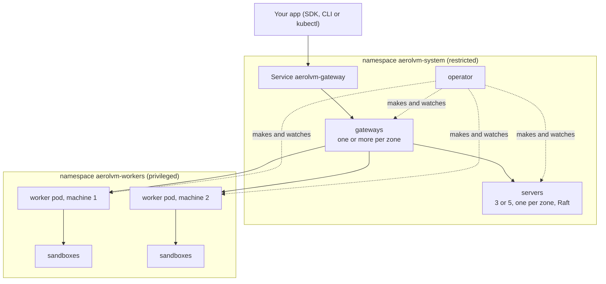

import { Tabs, TabItem, Aside } from '@astrojs/starlight/components';

In cluster mode, the chart installs an **operator** and one `AerolCluster` object. The operator builds an AerolVM cluster from that object and keeps it that way. It replaces failed pods and adds or removes workers with load. It moves sandboxes off a machine before the machine goes, and rolls upgrades in order.

This page installs it on EKS with Karpenter. Notes for AKS and fixed node groups are inline. Plan about an hour.



The [overview](/kubernetes/#cluster-mode) lists every object, name and namespace.

## Before you start

- **Kubernetes 1.30 or later.** Pods prove who they are to the operator with a ServiceAccount token that carries the node's name, which needs 1.30.
- **Nodes in two or more zones**, Linux, amd64 or arm64, cgroup v2, kernel 5.10 or later. Amazon Linux 2023, Bottlerocket, Azure Linux and Ubuntu 22.04 all work.
- **cluster-admin**, for the CRDs, the webhook and the operator's ClusterRole.
- **[cert-manager](https://cert-manager.io).** The operator's webhook gets its certificate from it.
- **A StorageClass with `volumeBindingMode: WaitForFirstConsumer`**, so each server's disk is made in that server's zone. AKS's `managed-csi` works as it is. A stock EKS cluster has only `gp2`: add the [`gp3` class below](#a-gp3-storageclass-on-eks).
- **Room for AerolVM's own pods**: in each zone, one server and one gateway. By default they request 1.5 CPU and 2.5 GiB together, plus 0.1 CPU per operator replica. Use machines with 4 or more CPUs. On a 2-CPU machine such as `m7i.large`, a server may not fit next to the cluster's own pods and stays Pending.
- **Worker machines**: a Karpenter NodePool, an AKS node pool with Node Auto Provisioning, or a fixed node group. They need `br_netfilter` loaded ([step 1](#step-1-prepare-the-worker-machines)).
- **Helm 3.8+, kubectl**, and [the chart](/kubernetes/#get-the-chart) cloned.
- **The [`aerolvm` CLI](/cli/#install)**, v0.7.1 or later, to check the install at the end.

### A gp3 StorageClass on EKS

It needs the Amazon EBS CSI driver add-on. On EKS Auto Mode, set `provisioner: ebs.csi.eks.amazonaws.com` instead.

```yaml title="storageclass-gp3.yaml"
apiVersion: storage.k8s.io/v1
kind: StorageClass
metadata:
  name: gp3
provisioner: ebs.csi.aws.com
volumeBindingMode: WaitForFirstConsumer
allowVolumeExpansion: true
parameters:
  type: gp3
```

```bash title="Your machine"
kubectl apply -f storageclass-gp3.yaml
```

## Step 1: Prepare the worker machines

Workers need machines of their own. Give them a label and a taint, so only worker pods land there. This guide uses the label `aerolvm.io/pool: gvisor-general` and a taint with the same key.

### Load br_netfilter on EKS

Amazon Linux 2023 does not load `br_netfilter` at boot. Add this user data. It works in a Karpenter `EC2NodeClass` and in the launch template of a managed node group:

```text title="User data (Amazon Linux 2023)"
MIME-Version: 1.0
Content-Type: multipart/mixed; boundary="//"

--//
Content-Type: text/x-shellscript; charset="us-ascii"

#!/bin/bash
echo br_netfilter > /etc/modules-load.d/br_netfilter.conf
modprobe br_netfilter

--//--
```

On Bottlerocket, also raise `user.max_user_namespaces` (see [What you need](/kubernetes/#what-you-need)).

If a machine still lacks it, the worker on it fails its checks and reports why. See [If something is wrong](#if-something-is-wrong).

### Karpenter

Give the worker pool a NodePool of its own. Three settings matter:

- **`expireAfter: Never`.** Karpenter's own expiry would take a machine without moving its sandboxes first. The operator replaces old machines itself instead (`maxMachineAge`, in step 2), moving sandboxes first.
- **No `terminationGracePeriod`.** With one, Karpenter takes a machine after that time even while a worker still holds sandboxes.
- **The pool's label and taint.**

```yaml title="karpenter-aerolvm.yaml"
apiVersion: karpenter.sh/v1
kind: NodePool
metadata:
  name: aerolvm-gvisor-general
spec:
  template:
    metadata:
      labels: { aerolvm.io/pool: gvisor-general }
    spec:
      nodeClassRef: { group: karpenter.k8s.aws, kind: EC2NodeClass, name: aerolvm-workers }
      taints: [{ key: aerolvm.io/pool, value: gvisor-general, effect: NoSchedule }]
      expireAfter: Never
      requirements:
        # One instance type: the size the worker pool's `machine` names.
        - { key: node.kubernetes.io/instance-type, operator: In, values: [m7i.8xlarge] }
        - { key: karpenter.sh/capacity-type, operator: In, values: [on-demand] }
  disruption:
    consolidationPolicy: WhenEmpty
    consolidateAfter: 5m
---
apiVersion: karpenter.k8s.aws/v1
kind: EC2NodeClass
metadata:
  name: aerolvm-workers
spec:
  amiSelectorTerms: [{ alias: al2023@latest }]
  # Your cluster's usual role, subnets and security groups.
  role: <karpenter-node-role>
  subnetSelectorTerms: [{ tags: { karpenter.sh/discovery: <cluster-name> } }]
  securityGroupSelectorTerms: [{ tags: { karpenter.sh/discovery: <cluster-name> } }]
  # Karpenter's defaults. Keep them: a pod then cannot reach the
  # instance metadata service, so no sandbox can use the node's IAM role.
  metadataOptions:
    httpTokens: required
    httpPutResponseHopLimit: 1
  userData: |
    MIME-Version: 1.0
    Content-Type: multipart/mixed; boundary="//"

    --//
    Content-Type: text/x-shellscript; charset="us-ascii"

    #!/bin/bash
    echo br_netfilter > /etc/modules-load.d/br_netfilter.conf
    modprobe br_netfilter

    --//--
```

```bash title="Your machine"
kubectl apply -f karpenter-aerolvm.yaml
```

Every worker pod carries `karpenter.sh/do-not-disrupt`, so Karpenter never takes a machine that runs one. When a machine drifts (a new AMI, a changed NodePool), the operator moves its sandboxes off, then lets Karpenter replace it.

**Without Karpenter**, use a node group with the same label and taint. The operator adds and removes worker pods the same way. A new worker pod that fits no machine stays Pending until the node group grows, by hand or with Cluster Autoscaler. Set the pool's `provisioner` to say who brings machines: `nap` (AKS Node Auto Provisioning), `aks-pool`, `eks-managed` or `none`. With `eks-managed`, the operator finishes each machine's decommission within 14 minutes, inside the managed node group's 15-minute limit.

## Step 2: Write the values file

```yaml title="aerolvm-cluster.yaml"
mode: cluster
cluster:
  zones: [eu-west-1a, eu-west-1b, eu-west-1c]
  servers:
    count: 3
    storage: { size: 50Gi, storageClassName: gp3 }
  gateways:
    minReplicas: 3
    # ClusterIP until you set up HTTPS. See the note below.
    service: { type: ClusterIP }
  workerPools:
    - name: gvisor-general
      runtimes: [gvisor]
      nodeSelector: { aerolvm.io/pool: gvisor-general }
      tolerations: [{ key: aerolvm.io/pool, operator: Exists, effect: NoSchedule }]
      machine: { cpu: 32, memoryGiB: 128 }   # one m7i.8xlarge
      minWorkers: 3
      maxWorkers: 100
      headroomPercent: 15
      provisioner: karpenter
      maxMachineAge: 720h
```

What each part does:

- **`zones`**: servers go one per zone, and gateways and workers spread over them.
- **`servers`**: 3 or 5. Each gets its own disk. For a busy cluster (around 1,000 creates a second), use fast disks and a separate Raft log disk: see [`cluster.servers.logStorage`](/kubernetes/values/#cluster).
- **`gateways.service`**: the default is a public `LoadBalancer`. Without HTTPS, the gateways serve the API over plain HTTP on port 21212, so keep it `ClusterIP` until you [turn on HTTPS](/kubernetes/networking/#https-for-the-api-and-sandbox-links), or use an internal load balancer.
- **`workerPools`**: one entry per kind of worker machine. `machine` is the size of one machine, and the worker pod asks for nearly all of it. `runtimes` lists the only runtimes its workers run. The operator keeps `headroomPercent` of each zone free, between `minWorkers` and `maxWorkers`.

Every field is on [Helm values](/kubernetes/values/#cluster).

<Aside>
For a regulated setup, start from `charts/aerolvm/values-bank-eks.yaml` instead. It turns on gVisor only, NetworkPolicies, HTTPS, monitoring, a create policy and machine replacement, and lists what you must set outside the chart.
</Aside>

## Step 3: Install

The release namespace must enforce `restricted`. The chart makes the worker namespace, `aerolvm-workers`, and labels it `privileged` itself.

```bash title="Your machine"
kubectl create namespace aerolvm-system
kubectl label namespace aerolvm-system pod-security.kubernetes.io/enforce=restricted
helm install aerolvm charts/aerolvm --namespace aerolvm-system -f aerolvm-cluster.yaml
```

## Step 4: Watch it build

The operator builds the cluster in order: the first server starts it, the other servers join one per zone, then gateways and workers join.

```bash title="Your machine"
kubectl -n aerolvm-system get aerolcluster,aerolnodes
```

```text title="Output (example)"
NAME                             VERSION   RUNNING   PHASE   SERVERS   WORKERS   AGE
aerolcluster.aerolvm.io/aerolvm  vX.Y.Z    vX.Y.Z    Ready   3         3         6m

NAME                                                ROLE      ZONE         STATE     VERSION   SANDBOXES   FREE CPU   AGE
aerolnode.aerolvm.io/aerolvm-server-0               server    eu-west-1a   Serving   vX.Y.Z                           6m
aerolnode.aerolvm.io/aerolvm-gateway-4kq7d          gateway   eu-west-1a   Serving   vX.Y.Z                           5m
aerolnode.aerolvm.io/aerolvm-gvisor-general-x7k2p   worker    eu-west-1a   Serving   vX.Y.Z    0           31         4m
...
```

The cluster is ready when the `AerolCluster` phase is `Ready` and every `AerolNode` is `Serving`. `kubectl describe aerolnode <name>` shows each node's progress as events.

## Step 5: Connect

Read the admin token the operator made, and forward the gateways' API port:

```bash title="Your machine"
export SB_PAT_TOKEN="$(kubectl -n aerolvm-system get secret aerolvm-admin -o jsonpath='{.data.token}' | base64 -d)"
kubectl -n aerolvm-system port-forward svc/aerolvm-gateway 21212:21212 &
export SB_API_URL=http://127.0.0.1:21212
```

Inside the cluster, apps can use `http://aerolvm-gateway.aerolvm-system:21212`. Once [HTTPS](/kubernetes/networking/) is on, the Service serves 443 instead of 21212, and every app, inside the cluster or not, uses `https://<your domain>`.

## Step 6: Create a sandbox

This sandbox uses gVisor and asks to start again on another machine if its machine dies:

<Tabs syncKey="lang">
  <TabItem label="TypeScript">
    ```ts
    import { MicroVM } from "@aerol-ai/aerolvm-sdk";

    const client = new MicroVM(); // reads SB_API_URL and SB_PAT_TOKEN

    const sandbox = await client.create({
      image: "ubuntu:22.04",
      runtime: "gvisor",
      failover: { policy: "recreate" },
    });
    const result = await sandbox.exec("echo hello from the cluster");
    console.log(result.stdout);

    await sandbox.destroy();
    ```
  </TabItem>
  <TabItem label="Python">
    ```python
    from microvm import MicroVM

    client = MicroVM()  # reads SB_API_URL and SB_PAT_TOKEN

    sandbox = client.create(
        image="ubuntu:22.04",
        runtime="gvisor",
        failover={"policy": "recreate"},
    )
    result = sandbox.exec("echo hello from the cluster")
    print(result["stdout"])

    sandbox.destroy()
    ```
  </TabItem>
  <TabItem label="Go">
    ```go
    client, err := microvm.NewClient() // reads SB_API_URL and SB_PAT_TOKEN
    if err != nil {
        log.Fatal(err)
    }

    sandbox, err := client.Create(ctx, sdktypes.CreateSandboxOptions{
        Image:    "ubuntu:22.04",
        Runtime:  sdktypes.RuntimeGvisor,
        Failover: &sdktypes.Failover{Policy: sdktypes.FailoverPolicyRecreate},
    })
    if err != nil {
        log.Fatal(err)
    }
    defer sandbox.Destroy(ctx)

    result, err := sandbox.ExecCommand(ctx, "echo hello from the cluster")
    if err != nil {
        log.Fatal(err)
    }
    fmt.Print(result.Stdout)
    ```
  </TabItem>
  <TabItem label="Rust">
    ```rust
    use aerolvm_sdk::{Client, CreateOptions, Failover};

    let client = Client::new(None, None)?; // reads SB_API_URL and SB_PAT_TOKEN

    let sandbox = client.create(CreateOptions {
        image: "ubuntu:22.04".into(),
        runtime: Some("gvisor".into()),
        failover: Some(Failover { policy: "recreate".into() }),
        ..Default::default()
    })?;
    let result = sandbox.exec("echo hello from the cluster")?;
    print!("{}", result.stdout);

    sandbox.destroy()?;
    ```
  </TabItem>
  <TabItem label="Java">
    ```java
    MicroVMClient client = new MicroVMClient(); // reads SB_API_URL and SB_PAT_TOKEN

    Sandbox sandbox = client.create(
        new CreateOptions()
            .setImage("ubuntu:22.04")
            .setRuntime("gvisor")
            .setFailover(new Failover().setPolicy("recreate"))
    );
    ExecResult result = sandbox.exec("echo hello from the cluster");
    System.out.print(result.stdout);

    sandbox.destroy();
    ```
  </TabItem>
</Tabs>

[Durability and failover](/durability/) explains what a sandbox keeps when it starts again elsewhere.

## Step 7: Check the install

`aerolvm k8s verify` checks the live install against the chart's security rules and exits 1 on any miss:

```bash title="Your machine"
aerolvm k8s verify --namespace aerolvm-system --worker-namespace aerolvm-workers --cluster aerolvm
```

[Security](/kubernetes/security/#check-a-live-install) lists what it checks.

## If something is wrong

Start with `kubectl -n aerolvm-system get aerolcluster,aerolnodes`. Most problems show there.

| What you see | Why, and what to do |
|---|---|
| A server or gateway stays `Pending` | No machine has room. `kubectl -n aerolvm-system get aerolnodes` shows the scheduler's reason, such as `Insufficient cpu`. Use machines with 4 or more CPUs for AerolVM's own pods. |
| A server's PVC stays `Pending` | The StorageClass is missing, or binds `Immediate` instead of `WaitForFirstConsumer`. |
| A worker's state is `Failed` | Its machine failed a check. `kubectl -n aerolvm-system get aerolnode <name> -o jsonpath='{.status.reason}'` names it, for example `preflight failed: br_netfilter: ...`. The operator starts a worker on another machine, and the bad pod stays on its machine so nothing else lands there. Fix the machine, or delete it. |
| A node has the condition `IdentityDenied` | The operator refused the pod's identity. `kubectl -n aerolvm-system describe aerolnode <name>` says why. Check the cluster runs Kubernetes 1.30 or later. |
| The `AerolCluster` phase is `Refused` | The spec asks for something the operator will not do, such as turning external-CA mode on after the first server started. `kubectl -n aerolvm-system describe aerolcluster aerolvm` says what. |
| The phase is `Degraded` | A server is missing or not ready. Look for the server whose state is not `Serving`. |
| Pods show `ImagePullBackOff` | The nodes cannot reach `ghcr.io`. Mirror the [four images](/kubernetes/#images) and set `image.registry`. |

## Uninstall

Helm keeps three things on purpose, because removing them ends every sandbox or loses the cluster's records: the worker namespace, the server disks and the CRDs. Remove them yourself when you are sure:

```bash title="Your machine"
helm uninstall aerolvm --namespace aerolvm-system

# Worker pods and every sandbox. Nothing else removes them once the operator is gone.
kubectl delete namespace aerolvm-workers

# The servers' disks (PVCs), and the rest of the release namespace.
kubectl delete namespace aerolvm-system

kubectl delete crd aerolclusters.aerolvm.io aerolnodes.aerolvm.io
```

With the [kubectl API](/kubernetes/kubectl/) on, also delete `sandboxtemplates.k8s.aerolvm.io` and `sandboxwarmpools.k8s.aerolvm.io`.

## Next steps

- [HTTPS and networking](/kubernetes/networking/): a domain with HTTPS, and keeping sandboxes off your network.
- [Security](/kubernetes/security/): what each pod may do, and external-CA mode.
- [Operate](/kubernetes/operations/): scaling, machine replacement, upgrades and backups.
