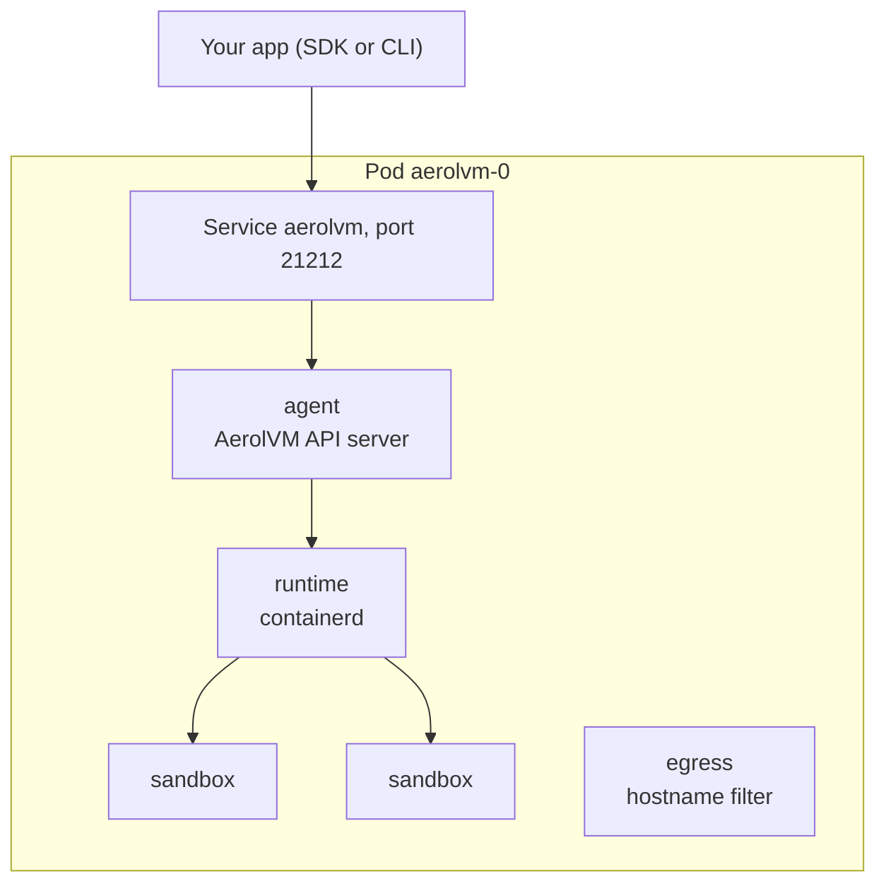

import { Tabs, TabItem, Aside } from '@astrojs/starlight/components';

Single mode runs AerolVM as **one pod**: a StatefulSet named `aerolvm` with one replica. That pod holds the API and every sandbox. There is no operator.

Use it to evaluate AerolVM, in CI, or for a small install where losing one machine's sandboxes is acceptable. For many machines, failover and autoscaling, use the [production install](/kubernetes/production/).

## Before you start

- A Kubernetes cluster whose nodes meet the [requirements](/kubernetes/#what-you-need): cgroup v2 and `br_netfilter`. To try it on a laptop, `kind create cluster` on Docker Desktop is enough. On EKS, stock Amazon Linux 2023 nodes lack `br_netfilter`: first add a node group with [this user data](/kubernetes/production/#load-br_netfilter-on-eks).
- Helm 3.8+ and kubectl.
- The release to install. See [Get the chart](/kubernetes/#get-the-chart).
- Room for the pod: it asks for 2.6 CPUs and 5.1 GiB by default. [Change the size](#size-the-pod) for a small laptop.

## Step 1: Make a namespace

The worker pod is privileged, so its namespace must allow privileged pods:

```bash title="Your machine"
kubectl create namespace aerolvm
kubectl label namespace aerolvm pod-security.kubernetes.io/enforce=privileged
```

## Step 2: Install the chart

```bash title="Your machine"
helm install aerolvm oci://ghcr.io/aerol-ai/charts/aerolvm --version <version> --namespace aerolvm
kubectl -n aerolvm wait --for=condition=Ready pod/aerolvm-0 --timeout=5m
```

The first start pulls two images, so it can take a few minutes. The chart makes an API token on first install and keeps it in the Secret `aerolvm-api-token`. If you cannot create CRDs, add `--skip-crds`: single mode does not use them.

## Step 3: Connect

The API Service is ClusterIP. Forward it to your machine, and read the token:

```bash title="Your machine"
kubectl -n aerolvm port-forward svc/aerolvm 21212:21212 &
export SB_API_URL=http://127.0.0.1:21212
export SB_PAT_TOKEN="$(kubectl -n aerolvm get secret aerolvm-api-token -o jsonpath='{.data.SB_PAT_TOKEN}' | base64 -d)"
```

The SDKs and the `aerolvm` CLI read these two variables. For a real address with HTTPS, see [HTTPS and networking](/kubernetes/networking/).

## Step 4: Create a sandbox

This sandbox uses gVisor, which puts a second kernel between the code and the node:

<Tabs syncKey="lang">
  <TabItem label="TypeScript">
    ```ts
    import { MicroVM } from "@aerol-ai/aerolvm-sdk";

    const client = new MicroVM(); // reads SB_API_URL and SB_PAT_TOKEN

    const sandbox = await client.create({ image: "ubuntu:22.04", runtime: "gvisor" });
    const result = await sandbox.exec("echo hello from gVisor");
    console.log(result.stdout);

    await sandbox.destroy();
    ```
  </TabItem>
  <TabItem label="Python">
    ```python
    from microvm import MicroVM

    client = MicroVM()  # reads SB_API_URL and SB_PAT_TOKEN

    sandbox = client.create(image="ubuntu:22.04", runtime="gvisor")
    result = sandbox.exec("echo hello from gVisor")
    print(result["stdout"])

    sandbox.destroy()
    ```
  </TabItem>
  <TabItem label="Go">
    ```go
    client, err := microvm.NewClient() // reads SB_API_URL and SB_PAT_TOKEN
    if err != nil {
        log.Fatal(err)
    }

    sandbox, err := client.Create(ctx, sdktypes.CreateSandboxOptions{
        Image:   "ubuntu:22.04",
        Runtime: sdktypes.RuntimeGvisor,
    })
    if err != nil {
        log.Fatal(err)
    }
    defer sandbox.Destroy(ctx)

    result, err := sandbox.ExecCommand(ctx, "echo hello from gVisor")
    if err != nil {
        log.Fatal(err)
    }
    fmt.Print(result.Stdout)
    ```
  </TabItem>
  <TabItem label="Rust">
    ```rust
    use aerolvm_sdk::{Client, CreateOptions};

    let client = Client::new(None, None)?; // reads SB_API_URL and SB_PAT_TOKEN

    let sandbox = client.create(CreateOptions {
        image: "ubuntu:22.04".into(),
        runtime: Some("gvisor".into()),
        ..Default::default()
    })?;
    let result = sandbox.exec("echo hello from gVisor")?;
    print!("{}", result.stdout);

    sandbox.destroy()?;
    ```
  </TabItem>
  <TabItem label="Java">
    ```java
    MicroVMClient client = new MicroVMClient(); // reads SB_API_URL and SB_PAT_TOKEN

    Sandbox sandbox = client.create(
        new CreateOptions().setImage("ubuntu:22.04").setRuntime("gvisor")
    );
    ExecResult result = sandbox.exec("echo hello from gVisor");
    System.out.print(result.stdout);

    sandbox.destroy();
    ```
  </TabItem>
</Tabs>

The sandbox is not a pod. `kubectl get pods` still shows only `aerolvm-0`. Sandboxes live inside its `runtime` container.

## What runs in the pod



| Container | Privileged | What it does |
|---|---|---|
| `runtime` | Yes | Runs containerd and every sandbox. Each sandbox gets its own cgroup inside this container's limits, so Kubernetes sees what sandboxes really use. |
| `agent` | Yes | The AerolVM server, `sandboxd`. You can [upgrade it in place](#upgrade); sandboxes keep running. |
| `egress` | No | Filters sandbox traffic by hostname when a sandbox has an allow list. Runs as uid 65532 with only `NET_ADMIN` and `NET_BIND_SERVICE`. |

Before these start, an init container named `preflight` checks the node: cgroup v2, the kernel version and `br_netfilter`. It needs no rights.

## Size the pod

Set the size and the volumes below **before you install**, in a values file, and pass it to [step 2](#step-2-install-the-chart) by adding `-f values.yaml` to the `helm install` command. Changing them later takes effect only when the pod is replaced, which ends every sandbox.

The `runtime` container's limits are the budget for all sandboxes together. Keep requests equal to limits, so the pod is Guaranteed and the kubelet evicts it last:

```yaml title="values.yaml"
worker:
  runtime:
    resources:
      requests: { cpu: "8", memory: 32Gi }
      limits: { cpu: "8", memory: 32Gi }
```

If sandboxes use up the budget, the kernel stops one whole sandbox. It never stops the AerolVM server.

## Keep data across restarts

By default, images and sandbox files live in `emptyDir` volumes, so they are lost with the pod. For anything you want to keep, point both volumes at PersistentVolumeClaims you made first. A local NVMe disk is best for `containerdVolume`:

```yaml title="values.yaml"
worker:
  containerdVolume:
    persistentVolumeClaim: { claimName: aerolvm-containerd }
  stateVolume:
    persistentVolumeClaim: { claimName: aerolvm-state }
```

Each value is a Kubernetes volume source, so any kind works. Avoid `hostPath`: [`aerolvm k8s verify`](/kubernetes/security/#check-a-live-install) fails an install that mounts a folder from the node.

## Upgrade

The StatefulSet uses `updateStrategy: OnDelete`, so `helm upgrade` never restarts the pod. A restart would end every sandbox.

To move to a new AerolVM release, say `v1.2.4`:

```bash title="Your machine"
# 1. Record the new version in the StatefulSet. The running pod does not change.
#    Pass the values file you installed with, if any.
helm upgrade aerolvm oci://ghcr.io/aerol-ai/charts/aerolvm --version 1.2.4 --namespace aerolvm -f values.yaml

# 2. Swap the server in place. Only the agent container restarts; sandboxes keep running.
kubectl -n aerolvm set image pod/aerolvm-0 agent=ghcr.io/aerol-ai/aerolvm:v1.2.4
```

Do not use `--reuse-values` across chart versions. It keeps only the old release's values and drops the new chart's defaults, so templates that read a new setting fail.

The `runtime` and `egress` containers move to the new version the next time the pod is replaced: when you delete it, or when its node goes away.

## Uninstall

```bash title="Your machine"
helm uninstall aerolvm --namespace aerolvm
kubectl delete namespace aerolvm
```

Every sandbox ends with the pod. Helm keeps the token Secret on purpose (it has `helm.sh/resource-policy: keep`), so deleting the namespace is what removes it.

## If something is wrong

| What you see | What to do |
|---|---|
| `aerolvm-0` is `Pending` | Not enough CPU or memory on any node. `kubectl -n aerolvm describe pod aerolvm-0` names it. Lower `worker.runtime.resources`. |
| `aerolvm-0` shows `Init:Error` or `Init:CrashLoopBackOff` | The node failed a check. Read it: `kubectl -n aerolvm logs aerolvm-0 -c preflight`. The last line names the problem and the fix. For `br_netfilter: the br_netfilter kernel module is not loaded`, load it on the node (`sudo modprobe br_netfilter`); the next retry passes. |
| `aerolvm-0` is `Running` but never `Ready` | Read the server's log: `kubectl -n aerolvm logs aerolvm-0 -c agent`. |
| The pod is refused with a Pod Security error | The namespace is missing `pod-security.kubernetes.io/enforce=privileged` ([step 1](#step-1-make-a-namespace)). |
| A gVisor create fails with `no space left on device` | The node allows no user namespaces. Bottlerocket ships that way. See [What you need](/kubernetes/#what-you-need). |

## Next steps

- [HTTPS and networking](/kubernetes/networking/): a domain with HTTPS, and keeping sandboxes off your network.
- [Security](/kubernetes/security/): check the install with `aerolvm k8s verify`.
- [Production install](/kubernetes/production/): many machines, failover and autoscaling.
- [Create and manage sandboxes](/sandboxes/): every create option.
