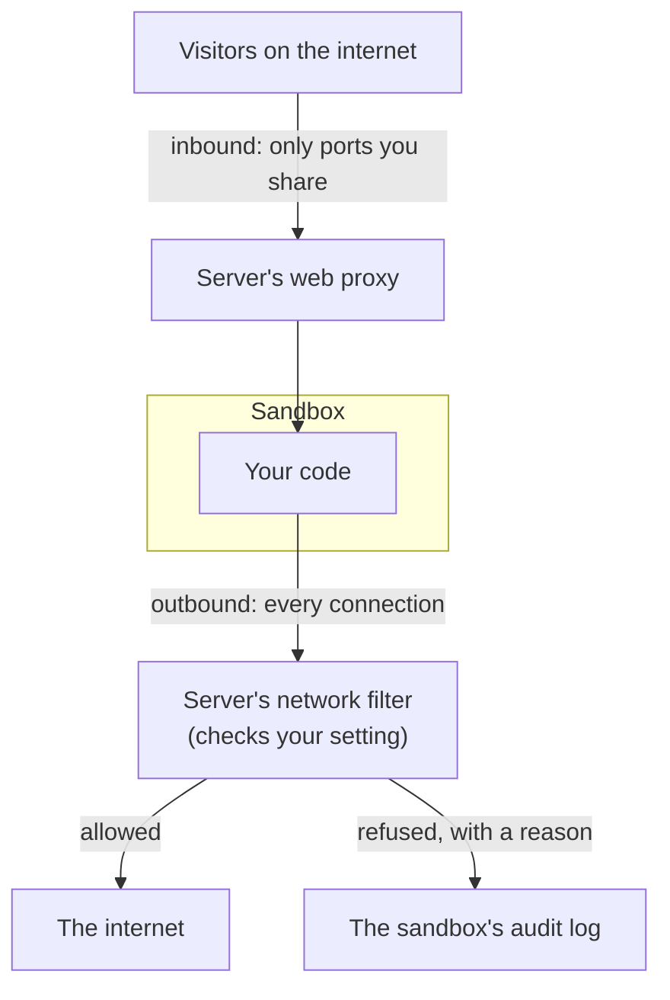

import { Aside, Tabs, TabItem } from '@astrojs/starlight/components';

Network traffic goes two ways. **Outbound** traffic leaves the sandbox, like a download from `pypi.org`. **Inbound** traffic comes in, like a visitor opening your app.

By default a new sandbox can reach the whole internet, but nobody can reach it. That is handy, but code you do not trust could use the open internet to send your data somewhere else. This page shows how to close that door.

## How it works



The server checks every connection that leaves the sandbox. You pick one of three settings for outbound traffic:

| Setting | The sandbox can reach | Use it for |
|---|---|---|
| Open (the default) | The whole internet | Trusted code |
| Allow list | Only the websites and addresses you name | Agents that install packages or call one API |
| Blocked | Nothing | Code that should never talk to the outside |

Inbound is private until you share a port. See [Who can reach the sandbox from outside](#who-can-reach-the-sandbox-from-outside).

## Block the internet

Set `networkBlockAll` to `true` when you create the sandbox.

<Tabs syncKey="lang">
  <TabItem label="TypeScript">
    ```ts
    const sandbox = await client.create({
      image: 'ubuntu:22.04',
      networkBlockAll: true,
    })
    ```
  </TabItem>
  <TabItem label="Python">
    ```python
    sandbox = client.create({
        'image': 'ubuntu:22.04',
        'networkBlockAll': True,
    })
    ```
  </TabItem>
  <TabItem label="Go">
    ```go
    sandbox, err := client.Create(ctx, sdktypes.CreateSandboxOptions{
        Image:           "ubuntu:22.04",
        NetworkBlockAll: true,
    })
    ```
  </TabItem>
  <TabItem label="Rust">
    ```rust
    let sandbox = client.create(CreateOptions {
        image: "ubuntu:22.04".to_string(),
        network_block_all: Some(true),
        ..Default::default()
    })?;
    ```
  </TabItem>
  <TabItem label="Java">
    ```java
    Sandbox sandbox = client.create(
        new CreateOptions()
            .setImage("ubuntu:22.04")
            .setNetworkBlockAll(true)
    );
    ```
  </TabItem>
</Tabs>

Now every outbound connection fails at once: web requests, database connections and DNS lookups (DNS turns a name like `example.com` into an address). To check, run a command that needs the internet, such as `curl -I https://google.com`. It fails with a non-zero exit code.

<Aside type="caution">
The server's firewall does the blocking, and it only runs on Linux. On the macOS install from the [Quickstart](/quick-start/), a sandbox with these settings still starts, but nothing is blocked. Test network rules on a Linux server.
</Aside>

## Allow only some websites

An agent that installs packages or calls one API rarely needs the whole internet. Give the sandbox an allow list with `networkAllowOut`. It can then reach those sites and nothing else.

<Tabs syncKey="lang">
  <TabItem label="TypeScript">
    ```ts
    const sandbox = await client.create({
      image: 'python:3.12',
      networkAllowOut: ['pypi.org', '*.pythonhosted.org', 'github.com:22'],
    })
    ```
  </TabItem>
  <TabItem label="Python">
    ```python
    sandbox = client.create({
        'image': 'python:3.12',
        'networkAllowOut': ['pypi.org', '*.pythonhosted.org', 'github.com:22'],
    })
    ```
  </TabItem>
  <TabItem label="Go">
    ```go
    sandbox, err := client.Create(ctx, sdktypes.CreateSandboxOptions{
        Image:           "python:3.12",
        NetworkAllowOut: []string{"pypi.org", "*.pythonhosted.org", "github.com:22"},
    })
    ```
  </TabItem>
  <TabItem label="Rust">
    ```rust
    let sandbox = client.create(CreateOptions {
        image: "python:3.12".to_string(),
        network_allow_out: Some(vec![
            "pypi.org".to_string(),
            "*.pythonhosted.org".to_string(),
            "github.com:22".to_string(),
        ]),
        ..Default::default()
    })?;
    ```
  </TabItem>
  <TabItem label="Java">
    ```java
    Sandbox sandbox = client.create(
        new CreateOptions()
            .setImage("python:3.12")
            .setNetworkAllowOut(List.of("pypi.org", "*.pythonhosted.org", "github.com:22"))
    );
    ```
  </TabItem>
</Tabs>

Now `pip install requests` works, and `curl https://example.com` fails at once with a message that names the host. Programs inside look up names and connect the usual way.

You write names, not IP addresses. On web ports (80 and 443), the server looks up the addresses itself and checks the name on every connection. So a sandbox cannot reach another site there just because it shares an address with an allowed one. An entry with another port, such as `github.com:22`, works differently: the server opens the addresses that name looked up to, on that port. Another site at the same address and port can then be reached too.

### What each entry allows

| Entry | Allows |
|---|---|
| `pypi.org` | `pypi.org` on ports 80 and 443 (HTTP and HTTPS) |
| `*.pythonhosted.org` | every name under `pythonhosted.org` on ports 80 and 443, but not `pythonhosted.org` itself |
| `github.com:22` | `github.com` on port 22 only |
| `10.20.0.0/16` | that IP address range, on any port |

- Names ignore upper and lower case, and a trailing dot.
- A list holds up to 64 names, plus any number of address ranges.
- To allow a name and everything under it, list both: `example.com` and `*.example.com`.
- `networkDenyOut` takes address ranges only. When you set both lists, the allow list wins. Then a match in the deny list is dropped, and anything else is allowed. Add `networkDenyOut: ['0.0.0.0/0']` to make the allow list the only way out.

### What the sandbox sees when it is refused

| What the sandbox tries | What happens |
|---|---|
| Look up a name that is not allowed | The DNS lookup (the step that turns a name into an address) answers `NXDOMAIN`, meaning "no such name". An extra note in the answer reads `aerolvm egress policy: <name> not allowed`. |
| Open HTTPS to a site that is not allowed | The connection fails in its first step with an `access_denied` alert. The check reads the site name the program sends when it opens HTTPS. So a connection to an allowed address that asks for a different site is refused too. |
| Send an HTTP request to a site that is not allowed | It gets a `403` response. The body names the host and the rule that decided. |
| Anything else, such as a raw IP address or another port | The connection is closed at once, unless an address range or `host:port` entry allows it. |

Each of these fails fast with a reason. An agent can stop retrying and ask for access, instead of waiting for a timeout.

## See what was refused

Every refusal goes into the sandbox's audit log, with the destination and the reason. Read it with `audit`, filtered to network events:

<Tabs syncKey="lang">
  <TabItem label="TypeScript">
    ```ts
    const page = await sandbox.audit({ kind: 'egress' })
    for (const event of page.events) {
      if (event.result === 'failure') {
        console.log(`${event.time} ${event.destination} refused: ${event.reason}`)
      }
    }
    ```
  </TabItem>
  <TabItem label="Python">
    ```python
    page = sandbox.audit({'kind': 'egress'})
    for event in page['events']:
        if event['result'] == 'failure':
            print(f"{event['time']} {event.get('destination')} refused: {event.get('reason')}")
    ```
  </TabItem>
  <TabItem label="Go">
    ```go
    page, err := sandbox.Audit(ctx, sdktypes.AuditOptions{Kind: "egress"})
    if err != nil {
        return err
    }
    for _, event := range page.Events {
        if event.Result == "failure" {
            fmt.Printf("%s %s refused: %s\n", event.Time, event.Destination, event.Reason)
        }
    }
    ```
  </TabItem>
  <TabItem label="Rust">
    ```rust
    let page = sandbox.audit(AuditOptions {
        kind: Some("egress".to_string()),
        ..Default::default()
    })?;
    for event in page.events.iter().filter(|e| e.result == "failure") {
        println!("{} {:?} refused: {:?}", event.time, event.destination, event.reason);
    }
    ```
  </TabItem>
  <TabItem label="Java">
    ```java
    AuditPage page = sandbox.audit(new AuditOptions().setKind("egress"));
    for (AuditEvent event : page.events) {
        if ("failure".equals(event.result)) {
            System.out.println(event.time + " " + event.destination + " refused: " + event.reason);
        }
    }
    ```
  </TabItem>
</Tabs>

The reasons you can see:

| Reason | What happened |
|---|---|
| `dns_not_allowed` | A name lookup for a name that no entry covers. |
| `host_not_allowed` | An HTTP request (or a WASM or V8 isolate connection) to a name that no entry covers. |
| `sni_not_allowed` | An HTTPS connection to a name that no entry covers. |
| `no_sni` | An HTTPS connection that sent no site name, to an address that no range allows. |
| `ip_not_allowed` | A direct connection to an address that no range allows (WASM, V8 isolate). |
| `sni_mismatch` | A WASM sandbox connected to an allowed name, but its HTTPS asked for a different one. |
| `blocked_ip` | An allowed name pointed to a private, loopback (`127.0.0.1`) or cloud metadata address. |
| `firewall_reject` | Another port or protocol, refused by the server's firewall. |
| `dns_rate_limited` | The sandbox made too many name lookups. |
| `conn_cap` | The sandbox has too many connections open through the filter. |
| `upstream_proxy_unavailable` | The operator's outbound proxy could not be reached (private networks only). |

The log comes a page at a time. Pass `nextCursor` back as `cursor` to read older pages.

## Who can reach the sandbox from outside

Inbound traffic is a separate choice, and the default is private. A private sandbox has no public address. You can still run commands, copy files and connect over SSH, because those go through the server directly.

To make an app in the sandbox public, share its port with `exposePort`. See [Public URLs](/public-urls/). Blocking outbound traffic does not close a port you shared: people can still reach that app.

For more, such as making a sandbox public from the start, see [More about inbound traffic](/advanced-network-rules/#more-about-inbound-traffic).

## Which sandbox types support it

| Runtime (kind of sandbox) | How names are checked |
|---|---|
| Docker, containerd, gVisor | By the server's filter service, which checks name lookups and the site name in each HTTPS or HTTP request. |
| WASM | Inside the WASM network layer. A refused connection returns an error that names the host and the rule. |
| V8 isolate | By the isolate's outbound proxy, which always uses HTTPS and returns a `403` that names the host. |
| Firecracker | By the server's filter service, reached through each VM's own network device. `networkBlockAll` and address lists are enforced on that device. |

Some servers cannot check names. A create that lists names on one of them gets `501`. Lists of address ranges still work there. See [For server operators](/advanced-network-rules/#for-server-operators) for why.

## Limits

- **IPv4 only.** These rules cover IPv4 traffic. If the sandbox has IPv6 routing, its IPv6 connections are not filtered.
- **Linux servers only.** The rules are enforced by the server's firewall, which runs only on Linux. On macOS, nothing is blocked.
- **Website names need the filter service.** A server that cannot run it refuses a create that lists names, with `501`. Lists of IP address ranges still work there.

## Next steps

- [Advanced network rules](/advanced-network-rules/): IP address lists, reusable allow lists, learn mode, and rules for single requests.
- [Public URLs](/public-urls/): share a port and get a public link.
- [Usage and limits](/network-usage/): count or cap the bytes a sandbox sends and receives.
