import { Tabs, TabItem } from '@astrojs/starlight/components';

Our test cluster could serve about 900 sandbox lists per second, at 256 clients. With 4 times as many clients, 1 in 100 list calls took 37 seconds or longer. Then a health watchdog restarted a busy server, and slowness became an outage: 5,081 failed requests in about a minute. A **watchdog** is a small program that checks a server and restarts it when it looks dead.

We fixed two things. A busy server now answers "busy, retry in 1 second" instead of piling up work. And the watchdog restarts only a server that has stopped answering, never one that is just busy. After the fix, the same 1,024-client test served 2,084 lists per second, with 0 errors and 0 restarts.

**In short:**

- A ramp test raised the load from 64 to 1,024 clients. Lists peaked at about 900 per second, at 256 clients.
- Past that, each list made its own encrypted call to the control plane. The 2-vCPU ingress node ran out of CPU.
- The watchdog read one slow health check as "dead" and restarted the server. Then it restarted the new server during its boot.
- **Fix 1:** a separate liveness check that answers from memory. The watchdog restarts only after 3 or more misses in a row, over at least 90 seconds.
- **Fix 2:** a node runs at most 16 cluster-wide lists at once. Extra lists wait up to 0.5 seconds, then get `503` with `Retry-After: 1`. Identical reads on a node share one call.
- Kubernetes splits liveness from readiness the same way. Its API server also limits expensive requests, and it is fair between users. Ours is not fair between users yet; that work is in progress.

## What we tested

This section describes the test cluster and the load we sent it.

We ran an 11-server test cluster on AWS. Each server in a cluster is a **node**, and each node has a role. These are the roles:

- **3 control-plane servers.** They agree on shared state, such as which worker owns which sandbox.
- **2 ingress nodes.** They take requests from clients and pass them on. Each was an m6i.large with 2 vCPUs.
- **5 workers.** They run the sandboxes. 2 of them were bare-metal servers.
- **1 metrics node.** It collects logs and numbers from the others. It does not serve requests.

Every node runs `sandboxd`, the AerolVM server program. In front of it on each node sits Caddy, the web server that takes incoming connections.

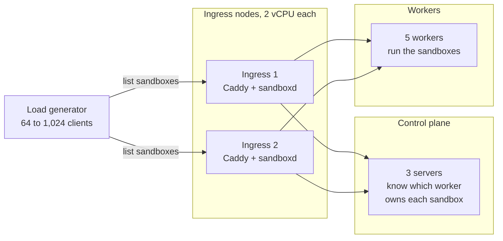

**What this shows:** every list call lands on an ingress node. To answer it, that node must talk to the control plane and to the workers.

A **ramp-to-failure test** raises the load in steps until something breaks. Each client called `GET /v1/sandboxes`, which lists sandboxes, over and over. Each step lasted 60 seconds.

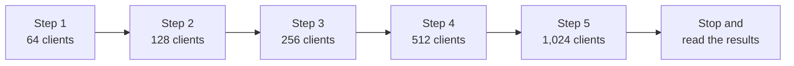

**What this shows:** the client count doubles at each step, and each step runs for 60 seconds.

Here is what we measured before the fix. **p50** is the median: half of the requests were faster. **p99** means 99 in 100 requests were faster, so it shows the slow tail.

| Clients | Lists per second | p99 latency | Errors |
|---|---|---|---|
| 128 | 454 | 342 ms | 0 |
| 256 | 887 | 352 ms | 0 |
| 512 | 167 | 5.6 s (p50 3.2 s) | 0 |
| 1,024 | 70 that succeeded | 37 s (p50 9.0 s) | 5,081 (HTTP `502`) |

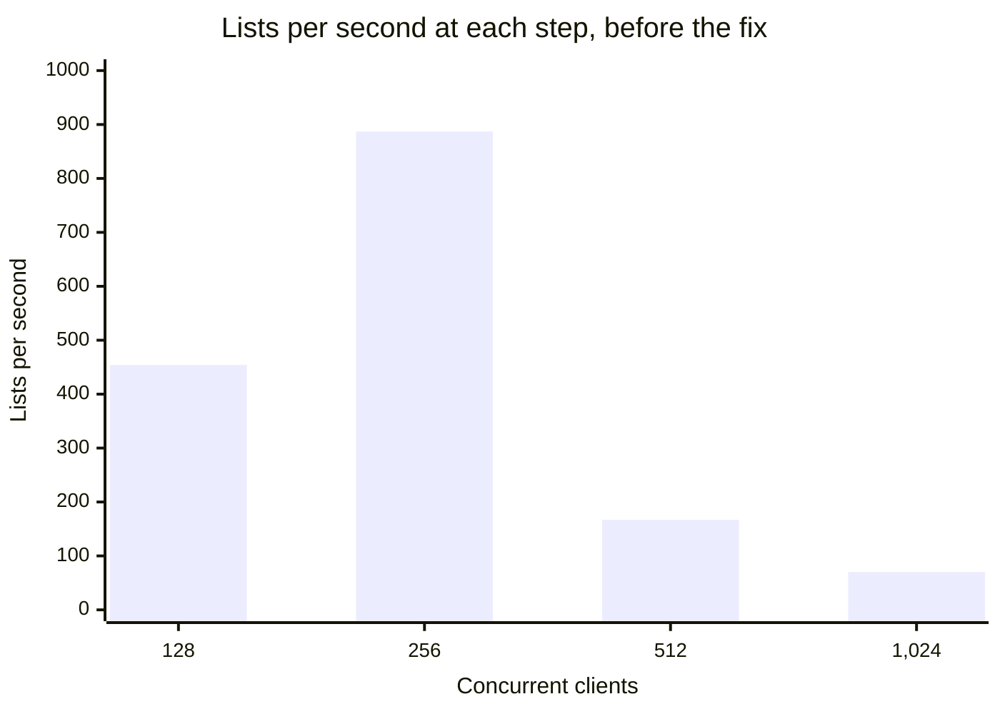

**What this shows:** throughput climbs to 887 lists per second, then falls by 81% when the clients double. More load made the cluster do less work.

`/health`, a much cheaper call, kept scaling under the same client counts. It reached 1,188 requests per second at 1,024 clients, with a p99 of 1.4 s and no errors. So the server program still worked. List calls were the problem.

Nothing was ever refused for being too much. The server sent zero `429 Too Many Requests` answers, because it had no limit to enforce.

## What broke, step by step

This section walks through the collapse in the order it happened.

### Step 1: every list paid for its own encrypted call

In cluster mode, a list gathers sandboxes from the workers that own them. So the ingress node first asks the control plane for the **placements**: the table of which worker owns which sandbox. Before the fix, every list made its own call for that table.

Calls between nodes use **mTLS**: encrypted connections where both sides prove who they are. Opening one costs a **TLS handshake**, a burst of CPU work. To skip that cost, a node keeps a **connection pool** of open connections it can reuse. It keeps 16 per peer.

512 lists at once meant 512 placement calls at once. Only 16 could reuse a pooled connection. Each of the rest needed a new handshake, on a machine with 2 vCPUs.

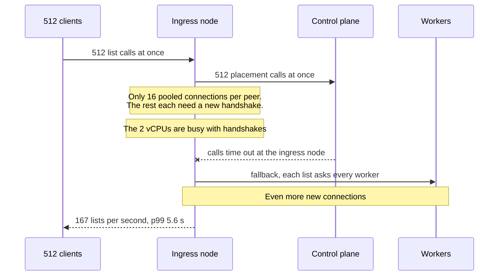

**What this shows:** the control plane was not slow. The ingress node spent its CPU opening connections, so its own calls timed out.

When a placement call failed, each list fell back to asking every worker directly. That opened even more connections. More connections meant more handshakes, and more handshakes meant more timeouts. This is a **feedback loop**: the problem feeds itself.

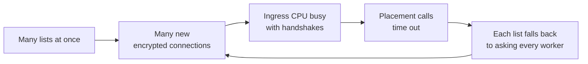

**What this shows:** once timeouts start, the fallback makes more connections, which causes more timeouts. Nothing in the loop slows it down.

The node logged 1,186 "placement page lookup failed" warnings and 2,134 "peer query failed" warnings. The other nodes answered in under 1 ms. The bottleneck was the ingress node itself.

### Step 2: the watchdog restarted a busy server

Each node runs a watchdog as a systemd timer. **systemd** is the Linux service manager that starts and stops `sandboxd`. Every 30 seconds, the old watchdog made one `/health` call with a 10-second timeout. If that one call failed, it restarted `sandboxd`.

Under the list storm, `/health` took more than 10 seconds. So the watchdog restarted a server that was alive, just busy.

systemd asked the server to stop with **SIGTERM**, the polite stop signal. The busy server did not finish stopping within 30 seconds. So systemd sent **SIGKILL**, which ends a process at once. Every request in flight on that node was lost.

### Step 3: a second restart during boot

The watchdog's next run found the new server 57 ms into its boot. Its API port was not open yet, so the check got "connection refused". The old watchdog read that as dead and restarted it again, 70 ms into its boot. That stop aborted the boot with an error.

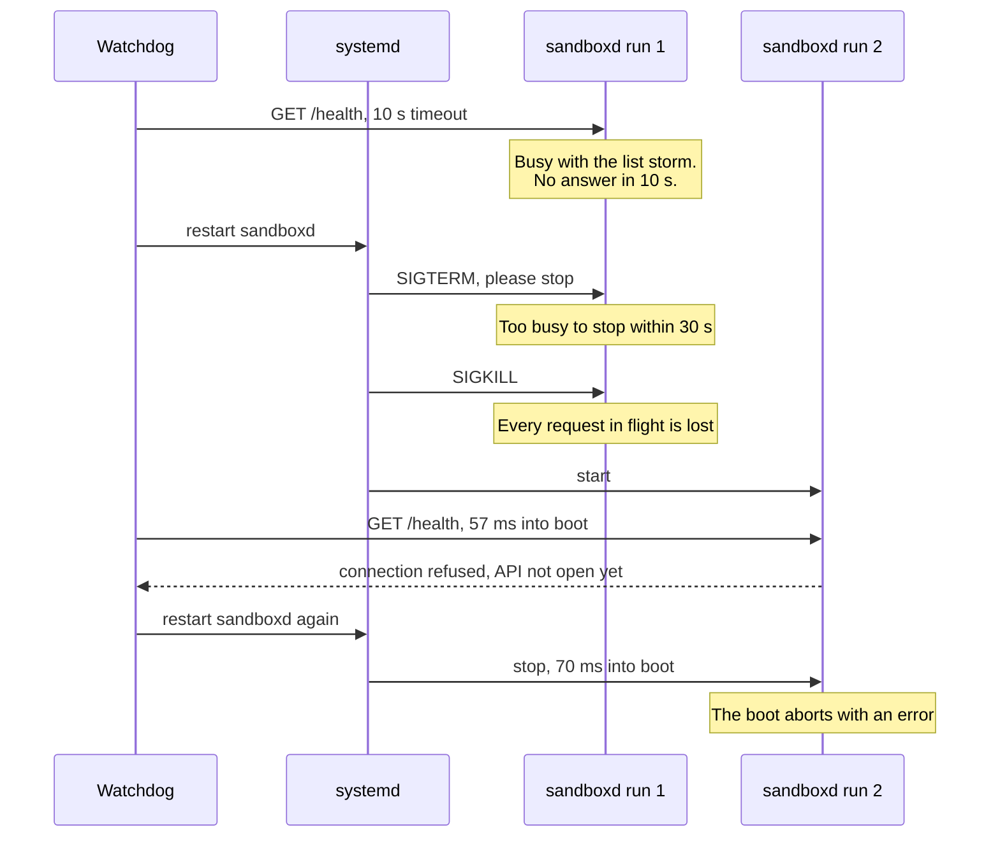

**What this shows:** one slow answer led to a forced kill. Then a check during boot led to a second restart before the server could start.

The node's API was down for about a minute. Caddy kept running and answered clients with `502 Bad Gateway`, 5,081 times. Overload had become an outage.

A restart is the right fix for a process that is stuck, for example in a deadlock. It is the wrong fix for a process that is busy. A restart throws away the work in flight, and the load comes straight back.

## Fix 1: ask two different health questions

This section explains the watchdog fix, from [#880](https://github.com/aerol-ai/microvm/pull/880).

The old watchdog asked one question: "Is everything healthy?" That mixes two questions, and each has a different fix:

- **Liveness:** is the process running and able to answer at all? If not, restart it.
- **Readiness:** can it serve traffic well right now? If not, send traffic elsewhere. Do not restart it.

`/health` is a readiness check. It reads the database, pings the container engine and Caddy, and checks the SSH gateway. A busy server can be slow to answer it, and that is fine.

### The liveness socket

`sandboxd` now opens a small **liveness socket** first thing at boot. This is a private local channel (a Unix socket) at `/run/sandboxd/live.sock`. Only root can reach it. The setting `SB_LIVENESS_SOCKET` sets its path.

`GET /livez` on this socket answers from memory only. It touches no disk, no network, no locks and no API queue. It has its own listener, so a backlog of list calls cannot delay it. It reports one of three phases.

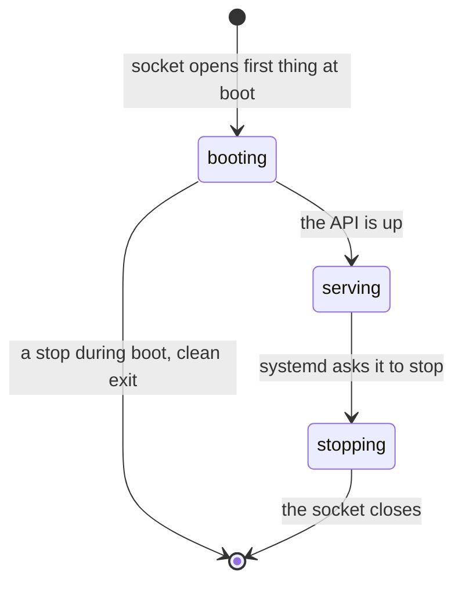

**What this shows:** a booting server answers "booting" instead of "connection refused". So the watchdog can tell a slow start from a dead process. A stop that arrives during boot now ends the process cleanly, without an error.

Each check now has its own job, and its own reader:

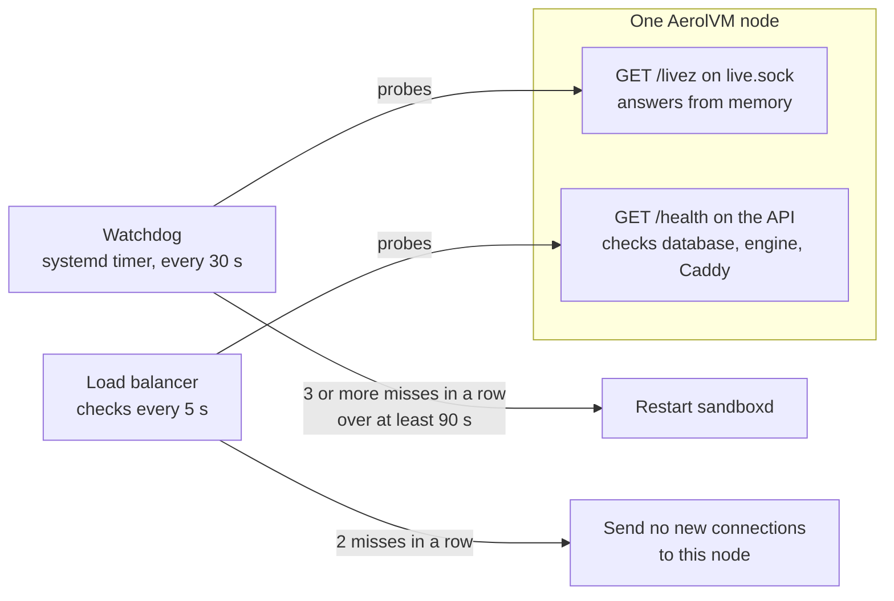

**What this shows:** only a dead process gets restarted. A slow or unhealthy one is taken out of rotation, and keeps the work it already has.

The readiness side needs a health-checked load balancer in front of the ingress nodes. Terraform can create one for you ([#864](https://github.com/aerol-ai/microvm/pull/864)); see [Put a load balancer in front](/cluster-setup/#put-a-load-balancer-in-front). Without one, clients keep reaching the node through DNS round-robin. `/health` and the alerts still report the problem, but nothing moves traffic.

### When the watchdog restarts

The watchdog now follows these rules:

- It restarts only after 3 or more failed liveness probes in a row, from one run of the daemon.
- The first and the latest failure must be at least 90 seconds apart. With a probe every 30 seconds, that usually means 4 failed probes.
- Any answered probe resets the count to zero. The count is kept in a small file between timer runs.
- It never restarts a daemon younger than 120 seconds.
- It never restarts a daemon that is starting or stopping, or one with a restart already queued.
- It checks again just before it acts. If the daemon changed in the meantime, it does nothing.
- It asks systemd for the restart without waiting for it. Its next run then sees the restart under way and leaves it alone.
- It takes a lock, so two watchdog runs cannot both ask for a restart.

One older rule stays. If systemd marked the service as failed, the watchdog still resets it and starts it again. That matters when the customer's key store was down at boot and has since come back.

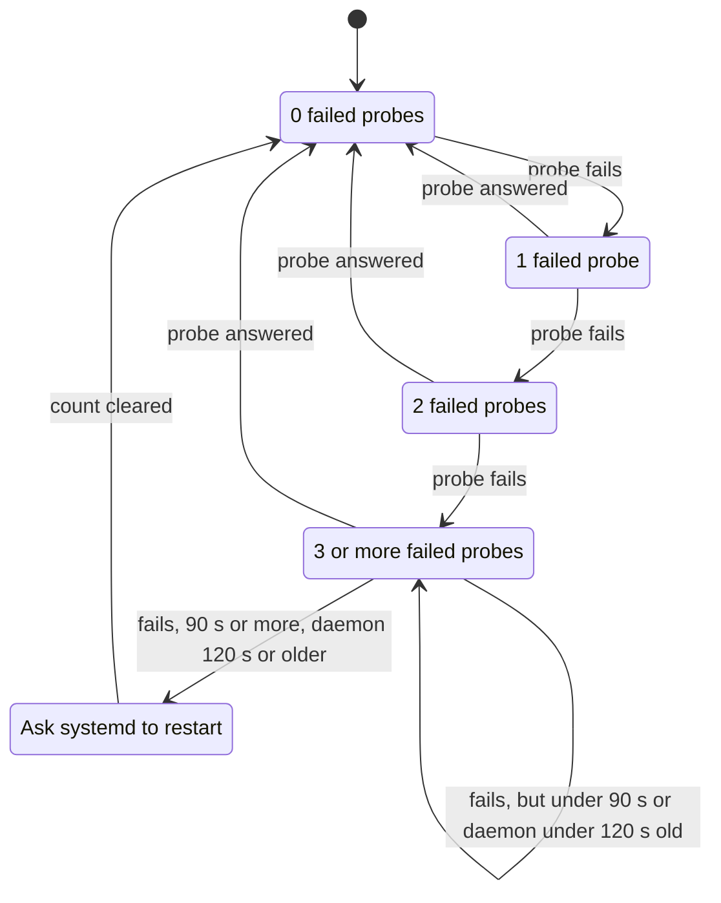

**What this shows:** the count climbs one failed probe at a time, and any answer drops it to zero. A restart needs 3 or more misses in a row over at least 90 seconds. The daemon must also be at least 120 seconds old.

A new run of the daemon starts its own count. Failures of an earlier run say nothing about this one.

### The trade-off

A daemon whose process is alive but whose API is stuck on a dependency is no longer restarted. Say the disk or the container engine hangs. `/livez` still answers, so the watchdog leaves the daemon alone.

We accept this on purpose. A stuck dependency is a readiness problem. `/health`, the alerts and the load balancer all report it. A restart would not fix a broken disk or engine, and it would drop every request in flight.

## Fix 2: refuse fast instead of piling up

This section explains load shedding, from [#881](https://github.com/aerol-ai/microvm/pull/881). **Load shedding** means turning some work away early, so the work you accept still finishes fast.

### The list gate

Each node now runs at most 16 cluster-wide lists at once. The number matches the 16 pooled connections per peer, so lists reuse connections instead of opening new ones.

- A list that finds all 16 slots taken waits up to 0.5 seconds for one.
- If no slot frees in time, the node answers at once. It sends `503 Service Unavailable`, the header `Retry-After: 1` and the error code `overloaded`.
- `Retry-After` tells the client how many seconds to wait before it tries again.
- Each API answers in its own error format: v1, and the Daytona, E2B and Runloop compatibility APIs.
- A healthy list holds its slot for a few milliseconds. So 16 slots can serve thousands of lists per second. They fill only when lists slow down.

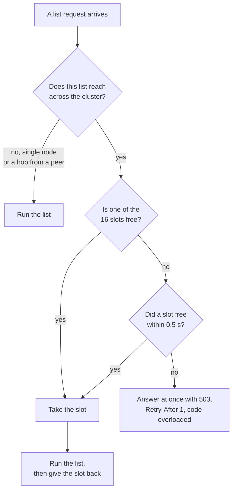

**What this shows:** a list either gets a slot within half a second, or gets a fast "busy" answer. It never waits in a long queue.

A list on a single node is never gated, because the local database is the whole answer. A hop forwarded from another node is not gated either. The node that started the list already holds a slot for it.

### Shared reads

Concurrent identical reads from the control plane now share one request on each node. There is one catch. A list right after a create must still see the new sandbox.

So a caller only shares a read that started after it asked. A read that was already running may have started before the caller's create finished.

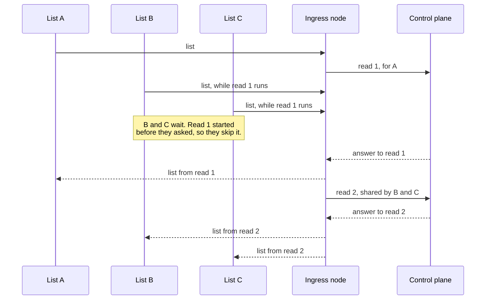

**What this shows:** three lists cost two control-plane reads, not three. Every answer comes from a read that started after its own request.

For each identical read, at most one runs and one waits behind it, however many lists arrive. A caller waits at most for the rest of the running read, plus one read of its own.

### What is not gated

Nothing else is limited. `/health`, getting one sandbox, exec, file transfers and terminal streams are untouched.

We chose not to cap all API traffic. Exec streams and attached terminal sessions stay open for a long time. A cap tight enough to protect a 2-vCPU node would turn away healthy users.

## Before and after

This section shows the numbers, and the test that guards them.

A new integration test, `TestOverloadShedsInsteadOfRestarting`, runs 1,024 list clients for 60 seconds. That is about 4 times the old ceiling. The test passes only if all of these hold:

- Every answer is a success, or a `503` with `Retry-After`.
- There are zero `502` answers and zero refused connections.
- No node's daemon restarts.
- List latency is back to normal within 60 seconds after the load stops.

We ran it on `main` plus [#880](https://github.com/aerol-ai/microvm/pull/880) and [#881](https://github.com/aerol-ai/microvm/pull/881). The full integration suite passed: 282 tests, 0 failures.

| At 1,024 clients, for 60 s | Before the fix | After the fix |
|---|---|---|
| Successful lists per second | 70 | 2,084 (125,059 in total) |
| p50 latency | 9.0 s | 470 ms |
| p99 latency | 37 s | 950 ms |
| Slowest request | not recorded | 3.2 s |
| Errors | 5,081 (HTTP `502`) | 0 |
| Daemon restarts | 2, one of them during boot | 0 on every node |
| Lists refused with `503` | 0 (there was no limit) | 0 |
| Back to normal after the load stopped | not recorded | 5.4 s (p50 278 ms) |

The two runs used different clusters. "Before" ran on the 11-server cluster above, with 2-vCPU m6i.large ingress nodes. "After" ran on a 3-node cluster of 2-vCPU nodes.

No list was refused in the "after" run. Shared reads made each list so much cheaper that 1,024 clients never filled the 16 slots. So the `503` path was not reached live. Unit tests cover it, but a live run has not shown it yet.

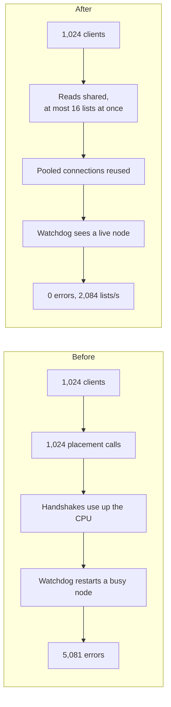

**What this shows:** the same load takes a different path. Shared reads keep the CPU free, so the watchdog has no reason to act. The gate waits for any load that shared reads cannot absorb.

## How Kubernetes does it

This section compares our fix with Kubernetes, which solved the same two problems for containers.

### Liveness and readiness probes

Kubernetes has the same split we now use.

- A **liveness probe** checks whether the container is alive. When it fails too many times in a row, the **kubelet** restarts the container. The kubelet is the agent that runs containers on each Kubernetes node.
- A **readiness probe** checks whether the container should get traffic. When it fails, the pod's address leaves the endpoints of its Services. Traffic stops, but nothing restarts.
- `failureThreshold` sets how many failures in a row count. Its default is 3, so one failed probe never restarts anything. Ours needs at least 3 in a row too.
- Kubernetes probes every 10 seconds by default. So a hung container restarts after about 30 seconds.
- Ours takes at least 90 seconds, because our timer runs every 30 seconds. That is slower on purpose. A restart of `sandboxd` drops every request on the node, so a wrong restart costs more than a late one.
- A `startupProbe` holds back the liveness and readiness probes until the app has started. `initialDelaySeconds` waits before the first probe. Our version is "no restart in the first 120 seconds, or while starting or stopping".

The Kubernetes docs warn about our exact bug. They say wrong liveness probes "can lead to cascading failures", with containers restarting "under high load". They also put checks of back-end services in the readiness probe, not the liveness probe.

### Protecting the API server

The Kubernetes API server has its own overload guard, called **API Priority and Fairness** (APF).

- Requests are sorted into **priority levels**. Each level gets a share of the server's concurrency budget: how many requests it may run at once.
- Leader election and the built-in controllers get their own levels. So a flood of requests from pods cannot block them.
- Inside a level, **fair queuing** gives each **flow** about equal weight. A flow can be one user or one namespace. So one noisy client cannot starve the others.
- Queues are short and have a fixed limit. A request that does not fit, or waits too long, gets `429 Too Many Requests`. The answer carries a `Retry-After` header.
- A large LIST counts as more than one unit of concurrency, in proportion to how many objects it returns.
- Current versions answer most LIST requests from the **watch cache**, an in-memory copy of the database (etcd). They do not read etcd each time.

Before APF, the flags `--max-requests-inflight` and `--max-mutating-requests-inflight` were plain global caps. The Kubernetes docs say those flags were "not enough to ensure that the most important requests get through".

### Side by side

| Question | Kubernetes | AerolVM |
|---|---|---|
| Is the process alive? | Liveness probe. The kubelet restarts the container after 3 failures in a row (default). | `/livez` on its own socket. The watchdog restarts after 3 or more failures in a row over at least 90 s. |
| Should it get traffic? | Readiness probe. The pod leaves the Service's endpoints. No restart. | `/health`. A health-checked load balancer, when you use one, stops sending new connections. No restart. |
| Slow start | `startupProbe` or `initialDelaySeconds` | No restart in the first 120 s, or while starting or stopping |
| Time to restart a hung process, by default | About 30 s (3 checks, 10 s apart) | At least 90 s (timer runs every 30 s) |
| Limit on expensive requests | APF concurrency shares per priority level | 16 cluster-wide lists per node |
| Wait before refusing | Short, fixed-length queues | Up to 0.5 s for a slot |
| Answer when refused | `429` with `Retry-After` | `503` with `Retry-After: 1` and code `overloaded` |
| Repeated lists | Served from the watch cache | Concurrent identical reads shared |
| Fair between users | Yes, fair queuing per flow | Not yet; in progress |

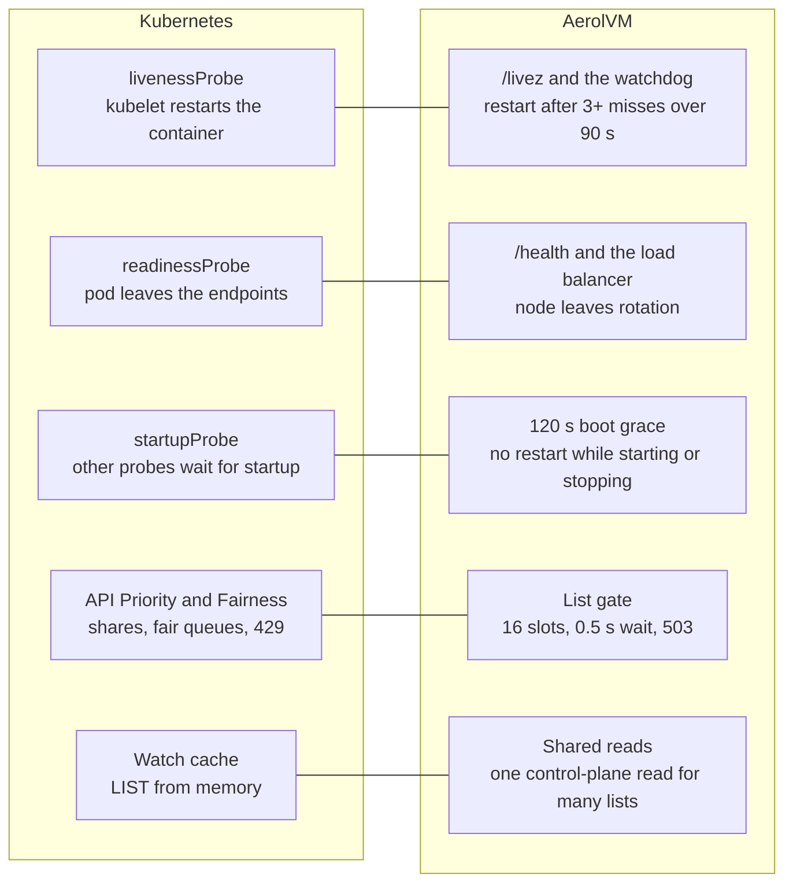

**What this shows:** each Kubernetes idea has an AerolVM match. The gap is inside "API Priority and Fairness": we have the limit, but not yet the fairness.

What ours shares with APF:

- A limit on how many expensive calls run at once.
- A short wait with a fixed limit, then a fast refusal.
- A `Retry-After` header, so clients know when to come back.
- Shared or cached reads for repeated lists.

What ours does not have yet is fairness between tenants. A **tenant** is one account or team. The 16 list slots on a node are shared by everyone. So one tenant that floods a node with list calls can make other tenants' lists get `503`. Those clients retry and recover, but it is not fair.

### 503 or 429?

The two codes mean different things, and we use them on purpose.

- `429 Too Many Requests` means "you, the client, sent too much".
- `503 Service Unavailable` means "this server is overloaded right now".

We send `503`, because today's limit protects the node, not a share per tenant. The plan for fairness keeps that split. A tenant over its own share will get `429`. Node overload will stay `503`.

## What we have not done yet

This section lists the open work. Both items are in progress, not done.

- **Fairness between tenants.** A change on top of [#881](https://github.com/aerol-ai/microvm/pull/881) is being built. It gives each tenant its own share of the list slots, like APF's fair queuing.
- **SDKs that wait for `Retry-After`.** All five SDKs already retry a `503` on a list, but they use their own timing. A separate change to all five SDKs is being built. With it, they will wait as long as `Retry-After` says.

Also, the `503` path has not been reached in a live run yet. Unit tests cover it.

## What your code sees

Your code does not need to handle overload by hand. All five SDKs retry a `503` on a list up to 3 times. They wait about 200, 400 and then 800 ms. Each wait varies by up to 25% at random, so clients spread out.

If the node is still busy after the third retry, you get an error. In Go and Python the error also carries the code `overloaded`. The examples below set the retry settings to their defaults, so you can see where to change them.

<Tabs syncKey="lang">
  <TabItem label="TypeScript">
    ```ts
    import { MicroVM } from '@aerol-ai/aerolvm-sdk'

    const client = new MicroVM({
      apiUrl: process.env.SB_API_URL,
      patToken: process.env.SB_PAT_TOKEN,
      // The defaults: 3 retries, waits start at 200 ms and double.
      retry: { maxRetries: 3, baseDelayMs: 200 },
    })

    try {
      // A 503 "overloaded" answer is retried for you.
      const sandboxes = await client.list()
      console.log(`${sandboxes.length} sandboxes`)
    } catch (err) {
      // Still busy after 3 retries.
      console.error('list failed:', err)
    }
    ```
  </TabItem>
  <TabItem label="Python">
    ```python
    from microvm import MicroVM
    from microvm.client import MicroVMHTTPError

    client = MicroVM(
        api_url='https://sandbox.example.com',
        pat_token='your-token',
        # The defaults: 3 retries, waits start at 200 ms and double.
        config={'retry': {'maxRetries': 3, 'baseDelayMs': 200}},
    )

    try:
        # A 503 "overloaded" answer is retried for you.
        sandboxes = client.list()
        print(f'{len(sandboxes)} sandboxes')
    except MicroVMHTTPError as err:
        # Still busy after 3 retries: status 503, code "overloaded".
        print('list failed:', err.status_code, err.code, err)
    ```
  </TabItem>
  <TabItem label="Go">
    ```go
    import (
        "context"
        "errors"
        "fmt"
        "log"
        "os"

        microvm  "github.com/aerol-ai/microvm/sdk/go/pkg/microvm"
        sdktypes "github.com/aerol-ai/microvm/sdk/go/pkg/types"
    )

    // The defaults: 3 retries, waits start at 200 ms and double.
    maxRetries, baseDelayMs := 3, 200

    client, err := microvm.NewClientWithConfig(&sdktypes.MicroVMConfig{
        APIUrl:   os.Getenv("SB_API_URL"),
        PATToken: os.Getenv("SB_PAT_TOKEN"),
        Retry: &sdktypes.RetryConfig{
            MaxRetries:  &maxRetries,
            BaseDelayMs: &baseDelayMs,
        },
    })
    if err != nil {
        log.Fatal(err)
    }

    // A 503 "overloaded" answer is retried for you.
    sandboxes, err := client.List(context.Background())
    var apiErr *microvm.APIError
    switch {
    case errors.As(err, &apiErr) && apiErr.Code == "overloaded":
        // Still busy after 3 retries. RetryAfter is the server's hint.
        log.Printf("cluster busy, try again in %s", apiErr.RetryAfter)
    case err != nil:
        log.Fatal(err)
    default:
        fmt.Println(len(sandboxes), "sandboxes")
    }
    ```
  </TabItem>
  <TabItem label="Rust">
    ```rust
    use aerolvm_sdk::{ApiVersion, Client, ClientConfig, RetryConfig};

    let client = Client::with_config(
        ClientConfig {
            api_url: Some("https://sandbox.example.com".to_string()),
            pat_token: Some("your-token".to_string()),
            // The defaults: 3 retries, waits start at 200 ms and double.
            retry: Some(RetryConfig {
                max_retries: Some(3),
                base_delay_ms: Some(200),
                max_delay_ms: Some(5000),
            }),
            ..Default::default()
        },
        ApiVersion::default(),
    )?;

    // A 503 "overloaded" answer is retried for you.
    match client.list() {
        Ok(sandboxes) => println!("{} sandboxes", sandboxes.len()),
        // Still busy after 3 retries.
        Err(err) => eprintln!("list failed: {err}"),
    }
    ```
  </TabItem>
  <TabItem label="Java">
    ```java
    import ai.aerol.microvm.MicroVMClient;
    import ai.aerol.microvm.MicroVMConfig;
    import ai.aerol.microvm.MicroVMException;
    import ai.aerol.microvm.Sandbox;
    import ai.aerol.microvm.model.RetryConfig;
    import java.util.List;

    MicroVMClient client = new MicroVMClient(
        new MicroVMConfig()
            .setApiUrl("https://sandbox.example.com")
            .setPatToken(System.getenv("SB_PAT_TOKEN"))
            // The defaults: 3 retries, waits start at 200 ms and double.
            .setRetry(new RetryConfig().setMaxRetries(3).setBaseDelayMs(200))
    );

    try {
        // A 503 "overloaded" answer is retried for you.
        List<Sandbox> sandboxes = client.list();
        System.out.println(sandboxes.size() + " sandboxes");
    } catch (MicroVMException e) {
        // Still busy after 3 retries.
        System.err.println("list failed: " + e.getMessage());
    }
    ```
  </TabItem>
</Tabs>

## For server operators

This section lists the settings, metrics and alert behind both fixes.

| Setting | What it does | Default |
|---|---|---|
| `SB_LIVENESS_SOCKET` | The path of the liveness socket the watchdog probes. `off` turns it off, and the watchdog falls back to `/health`. | `/run/sandboxd/live.sock` |
| `SB_API_LIST_MAX_INFLIGHT` | How many cluster-wide lists one node runs at once. `0` means no limit. | `16` |
| `SB_API_LIST_QUEUE_WAIT` | How long a list waits for a free slot before it gets `503`. `0` means refuse at once. | `500ms` |

- The metric `aerolvm_api_list_inflight` shows how many slots are in use now. `aerolvm_api_list_shed_total` counts lists refused with `503`.
- The alert `SandboxdAPIListShedding` fires when one node refuses more than 100 lists in 10 minutes, for 10 minutes.
- The watchdog writes its decisions to the journal under the tag `sandboxd-healthcheck`.
- When the alert fires, do not restart `sandboxd`. A restart drops every request in flight, and the load comes straight back. Instead, spread clients across more ingress nodes, or slow down the clients that poll. On nodes with more CPU, you can raise the limit.

The [SLO breach runbook](https://github.com/aerol-ai/microvm/blob/main/setup/runbooks/slo-breach.md) has the full steps.

## Sources

- [Liveness, Readiness, and Startup Probes](https://kubernetes.io/docs/concepts/configuration/liveness-readiness-startup-probes/) (kubernetes.io): the three probe types, the default `periodSeconds` of 10 and `failureThreshold` of 3, and the warning about cascading failures under high load.
- [API Priority and Fairness](https://kubernetes.io/docs/concepts/cluster-administration/flow-control/) (kubernetes.io): priority levels, fair queuing per flow, `429` rejections, seats for large LIST requests, and the older in-flight flags.
- [Kubernetes API Concepts](https://kubernetes.io/docs/reference/using-api/api-concepts/) (kubernetes.io): which LIST requests the API server answers from its watch cache.
- [`priority-and-fairness.go`](https://github.com/kubernetes/kubernetes/blob/master/staging/src/k8s.io/apiserver/pkg/server/filters/priority-and-fairness.go) (Kubernetes source): the APF filter that sends the `429` with a `Retry-After` header.

## Next steps

- [Placement and failover](/engineering-placement-failover/): how the control plane decides which worker owns each sandbox, the table every cluster-wide list reads.
- [Ingress nodes](/cluster-ingress/): the role that took the load in this test, and how to add more.
- [Cluster setup](/cluster-setup/#put-a-load-balancer-in-front): put a health-checked load balancer in front of the ingress nodes.
- [Runbooks](/operational-runbooks/): what to do when an alert fires.
