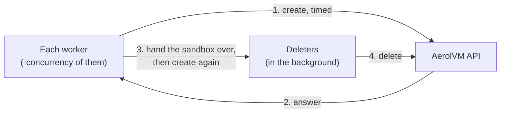

import { Tabs, TabItem } from '@astrojs/starlight/components';

How fast can AerolVM make sandboxes? This page answers with two numbers, explains how we measure them, and shows how to run the same test on your own servers.

- **Creates per second** is how many sandboxes the server made each second while the test ran.
- **Create time** is how long one create took, from sending the request until the answer came back. We give it at p50, p90 and p99. **p50** is the median: half of the creates were faster. **p90** means 9 in 10 were faster. **p99** means 99 in 100 were faster, so it shows the slow ones.

A fast median alone can hide a slow tail, and a high rate alone can hide slow creates. That is why every result gives both numbers, at the same settings.

## Our results

We measured these on AWS (us-east-1) on 2026-11-06. The tool ran on one of the servers, so the network trip to the API is short. Each row ran for 60 seconds, after a 15-second warm-up we threw away. Every sandbox used `alpine:3.20`. Firecracker used the same image from `public.ecr.aws`, because Docker Hub limits how often one address may pull. No create failed in any row, and no run left a sandbox behind.

| Servers | Runtime | Workers | Creates per second | p50 | p90 | p99 |
|---|---|---|---|---|---|---|
| 3 × t3.medium, Docker engine | Docker, warm pool on | 1 | 3.3 | 57 ms | 495 ms | 924 ms |
| 3 × t3.medium, Docker engine | Docker, warm pool on | 4 | 6.7 | 493 ms | 1,368 ms | 2,271 ms |
| 3 × t3.medium, Docker engine | Docker, warm pool off | 1 | 2.6 | 352 ms | 550 ms | 730 ms |
| 3 × t3.medium, Docker engine | Docker, warm pool off | 4 | 5.6 | 654 ms | 1,065 ms | 1,367 ms |
| 3 × t3.medium, containerd | gVisor | 1 | 4.0 | 216 ms | 366 ms | 563 ms |
| 3 × t3.medium, containerd | gVisor | 4 | 6.7 | 526 ms | 1,061 ms | 1,459 ms |
| 1 × c5.metal | Firecracker, from a template | 1 | 14.5 | 59 ms | 65 ms | 76 ms |
| 1 × c5.metal | Firecracker, from a template | 4 | 36.5 | 67 ms | 80 ms | 93 ms |
| 1 × c5.metal | Firecracker, no template | 1 | 0.8 | 1,264 ms | 1,290 ms | 1,331 ms |

"Warm pool on" is a [warm-pool entry](/warm-pools/) with depth 4 for the image on each server. "Off" is the same entry with depth 0.

What the numbers say:

- **A t3.medium has 2 CPUs, and that is the limit here.** With 4 workers, both small clusters top out near 6.7 creates per second, and the create time grows instead.
- **The warm pool helps while it keeps up.** With 1 worker it cuts the median create from 352 ms to 57 ms. With 4 workers on these small servers, the pool empties faster than it refills: most creates start cold, and the refills compete with them for the same 2 CPUs, so the slowest creates are slower than with the pool off. Pick a depth that fits the rate you expect, and leave the servers room to refill.
- **Firecracker is fast with a [template](/firecracker-templates/) and slow without one.** A template resumes a VM that has already booted, so a create takes about 60 ms, and 4 workers make 36 a second. Without a template, every create builds the VM's disk from the image again, which takes over a second.

The commands, run on a server with `SB_API_URL` and `SB_PAT_TOKEN` set:

```bash
# Docker (the clusters' default runtime) and gVisor
aerolvm-bench -concurrency 4 -duration 60s -json
aerolvm-bench -runtime gvisor -concurrency 4 -duration 60s -json

# Firecracker, from a template built from the same image
aerolvm-bench -runtime firecracker -image public.ecr.aws/docker/library/alpine:3.20 \
    -template bench-alpine -concurrency 4 -duration 60s -json
```

## How the test works

The test tool is `aerolvm-bench`. It talks to the normal AerolVM API through the Go SDK, the same way your code does. So it measures what a client sees, network included.



**What this shows:** each worker makes one sandbox at a time. As soon as a create answers, the worker starts the next one. The new sandbox goes to a deleter, which removes it in the background.

Here are the rules the tool follows:

- **Workers.** `-concurrency` sets how many creates are in flight at once. Each worker waits for its create to answer before it sends the next one.
- **Deleting as it goes.** Each new sandbox is deleted in the background right away. So the number of live sandboxes stays close to the number of workers, and a long test measures creates, not how many sandboxes a server can hold. If deletes fall behind, the workers wait for them. A server cannot keep up a create rate that is faster than its delete rate. Use `-hold` to keep every sandbox until the end instead.
- **One try per create.** The tool turns off the SDK's automatic retries for creates. When the server says "busy" (HTTP `429` or `503`), that create counts as a failure. It is not hidden inside a slower create.
- **A pause after a failure.** After a failed create, the worker waits 100 ms before its next one. So a server that is down or busy is not flooded with requests.
- **The rate.** Creates per second is the number of creates that worked, divided by the time from the first create sent to the last create answered.
- **The times.** Percentiles use the nearest-rank method. So p99 is always a real create time, never a value between two of them.

### Every sandbox is cleaned up

The tool deletes every sandbox it made before it exits, even when you stop it early.

- Each sandbox is named `bench-<run id>-<n>` and tagged `aerolvm-bench-run=<run id>`. At the end, the tool lists the sandboxes with that tag and deletes any that are left. That catches a sandbox whose create answer was lost.
- Each sandbox also deletes itself after a set age (`-max-age`), in case the tool is killed and cannot clean up.
- The report ends with `left behind`. It should be `0`.

Stopping the tool early works in three steps:

| You press Ctrl-C | What happens |
|---|---|
| Once | No new creates start. The tool waits for the creates already sent, then deletes every sandbox. |
| Twice | The tool stops waiting for creates already sent. It deletes what the API lists for the run's tag. |
| Three times | The tool exits at once and prints the command that finishes the cleanup. |

## Run it on your servers

You need Go 1.26 and a copy of the AerolVM repository. The token needs permission to create and delete sandboxes.

```bash
export SB_API_URL=https://api.example.com
export SB_PAT_TOKEN=your-token
go run ./cmd/aerolvm-bench -concurrency 8 -duration 60s
```

Add `-json` to get the report as JSON, for example to save it next to your server settings.

| Flag | What it does | Default |
|---|---|---|
| `-api` | The AerolVM API URL. | `$SB_API_URL` |
| `-token` | The API token. | `$SB_PAT_TOKEN`, then `$SB_API_TOKEN` |
| `-concurrency` | How many creates are in flight at once (1 to 1000). | `4` |
| `-duration` | How long to keep starting new creates. | `30s` |
| `-image` | The image of every sandbox. | `alpine:3.20` |
| `-runtime` | The runtime, such as `docker`, `gvisor` or `firecracker`. | the server's default |
| `-template` | A [Firecracker template](/firecracker-templates/) every sandbox starts from. Pass the image it was built from as `-image`. Without one, each Firecracker create builds its disk from the image, which is slow and pulls the image from its registry every time. | none |
| `-hold` | Keep every sandbox until the end, then delete them all. | off |
| `-max-age` | Each sandbox deletes itself at this age. `0s` turns it off. | the test length, plus `-create-timeout`, plus 15 minutes |
| `-create-timeout` | Give up on one create after this long. | `5m` |
| `-run-id` | The id in each sandbox's name and tag. | random |
| `-json` | Print the report as JSON. | off |
| `-cleanup <run id>` | Delete everything an earlier run left behind, then exit. | |

The JSON report has these fields:

| Field | Meaning |
|---|---|
| `creates_per_second` | Creates that worked, per second. |
| `create_latency_ms` | `p50`, `p90`, `p99`, `max` and `mean` create time in milliseconds, and the number of `samples`. |
| `delete_latency_ms` | The same for deletes. |
| `creates` | How many creates `succeeded` and `failed`. `not_started` counts creates that answered with a status other than `started`. |
| `errors` | Failed creates grouped by kind, such as `HTTP 503 capacity_exhausted` or `timeout`, with one example message each. |
| `left_behind` | Sandboxes of this run still listed after cleanup. `-1` means the check itself failed. |

The tool exits with code `0` when at least one create worked and nothing was left behind. It exits with `1` otherwise, and with `2` for a wrong flag.

### Get a fair number

- **Warm up first.** The first create of an image on a server may need to pull it. Run a short test once and throw that result away.
- **Say whether warm pools were on.** A [warm pool](/warm-pools/) hands out a sandbox that was started earlier, so a create from a pooled image is much faster. Test both ways if you can, and say which one a number is.
- **Run close to the servers.** The create time includes the network trip from the tool to the API. Run the tool in the same region as the servers.
- **Raise the workers step by step.** Try 1, 4, 16 and 64 workers. Creates per second stops growing at some point, while the create time keeps growing. That point is your server's limit.
- **Read the errors.** A run with failures is still useful. `HTTP 503` or `429` means the server said "busy", which tells you where the limit is.

## Time a create from your own code

To check one create from your own program, time the create call. This is the same thing the tool measures, one create at a time.

<Tabs syncKey="lang">
  <TabItem label="TypeScript">
    ```ts
    import { MicroVM } from "@aerol-ai/aerolvm-sdk";

    const client = new MicroVM(); // reads SB_API_URL and SB_PAT_TOKEN

    const start = performance.now();
    const sandbox = await client.create({ image: "alpine:3.20" });
    console.log(`create took ${Math.round(performance.now() - start)} ms`);

    await sandbox.destroy();
    ```
  </TabItem>
  <TabItem label="Python">
    ```python
    import time

    from microvm import MicroVM

    client = MicroVM()  # reads SB_API_URL and SB_PAT_TOKEN

    start = time.perf_counter()
    sandbox = client.create(image="alpine:3.20")
    print(f"create took {(time.perf_counter() - start) * 1000:.0f} ms")

    sandbox.destroy()
    ```
  </TabItem>
  <TabItem label="Go">
    ```go
    client, err := microvm.NewClient() // reads SB_API_URL and SB_PAT_TOKEN
    if err != nil {
        log.Fatal(err)
    }

    start := time.Now()
    sandbox, err := client.Create(ctx, sdktypes.CreateSandboxOptions{Image: "alpine:3.20"})
    if err != nil {
        log.Fatal(err)
    }
    fmt.Printf("create took %d ms\n", time.Since(start).Milliseconds())

    if err := sandbox.Destroy(ctx); err != nil {
        log.Fatal(err)
    }
    ```
  </TabItem>
  <TabItem label="Rust">
    ```rust
    use std::time::Instant;

    use aerolvm_sdk::{Client, CreateOptions};

    let client = Client::new(None, None)?; // reads SB_API_URL and SB_PAT_TOKEN

    let start = Instant::now();
    let sandbox = client.create(CreateOptions {
        image: "alpine:3.20".into(),
        ..Default::default()
    })?;
    println!("create took {} ms", start.elapsed().as_millis());

    sandbox.destroy()?;
    ```
  </TabItem>
  <TabItem label="Java">
    ```java
    MicroVMClient client = new MicroVMClient(); // reads SB_API_URL and SB_PAT_TOKEN

    long start = System.nanoTime();
    Sandbox sandbox = client.create(new CreateOptions().setImage("alpine:3.20"));
    System.out.println("create took " + (System.nanoTime() - start) / 1_000_000 + " ms");

    sandbox.destroy();
    ```
  </TabItem>
</Tabs>

One create says little on its own: the first create of an image is slower, and times vary from one create to the next. Use `aerolvm-bench` for numbers you plan to compare or publish.
