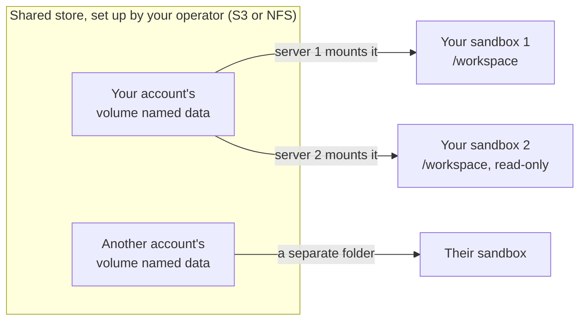
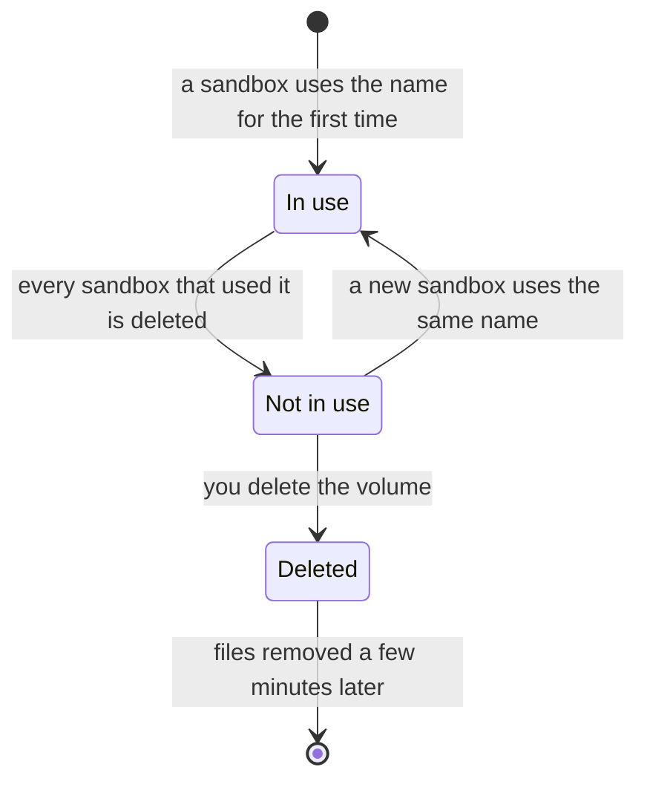

import { Aside, Tabs, TabItem } from '@astrojs/starlight/components';

A platform volume is named storage that outlives your sandboxes. You pick a name and a folder. AerolVM does the rest. You never handle a bucket address or credentials.

A platform volume:

- has a **name** that belongs to your account;
- **keeps its files** when a sandbox stops or is deleted;
- can be **attached again by the same name** from a later sandbox, on any server in a cluster;
- can be **shared** by several sandboxes at once.

## How it works



1. **You pass a name and a folder,** such as `data` at `/workspace`.
2. **The server looks up the name in your account.** The first time, it makes the volume, which starts empty. After that, the same name finds the same volume.
3. **The server mounts the volume's folder from the shared store.** The sandbox sees a plain folder. It never sees the store's address or keys.

Every server reads the same store, so a volume has the same files on every server.

## Attach a volume

This attaches the volume `data` at `/workspace`.

<Tabs syncKey="lang">
  <TabItem label="TypeScript">
    ```ts
    const sandbox = await client.create({
      image: "ubuntu:22.04",
      platformVolumes: [{ name: "data", path: "/workspace" }],
    });
    ```
  </TabItem>
  <TabItem label="Python">
    ```python
    sandbox = client.create(
        image="ubuntu:22.04",
        platformVolumes=[{"name": "data", "path": "/workspace"}],
    )
    ```
  </TabItem>
  <TabItem label="Go">
    ```go
    sandbox, err := client.Create(ctx, sdktypes.CreateSandboxOptions{
        Image: "ubuntu:22.04",
        PlatformVolumes: []sdktypes.PlatformVolumeMount{
            {Name: "data", Path: "/workspace"},
        },
    })
    if err != nil {
        log.Fatal(err)
    }
    ```
  </TabItem>
  <TabItem label="Rust">
    ```rust
    use aerolvm_sdk::PlatformVolumeMount;

    let sandbox = client.create(CreateOptions {
        image: "ubuntu:22.04".into(),
        platform_volumes: Some(vec![PlatformVolumeMount {
            name: "data".into(),
            path: "/workspace".into(),
            read_only: None,
        }]),
        ..Default::default()
    })?;
    ```
  </TabItem>
  <TabItem label="Java">
    ```java
    Sandbox sandbox = client.create(new CreateOptions()
        .setImage("ubuntu:22.04")
        .setPlatformVolumes(List.of(
            new PlatformVolumeMount().setName("data").setPath("/workspace"))));
    ```
  </TabItem>
</Tabs>

| Field | What it does | Default |
|---|---|---|
| `name` | The volume's name. | Required |
| `path` | The folder inside the sandbox, as a full path. | Required |
| `readOnly` | Let the sandbox read the files but not change them. | `false` |

Go spells these `Name`, `Path` and `ReadOnly`. Rust uses `read_only`. Python also accepts `platform_volumes` and `read_only`.

<Aside>
Platform volumes only work when your operator has turned them on. If they are off, every request that uses a volume fails with HTTP 412 (Precondition Failed). Ask your server operator to turn them on.
</Aside>

## Share files between sandboxes

Give a second sandbox the same name to see what the first one wrote. It can run on a different server and still read the same files.

To let the second sandbox read but not change the files, add `readOnly: true` to its volume. That is `ReadOnly: true` in Go, `read_only: Some(true)` in Rust and `.setReadOnly(true)` in Java.

A safe pattern is one sandbox that writes and any number that attach read-only. Two sandboxes writing the same files at once can lose data, because the store does not lock files.

## What happens to the files



- **Stopping or deleting a sandbox never deletes the volume's files.** Attach the same name again to get them back.
- **A volume in use cannot be deleted.** A stopped sandbox still counts. Delete every sandbox that uses the volume first, or the delete fails with HTTP 409 (Conflict).
- **Deleting a volume deletes its files.** The server removes them in the background, a few minutes later. If you reuse the name before that, the old files are still there.
- **There is no AerolVM SDK call to list or delete volumes yet.** The [Daytona SDK](/using-daytona-sdk/) can create, list, get and delete them through AerolVM.

## What you can do with the files

This depends on the store your operator picked. Ask them which one it is.

| | S3 store | NFS store |
|---|---|---|
| Read files | Yes | Yes |
| Add new files | Yes, written from start to finish in one go | Yes |
| Change, rename or delete a file already there | No | Yes |

On an S3 store, the server mounts the bucket with `mount-s3`, which only adds new files by default. To change a file, write a new file with a new name.

## Platform volume or your own storage?

| | [Attach cloud storage](/external-storage/) | Platform volume |
|---|---|---|
| Who owns the storage | You: your bucket and your keys | Your operator: one shared store |
| What you pass | A `source` and `credentials` | Only a `name` |
| How long the files last | As long as your storage keeps them | Until the volume is deleted |
| In a cluster | Works, because you point at your own store | Works, because the shared store holds the files |

## Naming rules

- Names are turned into lowercase. They may use only `a` to `z`, `0` to `9`, `.`, `_` and `-`. Any other character is refused, not removed.
- A name can be up to 64 characters. `.` and `..` are not allowed.
- **Each account has its own names.** Two tenants (separate accounts on the same server) can both use `data`, and each gets separate storage.

## Good to know

- **Only Docker and gVisor sandboxes** can attach platform volumes. Firecracker, WebAssembly and V8 isolate sandboxes refuse them with HTTP 400.
- **A sandbox can have up to 8 mounts in total.** Platform volumes and [cloud storage mounts](/external-storage/) share that limit.
- **Your operator can limit how many volumes each account has.** Going over the limit fails with HTTP 409 (Conflict).
- **Volumes survive a server failure.** If a sandbox is rebuilt on another server after a failure, it mounts the same volume again. See [Durability and failover](/durability/).
- **The E2B SDK** can attach volumes too, with its `volumeMounts` option. See [Use the E2B SDK](/using-e2b-sdk/).


| Setup | What happens |
|---|---|
| Off or not set | Every volume request fails with HTTP 412. |
| On, but a required setting is missing | The server refuses to start, so you find out at once. |
| On and fully set | Volumes attach normally. |

How it is laid out and kept safe:

- **Each volume is one folder in the store:** `<bucket>/<prefix>/<account>/<name>` on S3, or `<export>/<account>/<name>` on NFS. The account part is a hash made on the server, so callers cannot pick or guess another account's folder.
- **A volume's folder is fixed when the volume is made.** If you later change the bucket, prefix or export, existing volumes keep mounting from their old folder, with the current keys.
- **The store's keys stay on the server.** They are saved encrypted in the server's database with each mount. No read API returns them, and they never enter a sandbox, because the mount runs on the server.
- **You own and pay for the store.** Set any lifecycle or retention rules on it yourself.

When a volume is deleted, a background job removes its files. On S3 it runs `aws s3 rm --recursive`, so the AWS CLI must be installed on each server. The one-line installer does not install it, but the cluster Terraform setup does. On NFS it mounts the export and removes the volume's folder. A failed cleanup is tried again on the next pass.

| Variable | What it does | Default |
|---|---|---|
| `SB_PLATFORM_VOLUMES_RECLAIM_INTERVAL` | How often the server looks for deleted volumes to clean up. | `5m` |
| `SB_PLATFORM_VOLUMES_RECLAIM_CONCURRENCY` | How many cleanups run at the same time. | `8` |
| `SB_PLATFORM_VOLUMES_RECLAIM_MOUNT_ROOT` | The scratch folder used while cleaning up NFS volumes. | `/var/lib/aerolvm/volume-reclaim` |

## Next steps

- [Attach cloud storage](/external-storage/): mount your own bucket or share instead.
- [Files](/file-system/): copy single files in and out.
- [Use the Daytona SDK](/using-daytona-sdk/): create, list and delete volumes.
- [Durability and failover](/durability/): what happens to sandboxes when a server fails.
