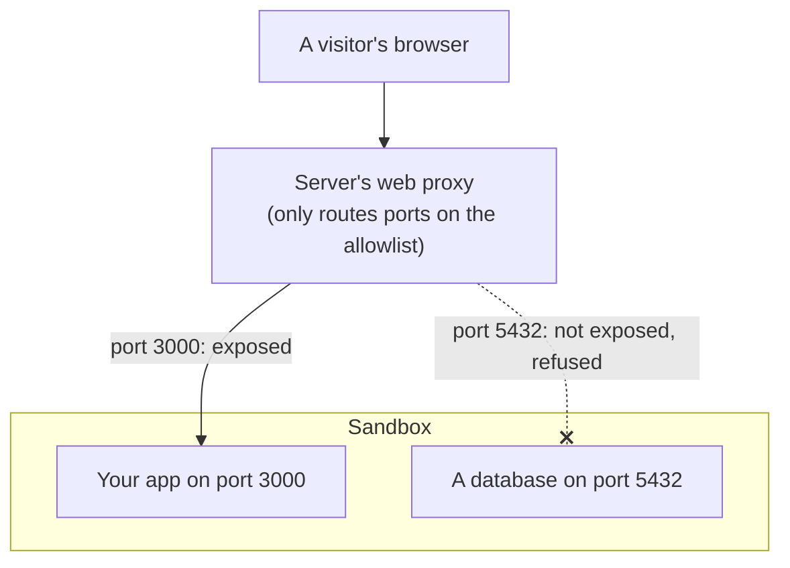

import { Aside, Tabs, TabItem } from '@astrojs/starlight/components';

A sandbox can run a web server, such as a Node app, a Python API or a dev server. To let people open it in a browser, you **expose a port**. A port is a number that tells the sandbox which program gets the traffic. Web servers often use `3000` or `8080`.

Exposing a port gives it a **public URL**: a web address anyone on the internet can open. Use it to share a preview of an app, a demo, or a web tool your agent built.

Every port starts **closed**. The server keeps a list of the ports you exposed for each sandbox, called the **port allowlist**, and refuses traffic to every other port. So a database, a debug tool or a forgotten test server is never open to anyone by accident.

<Aside type="caution" title="Public URLs need a server install">
Public URLs only work on a server install that runs the web proxy, set up as in [Install on a server](/getting-started/single-node-setup/). A local install ([Install on your computer](/getting-started/local-setup/)) does not run it. There, `exposePort` still returns a URL, but nothing answers at that address. To test a web server locally, call it from inside the sandbox instead, for example `curl -s http://localhost:3000` with [Run commands](/exec-streaming/) (the image needs `curl`).
</Aside>

## How it works



1. **Your app listens on a port** inside the sandbox.
2. **You call `exposePort`** for that port. The server adds it to the sandbox's allowlist and creates a route for it in its web proxy.
3. **Visitors open the public URL.** The proxy sends their requests to your app. Requests for any port not on the list are refused.

## Share a port

This starts a small web server on port 3000 inside the sandbox, then exposes that port.

<Tabs syncKey="lang">
  <TabItem label="TypeScript">
    ```ts
    import { MicroVM } from "@aerol-ai/aerolvm-sdk";

    const client = new MicroVM();
    const sandbox = await client.create({ image: "python:3.12-slim" });

    // Start a web server on port 3000 and leave it running in the background.
    await sandbox.exec("nohup python3 -m http.server 3000 > /dev/null 2>&1 &");

    const exposure = await sandbox.exposePort(3000);
    console.log(exposure.url);
    ```
  </TabItem>
  <TabItem label="Python">
    ```python
    from microvm import MicroVM

    client = MicroVM()
    sandbox = client.create(image="python:3.12-slim")

    # Start a web server on port 3000 and leave it running in the background.
    sandbox.exec("nohup python3 -m http.server 3000 > /dev/null 2>&1 &")

    exposure = sandbox.expose_port(3000)
    print(exposure.url)
    ```
  </TabItem>
  <TabItem label="Go">
    ```go
    sandbox, err := client.Create(ctx, sdktypes.CreateSandboxOptions{Image: "python:3.12-slim"})
    if err != nil {
        log.Fatal(err)
    }

    // Start a web server on port 3000 and leave it running in the background.
    if _, err := sandbox.ExecCommand(ctx, "nohup python3 -m http.server 3000 > /dev/null 2>&1 &"); err != nil {
        log.Fatal(err)
    }

    exposure, err := sandbox.ExposePort(ctx, 3000)
    if err != nil {
        log.Fatal(err)
    }
    fmt.Println(exposure.PublicURL)
    ```
  </TabItem>
  <TabItem label="Rust">
    ```rust
    use aerolvm_sdk::{Client, CreateOptions, ExposeOptions, ExposeResult};

    let client = Client::new(None, None)?;
    let sandbox = client.create(CreateOptions {
        image: "python:3.12-slim".into(),
        ..Default::default()
    })?;

    // Start a web server on port 3000 and leave it running in the background.
    sandbox.exec("nohup python3 -m http.server 3000 > /dev/null 2>&1 &")?;

    if let ExposeResult::Http { url } = sandbox.expose_port(3000, ExposeOptions::default())? {
        println!("{}", url);
    }
    ```
  </TabItem>
  <TabItem label="Java">
    ```java
    MicroVMClient client = new MicroVMClient();
    Sandbox sandbox = client.create(new CreateOptions().setImage("python:3.12-slim"));

    // Start a web server on port 3000 and leave it running in the background.
    sandbox.exec("nohup python3 -m http.server 3000 > /dev/null 2>&1 &");

    ExposeResult exposure = sandbox.exposePort(3000);
    System.out.println(exposure.url);
    ```
  </TabItem>
</Tabs>

On a server with a domain, you see something like this. Open it in a browser to see the server's file listing.

```text
https://sb-9f2c41d07a3e5b86-3000.sandbox.example.com
```

The URL keeps working until you unexpose the port or delete the sandbox. Calling `exposePort` again for the same port is safe: it returns the same URL.

## What the URL looks like

The URL depends on how the server was installed.

| Server setup | Port URL | Uses HTTPS? |
|---|---|---|
| With a domain | `https://<sandbox-id>-<port>.<domain>` | Yes |
| Without a domain (IP address only) | `http://<server-ip>/<sandbox-id>/proxy/<port>/` | No, plain HTTP |
| Local install | A URL is returned, but it does not work | No |

With a domain, every open port also answers under the sandbox's main URL, at `https://<sandbox-id>.<domain>/proxy/<port>/` (the proxy path). Use it when you want every port under one address.

Without a domain, the path form is the only one, and it is what `exposePort` returns. Pages that load files from absolute paths, such as `/app.js`, may not load there. A domain avoids this.

Before you expose a port, its URLs refuse requests with an error such as `403` or `404`.

## Make a sandbox public from the start

By default, the sandbox becomes public on your first `exposePort` call. To have its main URL live as soon as it starts, set `allowPublicTraffic: true` when you create it.

<Tabs syncKey="lang">
  <TabItem label="TypeScript">
    ```ts
    const sandbox = await client.create({
      image: "python:3.12-slim",
      allowPublicTraffic: true,
    });
    console.log(sandbox.publicURL); // https://<sandbox-id>.<domain>
    ```
  </TabItem>
  <TabItem label="Python">
    ```python
    sandbox = client.create(image="python:3.12-slim", allow_public_traffic=True)
    print(sandbox.publicURL)  # https://<sandbox-id>.<domain>
    ```
  </TabItem>
  <TabItem label="Go">
    ```go
    public := true
    sandbox, err := client.Create(ctx, sdktypes.CreateSandboxOptions{
        Image:              "python:3.12-slim",
        AllowPublicTraffic: &public,
    })
    if err != nil {
        log.Fatal(err)
    }
    fmt.Println(sandbox.PublicURL) // https://<sandbox-id>.<domain>
    ```
  </TabItem>
  <TabItem label="Rust">
    ```rust
    let sandbox = client.create(CreateOptions {
        image: "python:3.12-slim".into(),
        allow_public_traffic: Some(true),
        ..Default::default()
    })?;
    println!("{}", sandbox.data.public_url); // https://<sandbox-id>.<domain>
    ```
  </TabItem>
  <TabItem label="Java">
    ```java
    Sandbox sandbox = client.create(
        new CreateOptions()
            .setImage("python:3.12-slim")
            .setAllowPublicTraffic(true)
    );
    System.out.println(sandbox.publicUrl); // https://<sandbox-id>.<domain>
    ```
  </TabItem>
</Tabs>

The main URL (`publicURL`) points at the sandbox's built-in helper program, not at your app. Your app lives at the port URL that `exposePort` returns. Ports still stay closed until you expose them.

Without `allowPublicTraffic`, the first `exposePort` call makes the sandbox public. The sandbox object in your code still shows an empty `publicURL` until you call `refresh()`.

A sandbox you leave private still works for everything else: running commands, files and SSH all go through the AerolVM server, not the public URL.

## Stop sharing a port

`unexposePort` takes the port off the allowlist and removes its public URL. Its URLs refuse requests again right away. Calling it for a port that is not exposed does nothing.

<Tabs syncKey="lang">
  <TabItem label="TypeScript">
    ```ts
    await sandbox.unexposePort(3000);
    ```
  </TabItem>
  <TabItem label="Python">
    ```python
    sandbox.unexpose_port(3000)
    ```
  </TabItem>
  <TabItem label="Go">
    ```go
    if err := sandbox.UnexposePort(ctx, 3000); err != nil {
        log.Fatal(err)
    }
    ```
  </TabItem>
  <TabItem label="Rust">
    ```rust
    sandbox.unexpose_port(3000)?;
    ```
  </TabItem>
  <TabItem label="Java">
    ```java
    sandbox.unexposePort(3000);
    ```
  </TabItem>
</Tabs>

Once a sandbox is public, it stays public. Unexposing every port closes those ports, but the sandbox's main URL keeps working.

## Fix "host not allowed" errors

Your app sees the public address (for example `sb-9f2c41d07a3e5b86-3000.sandbox.example.com`) in each request's `Host` header. Some dev servers reject names they do not know. Vite says "Blocked request. This host is not allowed." webpack-dev-server, Django (`ALLOWED_HOSTS`) and Rails do the same.

Set `maskRequestHost` when you create the sandbox. The server then replaces the `Host` header with a value your app accepts, such as `localhost`. The public URL does not change.

<Tabs syncKey="lang">
  <TabItem label="TypeScript">
    ```ts
    const sandbox = await client.create({
      image: "node:22",
      maskRequestHost: "localhost",
    });
    ```
  </TabItem>
  <TabItem label="Python">
    ```python
    sandbox = client.create(image="node:22", mask_request_host="localhost")
    ```
  </TabItem>
  <TabItem label="Go">
    ```go
    sandbox, err := client.Create(ctx, sdktypes.CreateSandboxOptions{
        Image:           "node:22",
        MaskRequestHost: "localhost",
    })
    ```
  </TabItem>
  <TabItem label="Rust">
    ```rust
    let sandbox = client.create(CreateOptions {
        image: "node:22".into(),
        mask_request_host: Some("localhost".into()),
        ..Default::default()
    })?;
    ```
  </TabItem>
  <TabItem label="Java">
    ```java
    Sandbox sandbox = client.create(
        new CreateOptions()
            .setImage("node:22")
            .setMaskRequestHost("localhost")
    );
    ```
  </TabItem>
</Tabs>

This only changes web (HTTP) ports. TCP and TLS ports have no `Host` header, so it has no effect on them.

## If a URL does not work

For a `403` or `404`:

1. **Check that the port is on the list.** Refresh the sandbox and look at its exposed ports (code below).
2. **Check that `exposePort` succeeded.** It throws an error if it could not open the port.
3. **Check that the sandbox is running.** Its status must be `started`. A stopped sandbox does not answer, unless it is a [ghost sandbox](/ghost-sandboxes/) that wakes on traffic.

For a `502 Bad Gateway`, the port is open but nothing in the sandbox is listening on it. Check that your server is running and listens on `0.0.0.0`.

<Tabs syncKey="lang">
  <TabItem label="TypeScript">
    ```ts
    await sandbox.refresh();
    console.log(sandbox.status);
    for (const p of sandbox.exposedPorts ?? []) {
      console.log(p.port, p.publicURL);
    }
    ```
  </TabItem>
  <TabItem label="Python">
    ```python
    sandbox.refresh()
    print(sandbox.status)
    for p in sandbox.to_dict().get("exposedPorts", []):
        print(p["port"], p["publicURL"])
    ```
  </TabItem>
  <TabItem label="Go">
    ```go
    if err := sandbox.Refresh(ctx); err != nil {
        log.Fatal(err)
    }
    fmt.Println(sandbox.Status)
    for _, p := range sandbox.ExposedPorts {
        fmt.Println(p.Port, p.PublicURL)
    }
    ```
  </TabItem>
  <TabItem label="Rust">
    ```rust
    sandbox.refresh()?; // needs `let mut sandbox`
    println!("{}", sandbox.data.status);
    for p in sandbox.data.exposed_ports.iter().flatten() {
        println!("{} {}", p.port, p.public_url);
    }
    ```
  </TabItem>
  <TabItem label="Java">
    ```java
    sandbox.refresh();
    System.out.println(sandbox.status);
    if (sandbox.exposedPorts != null) {
        for (ExposedPort p : sandbox.exposedPorts) {
            System.out.println(p.port + " " + p.publicUrl);
        }
    }
    ```
  </TabItem>
</Tabs>

## Good to know

- **Listen on all addresses.** Start your server on `0.0.0.0`, not only `localhost` or `127.0.0.1`. The public URL connects to the sandbox's network address. For Vite, run `vite --host`.
- **You can expose a port before the server starts.** The URL returns an error (usually `502 Bad Gateway`) until something listens on the port.
- **Stop and start keep your ports.** The server saves the allowlist. When a stopped sandbox starts again, the same ports open with the same URLs, and you do not need to call `exposePort` again.
- **Blocking the internet does not block your URL.** `networkBlockAll` only stops traffic going out of the sandbox. See [Network access](/network-access/).
- **One protocol per port.** A port exposed for the web cannot also be a TCP or TLS port. Unexpose it first. See [TCP and TLS ports](/tcp-ports/).
- **WASM and V8 isolate sandboxes** support web (HTTP) ports only.

## For server operators

The allowlist lives in the server's sandbox database. Each `exposePort` and `unexposePort` call updates the list and adds or removes the matching route in Caddy. Caddy is the web proxy that the installer sets up next to the AerolVM server. The server also pushes the list to the sandbox's built-in helper program, which serves the proxy path and refuses ports that are not on it. When a sandbox starts again, the server puts its routes and its list back.

Domain mode needs two DNS records (entries at your domain provider that map a name to your server's address): one for `<domain>` and one for `*.<domain>`. See [Install on a server](/getting-started/single-node-setup/).

How Caddy handles certificates depends on the install:

- **Domain mode** (`SB_DOMAIN` set). Caddy gets one wildcard certificate that covers `<domain>` and `*.<domain>`. A certificate is the file that proves to browsers the site is really yours. A wildcard domain such as `*.sandbox.example.com` covers every name under it, so every sandbox URL shares that one certificate. Caddy gets it from Let's Encrypt with a DNS-01 check: it proves you own the domain by adding a short-lived DNS record through Cloudflare. That is why the installer requires `--dns-provider` and `--dns-api-token` whenever you pass `--domain`.
- **IP mode** (no `SB_DOMAIN`). Routes are plain HTTP, with no TLS.
- **Local install** (`--local`). The installer sets `SB_ENABLE_CADDY=false`, so no public routes are created at all.

## Next steps

- [Custom domains](/custom-domains/): serve a sandbox on your own domain, such as `app.acme.com`.
- [TCP and TLS ports](/tcp-ports/): share a database or another service that is not a website.
- [Ghost sandboxes](/ghost-sandboxes/): stop idle sandboxes and wake them on the next visit.
- [Network access](/network-access/): control what a sandbox can reach.
