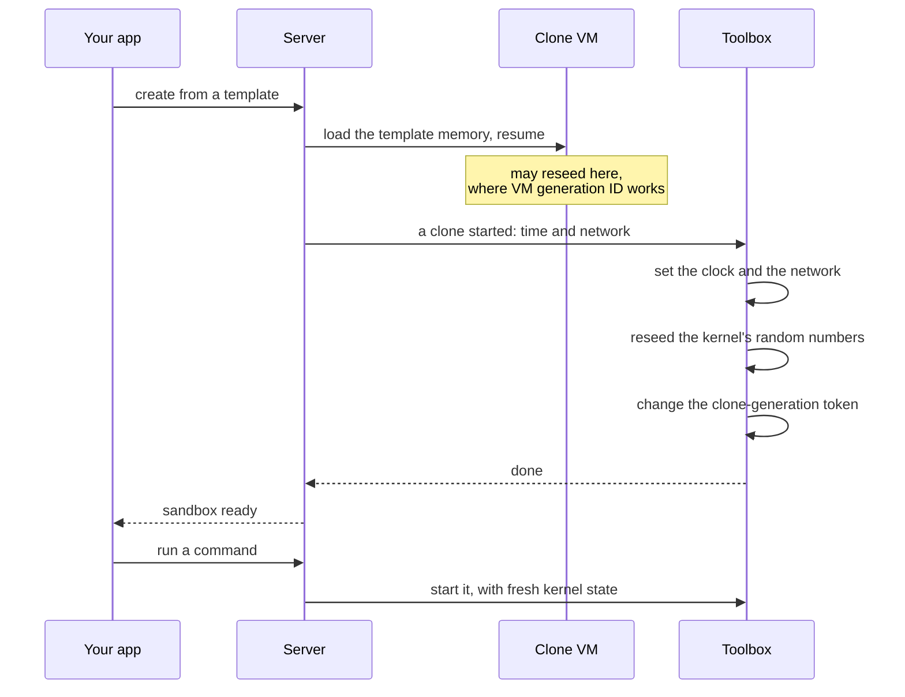
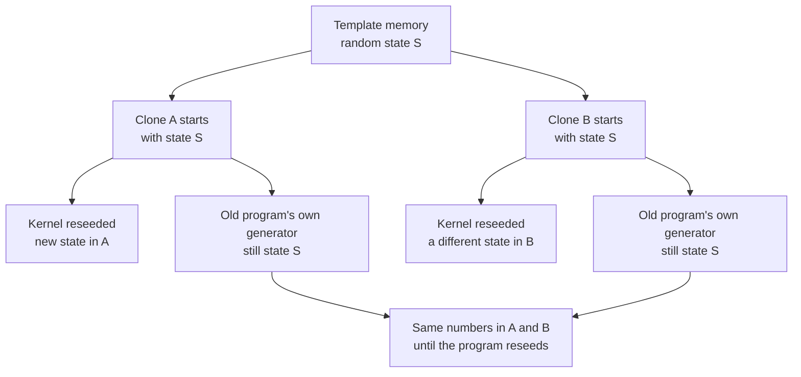
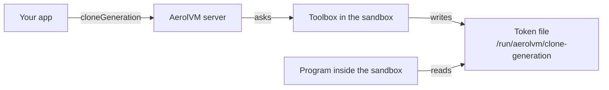
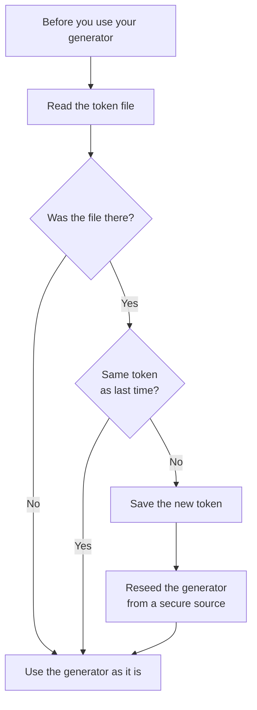

import { Aside, Tabs, TabItem } from '@astrojs/starlight/components';

A [Firecracker template](/firecracker-templates/) can save a paused copy of a running virtual machine's memory. New Firecracker sandboxes then start from a copy of that memory, which is why they start in milliseconds. We call each one a clone.

There is a catch. Every clone starts with the same copy of the template's random number state. Two clones that ask for "random" values right after they start could get the **same** ones. That means repeated IDs, repeated session tokens, or repeated encryption keys.

This page shows what AerolVM fixes for you, the one case it cannot fix, and how to handle that case in your own code.

## Two kinds of random number source

A Linux machine keeps random state in two places, and AerolVM handles them differently:

| Source | Examples | Copied into the clone? | Fixed by AerolVM? |
|---|---|---|---|
| **The kernel's secure source** (inside the operating system) | `getrandom()`, `/dev/urandom`, Go `crypto/rand`, OpenSSL, Python `secrets`, Java `SecureRandom` | Yes | **Yes, on every clone start** |
| **A generator inside your program** that lives a long time | Python `random` or `numpy` in a process that keeps running, Go `math/rand`, `java.util.Random` | Yes | No. Your program must reseed it. |

## What AerolVM does for you

Each time a clone starts, a small helper program inside the sandbox (the toolbox) makes the kernel reseed its random number generator. To reseed means to mix in new data and start a fresh stream. This happens before any program you start through the SDK runs. So:

- **New programs are safe.** Any program you start after the clone begins gets the fresh kernel state. Each `exec` starts a new program, so each one is already different from other clones.
- **Secure random calls are safe.** Code that asks the kernel each time, like Go `crypto/rand`, Python `secrets`, Node `crypto` and WebCrypto, or Java `SecureRandom`, needs nothing from you.

This is what happens each time a clone starts.



- The toolbox changes the clone-generation token last. So a program that sees a new token can reseed its own generator from a kernel that is already fresh. The next section explains the token.

There is one timing gap. A program that was **already running inside the template** may get to run for a moment before the reseed lands. The deep dive [Correct snapshot clones](/engineering-snapshot-correctness/) explains that gap and how Firecracker's VM generation ID closes it where it is available. It is the same long-running-program case described next.

## The gap: long-running programs with their own generator

AerolVM cannot fix a long-running program that was already started inside the template and keeps a random generator in its own memory. A common example is a Python interpreter that was started in the template and already ran `import numpy`. Its `random` and `numpy` state was saved with the template. The kernel reseed does not reach into that program's memory. So every clone of that template would produce the same `random` and `numpy` numbers.

Here is the gap, shown with two clones of one template.



- The kernel side is fixed for you, so A and B get different secure random numbers.
- The old program's generator is not, so A and B repeat each other's plain random numbers.

To let such a program notice that it is a clone, the toolbox publishes a **clone-generation token**. The token changes every time a clone starts. A program can read it from the file `/run/aerolvm/clone-generation` (fast, local, no login needed), or you can read it with the SDK.

These are the two ways to read the token.



- Use the file from inside the sandbox. It is the fastest way.
- Use the SDK from your own app, outside the sandbox.

## Check for a clone from the SDK

`cloneGeneration` returns the current token and the time of the last clone start. If the token changes, the sandbox was cloned or moved. Use it, for example, to run setup again. It only reads the token. It does not reseed anything inside the sandbox.

<Tabs syncKey="lang">
  <TabItem label="TypeScript">
    ```ts
    const gen = await client.cloneGeneration(sandboxID);
    console.log(gen.generation, gen.resumedAt);

    // or, from a sandbox object:
    const g = await sandbox.cloneGeneration();
    ```
  </TabItem>
  <TabItem label="Python">
    ```python
    gen = client.clone_generation(sandbox_id)
    print(gen.generation, gen.resumedAt)

    # or, from a sandbox object:
    g = sandbox.clone_generation()
    ```
  </TabItem>
  <TabItem label="Go">
    ```go
    gen, err := client.CloneGeneration(ctx, sandboxID)
    if err != nil {
        log.Fatal(err)
    }
    fmt.Println(gen.Generation, gen.ResumedAt)

    // or, from a sandbox object:
    g, err := sandbox.CloneGeneration(ctx)
    ```
  </TabItem>
  <TabItem label="Rust">
    ```rust
    let gen = client.clone_generation(&sandbox_id)?;
    println!("{} {}", gen.generation, gen.resumed_at);

    // or, from a sandbox object:
    let g = sandbox.clone_generation()?;
    ```
  </TabItem>
  <TabItem label="Java">
    ```java
    CloneGeneration gen = client.cloneGeneration(sandboxId);
    System.out.println(gen.generation + " " + gen.resumedAt);

    // or, from a sandbox object:
    CloneGeneration g = sandbox.cloneGeneration();
    ```
  </TabItem>
</Tabs>

`resumedAt` is the host's clock at the last clone start, in Unix nanoseconds. It is `0` on sandboxes that never get this start signal, such as containers. A Firecracker sandbox also gets the signal on a fresh boot, so a value other than `0` does not prove it was cloned.

## Reseed your own program inside the sandbox

If your template keeps a program running, have **that program** read the token and reseed its own generator when the token changes. The code below runs **inside** the sandbox, in the language of that program. Secure random calls are already safe, so only reseed the plain generators you control.

Each example below follows the same steps.



<Tabs syncKey="lang">
  <TabItem label="TypeScript">
    ```ts
    import { readFileSync } from "node:fs";

    // Node's Math.random() cannot be reseeded (it is internal to V8).
    // Node crypto and WebCrypto are already safe after the kernel reseed.
    // Use this hook to reseed any seeded generator library you use.
    let lastGen: string | undefined;

    export function reseedIfCloned(reseed: () => void): void {
      let gen: string;
      try {
        gen = readFileSync("/run/aerolvm/clone-generation", "utf8").trim();
      } catch {
        return; // no file: nothing to do
      }
      if (gen === lastGen) return;
      lastGen = gen;
      reseed(); // for example: seedrandom(crypto.randomBytes(16).toString("hex"))
    }
    ```
  </TabItem>
  <TabItem label="Python">
    ```python
    import os
    import random

    _GEN_FILE = "/run/aerolvm/clone-generation"
    _last_gen = None

    def reseed_if_cloned() -> None:
        global _last_gen
        try:
            gen = open(_GEN_FILE).read().strip()
        except OSError:
            return  # no file: nothing to do
        if gen == _last_gen:
            return
        _last_gen = gen
        random.seed(os.urandom(2500))  # reseed the standard library generator
        try:
            import numpy as np
            np.random.seed(int.from_bytes(os.urandom(4), "little"))
        except ImportError:
            pass
    ```
  </TabItem>
  <TabItem label="Go">
    ```go
    // On Go 1.24 and newer, rand.Seed does nothing, so the top-level
    // math/rand functions cannot be reseeded. Keep your own *rand.Rand and
    // replace it on clone. crypto/rand asks the kernel each time and is safe.
    var (
        lastGen string
        rng     = mathrand.New(mathrand.NewSource(newSeed()))
    )

    func newSeed() int64 {
        var b [8]byte
        _, _ = cryptorand.Read(b[:])
        return int64(binary.LittleEndian.Uint64(b[:]))
    }

    func reseedIfCloned() {
        b, err := os.ReadFile("/run/aerolvm/clone-generation")
        if err != nil {
            return // no file: nothing to do
        }
        gen := strings.TrimSpace(string(b))
        if gen == lastGen {
            return
        }
        lastGen = gen
        rng = mathrand.New(mathrand.NewSource(newSeed()))
    }
    ```
  </TabItem>
  <TabItem label="Rust">
    ```rust
    // rand::thread_rng() reseeds from the OS from time to time, but a
    // StdRng or SmallRng you keep across the clone is frozen. Rebuild it.
    use rand::SeedableRng;
    use std::fs;

    fn reseed_if_cloned(last_gen: &mut String, rng: &mut rand::rngs::StdRng) {
        let gen = match fs::read_to_string("/run/aerolvm/clone-generation") {
            Ok(s) => s.trim().to_string(),
            Err(_) => return, // no file: nothing to do
        };
        if &gen == last_gen {
            return;
        }
        *last_gen = gen;
        *rng = rand::rngs::StdRng::from_entropy();
    }
    ```
  </TabItem>
  <TabItem label="Java">
    ```java
    // java.util.Random is seeded once and copied into the clone. Reseed it
    // from SecureRandom, which asks the operating system and is safe.
    private String lastGen = null;

    void reseedIfCloned(java.util.Random rng) {
        String gen;
        try {
            gen = java.nio.file.Files.readString(
                java.nio.file.Path.of("/run/aerolvm/clone-generation")).trim();
        } catch (java.io.IOException e) {
            return; // no file: nothing to do
        }
        if (gen.equals(lastGen)) {
            return;
        }
        lastGen = gen;
        rng.setSeed(new java.security.SecureRandom().nextLong());
    }
    ```
  </TabItem>
</Tabs>

<Aside type="tip">
The simplest fix is to **not** keep a started program with random state in a template. If each request starts a new program (the default for `exec`), the kernel reseed covers you. Then you need no reseed code at all.
</Aside>

## Next steps

- [Firecracker templates](/firecracker-templates/): build the templates that clones start from.
- [Correct snapshot clones](/engineering-snapshot-correctness/): how the reseed and clock fix work when a clone starts.
- [Firecracker](/firecracker-sandbox/): create and use Firecracker sandboxes.
