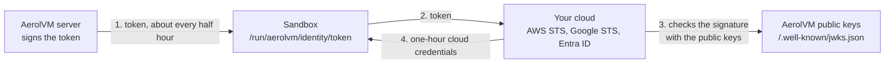

import { Aside, Tabs, TabItem } from '@astrojs/starlight/components';

Code in a sandbox often needs to reach your cloud: read a bucket, write to a queue, call a model. The usual way is to put an access key in an environment variable. That key lasts for months, and anyone who copies it can use it from anywhere.

A **cloud identity** removes the key. AerolVM signs a short token that says "this sandbox belongs to team `payments` and may act as role `deploy`". Your cloud checks the signature against AerolVM's public keys and trades the token for its own credentials, which last one hour. This is the same idea as IRSA on Amazon EKS and Workload Identity on Google Kubernetes Engine.

It works with AWS, Google Cloud and Azure, and the cloud SDKs inside the sandbox find the token on their own.

## How it works



1. **AerolVM signs a token** for the sandbox and writes it to a file inside it. It writes a fresh one before the old one runs out.
2. **A cloud SDK in the sandbox reads the file** and sends the token to your cloud.
3. **Your cloud checks the token** against AerolVM's public keys, which anyone can download.
4. **Your cloud returns credentials** for the role you chose, valid for one hour.

No cloud secret is stored in AerolVM, in the sandbox, or in your code.

## What you need

- **An AerolVM server with a public HTTPS address.** Your cloud downloads the public keys from it. The operator sets `SB_IDENTITY_ISSUER_URL` to that address, for example `https://api.example.com`, on every server. The address must use HTTPS and have no path. To check it, open `https://api.example.com/.well-known/openid-configuration` in a browser. You should see a short JSON page.
- **An admin.** Only an admin can choose which role tags a team may use.
- **A container or Firecracker sandbox.** Docker, containerd, gVisor and Firecracker sandboxes can have an identity. WASM and V8 isolate sandboxes cannot, because they have no file a cloud SDK could read.

## Step 1: Allow a role tag for a team

A **role tag** is a short name, like `deploy` or `read-reports`, that you will trust in your cloud. Each team has its own list of allowed tags. A sandbox can only use a tag that is on its team's list.

For each tag, you also pick the lowest caller role that may use it: `runner` (anyone who can create sandboxes) or `admin`. Use `admin` for powerful roles, so a regular team member cannot create a sandbox that uses them.

<Tabs syncKey="lang">
  <TabItem label="TypeScript">
    ```ts
    // Signed in as an admin.
    await client.putIdentityRole("deploy", { minRole: "runner", team: "payments" });
    ```
  </TabItem>
  <TabItem label="Python">
    ```python
    # Signed in as an admin.
    client.put_identity_role("deploy", {"minRole": "runner", "team": "payments"})
    ```
  </TabItem>
  <TabItem label="Go">
    ```go
    // Signed in as an admin.
    _, err := client.PutIdentityRole(ctx, "deploy", sdktypes.IdentityRoleOptions{
        MinRole: "runner",
        Team:    "payments",
    })
    if err != nil {
        log.Fatal(err)
    }
    ```
  </TabItem>
  <TabItem label="Rust">
    ```rust
    // Signed in as an admin.
    client.put_identity_role(
        "deploy",
        IdentityRoleOptions { min_role: "runner".into(), team: Some("payments".into()) },
    )?;
    ```
  </TabItem>
  <TabItem label="Java">
    ```java
    // Signed in as an admin.
    client.putIdentityRole("deploy", new IdentityRoleOptions()
        .setMinRole("runner")
        .setTeam("payments"));
    ```
  </TabItem>
</Tabs>

Leave out `team` for sandboxes that the operator token creates. Calling this again with the same values changes nothing, so it is safe to retry.

## Step 2: Trust AerolVM in your cloud

The token's **subject** names the team and the role tag: `team:payments:role:deploy`. Your cloud trusts that exact subject. Sandboxes that the operator token creates have the subject `operator:role:deploy` instead.

### AWS

1. In IAM, open **Identity providers** and add an **OpenID Connect** provider. Set the provider URL to your `SB_IDENTITY_ISSUER_URL` and the audience to `sts.amazonaws.com`.
2. Create an IAM role for the work, or open an existing one. Give it only the permissions the sandbox needs.
3. Set the role's trust policy so that only this subject can use it. Replace the account number and host name with yours:

```json
{
  "Version": "2012-10-17",
  "Statement": [
    {
      "Effect": "Allow",
      "Principal": { "Federated": "arn:aws:iam::123456789012:oidc-provider/api.example.com" },
      "Action": "sts:AssumeRoleWithWebIdentity",
      "Condition": {
        "StringEquals": {
          "api.example.com:aud": "sts.amazonaws.com",
          "api.example.com:sub": "team:payments:role:deploy"
        }
      }
    }
  ]
}
```

4. Set the role's **maximum session duration** to one hour. That is the shortest time AWS allows.

When you create the sandbox, pass the role's ARN as `awsRoleArn`. The sandbox then gets `AWS_ROLE_ARN` and `AWS_WEB_IDENTITY_TOKEN_FILE`, which every AWS SDK and the AWS CLI read on their own.

### Google Cloud

1. In IAM, create a **workload identity pool** and add an **OIDC provider** to it. Set the issuer URL to your `SB_IDENTITY_ISSUER_URL`.
2. Set the attribute mapping `google.subject` to `assertion.sub`.
3. Give the subject access. Either grant roles to it directly, or let it act as a service account by granting `roles/iam.workloadIdentityUser` to `principal://iam.googleapis.com/projects/PROJECT_NUMBER/locations/global/workloadIdentityPools/POOL_ID/subject/team:payments:role:deploy`.
4. Google checks the token's audience. By default it expects the provider's full name, so pass this as the sandbox's `audience`:
   `https://iam.googleapis.com/projects/PROJECT_NUMBER/locations/global/workloadIdentityPools/POOL_ID/providers/PROVIDER_ID`
5. Put this credential file in the sandbox, either in the image or uploaded with the file API, and set `GOOGLE_APPLICATION_CREDENTIALS` to its path. The file holds no secret. It tells the Google SDKs where the token is:

```json
{
  "type": "external_account",
  "audience": "//iam.googleapis.com/projects/PROJECT_NUMBER/locations/global/workloadIdentityPools/POOL_ID/providers/PROVIDER_ID",
  "subject_token_type": "urn:ietf:params:oauth:token-type:jwt",
  "token_url": "https://sts.googleapis.com/v1/token",
  "credential_source": { "file": "/run/aerolvm/identity/token" },
  "service_account_impersonation_url": "https://iamcredentials.googleapis.com/v1/projects/-/serviceAccounts/SERVICE_ACCOUNT_EMAIL:generateAccessToken"
}
```

Leave out the last line if you granted roles to the subject directly.

### Azure

1. Open the app registration, or the user-assigned managed identity, that the sandbox should act as.
2. Under **Federated credentials**, add a credential for "Other issuer". Set:
   - **Issuer** to your `SB_IDENTITY_ISSUER_URL`, exactly as the operator set it.
   - **Subject identifier** to `team:payments:role:deploy`.
   - **Audience** to `api://AzureADTokenExchange`.
3. Give that app or identity the Azure roles the work needs.

When you create the sandbox, pass the app's client ID and your tenant ID, and set `audience` to `api://AzureADTokenExchange`. The sandbox then gets `AZURE_CLIENT_ID`, `AZURE_TENANT_ID` and `AZURE_FEDERATED_TOKEN_FILE`, which the Azure SDKs read for workload identity.

## Step 3: Create a sandbox with an identity

Pass `identity` when you create the sandbox. This example uses AWS.

<Tabs syncKey="lang">
  <TabItem label="TypeScript">
    ```ts
    const sandbox = await client.create({
      image: "python:3.12",
      identity: {
        roleTag: "deploy",
        awsRoleArn: "arn:aws:iam::123456789012:role/sandbox-deploy",
      },
    });

    console.log(sandbox.identity?.subject); // team:payments:role:deploy
    ```
  </TabItem>
  <TabItem label="Python">
    ```python
    sandbox = client.create(
        image="python:3.12",
        identity={
            "roleTag": "deploy",
            "awsRoleArn": "arn:aws:iam::123456789012:role/sandbox-deploy",
        },
    )

    print(sandbox.identity["subject"])  # team:payments:role:deploy
    ```
  </TabItem>
  <TabItem label="Go">
    ```go
    sandbox, err := client.Create(ctx, sdktypes.CreateSandboxOptions{
        Image: "python:3.12",
        Identity: &sdktypes.IdentityOptions{
            RoleTag:    "deploy",
            AWSRoleARN: "arn:aws:iam::123456789012:role/sandbox-deploy",
        },
    })
    if err != nil {
        log.Fatal(err)
    }

    fmt.Println(sandbox.Identity.Subject) // team:payments:role:deploy
    ```
  </TabItem>
  <TabItem label="Rust">
    ```rust
    let sandbox = client.create(CreateOptions {
        image: "python:3.12".into(),
        identity: Some(IdentityOptions {
            role_tag: "deploy".into(),
            aws_role_arn: "arn:aws:iam::123456789012:role/sandbox-deploy".into(),
            ..Default::default()
        }),
        ..Default::default()
    })?;

    if let Some(identity) = &sandbox.data.identity {
        println!("{}", identity.subject); // team:payments:role:deploy
    }
    ```
  </TabItem>
  <TabItem label="Java">
    ```java
    Sandbox sandbox = client.create(new CreateOptions()
        .setImage("python:3.12")
        .setIdentity(new IdentityOptions()
            .setRoleTag("deploy")
            .setAwsRoleArn("arn:aws:iam::123456789012:role/sandbox-deploy")));

    System.out.println(sandbox.toData().identity.subject); // team:payments:role:deploy
    ```
  </TabItem>
</Tabs>

Code inside the sandbox needs no change. For example, `boto3.client("s3")` in Python, or `aws s3 ls` with the AWS CLI, uses the role at once.

The `identity` option takes:

| Field | What it does |
|---|---|
| `roleTag` | Required. A tag on your team's allow list. |
| `audience` | The token's audience. Default `sts.amazonaws.com`. Use `api://AzureADTokenExchange` for Azure and the provider's name for Google Cloud. |
| `awsRoleArn` | Also sets `AWS_ROLE_ARN` and `AWS_WEB_IDENTITY_TOKEN_FILE`. |
| `azureClientId`, `azureTenantId` | Set both. Also sets `AZURE_CLIENT_ID`, `AZURE_TENANT_ID` and `AZURE_FEDERATED_TOKEN_FILE`. |

Every sandbox with an identity also gets `AEROLVM_IDENTITY_TOKEN_FILE`, the path of the token file: `/run/aerolvm/identity/token`. Do not set these variables in `env` yourself with different values; the create is refused if you do.

## What the token says

The token is a signed JSON Web Token (RS256). Its claims are:

| Claim | Value |
|---|---|
| `iss` | Your `SB_IDENTITY_ISSUER_URL` |
| `sub` | `team:<team>:role:<role tag>`, or `operator:role:<role tag>` |
| `aud` | The audience you chose |
| `sandbox` | The sandbox ID, for your logs. Do not trust on it. |
| `team`, `role` | The team and the role tag |
| `iat`, `nbf`, `exp` | Issued now, valid from one minute ago, expires in one hour |
| `jti` | A unique ID for this token |

Trust on `sub` and `aud` only. AWS can only check those two, and Azure matches the subject exactly.

## When the token arrives and how it stays fresh

- **The first token arrives right after the create returns,** usually at once. A program that reads the file in its very first moments may not find it yet. The AWS and Azure SDKs try again on their own; your own scripts should too.
- **AerolVM writes a new token before the old one runs out.** Every five minutes it looks for tokens with less than 30 minutes left and replaces them. The file is replaced in one step, so a reader sees the old token or the new one, never half of each.
- **After a stop and start,** the sandbox gets a new token at once.
- **`get` shows when the token expires** (`identity.tokenExpiresAt`) and, if the last attempt failed, why (`identity.lastError`).

## Manage the allow list

List a team's tags, or take one off the list.

<Tabs syncKey="lang">
  <TabItem label="TypeScript">
    ```ts
    const page = await client.listIdentityRoles({ team: "payments" });
    for (const role of page.roles) {
      console.log(role.tag, role.minRole);
    }

    await client.deleteIdentityRole("deploy", { team: "payments" });
    ```
  </TabItem>
  <TabItem label="Python">
    ```python
    page = client.list_identity_roles({"team": "payments"})
    for role in page["roles"]:
        print(role["tag"], role["minRole"])

    client.delete_identity_role("deploy", {"team": "payments"})
    ```
  </TabItem>
  <TabItem label="Go">
    ```go
    page, err := client.ListIdentityRoles(ctx, sdktypes.ListIdentityRolesOptions{Team: "payments"})
    if err != nil {
        log.Fatal(err)
    }
    for _, role := range page.Roles {
        fmt.Println(role.Tag, role.MinRole)
    }

    if err := client.DeleteIdentityRole(ctx, "deploy", "payments"); err != nil {
        log.Fatal(err)
    }
    ```
  </TabItem>
  <TabItem label="Rust">
    ```rust
    let page = client.list_identity_roles(ListIdentityRolesOptions {
        team: Some("payments".into()),
        ..Default::default()
    })?;
    for role in &page.roles {
        println!("{} {}", role.tag, role.min_role);
    }

    client.delete_identity_role("deploy", Some("payments"))?;
    ```
  </TabItem>
  <TabItem label="Java">
    ```java
    IdentityRoleList page = client.listIdentityRoles(new ListIdentityRolesOptions().setTeam("payments"));
    for (IdentityRole role : page.roles) {
        System.out.println(role.tag + " " + role.minRole);
    }

    client.deleteIdentityRole("deploy", "payments");
    ```
  </TabItem>
</Tabs>

When you take a tag off the list, sandboxes that use it keep the token they have, which lasts at most one hour, and get no new one. Deleting a tag that is already gone succeeds. Pages hold up to 100 tags; pass `nextCursor` back as `cursor` for the next page.

## Security

- **A stolen token gives one role for at most one hour.** It is the role that sandbox already had. It cannot be turned into another role or another team, and it stops working at `exp`.
- **The team comes from your credential.** AerolVM builds the subject from the team of the credential that created the sandbox and a tag on that team's list. Nothing in the create request can name a different team.
- **Only an admin can add a tag,** and each tag names the lowest role that may use it.
- **No one can fetch a token through the API.** Only the sandbox receives it. The route that delivers it is closed to API callers, and it needs the sandbox's own toolbox token, which only the AerolVM server holds.
- **The signing key never leaves the server.** It is encrypted with the server key on disk and in the cluster, never logged, and never returned by any API. The public documents hold public keys only.
- **Every token is recorded.** Each delivery adds an `identity.token_issued` record to the sandbox's audit log, with the role tag, key ID, token ID and expiry. The token itself is never recorded.

### Turning access off

- **Destroy the sandbox,** or **take its tag off the list.** Either way it gets no new token.
- A token that was already issued **stays valid until it expires,** at most one hour later. To stop sooner, remove the trust in your cloud (the AWS trust policy, the Google pool provider or the Azure federated credential). Keep the cloud session short, too: one hour is the lowest AWS allows.

## Rotating the signing key

An operator can replace the signing key with `POST /v1/identity/keys/rotate`. The new key signs every token from then on. The old key stays in the public key list for two hours, so tokens it signed keep working until they expire. Your cloud picks up the new key from the public key list by itself; you do not change anything in your cloud.

## Errors

| Error | Why |
|---|---|
| 400 `identity needs SB_IDENTITY_ISSUER_URL` | The server is not set up as an issuer. Ask your operator. |
| 400 on a WASM or isolate sandbox | These runtimes cannot have an identity. Use a container or Firecracker sandbox. |
| 400 on `env` | `env` sets one of the identity variables to a different value. Remove it. |
| 403 `not on this team's identity allow list` | Ask an admin to add the tag for your team. |
| 403 `needs role admin or higher` | The tag needs an admin to create the sandbox. |
| 503 | A cluster node runs an older AerolVM version, or the cluster cannot be reached right now. Try again. |

<Aside type="note">
A Firecracker template keeps the toolbox agent it was built with. If a template was built before cloud identity existed, its sandboxes never get a token, and `identity.lastError` says so. Rebuild the template to fix it.
</Aside>
