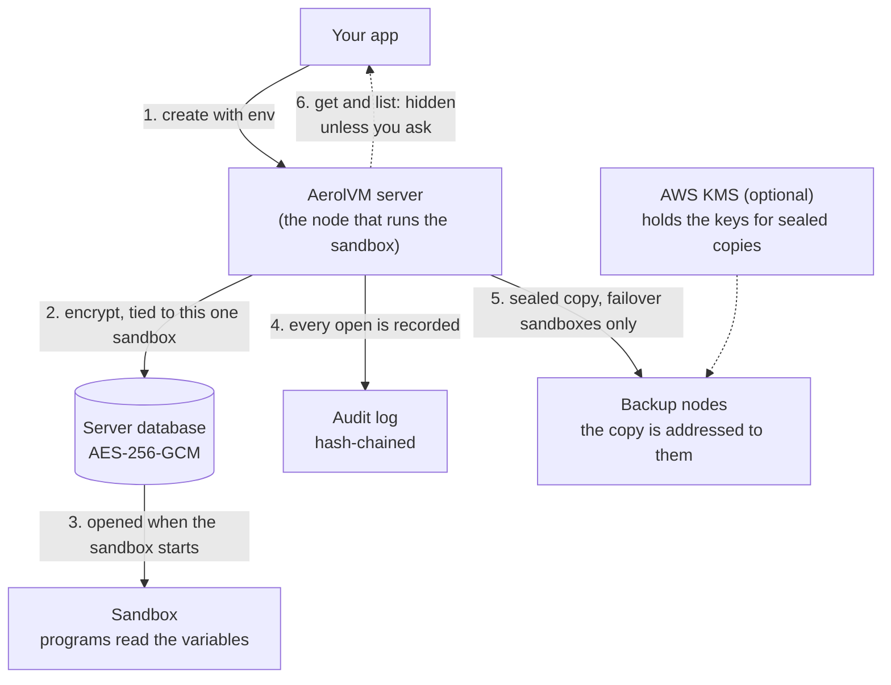

import { Aside, Tabs, TabItem } from '@astrojs/starlight/components';

Environment variables are named settings, like `APP_ENV=staging` or `DATABASE_URL=postgres://...`, that every program in the sandbox can read. You set them when you create the sandbox.

AerolVM treats every variable as a secret, even ones that are not. It encrypts them, hides them from normal API answers, shares them across a cluster only in sealed form, and records every time they are opened.

## How AerolVM protects your variables



1. **You send the variables once,** in `env` when you create the sandbox.
2. **The server encrypts them** with AES-256-GCM and ties them to that sandbox and that one life of it. A copy of the encrypted data cannot be opened for any other sandbox, even one that reuses the ID.
3. **The sandbox gets them when it starts.** Programs inside read them like any other environment variable.
4. **Every open is recorded** in the sandbox's audit log: when the sandbox starts, when it is rebuilt, and when your code asks for the values.
5. **In a cluster, only sealed copies move.** The record that every node shares never holds the values. See [In a cluster](#in-a-cluster).
6. **Normal API answers leave them out.** Create, get and list return no variables unless you ask for them.

## Compared with a plain container

| | A plain Docker container | An AerolVM sandbox |
|---|---|---|
| How the platform stores them | Plain text, in the container's settings | Encrypted, tied to one sandbox |
| Who can read them through the API | Anyone who can look at the container | Only callers who ask for them, and every read is recorded |
| Copies on other servers | Up to you | Sealed, and only on the nodes that need them |
| A record of who read them | None | A hash-chained audit log |

AerolVM still hands the values to the container engine on the node that runs the sandbox. Someone with admin access to that machine can see them there. See [Good to know](#good-to-know).

## Set environment variables

Pass a map of names and values in `env`.

<Tabs syncKey="lang">
  <TabItem label="TypeScript">
    ```ts
    const sandbox = await client.create({
      image: "ubuntu:22.04",
      env: {
        DATABASE_URL: "postgres://...",
        APP_ENV: "sandbox",
      },
    });

    const result = await sandbox.exec("echo $APP_ENV");
    console.log(result.stdout); // sandbox
    ```
  </TabItem>
  <TabItem label="Python">
    ```python
    sandbox = client.create(
        image="ubuntu:22.04",
        env={
            "DATABASE_URL": "postgres://...",
            "APP_ENV": "sandbox",
        },
    )

    result = sandbox.exec("echo $APP_ENV")
    print(result["stdout"])  # sandbox
    ```
  </TabItem>
  <TabItem label="Go">
    ```go
    sandbox, err := client.Create(ctx, sdktypes.CreateSandboxOptions{
        Image: "ubuntu:22.04",
        Env: map[string]string{
            "DATABASE_URL": "postgres://...",
            "APP_ENV":      "sandbox",
        },
    })
    if err != nil {
        log.Fatal(err)
    }

    result, err := sandbox.ExecCommand(ctx, "echo $APP_ENV")
    if err != nil {
        log.Fatal(err)
    }
    fmt.Print(result.Stdout) // sandbox
    ```
  </TabItem>
  <TabItem label="Rust">
    ```rust
    use std::collections::HashMap;

    let env = HashMap::from([
        ("DATABASE_URL".to_string(), "postgres://...".to_string()),
        ("APP_ENV".to_string(), "sandbox".to_string()),
    ]);

    let sandbox = client.create(CreateOptions {
        image: "ubuntu:22.04".into(),
        env: Some(env),
        ..Default::default()
    })?;

    let result = sandbox.exec("echo $APP_ENV")?;
    print!("{}", result.stdout); // sandbox
    ```
  </TabItem>
  <TabItem label="Java">
    ```java
    Sandbox sandbox = client.create(new CreateOptions()
        .setImage("ubuntu:22.04")
        .setEnv(Map.of(
            "DATABASE_URL", "postgres://...",
            "APP_ENV", "sandbox")));

    ExecResult result = sandbox.exec("echo $APP_ENV");
    System.out.print(result.stdout); // sandbox
    ```
  </TabItem>
</Tabs>

You cannot change a sandbox's variables after you create it. To pass a value to a single command instead, use the `env` option of `exec`. See [Run commands](/exec-streaming/).

## Read the variables back

`get` leaves the variables out unless you ask for them. Ask only when your code really needs the values, because each read is recorded.

<Tabs syncKey="lang">
  <TabItem label="TypeScript">
    ```ts
    const sandbox = await client.get(id, { includeEnv: true });
    console.log(sandbox.env?.APP_ENV);
    ```
  </TabItem>
  <TabItem label="Python">
    ```python
    sandbox = client.get(sandbox_id, include_env=True)
    print(sandbox.to_dict().get("env", {}).get("APP_ENV"))
    ```
  </TabItem>
  <TabItem label="Go">
    ```go
    sandbox, err := client.Get(ctx, id, microvm.WithGetIncludeEnv())
    if err != nil {
        log.Fatal(err)
    }
    fmt.Println(sandbox.Env["APP_ENV"])
    ```
  </TabItem>
  <TabItem label="Rust">
    ```rust
    let sandbox = client.get_with_options(&id, true)?;
    println!("{:?}", sandbox.data.env);
    ```
  </TabItem>
  <TabItem label="Java">
    ```java
    Sandbox sandbox = client.get(id, true);
    System.out.println(sandbox.env.get("APP_ENV"));
    ```
  </TabItem>
</Tabs>

`list` takes the same opt-in. This example also filters by [tag](/sandbox-tags/):

<Tabs syncKey="lang">
  <TabItem label="TypeScript">
    ```ts
    const sandboxes = await client.list({
      tags: { tenant: "acme" },
      includeEnv: true,
    });
    ```
  </TabItem>
  <TabItem label="Python">
    ```python
    sandboxes = client.list(tags={"tenant": "acme"}, include_env=True)
    ```
  </TabItem>
  <TabItem label="Go">
    ```go
    sandboxes, err := client.List(ctx,
        microvm.WithTags(map[string]string{"tenant": "acme"}),
        microvm.WithIncludeEnv(),
    )
    ```
  </TabItem>
  <TabItem label="Rust">
    ```rust
    let tags = HashMap::from([("tenant".to_string(), "acme".to_string())]);
    let sandboxes = client.list_with_options(&tags, true)?;
    ```
  </TabItem>
  <TabItem label="Java">
    ```java
    List<Sandbox> sandboxes = client.list(Map.of("tenant", "acme"), true);
    ```
  </TabItem>
</Tabs>

<Aside type="caution">
A normal `get` or `list` has no variables in it. In TypeScript `env` is `undefined`, in Go it is `nil`, in Rust it is `None`, and in Java it is `null`. In Python the `env` key is missing. That does **not** mean the sandbox lost its variables. Never copy that empty value into a new sandbox.
</Aside>

## See every time they were opened

Each time a server opens a sandbox's variables, it writes a `secret_open` record to the sandbox's audit log. The record says when, which server opened them, and whether it worked. Read the records like this:

<Tabs syncKey="lang">
  <TabItem label="TypeScript">
    ```ts
    const page = await sandbox.audit({ kind: "secret_open" });
    for (const event of page.events) {
      console.log(event.time, event.actor, event.ref, event.result);
    }
    ```
  </TabItem>
  <TabItem label="Python">
    ```python
    page = sandbox.audit({"kind": "secret_open"})
    for event in page["events"]:
        print(event["time"], event.get("actor"), event.get("ref"), event["result"])
    ```
  </TabItem>
  <TabItem label="Go">
    ```go
    page, err := sandbox.Audit(ctx, sdktypes.AuditOptions{Kind: "secret_open"})
    if err != nil {
        log.Fatal(err)
    }
    for _, event := range page.Events {
        fmt.Println(event.Time, event.Actor, event.Ref, event.Result)
    }
    ```
  </TabItem>
  <TabItem label="Rust">
    ```rust
    let page = sandbox.audit(AuditOptions {
        kind: Some("secret_open".to_string()),
        ..Default::default()
    })?;
    for event in &page.events {
        println!("{} {:?} {:?} {}", event.time, event.actor, event.r#ref, event.result);
    }
    ```
  </TabItem>
  <TabItem label="Java">
    ```java
    AuditPage page = sandbox.audit(new AuditOptions().setKind("secret_open"));
    for (AuditEvent event : page.events) {
        System.out.println(event.time + " " + event.actor + " " + event.ref + " " + event.result);
    }
    ```
  </TabItem>
</Tabs>

A record with `ref` `env:<sandbox-id>` is a read of the variables. Registry passwords and storage credentials show up under the same kind. Each record carries a fingerprint (hash) of the one before it, so a changed or deleted record breaks the chain. The server operator can also send the log to their own storage. See [Auditability](/getting-started/cluster-setup/#auditability).

## In a cluster

A cluster is a group of AerolVM servers that work as one. Every node keeps a shared record of every sandbox, so any node can answer for it. That shared record never holds your variables.

- **By default, the variables stay on one node.** They are sealed (encrypted for chosen nodes) on the node that runs the sandbox, and nowhere else.
- **Sandboxes with failover get backup copies.** Create a sandbox with `failover: { policy: "recreate" }` and a sealed copy also goes to backup nodes (two by default). The copy is addressed to those nodes. With the default key, every node shares one key, so the address is checked in software, not by the encryption. The create waits until at least one backup confirms its copy. If the sandbox's node dies, a backup rebuilds it with the same variables. See [Durability and failover](/durability/).
- **AWS KMS can hold the keys.** Then AWS permissions decide which nodes may open a sealed copy, and AWS logs every use of the key. See [Secrets providers](/cluster-secrets/).
- **Nodes prove who they are** before they exchange sealed copies, over mutual TLS.

## Good to know

- **Inside the sandbox, the values are plain.** That is how programs read them. Any code you run in the sandbox can read every variable, so only pass secrets that code is allowed to see.
- **The node's container engine holds them too.** AerolVM hands the values to Docker or containerd on the node that runs the sandbox. Someone with admin access to that machine can see them there. Protect the machines that run your sandboxes.
- **Snapshots copy them.** Saving a sandbox as a [snapshot](/images-and-snapshots/#snapshots) also saves its variables. Do not snapshot a sandbox whose secrets you would not share with every user of the snapshot.
- **They cannot change after create.** To use a new value, create a new sandbox.

## If your code reads env from get or list

Older AerolVM servers returned `env` on every get and list. Newer servers hide it, on every kind of install, including a single server or your laptop. No server setting brings the old behavior back. Update your code before you upgrade the server:

1. **Find the code that reads `env`** after a get or list. Look closely at code that copies those values into a new create. An empty `env` now means "hidden", not "none".
2. **Upgrade the SDK** to a version with the opt-in shown above. Ask for env only where you need the secret values. Dashboards, status checks and inventory code should keep the default.
3. **Test both cases** in a staging setup first. Check that the opt-in read works and creates an audit record. Check that your app does not log the secrets it gets back.

A client you cannot upgrade yet needs a code change before the server upgrade. The database upgrade does not make old clients work.

## For server operators

- **Encryption.** The server stores variables in the `sandbox_env` table as one encrypted, signed blob per sandbox (AES-256-GCM). The blob is tied to the sandbox ID and to that one life of the sandbox. Copying it to another sandbox, or to a new sandbox that reuses the ID, does not make it readable there.
- **The key.** The server reads the key from `SB_CREDENTIAL_ENCRYPTION_KEY`. Without it, a single server uses the key file at `SB_CREDENTIAL_ENCRYPTION_KEY_PATH` (default `/var/lib/sandboxd/credential_encryption.key`) and creates it on first start. In cluster mode, every node needs the same key, and the server will not start without one. Back the key up with the database.
- **Fails closed.** If the key is missing or the blob is damaged, the read fails. It never falls back to plain text. A missing blob for a sandbox that should have one is reported as an error, not treated as "no variables".
- **Upgrade.** On startup, the server moves old plain-text values into the encrypted form, in one transaction. It also re-ties older encrypted rows to their sandbox with the existing key. It records the upgrade in the schema, so later reads and restarts never use the old form.
- **Back up first.** Back up the database **and its matching key** before you upgrade. Keep them together in case you roll back. Do not run an older server binary against an upgraded database.

## Next steps

- [Secrets providers](/cluster-secrets/): how a cluster seals and copies secrets, and how to use AWS KMS.
- [Durability and failover](/durability/): rebuild a sandbox, with its variables, when its node dies.
- [Run commands](/exec-streaming/): pass a variable to one command with `env`.
- [Tags](/sandbox-tags/): filter lists of sandboxes by label.
