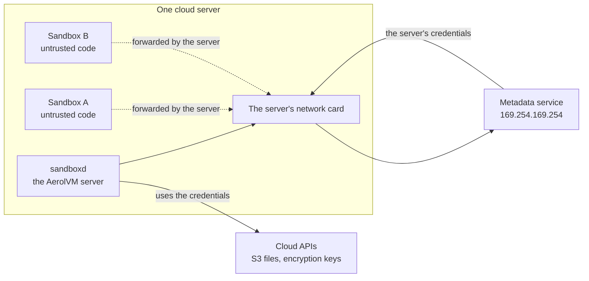
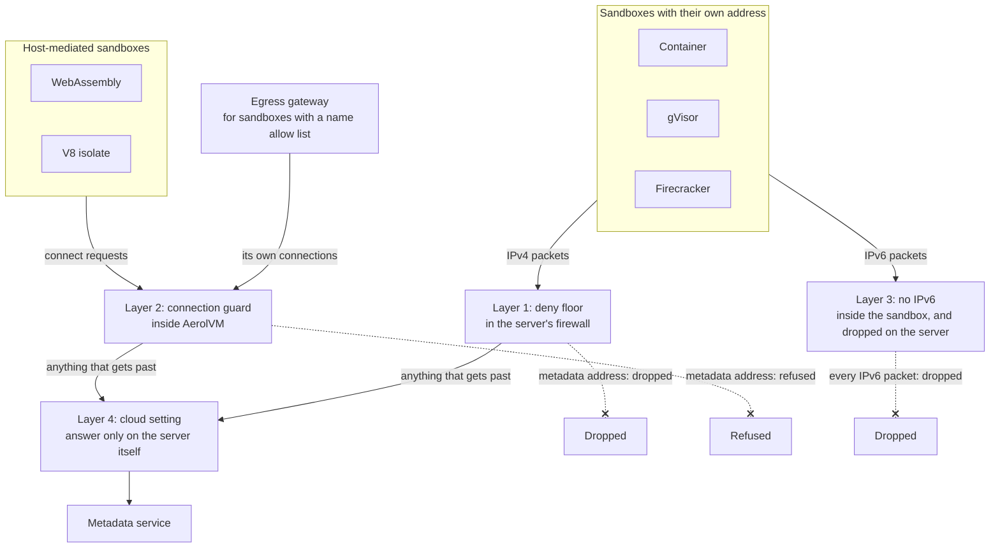
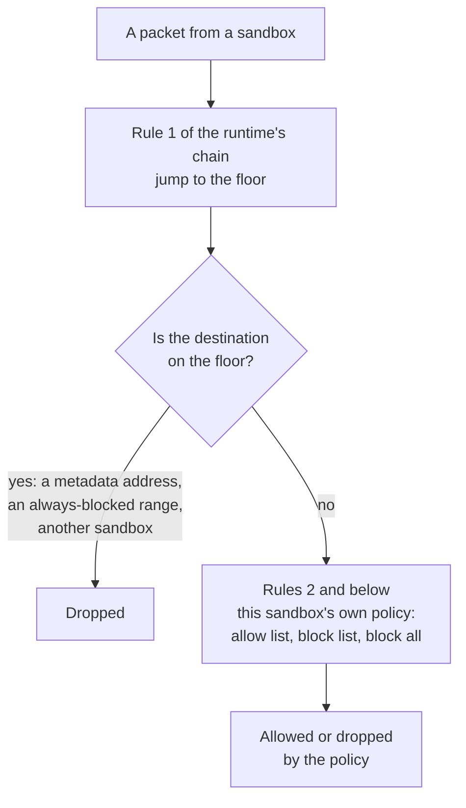
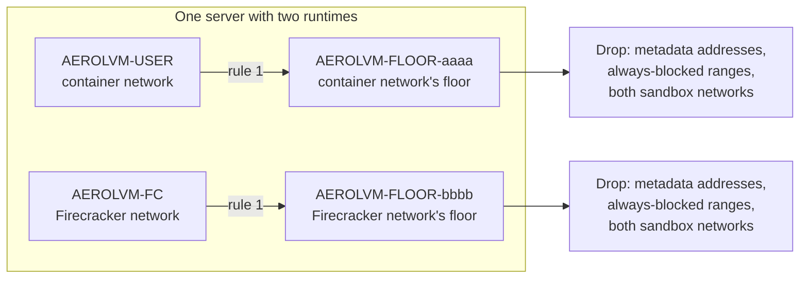
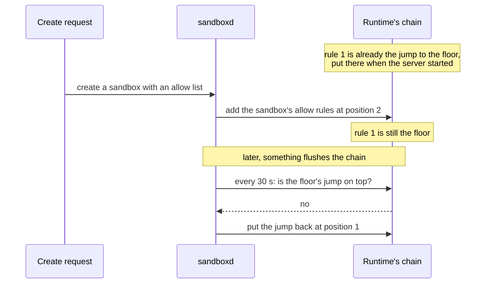
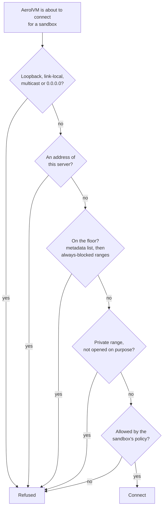
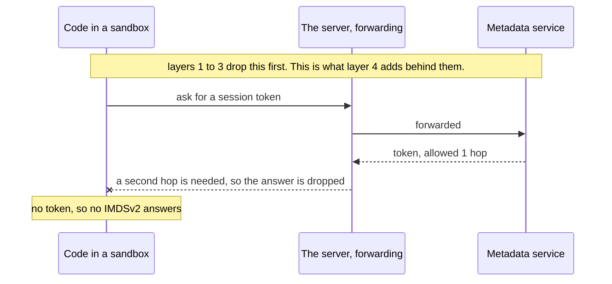
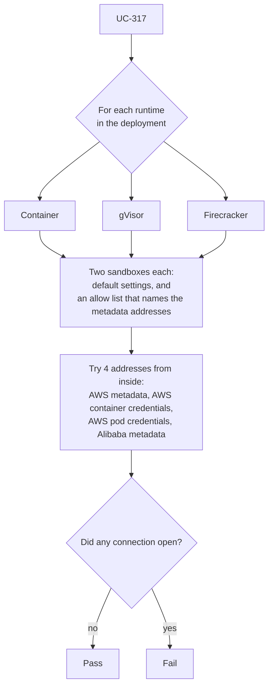
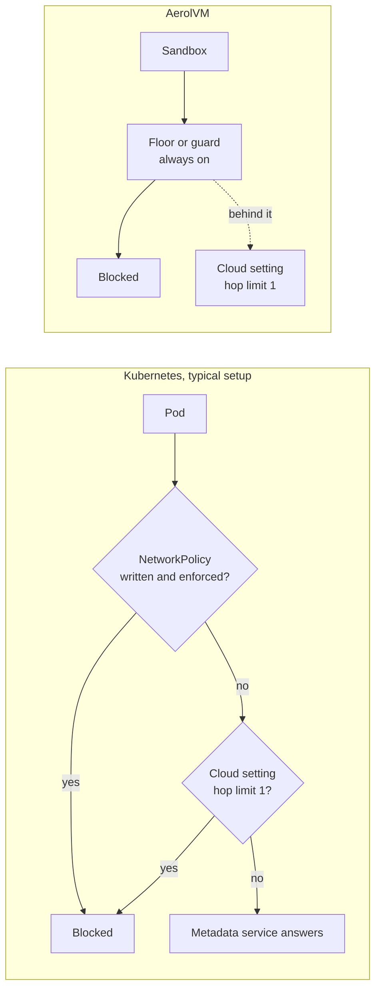

import { Tabs, TabItem } from '@astrojs/starlight/components';

Every cloud server has a **metadata service**. It is a small web service that the cloud runs next to each server, at a fixed address. Programs on the server ask it about the machine, and it hands out the server's own cloud credentials. On AWS those credentials belong to the server's **IAM role**: the set of cloud permissions the server was given. For an AerolVM server, that role can read the cluster's files in S3 and use its encryption keys.

A sandbox runs code you did not write. If that code could reach the metadata service, it could ask for the server's credentials and act as the server. So no sandbox may ever reach it, on any runtime, with any policy. This post explains how AerolVM makes sure of that.

**In short:**

- The metadata service answers anything that can reach its address. It does not know whether a sandbox or the server is asking.
- AerolVM blocks it in four layers. Each one is enough on its own for the traffic it sees.
- **Layer 1:** a drop rule in the server's firewall, placed above every sandbox's own rules. It covers containers, gVisor and Firecracker.
- **Layer 2:** a connection guard inside AerolVM. It covers WebAssembly and V8 isolate sandboxes, and the egress gateway.
- **Layer 3:** no IPv6 inside a sandbox, so the IPv6 forms of the address are out of reach too.
- **Layer 4:** the cloud's own setting. Our Terraform module tells AWS to answer only on the server itself.
- The list of addresses lives in the code. No setting, policy or allow list can remove an address from it.
- A live test tries to reach the service from every runtime, in every integration run that has container sandboxes.

## The threat

This section explains why the metadata service is dangerous to a sandbox platform.

The metadata service sits at a **link-local** address: an address that works only on the local network segment and is never routed on the internet. On AWS, Google Cloud, Azure, Oracle and OpenStack it is `169.254.169.254`. Some clouds and services add more. AWS has separate addresses for container and Kubernetes pod credentials. Azure has a second service, called WireServer. Alibaba Cloud uses an address of its own.

The cloud does not check who sends the question. It checks only that the question comes from the server's own network card. A sandbox's traffic leaves through that same card, after the server **forwards** it (passes it on from the sandbox's private network). So, to the metadata service, a question from a sandbox looks like a question from the server.



**What this shows:** the server and its sandboxes leave through one network card. Without a rule in the way, the metadata service cannot tell them apart.

This is a well-known problem on every cloud. AWS built IMDSv2, a second version of the service, partly for this reason (see [Sources](#sources)). Kubernetes platforms give the same advice for pods, as [How this compares](#how-this-compares) shows.

## The design: four layers

This section shows the four layers and which sandboxes each one covers.

AerolVM has five runtimes, and they reach the network in two different ways:

- **Containers, gVisor and Firecracker** have their own network address. Their packets cross the server's firewall on the way out.
- **WebAssembly and V8 isolate** sandboxes have no network of their own. AerolVM opens each connection for them, after it checks the address. This is called **host-mediated** networking.

So the design needs one layer for each way out, and more behind them.



**What this shows:** every way out of a sandbox meets at least one layer that refuses the metadata addresses. The cloud's own setting sits behind them all, as a last layer.

### One list of addresses

All the layers read one list in the code, `MetadataPrefixes` in `pkg/egresspolicy/metadata.go`. It holds:

- `169.254.169.254`, the metadata service on AWS, Google Cloud, Azure, OpenStack, Oracle and DigitalOcean;
- `169.254.170.2` and `169.254.170.23`, the AWS credential services for containers (ECS) and Kubernetes pods (EKS Pod Identity);
- `168.63.129.16`, Azure's WireServer;
- `100.100.100.200`, Alibaba Cloud's metadata service;
- the IPv6 forms of the AWS addresses.

Not every one of these is link-local. Azure's WireServer and Alibaba's address sit in other ranges. A rule that blocked only link-local addresses would miss them, so the list names each address.

### Layer 1: the deny floor

This layer covers containers, gVisor and Firecracker. It lives in the server's Linux firewall (`iptables`). The firewall checks each packet against lists of rules called **chains**, from the top down. The first rule that matches decides what happens to the packet.

Each runtime has its own chain for its sandboxes' traffic:

| Runtime | Its chain |
|---|---|
| Docker | `DOCKER-USER` |
| containerd and gVisor | `AEROLVM-USER` |
| Firecracker | `AEROLVM-FC` |

The **deny floor** is a separate, small chain of drop rules. Its name is `AEROLVM-FLOOR-` plus 8 characters made from the sandbox network's address. It drops packets from that sandbox network to:

- every metadata address in the list;
- the address ranges the operator always blocks (`deny_cidrs`);
- every sandbox network on the server, unless the operator allows sandboxes to talk to each other. See [Between sandboxes](/engineering-network-defenses/#between-sandboxes).

The first rule of each runtime's chain is a jump to its floor. A **jump** sends the packet through another chain first. Every other rule goes below it: each sandbox's own allow and block rules, and the rules that let sandbox traffic out at all.



**What this shows:** the floor answers first. A sandbox's own allow list is read only after the floor passes the packet. So an allow list that names a metadata address changes nothing.

The floor goes in when the server starts, with or without an operator file. It needs no setup.

### One floor per sandbox network

One server can run more than one runtime at once, for example containers and Firecracker. Each runtime has its own sandbox network, so each one gets its own floor chain. A runtime only ever rewrites its own floor. It never touches another runtime's.



**What this shows:** each sandbox network has a floor of its own, and each floor drops traffic to every sandbox network on the server. The order in which the runtimes start does not matter.

The server keeps a list of every sandbox network on the machine. When a new runtime adds its network, the server rewrites the other floors once. Then each one also drops traffic to the new network.

### Keeping the floor on top

Rules change all the time. A sandbox is created, its policy changes, it is deleted. The design keeps the floor first through all of it:

- **New rules go below the floor.** When a sandbox's rules are added, they are inserted at position 2, never at position 1. The server marks the floor as "first" before it adds the jump. So a rule added at the same moment cannot land above it.
- **A jump that slipped down moves back up.** If the floor's jump is found lower in the chain, the server puts a new jump at the top.
- **A wiped chain is rebuilt.** Another program can flush the firewall, for example during a firewall reload. On containerd and Firecracker, the server checks its chain every 30 seconds and puts the floor's jump back on top.

This sequence shows a sandbox being created with an allow list.



**What this shows:** a sandbox's rules are always added under the floor, and a wiped chain gets its floor back within 30 seconds.

### Layer 2: the connection guard

This layer covers WebAssembly and V8 isolate sandboxes. It also covers the **egress gateway**: the AerolVM service that checks site names for sandboxes with a name allow list, and then opens the connection for them.

For all of these, AerolVM itself opens the connection. Before it does, a guard checks the address (`DialGuard` in `pkg/egresspolicy/dial.go`). The guard refuses, in this order:

1. loopback, link-local, multicast and `0.0.0.0` addresses;
2. any address of the server itself;
3. the **floor**: the metadata list first, then the operator's always-blocked ranges;
4. private ranges that no policy opened;
5. anything the sandbox's own policy does not allow.

Steps 1 to 3 run for every connection, even for a sandbox with no policy at all. A policy is read only from step 4 on, so it cannot open what steps 1 to 3 refused.



**What this shows:** the metadata addresses are refused twice before any policy is read: once as link-local or a named address, and once on the floor.

The egress gateway also keeps a copy of the floor in its own kernel table, the `deny_floor` set. It holds the same metadata list.

### Layer 3: no IPv6

AWS also offers its metadata service on an IPv6 address. Sandboxes have no way to reach it:

- IPv6 is off inside every container, gVisor and Firecracker sandbox from the start. A sandbox has no IPv6 address at all.
- The server also drops IPv6 traffic on every sandbox network, in case code inside a sandbox turns IPv6 back on.
- The connection guard in layer 2 lists the IPv6 forms of the AWS addresses too.

See [No IPv6 in a sandbox](/engineering-network-defenses/#no-ipv6-in-a-sandbox) for how the IPv6 fence works.

### Layer 4: the cloud's own setting

The last layer is outside AerolVM. AWS lets you choose how its metadata service answers. Our Terraform module, which builds AerolVM clusters on AWS, sets two options on every server that runs sandboxes (`Terraform/nodes.tf`):

- **IMDSv2 only** (`http_tokens = "required"`). Every question must first get a short-lived session token. The older version, IMDSv1, answers plain questions with no token, and it is turned off.
- **Hop limit 1** (`http_put_response_hop_limit = 1`). The answer that carries the session token may make only one network hop. A **hop** is one pass through a router. Forwarding the answer into a sandbox network is a second hop, so the answer is dropped on the way.



**What this shows:** with a hop limit of 1, the token can reach programs on the server itself, but not a sandbox one forwarding hop away.

This layer has limits, which is why it comes last:

- It is an AWS setting. Other clouds work differently, so the AerolVM layers must hold on their own.
- It protects only the token step of IMDSv2. If IMDSv1 were left on, the hop limit would not help.
- It applies only where our Terraform module built the server. An operator who builds servers another way must set it by hand. See [For server operators](#for-server-operators).

## The design rules

These rules keep the design true as the code changes. A change that breaks one of them is a change to the security model, not a refactor.

1. **The address list lives in the code.** No operator file, policy or allow list can remove an address from `MetadataPrefixes`. A file can only add more always-blocked ranges.
2. **One list feeds every layer.** The firewall floor, the connection guard and the egress gateway's table all read the same list. A new address added there reaches every layer at once.
3. **The deny comes first.** The floor's jump is always rule 1 of a runtime's chain. Every allow rule goes below it. No rule, from any sandbox, may be inserted above it.
4. **No shared chain.** Each sandbox network has its own floor chain, and a runtime rewrites only its own. Two runtimes on one server cannot overwrite each other's floor.
5. **Every floor knows every sandbox network.** The server keeps one list of sandbox networks, and each floor drops traffic to all of them. Start order does not matter.
6. **On from the first second.** The floor is installed when the server starts, with or without an operator file.
7. **No floor, no sandbox.** If the floor is missing for a runtime, the server refuses new sandboxes on that runtime until it is back. It never starts a sandbox and hopes the other layers hold.
8. **The cloud setting is a second layer, never the only one.** AerolVM must block the service even where the cloud setting is missing.

## How every test run checks it

This section lists the tests that check this design, and when they run.

### The live test: UC-317

UC-317 (`TestBankCloudMetadataUnreachable` in `integration-tests/suite/bank_security_test.go`) runs on real AWS servers. For each runtime the deployment has (container, gVisor and Firecracker), it starts two sandboxes:

- a sandbox with the default network settings;
- a sandbox whose own allow list names the metadata addresses.

From inside each one, it tries to open a connection to four addresses: the AWS metadata service, the AWS container and pod credential services, and Alibaba's metadata service. The test fails if any connection opens.



**What this shows:** the live test covers each runtime, with and without an allow list that asks for the metadata service.

UC-317 runs in every integration scenario that has container sandboxes, which is most of them. The largest is an 11-server cluster with containers, gVisor and Firecracker side by side. So the "two runtimes on one server" case is part of that run.

### The live test: UC-363

UC-363 (`TestBankEgressFloorFailsClosedAndHeals`, in the same file) removes a runtime's floor chain on a live server, the way a stray firewall reload might. It then checks three things:

- the server puts the floor back within 45 seconds;
- every create in that window either works or is refused with `egress_floor_not_ready`, never started without the floor;
- the metadata addresses stay unreachable, from the running sandbox and from a new one.

### The unit tests

These run in CI on every push, with no cloud and no root access:

| Test | What it checks |
|---|---|
| `TestDialGuardCheckFloor`, `TestDialGuardCheck` | The guard refuses every metadata address, with and without a policy. |
| `TestWithMetadataFloor`, `TestNilOperatorDefaults` | The list is on the floor even when there is no operator file. |
| `TestFloorJumpStaysFirst` | Sandbox rules are inserted below the floor's jump, and a lower jump moves back to the top. |
| `TestFloorsOfTwoRuntimesCoexist` | Two runtimes on one server get two different floor chains. |
| `TestFloorsDropAcrossRuntimes` | Each floor drops traffic to every runtime's sandbox network, in any start order. |
| `TestSetFloor` | A floor holds each blocked range once, and clearing the operator's ranges keeps the rest. |

`TestKernelFloor` checks the same floor on a real Linux kernel. It needs root, so it runs behind the `kerneltest` build tag, not in every CI run.

## How this compares

This section compares the design with Kubernetes on the main clouds, which faces the same problem with pods.

**Kubernetes has no built-in block.** A pod can send traffic anywhere unless a rule says otherwise. The Kubernetes docs say "By default, a pod is non-isolated for egress; all outbound connections are allowed." To block the metadata address, you write a **NetworkPolicy** (a Kubernetes rule for pod traffic). That works only if your network plugin enforces it: the docs say "Creating a NetworkPolicy resource without a controller that implements it will have no effect."

**On AWS (EKS), the advice is the cloud setting.** The EKS Best Practices Guide says a pod "can still inherit the rights of the instance profile assigned to the worker node". To block it, the guide says to require IMDSv2 and set the hop limit to 1. Another way is to block the address with `iptables` on the node. The guide also notes that nodes made by `eksctl` or the official templates allow both IMDS versions, with a hop limit of 2. That lets pods that need the metadata service reach it.

**On Google Cloud (GKE), a stand-in answers.** With Workload Identity Federation for GKE, a GKE metadata server runs on every node. It catches requests from pods to the metadata address, so pods "can no longer access the Compute Engine metadata server" directly. Pods on the host network are the exception.

| Question | Kubernetes | AerolVM |
|---|---|---|
| Blocked by default? | No. You add a NetworkPolicy, a cloud setting or a stand-in server. | Yes, on every server, with no setup. |
| Where the block lives | The network plugin, the cloud setting, or a node daemon | The server's firewall, AerolVM's connection guard, and the cloud setting |
| Can a workload's own rule open it? | A broader NetworkPolicy can allow it. | No. The deny is above every allow. |
| Which addresses | Usually `169.254.169.254` alone | A list of the metadata and credential addresses of the major clouds |
| Cloud setting | IMDSv2 and hop limit 1 (EKS guide); defaults vary | IMDSv2 only and hop limit 1 in our Terraform module |



**What this shows:** in a typical Kubernetes setup, the block depends on settings someone must remember. In AerolVM it is part of the server, and the cloud setting is a backup.

Kubernetes has a good reason for its default. Many pods are trusted programs that need the metadata service, for example to read their own cloud credentials. Every AerolVM sandbox is treated as untrusted, so there is no such case to allow.

## What your code sees

Nothing changes for your code. No sandbox can reach the metadata addresses, whatever its network policy says, and there is no option to turn this off.

For code you do not trust, still set a network policy. It keeps the sandbox away from your other private systems too. This sandbox can reach only the Python package servers and GitHub over SSH:

<Tabs syncKey="lang">
  <TabItem label="TypeScript">
    ```ts
    const sandbox = await client.create({
      image: 'python:3.12',
      networkAllowOut: ['pypi.org', '*.pythonhosted.org', 'github.com:22'],
    })
    ```
  </TabItem>
  <TabItem label="Python">
    ```python
    sandbox = client.create({
        'image': 'python:3.12',
        'networkAllowOut': ['pypi.org', '*.pythonhosted.org', 'github.com:22'],
    })
    ```
  </TabItem>
  <TabItem label="Go">
    ```go
    sandbox, err := client.Create(ctx, sdktypes.CreateSandboxOptions{
        Image:           "python:3.12",
        NetworkAllowOut: []string{"pypi.org", "*.pythonhosted.org", "github.com:22"},
    })
    ```
  </TabItem>
  <TabItem label="Rust">
    ```rust
    let sandbox = client.create(CreateOptions {
        image: "python:3.12".to_string(),
        network_allow_out: Some(vec![
            "pypi.org".to_string(),
            "*.pythonhosted.org".to_string(),
            "github.com:22".to_string(),
        ]),
        ..Default::default()
    })?;
    ```
  </TabItem>
  <TabItem label="Java">
    ```java
    Sandbox sandbox = client.create(
        new CreateOptions()
            .setImage("python:3.12")
            .setNetworkAllowOut(List.of("pypi.org", "*.pythonhosted.org", "github.com:22"))
    );
    ```
  </TabItem>
</Tabs>

Even if this list named a metadata address, that address would stay closed. See [Network access](/network-access/) for every policy option.

## For server operators

This section lists what AerolVM does for you, and what you can add.

**What AerolVM does with no setup:**

- installs the floor on every sandbox network when the server starts, with or without `SB_EGRESS_OPERATOR_FILE`;
- refuses to start a sandbox without the floor. If the floor cannot be installed for a runtime, new container, gVisor and Firecracker sandboxes on it get HTTP 503, error code `egress_floor_not_ready`, with `Retry-After: 5`. The server tries again every 5 seconds until the floor is in;
- checks every 30 seconds that the floor is still there, and puts it back if a firewall reload or flush removed it;
- refuses the metadata addresses in every connection it opens for a sandbox;
- turns IPv6 off in every sandbox and drops IPv6 on every sandbox network.

**What our Terraform module sets:** on every AWS server that runs sandboxes, `metadata_options` has `http_endpoint = "enabled"`, `http_tokens = "required"` and `http_put_response_hop_limit = 1`. It leaves the IPv6 metadata endpoint off, which is the AWS default. The metadata service stays on, because AerolVM itself uses the server's role, for example for its S3 files and encryption keys.

**What you can add if you build servers another way:**

- **On AWS,** require IMDSv2 and set the hop limit to 1 on every server that runs sandboxes. You can set this per server, in a launch template, or as your account's default for new servers.
- **Keep the server's role small.** Give it only the S3 buckets and keys the cluster uses. The fewer rights it has, the less any leak could do.
- **Add your private ranges to `deny_cidrs`.** The floor drops them for every sandbox, the same way it drops the metadata addresses. You do not need to list the metadata addresses yourself.
- **Watch the floor metric.** `aerolvm_egress_floor_ready` at `GET /v1/metrics` is 1 for each runtime (`docker`, `containerd`, `firecracker`) whose floor is in place, and 0 otherwise. Alert on 0 only on servers with network rules on: a local-mode server has no floor and always reads 0.

**Where to look:** each runtime's chain (`DOCKER-USER`, `AEROLVM-USER` or `AEROLVM-FC`) starts with a jump to a chain named `AEROLVM-FLOOR-` and 8 characters. That chain holds one drop rule per blocked range. The [egress gateway runbook](https://github.com/aerol-ai/microvm/blob/main/setup/runbooks/egress-gateway.md) shows how to check them.

## Sources

- [Configure the Instance Metadata Service options](https://docs.aws.amazon.com/AWSEC2/latest/UserGuide/configuring-instance-metadata-options.html) (AWS): IMDSv1 and IMDSv2, the hop limit (1 to 64), the IPv6 endpoint, and the account, AMI and instance levels where they are set.
- [Add defense in depth against open firewalls, reverse proxies, and SSRF vulnerabilities with enhancements to the EC2 Instance Metadata Service](https://aws.amazon.com/blogs/security/defense-in-depth-open-firewalls-reverse-proxies-ssrf-vulnerabilities-ec2-instance-metadata-service/) (AWS Security Blog, November 2019): why IMDSv2 exists, and why the token's packet has a time-to-live of 1 by default.
- [Identity and Access Management](https://docs.aws.amazon.com/eks/latest/best-practices/identity-and-access-management.html) (EKS Best Practices Guide): "Restrict access to the instance profile assigned to the worker node", and the hop limit of 2 on nodes made by `eksctl`.
- [Network Policies](https://kubernetes.io/docs/concepts/services-networking/network-policies/) (kubernetes.io): pods are not isolated for egress by default, and a NetworkPolicy needs a plugin that enforces it.
- [About Workload Identity Federation for GKE](https://docs.cloud.google.com/kubernetes-engine/docs/concepts/workload-identity) (Google Cloud): the GKE metadata server that answers pods in place of the Compute Engine one.

## Next steps

- [How AerolVM fences a sandbox's network](/engineering-network-defenses/): the rest of the network design, including the server itself and other sandboxes.
- [How the in-sandbox agent knows who is calling](/toolbox-agent-authentication/): the other side of the same wall, for the agent inside each sandbox.
- [Network access](/network-access/): block the internet, or allow only some sites.
- [Cluster setup](/cluster-setup/): build a cluster on AWS with the Terraform module.
