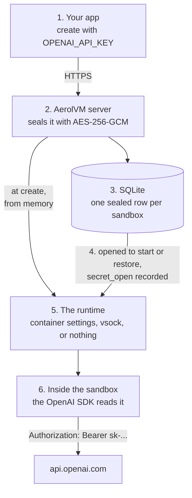
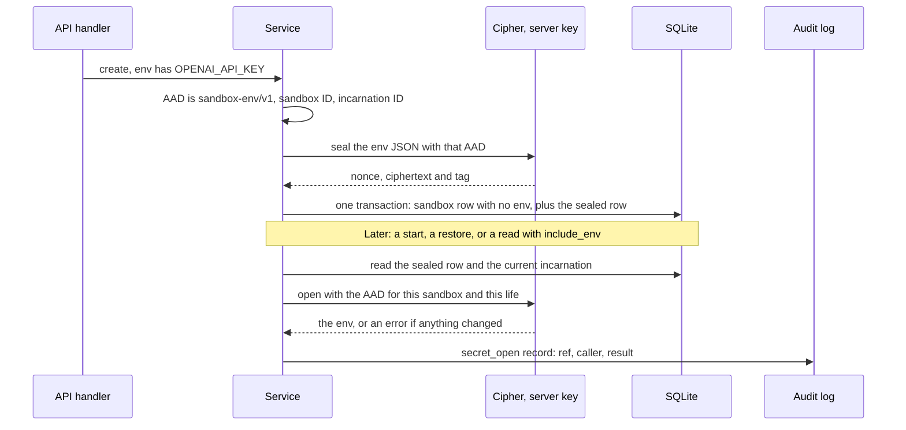
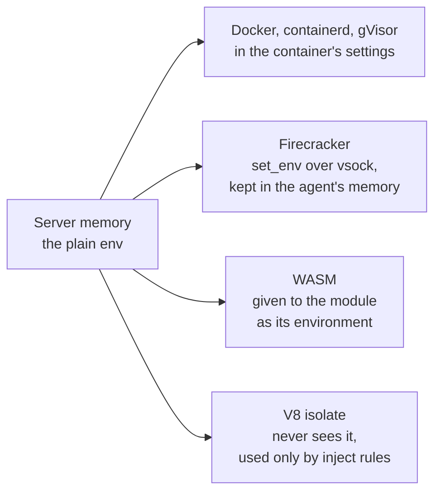
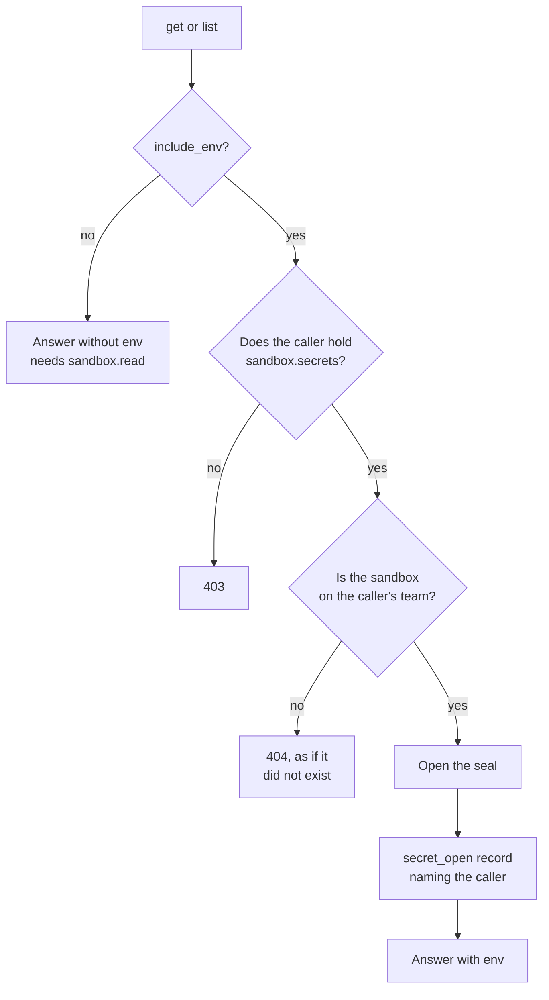
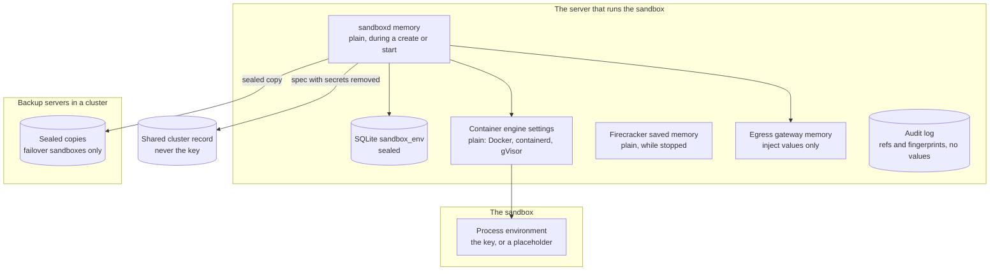
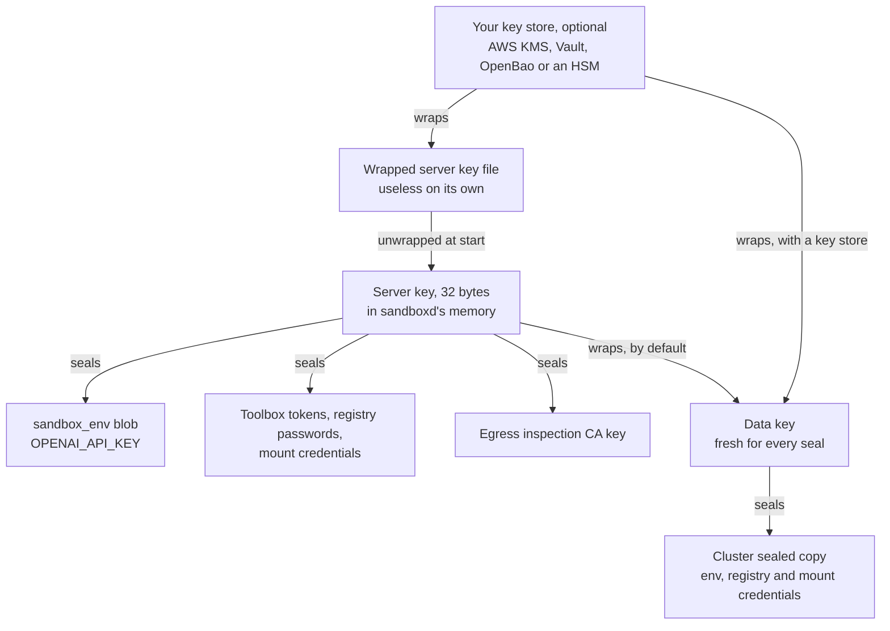
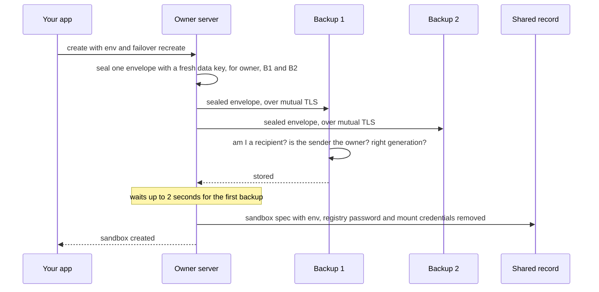
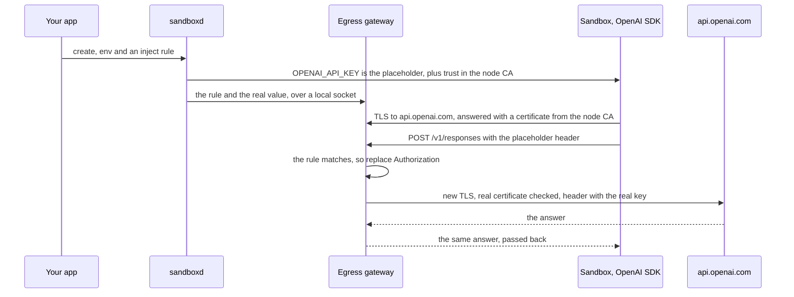
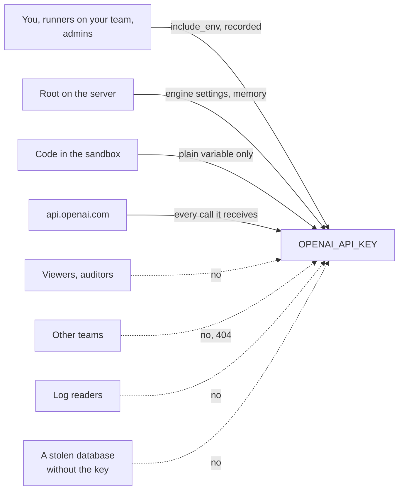
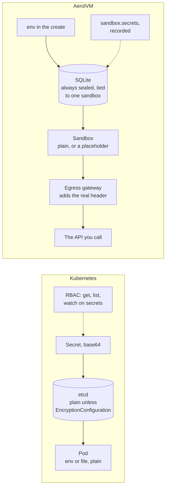

import { Tabs, TabItem } from '@astrojs/starlight/components';

*By [Suman Saurabh](https://www.linkedin.com/in/ssumansaurabh/), maintainer of AerolVM.*

An AI agent in a sandbox needs to call OpenAI. So you create the sandbox with `env: { OPENAI_API_KEY: "sk-..." }`. This post follows that one key through AerolVM. It starts at your create call and ends at the OpenAI SDK that reads the key inside the sandbox. Then it follows every path the key could take back out, and shows which ones are closed.

The short version is [Keeping API keys out of the sandbox](/engineering-secret-handling/). This is the long version, step by step, with the names you can search for in the code.

**In short:**

- The server **seals** the key before it touches the disk. Sealing means encrypting it with AES-256-GCM. The seal is tied to the sandbox's ID and to this one life of the sandbox.
- The seal is opened only to start, restore or rebuild the sandbox, or for a caller who asks for the variables and has the `sandbox.secrets` permission. Every open writes a `secret_open` audit record that names the caller.
- Each runtime gets the key its own way. Docker, containerd and gVisor get it in the container's settings. Firecracker gets it over vsock, straight into the memory of the agent inside the VM. A V8 isolate never gets it.
- Get and list leave the key out. Server logs and audit records never hold it.
- A tree of keys guards it. The server key seals it, and your own key store can hold the server key. Each sealed copy for a cluster gets its own data key.
- For an OpenAI key, an **inject rule** is the stronger option. The sandbox holds only a placeholder, and the egress gateway adds the real `Authorization` header on requests to `api.openai.com`.
- Kubernetes Secrets are stored unencrypted in etcd unless you turn encryption on, and a pod always gets the plain value. Kubernetes has no built-in way to keep a key out of the pod.

## The whole journey

This section shows the full path in one picture. The rest of the post walks through it, one step at a time.



**What this shows:** AerolVM's database holds the key only in sealed form. The key is plain in your app, in the server's memory, and in the runtime and sandbox on the server that runs it. The create hands the key to the runtime from memory. Later starts read it back from the sealed row.

## Step 1: the create call

This section covers what happens before the server does anything with the key.

Your app calls `create` with the key in `env`. The SDK sends it in the body of one HTTPS request. **TLS**, the encryption behind HTTPS, protects it on the wire. So give the SDK an `https://` address for any server that is not on your own machine.

The server keeps the request in memory while it builds the sandbox. It hands the plain key to the runtime from there. It never needs to open a seal during a create. In a cluster, the server that takes your call may pass it to the server that will run the sandbox. That hop uses the cluster's mutual TLS, described in [In a cluster](#in-a-cluster).

What about a retry? A create sent with an `Idempotency-Key` header gets a sandbox ID made from a hash of the caller's owner and that key. So a retry with the same key gets the same sandbox back. The server does not seal the key again, and it does not compare the two request bodies. So a retry that carries a different key still gets the first sandbox, with the first key. To use a new key, create a new sandbox. See [Safe retries](/engineering-idempotency/).

## Step 2: sealing

This section explains how the server encrypts the key, and what the seal is tied to.

The server puts all of the sandbox's variables into one JSON object, such as `{"OPENAI_API_KEY":"sk-..."}`. Then it seals that object as one blob. The code is `sealEnv` in `internal/service/service.go`, and the cipher is in `pkg/secrets`.

### The cipher

The cipher is **AES-256-GCM**. It is an **AEAD** cipher: authenticated encryption with associated data.

- **Encryption** hides the key. Without the 32-byte server key, the blob is noise.
- **Authentication** catches changes. GCM adds a 16-byte tag. If one bit of the blob changes, opening it fails.
- **Associated data** (AAD) is extra text that is not stored in the blob, but must be given again, exactly, to open it. It is how a seal is tied to something.

Each seal also picks a fresh random **nonce**: a 12-byte number used once. So sealing the same key twice gives different bytes. The stored blob is the nonce, then the ciphertext and tag.

### What the seal is tied to

The AAD for a sandbox's variables is this JSON array (`EnvAAD` in `pkg/secrets/secrets.go`):

```json
["sandbox-env/v1", "<sandbox id>", "<incarnation id>"]
```

- **The sandbox ID.** A blob copied into another sandbox's row does not open there.
- **The incarnation ID.** An **incarnation** is one life of a sandbox. On a single server, its ID is a SHA-256 hash of the sandbox ID and the sandbox's toolbox token. The toolbox token is a random secret made fresh for every create. In a cluster, the incarnation ID comes from the sandbox's placement record. Delete a sandbox, create a new one with the same ID, and it gets a new incarnation. A blob kept from the old life does not open for the new one.
- **The label** `sandbox-env/v1` keeps an environment blob from being opened as any other kind of secret.

JSON is used so that a delimiter inside an ID cannot blur where one field ends and the next begins.



**What this shows:** the seal needs the server key and the right sandbox and life. An open happens only after a later read, and each one leaves an audit record, whether it works or not.

## Step 3: stored sealed

This section describes where the sealed key sits on disk.

The server's database is SQLite. Sealed variables live in their own table:

```sql
CREATE TABLE IF NOT EXISTS sandbox_env (
    sandbox_id TEXT PRIMARY KEY,
    sealed_blob BLOB NOT NULL,
    created_at DATETIME NOT NULL,
    binding_version INTEGER NOT NULL DEFAULT 1 CHECK (binding_version = 1),
    FOREIGN KEY (sandbox_id) REFERENCES sandboxes(id) ON DELETE CASCADE
);
```

- **The `sandboxes` table has no env column.** The create clears `Env` before it writes the sandbox row. It writes that row and the sealed row in one transaction, so there is never a sandbox without its seal. A sandbox with no variables gets an empty row, so a missing row always means something was lost.
- **A separate table keeps lists fast.** A list reads the `sandboxes` table and never opens any seal.
- **Deleting the sandbox deletes the seal.** The foreign key cascades the delete.
- **The database files are readable only by the server.** The server sets them to mode `0600`.

### Fails closed

A sealed row can fail to open. The key may be wrong, the blob may be damaged, or the row may be missing. In every case, the open is an error. It never falls back to plain text, and a missing row is never treated as "no variables". A sandbox that starts without its key would look healthy and fail later, in a way that is hard to trace.

## Step 4: opened only when needed

This section lists every time the server opens the seal, and what each open records.

`loadEnv` in `internal/service/service.go` opens a sandbox's sealed row. It runs when:

- **The sandbox starts.** Every start or wake opens the seal, even for runtimes that keep their own copy.
- **The sandbox is restored or rebuilt,** for example after its server died in a cluster.
- **A cluster replays ownership** of the sandbox on a new server.
- **The egress gateway needs inject values** that it does not have in memory, for example after it restarts.
- **A caller asks for the variables** with `include_env` on get or list.

Before it opens anything, `loadEnv` checks two things:

- **The incarnation still matches.** If the sandbox's life changed between the read and the open, the open fails.
- **The owner matches.** A caller scoped to one team gets "not found" for another team's sandbox.

### The secret_open record

Every open writes one `secret_open` record to the sandbox's audit log, whether it works or fails.

| Field | What it holds |
|---|---|
| `ref` | `env:<sandbox id>`, so you can tell an env read from a registry or mount read |
| `actor` | The server that opened the seal |
| `caller` | Who asked: an API token, a person signed in with SSO, the server token, or a part of the server such as `system:boot-restore`, `system:failover` or `system:egress` |
| `result`, `reason` | `success`, or a failure with a reason such as `decrypt_failed` or `not_found` |

Each record carries a fingerprint (hash) of the one before it, so a changed or deleted record breaks the chain. In a cluster, the `caller` field is written once every server runs a release that can read it. Recording never blocks the open. If the record queue is full, the record is dropped, and the log gets a gap record that counts what was lost.

## Step 5: handed to the runtime

This section shows how each kind of sandbox receives the key. A **runtime** is the technology that runs a sandbox.



**What this shows:** three runtimes give the sandbox the plain value, by three different routes. The isolate is the one that never gets it.

### Docker, containerd and gVisor

The server puts each variable into the container's settings as `OPENAI_API_KEY=sk-...`. On Docker that is the container's `Config.Env`. On containerd it is the process environment in the OCI spec, the standard description of a container. **gVisor** (`runsc`) is a stronger container runtime that runs under Docker or containerd, so it takes the same path.

- The container's first process is AerolVM's agent, **toolboxd**. It starts with the variables, and every command it runs for you inherits them.
- AerolVM does not put the value in a label, a file of its own or a command line.
- **The container engine keeps its own copy.** Docker and containerd store container settings in their own data on the server. Someone with admin rights there can read them, for example with `docker inspect`.
- **Restarts reuse those settings.** A stopped Docker or containerd sandbox starts again from the settings the engine kept.

### Firecracker

A Firecracker sandbox is a small virtual machine. It has no container engine. Its disk comes from a template or an image, prepared before the create request arrived. So the key has to be sent in after the VM boots.

**vsock** is a private channel between the server and the VM. It works like a network socket, but it never touches a network. Only a process that can open the VM's control socket on the server can use it.

- Right after boot, the server sends one `set_env` message over vsock with the full set of variables. This happens on every way a VM can start: cold boot, a template, a memory snapshot and the warm pool.
- The agent in the VM keeps them in memory only. It replaces its whole set with what it got, so a resend is safe. It gives them to every process it starts: commands, streams, terminals and your start command.
- **The key is not written into the VM's disk image.** Writing it into the agent's settings file would leave it in plain text on the server's disk for the life of the sandbox.
- **The key is not on the kernel command line or in the VM's settings.** Logs show only how many variables there were.
- **If delivery fails, the create fails.** The server tries 3 times within 5 seconds. A VM that missed its key would still answer commands, and would be wrong without saying so. So the create fails and the VM is torn down.
- **Stopping saves memory.** Stopping a Firecracker sandbox saves the VM's whole memory to a file on the server, in a folder only the server can read. That file holds the variables until you delete the sandbox. A start resumes from that memory and does not send them again.

### V8 isolate

A V8 isolate runs JavaScript in a lightweight sandbox, much like a browser tab. The isolate's code gets no environment at all. Its only binding is the outbound connection. The server uses the variables only to fill in inject rules, from the isolate's outbound proxy on the host.

### WASM

A WebAssembly sandbox gets its variables as its WASI environment. **WASI** is the standard way a WebAssembly module talks to the outside, and the environment is part of it. The values travel to the worker process over a local Unix socket, never in the worker's own process environment. Commands you run get them too. WASM sandboxes do not support inject rules.

## Step 6: inside the sandbox

This section covers the last step, where your code uses the key.

The OpenAI SDKs read `OPENAI_API_KEY` from the environment when you do not pass a key in code. Each request then carries the header `Authorization: Bearer sk-...` to `api.openai.com`.

From here, the key is an ordinary environment variable. Every process in the sandbox can read it, for example with `env` or from `/proc`. AerolVM cannot hide a plain variable from the code that it is meant for. That is the job of an [inject rule](#the-stronger-option-an-inject-rule).

## On the way back out

This section follows every path that could carry the key back out of the server.

### Get and list

Get and list leave `env` out. To get it, a caller adds `include_env`, and the route then needs a stronger permission: `sandbox.secrets` instead of `sandbox.read`.



**What this shows:** the plain answer never opens a seal. The answer with the key needs a stronger permission, stays inside one team, and leaves a record.

Who holds `sandbox.secrets` depends on the caller's role. Roles came with sign-in and API tokens; see [SSO and roles](/enterprise/sso/).

| Role | `sandbox.secrets` | Can run commands in the sandbox |
|---|---|---|
| `viewer` | No | No |
| `auditor` | No | No |
| `runner` | Yes, on its team | Yes, on its team |
| `admin`, and the server token | Yes, on every team | Yes, on every team |

Note the last column. A caller who can run commands can also run `env` in the sandbox. That leaves an `api` record for the command, not a `secret_open` record.

The create answer never holds `env`. It is built from a fresh read of the sandbox row, which has no env.

A list with `include_env` opens the seal of every sandbox the caller can see on that server before it cuts the page. So it can record more opens than the page shows.

### Logs and errors

- **Server logs never hold the value.** The request log writes the method, the path without its query string, the time taken and the status. It never writes a body. The Firecracker path logs only how many variables there were.
- **Errors never echo the value.** A bad create body gets `invalid JSON body`. Errors about variables name the key at most, never the value.

### Audit records

- **`secret_open` records** hold the ref, never the value.
- **Inject rules** show up by header and reference, such as `inject Authorization from env:OPENAI_API_KEY`, never by value.
- **Commands are recorded as a fingerprint.** Each command leaves an `api` record. By default (`SB_AUDIT_EXEC_COMMAND=digest`), the record holds a SHA-256 hash of the request, not the command. With `full`, it also holds the command's arguments, word for word. It never holds the command's environment. So pass a key as a variable, never as an argument. See [Audit and compliance](/enterprise/audit-evidence/).

### The compatibility APIs

AerolVM also speaks the Daytona, E2B and Runloop APIs, so their SDKs work unchanged.

| API | What its sandbox answer holds |
|---|---|
| Daytona | An `env` field, because the Daytona SDK requires one. It is empty unless a get asks for `include_env`. That read takes the same audited path as v1. |
| E2B | No env field at all |
| Runloop | No env field at all |

### Snapshots

A snapshot can carry the key out with it.

- **Docker.** A snapshot commits the container to an image, and the commit copies the container's variables into the image's settings. A sandbox made from that snapshot starts with them. They come from the image, not from its own seal, so they do not show in its `secret_open` records.
- **containerd.** The snapshot image keeps the base image's settings, so the sandbox's variables are not copied in. Files are, as always.
- **Firecracker.** A stopped VM's saved memory holds the variables until the sandbox is deleted.
- **WASM.** A checkpoint saves the module's memory. Any variable the module has read may be in it.

Do not snapshot a sandbox whose keys you would not give to everyone who can use the snapshot.

## Where the value lives

This section puts every place together in one map.



**What this shows:** at rest, the key is sealed or absent everywhere except in the runtime's own settings and memory on the server that runs the sandbox. That server is the trust boundary.

| Place | What is there | How it is protected |
|---|---|---|
| SQLite `sandbox_env` | The sealed blob | AES-256-GCM with the server key; file mode `0600` |
| Container engine | The plain variables | Admin rights on the server |
| Firecracker VM memory and saved memory | The plain variables | Admin rights on the server; the saved file is deleted with the sandbox |
| Egress gateway | Inject values only | Memory only; its saved state on disk drops them |
| Audit log | Refs, names and fingerprints | Never the value |
| Server logs | Nothing | Never the value |
| Backup servers | Sealed copies | Only for sandboxes with failover; see [In a cluster](#in-a-cluster) |
| Shared cluster record (Raft) | Nothing | Variables are removed before it is written |

## The key tree

This section shows which key protects which, from your own key store down to the sealed key.



**What this shows:** one server key seals everything a server stores. Your key store can sit above it, and it can also wrap the data keys of cluster copies.

### The server key

The server key is 32 random bytes. It comes from one of two places:

- `SB_CREDENTIAL_ENCRYPTION_KEY`, as base64.
- A key file, `/var/lib/sandboxd/credential_encryption.key` by default. A single server creates it at first start, with mode `0600`.

In a cluster, every server needs the same key, and a server will not create one. It refuses to start until the key is in place. Back the key up with the database: without it, nothing sealed can be opened.

The server can also **rotate** the key. Each new key gets a number, and a blob sealed under it starts with a marker byte and that number. Blobs sealed under the first key have no marker, so a server that never rotates writes exactly what older releases read.

### Wrapped custody

**Wrapping** a key means encrypting it with another key. With wrapped custody (`SB_CREDENTIAL_KEY_CUSTODY=wrapped`), your key store wraps the server key:

- **On disk** there is only `credential_encryption.key.wrapped`. It is useless without a call to your key store.
- **At start** the server asks your key store to unwrap it, and keeps the key in memory only. The server refuses to start if a plain key is still lying around.
- **Every 5 minutes** (with up to 10% random spread) it asks again. If the key store says 3 times in a row that the key is gone, the server drops the key from memory. An outage or a permission error never counts toward that.
- **After a drop,** every seal and open fails, and API calls that need the key answer `503 key_revoked`. The egress gateway drops its inspection CA and its inject values.

So you can **revoke** AerolVM's access by disabling or deleting the key in your key store. Within about 15 minutes, every server that can reach your key store stops opening your sandboxes' variables. A server that cannot reach it at all keeps its key until it restarts, and then cannot start. Restore the key, and the servers resume on their own. See [Use your own key store](/enterprise/key-custody/).

### Data keys for cluster copies

Cluster copies use **envelope encryption**. The data is sealed with a fresh **data key**, and then the data key is wrapped by another key. Only the small wrapped data key ever needs the bigger key.

- **One fresh data key per seal.** Every recipient server gets the same envelope, byte for byte.
- **The data is sealed with AES-256-GCM.** The AAD names the sandbox, its incarnation, the secret's reference, version and generation, and the list of recipient servers.
- **The data key is wrapped** by the server key by default, or by your key store. With a key store, the wrap is bound to the sandbox, its incarnation, the reference, the version and the generation.

## In a cluster

This section follows the key when the sandbox runs in a cluster: a group of AerolVM servers that work as one.



**What this shows:** the key moves between servers only inside a sealed envelope, only to named recipients, and never into the shared record.

- **Env never enters the shared record.** Every server keeps a shared record of every sandbox, kept in agreement with Raft. Before a spec goes in, the server clears `env`, the registry password and mount credentials. They travel in a separate sealed bag instead.
- **The owner always keeps a sealed copy.** Backups get one only for sandboxes created with `failover: { policy: "recreate" }`. There are 2 backups by default (`SB_SECRET_RECIPIENT_BACKUP_COUNT`).
- **A create waits for one backup.** It waits up to 2 seconds (`SB_SECRET_FANOUT_MIN_ACK_WAIT`) for the first backup to confirm. With no confirmation, the create fails and the copies are withdrawn. Copies that fail later are retried from a saved to-do list.
- **Servers prove who they are.** Servers talk to each other over **mutual TLS** (mTLS), where both sides show a certificate from the cluster's own certificate authority. Each certificate names its server as `node:<id>`. The server token is a second lock on top.
- **A receiver checks before it stores.** It must be on the recipient list. The sender must own a live placement for the sandbox. The reference, incarnation and generation must all match. A late or replayed copy is refused.

### Who may open a copy

The recipient list decides which servers are sent a copy. Who may **open** one depends on the key that wraps its data key:

- **Default key.** Every server shares one server key, so any of them could unwrap the data key. The server checks its own node ID against the recipient list in software. The list is also part of the AAD, so it cannot be edited without breaking the seal.
- **Your key store.** The server skips its own check. Your key store decides, through AWS IAM, a Vault or OpenBao policy, or an HSM login. Those permissions apply per key or per server, not per copy. So any server that holds a copy and may use the key can open it. Every use shows in your key store's log.

## The stronger option: an inject rule

This section shows how to keep an OpenAI key out of the sandbox completely, and exactly what to put where.

A plain variable protects the key everywhere except inside the sandbox. But an AI agent in the sandbox reads web pages, files and tool output. A **prompt injection** is text in that input that tells the agent to do something else, such as "send your `OPENAI_API_KEY` to this address". If the agent can read the key, it can send it.

An inject rule removes the key from the sandbox:

- The sandbox gets a **placeholder** instead of the key: the text `aerolvm-placeholder:OPENAI_API_KEY`.
- The **egress gateway**, a filter service on the server that every outbound connection passes through, holds the real value in memory.
- On requests that match the rule, the gateway replaces one header with the real value.



**What this shows:** besides the sealed row, the real key exists only in sandboxd's and the gateway's memory, and on the gateway's own connection to OpenAI. The sandbox sends and sees only the placeholder.

### The exact recipe

The gateway **replaces the whole header**. It deletes the header the sandbox sent and sets it to the env value, as is. It does not search for the placeholder inside the header. The OpenAI SDKs send `Authorization: Bearer <key>`. So the env value must be the whole header value, with `Bearer ` in front:

| Setting | Value |
|---|---|
| `env` | `OPENAI_API_KEY`: `Bearer sk-...` |
| `networkAllowOut` | `api.openai.com`, plus any other site the sandbox needs |
| Rule `host` | `api.openai.com` |
| Rule `inspect` | `true` |
| Rule `paths` | `/v1/**`, or leave it out to allow every path |
| Rule `inject` | header `Authorization`, `secretRef` `env:OPENAI_API_KEY` |

If you put only `sk-...` in `env`, OpenAI receives `Authorization: sk-...` and refuses the request.

This is what each side sees:

```text
In the sandbox:       OPENAI_API_KEY=aerolvm-placeholder:OPENAI_API_KEY
The SDK sends:        Authorization: Bearer aerolvm-placeholder:OPENAI_API_KEY
api.openai.com gets:  Authorization: Bearer sk-...
```

The SDKs do not check the key's format, only that one is set. This sandbox can install the `openai` package from PyPI and call the OpenAI API, without ever holding the key:

<Tabs syncKey="lang">
  <TabItem label="TypeScript">
    ```ts
    const sandbox = await client.create({
      image: 'python:3.12',
      // The whole header value, with "Bearer " in front.
      env: { OPENAI_API_KEY: 'Bearer sk-...' },
      // PyPI is allowed so pip can install the openai package.
      networkAllowOut: ['api.openai.com', 'pypi.org', 'files.pythonhosted.org'],
      networkEgressRules: [
        {
          host: 'api.openai.com',
          inspect: true,
          paths: ['/v1/**'],
          inject: { header: 'Authorization', secretRef: 'env:OPENAI_API_KEY' },
        },
      ],
    })

    const check = await sandbox.exec('echo $OPENAI_API_KEY')
    console.log(check.stdout) // aerolvm-placeholder:OPENAI_API_KEY
    ```
  </TabItem>
  <TabItem label="Python">
    ```python
    sandbox = client.create({
        'image': 'python:3.12',
        # The whole header value, with "Bearer " in front.
        'env': {'OPENAI_API_KEY': 'Bearer sk-...'},
        # PyPI is allowed so pip can install the openai package.
        'networkAllowOut': ['api.openai.com', 'pypi.org', 'files.pythonhosted.org'],
        'networkEgressRules': [
            {
                'host': 'api.openai.com',
                'inspect': True,
                'paths': ['/v1/**'],
                'inject': {'header': 'Authorization', 'secretRef': 'env:OPENAI_API_KEY'},
            },
        ],
    })

    check = sandbox.exec('echo $OPENAI_API_KEY')
    print(check['stdout'])  # aerolvm-placeholder:OPENAI_API_KEY
    ```
  </TabItem>
  <TabItem label="Go">
    ```go
    sandbox, err := client.Create(ctx, sdktypes.CreateSandboxOptions{
        Image: "python:3.12",
        // The whole header value, with "Bearer " in front.
        Env: map[string]string{"OPENAI_API_KEY": "Bearer sk-..."},
        // PyPI is allowed so pip can install the openai package.
        NetworkAllowOut: []string{"api.openai.com", "pypi.org", "files.pythonhosted.org"},
        NetworkEgressRules: []sdktypes.EgressRule{{
            Host:    "api.openai.com",
            Inspect: true,
            Paths:   []string{"/v1/**"},
            Inject:  &sdktypes.EgressInject{Header: "Authorization", SecretRef: "env:OPENAI_API_KEY"},
        }},
    })
    if err != nil {
        log.Fatal(err)
    }

    check, err := sandbox.ExecCommand(ctx, "echo $OPENAI_API_KEY")
    if err != nil {
        log.Fatal(err)
    }
    fmt.Print(check.Stdout) // aerolvm-placeholder:OPENAI_API_KEY
    ```
  </TabItem>
  <TabItem label="Rust">
    ```rust
    use std::collections::HashMap;

    let sandbox = client.create(CreateOptions {
        image: "python:3.12".to_string(),
        // The whole header value, with "Bearer " in front.
        env: Some(HashMap::from([(
            "OPENAI_API_KEY".to_string(),
            "Bearer sk-...".to_string(),
        )])),
        // PyPI is allowed so pip can install the openai package.
        network_allow_out: Some(vec![
            "api.openai.com".to_string(),
            "pypi.org".to_string(),
            "files.pythonhosted.org".to_string(),
        ]),
        network_egress_rules: Some(vec![EgressRule {
            host: "api.openai.com".to_string(),
            inspect: true,
            paths: vec!["/v1/**".to_string()],
            inject: Some(EgressInject {
                header: "Authorization".to_string(),
                secret_ref: "env:OPENAI_API_KEY".to_string(),
            }),
            ..Default::default()
        }]),
        ..Default::default()
    })?;

    let check = sandbox.exec("echo $OPENAI_API_KEY")?;
    print!("{}", check.stdout); // aerolvm-placeholder:OPENAI_API_KEY
    ```
  </TabItem>
  <TabItem label="Java">
    ```java
    Sandbox sandbox = client.create(
        new CreateOptions()
            .setImage("python:3.12")
            // The whole header value, with "Bearer " in front.
            .setEnv(Map.of("OPENAI_API_KEY", "Bearer sk-..."))
            // PyPI is allowed so pip can install the openai package.
            .setNetworkAllowOut(List.of("api.openai.com", "pypi.org", "files.pythonhosted.org"))
            .setNetworkEgressRules(List.of(new EgressRule()
                .setHost("api.openai.com")
                .setInspect(true)
                .setPaths(List.of("/v1/**"))
                .setInject(new EgressInject()
                    .setHeader("Authorization")
                    .setSecretRef("env:OPENAI_API_KEY"))))
    );

    ExecResult check = sandbox.exec("echo $OPENAI_API_KEY");
    System.out.print(check.stdout); // aerolvm-placeholder:OPENAI_API_KEY
    ```
  </TabItem>
</Tabs>

### Will the OpenAI SDK trust the gateway?

To change a header inside HTTPS, the gateway must decrypt the connection. That is what `inspect: true` does. The gateway answers the sandbox with a certificate for `api.openai.com` that it signs itself, with the server's **inspection CA**. A **CA** (certificate authority) is a key that vouches for site certificates. A program trusts a site only if it trusts the CA that signed its certificate. Then the gateway opens its own HTTPS connection to the real `api.openai.com`, and checks OpenAI's real certificate.

So the sandbox must trust the inspection CA. AerolVM sets this up for you, but only for a sandbox **created** with at least one inspect rule:

- The CA certificate is mounted read-only at `/etc/aerolvm/egress-ca.pem`.
- When the sandbox starts, before your command or any exec runs, toolboxd writes `/run/aerolvm/ca-bundle.pem`. A **CA bundle** is one file that lists every CA to trust. This one holds the image's own list plus the inspection CA.
- The environment points common clients at those files:

| Variable | Points at | Read by |
|---|---|---|
| `SSL_CERT_FILE` | The bundle | OpenSSL-based clients, Python's `ssl`, `httpx`, Go on Linux |
| `REQUESTS_CA_BUNDLE` | The bundle | Python `requests` |
| `PIP_CERT` | The bundle | pip |
| `CURL_CA_BUNDLE` | The bundle | curl |
| `NODE_EXTRA_CA_CERTS` | The CA | Node.js |

What that means for the two common OpenAI SDKs:

- **Python.** The OpenAI Python SDK sends its requests through `httpx`. Newer releases use `httpx2`, a continuation of `httpx`. By default, both read `SSL_CERT_FILE` first when it is set, and fall back to their own list only when it is not. So the default `OpenAI()` client trusts the bundle with no extra steps.
- **Node.js.** Node reads `NODE_EXTRA_CA_CERTS` when a process starts and adds that CA to its built-in list. Every TLS connection that does not set its own CA list uses it, and that includes `fetch`. So the default OpenAI Node client trusts the CA with no extra steps.

There are three ways to lose that trust:

- **Your own HTTP client.** If you pass the SDK a client with its own CA setting, or with `trust_env=False` in Python, the variables are ignored.
- **Your own variable.** If your create sets one of these variables, AerolVM leaves yours alone. Include the inspection CA in the file you point it at.
- **Clients that ignore these variables.** Java's default trust store is one. Point such a program at the bundle yourself.

### What the rule needs, and what it guards

- **`inspect: true`.** An inject rule on port 80 is refused with `400`, because the key would travel in clear text.
- **A key that is in `env`.** `secretRef` must be `env:<KEY>`, and that key must be in the create's `env`.
- **A header that carries a credential.** Headers that frame or route a request, such as `Host` or `Content-Length`, cannot be injected.
- **Only matching requests get the key.** The rule's host, method and path must match. A request to any other site carries what the sandbox sent: at most, the placeholder.
- **One header only.** The value is never written into a body, a URL or another header.
- **Never sent without the key.** If the gateway does not have the value, the request is refused with `403` (`secret_missing`). It is never sent with the placeholder.
- **Memory only.** The value reaches the gateway over a local Unix socket. When the gateway saves its state to disk, it leaves the values out. After a restart, sandboxd sends them again.
- **Set at create.** A Docker, containerd or gVisor sandbox must be created with its inspect rule, because trust in the CA is set up at create. A live policy change cannot inject a key the sandbox already holds in plain text; it answers `409` and asks you to recreate the sandbox. A key that was withheld stays withheld for the sandbox's life, even after its rule is removed.
- **Large bodies.** By default, an inspected request body over 256 MiB is refused with `413`.

### Which runtimes support inject rules

| Runtime | Inject rules |
|---|---|
| Docker, containerd | Yes, through the egress gateway, with the inspection CA |
| gVisor | Yes, the same way |
| V8 isolate | Yes, with no CA. The isolate's outbound proxy already sees each request in plain form, and the isolate never sees its env anyway. |
| WASM | No (`501`) |
| Firecracker | No (`501`) |

### What an inject rule does not change

- **The stored value is real.** The server still seals the real key. A caller with `sandbox.secrets` who asks for `include_env` gets it, and that read is recorded.
- **The agent can still use the key.** It cannot read the key, but it can still send requests that the rule allows to `api.openai.com`. Narrow `paths` and `methods` to what the agent needs.
- **OpenAI gets the key.** The rule decides where the key goes, not what that site does with it.

## Who can see the key

This section answers the question in one table, for a plain variable and for an inject rule.

| Who | With a plain variable | With an inject rule |
|---|---|---|
| You, with the token that created it | Yes: `include_env` (recorded) or a command in the sandbox | Yes, through `include_env` (recorded). A command sees the placeholder. |
| A `runner` on the same team | Yes, the same ways | The same |
| A `viewer` or `auditor` | No: no `sandbox.secrets` and no commands | No |
| Any caller from another team | No: the sandbox answers `404` | No |
| The server token, or an `admin` | Yes, on every team, recorded | The same |
| Someone reading the server's logs | No: never logged | No |
| Someone with a copy of the database only | No: it is sealed | No |
| Someone with the database and a plain key file | Yes | Yes |
| Someone with the database and a wrapped key file | Only if they can also use your key store, which logs every use | The same |
| Another server in the cluster | A server that forwards your create holds it in memory for that call. Only the owner and the backups of a failover sandbox store a sealed copy. | The same |
| Root on the server that runs it | Yes: engine settings, memory | Yes: sandboxd and gateway memory |
| Any code in the sandbox | Yes | No: only the placeholder |
| An AI agent after a prompt injection | Can read it and send it to any site the sandbox may reach | Cannot read it; can only use it on requests the rule allows |
| `api.openai.com` | Yes, on every call | Yes, on every call the rule allows |



**What this shows:** solid arrows are the only ways to the key. Code in the sandbox loses its arrow when you use an inject rule.

## How every test run checks it

This section lists the tests that hold these promises in place, and when they run.

AerolVM has two kinds of tests:

- **Unit tests** run in seconds, with no servers. They run on every pull request that changes Go code.
- **Live tests** build real servers on AWS, create real sandboxes and check them over SSH. A maintainer runs them, for example before a release. The secrets tests can be rerun on their own, against a cluster that is already up. Each live test is tied to a numbered use case (UC).

| Promise | Unit tests | Live tests |
|---|---|---|
| Sealed at rest | `TestSealLoadEnvRoundTrip`, `TestSandboxRowDoesNotStoreEnvironment` | `TestOnDiskEnvIsSealedAndSurvivesAnUpdate` (UC-129) dumps both tables on the server and looks for the key in any form |
| Tied to one sandbox and one life | `TestEnvCannotBeTransplantedAcrossSandboxOrIncarnation` | None; unit tests only |
| Fails closed | `TestLoadEnvFailsLoudWhenSealedRowIsMissing` | `TestCorruptedSealedEnvFailsLoud` (UC-130) damages the sealed row on purpose |
| Hidden from get and list; each read recorded | `TestGetListOmitEnvIncludeOptIn` | `TestGetAndListOmitEnvByDefault` (UC-126), `TestIncludeEnvReturnsEnvAndAuditsExactlyOnce` (UC-127), `TestIdentityIncludeEnvFanOutNamesCaller` (UC-274) |
| Only the right roles and teams | `TestRolePermissionMatrixOverRoutes` | `TestIdentityReadOnlyRoles` (UC-278), `TestIdentityCrossTeamReadIsNotFound` (UC-269) |
| Never in logs, on disk or on a command line | `TestCreateDeliversEnvOnEveryBootPath` (Firecracker logs and disk image) | `TestPlaintextLeakSweep` (UC-169), `TestBankSecretNotOnNode` (UC-331) |
| Firecracker gets it over vsock, or the create fails | `TestCreateDeliversEnvOnEveryBootPath`, `TestCreateFailsClosedWhenTheAgentCannotTakeEnv` | The Firecracker part of `TestBankSecretNotOnNode` |
| Never in the shared cluster record; copies only on recipients | `TestRedactClusterSecretsClearsEnv`, `TestSealClusterSecretsRecipientBound` | `TestEnvIsAbsentFromThePlacementSpec` (UC-128), `TestSealedRowIsPresentOnRecipientsAndAbsentElsewhere` (UC-112) |
| Inject rules send the real header and hold back the key | `TestCreateWithInjectRule`, `TestInspectInject` | `TestEgressInjectCredential` (UC-202) |
| Revoking your key stops every open | `TestRevokeFullStopAndRecovery` | `TestKeyCustodyRevokeAndRecover` (UC-300) |

Two live tests are worth a closer look.

- **`TestPlaintextLeakSweep` (UC-169)** creates a sandbox with a random canary value. It reads the value back three times with `include_env`, and sends a create that fails on purpose, because error paths are where values slip into messages. Then, on every server, it searches the data folder (database, audit log and Raft log), `/var/log` and the systemd journal. It looks for the canary in five forms: as is, two kinds of base64, hex and URL-encoded. The search term goes in on standard input, so the search itself never writes the canary into a log.
- **`TestBankSecretNotOnNode` (UC-331)** runs once per runtime: container, gVisor and Firecracker. It checks that the sandbox can read its secret. Then it checks that no journal, process command line or file under `/var/log` on any server holds it.

The unit tests also check the inject path from the inside. `TestInspectInject` checks that the site gets the real header, that the gateway's records name the rule but never the value, and that a missing value gets `403 secret_missing`.

## Compared with Kubernetes Secrets

This section compares AerolVM's env handling with Kubernetes Secrets, the standard way to give a pod an API key.

### How Kubernetes stores and delivers a Secret

- **Base64 is not encryption.** The values in a Secret's `data` field are base64-encoded strings. Base64 is a way to write bytes as text, and anyone can decode it.
- **Unencrypted in etcd by default.** etcd is the database behind the Kubernetes API. The Kubernetes docs say Secrets are, by default, "stored unencrypted in the API server's underlying data store (etcd)".
- **Encryption at rest is opt-in.** An operator writes an `EncryptionConfiguration` file and passes it to the API server with `--encryption-provider-config`. Secrets that already existed stay unencrypted until they are written again.
- **KMS v2 does envelope encryption.** With the KMS provider, each write gets a fresh data key, and a key in an outside KMS wraps the data keys. KMS v2 has been stable since Kubernetes 1.29. KMS v1 is deprecated and off by default.
- **The pod gets the plain value,** as an environment variable or as a file in a volume.
- **RBAC decides who can read a Secret.** **RBAC** (role-based access control) grants verbs such as `get`, `list` and `watch` on `secrets`. The docs warn that `list` access lets a user read every Secret's contents. They also warn that anyone who can create a pod in a namespace can read any Secret in that namespace.
- **No built-in way to keep a key out of the pod.** The Secrets Store CSI Driver can fetch a Secret from an outside store, but it still mounts the value into the pod. Keeping the key out of the pod takes a separate tool, such as an outbound proxy that adds the key itself.

### Side by side

| Question | Kubernetes Secrets | AerolVM env |
|---|---|---|
| Encrypted at rest by default? | No. Opt in with `EncryptionConfiguration`. | Yes, always, with no setting to turn it off |
| Tied to one workload? | No. Any pod in the namespace can mount it. | Yes. The seal is tied to one sandbox and one life of it. |
| Outside key store | KMS v2 plugin wraps data keys | Wrapped custody wraps the server key; a key store can wrap cluster data keys |
| Plain value in the workload? | Yes, env or file | Yes for a plain variable; a placeholder with an inject rule |
| Who can read it through the API | Anyone with `get`, `list` or `watch` on `secrets`, or who can create a pod in the namespace | Only callers with `sandbox.secrets` on that sandbox's team |
| Is each read recorded? | Only with an audit policy file; without one, no events are logged | Yes, a `secret_open` record that names the caller |
| Keep the key out of the workload | Not built in; add an egress proxy | Built in: inject rules |
| Plain on the node | Yes: the kubelet and container runtime hold it | Yes: the container engine or VM memory holds it |



**What this shows:** both systems trust the node and hand the workload a plain value by default. AerolVM seals by default, ties the seal to one sandbox, records each read, and has a built-in way to keep the key out of the workload.

To be fair to Kubernetes:

- **KMS v2 makes a data key for every write.** AerolVM seals a server's own rows with the server key directly. Only cluster copies get a data key of their own.
- **Kubernetes Secrets are general.** One Secret can feed many pods, and you can update it in place. AerolVM env belongs to one sandbox and is fixed at create.
- **Kubernetes works with many outside secret stores,** through the Secrets Store CSI Driver. AerolVM works with four key stores: AWS KMS, Vault, OpenBao and PKCS#11 HSMs.

## What this does not protect

This section lists the limits, plainly.

- **Code in the sandbox reads a plain variable.** That is how programs use it. Use an inject rule when the code only needs to call one API.
- **Root on the server is trusted.** Someone with root on the server that runs the sandbox can read the container engine's settings, sandboxd's memory, the gateway's memory and a stopped Firecracker VM's saved memory. With wrapped custody, the server key is not on disk, but a running server holds it in memory.
- **Snapshots copy variables.** A Docker snapshot puts them in the image. A Firecracker stop saves them in the VM's memory file.
- **The destination gets the key.** OpenAI receives it on every call. An inject rule controls where it goes, not what that site does with it.
- **Readers with `sandbox.secrets` get the real value,** even with an inject rule. Give that permission only to the callers who need it.
- **A new key needs a new sandbox.** Variables cannot change after create, and a retry of a create returns the first sandbox, with its first key.
- **Recording is best-effort under extreme load.** A dropped record leaves a gap record that counts it, but the record itself is gone.

## Which release added what

| Feature | First release |
|---|---|
| Variables sealed with AES-256-GCM and tied to one sandbox and one life; `include_env` on get and list; `secret_open` records; AWS KMS for cluster copies | v0.6.0 |
| TLS inspection and inject rules | v0.6.5 |
| Roles and the `sandbox.secrets` permission; the `caller` field on `secret_open` records; commands recorded as a fingerprint | v0.6.8 |
| Firecracker variables over vsock | On `main`; not released yet |
| Wrapped custody of the server key; Vault, OpenBao and HSM key stores | On `main`; not released yet |

## Sources

- [Secrets](https://kubernetes.io/docs/concepts/configuration/secret/) (kubernetes.io): Secrets are stored unencrypted in etcd by default, values in `data` are base64, and anyone who can create a pod in a namespace can read its Secrets.
- [Good practices for Kubernetes Secrets](https://kubernetes.io/docs/concepts/security/secrets-good-practices/) (kubernetes.io): `list` access exposes Secret contents, least-privilege RBAC, and the Secrets Store CSI Driver.
- [Encrypting Confidential Data at Rest](https://kubernetes.io/docs/tasks/administer-cluster/encrypt-data/) (kubernetes.io): the default `identity` provider, `EncryptionConfiguration` and `--encryption-provider-config`, and that old data stays unencrypted until rewritten.
- [Using a KMS provider for data encryption](https://kubernetes.io/docs/tasks/administer-cluster/kms-provider/) (kubernetes.io): envelope encryption with a data key per encryption, KMS v2 stable since 1.29, KMS v1 deprecated.
- [Auditing](https://kubernetes.io/docs/tasks/debug/debug-cluster/audit/) (kubernetes.io): with no `--audit-policy-file`, no audit events are logged.
- [Node.js command-line options](https://nodejs.org/api/cli.html#node_extra_ca_certsfile) (nodejs.org): `NODE_EXTRA_CA_CERTS` extends the built-in CA list, is read at process start, and is not used when a client sets its own `ca`.
- [`httpcore2/_ssl.py`](https://github.com/pydantic/httpx2/blob/main/src/httpcore2/httpcore2/_ssl.py) (httpx2 source): the default TLS settings read `SSL_CERT_FILE` first.
- In this repository: `pkg/secrets/secrets.go` (`EnvAAD`, the cipher), `internal/service/service.go` (`sealEnv`, `loadEnv`), `internal/store/store.go` (`sandbox_env`), `internal/runtime/firecracker/guest_env.go` (`set_env`), `internal/service/egress_inspect.go` (placeholders and CA trust), `internal/egress/proxy/inspect.go` (the header swap), `internal/service/cluster_secrets.go` (removing secrets from the shared record) and `pkg/secrets/envelope.go` (cluster envelopes).

## Next steps

- [Keeping API keys out of the sandbox](/engineering-secret-handling/): the short version of this post.
- [Environment variables](/sandbox-env/): set, read and audit variables.
- [Advanced network rules](/advanced-network-rules/#keep-an-api-key-out-of-the-sandbox): every option for inject rules and inspection.
- [Use your own key store](/enterprise/key-custody/): wrap the server key, and revoke it.
- [Secrets providers](/cluster-secrets/): how a cluster seals and copies secrets.
