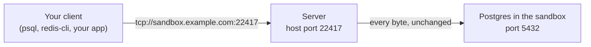
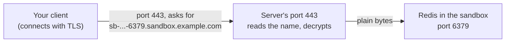

import { Aside, Tabs, TabItem } from '@astrojs/starlight/components';

Browsers talk HTTP, the language of the web. Many other programs do not. Databases such as Postgres, Redis, MySQL and MongoDB, plus MQTT brokers, gRPC services, SSH and game servers, send their own data over TCP, the basic way two programs send bytes over a network. A web URL cannot carry that traffic.

So `exposePort` takes a `protocol` option:

| Protocol | You get | Use it for |
|---|---|---|
| `"http"` (default) | A web URL: `https://<sandbox-id>-<port>.<domain>` | Websites, REST APIs, websockets. See [Public URLs](/public-urls/). |
| `"tcp"` | `tcp://<host>:<host-port>` | Postgres, Redis, MySQL, MongoDB and any other TCP service |
| `"tls"` | `tls://<sandbox-id>-<port>.<domain>:443` | Clients that encrypt with TLS (the encryption behind `https://`) from the first byte |

Not sure which one to pick? See [TCP or TLS?](/tcp-vs-tls-ports/).

<Aside type="caution" title="Server setup needed">
These addresses only work on a server install. TCP ports work with or without a domain. TLS ports need a server with a domain. A local install returns an address, but nothing answers there.
</Aside>

## Connect to a database with a TCP port



Pass `protocol: "tcp"`. The server picks a free port on its own network, called the **host port**. It forwards every byte from that port to the port inside the sandbox. The result has the full `url`, plus `host` and `hostPort` to build a connection string (the one line of text a database client uses to connect).

<Tabs syncKey="lang">
  <TabItem label="TypeScript">
    ```ts
    const exposure = await sandbox.exposePort(5432, { protocol: "tcp" });
    if (exposure.protocol === "tcp") {
      const dsn = `postgresql://user:pass@${exposure.host}:${exposure.hostPort}/appdb`;
      console.log(exposure.url); // tcp://sandbox.example.com:22417
    }
    ```
  </TabItem>
  <TabItem label="Python">
    ```python
    exposure = sandbox.expose_port(5432, protocol="tcp")
    dsn = f"postgresql://user:pass@{exposure.host}:{exposure.host_port}/appdb"
    print(exposure.url)  # tcp://sandbox.example.com:22417
    ```
  </TabItem>
  <TabItem label="Go">
    ```go
    exposure, err := sandbox.ExposePort(ctx, 5432, microvm.WithProtocol(sdktypes.ExposeProtocolTCP))
    if err != nil {
        log.Fatal(err)
    }
    dsn := fmt.Sprintf("postgresql://user:pass@%s:%d/appdb", exposure.Host, exposure.HostPort)
    fmt.Println(exposure.PublicURL) // tcp://sandbox.example.com:22417
    ```
  </TabItem>
  <TabItem label="Rust">
    ```rust
    use aerolvm_sdk::{ExposeOptions, ExposeResult};

    if let ExposeResult::Tcp { url, host, host_port } = sandbox.expose_port(5432, ExposeOptions::tcp())? {
        let dsn = format!("postgresql://user:pass@{}:{}/appdb", host, host_port);
        println!("{}", url); // tcp://sandbox.example.com:22417
    }
    ```
  </TabItem>
  <TabItem label="Java">
    ```java
    ExposeResult exposure = sandbox.exposePort(5432, ExposeOptions.tcp());
    String dsn = String.format("postgresql://user:pass@%s:%d/appdb", exposure.host, exposure.hostPort);
    System.out.println(exposure.url); // tcp://sandbox.example.com:22417
    ```
  </TabItem>
</Tabs>

`host` is the server's domain, or its IP address on a server without a domain. The host port comes from a range the operator sets, `22000` to `23000` by default. Pass the two to any client: `psql`, `redis-cli`, `mysql`, `mongosh`, or your app's connection string.

<Aside type="caution" title="Anyone can try to connect">
A TCP port is open to the whole internet. AerolVM passes the bytes through and does not check who is connecting. Protect the service itself, for example with a strong database password.
</Aside>

## Get a TLS address on port 443



With `protocol: "tls"`, every TLS port shares the server's port 443. Each one gets its own name, and the server uses that name to find the right sandbox. It also holds the certificate (the file that proves the address is really yours) and decrypts the traffic, so your service needs no TLS setup.

<Tabs syncKey="lang">
  <TabItem label="TypeScript">
    ```ts
    const exposure = await sandbox.exposePort(6379, { protocol: "tls" });
    console.log(exposure.url); // tls://sb-9f2c41d07a3e5b86-6379.sandbox.example.com:443
    ```
  </TabItem>
  <TabItem label="Python">
    ```python
    exposure = sandbox.expose_port(6379, protocol="tls")
    print(exposure.url)  # tls://sb-9f2c41d07a3e5b86-6379.sandbox.example.com:443
    ```
  </TabItem>
  <TabItem label="Go">
    ```go
    exposure, err := sandbox.ExposePort(ctx, 6379, microvm.WithProtocol(sdktypes.ExposeProtocolTLS))
    if err != nil {
        log.Fatal(err)
    }
    fmt.Println(exposure.PublicURL) // tls://sb-9f2c41d07a3e5b86-6379.sandbox.example.com:443
    ```
  </TabItem>
  <TabItem label="Rust">
    ```rust
    if let ExposeResult::Tls { url } = sandbox.expose_port(6379, ExposeOptions::tls())? {
        println!("{}", url); // tls://sb-9f2c41d07a3e5b86-6379.sandbox.example.com:443
    }
    ```
  </TabItem>
  <TabItem label="Java">
    ```java
    ExposeResult exposure = sandbox.exposePort(6379, ExposeOptions.tls());
    System.out.println(exposure.url); // tls://sb-9f2c41d07a3e5b86-6379.sandbox.example.com:443
    ```
  </TabItem>
</Tabs>

What to know about TLS ports:

- **They need a server with a domain.** Without one, the call fails with `TLS-SNI exposure requires --domain to be configured`.
- **The client must send the name it wants** at the start of the connection. This is called SNI (Server Name Indication). Almost every modern client sends it.
- **The client must start with TLS right away.** Some protocols, such as MySQL and default Postgres, start in plain text and switch to TLS later. Use a TCP port for those.
- **The TLS connection ends at the server.** Client certificates (mutual TLS) never reach your service. Use a TCP port if you need them.

## Stop sharing or change a port

- **To stop sharing,** call `unexposePort(port)`, the same call as for web ports (see [Stop sharing a port](/public-urls/#stop-sharing-a-port)). It works for every protocol. Unexposing a TCP port gives its host port back for other sandboxes.
- **One protocol per port.** Exposing a port again with a different protocol fails with `port 5432 already exposed as tcp; unexpose it first`. Unexpose it, then expose it with the new protocol.
- **Exposing again with the same protocol is safe.** It returns the same address, and a TCP port keeps its host port.

## Good to know

- **Restarts keep the address.** Stop and start the sandbox, and its ports come back with the same addresses. A TCP port keeps the same host port, so saved connection strings keep working.
- **Ghost sandboxes wake on connections.** A [ghost sandbox](/ghost-sandboxes/) that stopped while idle starts again when a client connects to its TCP or TLS port.
- **Listen on all addresses.** The service inside the sandbox must listen on `0.0.0.0`, not only `localhost`.
- **The firewall must allow the host ports.** If you cannot connect to a TCP port, ask your operator to open ports `22000` to `23000`.
- **No custom domains with TCP or TLS.** A sandbox with a TCP or TLS port cannot also have a [custom domain](/custom-domains/).
- **WASM and V8 isolate sandboxes** support web (HTTP) ports only.

## For server operators

### The host port pool

Each TCP exposure takes one port from a pool on the server: `22000` to `23000` by default, about 1,000 ports. That is also the most TCP exposures one server can have at a time. When it runs out, `exposePort` fails with `L4 port pool exhausted`. The server picks a random free port first, then checks the pool in order. It saves each pick in the database in one step, so two calls never get the same port.

Change the pool with `SB_L4_PORT_RANGE_START` and `SB_L4_PORT_RANGE_END` on `sandboxd`. The start must be at least `1024` and lower than the end, and the end at most `65535`.

Keep the pool below the Linux ephemeral port range, the range the kernel uses for outgoing connections (usually `32768` to `60999`; check with `cat /proc/sys/net/ipv4/ip_local_port_range`). If they overlap, the kernel can take a pool port, and on busy hosts an exposure fails with `EADDRINUSE`. The host firewall must allow incoming traffic on the whole pool. The installer prints a reminder but does not open it.

### The shared TLS port

TLS ports run on caddy-l4, the module of Caddy (the server's web proxy) that handles raw TCP traffic. In domain mode, the installer sets `SB_L4_TLS_LISTEN=:443`, so caddy-l4 owns port 443. Normal HTTPS traffic for the API and web URLs moves to `127.0.0.1:8443` (`SB_L4_TLS_FALLBACK`), and caddy-l4 sends every name that is not a TLS port there. If `SB_L4_TLS_LISTEN` is empty, TLS exposures fail with `TLS-SNI exposure requires SB_L4_TLS_LISTEN to be set`.

TLS ports reuse the server's wildcard certificate for `*.<domain>`, which Caddy gets once at startup. So exposing a TLS port does no certificate work: it adds one route to Caddy and one row to the database. The certificate's private key never enters a sandbox.

### Restarts, clusters and cleanup

- **Restarts.** The host port is saved with the exposure. After a `sandboxd` restart, the regular sync pass puts each TCP route back on the same host port.
- **Clusters.** The host port is copied to every server. Servers that do not run the sandbox open the same port and forward to the one that does, so the address stays the same. If the server taking over a failed sandbox cannot open that port because something else uses it, the exposure needs an operator's help. The server does not quietly move it.
- **Unexpose.** The server removes the Caddy route that matches the saved protocol: `sandbox-<id>-port-<port>` for HTTP, the layer-4 server `tcp-port-<host-port>` for TCP (the port goes back to the pool), and `sandbox-<id>-port-<port>-tls` for TLS. The exposure row is deleted and the proxy path `/proxy/<port>/` refuses requests right away.
- **Sync.** The regular sync pass, and a manual run, keep Caddy and the database matched for all three protocols. They remove routes that no longer belong to any sandbox. See [Reconcile](/reconcile/).

## Next steps

- [TCP or TLS?](/tcp-vs-tls-ports/): pick the right protocol for your service.
- [Public URLs](/public-urls/): web URLs for websites and APIs.
- [Reconcile](/reconcile/): how the server keeps its routes in sync.
