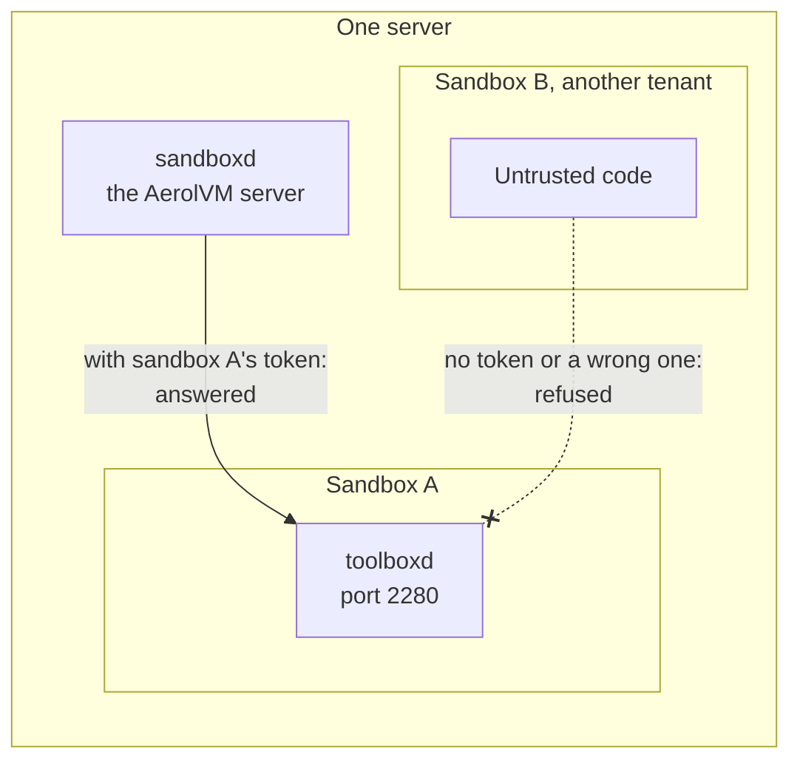
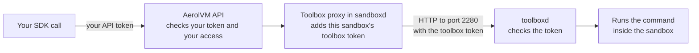
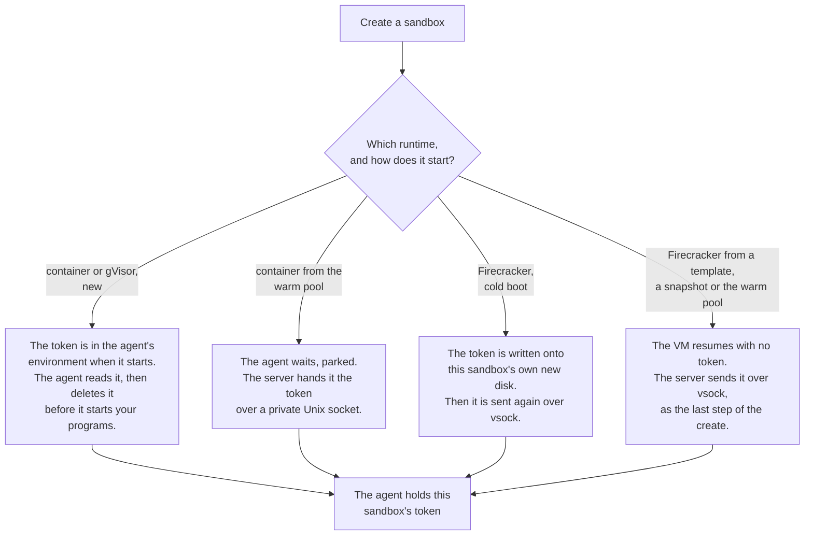
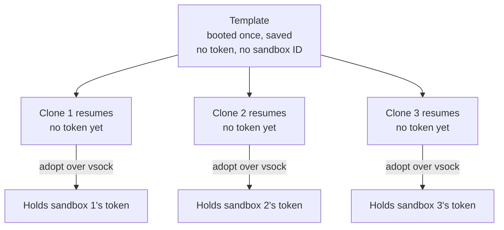
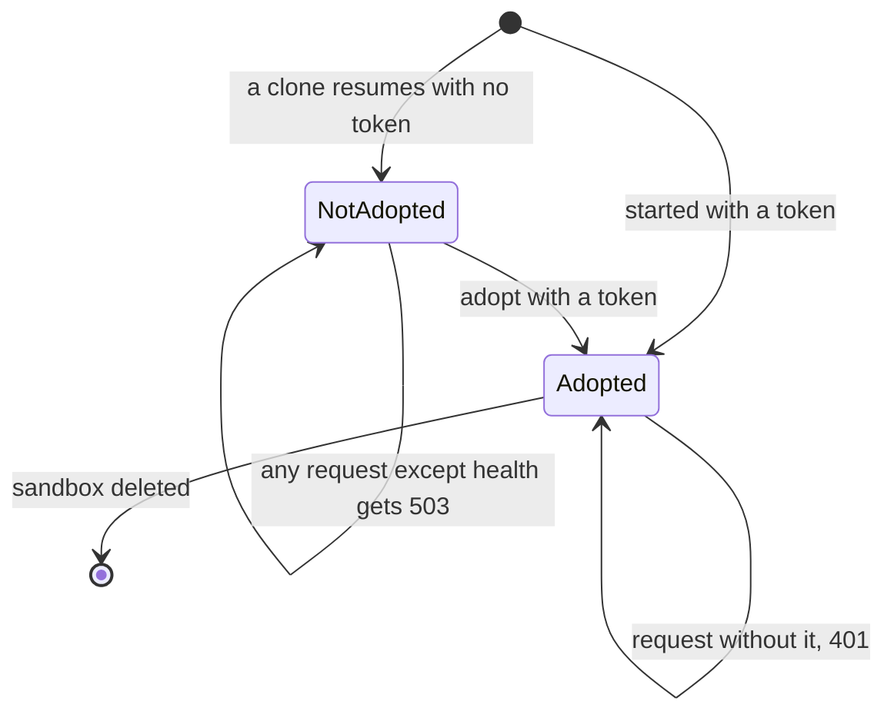
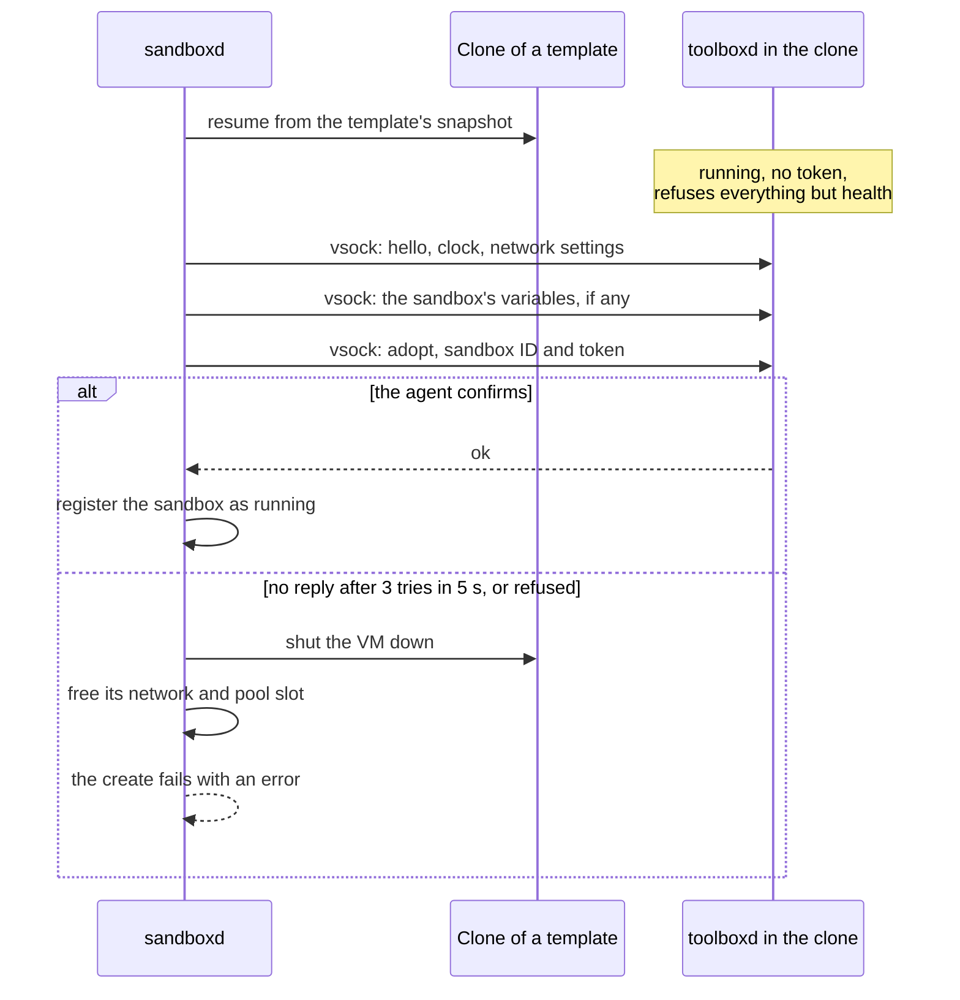
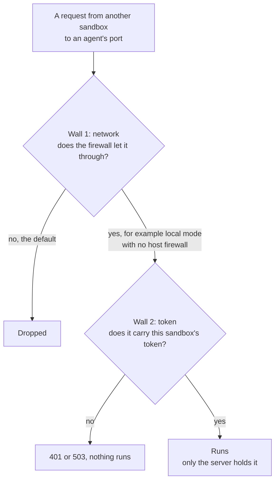
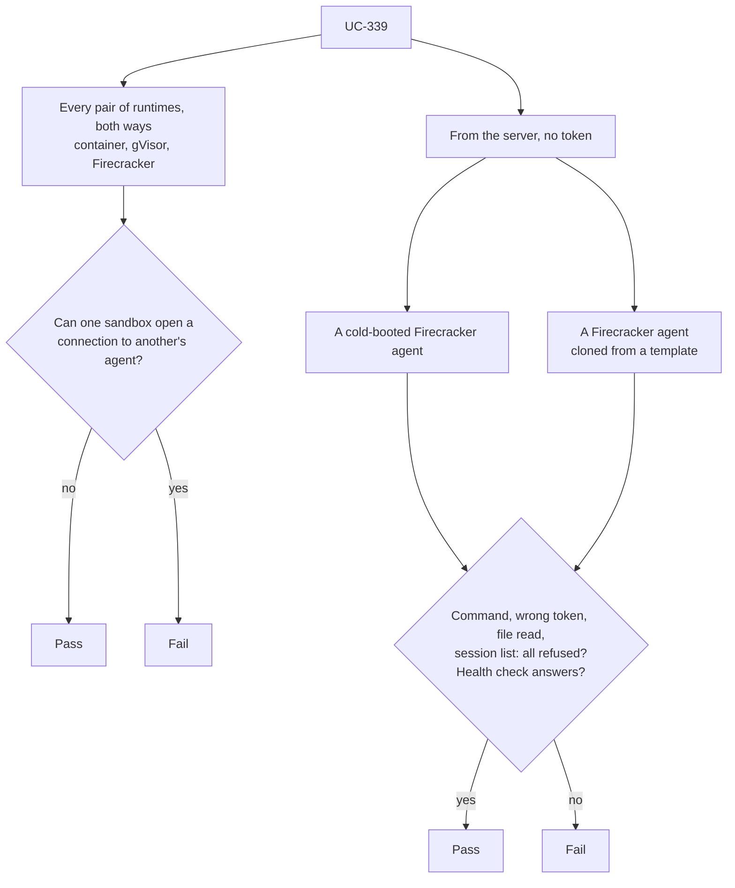
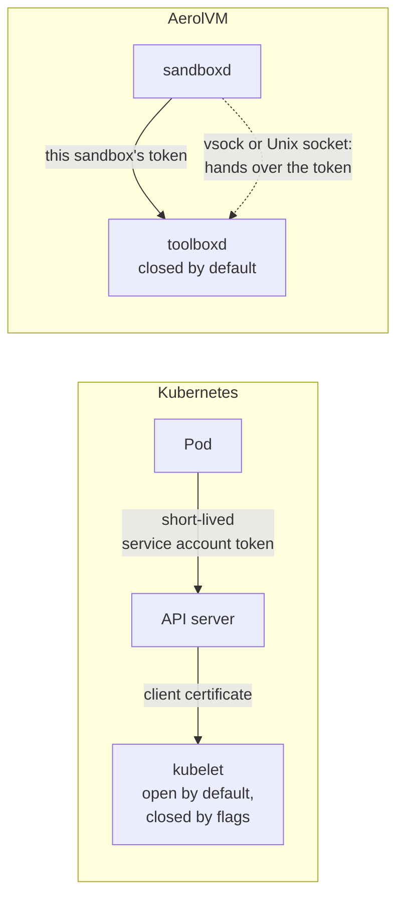

import { Tabs, TabItem } from '@astrojs/starlight/components';

Each container and Firecracker sandbox runs a small helper program called **toolboxd**, the **agent**. Say you run a command, read a file or open a terminal through the API. The AerolVM server passes the request to this agent, and the agent does the work inside the sandbox.

An agent that runs commands is a powerful thing to leave on a network. Anything that can talk to it and get an answer can run code inside that sandbox. So the agent must know who is calling, and answer only the AerolVM server, and only for its own sandbox. This post explains how it does that, and the harder case: virtual machines that are copied from a saved template.

**In short:**

- Every sandbox gets its own random **toolbox token**, a long secret made by the server. The agent runs a request only if it carries that exact token.
- **Fail closed:** an agent that has no token refuses every request except its health check.
- Containers get their token when they start. A Firecracker VM copied from a template gets its token after it resumes, over a private channel that only the server can use.
- An agent keeps the first token it gets. It refuses any other, so it can belong to one sandbox only.
- If an agent cannot take its token, the sandbox is not created. The server undoes everything instead of starting a sandbox without one.
- The network also keeps sandboxes away from each other's agents. So there are two walls, and either one is enough.
- A live test calls every sandbox's agent from every other runtime, and from the server without a token, in every integration run that has container sandboxes.

## The threat

This section explains what the agent can do, and who might try to call it.

The agent listens on port 2280 at the sandbox's own network address. It offers everything the API offers: run commands and code, open terminal sessions, read and write files, and run Git. Whoever gets an answer from it controls that sandbox.

Many parties could, in principle, send it a request:

- **another sandbox on the same server,** which may belong to another tenant (another account or team);
- **code inside the same sandbox,** which already runs there and gains nothing new;
- **the AerolVM server,** which is the only caller that should get an answer.

So the agent must tell the server apart from everyone else, on every request.



**What this shows:** two kinds of caller can reach an agent, and only one of them holds the token. The agent answers that one alone.

## The design

This section walks through the design one part at a time.

### A token for each sandbox

When the server creates a sandbox, it makes a new toolbox token: 32 random bytes from the operating system's secure random source, written as 64 hex characters (`generateToolboxToken` in `internal/service/service.go`).

- **The token belongs to one sandbox.** It opens that sandbox's agent and no other.
- **Your code never sees it.** You call the API with your own API token. The server adds the sandbox's toolbox token when it passes the request to the agent. The toolbox token is never part of an API response.
- **The server stores it encrypted,** tied to the sandbox's ID. See [Where secrets live](/engineering-trust-boundary/).
- **It never appears in a log line or an error message.** Tests search the logs for it.



**What this shows:** two different tokens guard two different doors. Your API token proves who you are to the server. The toolbox token proves to the agent that the request comes from the server.

### The agent checks every request

Every request that runs a command, reads or writes a file, or opens a session goes through the same check:

1. Does the agent hold a token at all? If not, answer `503`, "sandbox not adopted".
2. Does the request carry `Bearer` and a token? If not, answer `401`.
3. Is it exactly this sandbox's token? The comparison takes the same time whatever the guess, so timing gives nothing away. If not, answer `401`.

Only then does the request run. The health check is the one route that answers with no token. It runs nothing and reads nothing; it reports only that the agent is up, and its version.

The first two steps are separate checks on purpose. One sits in front of all the routes, and one inside each route that does work. Either one alone keeps an agent without a token closed.

### How each runtime hands over the token

The agent can learn its token in three ways. Which one a sandbox uses depends on how it starts.



**What this shows:** every path ends in the same place, an agent that holds this sandbox's token. The paths differ only in when and how the token arrives.

Two of these paths use a **private channel** between the server and the sandbox, not the network:

- A **Unix socket** is a channel between two programs on one machine. The container warm pools use one per parked slot.
- **vsock** is a direct channel between a host and its virtual machine. It does not go over the network at all. On the host side it is a file in the VM's own folder, so only the server can open it.

### Why a template cannot carry a token

A **Firecracker template** is a VM that was booted once, set up, and then saved: its disk, and often a **snapshot** of its memory too. New sandboxes start as copies of it, called **clones**, in milliseconds instead of seconds. The **warm pool** keeps a few clones already resumed and waiting.

The template is made before any sandbox exists. Everything in it is shared by every clone. If the template held a token, every clone would have the same one, and one sandbox's token would open all of them. So the design rule is strict:

- **A template's disk and memory hold no token.** The code that saves a template never sends one.
- **Each clone gets its own token after it resumes.** Identity is added to a copy, never copied from the original.



**What this shows:** clones share everything that was in the template, so the token must come later, one per clone.

The same idea applies to other things a clone must not share, such as random-number state and the clock. See [Randomness in cloned sandboxes](/randomness-in-cloned-sandboxes/) and [Correct snapshot clones](/engineering-snapshot-correctness/). Firecracker's own docs make the same point: resuming one saved state more than once is safe only if each copy is made unique again.

### Adopt: the last step of every Firecracker create

The message that hands a token to a Firecracker agent is called **adopt**. It carries the sandbox's ID and its token. The server sends it as the last step of every Firecracker create: cold boot, template disk, snapshot and warm pool alike. It sends it again when a stopped sandbox starts.

The agent follows three rules when it gets an adopt message:

- **No token yet:** it takes this one, and starts answering requests that carry it.
- **The same token again:** nothing changes. This makes a resend safe when a reply was lost.
- **A different token:** it refuses, and keeps the one it has. A VM belongs to one sandbox for life.



**What this shows:** an agent moves from "not adopted" to "adopted" once, and never back or sideways to another sandbox.

The server treats a failed adopt as a failed create:



**What this shows:** a sandbox becomes "running" only after its agent has confirmed the token. There is no path that ends in a running sandbox with an open agent.

An agent too old to know the adopt message answers "unknown op". The create then fails with a hint to rebuild the template. See [For server operators](#for-server-operators).

### Two walls: the token and the network

The token is one wall. The network is a second one, so an agent is out of reach as well as locked:

- **Between sandboxes:** by default, the server's firewall drops traffic from any sandbox network to any sandbox network on the same server, for every runtime. See [Between sandboxes](/engineering-network-defenses/#between-sandboxes).
- **Around Firecracker VMs:** a firewall chain named `AEROLVM-FC-ISOLATE` drops every packet from one VM to another, of any kind. It also drops any forwarded packet that tries to open a connection into a VM. Only replies to a VM's own connections come in.
- **The server still gets through.** The server reaches each agent directly, not by forwarding, so these rules do not stand in its way.

The Firecracker chain lives in the firewall's `mangle` table, which the kernel checks before the usual `filter` table. An allow rule in the `filter` table cannot skip it. The server installs it at start and checks it every 30 seconds.



**What this shows:** a request from another sandbox must pass both walls, and each wall stops it on its own.

Local mode, for development on one machine, has no host firewall. There, the token is the only wall, and it still holds.

## The design rules

These rules keep the design true as the code changes. A change that breaks one of them changes the security model.

1. **Fail closed.** An agent without a token refuses every request except its health check. Its default is "no".
2. **Identity after restore, never from the template.** A template's disk and memory hold no token. Each clone is given its own after it resumes.
3. **One sandbox per agent, for life.** The first token sticks. A different one is refused.
4. **Identity travels on a private channel.** Tokens reach an agent through its start environment, a Unix socket or vsock. Never over the sandbox network.
5. **No silent fallback.** If an agent cannot take its token, the create or start fails and is undone.
6. **Two walls.** The network keeps other sandboxes away from an agent. The token check holds even where the network wall is missing.
7. **The token stays on the server's side.** It is never in an API response, a log line or an error message. It is stored encrypted. The agent deletes it from its environment before your programs start.

## How every test run checks it

This section lists the tests that check this design, and when they run.

### The live test: UC-339

UC-339 (`TestBankToolboxAgentUnreachable` in `integration-tests/suite/bank_security_test.go`) runs on real AWS servers. It starts one sandbox on each runtime the deployment has: container, gVisor and Firecracker. Then:

- **Every pair, both ways.** From a sandbox of each runtime, it tries to reach the agent of every other sandbox on the same server. That is 9 pairs when all three runtimes are present. The port must be closed.
- **From the server, without a token.** On deployments with Firecracker, it calls two Firecracker agents from the server itself: one from a cold boot and one cloned from a template. It tries to run a command with no token and with a wrong token, read a file, and list sessions. Each must be refused with `401` or `503`. The health check must answer, which proves the calls really reached the agent.
- **With no host firewall,** in local mode, a reachable agent must refuse a command without its token.



**What this shows:** the live test checks both walls. The pairs check the network wall, and the calls from the server check the token wall, on the template path too.

UC-339 runs in every integration scenario that has container sandboxes. The largest one is an 11-server cluster with all three runtimes, where all 9 pairs and both server checks run.

### The unit tests

These run in CI on every push:

| Test | What it checks |
|---|---|
| `TestTokenlessAgentFailsClosed`, `TestServingRequestsNeedsAToken` | An agent with no token refuses every kind of route, and serves only the health check. |
| `TestVsockAdoptThenServe`, `TestVsockAdoptIsOneWay`, `TestVsockAdoptRefusals` | Adopt takes the first token, accepts the same one again, and refuses a different, empty or malformed one. |
| `TestAdoptRacesInFlightRequests` | Requests that arrive while adopt runs see either no token or the right one, never a half state. |
| `TestCreateAdoptsTheGuestOnEveryBootPath` | Every Firecracker boot path sends adopt as its last step. |
| `TestCreateFailsClosedWhenTheAgentCannotBeAdopted`, `TestCreateFailsWhenAdoptNeverAcks` | A create whose agent cannot take its token fails and is undone. |
| `TestSnapshotTemplateNeverAdoptsTheGuest`, `TestTemplateInjectFilesCarryNoToken` | A template's memory and disk never hold a token. |
| `TestStartWithIdentityAdoptsTheRestoredGuest` | A stopped Firecracker sandbox is adopted again when it starts. |
| `TestEnsureIsolationDropsGuestToGuestAndCrossRuntime` | The Firecracker fence drops VM-to-VM traffic and new connections into a VM, and lets replies through. |

`TestKernelIsolation` checks the Firecracker fence on a real Linux kernel. It needs root, so it runs behind the `kerneltest` build tag, not in every CI run.

## How this compares

This section compares the design with Kubernetes, which has a node agent with the same job.

**The kubelet** is the agent on every Kubernetes node. Like toolboxd, it can run commands in containers and read their logs, and the control plane calls it over the network.

- **Its default is open, then you close it.** The Kubernetes docs say: "By default, requests to the kubelet's HTTPS endpoint that are not rejected by other configured authentication methods are treated as anonymous requests". The default authorization mode is `AlwaysAllow`. You turn anonymous access off with `--anonymous-auth=false`, and check each request with the API server with `--authorization-mode=Webhook`. `kubeadm`, for example, sets both.
- **The control plane proves itself with a certificate.** The API server calls the kubelet with a client certificate, set by `--kubelet-client-certificate` and `--kubelet-client-key`.
- **Pods get their own short-lived tokens** for calls the other way, to the Kubernetes API. Since v1.22, Kubernetes gives a pod "a short-lived, automatically rotating token" through the `TokenRequest` API.

| Question | Kubernetes kubelet | AerolVM toolboxd |
|---|---|---|
| Default with no credentials set | Anonymous requests allowed, all requests allowed | Every request refused except the health check |
| How the control plane proves itself | One client certificate for all kubelets | One token per sandbox, accepted by that sandbox's agent only |
| Scope of one credential | Every node | One sandbox |
| Token lifetime | Pod tokens are short-lived and rotate | Lives as long as the sandbox, never rotated |
| Cloned machines | Not a kubelet concern | Identity given after restore, never stored in the template |
| Network wall in front of the agent | Up to the cluster's network setup | Built in: sandboxes cannot reach each other's agents |



**What this shows:** both systems authenticate the control plane to the node agent. AerolVM's agent starts closed and has one credential per sandbox, because each sandbox may belong to a different tenant.

Two honest differences:

- **Our tokens do not rotate.** A Kubernetes pod token expires and renews itself. A toolbox token lives as long as its sandbox. It never leaves the server's side, and opens one sandbox only, which limits what a leak could reach.
- **The kubelet is one agent per node; toolboxd is one per sandbox.** That is why AerolVM needs a token per sandbox. It is also why a cloned VM gets its token after restore.

## What your code sees

Your code never handles a toolbox token. It uses your API token, as for any call, and the server does the rest. This example creates a Firecracker sandbox from a template (here a template named `py311`) and runs a command. Behind it, the clone resumes, is adopted with its own token, and then runs the command:

<Tabs syncKey="lang">
  <TabItem label="TypeScript">
    ```ts
    import { MicroVM } from "@aerol-ai/aerolvm-sdk";

    const client = new MicroVM(); // reads SB_API_URL and SB_PAT_TOKEN

    const sandbox = await client.create({
      image: "python:3.11",
      runtime: "firecracker",
      templateId: "py311",
    });
    const result = await sandbox.exec("python3 --version");
    console.log(result.stdout);

    await sandbox.destroy();
    ```
  </TabItem>
  <TabItem label="Python">
    ```python
    from microvm import MicroVM

    client = MicroVM()  # reads SB_API_URL and SB_PAT_TOKEN

    sandbox = client.create(
        image="python:3.11",
        runtime="firecracker",
        templateId="py311",
    )
    result = sandbox.exec("python3 --version")
    print(result["stdout"])

    sandbox.destroy()
    ```
  </TabItem>
  <TabItem label="Go">
    ```go
    client, err := microvm.NewClient() // reads SB_API_URL and SB_PAT_TOKEN
    if err != nil {
        log.Fatal(err)
    }

    sandbox, err := client.Create(ctx, sdktypes.CreateSandboxOptions{
        Image:      "python:3.11",
        Runtime:    sdktypes.RuntimeFirecracker,
        TemplateID: "py311",
    })
    if err != nil {
        log.Fatal(err)
    }
    defer sandbox.Destroy(ctx)

    result, err := sandbox.ExecCommand(ctx, "python3 --version")
    if err != nil {
        log.Fatal(err)
    }
    fmt.Print(result.Stdout)
    ```
  </TabItem>
  <TabItem label="Rust">
    ```rust
    use aerolvm_sdk::{Client, CreateOptions};

    let client = Client::new(None, None)?; // reads SB_API_URL and SB_PAT_TOKEN

    let sandbox = client.create(CreateOptions {
        image: "python:3.11".into(),
        runtime: Some("firecracker".into()),
        template_id: Some("py311".into()),
        ..Default::default()
    })?;
    let result = sandbox.exec("python3 --version")?;
    print!("{}", result.stdout);

    sandbox.destroy()?;
    ```
  </TabItem>
  <TabItem label="Java">
    ```java
    MicroVMClient client = new MicroVMClient(); // reads SB_API_URL and SB_PAT_TOKEN

    Sandbox sandbox = client.create(
        new CreateOptions()
            .setImage("python:3.11")
            .setRuntime("firecracker")
            .setTemplateId("py311")
    );
    ExecResult result = sandbox.exec("python3 --version");
    System.out.print(result.stdout);

    sandbox.destroy();
    ```
  </TabItem>
</Tabs>

If the clone's agent cannot be adopted, `create` fails with an error. You never get a sandbox back whose agent is open.

## For server operators

This section lists what to know when you run Firecracker templates.

- **Templates made before the adopt message existed cannot start sandboxes.** Their agent answers adopt with "unknown op". So every create from them fails, with a hint to rebuild the template. Delete such a template and create it again. A rebuild is not enough, because it reuses the template's disk, and the agent lives on that disk. See [Rebuild a template](/firecracker-templates/#rebuild-a-template).
- **The same holds for a sandbox that was stopped with an older agent.** Its start is refused with "destroy it and create a new one". Running sandboxes are not affected until they stop.
- **During a rolling upgrade of a cluster,** take a template built on an upgraded server. On a server not yet upgraded, it starts a sandbox whose agent is never adopted. That sandbox answers `503` to every call until its server is upgraded. It is closed, not open.
- **Each Firecracker create gains one vsock round trip for adopt.** It shows as the `fc_adopt` stage in the create's `Server-Timing` header.
- **Where to look:** `AEROLVM-FC-ISOLATE` is in the firewall's `mangle` table, with two drop rules marked `aerolvm-fc-isolate`, and a jump to it from the `mangle` table's `FORWARD` chain. The server puts it back within 30 seconds if a firewall reload removes it.

WebAssembly and V8 isolate sandboxes have no agent inside. The server runs their commands and file calls itself, so none of this applies to them.

## Sources

- [Kubelet authentication/authorization](https://kubernetes.io/docs/reference/access-authn-authz/kubelet-authn-authz/) (kubernetes.io): anonymous requests by default, `--anonymous-auth=false`, the `AlwaysAllow` default and `Webhook` mode, and the API server's client certificate.
- [Service Accounts](https://kubernetes.io/docs/concepts/security/service-accounts/) (kubernetes.io): short-lived, automatically rotating pod tokens from the `TokenRequest` API.
- [Firecracker snapshotting](https://github.com/firecracker-microvm/firecracker/blob/main/docs/snapshotting/snapshot-support.md) (Firecracker): the "Snapshot security and uniqueness" section, on why each copy of one saved state must be made unique.
- [Firecracker vsock](https://github.com/firecracker-microvm/firecracker/blob/main/docs/vsock.md) (Firecracker): how the host-to-VM socket maps to a Unix socket on the host.

## Next steps

- [Keeping sandboxes away from the node's cloud credentials](/sandbox-metadata-isolation/): the network side of the same wall, for the cloud metadata service.
- [How AerolVM isolates sandboxes](/engineering-isolation/): the wall each runtime puts around a sandbox, and the control channel.
- [Firecracker architecture](/firecracker-architecture/): every step of a Firecracker create, adopt included.
- [Firecracker templates](/firecracker-templates/): build, rebuild and delete templates.
