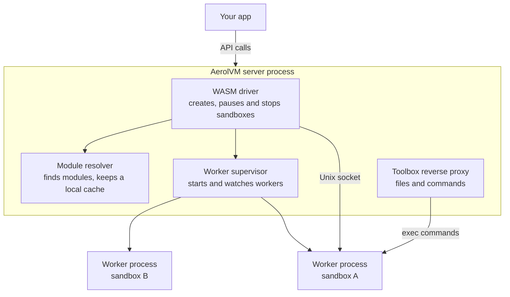
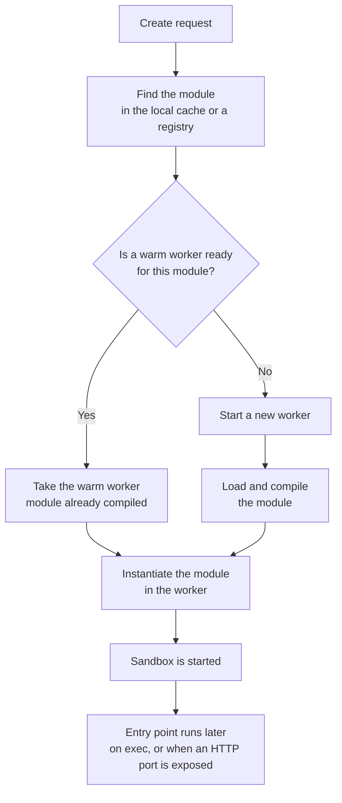
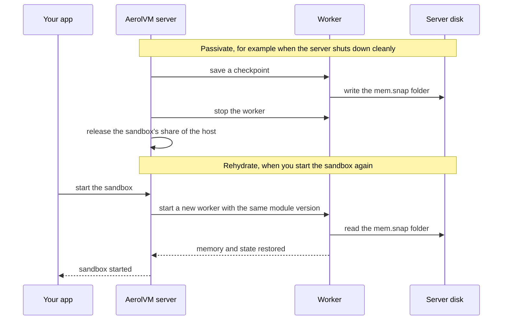
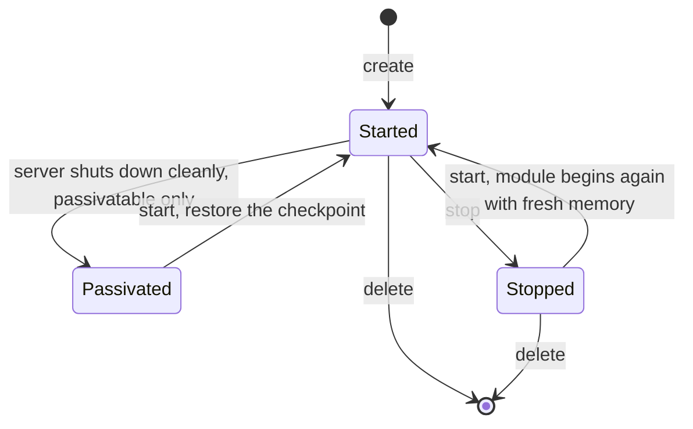

A WASM sandbox runs a WebAssembly module instead of a whole Linux machine. **WebAssembly** (WASM) is a compact program format that runs inside a locked-down virtual machine. AerolVM runs these sandboxes with a **host-mediated** model: the server reaches the outside world on the sandbox's behalf.

The AerolVM server process (`sandboxd`) keeps handling the API. Each sandbox runs in its own worker subprocess. The server and the worker talk over a Unix socket, a private channel between two processes on one machine.

**In short:**

- Each WASM sandbox runs in its own worker process, either newly started or taken from a warm pool.
- To pause a sandbox created with `durability: "passivatable"`, AerolVM saves a checkpoint of its memory and state to disk, then stops the worker.
- To wake it up, AerolVM restores that checkpoint into a worker.
- Durable sandboxes, whose checkpoints would also go to a registry for failover, are not available yet.

## The parts

This section shows the pieces inside the server that run WASM sandboxes.

- **`internal/runtime/wasm.Driver`** is the WASM runtime driver: the part of the server that creates, pauses and stops WASM sandboxes.
- **The `pkg/wasmmod` resolver** finds the module a sandbox asks for, and keeps a local cache of modules.
- **The `pkg/wasm/worker` supervisor** starts and watches the worker processes.
- **The toolbox reverse proxy** handles toolbox requests (reading files, running commands) for the right sandbox. Each `exec` command runs in that sandbox's worker. A **reverse proxy** receives requests and forwards them to another program.

## What a checkpoint holds

This section describes the saved state of a WASM sandbox. **Passivation** means pausing a sandbox to free its resources. WASM sandboxes are `ephemeral` by default and keep no checkpoint. A sandbox created with `durability: "passivatable"` writes a `mem.snap` folder when it passivates, which is its **checkpoint**:

- `config.json`: engine metadata, the clone generation and the module digest. The **clone generation** is a token that changes when a sandbox is restored from a saved copy. The **digest** is a hash that names the exact module.
- `memory.zstd`, `globals.cbor` and `wasi-state.cbor`: the guest's own state. The guest is the program running inside the sandbox. **WASI** (the WebAssembly System Interface) is how a module reaches files, clocks and other system features.

### Durable checkpoints (not available yet)

Durable sandboxes are designed to also push this folder to AOCR, the Aerol OCI Registry. (OCI is the standard format for container images and their registries.) Another server could then restore the sandbox after a failure. The push path is:

`cluster/<cluster-id>/wasm-checkpoints/<sandbox-id>:latest`

The server already has the code to push and pull these checkpoints (`internal/service/wasm_checkpoint.go` and `wasm_checkpoint_pull.go`). But a create that asks for `durability: "durable"` is refused today as not implemented (`NormalizeCreateDurability` in `pkg/models`). So no WASM sandbox can be durable yet, and the durable steps below are planned behavior.

## Lifecycle

This section walks through the four stages of a WASM sandbox's life.

1. **Create.** Find the module, start a worker or take a warm one, and instantiate the module (load it into the worker). Its entry point runs later: once for each `exec` command, or in the background when you expose an HTTP port.
2. **Passivate.** Save a checkpoint of the running guest, stop the worker and release its admission (its reserved share of the host).
3. **Rehydrate.** Restore from the local `mem.snap`. For a durable sandbox (planned), a missing local copy is first pulled from AOCR.
4. **Failover (planned, durable only).** When a cluster member fails, the server that now owns the sandbox calls `RecreateSandbox`. A durable WASM sandbox pulls its checkpoint, then rehydrates.

This chart shows the create step. A warm worker has already compiled the module, which is often the slowest part.

This picture shows passivate and rehydrate for a `passivatable` sandbox.

- The new worker loads the exact module version the sandbox was created with, not a newer one with the same name.
- Rehydrate always starts a new worker. It does not take one from the warm pool.

These are the states a WASM sandbox moves between.

- **Stop** does not save memory. The next start runs the module from the beginning. Files the module wrote under `/work` stay.
- **Passivate** saves memory, so the next start picks up where the guest left off.
- An `ephemeral` sandbox (the default) is marked stopped if the server restarts, because it has no checkpoint.

## For server operators

This section lists the server settings for the WASM runtime.

| Setting | What it does | Default |
|---|---|---|
| `SB_ENABLE_WASM` | Turns the WASM runtime on. | `false` |
| `SB_WASM_MODULES_DIR` | Root folder for the module cache and checkpoints. | `/var/lib/sandboxd/wasm/modules` |
| `SB_WASM_CHECKPOINT_INTERVAL` | Takes a checkpoint of running passivatable sandboxes at a safe boundary, on a fixed interval. Optional. | `0` (off) |
| `SB_WASM_DURABLE_PUSH_INTERVAL` | Retries the AOCR push for durable sandboxes. Has no effect until durable sandboxes are available. | `0` (off; the push still happens at passivation) |
| `SB_SNAPSHOT_PUSH_ENABLED` | Turns on the credentials for AOCR push and pull. | `false` |

See the [WASM runtime health runbook](https://github.com/aerol-ai/microvm/blob/main/setup/runbooks/wasm-runtime-health.md) for failure modes and the log lines each one leaves.

## Next steps

- [WebAssembly (WASM)](/wasm-sandbox/): create and use WASM sandboxes.
- [WASM modules](/wasm-modules/): register the modules your sandboxes run.
- [WASM networking](/wasm-networking/): how WASM sandboxes reach the network.
- [Durability and failover](/durability/): how sandboxes survive restarts and server failures.
