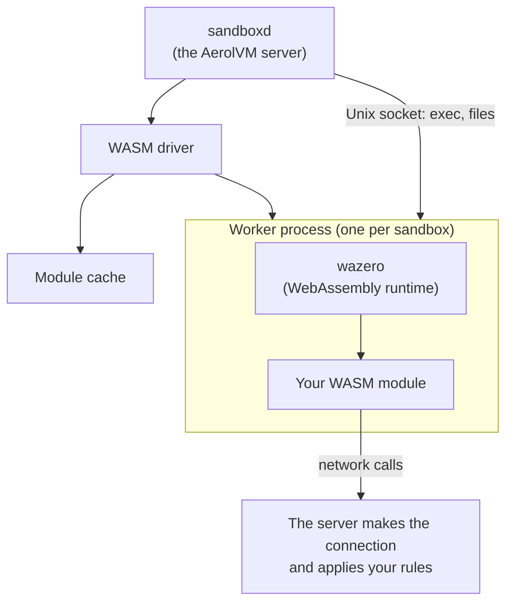

import { Aside, Tabs, TabItem } from '@astrojs/starlight/components';

WebAssembly (WASM) is a portable format for compiled programs. A WASM sandbox runs one such program, called a module, in its own worker process on the server. There is no container image and no Linux system inside: just your program.

The module reaches files, the clock and the network through WASI (the WebAssembly System Interface), a standard set of system functions for WebAssembly. AerolVM runs core WASI preview 1 modules, often written `wasip1`. You can build one from Go, Rust and other languages, or use a ready-made language module such as Python.

Choose WASM when you want sandboxes that start very fast and use little memory, and your code can be compiled to WebAssembly. With the server's default settings, creating a WASM sandbox took about 22 ms on the server (median) on our three-server test cluster. Most creates take 20 to 50 ms.

## How it works



1. **There is no container and no kernel of its own.** Your code is a WebAssembly module.
2. **Each sandbox gets its own worker process,** which runs the module in the wazero WebAssembly runtime. The module can only do what that runtime allows. It makes no system calls of its own.
3. **The server talks to the worker over a Unix socket,** a private channel between two programs on one machine. Commands go through it. File requests are served by the server from the sandbox's own work folder.
4. **The server makes network connections for the module** (host-mediated), so it can apply your network rules to each one.
5. **A `passivatable` sandbox can be saved to disk** as a checkpoint and brought back later. See [Keep the sandbox across server restarts](#keep-the-sandbox-across-server-restarts).

For the details, see [WASM architecture](/wasm-architecture/).

## What the server needs

WASM needs no special hardware. It is off by default: the server operator turns it on with `SB_ENABLE_WASM=true` (see [Turn on WebAssembly](/getting-started/installer-options/#turn-on-webassembly)). Until they do, a create fails with `runtime "wasm" requires SB_ENABLE_WASM=true`.

## Create a WASM sandbox

Set `runtime: "wasm"` and say which module to run with `moduleRef`. The easiest choice is a standard module, a short name such as `python` that your operator set up on every server. Ask your operator which names they offer.

<Tabs syncKey="lang">
  <TabItem label="TypeScript">
    ```ts
    import { MicroVM } from "@aerol-ai/aerolvm-sdk";

    const client = new MicroVM(); // reads SB_API_URL and SB_PAT_TOKEN

    const sandbox = await client.create({
      image: "python", // the TypeScript SDK requires image: use the module name
      moduleRef: "python",
      runtime: "wasm",
    });
    console.log(sandbox.id);

    await sandbox.destroy();
    ```
  </TabItem>
  <TabItem label="Python">
    ```python
    from microvm import MicroVM

    client = MicroVM()  # reads SB_API_URL and SB_PAT_TOKEN

    sandbox = client.create(
        image="python",  # the Python SDK requires image: use the module name
        module_ref="python",
        runtime="wasm",
    )
    print(sandbox.id)

    sandbox.destroy()
    ```
  </TabItem>
  <TabItem label="Go">
    ```go
    client, err := microvm.NewClient() // reads SB_API_URL and SB_PAT_TOKEN
    if err != nil {
        log.Fatal(err)
    }

    sandbox, err := client.Create(ctx, sdktypes.CreateSandboxOptions{
        ModuleRef: "python",
        Runtime:   sdktypes.RuntimeWasm,
    })
    if err != nil {
        log.Fatal(err)
    }
    defer sandbox.Destroy(ctx)

    fmt.Println(sandbox.ID)
    ```
  </TabItem>
  <TabItem label="Rust">
    ```rust
    use aerolvm_sdk::{Client, CreateOptions};

    let client = Client::new(None, None)?; // reads SB_API_URL and SB_PAT_TOKEN

    let sandbox = client.create(CreateOptions {
        module_ref: Some("python".into()),
        runtime: Some("wasm".into()),
        ..Default::default()
    })?;
    println!("{}", sandbox.data.id);

    sandbox.destroy()?;
    ```
  </TabItem>
  <TabItem label="Java">
    ```java
    MicroVMClient client = new MicroVMClient(); // reads SB_API_URL and SB_PAT_TOKEN

    Sandbox sandbox = client.create(
        new CreateOptions().setModuleRef("python").setRuntime("wasm")
    );
    System.out.println(sandbox.id);

    sandbox.destroy();
    ```
  </TabItem>
</Tabs>

## Choose a module

`moduleRef` accepts four kinds of names. The server checks them in this order:

| Kind | Example | When to use it |
|---|---|---|
| Standard module | `python` | A language your operator set up on every server. No upload, no path. |
| Registry reference | `oci://registry.example.com/team/app:v1` | Your own module, stored in a container registry. |
| Catalogue ID | the `id` from `createWasmModule` | A module already registered on this server. |
| File on the server | `file:///opt/agent.wasm` | Self-hosted servers where you can put files on the server yourself. |

To build and push your own module, see [WASM modules](/wasm-modules/).

## Run commands

`exec` works on WASM sandboxes, but there is no shell. Each `exec` runs the module from the start, with your command split on spaces as its arguments. Quotes do not group words. Files the module writes under `/work` stay there between runs.

## Keep the sandbox across server restarts

By default, a WASM sandbox is lost when the server restarts. Set `durability` to keep it. This is the same create field described in [Durability and failover](/durability/), but WASM uses a different default.

| `durability` | What happens | Default for WASM |
|---|---|---|
| `ephemeral` | The sandbox is lost when the server restarts. | Yes |
| `passivatable` | When the server shuts down cleanly, it saves the sandbox's memory and state to its disk (a checkpoint). The sandbox comes back from that checkpoint. | No |
| `durable` | Not available yet. The server rejects it with `not yet implemented`. | No |

<Tabs syncKey="lang">
  <TabItem label="TypeScript">
    ```ts
    const sandbox = await client.create({
      image: "python",
      moduleRef: "python",
      runtime: "wasm",
      memoryMB: 256,
      durability: "passivatable",
    });
    ```
  </TabItem>
  <TabItem label="Python">
    ```python
    sandbox = client.create(
        image="python",
        module_ref="python",
        runtime="wasm",
        memory_mb=256,
        durability="passivatable",
    )
    ```
  </TabItem>
  <TabItem label="Go">
    ```go
    sandbox, err := client.Create(ctx, sdktypes.CreateSandboxOptions{
        ModuleRef:  "python",
        Runtime:    sdktypes.RuntimeWasm,
        MemoryMB:   256,
        Durability: sdktypes.DurabilityPassivatable,
    })
    ```
  </TabItem>
  <TabItem label="Rust">
    ```rust
    let sandbox = client.create(CreateOptions {
        module_ref: Some("python".into()),
        runtime: Some("wasm".into()),
        memory_mb: Some(256),
        durability: Some("passivatable".into()),
        ..Default::default()
    })?;
    ```
  </TabItem>
  <TabItem label="Java">
    ```java
    Sandbox sandbox = client.create(
        new CreateOptions()
            .setModuleRef("python")
            .setRuntime("wasm")
            .setMemoryMb(256)
            .setDurability("passivatable")
    );
    ```
  </TabItem>
</Tabs>

If you leave out `memoryMB`, the sandbox gets the server's WASM default, 256 MB unless your operator changed it.

## Good to know

- **No GPU, no templates.** WASM sandboxes reject `gpus` and `template_id`.
- **Allow and block lists work; method and path rules do not.** You can block the internet or allow only some hosts. The finer method and path rules from [Rules and inspection](/advanced-network-rules/#allow-only-some-requests) are rejected.
- **HTTP only for public ports.** You can share a web server the module runs, but not raw TCP ports or TLS (encrypted TCP) ports. See [WASM networking](/wasm-networking/).

For how workers and checkpoints work inside, see [WASM architecture](/wasm-architecture/).

## Next steps

- [WASM modules](/wasm-modules/): use standard modules or push your own.
- [WASM networking](/wasm-networking/): share a web server running in a WASM sandbox.
- [V8 isolate](/isolate-sandbox/): run JavaScript or TypeScript handlers instead.
- [WASM architecture](/wasm-architecture/): workers, checkpoints and failover in detail.
