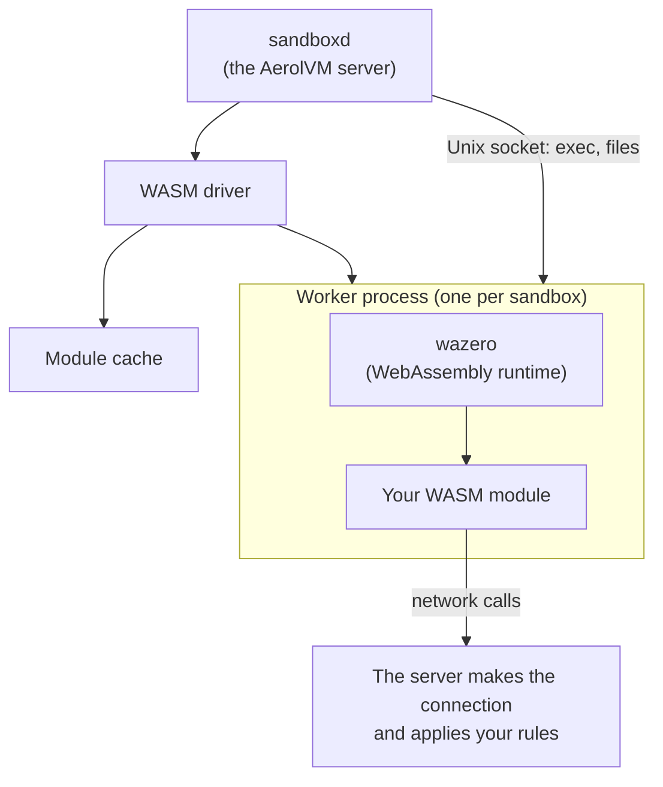

import { Aside, Tabs, TabItem } from '@astrojs/starlight/components';

WebAssembly (WASM) is a portable format for compiled programs. A WASM sandbox runs one such program, called a module, in its own worker process on the server. There is no container image and no Linux system inside: just your program.

The module reaches files, the clock and the network through WASI (the WebAssembly System Interface), a standard set of system functions for WebAssembly. AerolVM runs core WASI preview 1 modules, often written `wasip1`. You can build one from Go, Rust and other languages, or use a ready-made language module such as Python.

Choose WASM when you want sandboxes that start very fast and use little memory, and your code can be compiled to WebAssembly. With the server's default settings, creating a WASM sandbox took about 22 ms on the server (median) on our three-server test cluster. Most creates take 20 to 50 ms.

## How it works



1. **There is no container and no kernel of its own.** Your code is a WebAssembly module.
2. **Each sandbox gets its own worker process,** which runs the module in the wazero WebAssembly runtime. The module can only do what that runtime allows. It makes no system calls of its own.
3. **The server talks to the worker over a Unix socket,** a private channel between two programs on one machine. Commands go through it. File requests are served by the server from the sandbox's own work folder.
4. **The server makes network connections for the module** (host-mediated), so it can apply your network rules to each one.
5. **A `passivatable` sandbox can be saved to disk** as a checkpoint and brought back later. See [Keep the sandbox across server restarts](#keep-the-sandbox-across-server-restarts).

For the details, see [WASM architecture](/wasm-architecture/).

## What the server needs

WASM needs no special hardware. It is off by default: the server operator turns it on with `SB_ENABLE_WASM=true` (see [Turn on WebAssembly](/getting-started/installer-options/#turn-on-webassembly)). Until they do, a create fails with `runtime "wasm" requires SB_ENABLE_WASM=true`.

## Create a WASM sandbox

Set `runtime: "wasm"` and say which module to run with `moduleRef`. The easiest choice is a standard module, a short name such as `python` that your operator set up on every server. Ask your operator which names they offer.

<Tabs syncKey="lang">
  <TabItem label="TypeScript">
    ```ts
    import { MicroVM } from "@aerol-ai/aerolvm-sdk";

    const client = new MicroVM(); // reads SB_API_URL and SB_PAT_TOKEN

    const sandbox = await client.create({
      image: "python", // the TypeScript SDK requires image: use the module name
      moduleRef: "python",
      runtime: "wasm",
    });
    console.log(sandbox.id);

    await sandbox.destroy();
    ```
  </TabItem>
  <TabItem label="Python">
    ```python
    from microvm import MicroVM

    client = MicroVM()  # reads SB_API_URL and SB_PAT_TOKEN

    sandbox = client.create(
        image="python",  # the Python SDK requires image: use the module name
        module_ref="python",
        runtime="wasm",
    )
    print(sandbox.id)

    sandbox.destroy()
    ```
  </TabItem>
  <TabItem label="Go">
    ```go
    client, err := microvm.NewClient() // reads SB_API_URL and SB_PAT_TOKEN
    if err != nil {
        log.Fatal(err)
    }

    sandbox, err := client.Create(ctx, sdktypes.CreateSandboxOptions{
        ModuleRef: "python",
        Runtime:   sdktypes.RuntimeWasm,
    })
    if err != nil {
        log.Fatal(err)
    }
    defer sandbox.Destroy(ctx)

    fmt.Println(sandbox.ID)
    ```
  </TabItem>
  <TabItem label="Rust">
    ```rust
    use aerolvm_sdk::{Client, CreateOptions};

    let client = Client::new(None, None)?; // reads SB_API_URL and SB_PAT_TOKEN

    let sandbox = client.create(CreateOptions {
        module_ref: Some("python".into()),
        runtime: Some("wasm".into()),
        ..Default::default()
    })?;
    println!("{}", sandbox.data.id);

    sandbox.destroy()?;
    ```
  </TabItem>
  <TabItem label="Java">
    ```java
    MicroVMClient client = new MicroVMClient(); // reads SB_API_URL and SB_PAT_TOKEN

    Sandbox sandbox = client.create(
        new CreateOptions().setModuleRef("python").setRuntime("wasm")
    );
    System.out.println(sandbox.id);

    sandbox.destroy();
    ```
  </TabItem>
</Tabs>

## Choose a module

`moduleRef` accepts four kinds of names. The server checks them in this order:

| Kind | Example | When to use it |
|---|---|---|
| Standard module | `python` | A language your operator set up on every server. No upload, no path. |
| Registry reference | `oci://registry.example.com/team/app:v1` | Your own module, stored in a container registry. |
| Catalogue ID | the `id` from `createWasmModule` | A module already registered on this server. |
| File on the server | `file:///opt/agent.wasm` | Self-hosted servers where you can put files on the server yourself. |

To build and push your own module, see [WASM modules](/wasm-modules/).

## Run commands

`exec` works on WASM sandboxes, but there is no shell. Each `exec` runs the module from the start, with your command split on spaces as its arguments. Quotes do not group words. Files the module writes under `/work` stay there between runs.

Every command runs inside the WebAssembly engine, never as a program on the server. It sees `/work` and nothing else of the server's disk, and it follows the sandbox's network rules.

### Stream a command

[`execStream`](/exec-streaming/) works too. You see the output while the command runs, and you can send it input. The command runs as a second copy of the sandbox's module, next to the one already running, so it does not stop a web server the sandbox is serving.

A WASM sandbox has no operating system, so a few things work differently than on other sandboxes:

- **No terminal.** `tty: true` fails with an error.
- **No signals.** Any signal, such as stopping the command from the SDK, ends the command at once. The exit has code `-1` and signal `killed`.
- **No shell.** Quotes group words, so `python -c 'print(1 + 2)'` gives the module three arguments. But `|`, `>`, `*` and `$NAME` are passed as plain text.
- **The working folder** must be `/work` or a folder inside it. The module gets it in the `PWD` variable. Whether the module uses it depends on the module.
- **No time limit.** A streamed command runs until it exits or you disconnect. Disconnecting ends it.
- **A limit per sandbox.** A sandbox runs at most 8 streamed commands and code runs at a time (your operator can change this). One more fails with HTTP 429.

Stopping, passivating or moving the sandbox ends its streamed commands.

### Run code

The Daytona SDK's `process.codeRun` works for `python`, `javascript` and `ruby`, when your operator has set up those [standard modules](/wasm-modules/). Your code runs in that language's module (CPython, QuickJS or Ruby built for WebAssembly) with the sandbox's `/work`. Some things to know:

- Each call starts a fresh interpreter. Variables do not carry over between calls.
- JavaScript runs on QuickJS, not Node.js. Node's modules, such as `fs` and `require`, are not there.
- A call stops after `timeout` seconds. Without one, it stops at the server's WASM time limit (`SB_WASM_DEFAULT_TIMEOUT`, 5 minutes by default). The result keeps the first 10 MiB of output.
- The first run of a language on a server compiles its module, which takes a few seconds (up to about 20 for Ruby). Later runs start fast.
- Any other language fails with HTTP 400. The error lists the languages this server can run.

### Daytona sessions

The Daytona SDK's sessions work on WASM sandboxes. You can create a session, run commands in it, wait for a command or let it run in the background, read its logs or follow them live, send it input, and delete the session.

Each command is a run of the sandbox's own module, with your command line as its arguments. The line is split the same way as for a [streamed command](#stream-a-command). That means:

- **There is no shell.** `cd`, `export`, `&&` and `|` do nothing special. The working folder and environment variables do not carry over from one command to the next. Files under `/work` do.
- **One command at a time.** Commands in one session run in order, one after another, as on other sandboxes.
- **No time limit.** A command runs until it exits. Deleting the session ends it.
- **The same limit as streamed commands.** A running session command counts toward the 8 streamed commands and code runs a sandbox can have. One more fails with HTTP 429.
- **Logs are capped.** The server keeps the last 1 MB of each command's output and of its error output. A longer log starts partway through, but its offsets still count from the start of the output.
- **A sandbox has at most 16 sessions,** and each session keeps its last 64 finished commands.
- **Sessions end with the sandbox.** Stopping, passivating or moving the sandbox ends them, as on other sandboxes.

The entrypoint session (`process.getEntrypointSession`, `process.getEntrypointLogs`) is the sandbox's web server: the run of the module that serves its public port. Its logs are the last 1 MB that server printed. A sandbox that does not serve a port has no entrypoint, so these calls fail with HTTP 404.

### Code interpreter

The [code interpreter](/code-interpreter/) works for Python, from the AerolVM SDKs (`runCode`), the Daytona SDK (`codeInterpreter`) and the E2B Code Interpreter SDK. It needs the `python` standard module, the same one `codeRun` uses. Unlike `codeRun`, a context keeps its variables from one run to the next.

Each context is a copy of the Python module that stays open in the sandbox's WebAssembly engine, with the sandbox's `/work`, memory limit and network rules. Some things to know:

- **Contexts start in `/work`**, for E2B too (E2B's own default is `/home/user`).
- **A timeout or an interrupt resets the context.** WebAssembly has no way to interrupt running code, so the sandbox stops the whole interpreter. The context stays, but its next run starts with no variables.
- **At most 4 contexts** per sandbox. Each context whose interpreter is open counts toward the 8 streamed commands and code runs above.
- **Idle contexts stop after 15 minutes** without a run, which frees their memory. The context stays and starts fresh on its next run.
- **Only Python's standard library.** No IPython, so no `%magics` or `!ls`; no pandas or matplotlib.
- Stopping, passivating or moving the sandbox ends all its contexts.

### What does not work

- Interactive [terminal sessions](/sessions/) and Daytona terminals (`process.createPty`). The server answers HTTP 501. Use [Daytona sessions](#daytona-sessions) or a [streamed command](#stream-a-command) instead.
- [SSH logins](/ssh-access/). A login opens a terminal session, so it fails too.

### For server operators

| Setting | What it does | Default |
|---|---|---|
| `SB_WASM_CODERUN_MODULES` | Which module runs each code-run language, as `language=module,...`. Languages can be `python`, `python3`, `py`, `javascript`, `js`, `node`, `ruby` and `rb`. | Built from `SB_WASM_STANDARD_MODULES`: the `python`, `javascript` and `ruby` modules, when present |
| `SB_WASM_MAX_STREAMS_PER_SANDBOX` | How many streamed commands, code runs and open code interpreters one WASM sandbox may run at a time. Each one uses memory on the server. | `8` |
| `SB_WASM_STREAM_MAX_MESSAGE_BYTES` | The largest single message a client may send on a streamed command: one piece of input, or one control message. A bigger one closes the stream with code 1009 and ends the command. Send large input in several messages. | `1048576` (1 MiB) |
| `SB_WASM_SESSION_LOG_BYTES` | How much of each Daytona session command's output, and of its error output, the server keeps. | `1048576` (1 MiB) |
| `SB_WASM_MAX_SESSIONS_PER_SANDBOX` | How many Daytona sessions one WASM sandbox may have. | `16` |
| `SB_WASM_SESSION_COMMANDS_KEPT` | How many finished commands a session keeps, and how many may wait for their turn. | `64` |
| `SB_WASM_SESSION_LOG_BUDGET_BYTES` | How much session log one WASM sandbox may keep in total. Past it, the logs of the oldest finished commands are dropped first. | `16777216` (16 MiB) |
| `SB_WASM_INTERP_MAX_CONTEXTS` | How many code interpreter contexts one WASM sandbox may have, Daytona's and E2B's together. | `4` |
| `SB_WASM_INTERP_IDLE_TTL` | How long a context's interpreter may sit without a run before it is stopped. The context stays and starts fresh on its next run. | `15m` |

Session logs live in the server's memory, which is why each part has a limit.

A worker started by an older release cannot stream. Streamed commands, code runs, session commands, entrypoint logs and code interpreter contexts on its sandbox fail until the sandbox restarts (HTTP 501 for all but code interpreter contexts). Servers that use the `wasmtime` engine (`SB_WASM_ENGINE=wasmtime`) answer HTTP 501 too.

## Keep the sandbox across server restarts

By default, a WASM sandbox is lost when the server restarts. Set `durability` to keep it. This is the same create field described in [Durability and failover](/durability/), but WASM uses a different default.

| `durability` | What happens | Default for WASM |
|---|---|---|
| `ephemeral` | The sandbox is lost when the server restarts. | Yes |
| `passivatable` | When the server shuts down cleanly, it saves the sandbox's memory and state to its disk (a checkpoint). The sandbox comes back from that checkpoint. | No |
| `durable` | Not available yet. The server rejects it with `not yet implemented`. | No |

<Tabs syncKey="lang">
  <TabItem label="TypeScript">
    ```ts
    const sandbox = await client.create({
      image: "python",
      moduleRef: "python",
      runtime: "wasm",
      memoryMB: 256,
      durability: "passivatable",
    });
    ```
  </TabItem>
  <TabItem label="Python">
    ```python
    sandbox = client.create(
        image="python",
        module_ref="python",
        runtime="wasm",
        memory_mb=256,
        durability="passivatable",
    )
    ```
  </TabItem>
  <TabItem label="Go">
    ```go
    sandbox, err := client.Create(ctx, sdktypes.CreateSandboxOptions{
        ModuleRef:  "python",
        Runtime:    sdktypes.RuntimeWasm,
        MemoryMB:   256,
        Durability: sdktypes.DurabilityPassivatable,
    })
    ```
  </TabItem>
  <TabItem label="Rust">
    ```rust
    let sandbox = client.create(CreateOptions {
        module_ref: Some("python".into()),
        runtime: Some("wasm".into()),
        memory_mb: Some(256),
        durability: Some("passivatable".into()),
        ..Default::default()
    })?;
    ```
  </TabItem>
  <TabItem label="Java">
    ```java
    Sandbox sandbox = client.create(
        new CreateOptions()
            .setModuleRef("python")
            .setRuntime("wasm")
            .setMemoryMb(256)
            .setDurability("passivatable")
    );
    ```
  </TabItem>
</Tabs>

If you leave out `memoryMB`, the sandbox gets the server's WASM default, 256 MB unless your operator changed it.

## Good to know

- **No GPU, no templates.** WASM sandboxes reject `gpus` and `template_id`.
- **Allow and block lists work; method and path rules do not.** You can block the internet or allow only some hosts. The finer method and path rules from [Rules and inspection](/advanced-network-rules/#allow-only-some-requests) are rejected.
- **HTTP only for public ports.** You can share a web server the module runs, but not raw TCP ports or TLS (encrypted TCP) ports. See [WASM networking](/wasm-networking/).

For how workers and checkpoints work inside, see [WASM architecture](/wasm-architecture/).

## Next steps

- [WASM modules](/wasm-modules/): use standard modules or push your own.
- [WASM networking](/wasm-networking/): share a web server running in a WASM sandbox.
- [V8 isolate](/isolate-sandbox/): run JavaScript or TypeScript handlers instead.
- [WASM architecture](/wasm-architecture/): workers, checkpoints and failover in detail.
