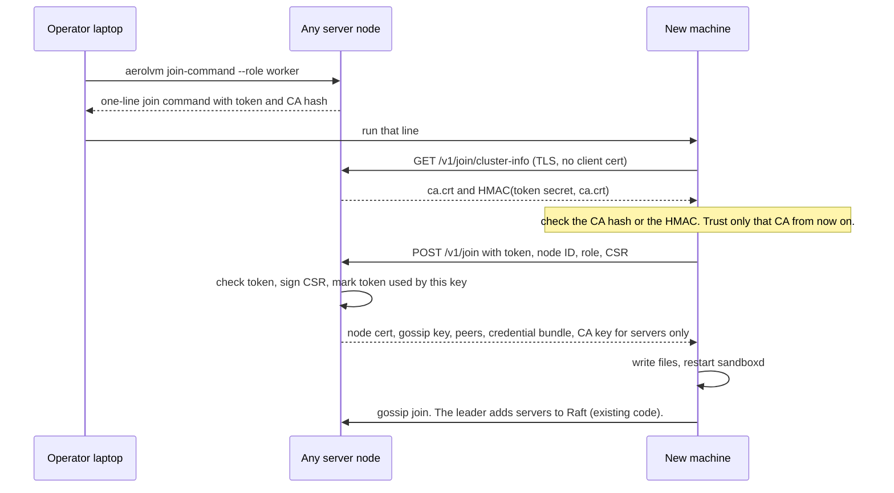
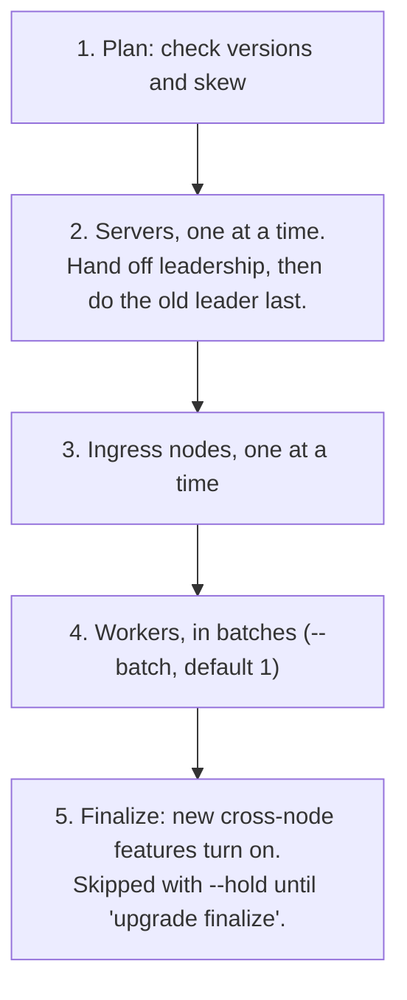

# Install, grow and upgrade AerolVM like Kubernetes

**Status:** PROPOSED (2026-11-07). Not reviewed. Nothing below is built.
**Branch:** `plans/kubectl-style-ops`, cut from `main` at `e33b6e16`.
**Related:**
- `plans/kubernetes-v2-architecture.md` (PR #522). That plan runs AerolVM
  *on* Kubernetes. This plan is for plain machines with no Kubernetes. It
  borrows that plan's upgrade order and its "finalize" rule, so both installs
  upgrade the same way.
- `plans/mcp-server-and-agent-cli.md`. The `aerolvm` CLI contract this plan
  extends (§5.2: stdout is data, `--json` everywhere, fixed exit codes).
- `plans/identity-and-access.md`. API tokens stored in Raft. Join tokens
  reuse that path.
- `setup/cluster.md`, `setup/deployment/role-changes.md`. Today's runbooks.

## How to read this plan

Part 1 says what is hard today and why. Every claim names a file and line.
Part 2 lists the decisions. Part 3 is the design. Part 4 has the phases,
tests, risks and open questions.

### Words used in this plan

- **Node command.** Runs on the machine itself, as root:
  `sudo sandboxd …`. This is the `kubeadm` job.
- **Cluster command.** Runs from any laptop, over the API: `aerolvm …`.
  This is the `kubectl` job.
- **Server, worker, ingress.** The node roles (`SB_NODE_ROLE`). Servers hold
  Raft. Workers run sandboxes. Ingress nodes take outside traffic.
- **Join token.** A short-lived secret that lets one new machine join. The
  same idea as a kubeadm bootstrap token.
- **CA hash.** The SHA-256 of the cluster CA's public key. A new machine
  checks it, so a fake server can't trick it into joining the wrong cluster.
- **Cluster version.** The newest cross-node data format that every node has
  agreed to use. Today this is `fsmOpsVersion`
  (`internal/cluster/fsm_egress_profiles.go:34`).

---

# Part 1: What is hard today

## 1. The goal in one table

| Job | Kubernetes | AerolVM today | AerolVM after this plan |
|---|---|---|---|
| Get the tools | Download `kubeadm` and `kubectl` | `curl … \| sudo bash` for one node. A repo checkout for Terraform, Ansible, drain and backup. | `curl … \| sudo bash` on each node. `aerolvm` from Homebrew, npm or the release page. |
| Start a cluster | `kubeadm init` | `install.sh`, then `cluster-init.sh`, then copy two tar files and a gossip key by hand | `sudo sandboxd init` |
| Add a machine | `kubeadm join <addr> --token … --discovery-token-ca-cert-hash …` | Run `cluster-join.sh` twice. In between, `scp` a CSR to the seed, sign it there, and `scp` the cert back. | Paste the one line that `aerolvm join-command` prints |
| List machines | `kubectl get nodes` | `curl /v1/cluster/members` | `aerolvm get nodes` |
| Stop new work on a machine | `kubectl cordon` | `curl -X POST …/drain` (it only cordons) | `aerolvm cordon` |
| Empty a machine | `kubectl drain` | `sandboxd-node-lifecycle.sh`, from the repo | `aerolvm drain` |
| Remove a machine | `kubectl delete node`, then `kubeadm reset` | `curl -X DELETE …/members/{id}` (servers only) | `aerolvm delete node`, then `sudo sandboxd reset` |
| Upgrade | `kubeadm upgrade plan` / `apply` | Re-run `install.sh` with every flag, by SSH, on every node. Or Ansible from a repo checkout. | `aerolvm upgrade plan`, then `aerolvm upgrade apply v0.6.12` |
| Renew node certs | Automatic | Repeat the sign-and-copy steps every 90 days | Automatic |
| Switch clusters | `kubectl config use-context` | One saved login only | `aerolvm config use-context` |

## 2. Why it is hard: six causes

### C1. Joining is a manual hand-off of secrets

The daemon has no join endpoint, no join token and no certificate signing.
The only `x509.CreateCertificate` call in server code is the egress
inspection CA (`internal/egress/inspect/ca.go`). Bash does all of it:

1. On the seed, `cluster-init.sh` makes the gossip key with `openssl`
   (`scripts/cluster-init.sh:303-323`). It makes the CA and the seed's cert
   (`:422-450`) and two tar files (`:457`, `:467-478`). Then it prints `scp`
   instructions (`:582-623`).
2. The operator copies both tar files and pastes the gossip key
   (`setup/cluster.md:377-387`).
3. On the new node, `cluster-join.sh` makes a key and a CSR, then stops on
   purpose with exit code 2 (`scripts/cluster-join.sh:343-366`).
4. The operator copies the CSR to the seed, runs `cluster-sign-node.sh` there
   (`scripts/cluster-sign-node.sh:88-102`), and copies the cert back.
5. `cluster-join.sh` runs a second time with `--signed-cert`. It writes
   `cluster.env` and restarts sandboxd (`:431-470`, `:513-514`).

On AWS, Terraform automates the same hand-off. It uses S3 and a loop on the
seed that signs CSRs (`Terraform/templates/bootstrap.sh.tftpl:262-372`). That
only works on AWS, and only from a repo checkout. The docs say so: "A copy of
the AerolVM repository … You run every command below from its top folder"
(`docs/src/content/docs/cluster-setup.mdx:27`).

None of the join secrets expire: the gossip key, `ca.crt`, the credential
bundle and the shared PAT. The PAT must be the same on every node
(`setup/cluster.md:271-272`).

**What already works, and we keep.** Once a node has its cert and the gossip
key, joining Raft is automatic. When gossip sees a new server, the leader
adds it as a voter, or as a non-voter past the voter cap
(`internal/cluster/voter_autojoin.go:64-175`). Workers and ingress nodes
never enter Raft (`internal/cluster/agent.go:270`).

### C2. Node certs expire after 90 days, and nothing renews them

`cluster-sign-node.sh` defaults to 90 days (`:23`). To renew, you "re-run
cluster-join / this script with a fresh CSR" (`:32-33`). That means the whole
copy dance again, on every node, every 90 days. An alert fires 14 days
before expiry (`setup/prometheus/sandboxd-alerts.yml:649`). The daemon already
picks up a cert that is replaced on disk (`internal/cluster/tls.go:334-383`).
The only missing piece is a signer the node can call.

### C3. Upgrading means re-running the installer, with every flag, on every node

**One node.** You re-run `install.sh` with all of the original flags
(`setup/single-node.md:262-279`). The installer does not remember them:

- It rewrites `/etc/sandboxd/sandboxd.env` from scratch on every run
  (`scripts/install.sh:1357`). Hand edits are lost.
- On Linux, a run without `--pat-token` makes a new random PAT
  (`install.sh:820-827`) and writes it (`:1358`). Only macOS keeps the old one
  (`:2841`). In a cluster every node must share the PAT, so one forgotten
  flag should break that node's calls to its peers. This is not yet tested
  live.
- If the flags did not change, it does not restart sandboxd (`:1945-1951`).
  The old binary keeps running until someone restarts it by hand.
- It overwrites the binary and keeps no copy (`:1344`). There is no rollback
  and no database backup.
- `--version` only picks a download URL (`:438-448`). Nothing stops a
  downgrade.

**A fleet.** `Ansible/playbooks/update-sandboxd.yml` needs the repo, boto3 and
the EC2 inventory (`Ansible/README.md:7-35`). It upgrades one host at a time
(`:23-26`), but:

- It does not drain the node and does not move the leader last. It waits
  only for the local `/health` (`:138-146`), not for Raft to catch up.
- It downloads a remote URL with no checksum (`:76-84`). `install.sh` checks
  checksums; this does not.
- It runs `sandboxd --version` (`:151`), but sandboxd has no such flag.
  `cmd/sandboxd/main.go:111` falls through to `run()`, so this starts a
  second daemon on the live state folder. `failed_when: false` hides the
  result. This is a bug, and Phase 0 fixes it.

Our own upgrade test does the same by hand. It copies a binary with `scp`,
then runs `systemctl stop`, `install` and `systemctl start` on each node
(`integration-tests/upgrade-gate.sh:130-133`).

### C4. Day-2 tools live only in the repo

A release ships the binaries (`sandboxd`, `toolboxd`, `caddy`, `aerolvm`) and
four scripts: `install.sh`, `cluster-init.sh`, `cluster-join.sh` and
`cluster-sign-node.sh` (`.github/workflows/release.yml:380-386`). Everything
else needs a clone:

| Tool | Path | Note |
|---|---|---|
| Uninstall | `scripts/uninstall.sh` | The docs download it from the latest release (`setup/single-node.md:284`, `setup/local.md:144`), but the release never uploads it. That link should return 404. |
| Drain and role change | `scripts/sandboxd-node-lifecycle.sh` | Its "wait until empty" loop runs on the client, in Python (`:132-179`). |
| Backup and restore | `scripts/sandboxd-backup.sh`, `scripts/sandboxd-restore.sh` | |
| Lost-quorum recovery | `scripts/raft-lost-quorum-recover.sh` | |
| Fleet upgrade and ops settings | `Ansible/` | Reached over SSH with an EC2 tag inventory |
| AWS cluster | `Terraform/`, `scripts/terraform.sh` | |
| Alerts, dashboards, runbooks | `setup/prometheus/`, `setup/alertmanager/`, `setup/grafana/`, `setup/runbooks/` | |

`packaging/` is only a reference copy. `install.sh` writes its own systemd
units from heredocs (`install.sh:1838`).

### C5. The `aerolvm` CLI only knows sandboxes

Its verbs cover sandboxes, tokens, audit and login
(`cmd/aerolvm/app.go:90-125`). It has no node or cluster verbs. It saves one
login: one URL and one token (`cmd/aerolvm/login.go:28-40`). To switch
between staging and production, you must juggle environment variables.

The daemon already has most of what node verbs need. Every `/v1/cluster/*`
route needs `fleet.admin` (`pkg/api/v1/routes.go:218`):

| Future verb | Route today | Anchor |
|---|---|---|
| `get nodes` | `GET /v1/cluster/members` | `routes.go:222` |
| `delete node` | `DELETE /v1/cluster/members/{id}`. Servers only: a worker gets 404 (`internal/cluster/client.go:1119-1124`). | `routes.go:223` |
| `cordon` | `POST /v1/cluster/nodes/{id}/drain`. It stops new placements and moves nothing (`pkg/api/v1/cluster_handler.go:1208-1237`). | `routes.go:239` |
| `uncordon` | `POST /v1/cluster/nodes/{id}/uncordon` | `routes.go:240` |
| `cluster-info` | `GET /v1/cluster/leader` | `routes.go:224` |
| `drain` (the wait) | `GET /v1/cluster/sandbox-index` (paged) | `routes.go:237` |

The member record has role, alive, drained and capacity
(`internal/cluster/cluster.go:484-516`). It has no build version, no voter
flag and no leader flag.

### C6. Nodes can't compare versions

- Gossip carries the FSM op version (`fv`), not the build version
  (`internal/cluster/gossip.go:26-61`). Gossip metadata is capped at 512
  bytes (`:18-21`).
- New cross-node writes switch on per feature, once every server has the new
  op version (`fsm_egress_profiles.go:24-52`). There is no cluster-wide
  "finalize" step and no way to hold it. So rollback stops being safe the
  moment the last server upgrades.
- The SQLite schema has no version number. Migrations are `ALTER TABLE`s that
  ignore "duplicate column" (`internal/store/store.go:858-889`), plus some that
  rebuild whole tables (`migrateSnapshotOwnerPK`). Nothing notices an old
  binary starting on a newer database.
- `sandboxd` has no `version` command. `aerolvm version` prints only the
  client's version (`cmd/aerolvm/verbs.go:370-381`).

Reading for this plan also turned up doc drift. Appendix A lists it.

---

# Part 2: Decisions

| ID | Decision | Why |
|---|---|---|
| D1 | **Two binaries, two jobs, like `kubeadm` and `kubectl`.** `sandboxd` gets node commands: `init`, `join`, `reset`, `upgrade node`, `host apply`, `version`, `backup`, `restore`, `recover-quorum`. `aerolvm` gets cluster commands. No new binary. | `sandboxd` is already on every node, runs as root, and already has a subcommand (`sandboxd key`, `cmd/sandboxd/key.go:70-84`). `aerolvm` must stay a thin client with no server packages (`cmd/aerolvm/deps_test.go`), and it ships to Mac and Windows. |
| D2 | **The daemon owns cluster bootstrap.** Making the CA, signing CSRs, join tokens and the secret hand-off move from bash and Terraform into Go, in `internal/cluster`. The four cluster scripts become thin wrappers for one release, then go away. | Go code is tested, ships inside the signed binary, and works on any cloud. |
| D3 | **kubeadm-style join tokens.** A token looks like `<id>.<secret>`. It is stored hashed in Raft, through the existing API token path (`internal/cluster/api_tokens.go`). It carries a role and a TTL (default 2h, at most 24h), and works once unless `--reusable` is set. `aerolvm join-command` makes one. Tokens can be revoked, and every use is audited. | One short-lived secret replaces four that never expire. Reusing the API token store avoids a new FSM op, if its fields fit. Phase 2 checks this first. |
| D4 | **The new machine checks the cluster before trusting it.** With `--ca-cert-hash sha256:…`, it pins the CA. Without it, it trusts the CA only if the server proves it knows the token secret: an HMAC over `ca.crt`, like kubeadm's signed `cluster-info`. | A fake server can't hand out a fake CA. Terraform can join nodes without knowing the CA hash in advance. |
| D5 | **The CA key lives on server nodes only**, like kubeadm's control-plane nodes. A new server receives it in its join answer. Workers and ingress nodes never hold it. `sandboxd init --external-ca` keeps the key out of the cluster. Joins then wait for `aerolvm certificate approve` or an outside signer. | Any server can sign, so the seed is not a single point of failure. Banks can keep the key outside the cluster, which matches `kubernetes-v2-architecture.md` D11. |
| D6 | **Node certs renew themselves** at two thirds of their life, over the mTLS channel they already have. | Removes the 90-day cliff (C2). The reload code already exists (`tls.go:334-383`). |
| D7 | **`install.sh` remembers its answers.** It writes every non-secret flag to `/etc/sandboxd/node.json`. It reads secrets back from the env files it wrote before, and never makes a new PAT when one exists. A re-run with no flags rebuilds the same node. `install.sh` is also built into `sandboxd` (`go:embed`), so a binary and its host setup always match. | Fixes the lost-PAT and lost-flags traps (C3). An upgrade can redo host setup with no SSH. |
| D8 | **`aerolvm upgrade` drives upgrades, and `sandboxd upgrade node` does the work on each node.** The node step runs in its own short-lived systemd unit, outside sandboxd's cgroup. It checks hashes, keeps the old binaries, backs up the database, swaps the files, restarts, waits for cluster health, and rolls back on failure. | No SSH, no Ansible, no repo. One code path for 1 node or 2,000. |
| D9 | **Upgrade order and skew follow the Kubernetes v2 plan** (`kubernetes-v2-architecture.md` §13). Servers go one at a time, with the leader last after a leadership hand-off. Then ingress nodes, then workers in batches, then finalize. Any two nodes may be one release apart. | One upgrade story, on machines and on Kubernetes. |
| D10 | **One cluster version, with a hold.** The per-feature gates become one active cluster version, stored in Raft. `aerolvm upgrade apply --hold` keeps new writes off until `aerolvm upgrade finalize`, so rollback stays safe. Without `--hold`, it finalizes by itself once every node runs the new version, which is how the gates behave today. | The same idea as CockroachDB's `preserve_downgrade_option`. |
| D11 | **kubectl grammar in `aerolvm`, with every old verb kept.** `get`, `describe`, `delete` and `apply` take a resource kind. Output takes `-o wide\|json\|yaml\|name\|jsonpath=…`. `-l` selects by tag. `--context` picks a cluster. Kinds have short names. Every current verb keeps working, with the same output. | Kubernetes users already know these commands. Agents and scripts that use today's verbs don't break (the §5.2 contract in `plans/mcp-server-and-agent-cli.md`). |
| D12 | **One manifest format for `aerolvm apply` and the Kubernetes operator.** `-o yaml` prints `apiVersion`, `kind`, `metadata`, `spec` and `status`, with the same group and fields as the operator's future CRDs. | The same YAML file works with `aerolvm apply` and with `kubectl apply`. |
| D13 | **`kubectl aerolvm` works as a plugin. We don't fake the Kubernetes API.** The `aerolvm` binary behaves the same when it is called as `kubectl-aerolvm`, and we publish a Krew manifest. | The plugin is cheap. A fake API server would need discovery, OpenAPI, watch, server-side apply and RBAC mapping, which is a lot to build and maintain. Real `kubectl get sandboxes` comes from the operator on Kubernetes (v2 plan K11). |
| D14 | **Everything an operator needs ships in the release or inside a binary.** `uninstall.sh` and `aerolvm-ops-<version>.tar.gz` (alerts, dashboards, runbooks) become release assets. Backup, restore and lost-quorum recovery become `sandboxd` commands. Terraform is used by URL with `?ref=<tag>`, without a clone. | Closes C4. |
| D15 | **Remote upgrade is on by default, and each node can turn it off** with `SB_REMOTE_UPGRADE=false`. When it is off, `aerolvm upgrade apply` prints the command to run on each node, in order, and waits for each node to finish. | Easy by default. Teams with their own change tooling keep control. |

---

# Part 3: The design

## 3. The commands

### 3.1 On a node: `sudo sandboxd …`

| Command | What it does | Replaces |
|---|---|---|
| `sandboxd version [-o json]`, `sandboxd --version` | Prints the build version, the commit, and the cluster versions this build supports | Nothing. It is missing today, and the Ansible bug in C3 depends on it. |
| `sandboxd init [--role server] [--token <id.secret>] [--external-ca] [--advertise <ip>]` | Makes the CA, the gossip key and the credential key (or wraps the credential key, per custody). Makes the seed's cert, writes `cluster.env`, and starts Raft. Prints a join command and an admin login line. | `cluster-init.sh` |
| `sandboxd join <url> --token <t> [--ca-cert-hash sha256:…] [--role worker]` | One pass: makes a key and CSR, calls join, writes the files, restarts, and waits until the node is a member | `cluster-join.sh`, `cluster-sign-node.sh` and every `scp` |
| `sandboxd reset` | Asks the cluster to remove this node if it can reach it, then removes `cluster.env` and the certs | Deleting files by hand (`setup/cluster.md:1119-1126`) |
| `sandboxd upgrade node --version <v> --sha256 …` | The per-node upgrader (§6.3) | Re-running `install.sh`, `update-sandboxd.yml` |
| `sandboxd host apply` | Re-runs the built-in `install.sh` with the answers in `node.json` | Re-running `install.sh` with every flag |
| `sandboxd backup`, `restore`, `recover-quorum` | Go versions of the three scripts | `scripts/sandboxd-backup.sh`, `sandboxd-restore.sh`, `raft-lost-quorum-recover.sh` |

The installer passes `init` and `join` straight through. This installs the
host, then runs `sandboxd join`:

```bash
curl -fsSL https://aerolvm.aerol.ai | sudo bash -s -- \
  join https://10.0.0.5:7002 --token abc123.0f1e2d3c4b5a6978 --ca-cert-hash sha256:9a1c…
```

### 3.2 From anywhere: `aerolvm …`

**New cluster verbs:**

| Command | Server side |
|---|---|
| `aerolvm get nodes [-o wide]` | `GET /v1/cluster/members`, plus new version, voter and leader fields |
| `aerolvm describe node <name>` | The member record, plus sandbox count, capacity and cert expiry |
| `aerolvm cordon <name>`, `uncordon <name>` | Today's drain and uncordon routes. Add `POST …/cordon` as the clear name, and keep `/drain` for old clients. |
| `aerolvm drain <name> [--timeout 10m] [--delete-sandboxes] [--migrate]` | Cordon, then wait (§5) |
| `aerolvm delete node <name>` | Today's remove route, extended to workers and ingress nodes (§5) |
| `aerolvm join-command [--role worker] [--ttl 2h] [--reusable]` | New. Makes a join token and prints the one-line join command. |
| `aerolvm get jointokens`, `aerolvm delete jointoken <id>` | List and revoke join tokens |
| `aerolvm get csr`, `aerolvm certificate approve <id>` | External-CA mode only (D5) |
| `aerolvm cluster-info` | Leader, API URLs, cluster version, CA expiry |
| `aerolvm upgrade plan\|apply\|status\|finalize\|rollback` | §6 |
| `aerolvm config get-contexts\|use-context\|current-context\|rename-context\|delete-context\|view` | The local config file (§3.4) |
| `aerolvm version` | Prints the client version and the server's version, like `kubectl version` |
| `aerolvm api-resources` | Lists the kinds and their short names |
| `aerolvm top nodes` | Capacity per node, from `GET /v1/capacity` and the member record |

What `aerolvm get nodes` prints. The STATUS words match kubectl's:

```
NAME     ROLE    STATUS                     VERSION   AGE   SANDBOXES   CPU    MEMORY
srv-a    server  Ready,Leader               v0.6.12   41d   0           3%     11%
srv-b    server  Ready                      v0.6.12   41d   0           2%     10%
wrk-1    worker  Ready                      v0.6.12   12d   212         61%    48%
wrk-2    worker  Ready,SchedulingDisabled   v0.6.11   12d   9           4%     6%
```

### 3.3 Sandbox verbs in kubectl grammar

| Kubernetes habit | New `aerolvm` form | Today's form (kept) |
|---|---|---|
| `kubectl get pods` | `aerolvm get sandboxes` or `aerolvm get sb` | `aerolvm list` |
| `kubectl get pod x -o yaml` | `aerolvm get sb x -o yaml` | `aerolvm get x --json` |
| `kubectl describe pod x` | `aerolvm describe sb x` | (none) |
| `kubectl delete pod x` | `aerolvm delete sb x` | `aerolvm destroy x` |
| `kubectl apply -f x.yaml` | `aerolvm apply -f x.yaml` | `aerolvm create …` |
| `kubectl exec -it x -- bash` | `aerolvm exec -it x -- bash` (`-it` means `shell`) | `aerolvm shell x` |
| `kubectl get pods -l app=web` | `aerolvm get sb -l app=web` (sandbox tags) | (none) |
| `kubectl logs`, `kubectl cp` | Same verbs, already there | Same |
| `kubectl get <kind>` | Also works for `snapshots` and `tokens` | Per-verb today |

Rules that keep old commands working:

- After `get`, `describe` or `delete`, the first word is a kind if it matches
  a known kind or short name. Otherwise it is a sandbox name or ID, as today.
  So `aerolvm get my-box` still works.
- A sandbox named the same as a kind (say, `nodes`) must be written
  `aerolvm get sb nodes`. `aerolvm create` prints a warning to stderr when a
  new name matches a kind.
- `--json` stays and prints today's shape. `-o json` and `-o yaml` print the
  object shape (D12). Both shapes are stable contracts.
- Exit codes and the JSON error envelope stay as they are
  (`cmd/aerolvm/app.go:20-28`, `:246-262`).
- `apply` creates a missing object. When the object exists, it changes the
  fields that can change (tags, lifecycle, exposed ports). When an
  unchangeable field differs, such as the image, it fails and says "delete
  and re-create", the way kubectl does for unchangeable fields. Sandbox
  create is already "or return the existing one with that name"
  (`cmd/aerolvm/app.go:103`), so a repeated `apply` is safe.
- When `os.Args[0]` ends in `kubectl-aerolvm`, the binary behaves exactly as
  `aerolvm`. So `kubectl aerolvm get nodes` works once it is on `PATH`.

### 3.4 Contexts

We keep the same file, `$XDG_CONFIG_HOME/aerolvm/config.json`
(`cmd/aerolvm/login.go:70-90`). The new shape adds `contexts` and
`current_context`. It also keeps the old top-level fields as a copy of the
current context. An older `aerolvm` reads only `api_url` and `token`
(`login.go:31-34`), so older CLIs keep working.

```json
{
  "current_context": "prod",
  "contexts": {
    "prod":    { "api_url": "https://api.prod.example.com", "token": "…", "team": "ml" },
    "staging": { "api_url": "https://api.stg.example.com", "sso": { "…": "…" } }
  },
  "api_url": "https://api.prod.example.com",
  "token": "…",
  "team": "ml"
}
```

- `aerolvm login <url>` adds or updates a context, named after the host or
  given with `--name`, and makes it current.
- Which cluster a command uses, first match wins: the `--context` flag, then
  `SB_PAT_TOKEN` / `SB_API_URL` (as today, the SDK rule), then
  `AEROLVM_CONTEXT`, then the current context.
- `sandboxd init` writes `/etc/sandboxd/admin-context.json` (mode 0600).
  `aerolvm config import <file>` adds it as a context. This is the same job
  as kubeadm's `admin.conf`.

## 4. Joining, step by step



- **Where the join call lands.** The internal mTLS port (7002) already
  presents a cert signed by the cluster CA, which is exactly what the CA hash
  pins. Today that listener demands a client cert
  (`internal/cluster/tls.go:299`). We change it to "check a client cert if one
  is given". Every route except the two join paths then sits behind a "must
  have a verified peer cert" check. A test walks every registered internal
  route and proves it. A separate join port is the alternative (Q1).
- **Who signs.** Any server that holds the CA key. A worker that gets a join
  call forwards it to a server over the existing internal channel.
- **What gets signed.** The signer builds the cert from the token's role and
  the requested node ID. It ignores the names written in the CSR. This is the
  rule `cluster-sign-node.sh:88-98` follows today, with the names
  `DNS:aerolvm-cluster-node` and `DNS:node:<id>`. The node ID must not match a
  live member.
- **Safe to retry.** A single-use token is marked as used *by this node's
  public key*. A retry with the same key and node ID gets the same answer.
  Anything else is refused. So a `join` that crashed halfway can just be run
  again.
- **The secrets in the answer** are the ones the operator copies by hand
  today (C1), and nothing more. When credential custody is wrapped (KMS,
  Vault or PKCS#11), the answer carries only the wrapped blob, and the node
  unwraps it with its own key access (`plans/customer-key-custody.md`). The
  shared PAT stays as it is today; replacing it is out of scope (§12).
- **Limits.** Join calls are rate-limited per source address. Every success
  and every failure is audited.
- **Raft does not change.** Gossip join and `voter_autojoin.go` do the rest,
  as today.

### 4.1 What `sandboxd init` does, compared with `cluster-init.sh`

| `cluster-init.sh` today | `sandboxd init` |
|---|---|
| Gossip key from `openssl rand` (`:303-323`) | `crypto/rand`, 32 bytes |
| RSA-4096 CA, 10 years (`:422-426`) | ECDSA P-256 CA, 10 years. The daemon only checks the chain and the names (`tls.go:163-197`), so old and new certs can mix. |
| Makes the credential key, or runs `sandboxd key wrap` (`:348-390`) | Same code, called in-process |
| Advertise address from `ip route get 1.1.1.1` (`:260-301`) | Same rule in Go, with an `--advertise` override |
| Writes `cluster.env` and a systemd drop-in (`:486-530`) | Same files and the same names, so old and new nodes look alike |
| `--force` wipes Raft (`:241-253`) | `sandboxd reset`, then `sandboxd init` |
| Prints `scp` instructions | Prints an `aerolvm` login line and a join command |

### 4.2 Cert renewal

- At two thirds of its life, a node calls
  `POST /v1/cluster/internal/renew-cert` with its current cert, over mTLS.
  A server that holds the CA key signs a new cert for the same node ID. The
  node writes it to disk atomically, and `tls.go` loads it on the next
  handshake.
- Certs still last 90 days by default.
- A cert that has already expired can't renew itself. The node needs a new
  join token. This is on purpose.

## 5. Node lifecycle

- **`cordon`** marks the node so nothing new is placed on it. This is today's
  `drain` route.
- **`drain`** cordons, then waits until the node owns no running sandboxes,
  or until `--timeout`. `--delete-sandboxes` stops and destroys whatever is
  left, like kubectl's `--force`. `--migrate` moves WASM sandboxes with the
  existing migrate route (`routes.go:244`), and Firecracker sandboxes later,
  through snapshots. The wait loop moves out of the bash and Python helper
  (`sandboxd-node-lifecycle.sh:132-179`) and into the CLI. A new
  `GET /v1/cluster/nodes/{id}` returns counts, so the CLI does not page
  through the whole sandbox index at fleet scale.
- **`delete node`** works for servers today (`RemoveMember`,
  `internal/cluster/client.go:1107-1161`). For workers and ingress nodes it is
  new. It marks the node drained and orphans its placements, the same way
  the dead-owner path does (`internal/cluster/dead_owner.go:165-237`). It also
  puts the node ID on a deny list in Raft, so the node can't come back
  without a new join token. There is no CRL (`cluster-sign-node.sh:32-36`), so
  without the deny list a removed node's cert would keep working for up to
  90 days.
- **Changing a role** stays "drain, delete, join again with a token for the
  new role". This matches `setup/deployment/role-changes.md`, which already
  says to recreate the node. We don't build an in-place role API.

## 6. Upgrades

### 6.1 What the operator types

```bash
aerolvm upgrade plan v0.6.12
aerolvm upgrade apply v0.6.12 [--hold] [--batch 5] [--from ./dist]
aerolvm upgrade status
aerolvm upgrade finalize
aerolvm upgrade rollback
```

`plan` prints:

- each node's role and version, and the target version;
- whether the skew rule allows the jump;
- the order the nodes will go in;
- what restarts on each node, per runtime (§6.4);
- whether the release changes host setup (the built-in `install.sh` differs).

### 6.2 Order



Between two nodes, `aerolvm` waits for the node it just upgraded to pass the
health check:

- it is alive in gossip and reports the target version;
- for a server, its Raft applied index is close to the leader's;
- its capacity heartbeat is fresh;
- `/health` returns 200.

It stops at the first failure. Running `apply` again picks up where it
stopped, because nodes already on the target version are skipped.

Leadership hand-off uses Raft's `LeadershipTransfer`. Nothing calls it today.
We add it behind a new route, `POST /v1/cluster/leader/transfer`.

### 6.3 On each node: `sandboxd upgrade node`

`aerolvm` calls `POST /v1/cluster/nodes/{id}/upgrade` with the version and a
SHA-256 for each file. The call needs `fleet.admin`, and the cluster forwards
it to the target node. The node answers `202` with an operation ID. It then
starts `systemd-run --unit aerolvm-upgrade-<id> sandboxd upgrade node …`.
This keeps the upgrader outside sandboxd's cgroup, so stopping sandboxd does
not kill the upgrader (`KillMode=control-group`, `install.sh:1863-1866`).

The upgrader:

1. Downloads `sandboxd`, `toolboxd` and `caddy` for this node's CPU type from
   `SB_RELEASE_URL`. The default is GitHub releases; air-gapped sites point it
   at a mirror. With `--from`, it uses files that `aerolvm` pushed instead.
2. Checks each file against the SHA-256 that `aerolvm` sent. `aerolvm` read
   those hashes from the release's `checksums.txt`, and can also check the
   SLSA provenance (`RELEASE-VERIFICATION.md`). On a mismatch, it stops.
3. Refuses to downgrade, unless this is a `rollback` and the cluster is not
   finalized.
4. Moves Firecracker VMs out of sandboxd's cgroup. This is a Go port of
   `install.sh:1910-1934`.
5. Stops sandboxd and backs up the database with `VACUUM INTO`. sandboxd is
   stopped, so the single-writer rule still holds.
6. Keeps the old files as `*.prev` and renames the new files into place.
7. If this release changes host setup, runs `sandboxd host apply`.
8. Starts sandboxd and waits for local health and cluster membership.
9. On failure, puts the `*.prev` files back, restores the database backup if
   the schema changed, starts sandboxd and reports the failure.

The upgrader keeps its state in `/var/lib/sandboxd/upgrade/<op>.json`, and
`GET …/upgrade` reads it. If the node already runs the requested version, the
call returns 200 and does nothing. Caddy restarts only when its file
changed. The egress gateway is not restarted, because it accepts sandboxd
N and N-1 (`Ansible/playbooks/update-sandboxd.yml:127-130`).

### 6.4 What a running sandbox sees during an upgrade

| Runtime | While sandboxd restarts | Evidence |
|---|---|---|
| containerd, docker, gVisor | Keeps running. sandboxd adopts it again at boot. | Needs live proof in the upgrade test |
| Firecracker | Keeps running. It was moved to the `aerolvm-vmm` cgroup. | `install.sh:1863-1866`, `:1910-1934` |
| WASM, V8 isolate (workerd) | Their worker processes sit in sandboxd's cgroup, so they likely die with it, unless they are moved too. **Not confirmed. Measure this before Phase 3 ships.** | `KillMode=control-group`, `install.sh:1866` |
| toolboxd inside a sandbox | The old one keeps running. New sandboxes get the new one. | `setup/deployment/toolboxd-updates.md:108-114` |

`upgrade plan` prints this for each node. The goal matches the v2 plan: zero
sandbox restarts for containers and VMs.

### 6.5 Versions and skew

- **Build version everywhere.** `sandboxd version` prints it. Gossip carries
  it under a new short key, `bv` (about 12 bytes; the cap is 512 bytes,
  `gossip.go:18-21`). `get nodes` shows it.
- **One active cluster version, in Raft.** A new cross-node write checks
  "active version ≥ this feature's version". Today it checks "every server's
  `fv` ≥ this feature's version". Finalize means the leader writes the new
  active version once every member reports it: servers, workers and ingress
  nodes. With `--hold`, only `aerolvm upgrade finalize` writes it. On the
  first boot of the new build, the active version starts at the lowest `fv`
  among the servers, so nothing that is on today turns off.
- **Skew rule.** A node may join only if its build supports the active
  cluster version. `upgrade plan` refuses a target more than one release
  ahead of the oldest node.
- **Schema version.** The database gets a `schema_version` row. A binary that
  finds a newer schema than it knows refuses to start, with a clear error.
  The exception is when every newer step is marked "safe for N-1" because it
  only adds columns or tables. This makes rollback honest.

## 7. Install and release changes

- **`install.sh`** writes `/etc/sandboxd/node.json`. It reads secrets back
  from the existing env files, and never makes a new PAT when one exists. It
  accepts `init` and `join` as its first word and passes them to `sandboxd`.
- **Built into `sandboxd`.** A small Go package in `scripts/` embeds
  `install.sh` (`//go:embed install.sh`). `sandboxd host apply` runs that
  copy.
- **New release assets:** `uninstall.sh`, `aerolvm-ops-<version>.tar.gz`
  (Prometheus rules, Alertmanager config, Grafana dashboards, runbooks) and a
  Krew manifest. A Homebrew tap formula for `aerolvm` is published from the
  release workflow.
- **Terraform** becomes a reusable module that is used by URL:
  `source = "git::https://github.com/aerol-ai/microvm//Terraform?ref=vX.Y.Z"`.
  This means moving `backend.tf` out of the module. Terraform makes a
  reusable join token (`random_password`, shaped as `id.secret`). It passes
  that token to `sandboxd init --token` on the seed and to the one-line join
  on every other node. The S3 bundle hand-off and the CSR loop on the seed
  (`bootstrap.sh.tftpl:262-372`) go away.
- **Ansible.** `aerolvm upgrade` replaces `update-sandboxd.yml` and
  `update-toolboxd.yml`. `configure-ops.yml` stays for now, because it sets
  host ops settings. It moves later, to `node.json` plus `sandboxd host apply`.

## 8. Security

- **Remote upgrade lets a `fleet.admin` caller run a new binary on every
  node.** Today, the same power comes from SSH root through Ansible. Guards:
  - files come only from `SB_RELEASE_URL`, or from an operator push whose
    hashes are pinned;
  - downgrades are refused, except for a rollback before finalize;
  - every step is audited;
  - pushed files have a size cap;
  - `SB_REMOTE_UPGRADE=false` turns it off on a node (D15).
- **The join route accepts calls without a client cert.** Guards:
  - a rate limit and an audit record on every call;
  - the token is stored hashed and compared in constant time;
  - tokens work once by default and last at most 24 hours;
  - a test proves no other internal route skips the cert check.
- **The CA key on every server.** Servers already hold the credential key,
  which unlocks every sealed secret, so the CA key adds little exposure.
  `--external-ca` is there for teams that want the CA key out.
- **Deleted nodes are denied** by node ID until their cert expires (§5).

## 9. Phases

Each phase ships as one stack of PRs, one PR per task. Nothing in a stack
merges until the whole stack is green.

| Phase | What | Server code touched | Size | Exit gate |
|---|---|---|---|---|
| **0. Quick fixes** (no new design) | `sandboxd version` and `--version`. Fix `update-sandboxd.yml:151`. Ship `uninstall.sh` as a release asset. `install.sh` keeps the PAT and writes `node.json`. Fix the doc drift in Appendix A. A docs page: "Upgrade without the repo". | `cmd/sandboxd`, `scripts/`, `release.yml`, docs | S | Unit tests. `run.sh single-node --upgrade-from <previous tag>` passes using only release assets. |
| **1. Node verbs** | `bv` in gossip. Voter and leader fields on members. `aerolvm get/describe nodes`, `cordon`, `uncordon`, `drain`, `delete node` (workers too, plus the deny list), `cluster-info`, client and server `version`, contexts, `-o`. | `internal/cluster` (gossip meta, remove for workers), `pkg/api/v1`, `cmd/aerolvm` | M | Cluster scenario: drain a worker with live sandboxes from a laptop, then delete it and see it can't rejoin. |
| **2. Join in one line** | `sandboxd init`, `join`, `reset`. Join tokens, the CA on servers, HMAC discovery, cert renewal, external-CA mode, `aerolvm join-command`. The cluster scripts become wrappers. | `internal/cluster` (FSM ops, `tls.go` listener), `cmd/sandboxd`, `scripts/` | L | New scenario `cluster-join-token`: 3 servers and 2 workers from blank Ubuntu, using only `curl`, with no `scp` and no repo. Renewal tested with 10-minute certs. |
| **3. Upgrades** | `sandboxd upgrade node`, `host apply`, the built-in `install.sh`, leadership hand-off, one cluster version with hold, schema version, `aerolvm upgrade *`. | `internal/cluster` (FSM), `internal/store`, `cmd/sandboxd`, `pkg/api/v1`, `cmd/aerolvm` | L | `upgrade-gate.sh` calls `aerolvm upgrade apply`, with no `scp`. Zero container and VM restarts, measured. The mixed-version window is tested. A forced failure on the second node rolls it back. |
| **4. kubectl polish** | `get`, `describe`, `delete` and `apply` for sandboxes, snapshots and tokens. Manifests (D12). `-l`. `kubectl-aerolvm` and Krew. Homebrew. `api-resources`. | `cmd/aerolvm` only | M | Golden tests for every form. The agent CLI contract tests don't change. |
| **5. Retire the repo-only paths** | Backup, restore and recover-quorum in Go. The ops tarball. Terraform as a module with one-line joins. Ansible upgrade playbooks removed. Docs rewritten. | `cmd/sandboxd`, `Terraform/`, `Ansible/`, docs | M | `integration-cluster-*` provisions with Terraform used by URL, without a checkout of `scripts/`. |

Phase 0 is useful on its own and carries no design risk. Start there.

## 10. Testing

- **Unit tests** go next to every changed file, and each package stays at or
  above 85% coverage.
- **Fragile areas** (CLAUDE.md rules 5 and 6):
  - The new FSM records (join tokens, the deny list, the active cluster
    version) get `fsm_*_test.go` tests. These cover replay and mixed
    versions: an old FSM and a new FSM apply the same log and must end in the
    same state, as in `plans/mcp-server-and-agent-cli.md` R5.
  - The listener change gets a test that every internal route rejects a call
    with no client cert, except the two join paths.
  - With cluster mode off, nothing changes. `Noop` is untouched.
- **CLI.** Golden files for the `get nodes` table and every `-o` form, like
  `cmd/aerolvm/testdata/identity/*.golden`. A test checks that every old verb
  and flag still parses and prints the same output.
- **Live.** The new scenarios in §9 run behind the `integration` build tag.
- **`make test` stays offline.** The upgrader's download sits behind an
  interface, and tests use a local HTTP server.

## 11. The CLAUDE.md non-negotiables

- **Idempotency.**
  - `join`: the same key gets the same answer.
  - `upgrade node`: the same version does nothing, and `apply` resumes where
    it stopped.
  - `drain`: can be repeated.
  - `delete node`: a second call returns 404, which the CLI treats as done.
  - `join-command`: makes a new token on each call, like
    `kubeadm token create`. Tokens expire, so a retry leaves nothing that
    lasts.
- **Boot-path latency.** Nothing in this plan runs inside `CreateSandbox`.
  Placement already reads the cordon state today. Create gets zero new work.
- **Lazy bootstrap.** The renewal loop is a ticker started after boot, not
  part of the boot path.
- **Failure-path consistency.**
  - `join` writes its files, then restarts. If it fails before the restart,
    it removes what it wrote.
  - `upgrade node` has the explicit rollback in §6.3.
- **Cluster mode.** Every FSM change sits behind an `fv` bump and the gate.
  Each PR calls out split-brain risk, replay safety, leader-change behavior
  and single-node impact.

## 12. Not in scope

- Running AerolVM on Kubernetes. That is `plans/kubernetes-v2-architecture.md`.
- A fake Kubernetes API server (D13).
- Rotating the CA or the gossip key. Both need a window where two keys are
  trusted. Separate plan.
- Replacing the shared PAT as a node's identity (`pkg/api/v1/routes.go:213-221`).
- An in-place role change API (proposed in
  `setup/deployment/role-changes.md:130`).
- `aerolvm port-forward`, and `-w` watch, until a server watch API exists.
- `aerolvm` updating itself. Homebrew and npm already do that.
- apt and yum packages.

## 13. Risks

| Risk | What we do about it |
|---|---|
| The join route, which takes calls without a client cert, sits on the internal port | Only two paths are open. A test walks every route. Rate limit. Q1 keeps a separate port as the fallback. |
| Remote upgrade means a `fleet.admin` caller can run code on every node | The guards in §8, and the off switch |
| WASM and isolate sandboxes may die during an upgrade | Measure first. Then either move their workers out of the cgroup, or drain those nodes before the upgrade and say so in `upgrade plan`. |
| The new `get <kind>` grammar breaks a script whose sandbox is named like a kind | Warning at create time. The `get sb <name>` form always works. |
| Raft replicas disagree while the per-feature gates switch to one cluster version | The active version starts at the lowest server `fv`. Determinism tests. A PR call-out. |
| `host apply` fails halfway during an upgrade | It runs before sandboxd starts again, and a failure triggers the rollback in §6.3. `install.sh` is already safe to re-run. |
| Gossip metadata grows past 512 bytes | `bv` is about 12 bytes. A test builds the largest possible metadata and checks that it fits. |

## 14. Open questions

| # | Question | Recommendation |
|---|---|---|
| Q1 | Should join land on port 7002 behind an allowlist, or on its own port? | 7002. It needs no new firewall rule, and the allowlist test guards it. |
| Q2 | Should the CA key live on all servers (D5), or only on the seed? | All servers, as kubeadm does. Otherwise a dead seed blocks every join. |
| Q3 | Default join token lifetime: 2 hours, or kubeadm's 24 hours? | 2 hours. `--ttl` can raise it. |
| Q4 | Manifest `apiVersion` group: wait for the v2 plan's Q1 (the `agent-sandbox` CRD shape), or pick `aerolvm.dev/v1alpha1` now? | Decide together with the v2 plan before Phase 4. |
| Q5 | Keep `config.json`, or move to a YAML file shaped like kubeconfig? | Keep JSON. One file, and older CLIs keep working. |
| Q6 | Remote upgrade on by default (D15)? | On by default. Off by default in enterprise mode. |
| Q7 | Should `drain` wait by default, or stop sandboxes? | Wait, with a 10-minute timeout. |

---

## Appendix A: Doc drift found while reading

- `setup/cluster.md:403-418` describes a one-pass join that "mints a fresh
  per-node cert signed by the bundled CA". Today's `cluster-join.sh` runs in
  two passes and needs `--cred-bundle` (`scripts/cluster-join.sh:190-211`,
  `:318-367`).
- `setup/deployment/role-changes.md:21-22` says `SB_NODE_ROLE` lives in
  `sandboxd.env`. The scripts write it to `cluster.env`
  (`scripts/cluster-init.sh:512-514`).
- `setup/single-node.md:284` and `setup/local.md:144` download `uninstall.sh`
  from the latest release. The release does not upload it
  (`.github/workflows/release.yml:380-386`).
- `docs/src/content/docs/operational-runbooks.mdx:52` links scripts on
  `main`, not on the release tag a reader installed.
- The release builds no `sandboxd_darwin_amd64` (`release.yml:180-187`), so
  `install.sh --local` on an Intel Mac should get a 404. Not checked live.
