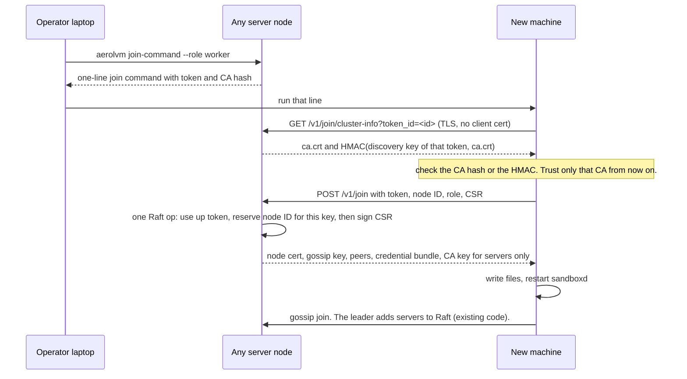
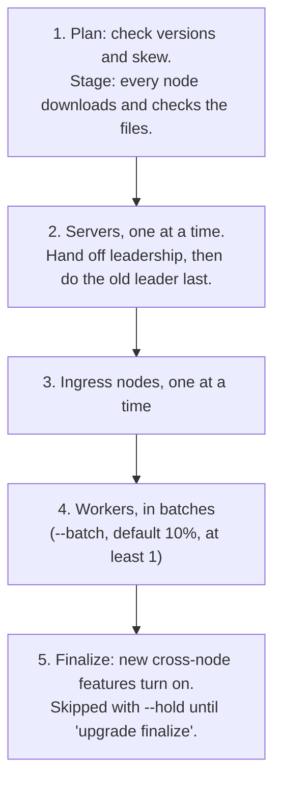

# Install, grow and upgrade AerolVM like Kubernetes

**Status:** PROPOSED (2026-11-07). CEO-reviewed 2026-11-07 in SELECTIVE
EXPANSION mode (Part 5). Eng review pending. Nothing below is built.
**Branch:** `plans/kubectl-style-ops`, cut from `main` at `e33b6e16`.
**Related:**
- `plans/kubernetes-v2-architecture.md` (PR #522). That plan runs AerolVM
  *on* Kubernetes. This plan is for plain machines with no Kubernetes. It
  borrows that plan's upgrade order and its "finalize" rule, so both installs
  upgrade the same way.
- `plans/mcp-server-and-agent-cli.md`. The `aerolvm` CLI contract this plan
  extends (§5.2: stdout is data, `--json` everywhere, fixed exit codes).
- `plans/identity-and-access.md`. API tokens stored in Raft. Join tokens
  reuse that path.
- `setup/cluster.md`, `setup/deployment/role-changes.md`. Today's runbooks.

## How to read this plan

Part 1 says what is hard today and why. Every claim names a file and line.
Part 2 lists the decisions. Part 3 is the design. Part 4 has the phases,
tests, risks and open questions. Part 5 records the CEO review: every scope
question, its answer, and the findings.

### Words used in this plan

- **Node command.** Runs on the machine itself, as root:
  `sudo sandboxd …`. This is the `kubeadm` job.
- **Cluster command.** Runs from any laptop, over the API: `aerolvm …`.
  This is the `kubectl` job.
- **Server, worker, ingress.** The node roles (`SB_NODE_ROLE`). Servers hold
  Raft. Workers run sandboxes. Ingress nodes take outside traffic.
- **Join token.** A short-lived secret that lets one new machine join. The
  same idea as a kubeadm bootstrap token.
- **CA hash.** The SHA-256 of the cluster CA's public key. A new machine
  checks it, so a fake server can't trick it into joining the wrong cluster.
- **Cluster version.** The newest cross-node data format that every node has
  agreed to use. Today this is `fsmOpsVersion`
  (`internal/cluster/fsm_egress_profiles.go:34`).

---

# Part 1: What is hard today

## 1. The goal in one table

| Job | Kubernetes | AerolVM today | AerolVM after this plan |
|---|---|---|---|
| Get the tools | Download `kubeadm` and `kubectl` | `curl … \| sudo bash` for one node. A repo checkout for Terraform, Ansible, drain and backup. | `curl … \| sudo bash` on each node. `aerolvm` from Homebrew, npm or the release page. |
| Start a cluster | `kubeadm init` | `install.sh`, then `cluster-init.sh`, then copy two tar files and a gossip key by hand | `sudo sandboxd init` |
| Add a machine | `kubeadm join <addr> --token … --discovery-token-ca-cert-hash …` | Run `cluster-join.sh` twice. In between, `scp` a CSR to the seed, sign it there, and `scp` the cert back. | Paste the one line that `aerolvm join-command` prints |
| List machines | `kubectl get nodes` | `curl /v1/cluster/members` | `aerolvm get nodes` |
| Stop new work on a machine | `kubectl cordon` | `curl -X POST …/drain` (it only cordons) | `aerolvm cordon` |
| Empty a machine | `kubectl drain` | `sandboxd-node-lifecycle.sh`, from the repo | `aerolvm drain` |
| Remove a machine | `kubectl delete node`, then `kubeadm reset` | `curl -X DELETE …/members/{id}` (servers only) | `aerolvm delete node`, then `sudo sandboxd reset` |
| Upgrade | `kubeadm upgrade plan` / `apply` | Re-run `install.sh` with every flag, by SSH, on every node. Or Ansible from a repo checkout. | `aerolvm upgrade plan`, then `aerolvm upgrade apply v0.6.12` |
| Renew node certs | Automatic | Repeat the sign-and-copy steps every 90 days | Automatic |
| Switch clusters | `kubectl config use-context` | One saved login only | `aerolvm config use-context` |

## 2. Why it is hard: six causes

### C1. Joining is a manual hand-off of secrets

The daemon has no join endpoint, no join token and no certificate signing.
The only `x509.CreateCertificate` call in server code is the egress
inspection CA (`internal/egress/inspect/ca.go`). Bash does all of it:

1. On the seed, `cluster-init.sh` makes the gossip key with `openssl`
   (`scripts/cluster-init.sh:303-323`). It makes the CA and the seed's cert
   (`:422-450`) and two tar files (`:457`, `:467-478`). Then it prints `scp`
   instructions (`:582-623`).
2. The operator copies both tar files and pastes the gossip key
   (`setup/cluster.md:377-387`).
3. On the new node, `cluster-join.sh` makes a key and a CSR, then stops on
   purpose with exit code 2 (`scripts/cluster-join.sh:343-366`).
4. The operator copies the CSR to the seed, runs `cluster-sign-node.sh` there
   (`scripts/cluster-sign-node.sh:88-102`), and copies the cert back.
5. `cluster-join.sh` runs a second time with `--signed-cert`. It writes
   `cluster.env` and restarts sandboxd (`:431-470`, `:513-514`).

On AWS, Terraform automates the same hand-off. It uses S3 and a loop on the
seed that signs CSRs (`Terraform/templates/bootstrap.sh.tftpl:262-372`). That
only works on AWS, and only from a repo checkout. The docs say so: "A copy of
the AerolVM repository … You run every command below from its top folder"
(`docs/src/content/docs/cluster-setup.mdx:27`).

None of the join secrets expire: the gossip key, `ca.crt`, the credential
bundle and the shared PAT. The PAT must be the same on every node
(`setup/cluster.md:271-272`).

**What already works, and we keep.** Once a node has its cert and the gossip
key, joining Raft is automatic. When gossip sees a new server, the leader
adds it as a voter, or as a non-voter past the voter cap
(`internal/cluster/voter_autojoin.go:64-175`). Workers and ingress nodes
never enter Raft (`internal/cluster/agent.go:270`).

### C2. Node certs expire after 90 days, and nothing renews them

`cluster-sign-node.sh` defaults to 90 days (`:23`). To renew, you "re-run
cluster-join / this script with a fresh CSR" (`:32-33`). That means the whole
copy dance again, on every node, every 90 days. An alert fires 14 days
before expiry (`setup/prometheus/sandboxd-alerts.yml:649`). The daemon already
picks up a cert that is replaced on disk (`internal/cluster/tls.go:334-383`).
The only missing piece is a signer the node can call.

### C3. Upgrading means re-running the installer, with every flag, on every node

**One node.** You re-run `install.sh` with all of the original flags
(`setup/single-node.md:262-279`). The installer does not remember them:

- It rewrites `/etc/sandboxd/sandboxd.env` from scratch on every run
  (`scripts/install.sh:1357`). Hand edits are lost.
- On Linux, a run without `--pat-token` makes a new random PAT
  (`install.sh:820-827`) and writes it (`:1358`). Only macOS keeps the old one
  (`:2841`). In a cluster every node must share the PAT, so one forgotten
  flag should break that node's calls to its peers. This is not yet tested
  live.
- If the flags did not change, it does not restart sandboxd (`:1945-1951`).
  The old binary keeps running until someone restarts it by hand.
- It overwrites the binary and keeps no copy (`:1344`). There is no rollback
  and no database backup.
- `--version` only picks a download URL (`:438-448`). Nothing stops a
  downgrade.

**A fleet.** `Ansible/playbooks/update-sandboxd.yml` needs the repo, boto3 and
the EC2 inventory (`Ansible/README.md:7-35`). It upgrades one host at a time
(`:23-26`), but:

- It does not drain the node and does not move the leader last. It waits
  only for the local `/health` (`:138-146`), not for Raft to catch up.
- It downloads a remote URL with no checksum (`:76-84`). `install.sh` checks
  checksums; this does not.
- It runs `sandboxd --version` (`:151`), but sandboxd has no such flag.
  `cmd/sandboxd/main.go:111` falls through to `run()`, so this starts a
  second daemon on the live state folder. `failed_when: false` hides the
  result. This is a bug, and Phase 0 fixes it.

Our own upgrade test does the same by hand. It copies a binary with `scp`,
then runs `systemctl stop`, `install` and `systemctl start` on each node
(`integration-tests/upgrade-gate.sh:130-133`).

### C4. Day-2 tools live only in the repo

A release ships the binaries (`sandboxd`, `toolboxd`, `caddy`, `aerolvm`) and
four scripts: `install.sh`, `cluster-init.sh`, `cluster-join.sh` and
`cluster-sign-node.sh` (`.github/workflows/release.yml:380-386`). Everything
else needs a clone:

| Tool | Path | Note |
|---|---|---|
| Uninstall | `scripts/uninstall.sh` | The docs download it from the latest release (`setup/single-node.md:284`, `setup/local.md:144`), but the release never uploads it. That link should return 404. |
| Drain and role change | `scripts/sandboxd-node-lifecycle.sh` | Its "wait until empty" loop runs on the client, in Python (`:132-179`). |
| Backup and restore | `scripts/sandboxd-backup.sh`, `scripts/sandboxd-restore.sh` | |
| Lost-quorum recovery | `scripts/raft-lost-quorum-recover.sh` | |
| Fleet upgrade and ops settings | `Ansible/` | Reached over SSH with an EC2 tag inventory |
| AWS cluster | `Terraform/`, `scripts/terraform.sh` | |
| Alerts, dashboards, runbooks | `setup/prometheus/`, `setup/alertmanager/`, `setup/grafana/`, `setup/runbooks/` | |

`packaging/` is only a reference copy. `install.sh` writes its own systemd
units from heredocs (`install.sh:1838`).

### C5. The `aerolvm` CLI only knows sandboxes

Its verbs cover sandboxes, tokens, audit and login
(`cmd/aerolvm/app.go:90-125`). It has no node or cluster verbs. It saves one
login: one URL and one token (`cmd/aerolvm/login.go:28-40`). To switch
between staging and production, you must juggle environment variables.

The daemon already has most of what node verbs need. Every `/v1/cluster/*`
route needs `fleet.admin` (`pkg/api/v1/routes.go:218`):

| Future verb | Route today | Anchor |
|---|---|---|
| `get nodes` | `GET /v1/cluster/members` | `routes.go:222` |
| `delete node` | `DELETE /v1/cluster/members/{id}`. Servers only: a worker gets 404 (`internal/cluster/client.go:1119-1124`). | `routes.go:223` |
| `cordon` | `POST /v1/cluster/nodes/{id}/drain`. It stops new placements and moves nothing (`pkg/api/v1/cluster_handler.go:1208-1237`). | `routes.go:239` |
| `uncordon` | `POST /v1/cluster/nodes/{id}/uncordon` | `routes.go:240` |
| `cluster-info` | `GET /v1/cluster/leader` | `routes.go:224` |
| `drain` (the wait) | `GET /v1/cluster/sandbox-index` (paged) | `routes.go:237` |

The member record has role, alive, drained and capacity
(`internal/cluster/cluster.go:484-516`). It has no build version, no voter
flag and no leader flag.

### C6. Nodes can't compare versions

- Gossip carries the FSM op version (`fv`), not the build version
  (`internal/cluster/gossip.go:26-61`). Gossip metadata is capped at 512
  bytes (`:18-21`).
- New cross-node writes switch on per feature, once every server has the new
  op version (`fsm_egress_profiles.go:24-52`). There is no cluster-wide
  "finalize" step and no way to hold it. So rollback stops being safe the
  moment the last server upgrades.
- The SQLite schema has no version number. Migrations are `ALTER TABLE`s that
  ignore "duplicate column" (`internal/store/store.go:858-889`), plus some that
  rebuild whole tables (`migrateSnapshotOwnerPK`). Nothing notices an old
  binary starting on a newer database.
- `sandboxd` has no `version` command. `aerolvm version` prints only the
  client's version (`cmd/aerolvm/verbs.go:370-381`).

Reading for this plan also turned up doc drift. Appendix A lists it.

---

# Part 2: Decisions

| ID | Decision | Why |
|---|---|---|
| D1 | **Two binaries, two jobs, like `kubeadm` and `kubectl`.** `sandboxd` gets node commands: `init`, `join`, `reset`, `upgrade node`, `host apply`, `version`, `backup`, `restore`, `recover-quorum`. `aerolvm` gets cluster commands. No new binary. | `sandboxd` is already on every node, runs as root, and already has a subcommand (`sandboxd key`, `cmd/sandboxd/key.go:70-84`). `aerolvm` must stay a thin client with no server packages (`cmd/aerolvm/deps_test.go`), and it ships to Mac and Windows. |
| D2 | **The daemon owns cluster bootstrap.** Making the CA, signing CSRs, join tokens and the secret hand-off move from bash and Terraform into Go, in `internal/cluster`. The four cluster scripts become thin wrappers for one release, then go away. | Go code is tested, ships inside the signed binary, and works on any cloud. |
| D3 | **kubeadm-style join tokens.** A token looks like `<id>.<secret>`. It is stored hashed in Raft, through the existing API token path (`internal/cluster/api_tokens.go`). It carries a role and a TTL: default 2h; at most 24h for server tokens; worker and ingress tokens may be `--reusable --ttl 0` and never expire (CEO D13). It works once unless `--reusable` is set. Raft keeps the hash of the secret (to check a join) and a discovery key derived from it (to sign the discovery answer, §4). `aerolvm join-command` makes one. Tokens can be revoked, and every use is audited. | One short-lived secret replaces four that never expire. Reusing the API token store avoids a new FSM op, if its fields fit. Phase 2 checks this first. |
| D4 | **The new machine checks the cluster before trusting it.** With `--ca-cert-hash sha256:…`, it pins the CA. Without it, it trusts the CA only if the server proves it knows the token secret: an HMAC over `ca.crt`, like kubeadm's signed `cluster-info`. | A fake server can't hand out a fake CA. Terraform can join nodes without knowing the CA hash in advance. |
| D5 | **The CA key lives on server nodes only**, like kubeadm's control-plane nodes. A new server receives it in its join answer. Workers and ingress nodes never hold it. External-CA mode (`sandboxd init --external-ca`, joins approved with `aerolvm certificate approve`) is deferred by CEO review D4. | Any server can sign, so the seed is not a single point of failure. |
| D6 | **Node certs renew themselves** at two thirds of their life, over the mTLS channel they already have. | Removes the 90-day cliff (C2). The reload code already exists (`tls.go:334-383`). |
| D7 | **`install.sh` remembers its answers.** It writes every non-secret flag to `/etc/sandboxd/node.json`. It reads secrets back from the env files it wrote before, and never makes a new PAT when one exists. A re-run with no flags rebuilds the same node. On an older node with no `node.json`, the first run reads the non-secret settings back from `sandboxd.env` once and writes `node.json`. It restarts sandboxd when the binary changed too, not only when the env file or unit changed (today: `install.sh:1877-1878`, `:1946-1951`). `install.sh` is also built into `sandboxd` (`go:embed`), so a binary and its host setup always match. | Fixes the lost-PAT and lost-flags traps (C3). An upgrade can redo host setup with no SSH. |
| D8 | **`aerolvm upgrade apply` stores a rollout in Raft and the leader drives it (CEO review D6); `sandboxd upgrade node` does the work on each node.** The node step runs in its own short-lived systemd unit, outside sandboxd's cgroup. It checks hashes, keeps the old binaries, backs up the database, swaps the files, restarts, waits for cluster health, and rolls back on failure. | No SSH, no Ansible, no repo. One code path for 1 node or 2,000. |
| D9 | **Upgrade order and skew follow the Kubernetes v2 plan** (`kubernetes-v2-architecture.md` §13). Servers go one at a time, with the leader last after a leadership hand-off. Then ingress nodes, then workers in batches, then finalize. During a rollout, nodes run only its previous and target versions; `upgrade_from_min` in `release.json` (§6.5) says which previous versions may jump straight to a target. | One upgrade story, on machines and on Kubernetes. |
| D10 | **One cluster version, with a hold.** The per-feature gates become one active cluster version, stored in Raft. `aerolvm upgrade apply --hold` keeps new writes off until `aerolvm upgrade finalize`, so rollback stays safe. Without `--hold`, it finalizes by itself once every member runs the new version. Today's gates count only servers; this one counts every member (§6.5). | The same idea as CockroachDB's `preserve_downgrade_option`. |
| D11 | **kubectl grammar in `aerolvm`, with every old verb kept.** `get`, `describe` and `delete` take a resource kind (`apply` is deferred by CEO D3). Output takes `-o wide\|json\|yaml\|name\|jsonpath=…`. `-l` selects by tag. `--context` picks a cluster. Kinds have short names. Every current verb keeps working, with the same output. | Kubernetes users already know these commands. Agents and scripts that use today's verbs don't break (the §5.2 contract in `plans/mcp-server-and-agent-cli.md`). |
| D12 | **Deferred by CEO review D3 (until the K8s v2 plan's Q1 picks the CRD shape).** **One manifest format for `aerolvm apply` and the Kubernetes operator.** `-o yaml` prints `apiVersion`, `kind`, `metadata`, `spec` and `status`, with the same group and fields as the operator's future CRDs. | The same YAML file works with `aerolvm apply` and with `kubectl apply`. |
| D13 | **`kubectl aerolvm` works as a plugin. We don't fake the Kubernetes API.** The `aerolvm` binary behaves the same when it is called as `kubectl-aerolvm`, and we publish a Krew manifest. | The plugin is cheap. A fake API server would need discovery, OpenAPI, watch, server-side apply and RBAC mapping, which is a lot to build and maintain. Real `kubectl get sandboxes` comes from the operator on Kubernetes (v2 plan K11). |
| D14 | **Everything an operator needs ships in the release or inside a binary.** `uninstall.sh` and `aerolvm-ops-<version>.tar.gz` (alerts, dashboards, runbooks) become release assets. Backup, restore and lost-quorum recovery become `sandboxd` commands. Terraform is used by URL with `?ref=<tag>`, without a clone. | Closes C4. |
| D15 | **Remote upgrade is on by default (enterprise mode's default is Q6), and each node can turn it off** with `SB_REMOTE_UPGRADE=false`. When it is off on a node, the rollout marks that node `manual` and waits; `aerolvm upgrade status` and `apply --wait` print the command to run on it (§6.3). | Easy by default. Teams with their own change tooling keep control. |

---

# Part 3: The design

## 3. The commands

### 3.1 On a node: `sudo sandboxd …`

| Command | What it does | Replaces |
|---|---|---|
| `sandboxd version [-o json]`, `sandboxd --version` | Prints the build version, the commit, and the cluster versions this build supports | Nothing. It is missing today, and the Ansible bug in C3 depends on it. |
| `sandboxd init [--role server] [--token <role>=<id.secret>[:<ttl>] …] [--advertise <ip>]` | Makes the CA, the gossip key and the credential key (or wraps the credential key, per custody). Makes the seed's cert, writes `cluster.env`, and starts Raft. Prints a join command and an admin login line. | `cluster-init.sh` |
| `sandboxd join <url> --token <t> [--ca-cert-hash sha256:…] [--node-id <id>]` | The token decides the role. `--node-id` defaults to the host name. One pass: makes a key and CSR, calls join, writes the files, restarts, and waits until the node is a member | `cluster-join.sh`, `cluster-sign-node.sh` and every `scp` |
| `sandboxd preflight [--join <url> --token <t>]` | Checks the machine and the network before anything changes, and prints a fix for each failure (§4.3). `init` and `join` run it first. Added by CEO review D7. | Nothing (failures appear mid-join today) |
| `sandboxd adopt` | Brings a cluster built with `cluster-init.sh` onto the new join and signing (§4.4) | Nothing (new) |
| `sandboxd reset` | Asks the cluster to remove this node if it can reach it, then removes `cluster.env` and the certs | Deleting files by hand (`setup/cluster.md:1119-1126`) |
| `sandboxd upgrade node <version> --sha256 <file>=<hash> …` | The per-node upgrader (§6.3). Run by hand on a node with remote upgrade off, or for the first hop (§6.6). | Re-running `install.sh`, `update-sandboxd.yml` |
| `sandboxd host apply` | Re-runs the built-in `install.sh` with the answers in `node.json` | Re-running `install.sh` with every flag |
| `sandboxd backup`, `restore`, `recover-quorum` | Go versions of the three scripts | `scripts/sandboxd-backup.sh`, `sandboxd-restore.sh`, `raft-lost-quorum-recover.sh` |

The installer passes `init` and `join` straight through. This installs the
host, then runs `sandboxd join`:

```bash
curl -fsSL https://aerolvm.aerol.ai | sudo bash -s -- \
  join https://10.0.0.5:7002 --token abc123.0f1e2d3c4b5a6978 --ca-cert-hash sha256:9a1c…
```

### 3.2 From anywhere: `aerolvm …`

**New cluster verbs:**

| Command | Server side |
|---|---|
| `aerolvm get nodes [-o wide]` | `GET /v1/cluster/members`, plus new version, voter and leader fields |
| `aerolvm describe node <name>` | The member record, plus sandbox count, capacity and cert expiry |
| `aerolvm cordon <name>`, `uncordon <name>` | Today's drain and uncordon routes. Add `POST …/cordon` as the clear name, and keep `/drain` for old clients. |
| `aerolvm drain <name> [--timeout 10m] [--delete-sandboxes] [--migrate]` | Cordon, then wait (§5) |
| `aerolvm delete node <name>` | Today's remove route, extended to workers and ingress nodes (§5) |
| `aerolvm join-command [--role worker] [--ttl 2h] [--reusable]` | New. Makes a join token and prints the one-line join command. The installer asks the cluster which version to install (§6.5). `--ttl 0` only for worker and ingress roles (CEO D13). |
| `aerolvm get jointokens`, `aerolvm delete jointoken <id>` | List and revoke join tokens |
| `aerolvm get csr`, `aerolvm certificate approve <id>` | External-CA mode only (D5). Deferred by CEO review D4. |
| `aerolvm cluster-info` | Leader, API URLs, cluster version, CA expiry |
| `aerolvm upgrade plan\|apply\|status\|stop\|resume\|finalize\|rollback` | §6 |
| `aerolvm release pull <version> -o <file>` | Writes the offline bundle (§7.1) |
| `aerolvm config get-contexts\|use-context\|current-context\|rename-context\|delete-context\|view\|import` | The local config file (§3.4) |
| `aerolvm version` | Prints the client version and the server's version, like `kubectl version` |
| `aerolvm api-resources` | Lists the kinds and their short names |
| `aerolvm top nodes` | Capacity per node, from `GET /v1/capacity` and the member record |

What `aerolvm get nodes` prints. The STATUS words match kubectl's:

```
NAME     ROLE    STATUS                     VERSION   AGE   SANDBOXES   CPU    MEMORY
srv-a    server  Ready,Leader               v0.6.12   41d   0           3%     11%
srv-b    server  Ready                      v0.6.12   41d   0           2%     10%
wrk-1    worker  Ready                      v0.6.12   12d   212         61%    48%
wrk-2    worker  Ready,SchedulingDisabled   v0.6.11   12d   9           4%     6%
```

### 3.3 Sandbox verbs in kubectl grammar

| Kubernetes habit | New `aerolvm` form | Today's form (kept) |
|---|---|---|
| `kubectl get pods` | `aerolvm get sandboxes` or `aerolvm get sb` | `aerolvm list` |
| `kubectl get pod x -o yaml` | `aerolvm get sb x -o yaml` | `aerolvm get x --json` |
| `kubectl describe pod x` | `aerolvm describe sb x` | (none) |
| `kubectl delete pod x` | `aerolvm delete sb x` | `aerolvm destroy x` |
| `kubectl apply -f x.yaml` | Deferred by CEO D3 (`TODOS.md`) | `aerolvm create …` |
| `kubectl exec -it x -- bash` | `aerolvm exec -it x -- bash` (`-it` means `shell`) | `aerolvm shell x` |
| `kubectl get pods -l app=web` | `aerolvm get sb -l app=web` (sandbox tags) | (none) |
| `kubectl logs`, `kubectl cp` | Same verbs, already there | Same |
| `kubectl get <kind>` | Also works for `snapshots` and `tokens` | Per-verb today |

Rules that keep old commands working:

- After `get`, `describe` or `delete`, the first word is a kind if it matches
  a known kind or short name. Otherwise it is a sandbox name or ID, as today.
  So `aerolvm get my-box` still works.
- A sandbox named the same as a kind (say, `nodes`) must be written
  `aerolvm get sb nodes`. `aerolvm create` prints a warning to stderr when a
  new name matches a kind.
- `--json` stays and prints today's shape; it is the stable contract.
  `-o json` and `-o yaml` print the plain sandbox object. That shape is not
  promised to stay until the shared manifest (D12, deferred by CEO D3) lands.
- Exit codes and the JSON error envelope stay as they are
  (`cmd/aerolvm/app.go:20-28`, `:246-262`).
- When `os.Args[0]` ends in `kubectl-aerolvm`, the binary behaves exactly as
  `aerolvm`. So `kubectl aerolvm get nodes` works once it is on `PATH`.

### 3.4 Contexts

Contexts live in a new file, `$XDG_CONFIG_HOME/aerolvm/contexts.json`.
`config.json` (`cmd/aerolvm/login.go:70-90`) keeps today's shape and always
holds the current context. An older `aerolvm` reads and writes only
`config.json` (`saveLogin` writes the whole `savedLogin` struct), so it
keeps working and can never erase the other contexts.

If the two files disagree (an older CLI logged in somewhere else),
`config.json` wins as the current context, and the next new-CLI command
adds it to `contexts.json` under its host name.

```json
// contexts.json
{
  "current_context": "prod",
  "contexts": {
    "prod":    { "api_url": "https://api.prod.example.com", "token": "…", "team": "ml" },
    "staging": { "api_url": "https://api.stg.example.com", "sso": { "…": "…" } }
  }
}
```

- `aerolvm login <url>` adds or updates a context, named after the host or
  given with `--name`, and makes it current.
- Which cluster a command uses, first match wins: the `--context` flag, then
  `SB_PAT_TOKEN` / `SB_API_URL` (as today, the SDK rule), then
  `AEROLVM_CONTEXT`, then the current context.
- `sandboxd init` writes `/etc/sandboxd/admin-context.json` (mode 0600).
  `aerolvm config import <file>` adds it as a context. This is the same job
  as kubeadm's `admin.conf`.

## 4. Joining, step by step



- **Where the join call lands.** The internal mTLS port (7002) already
  presents a cert signed by the cluster CA, which is exactly what the CA hash
  pins. Today that listener demands a client cert
  (`internal/cluster/tls.go:299`). We change it to "check a client cert if one
  is given". Every route except the three join paths (`cluster-info`,
  `join`, `join/preflight`) then sits behind a "must
  have a verified peer cert" check. A test walks every registered internal
  route and proves it. A separate join port is the alternative (Q1).
- **Discovery check.** For each token, Raft keeps the hash of the secret and
  a discovery key derived from the secret (HKDF). The discovery key can sign
  the `cluster-info` answer but can't be used to join. The new machine
  derives the same key from its token and checks the HMAC.
- **Who signs.** Any server that holds the CA key. A worker that gets a
  worker or ingress join call runs the dial-back itself (it sees the
  caller's real IP, §4.3), then forwards the call to a server over the
  existing internal channel. A worker never relays a server-role join,
  because that answer carries the CA key (D5): it answers `421` with the
  servers' join URLs, and the installer retries there.
- **What gets signed.** The signer builds the cert from the token's role and
  the requested node ID. It ignores the names written in the CSR. This is the
  rule `cluster-sign-node.sh:88-98` follows today, with the names
  `DNS:aerolvm-cluster-node` and `DNS:node:<id>`. The node ID must not match a
  live member. A join for a deleted node ID, with a new token and a new key,
  replaces that ID's deny record (§5).
- **One winner per node ID.** Before it signs, the signer writes one Raft op
  that uses up the token and reserves the node ID for this node's key. Raft
  applies these one at a time, so when two machines ask for the same node
  ID at once, exactly one wins; the other gets `409 node ID in use`.
- **Safe to retry.** A single-use token is marked as used *by this node's
  public key*. A retry with the same key and node ID gets the same answer.
  Anything else is refused. So a `join` that crashed halfway can just be run
  again.
- **The secrets in the answer** are the ones the operator copies by hand
  today (C1), and nothing more. When credential custody is wrapped (KMS,
  Vault or PKCS#11), the answer carries only the wrapped blob, and the node
  unwraps it with its own key access (`plans/customer-key-custody.md`). The
  shared PAT stays as it is today; replacing it is out of scope (§12).
- **Limits.** Join calls are rate-limited per source address. Every success
  and every failure is audited.
- **Raft does not change.** Gossip join and `voter_autojoin.go` do the rest,
  as today.

### 4.1 What `sandboxd init` does, compared with `cluster-init.sh`

| `cluster-init.sh` today | `sandboxd init` |
|---|---|
| Gossip key from `openssl rand` (`:303-323`) | `crypto/rand`, 32 bytes |
| RSA-4096 CA, 10 years (`:422-426`) | ECDSA P-256 CA, 10 years. The daemon only checks the chain and the names (`tls.go:163-197`), so old and new certs can mix. |
| Makes the credential key, or runs `sandboxd key wrap` (`:348-390`) | Same code, called in-process |
| Advertise address from `ip route get 1.1.1.1` (`:260-301`) | Same rule in Go, with an `--advertise` override |
| Writes `cluster.env` and a systemd drop-in (`:486-530`) | Same files and the same names, so old and new nodes look alike |
| `--force` wipes Raft (`:241-253`) | `sandboxd reset`, then `sandboxd init` |
| Prints `scp` instructions | Prints an `aerolvm` login line and a join command |

### 4.2 Cert renewal

- At two thirds of its life, a node calls
  `POST /v1/cluster/internal/renew-cert` with its current cert, over mTLS.
  A server that holds the CA key signs a new cert for the same node ID,
  unless the node's key is on the deny list (§5). The node writes it to disk
  atomically, and `tls.go` loads it on the next
  handshake.
- Certs still last 90 days by default.
- A cert that has already expired can't renew itself. The node needs a new
  join token. This is on purpose.

### 4.3 Preflight (CEO review D7)

`sandboxd preflight` runs before `init` and `join` change anything. It can
also run alone. Each failed check prints one line that says how to fix it.

| Check | Fails when | Printed fix (example) |
|---|---|---|
| Ports | This node can't reach the join server on the TCP ports its role needs, or the join server can't reach this node back. Servers: TCP 7000 (Raft), TCP 7001 (gossip), TCP 7002 (internal). UDP 7001 can't be checked before the node has the gossip key, so preflight only warns that it must be open. Workers and ingress nodes: 7001 and 7002 only, because they run no Raft listener (`internal/cluster/agent.go:270`). | "open TCP 7001-7002 and UDP 7001 between nodes (and TCP 7000 between servers)" |
| Clock | This node's clock is more than 30 seconds off the join server's (read from the HTTP `Date` header) | "start time sync (chrony or systemd-timesyncd)" |
| cgroup v2 | Never fails; warns when the unified cgroup hierarchy is not mounted. Today cgroup v1 only logs a warning too (`internal/runtime/firecracker/vmm.go`). On a Firecracker node the warning adds that VMs won't survive a sandboxd restart, because the VM cgroup move needs v2. | "boot with systemd.unified_cgroup_hierarchy=1" |
| KVM | Firecracker is enabled for this node and `/dev/kvm` is missing | "use a metal or nested-virt machine, or turn Firecracker off" |
| Disk | Free space under the state folder is below the configured minimum (an upgrade checks its own needs again at stage time, §6.7) | "free space under the state folder" |
| Node ID | The requested node ID belongs to a live member | "pick another --node-id" |

The return path in the ports check needs the other side. Preflight opens
short-lived listeners on this node's TCP ports and asks the join server to
dial them back: inside `POST /v1/join` during a join, or through
`POST /v1/join/preflight` (token required, rate-limited, audited, signs
nothing) when preflight runs alone. The node that receives the call dials
back, only at that call's source IP, never at an address taken from the
request body. The listeners then close.

`init` has no join server, so it runs only the local checks: cgroup, KVM,
disk, and that its own ports are free.

### 4.4 Existing clusters: adopting the new join (Codex outside review, finding 5)

Clusters built with `cluster-init.sh` keep the CA key on the seed only
(`scripts/cluster-init.sh:393`), and their nodes were never recorded as
admitted keys. After the first hop into the Phase 2 release (`install.sh`
once per node, §6.6):

1. On the seed, `sudo sandboxd adopt` imports `ca.key` from
   `/etc/sandboxd/cluster-ca/` into the CA store and records every live
   member's node ID and current cert key as admitted (one Raft op).
2. On every other server, `sudo sandboxd adopt` asks the seed for the CA key
   over the internal mTLS channel, authenticated by that server's existing
   node cert. Workers and ingress nodes need nothing.
3. From then on, `aerolvm join-command` and cert renewal work as in §4.
4. If the original seed is gone and nobody kept `ca.key` (for example in a
   `sandboxd-backup.sh` archive), the cluster can't sign new certs. `adopt`
   says so, and the way out is a new CA, which is out of scope here (§12).

The Phase 2 exit gate adds this path: a cluster built with today's scripts
on the last release, adopted, then grown with one-line joins.

## 5. Node lifecycle

- **`cordon`** marks the node so nothing new is placed on it. This is today's
  `drain` route.
- **`drain`** cordons, then waits until the node owns no running sandboxes,
  or until `--timeout`. `--delete-sandboxes` stops and destroys whatever is
  left, like kubectl's `--force`. `--migrate` moves WASM sandboxes with the
  existing migrate route (`routes.go:244`), and Firecracker sandboxes later,
  through snapshots. The wait loop moves out of the bash and Python helper
  (`sandboxd-node-lifecycle.sh:132-179`) and into the CLI. A new
  `GET /v1/cluster/nodes/{id}` returns counts, so the CLI does not page
  through the whole sandbox index at fleet scale.
- **`delete node`** works for servers today (`RemoveMember`,
  `internal/cluster/client.go:1107-1161`). For workers and ingress nodes it is
  new. It marks the node drained and orphans its placements, the same way
  the dead-owner path does (`internal/cluster/dead_owner.go:165-237`). It also
  writes a deny record to Raft: the node ID and its cert key. Until a fresh
  join for that ID (new token, new key) replaces the record, the ID gets no
  placements, and the old key is refused on every internal call and on cert
  renewal. Workers and ingress nodes hold no Raft state
  (`internal/cluster/agent.go`), so the deny records reach them the way
  API tokens do, through the token mirror (`internal/cluster/api_tokens.go`).
  Every member also refuses a denied node ID at gossip join, through
  memberlist's `AliveDelegate` (new: `gossip.go` uses only `NodeMeta` today), so a deleted node that still has the gossip key can't come
  back as a member. There is no CRL (`cluster-sign-node.sh:32-36`), so without the
  deny record a removed node's cert would keep working for up to 90 days.
  A role change (below) re-joins the same machine with a new key, so it is
  not blocked. Revoked keys stay on a tombstone list until their cert would
  have expired, even after the node ID is reused. Raft keeps the one admitted
  key for each node ID, and every authenticated internal call and every
  renewal must present that key, so the old cert of a reused ID is refused.
  (Repair from the Codex outside review, finding 6.)
- **Changing a role** stays "drain, delete, join again with a token for the
  new role". This matches `setup/deployment/role-changes.md`, which already
  says to recreate the node. We don't build an in-place role API.

## 6. Upgrades

### 6.1 What the operator types

```bash
aerolvm upgrade plan v0.6.12
aerolvm release pull v0.6.12 -o aerolvm-v0.6.12.tgz   # offline sites (§7.1)
aerolvm upgrade apply v0.6.12 [--hold] [--batch <n|n%>] [--pause-after N] [--from ./dist | --from aerolvm-v0.6.12.tgz] [--wait]
aerolvm upgrade status
aerolvm upgrade stop
aerolvm upgrade resume
aerolvm upgrade finalize
aerolvm upgrade rollback [--wait]
```

`apply` writes a rollout to Raft and returns (§6.6). `--wait` follows it
until it ends and prints each node's progress. `--batch` takes a number or a
percentage of the workers, rounded up; the default is 10%, at least 1
(CEO D10).

**Without cluster mode** (one node, no Raft), `apply` calls that node's own
upgrade route, `POST /v1/node/upgrade` (`fleet.admin`), which runs the stage
and apply steps of §6.3 on it. There is no rollout record, and `stop`,
`resume`, `--batch` and `--pause-after` don't apply. `Noop` stays untouched:
this path lives in the node upgrader, not in `internal/cluster`. For
`--from` on one node, `aerolvm` uploads the files with
`PUT /v1/node/upgrade/files/{sha256}` first. In cluster mode both routes
answer `409` and point to `aerolvm upgrade apply`.

`plan` prints:

- each node's role and version, and the target version;
- whether the skew rule allows the jump;
- the order the nodes will go in;
- what restarts on each node, per runtime (§6.4);
- whether the release changes host setup (the built-in `install.sh` differs);
- whether finalize will run one-way migrations, after which there is no
  rollback (§6.5, CEO D16);
- whether the node steps restart the egress gateway (§6.3);
- an estimated time for each tier (servers and ingress nodes go one at a
  time, so a large ingress tier shows up here).

It reads these from the target release's `release.json` (§6.5).

### 6.2 Order



The leader drives this order from the rollout record (§6.6). Between two
nodes, it waits for the node it just upgraded to pass the health check:

- it is alive in gossip and reports the target version;
- for a server, its Raft applied index is close to the leader's;
- its capacity heartbeat is fresh;
- `/health` returns 200.

The leader cordons each worker batch before it restarts any of them, and
uncordons each node once it passes the health check, unless the operator
had cordoned it before the rollout (the record keeps each node's cordon
state from the start, and the leader puts it back), so placement never
sends new sandboxes to a node that is about to restart.

It stops at the first failure and marks the rollout `failed`.

**A member that is down (CEO D11).** A member that gossip shows as dead when
its turn comes, or when staging starts, is marked `skipped`, and the rollout
goes on without it.

- When a skipped node comes back, it stays cordoned. The leader stages and
  upgrades it first, then uncordons it, so it never takes new work on the
  old version.
- Finalize waits until every skipped node is upgraded or deleted
  (`aerolvm delete node`). `aerolvm upgrade status` lists the skipped nodes
  and both ways out.
- **Servers keep quorum.** A down server is skipped too. But the leader
  restarts another server only if the voters that stay up still form a
  majority. If they wouldn't, the rollout ends `failed` and names the down
  server. With three servers and one down, nothing restarts.

Leadership hand-off uses Raft's `LeadershipTransfer`. Nothing calls it today.
We add it behind a new route, `POST /v1/cluster/leader/transfer`.

### 6.3 On each node: `sandboxd upgrade node`

The rollout leader calls `POST /v1/cluster/nodes/{id}/upgrade` over the
internal mTLS channel, as itself. The body carries the rollout ID, the step
(`stage` or `apply`), the version, a map from file name to SHA-256 for this
node's CPU type, and
the caller who started the rollout, and the leader's Raft term. The node
accepts the call only from a verified, live peer (`authorizePeerRequest` in
`internal/cluster/internal_server.go`), and only after it checks, against
Raft, that the caller is the current leader and that the rollout ID and
step are in the committed record. Servers read their own FSM. Workers and
ingress nodes ask a server through the existing read-index route
(`InternalReadIndexPath`, `internal/cluster/catch_up.go:64`). The node
remembers the highest term it has obeyed and refuses a command with an
older term, so a delayed command from a former leader can't act. A lock
file under `/var/lib/sandboxd/upgrade/` lets only one upgrade run on a node
at a time, whether it came from the leader or from `sandboxd upgrade node`
by hand. Its audit record names the rollout ID and the original caller
(taken from the committed record, not from the request), so every node's
log points back to the person or token that ran `apply`. (Repair from the
Codex outside review, finding 1.)

For `apply`, the node answers `202` with an operation ID. It then starts
`systemd-run --unit aerolvm-upgrade-<id> sandboxd upgrade node …`. This keeps
the upgrader outside sandboxd's cgroup, so stopping sandboxd does not kill
the upgrader (`KillMode=control-group`, `install.sh:1863-1866`).

The upgrader:

1. Gets `sandboxd`, `toolboxd` and `caddy` for this node's CPU type
   (CEO D12). After staging (§6.7), the files are already on disk.
   - **Servers** download them from `SB_RELEASE_URL` (default GitHub
     releases; air-gapped sites point it at a mirror). With `--from`, a
     server copies them from the leader instead (§6.6).
   - **Workers and ingress nodes** copy them from any server over the
     internal mTLS channel: `GET /v1/cluster/internal/upgrade/files/{sha256}`.
     The route sits behind `authorizePeerRequest`, so only live members can
     read it. Files are named by their hash, and the reader checks the hash
     again. Each server serves at most 20 copies at once and answers `503`
     with `Retry-After` past that. Workers never need outside access.
   - Copies are capped at 200 MB/s per server by default
     (`SB_UPGRADE_SERVE_MBPS`), and the current leader serves none while
     another server is up (CEO D15). Raft keeps its default 1-second
     heartbeat (`internal/cluster/raft.go:70`), so copy traffic must never
     fill a server's link. Staging 2,000 nodes with 6 serving servers takes
     about 4 minutes [estimated: 280 GiB of copies].
   - At most 7 machines (`MaxServerTierNodes`, `internal/cluster/topology.go:27`)
     ever touch the release URL. A release is about 140 MiB per amd64 node
     [measured: v0.6.11 assets: sandboxd 77, toolboxd 10, caddy 53 MiB].
2. Checks each file against its SHA-256 in the call. `aerolvm` read those
   hashes from the release's `checksums.txt` (or the bundle's), and can also
   check the SLSA provenance (`RELEASE-VERIFICATION.md`). On a mismatch, it
   stops.
3. Refuses to downgrade, unless this is a rollback (§6.8).
4. Moves Firecracker VMs out of sandboxd's cgroup. This is a Go port of
   `install.sh:1910-1934`.
5. Stops sandboxd and backs up the database with `VACUUM INTO`. sandboxd is
   stopped, so the single-writer rule still holds.
6. Keeps the old files as `*.prev` and renames the new files into place.
7. If this release changes host setup, runs `sandboxd host apply` in
   config-only mode: `install.sh --config-only` with the staged files as
   inputs. In that mode it never downloads or replaces binaries, never
   installs packages, and never starts or restarts services; the upgrader
   owns the binaries and every restart. A host change that needs new
   packages or network access is marked in `release.json`
   (`host_setup_needs_network`), and an offline or `--from` rollout of such a
   release is refused at `upgrade plan`, before anything stops. Every host
   change must keep working with the previous binary, so a rollback leaves
   it in place safely. (Repair from the Codex outside review, finding 3.)
8. Starts sandboxd and waits for local health and cluster membership.
9. On failure:
   - If the store's open-and-migrate step failed (the first thing sandboxd
     does, `pkg/daemon/daemon.go:183`, before any reconcile, outbox or loop
     starts), nothing else ran. Restore the database backup and put the
     `*.prev` files back, then start.
   - In every other case, never restore the backup: boot work such as the
     secret outbox reconcile (`pkg/daemon/daemon.go:802`) may already have
     reached peers. Put the `*.prev` files back and start. Before finalize
     only `n1_safe` migrations have run (CEO D16), so the old binary can read
     the database. (Repair from the Codex outside review, finding 2.)

The upgrader swaps files in a fixed order: `toolboxd`, then `caddy`, then
`sandboxd` last. It keeps its state in `/var/lib/sandboxd/upgrade/<op>.json`,
and `GET …/upgrade` reads it. **A reboot mid-swap:** at boot, sandboxd reads
any unfinished op. If every new file is in place, it marks the op done.
Otherwise it puts back the `*.prev` files already swapped and marks the op
`failed`, so a node never runs a half-swapped set. If the node already runs the requested version, the
call returns 200 and does nothing. Caddy restarts only when its file
changed. The egress gateway is not restarted when it can stay: it accepts
sandboxd N and N-1 (`Ansible/playbooks/update-sandboxd.yml:127-130`). The
node reports the protocol version its running gateway speaks. When the
target sandboxd would no longer speak it, the node step restarts the
gateway too, and `upgrade plan` says so up front, because hostname-filtered
sandboxes on that node pause briefly (fail-closed) during that restart.
(Repair from the Codex outside review, finding 8.)

**Remote upgrade turned off (D15).** A node with `SB_REMOTE_UPGRADE=false`
refuses the call with `remote_upgrade_disabled`. The leader marks that node
`manual` and waits for it. `aerolvm upgrade status` and `apply --wait` print
the one command to run on it (`sudo sandboxd upgrade node v0.6.12 --sha256 …`).
The rollout moves on once that node reports the target version. Run on a
server, `sandboxd upgrade node` does the same safety steps the leader does:
it refuses to stop if the servers left up would not be a majority, and if
it is the leader, it hands off leadership first.

### 6.4 What a running sandbox sees during an upgrade

| Runtime | While sandboxd restarts | Evidence |
|---|---|---|
| containerd, docker, gVisor | Keeps running. sandboxd adopts it again at boot. | Needs live proof in the upgrade test |
| Firecracker | Keeps running. It was moved to the `aerolvm-vmm` cgroup. | `install.sh:1863-1866`, `:1910-1934` |
| WASM, V8 isolate (workerd) | Their worker processes sit in sandboxd's cgroup, so they likely die with it, unless they are moved too. **Not confirmed. Measure this before Phase 3 ships.** | `KillMode=control-group`, `install.sh:1866` |
| toolboxd inside a sandbox | The old one keeps running. New sandboxes get the new one. | `setup/deployment/toolboxd-updates.md:108-114` |

`upgrade plan` prints this for each node. The goal matches the v2 plan: zero
sandbox restarts for containers and VMs.

### 6.5 Versions and skew

- **Build version everywhere.** `sandboxd version` prints it. Gossip carries
  it under a new short key, `bv` (about 12 bytes; the cap is 512 bytes,
  `gossip.go:18-21`). `get nodes` shows it.
- **One active cluster version, in Raft.** A new cross-node write checks
  "active version ≥ this feature's version". Today it checks "every server's
  `fv` ≥ this feature's version". Finalize means the leader writes the new
  active version once every member reports it: servers, workers and ingress
  nodes. A skipped node counts once it is upgraded or deleted (§6.2). With
  `--hold`, only `aerolvm upgrade finalize` writes it. The first
  active-version write happens once, after the first boot of the build that
  adds it: the leader writes it only when every server's `fv` supports the
  new op (today's gate, so old servers never replay an op they don't know).
  It starts at the lowest `fv` among the servers, so nothing that is on
  today turns off.
- **Which versions may meet.** Every release ships `release.json` (also
  inside the offline bundle, §7.1):
  - `upgrade_from_min`: the oldest version that may upgrade straight to it;
  - `one_way_migrations`: the numbers of its non-`n1_safe` migrations,
    which run only at finalize (CEO D16);
  - `host_setup_sha256`: the hash of its built-in `install.sh`;
  - `host_setup_needs_network`: true when its host changes need packages or
    network access (§6.3 step 7);
  - `egress_gateway_protocol`: the gateway protocol versions it speaks;
  - `fsm_ops_version`.

  `upgrade plan` refuses a jump from below `upgrade_from_min` and prints the
  releases to step through instead. A node may join only if its build
  supports the active cluster version.
- **Schema version.** Today migrations are `ALTER TABLE`s with no version
  (`internal/store/store.go:858-889`). The new design:
  - Each migration gets a number and a flag, `n1_safe`: true when it only
    adds tables or columns an older binary can ignore; false when it
    rebuilds or changes data (like `migrateSnapshotOwnerPK`).
  - A `schema_migrations` table records every number applied.
  - At start, a binary runs only its `n1_safe` migrations. Its non-`n1_safe`
    (one-way) migrations wait until the leader writes the new active cluster
    version; then each node runs them once (CEO D16). Code that ships a
    one-way migration must work on the old schema until finalize.
  - A binary that finds a migration number it doesn't know refuses to start
    with a clear error, unless every unknown number is `n1_safe`.
  - So before finalize, the previous binary can always read the database,
    and rollback always works.
- **One held release at a time.** While a rollout is done but not finalized
  (`--hold`), `apply` to any other target is refused. Finalize or roll back
  first, so no node is ever more than one rollout apart.
- **Old members after finalize.** A member whose `fv` is below the active
  cluster version (one that was out of gossip during the whole rollout) is
  kept cordoned and gets no placements. If it is a server, it is also kept
  out of Raft: the voter auto-join (`internal/cluster/voter_autojoin.go:64`)
  refuses to add or keep a server whose gossiped `fv` is below the active
  version, and the leader removes it from the Raft configuration until it
  is upgraded, so it never replays an op it can't apply. (Repair from the
  Codex outside review, finding 7.) The leader upgrades it if it can
  reach it; otherwise `aerolvm get nodes` shows it as
  `Ready,SchedulingDisabled` with the reason, until an operator upgrades or
  deletes it.
- **Joining during a rollout.** While a rollout is not finalized, a new node
  may join only on the rollout's target or previous version. The join answer
  adds it to the rollout record (`done` on the target, `pending` otherwise).
- **Which build a new node installs.** The one-line installer asks the
  cluster first: `GET /v1/join/cluster-info` also returns the version to
  install (the active version, or a running rollout's target). So a
  long-lived token (CEO D13) never installs a stale build. `POST /v1/join`
  sends the node's build version, and the join server refuses one that may
  not join.

### 6.6 The rollout lives in the cluster (CEO review D6)

`aerolvm upgrade apply` does not walk the nodes itself. It writes a rollout
record to Raft and returns, or follows progress with `--wait`. The leader
runs the rollout. Nobody's laptop has to stay awake, and a CI job can start
an upgrade and exit.

```
aerolvm upgrade apply ──► leader: opPutRollout (fleet.admin, audited, caller recorded)
                              │
                              ▼
            rollout record in Raft: rollout ID, caller, target and
            previous version, SHA-256 per CPU type, batch, pause-after,
            hold flag, rollout state, state per node
                              │
            leader loop ──────┤ stage every node (§6.7), then for each node
                              │ in §6.2 order:
                              │   POST /v1/cluster/nodes/{id}/upgrade
                              │   wait for the health check (§6.2)
                              │   opUpdateRolloutNode(node, state)
                              ▼
            before restarting itself, the leader hands off leadership;
            the new leader (already upgraded) reads the record and continues
```

**Rollout states.** Every move between states:

| From | Event | To |
|---|---|---|
| (none) | `apply` | staging |
| staging | every node staged, `manual` or `skipped` | running |
| staging | a node fails to stage | failed |
| running | `--pause-after` count reached (once) | paused |
| paused | `resume` | running |
| running | every node `done` or `skipped` | done |
| running | a node fails its health check | failed |
| staging, running, paused | `stop` | stopped |
| failed, stopped | `apply` with the same target | staging (nodes on the target are skipped) |
| done | finalize (auto, or `finalize` with `--hold`) | finalized |
| done, failed, stopped, paused | `rollback` | rolling-back |
| rolling-back | every node back on the previous version | rolled-back |
| rolling-back | a node fails | failed (direction: rollback) |
            ┌──────── stop ─────────┐
            │                       ▼
 staging ──► running ──► done ──► finalized      (auto, or `finalize` with --hold)
   │  │        │  ▲        │
   │  │  pause-│  │resume  └── rollback ──► rolling-back ──► rolled-back
   │  │  after ▼  │                              │
   │  │       paused ── stop ──► stopped         └──► failed
   │  └── a node fails to stage ──► failed
   └── stop ──► stopped
 failed / stopped ── apply (same target) ──► running   (nodes on target are skipped)
 failed / stopped / paused ── rollback ──► rolling-back
```

| Command | Allowed in state | Result |
|---|---|---|
| `apply` same target | staging, running, paused, done | Returns the existing rollout |
| `apply` same target | failed, stopped | Back to staging, so stopped nodes re-stage; nodes on the target are skipped |
| `apply` same target | finalized | Success; nothing changes |
| `apply` same target | rolling-back | Refused: wait for the rollback to end |
| `apply` same target | rolled-back | New rollout |
| `apply` other target | finalized, rolled-back, or no rollout | New rollout |
| `apply` other target | any other state | Refused: finalize or roll back first |
| `stop` | staging, running, paused | The leader finishes the nodes in progress, starts no new one |
| `stop` | stopped | Success; nothing changes |
| `resume` | paused | Back to running |
| `resume` | running | Success; nothing changes |
| `resume` | stopped, failed | Refused, with the hint to run `apply` again |
| `rollback` | done (held), failed, stopped, paused | See §6.8 |
| `rollback` | rolling-back, rolled-back | Success; nothing changes |
| `rollback` | failed (direction: rollback) | Resumes the same rollback |
| `finalize` | done, with no node still `skipped` | Writes the new active cluster version (§6.5) |
| `finalize` | done, with skipped nodes | Refused: lists them; upgrade or delete each first (§6.2) |
| `finalize` | finalized | Success; nothing changes |

**Per-node states:** `pending → staged → upgrading → done | failed`, plus
`manual` (remote upgrade off, §6.3) and `skipped` (down when its turn came,
§6.2).

- **Any leader can resume.** All progress is in Raft. A node already on the
  target version is skipped. A node that was mid-upgrade when the leader
  changed reports its own state (`GET …/upgrade`), so the new leader never
  starts a second upgrade on it.
- **One rollout at a time.** The table above is the only way in.
- **`--from` files.** `aerolvm upgrade apply --from` first uploads each file
  to the leader with `PUT /v1/cluster/upgrade/files/{sha256}` (`fleet.admin`,
  256 MiB cap per file; the leader rejects a body whose hash differs from
  the path). Then it writes the rollout, marked `source: upload`. The
  first part of staging is the servers copying the uploads from the leader,
  or from any server that already has them; a down server is skipped (§6.2)
  and copies them when it returns. Workers and ingress nodes then copy from
  servers (§6.3, CEO D12).
  - If the leader changes before any other server has copied the files,
    staging fails with "uploaded files lost". `apply --from` again uploads
    only the files the leader is missing, because uploads are named by hash.
  - Uploads that no rollout uses within one hour are deleted.
- **Previous-version files.** At staging, every node reports the hashes of
  the binaries it runs now. The record keeps them per CPU type as the
  previous version. A rollback (§6.8) takes those files from any node that
  still has them: a node on the old version, or an upgraded node's
  `*.prev`. Servers copy them for nodes that have no `*.prev`. If no copy
  exists for a CPU type, rollback marks those nodes `failed` and names them.
- **The first upgrade into this release.** The upgrade route and the rollout
  ops ship in the same release, so an older cluster has nothing to drive.
  The first hop into it uses `install.sh` once per node, as the Phase 0 docs
  page describes (Phase 0 makes that re-run keep the PAT and the flags).
  Every later upgrade uses `aerolvm upgrade`. There is no CLI-driven
  fallback.
- **Where the driver lives.** The order, health check and skip rules run on
  the leader, in `internal/cluster`, behind a small interface (start a node
  step, read a node's state, hand off leadership) so tests can use a fake.
  The rollout and node states are one pure transition function built from
  the tables above, not branches spread across handlers.
- **Per-node health timeout.** Not chosen yet. Suggested default: 10
  minutes, with a flag. Owner: the Phase 3b implementer, settled in eng
  review.

### 6.7 Staging and the canary pause (CEO review D8)

- **Stage first.** Before any node restarts, the leader asks every node to
  stage the target version (`"step": "stage"`). The node first checks it
  has free space for the staged files, the `*.prev` copies and the database
  backup (§6.3 step 5), and that `systemd-run` exists, then runs
  §6.3 steps 1 and 2 and keeps the files under
  `/var/lib/sandboxd/upgrade/<version>/`. If any node fails to stage, the
  rollout ends `failed` with that node's error, and no node has restarted.
  A node with remote upgrade off refuses the stage call; it is marked
  `manual` (§6.3), not failed.
  A node's later turn then skips the download. Servers stage first,
  because the other nodes copy from them. The per-server limit of 20
  copies (§6.3) bounds how fast the rest stage.
- **Cleanup.** Workers and ingress nodes delete their staged files once they
  run the target version. Servers keep the target's files until the rollout
  is finalized or rolled back, so a skipped node that comes back late can
  still copy them. A stopped or failed rollout keeps its staged files, since
  `apply` may restart it; every node deletes staged files when the rollout
  is replaced or rolled back.
- **Canary pause.** With `--pause-after N`, the first worker batch is cut to
  at most N workers. Once N workers are done, the rollout is `paused`, once
  per rollout. Only workers count; servers and ingress nodes do not.
  `aerolvm upgrade resume` continues with the normal batch size;
  `aerolvm upgrade stop` ends it.

### 6.8 Rollback

`aerolvm upgrade rollback` turns the same rollout into a rollback: its state
becomes `rolling-back`, and its target becomes the previous version stored
in the record. It is allowed only before
finalize (the table in §6.6).

- **Order.** The reverse of an upgrade: workers, then ingress nodes, then
  servers, with the leader last. Nodes still on the old version are skipped.
- **A node with no `*.prev`** (it joined on the target during the rollout)
  gets the previous version's files through the same path as an upgrade:
  servers fetch them, the node copies them from a server.
- **On each node.** The upgrader puts the `*.prev` files back. No download is
  needed.
- **Database.** Before finalize, only `n1_safe` migrations have run (CEO
  D16), so the database stays as it is and the previous binary reads it.
  We never restore a backup over writes made after the upgrade. After
  finalize, one-way migrations may have run, so there is no rollback.

## 7. Install and release changes

- **`install.sh`** writes `/etc/sandboxd/node.json`. It reads secrets back
  from the existing env files, and never makes a new PAT when one exists. It
  accepts `init` and `join` as its first word and passes them to `sandboxd`.
- **Built into `sandboxd`.** A small Go package in `scripts/` embeds
  `install.sh` (`//go:embed install.sh`). `sandboxd host apply` runs that
  copy.
- **New release assets:** `uninstall.sh`, `aerolvm-ops-<version>.tar.gz`
  (Prometheus rules, Alertmanager config, Grafana dashboards, runbooks) and a
  Krew manifest. A Homebrew tap formula for `aerolvm` is published from the
  release workflow.
- **Terraform** becomes a reusable module that is used by URL:
  `source = "git::https://github.com/aerol-ai/microvm//Terraform?ref=vX.Y.Z"`.
  This means moving `backend.tf` out of the module. Terraform makes one
  join token per role (`random_password`, shaped as `id.secret`). The worker
  and ingress tokens are reusable and never expire (CEO D13), so scale-out
  weeks later still works. The server token is reusable for 24 hours,
  enough for the first servers. `sandboxd init` registers all three on the
  seed (`--token worker=<id.secret>:0 --token ingress=<id.secret>:0
  --token server=<id.secret>:24h`). Servers added later get a fresh token from
  `aerolvm join-command --role server`. The S3 bundle hand-off and the CSR loop on the seed
  (`bootstrap.sh.tftpl:262-372`) go away.
- **Ansible.** `aerolvm upgrade` replaces `update-sandboxd.yml` and
  `update-toolboxd.yml`. `configure-ops.yml` stays for now, because it sets
  host ops settings. It moves later, to `node.json` plus `sandboxd host apply`.

### 7.1 The offline bundle (CEO review D9)

`aerolvm release pull <version> -o <file>.tgz` runs on a machine with
internet access. It downloads one release for every CPU type the release
builds, checks every file against `checksums.txt`, and packs one file:

```
aerolvm-v0.6.12.tgz
├── manifest.json        version, file list, SHA-256 per file, bundle format version
├── checksums.txt        copied from the release, unchanged
├── v0.6.12.intoto.jsonl SLSA provenance, unchanged
├── sandboxd_linux_amd64, sandboxd_linux_arm64, …
├── toolboxd_linux_amd64, …
└── caddy_linux_amd64, …
```

- `aerolvm upgrade apply --from <file>.tgz` checks every file in the bundle
  against `checksums.txt` again before it pushes anything.
- Nodes receive only the files for their own CPU type, through the same
  path as `--from ./dist`: leader, then servers, then everyone else (§6.3).
- A release whose host changes need network access
  (`host_setup_needs_network`) can't be applied from a bundle; `upgrade plan`
  refuses it before anything stops (§6.3 step 7).
- `manifest.json` carries a bundle format version. An `aerolvm` that does not
  know the version refuses the bundle with a clear error.

## 8. Security

- **Remote upgrade lets a `fleet.admin` caller run a new binary on every
  node.** Today, the same power comes from SSH root through Ansible. Guards:
  - files come only from `SB_RELEASE_URL`, or from an operator push whose
    hashes are pinned;
  - downgrades are refused, except for a rollback before finalize;
  - every step is audited;
  - pushed files have a size cap;
  - `SB_REMOTE_UPGRADE=false` turns it off on a node (D15).
- **Release files inside the cluster (§6.3).** Only live members with a
  verified cert can read them, and every reader checks the hash.
- **The join server dials back new nodes (§4.3).** It dials only the join
  call's source IP, so a token holder can't use it to make servers connect
  to other hosts.
- **The join route accepts calls without a client cert.** Guards:
  - a rate limit and an audit record on every call;
  - the token is stored hashed and compared in constant time;
  - tokens work once by default; server tokens last at most 24 hours, and
    worker and ingress tokens may last any time, or never expire with
    `--ttl 0` (CEO D13);
  - a test proves no other internal route skips the cert check.
- **The CA key on every server.** Servers already hold the credential key,
  which unlocks every sealed secret, so the CA key adds little exposure.
  External-CA mode, for teams that want the CA key out, is deferred by CEO
  review D4.
- **Input and secret rules.**
  - A join token's secret carries at least 128 bits
    (`[a-z0-9]{6}.[a-z0-9]{32}`, kubeadm's shape, longer).
  - `{sha256}` in the file routes must be exactly 64 hex characters, or 400.
  - `--from` uploads are capped at 2 GiB in total on the leader, plus the
    1-hour cleanup (§6.6).
  - `host apply` passes `node.json` values to `install.sh` as separate
    arguments, never inside a shell string.
  - `contexts.json` is written with mode 0600, like `config.json`.
- **Deleted nodes are denied** by node ID and cert key until a fresh join
  replaces the record (§5).
- **Long-lived join tokens** exist only for worker and ingress roles
  (CEO D13). They can be listed and revoked, and every use is audited. A
  leaked one never carries the CA key, but it still lets someone join a
  worker until it is revoked, and a worker's join answer carries the gossip
  key and the credential bundle (§4). With plain credential custody, that
  bundle decrypts sealed credentials; with wrapped custody (KMS, Vault or
  PKCS#11) it does not. Q8 asks whether `--ttl 0` should require wrapped
  custody.

# Part 4: Phases, tests, risks and open questions

## 9. Phases

Each phase ships as one stack of PRs, one PR per task. Nothing in a stack
merges until the whole stack is green.

| Phase | What | Server code touched | Size | Exit gate |
|---|---|---|---|---|
| **0. Quick fixes** (no new design) | `sandboxd version` and `--version`. Fix `update-sandboxd.yml:151`. Ship `uninstall.sh` as a release asset. `install.sh` keeps the PAT, writes `node.json` (reading settings back from `sandboxd.env` on older nodes), and restarts sandboxd when the binary changed. Fix the doc drift in Appendix A. A docs page: "Upgrade without the repo". | `cmd/sandboxd`, `scripts/`, `release.yml`, docs | S | Unit tests. `run.sh single-node --upgrade-from <previous tag>` passes using only release assets, and the node runs the new binary afterwards. |
| **1. Node verbs** | `bv` in gossip. Voter and leader fields on members. `aerolvm get/describe nodes`, `cordon`, `uncordon`, `drain`, `delete node` (workers too, plus the deny list), `cluster-info`, client and server `version`, contexts, `-o`. | `internal/cluster` (gossip meta, remove for workers), `pkg/api/v1`, `cmd/aerolvm` | M | Cluster scenario: drain a worker with live sandboxes from a laptop, then delete it and see it can't rejoin. |
| **2. Join in one line** | `sandboxd preflight` (CEO review D7), `init`, `join`, `reset`. Join tokens, the CA on servers, HMAC discovery, cert renewal, `aerolvm join-command` (external-CA mode deferred by CEO review D4). The cluster scripts become wrappers. | `internal/cluster` (FSM ops, `tls.go` listener), `cmd/sandboxd`, `scripts/` | L | New scenario `cluster-join-token`: 3 servers and 2 workers from blank Ubuntu, using only `curl`, with no `scp` and no repo. Plus the adopt path (§4.4): a cluster built with today's scripts, adopted, then grown with one-line joins. Renewal tested with 10-minute certs. |
| **3a. Node upgrader** | `sandboxd upgrade node` (run on the node), `host apply`, the built-in `install.sh`, leadership hand-off, one cluster version with auto-finalize, schema version, `release.json` in every release. | `internal/cluster` (FSM), `internal/store`, `cmd/sandboxd`, `pkg/api/v1` | L | `upgrade-gate.sh` runs `sudo sandboxd upgrade node <version>` on each node, which fetches from the release URL, with no `scp`. Zero container and VM restarts, measured. The mixed-version window is tested. A forced failure on the second node rolls it back. |
| **3b. Rollouts** | `--hold` and `aerolvm upgrade finalize`, the node upgrade route (§6.3) and the single-node routes (§6.1), the leader-driven rollout in Raft (§6.6), release files served by servers (§6.3), staging and the canary pause (§6.7), rollback (§6.8), the offline bundle (§7.1), `aerolvm upgrade *`. | `internal/cluster` (FSM), `pkg/api/v1`, `cmd/aerolvm` | L | Two local builds of this stack with different versions: `aerolvm upgrade apply` takes a cluster from one to the other. The rollout keeps going after the CLI exits, and after the leader itself is upgraded. A node that can't stage stops the rollout before any restart. `--pause-after` and `rollback` work. The first hop from the last real release uses `install.sh` (§6.6). |
| **4. kubectl polish** | `get`, `describe` and `delete` for sandboxes, snapshots and tokens (`apply -f` and D12 manifests deferred by CEO review D3). `-l`. `kubectl-aerolvm` and Krew. Homebrew. `api-resources`. | `cmd/aerolvm` only | M | Golden tests for every form. The agent CLI contract tests don't change. |
| **5. Retire the repo-only paths** | Backup, restore and recover-quorum in Go. The ops tarball. Terraform as a module with one-line joins. Ansible upgrade playbooks removed. Docs rewritten. | `cmd/sandboxd`, `Terraform/`, `Ansible/`, docs | M | `integration-cluster-*` provisions with Terraform used by URL, without a checkout of `scripts/`. |

Phase 0 is useful on its own and carries no design risk. Start there.

## 10. Testing

- **Unit tests** go next to every changed file, and each package stays at or
  above 85% coverage.
- **Fragile areas** (CLAUDE.md rules 5 and 6):
  - The new FSM records (join tokens, the deny list, the active cluster
    version) get `fsm_*_test.go` tests. These cover replay and mixed
    versions: an old FSM and a new FSM apply the same log and must end in the
    same state, as in `plans/mcp-server-and-agent-cli.md` R5.
  - The listener change gets a test that every internal route rejects a call
    with no client cert, except the three join paths.
  - The rollout record (§6.6): replay and mixed-version tests for its ops; a
    leader-change test where a new leader resumes a half-done rollout without
    a second upgrade on any node; `stop` and "same target twice" tests.
  - The rollout driver gets unit tests against a fake node interface.
  - Offline bundle: a round trip (`release pull` against a local HTTP server,
    then `apply --from` the file); a tampered file and an unknown format
    version are both refused before any push.
  - Joins: the discovery HMAC checks with the derived key and fails with a
    wrong token; a deleted node's old key is refused on internal calls and
    on renewal, and a fresh join for the same ID is allowed; a join during
    a rollout on a third version is refused.
  - Rollouts: a worker batch is cordoned before restart and each node is
    uncordoned after its health check; `stop`, `resume` and `finalize`
    repeated after success return success; single-node `apply` upgrades
    the one node with no rollout record.
  - Outside-review repairs: a node refuses an upgrade command from a
    non-leader and from an older term, and a second local upgrade while one
    runs; a failed store migration restores the backup, any later failure
    never does; `host apply --config-only` never touches binaries or
    services; one-way migrations run only after finalize and a rollback
    before finalize keeps the database readable; an old cert of a reused
    node ID is refused after the new node joins; an obsolete server is kept
    out of Raft; the gateway restarts only when its protocol would fall
    outside the target's range.
  - Crash safety: kill the upgrader after each file swap; the next boot
    completes or restores the set. Two joins with the same node ID at once:
    exactly one wins. Kill the leader during staging: the new leader
    finishes it, and no node stages twice.
  - Release files: a worker stages from a server, not the release URL; a
    server past 20 copies answers `503` and the worker retries; a file whose
    hash doesn't match its name is refused.
  - Down members: a worker that is down is skipped, comes back cordoned, is
    upgraded, then uncordoned; finalize waits for it; with three servers and
    one down, no server restarts and the rollout ends `failed`.
  - Batch size: `--batch 10%` on 25 workers gives batches of 3; on 5 workers,
    batches of 1; `--pause-after 2` cuts the first batch to 2.
  - Staging: a rollout where one node can't stage ends `failed` with no
    node restarted; staged files are removed after success and after `stop`;
    `--pause-after 2` stops after exactly two workers and `resume` continues.
  - Preflight: one table-driven test per check, with fake network and file
    system readers; a test that `join` stops before writing any file when a
    check fails.
  - With cluster mode off, nothing changes. `Noop` is untouched.
- **CLI.** Golden files for the `get nodes` table and every `-o` form, like
  `cmd/aerolvm/testdata/identity/*.golden`. A test checks that every old verb
  and flag still parses and prints the same output.
- **Live.** The new scenarios in §9 run behind the `integration` build tag.
- **`make test` stays offline.** The upgrader's download sits behind an
  interface, and tests use a local HTTP server.

### 10.1 Observability (CEO review Section 8)

| Kind | What |
|---|---|
| Metrics | `aerolvm_join_attempts_total{result,reason}`, `aerolvm_join_tokens{role,ttl_kind}`, `aerolvm_cert_renew_failures_total`, `aerolvm_rollout_state`, `aerolvm_rollout_nodes{state}`, `aerolvm_node_upgrade_seconds`, `aerolvm_upgrade_files_served_bytes_total`, `aerolvm_deny_hits_total` |
| Alerts (`setup/prometheus/sandboxd-alerts.yml`) | A rollout is `failed`, or in one state for more than 1 hour; cert renewal failing for more than 1 day; a `skipped` or `manual` node waiting for more than 24 hours; a member below the active cluster version |
| Dashboard (`setup/grafana/`) | One rollout row: state, nodes per state, upgrade time per node, bytes served per server |
| Runbooks (`setup/runbooks/`) | Rollout failed; node stuck `manual`; join failing; cert renewal failing |
| Logs | Every join, token use, deny hit, rollout step and node step logs the rollout ID or token ID, the node ID and the caller |

## 11. The CLAUDE.md non-negotiables

- **Idempotency.**
  - `join`: the same key gets the same answer.
  - `upgrade node`: the same version does nothing, and `apply` resumes where
    it stopped.
  - `drain`: can be repeated.
  - `upgrade stop`, `resume`, `finalize`: a repeat after it worked returns
    success (§6.6 table).
  - `delete node`: a second call returns 404, which the CLI treats as done.
  - `join-command`: makes a new token on each call, like
    `kubeadm token create`. Tokens expire, so a retry leaves nothing that
    lasts.
- **Boot-path latency.** Nothing in this plan runs inside `CreateSandbox`.
  Placement already reads the cordon state today. Create gets zero new work.
- **Lazy bootstrap.** The renewal loop is a ticker started after boot, not
  part of the boot path.
- **Failure-path consistency.**
  - `join` writes its files, then restarts. If it fails before the restart,
    it removes what it wrote, except the node key, which stays so a re-run
    with the same single-use token is still accepted (§4).
  - `upgrade node` has the explicit rollback in §6.3.
- **Cluster mode.** Every FSM change sits behind an `fv` bump and the gate.
  Each PR calls out split-brain risk, replay safety, leader-change behavior
  and single-node impact.

## 12. Not in scope

- Running AerolVM on Kubernetes. That is `plans/kubernetes-v2-architecture.md`.
- A fake Kubernetes API server (D13).
- Rotating the CA or the gossip key. Both need a window where two keys are
  trusted. Separate plan.
- Replacing the shared PAT as a node's identity (`pkg/api/v1/routes.go:213-221`).
- An in-place role change API (proposed in
  `setup/deployment/role-changes.md:130`).
- `aerolvm port-forward`, and `-w` watch, until a server watch API exists.
- `aerolvm apply -f` and the manifest shared with the Kubernetes operator
  (D12). Deferred by CEO review D3: the format must match the K8s v2 plan's
  CRD shape, which its Q1 has not picked yet. Tracked in `TODOS.md`.
- External-CA mode (`sandboxd init --external-ca`, `aerolvm get csr`,
  `aerolvm certificate approve`). Deferred by CEO review D4: the default
  path already makes joining one line, and this mode can be added later
  without changing it. Tracked in `TODOS.md`.
- `aerolvm` updating itself. Homebrew and npm already do that.
- `aerolvm upgrade` on macOS local mode. The node upgrader needs
  `systemd-run`, so it covers Linux nodes; local mode keeps re-running
  `install.sh` (clarified in CEO review Section 1; nothing was cut).
- apt and yum packages.

## 13. Risks

| Risk | What we do about it |
|---|---|
| The join route, which takes calls without a client cert, sits on the internal port | Only three join paths are open. A test walks every route. Rate limit. Q1 keeps a separate port as the fallback. |
| Remote upgrade means a `fleet.admin` caller can run code on every node | The guards in §8, and the off switch |
| WASM and isolate sandboxes may die during an upgrade | Measure first. Then either move their workers out of the cgroup, or drain those nodes before the upgrade and say so in `upgrade plan`. |
| The new `get <kind>` grammar breaks a script whose sandbox is named like a kind | Warning at create time. The `get sb <name>` form always works. |
| A leader change mid-rollout starts a second upgrade on a node | Node state comes from the node (`GET …/upgrade`), and `upgrade node` is a no-op for the version already running. Leader-change test (§10). |
| Raft replicas disagree while the per-feature gates switch to one cluster version | The active version starts at the lowest server `fv`. Determinism tests. A PR call-out. |
| `host apply` fails halfway during an upgrade | It runs before sandboxd starts again, and a failure triggers the rollback in §6.3. `install.sh` is already safe to re-run. |
| Gossip metadata grows past 512 bytes | `bv` is about 12 bytes. A test builds the largest possible metadata and checks that it fits. |

## 14. Open questions

| # | Question | Recommendation |
|---|---|---|
| Q1 | Should join land on port 7002 behind an allowlist, or on its own port? | 7002. It needs no new firewall rule, and the allowlist test guards it. |
| Q2 | Should the CA key live on all servers, or only on the seed? | Settled by D5: all servers. |
| Q3 | Default join token lifetime: 2 hours, or kubeadm's 24 hours? | 2 hours. `--ttl` can raise it. |
| Q4 | Manifest `apiVersion` group: wait for the v2 plan's Q1 (the `agent-sandbox` CRD shape), or pick `aerolvm.dev/v1alpha1` now? | Decide together with the v2 plan when the deferred `apply -f` work starts (`TODOS.md`). |
| Q5 | JSON files, or a YAML file shaped like kubeconfig? | JSON: `config.json` unchanged plus `contexts.json` (§3.4), so older CLIs keep working. |
| Q6 | Should enterprise mode turn remote upgrade off by default? D15 keeps it on everywhere else. | Yes: off by default in enterprise mode, so banks opt in. |
| Q7 | Should `drain` wait by default, or stop sandboxes? | Settled by §5: wait, with a 10-minute default `--timeout`. |
| Q8 | Should `--ttl 0` join tokens be allowed only when credential custody is wrapped (§8)? | Decide in eng review with the key-custody owners. Leaning yes for enterprise mode. |

---

## Appendix A: Doc drift found while reading

- `setup/cluster.md:403-418` describes a one-pass join that "mints a fresh
  per-node cert signed by the bundled CA". Today's `cluster-join.sh` runs in
  two passes and needs `--cred-bundle` (`scripts/cluster-join.sh:190-211`,
  `:318-367`).
- `setup/deployment/role-changes.md:21-22` says `SB_NODE_ROLE` lives in
  `sandboxd.env`. The scripts write it to `cluster.env`
  (`scripts/cluster-init.sh:512-514`).
- `setup/single-node.md:284` and `setup/local.md:144` download `uninstall.sh`
  from the latest release. The release does not upload it
  (`.github/workflows/release.yml:380-386`).
- `docs/src/content/docs/operational-runbooks.mdx:52` links scripts on
  `main`, not on the release tag a reader installed.
- The release builds no `sandboxd_darwin_amd64` (`release.yml:180-187`), so
  `install.sh --local` on an Intel Mac should get a 404. Not checked live.

---

# Part 5: CEO review (2026-11-07)

Run by `/plan-ceo-review` in SELECTIVE EXPANSION mode (chosen by the user;
the recommendation was SCOPE REDUCTION). This part records every scope
question, the user's answer, and the review findings. Parts 1-4 above are
amended only where an answer says so.

## Decision ledger

| ID and owner | Contract and evidence | Current | Proposed | Status | Exact approval and scope |
|---|---|---|---|---|---|
| MODE (user) | Review mode | SELECTIVE EXPANSION | n/a | approved | D2 answer 2026-11-07: "Selective expansion" |
| S1 (CLI) | D12, §3.3, Phase 4: `aerolvm apply -f` and a manifest shared with the K8s operator | Deferred to TODOS.md | n/a | deferred | CEO D3 answer 2026-11-07: "Defer to TODOS.md". Scope: `apply -f` and the D12 shared manifest only; the rest of Phase 4 stays. |
| S2 (cluster PKI) | D5, §3.2, §8: external-CA mode (`--external-ca`, `get csr`, `certificate approve`) | Deferred to TODOS.md | n/a | deferred | CEO D4 answer 2026-11-07: "Defer to TODOS.md". Scope: external-CA mode only; the CA key on server nodes (D5 default) stays in Phase 2. |
| S3 (ops) | D14, §7, Phase 5: Go ports of backup/restore/recover-quorum, Terraform as a module, Ansible upgrade playbooks removed | In scope (Phase 5), as written | n/a | approved (keep) | CEO D5 answer 2026-11-07: "Keep Phase 5 as written". Scope: Phase 5 unchanged; no extra release assets added to Phase 0. |
| E1 (cluster) | §6.2: rollout driven from the operator's machine | Leader-driven rollout stored in Raft (§6.6) | n/a | approved (add) | CEO D6 answer 2026-11-07: "Add to this plan's scope". Scope: a rollout record in Raft, driven by the leader, resumed by any new leader; `aerolvm upgrade stop` to halt it; the client-driven loop kept only for the first upgrade into a rollout-capable release. Spec review 2026-11-07: that fallback removed as infeasible (no older release has the upgrade route); the first hop into the release uses `install.sh` once per node (§6.6). `--wait` is part of this scope. The `manual` node state (keeps D15 working under a leader-driven rollout) was added in spec review round 1. |
| E2 (node) | §4: join has no pre-checks | `sandboxd preflight`, run first by `init` and `join` (§4.3) | n/a | approved (add) | CEO D7 answer 2026-11-07: "Add to this plan's scope". Scope: the command, the checks listed in §4.3 with a printed fix for each, and the join server dialing back the new node's ports before it signs. |
| E3 (upgrade) | §6.3: each node downloads during its own turn | Every node stages (downloads and checks) before the first restart; `--pause-after N` with `aerolvm upgrade resume` (§6.7) | n/a | approved (add) | CEO D8 answer 2026-11-07: "Add to this plan's scope". Scope: a stage step on every node before any restart, staged-file cleanup, `--pause-after N`, and `resume` to continue after the pause. |
| E4 (release) | §6.3 step 1: `--from ./dist` or `SB_RELEASE_URL` | Mirror, loose files, or one bundle from `aerolvm release pull` (§7.1) | n/a | approved (add) | CEO D9 answer 2026-11-07: "Add to this plan's scope" (recommendation was Defer). Scope: `aerolvm release pull` and bundle support in `--from`. |
| R1 (upgrade) | §6.1, §6.2: default worker batch size | 10% of workers, at least 1; `--batch` takes a number or a percentage | n/a | approved | CEO D10 answer 2026-11-07: "10% of workers, at least 1". Scope: the default and percentage parsing only. |
| R2 (upgrade) | §6.2, §6.5: a member that is down or deleted during a rollout | Down members are `skipped`; a returning one stays cordoned until the leader upgrades it; finalize waits until each skipped node is upgraded or deleted (§6.2) | n/a | approved | CEO D11 answer 2026-11-07: "Skip it, catch it up later". Scope: the skip rule, cordon-until-upgraded catch-up, the finalize wait, and `status` listing skipped nodes. The quorum check for servers (§6.2) is a safety repair inside this scope. |
| R3 (upgrade) | §6.3 step 1, §6.6 `--from`, §6.7: where nodes get the release files | Servers fetch from `SB_RELEASE_URL` (or get `--from` files from the leader); workers and ingress copy from any server over mTLS, at most 20 at once per server (§6.3) | n/a | approved | CEO D12 answer 2026-11-07: "Servers fetch once, others copy from them". Scope: server-only downloads, the internal file route, the per-server limit of 20, and the leader copying `--from` files to servers. |
| T1 (cluster PKI) | D3, §7, §8: join token lifetime for Terraform and autoscaling | Worker and ingress tokens may be `--reusable --ttl 0`; server tokens stay at most 24 hours | n/a | approved | CEO D13 answer 2026-11-07: "Long-lived for workers and ingress only". Scope: the TTL rule per role and Terraform's per-role tokens (§7). |
| DOCS (user) | 0H: this plan and the CEO summary after three spec-review rounds | Approved | n/a | approved | CEO D14 answer 2026-11-07: "Approve and continue". Scope: these document versions only; no build approval. |
| A1 (upgrade, Section 1) | §6.3, §6.7: servers serve every release copy (CEO D12); Raft uses 1 s heartbeat and election timeouts (`raft.DefaultConfig()`, `internal/cluster/raft.go:70`) | Copies capped at 200 MB/s per server by default (`SB_UPGRADE_SERVE_MBPS`); the leader serves none while another server is up (§6.3) | n/a | approved | CEO D15 answer 2026-11-07: "Cap and keep the leader out". Scope: the per-server rate cap with its setting, and leader exclusion. |
| O4 (upgrade, outside voice) | §6.5 schema version, §6.6 states, §6.8: a release with a non-`n1_safe` migration that starts serving and then fails can't be rolled back, and no other target may be applied | Non-`n1_safe` migrations run only after finalize; rollback before finalize always works (§6.5, §6.8) | n/a | approved | CEO D16 answer 2026-11-07: "One-way steps only at finalize". Scope: finalize-gated one-way migrations and the rule that code shipping one must work on the old schema until finalize. |

Approval readiness: PASS. Checked rows and their answers: MODE (D2), S1 (CEO D3), S2 (CEO D4), S3 (CEO D5), E1 (CEO D6), E2 (CEO D7), E3 (CEO D8), E4 (CEO D9), R1 (CEO D10), R2 (CEO D11), R3 (CEO D12), T1 (CEO D13), DOCS (CEO D14), A1 (CEO D15), O4 (CEO D16). Repairs made without a question are listed in "Repairs inside accepted scope" below; each one keeps a promise the plan already makes and changes no approved behavior.

## Build timeline check (step 0I)

What an implementer meets, in order. Effort is [estimated], human team /
Claude Code.

```
HOUR 1 (foundations)   internal/cluster/internal_server.go (the 7002 mux and
                       authorizePeerRequest), api_tokens.go + fsm_tokens.go
                       (token store and the mirror to workers),
                       fsm_egress_profiles.go (the fv gate pattern),
                       voter_autojoin.go, tls.go (cert reload),
                       cmd/aerolvm/deps_test.go, scripts/install.sh, release.yml
HOUR 2-3 (core logic)  pick FSM op codes by grepping, not by the comment in
                       fsm.go (it lags); the HKDF label for the discovery key;
                       per-node rollout entries as separate Raft ops, not one
                       growing record (2,000 nodes x a few state changes is
                       about 8,000 small writes per rollout [estimated])
HOUR 4-5 (integration) WASM and workerd processes sit in sandboxd's cgroup
                       (KillMode=control-group); systemd-run must exist on the
                       host; a worker forwarding a join must pick a live server
                       from the member list; Caddy restarts drop connections
HOUR 6+ (tests)        live scenarios cost AWS money; the 3b gate needs two
                       local builds with different versions; golden files for
                       every -o form; FSM replay tests for every new op
```

**Feasibility blockers to clear before the phase that needs them:**

1. Measure what WASM and isolate sandboxes do during a sandboxd restart
   (§6.4), before Phase 3a ships.
2. The first hop into the release with `aerolvm upgrade` uses `install.sh`
   once per node (§6.6). The Phase 0 docs page must say so.
3. Eng review must answer Q1 (join port), Q6 (enterprise default for remote
   upgrade) and Q8 (`--ttl 0` and key custody) before Phase 2.

| Phase | Size | Human team | Claude Code |
|---|---|---|---|
| 0 | S | ~3 days | ~1.5 h |
| 1 | M | ~1.5 weeks | ~4 h |
| 2 | L | ~3 weeks | ~8 h |
| 3a | L | ~3 weeks | ~8 h |
| 3b | L | ~3 weeks | ~8 h |
| 4 | M | ~1 week | ~3 h |
| 5 | M | ~2 weeks | ~4 h |

## Decision record

Each block below is the question exactly as it was asked. The answer is in
the ledger above.


### currentDecision (S1)
Commitment comparison:

| Commitment | Source/approval or pending | Current | A | B |
|---|---|---|---|---|
| `get/describe/delete -o/-l` for sandboxes, `kubectl-aerolvm`, Krew, Homebrew | Plan D11, D13 (unchanged by this row) | Phase 4 | Phase 4 | Phase 4 |
| `aerolvm apply -f` | Plan §3.3 | Phase 4 | Deferred to TODOS.md | Phase 4 |
| `-o yaml` object shape shared with the K8s operator (D12) | Plan D12 | Phase 4 | Deferred to TODOS.md; `-o yaml` prints the plain object until then | Phase 4 |
| Dependency on K8s v2 plan Q1 (agent-sandbox CRD shape) | PR #522 | Open | Waits for Q1 | Picks an apiVersion before Q1 |

Question: D3 — S1: Defer `aerolvm apply -f` and the manifest shared with the Kubernetes operator?
Project/branch/task: CEO review of plans/kubectl-style-cluster-ops.md on plans/kubectl-style-ops (PR #986).
ELI10: Phase 4 makes sandbox commands look like kubectl. One piece, `apply -f file.yaml`, needs a file format that should match the future Kubernetes operator's format. That plan (PR #522) hasn't picked its format yet (its Q1). Deferring waits for that choice; keeping picks a format now.
Stakes if we pick wrong: pick a format now and the Kubernetes plan picks another, and every saved YAML file breaks on rename.
Recommendation: A) Defer because the format depends on an open decision in the Kubernetes plan, and the rest of Phase 4 ships without it.
Note: options differ in kind, not coverage — no completeness score.
Pros / cons: see each option.
Net: `apply -f` in the first release versus one stable file format for VMs and Kubernetes.
Header: S1 apply
A) Defer to TODOS.md (recommended)
Zero implementation work now (effort S, risk low). ✅ Phase 4 still ships kubectl-style get, describe, delete, -o and the kubectl plugin. ✅ We don't lock an apiVersion before the Kubernetes plan picks its CRD shape (its Q1). ❌ No `aerolvm apply -f` and no YAML round trip until that decision lands.
B) Keep in scope
Build apply and the shared manifest in Phase 4 (effort M, risk medium; human ~1 week / CC ~2h). ✅ One YAML file works with `aerolvm apply` and `kubectl apply` from the first release. ✅ Declarative create matches the kubectl habit people already have. ❌ Picks a manifest schema before the Kubernetes plan does, so a rename later breaks saved files.

### currentDecision (S2)
Commitment comparison:

| Commitment | Source/approval or pending | Current | A | B |
|---|---|---|---|---|
| CA key on every server node, signing joins (D5 default) | Plan D5 (unchanged by this row) | Phase 2 | Phase 2 | Phase 2 |
| `sandboxd init --external-ca`, pending-CSR queue | Plan D5, §8 | Phase 2 | Deferred to TODOS.md | Phase 2 |
| `aerolvm get csr`, `aerolvm certificate approve` | Plan §3.2 | Phase 2 | Deferred to TODOS.md | Phase 2 |

Question: D4 — S2: Defer external-CA mode (CA key kept outside the cluster, joins approved by hand)?
Project/branch/task: CEO review of plans/kubectl-style-cluster-ops.md on plans/kubectl-style-ops (PR #986).
ELI10: By default, server nodes hold the key that signs new nodes' certificates, like kubeadm. External-CA mode keeps that key outside the cluster, so every join waits for a person or an outside signer to approve it. Banks may want this; most installs don't need it.
Stakes if we pick wrong: defer it and a bank customer must wait for a follow-up; keep it and Phase 2, the riskiest phase, grows a second signing path.
Recommendation: A) Defer because the default path already makes joining one line, and external CA can be added later without changing it.
Note: options differ in kind, not coverage — no completeness score.
Pros / cons: see each option.
Net: bank-grade key custody on day one versus a smaller, safer Phase 2.
Header: S2 ext-CA
A) Defer to TODOS.md (recommended)
Zero implementation work now (effort S, risk low). ✅ Removes a pending-CSR state machine and an approve command from Phase 2, which is already the riskiest phase. ✅ The default path (CA key on server nodes, like kubeadm) covers most installs. ❌ A bank that needs the CA key outside the cluster waits for a follow-up.
B) Keep in scope
Build external-CA mode in Phase 2 (effort M, risk medium; human ~1 week / CC ~2h). ✅ Matches the Kubernetes plan's rule that banks keep the CA key outside the cluster (its D11). ✅ `aerolvm certificate approve` mirrors `kubectl certificate approve`. ❌ Adds a pending-CSR record in Raft and a second signing path to Phase 2's fragile work.

### currentDecision (S3)
Commitment comparison:

| Commitment | Source/approval or pending | Current | A | B |
|---|---|---|---|---|
| `uninstall.sh` as a release asset | Plan Phase 0 (unchanged) | Phase 0 | Phase 0 | Phase 0 |
| `sandboxd-backup.sh`, `sandboxd-restore.sh`, `raft-lost-quorum-recover.sh`, `sandboxd-node-lifecycle.sh` as release assets | Pending | Not planned (ported to Go in Phase 5) | Phase 0 | Not planned |
| Ops tarball (alerts, dashboards, runbooks) | Plan D14 | Phase 5 | Phase 0 | Phase 5 |
| Go ports: `sandboxd backup/restore/recover-quorum` | Plan D14 | Phase 5 | Deferred to TODOS.md | Phase 5 |
| Terraform as a module used by URL; one-line join user data | Plan §7 | Phase 5 | Deferred to TODOS.md | Phase 5 |
| Ansible upgrade playbooks removed | Plan §7 | Phase 5 | Deferred to TODOS.md (removed once `aerolvm upgrade` ships) | Phase 5 |

Question: D5 — S3: Ship the repo-only scripts as release files now, and defer the Go ports and the Terraform/Ansible rework?
Project/branch/task: CEO review of plans/kubectl-style-cluster-ops.md on plans/kubectl-style-ops (PR #986).
ELI10: Backup, restore, drain and quorum recovery are bash scripts that exist only in the repo. The plan rewrites them in Go in its last phase. The quickest way to stop needing the repo is to publish the existing scripts with each release now, and do the rewrite later.
Stakes if we pick wrong: keep Phase 5 as is and operators still need the repo for backups until the last phase ships.
Recommendation: A) Ship scripts now because it reaches the "no repo" goal in Phase 0 with one release-workflow change.
Note: options differ in kind, not coverage — no completeness score.
Pros / cons: see each option.
Net: no-repo backups after the next release versus one Go code path at the end of the plan.
Header: S3 ops
A) Ship scripts now, defer the rest (recommended)
Phase 0 gains one release-workflow change (effort S, risk low; human ~2h / CC ~15min). ✅ Nobody needs the repo for backup, restore, drain or quorum recovery after the next release. ✅ The Go ports wait until something actually needs them inside the binary. ❌ Bash scripts and the new Go commands live side by side for longer.
B) Keep Phase 5 as written
Port the scripts to Go and rework Terraform and Ansible (effort L, risk medium; human ~2 weeks / CC ~4h). ✅ One tested Go code path instead of bash. ✅ Terraform can be used by URL with no checkout. ❌ About 25 more files, including a Terraform root-module restructure, before the plan is done.

### currentDecision (E1)
Commitment comparison:

| Commitment | Source/approval or pending | Current | A | B | C |
|---|---|---|---|---|---|
| Who drives the rollout | Plan §6.2 | `aerolvm` on the operator's machine | The Raft leader, from a rollout record in Raft | `aerolvm` (server-side rollout in TODOS.md) | `aerolvm` |
| Rollout survives the operator's machine going away | — | No; re-running `apply` resumes | Yes; the next leader resumes it | No | No |
| New Raft record and `fv` bump | — | None | Yes (rollout record) | None | None |
| `aerolvm upgrade status` | Plan §6.1 | Reads node state | Reads the rollout record | Reads node state | Reads node state |
| Worker batch default | Plan §6.2 (`--batch`, default 1) | 1 | Pending (Section 7 finding) | Pending (Section 7 finding) | Pending (Section 7 finding) |

Question: D6 — E1: Add a rollout that runs inside the cluster, driven by the Raft leader?
Project/branch/task: CEO review of plans/kubectl-style-cluster-ops.md on plans/kubectl-style-ops (PR #986).
ELI10: Today the plan has your laptop run the upgrade, node by node. If the laptop sleeps, you re-run the command and it carries on. The add-on stores the rollout inside the cluster, and the cluster's leader runs it, the way k3s's upgrade controller does. Then nobody's laptop has to stay awake, and CI can start an upgrade and walk away.
Stakes if we pick wrong: add it and Phase 3 gains new Raft state in the most fragile code; skip it and very long rollouts depend on one machine staying online.
Recommendation: B) Defer because the laptop-driven rollout already resumes when re-run, and a percentage batch size (a separate Section 7 finding, not yet decided) would let large fleets finish in a few waves.
Note: options differ in kind, not coverage — no completeness score.
Pros / cons: see each option.
Net: unattended, CI-friendly rollouts versus no new Raft state in Phase 3.
Header: E1 rollout
A) Add to this plan's scope
Leader-driven rollout stored in Raft (effort L, risk medium; human ~2 weeks / CC ~4h). ✅ The upgrade keeps going if the operator's laptop sleeps or a CI job times out. ✅ A new leader picks up the rollout after the old leader is upgraded. ❌ Adds a new Raft record and a leader control loop to the fragile cluster code.
B) Defer to TODOS.md (recommended)
Zero implementation work now (effort S, risk low). ✅ Phase 3 stays client-driven and smaller, with no new Raft state. ✅ Can be added later when a real rollout outlasts a laptop session. ❌ Until then, a long rollout depends on the operator's machine staying connected.
C) Skip
Never build it in this plan (effort S, risk low). ✅ No Raft work for rollouts, ever, in this plan. ✅ The smallest surface to test and secure. ❌ Unattended, CI-driven fleet upgrades are ruled out until a new plan.

### currentDecision (E2)
Commitment comparison:

| Commitment | Source/approval or pending | Current | A | B | C |
|---|---|---|---|---|---|
| `sandboxd preflight` command | — | None | Added; `init` and `join` run it first | TODOS.md | None |
| Checks: ports 7000-7002 reachable both ways, clock skew, cgroup v2, `/dev/kvm` for Firecracker, free disk, node ID not in use | — | None | All, each with the fix printed | TODOS.md | None |
| The join server dials back the new node's ports before signing | — | None | Yes | TODOS.md | None |

Question: D7 — E2: Add a preflight check that runs before `init` and `join`?
Project/branch/task: CEO review of plans/kubectl-style-cluster-ops.md on plans/kubectl-style-ops (PR #986).
ELI10: A join can fail for reasons outside AerolVM: a firewall blocks ports 7000-7002, the clock is off, or the machine has no KVM. kubeadm checks these before it changes anything. The add-on does the same and prints how to fix each problem.
Stakes if we pick wrong: skip it and failed joins show up halfway through, with error messages that don't say "open port 7001".
Recommendation: A) Add because it is small and turns network and machine problems into clear one-line fixes before anything changes.
Note: options differ in kind, not coverage — no completeness score.
Pros / cons: see each option.
Net: clear errors before a join starts versus one more command to maintain.
Header: E2 preflight
A) Add to this plan's scope (recommended)
`sandboxd preflight`, run first by `init` and `join` (effort S, risk low; human ~2 days / CC ~30min). ✅ Catches blocked ports, clock skew and missing KVM before any file changes. ✅ Each failure prints its fix, the way kubeadm's preflight does. ❌ One more command, plus a list of checks to keep current.
B) Defer to TODOS.md
Zero implementation work now (effort S, risk low). ✅ Phase 2 stays a little smaller. ✅ Join errors still appear, just later. ❌ Failures show up mid-join with less helpful messages.
C) Skip
Never build it in this plan (effort S, risk low). ✅ No extra checks to maintain. ✅ The join code path stays as planned. ❌ Network and machine problems during a join stay hard to diagnose.

### currentDecision (E3)
Commitment comparison:

| Commitment | Source/approval or pending | Current | A | B | C |
|---|---|---|---|---|---|
| When nodes download new files | Plan §6.3 step 1 | During each node's own turn | On every node before the first restart | During each node's own turn (pre-staging in TODOS.md) | During each node's own turn |
| A file missing for one CPU type, or a mirror some nodes can't reach, is found before the first node restarts | — | No; found at the first affected node, which may be after the servers are upgraded | Yes | No | No |
| Time each node spends in its turn | — | Download + check + swap + restart | Swap + restart | Download + check + swap + restart | Download + check + swap + restart |
| `--pause-after N` | — | None | Stops after N workers for a human check | TODOS.md | None |

Question: D8 — E3: Add pre-staging and a canary pause to upgrades?
Project/branch/task: CEO review of plans/kubectl-style-cluster-ops.md on plans/kubectl-style-ops (PR #986).
ELI10: Today each node downloads and checks the new version when its turn comes, before it stops, so a bad file never takes a node down. But a problem that hits only some nodes, like a missing arm64 file, is found only when the first arm64 node's turn comes, after the servers are already upgraded. Pre-staging downloads and checks on every node first, and makes each turn shorter. `--pause-after N` upgrades N workers and then waits, so a person can check them before the rest go.
Stakes if we pick wrong: skip it and the cluster can stall halfway, with servers on the new version and some workers unable to fetch it.
Recommendation: A) Add because both are small, and they stop a rollout before it can stall halfway or spread a bad release past a few workers.
Note: options differ in kind, not coverage — no completeness score.
Pros / cons: see each option.
Net: catching bad releases early versus two more flags and a staged state per node.
Header: E3 staging
A) Add to this plan's scope (recommended)
Pre-staging plus `--pause-after N` (effort S, risk low; human ~2 days / CC ~30min). ✅ A file missing for one CPU type, or an unreachable mirror, stops the rollout before any node restarts. ✅ A human can check the first upgraded workers before the rest go. ❌ Two more flags, and each node keeps a staged copy until its turn.
B) Defer to TODOS.md
Zero implementation work now (effort S, risk low). ✅ Phase 3 stays smaller. ✅ Hash checks still run, one node at a time. ❌ A problem that hits only some nodes shows up mid-rollout, after the servers are upgraded.
C) Skip
Never build it in this plan (effort S, risk low). ✅ The simplest upgrader: download, check, swap. ✅ No staged files on disk. ❌ No built-in way to stop after a few nodes and look.

### currentDecision (E4)
Commitment comparison:

| Commitment | Source/approval or pending | Current | A | B | C |
|---|---|---|---|---|---|
| Offline source for upgrades | Plan §6.3 step 1 | `SB_RELEASE_URL` mirror, or loose files with `--from ./dist` | Plus one bundle file from `aerolvm release pull` | Mirror or loose files (bundle in TODOS.md) | Mirror or loose files |
| Bundle holds every CPU type's binaries, `checksums.txt` and provenance | — | None | Yes | TODOS.md | None |
| `aerolvm upgrade apply --from bundle.tgz` | — | `--from` takes a folder | Takes a folder or a bundle | Folder only | Folder only |

Question: D9 — E4: Add an offline upgrade bundle (`aerolvm release pull`)?
Project/branch/task: CEO review of plans/kubectl-style-cluster-ops.md on plans/kubectl-style-ops (PR #986).
ELI10: A cluster may have no internet access. The plan already supports that two ways: point nodes at an internal mirror, or copy release files into a folder and pass `--from`. The add-on packs one release, for every CPU type, into a single file you carry in.
Stakes if we pick wrong: skip it and offline sites gather the right files by hand; add it and we own another file format.
Recommendation: B) Defer — this is a taste call, no strong preference either way; `--from ./dist` already works offline, so the bundle only saves hand work.
Note: options differ in kind, not coverage — no completeness score.
Pros / cons: see each option.
Net: one-file offline upgrades versus one less format to version and test.
Header: E4 bundle
A) Add to this plan's scope
`aerolvm release pull` plus bundle support in `--from` (effort S, risk low; human ~2 days / CC ~30min). ✅ One file carries every CPU type's binaries, checksums and provenance into a closed network. ✅ Reuses the `--from` path the plan already has. ❌ A bundle format to version and test with every release.
B) Defer to TODOS.md (recommended)
Zero implementation work now (effort S, risk low). ✅ Offline sites still upgrade with a mirror or `--from ./dist`. ✅ No new file format in this plan. ❌ Offline operators pick the right files for each CPU type by hand.
C) Skip
Never build it in this plan (effort S, risk low). ✅ No new format, ever, in this plan. ✅ One fewer thing to test per release. ❌ Offline installs stay a manual, error-prone file hunt.

### currentDecision (R1)
Commitment comparison:

| Commitment | Source/approval or pending | Current | A | B |
|---|---|---|---|---|
| Default worker batch | Plan §6.2 (`--batch`, default 1) | 1 | 10% of workers, at least 1 | 1 |
| `--batch` accepts a percentage | — | Number only | Number or percentage | Number only |
| Steps for 2,000 workers | [estimated] | 2,000 | About 10 waves | 2,000 |
| `--pause-after N` cuts the first batch to N | CEO D8 (unchanged) | Yes | Yes | Yes |

Question: D10 — R1: What should the default worker batch size be?
Project/branch/task: CEO review of plans/kubectl-style-cluster-ops.md on plans/kubectl-style-ops (PR #986).
ELI10: The rollout upgrades workers in batches. The plan says one at a time by default. Each worker's turn (swap, restart, health check) takes roughly half a minute to a minute [estimated], so 2,000 workers one at a time would take most of a day. Kubernetes usually upgrades a percentage at a time instead.
Stakes if we pick wrong: one at a time makes big fleets crawl; too many at once lets a bad release hit many workers before anyone notices.
Recommendation: A) 10% because it finishes a 2,000-worker fleet in about 10 waves, and `--pause-after` (already accepted) still lets a person check the first few.
Note: options differ in kind, not coverage — no completeness score.
Pros / cons: see each option.
Net: a fleet upgrade in minutes versus the slowest, most careful default.
Header: R1 batch
A) 10% of workers, at least 1 (recommended)
`--batch` takes a number or a percentage; default 10% (effort S, risk low; human ~2h / CC ~10min). ✅ A 2,000-worker fleet upgrades in about 10 waves instead of 2,000 steps. ✅ Matches the "max unavailable" habit Kubernetes users already have. ❌ Without `--pause-after`, a bad release can reach 10% of workers in the first wave.
B) Keep 1 at a time
Leave the default as written (effort S, risk low; zero implementation work). ✅ The safest default: a bad release hits one worker before anything else. ✅ No percentage parsing to build or test. ❌ Large fleets take most of a day unless the operator remembers to pass `--batch`.

### currentDecision (R2)
Commitment comparison:

| Commitment | Source/approval or pending | Current | A | B |
|---|---|---|---|---|
| A member that is down when its turn (or staging) comes | Not defined | Blocks the rollout | Marked `skipped`; the rollout goes on | Rollout ends `failed`; operator deletes or fixes the node, then re-runs `apply` |
| A skipped node that comes back | Not defined | — | Kept cordoned; the leader upgrades it first, then uncordons it | n/a |
| Finalize | Plan §6.5 (every member) | Waits for every member | Waits until every skipped node is upgraded or deleted | Every member |
| `aerolvm upgrade status` | Plan §6.1 | — | Lists skipped nodes with both ways out | Shows the failed node |

Question: D11 — R2: What happens when a node is down during a rollout?
Project/branch/task: CEO review of plans/kubectl-style-cluster-ops.md on plans/kubectl-style-ops (PR #986).
ELI10: In a big fleet, a machine may be down for repair when an upgrade starts. Today the plan would wait for it forever: staging needs every node, and finalize needs every member. Either the rollout skips dead machines and fixes them when they come back, or it stops and makes a person deal with them first.
Stakes if we pick wrong: block, and one broken box stalls a 2,000-node upgrade; skip carelessly, and an old node could rejoin a cluster that moved on.
Recommendation: A) Skip because one dead box should not stall the fleet, and keeping a returning node cordoned until it is upgraded makes the skip safe.
Note: options differ in kind, not coverage — no completeness score.
Pros / cons: see each option.
Net: a rollout that finishes around broken machines versus one simple rule with no special states.
Header: R2 dead node
A) Skip it, catch it up later (recommended)
Down members are marked `skipped`; a returning one stays cordoned until the leader upgrades it; finalize waits until each is upgraded or deleted (effort S, risk medium; human ~3 days / CC ~45min). ✅ One dead machine no longer stalls a whole-fleet upgrade. ✅ A node that comes back can't take work on the old version. ❌ One more node state and a catch-up path to test, including a leader change during catch-up.
B) Stop and let a person decide
The rollout ends `failed` naming the down node (effort S, risk low; human ~2h / CC ~10min). ✅ No special states: the operator deletes or repairs the node, then re-runs `apply`. ✅ Nothing is ever upgraded behind the operator's back. ❌ At fleet scale, one down node stops the whole rollout until someone acts.

### currentDecision (R3)
Commitment comparison:

| Commitment | Source/approval or pending | Current | A | B |
|---|---|---|---|---|
| Who downloads from `SB_RELEASE_URL` | Plan §6.3 step 1 | Every node | Server nodes only (7 at most, `MaxServerTierNodes`) | Every node |
| Where workers and ingress nodes get files | — | `SB_RELEASE_URL` | Any server, over the internal mTLS channel | `SB_RELEASE_URL` |
| `--from` uploads | CEO D9 (`PUT …/upgrade/files/{sha256}` to the leader) | — | The leader copies them to every server | The leader serves them to every node |
| Workers need internet or mirror access | — | Yes | No | Yes |
| How many nodes stage at once | — | Unbounded | Each server serves at most 20 at once | At most 20 nodes download at once |
| Data per node per release | [measured: v0.6.11 assets] sandboxd 77 MiB + toolboxd 10 MiB + caddy 53 MiB (amd64) | Same | Same, served by servers | Same, from the release URL |

Question: D12 — R3: Where should nodes get the release files during an upgrade?
Project/branch/task: CEO review of plans/kubectl-style-cluster-ops.md on plans/kubectl-style-ops (PR #986).
ELI10: Each node needs about 140 MiB of new files per release. If 2,000 nodes all fetch them from GitHub or a mirror, that is a lot of traffic, GitHub may throttle it, and every worker needs outside access. The other way: only the few server nodes fetch the files, and the other nodes copy them from the servers inside the cluster.
Stakes if we pick wrong: every node fetching from outside can stall staging and forces internet access on workers; servers serving files puts extra load on the nodes that run Raft.
Recommendation: A) Servers fetch once because workers then need no outside access, the `--from` and offline-bundle paths become the same path, and at most 7 machines touch the release URL.
Note: options differ in kind, not coverage — no completeness score.
Pros / cons: see each option.
Net: closed workers and one file path versus no extra load on the Raft servers.
Header: R3 files
A) Servers fetch once, others copy from them (recommended)
Servers download (or receive `--from` files) and check hashes; workers and ingress stage from any server over mTLS, at most 20 at once per server (effort M, risk medium; human ~1 week / CC ~1.5h). ✅ Workers never need GitHub or a mirror, which suits locked-down networks. ✅ Online, `--from` and offline-bundle upgrades all use one path. ❌ Servers carry the copy traffic during staging, on the same machines that run Raft.
B) Every node downloads, with a cap
Each node fetches from `SB_RELEASE_URL`; at most 20 stage at once; `--from` files come from the leader (effort S, risk low; human ~2 days / CC ~30min). ✅ No file-serving role on servers; Raft machines stay quiet. ✅ A site mirror can spread the load however it likes. ❌ Every worker needs access to GitHub or the mirror, and the leader alone serves `--from` files to every node.

### currentDecision (T1)
Commitment comparison:

| Commitment | Source/approval or pending | Current | A | B | C |
|---|---|---|---|---|---|
| Longest token life, worker and ingress roles | Plan D3, §8 | 24 hours | No limit (`--reusable --ttl 0`) | 24 hours | No limit |
| Longest token life, server role | Plan D3, §8 | 24 hours | 24 hours | 24 hours | No limit |
| Terraform | Plan §7 (one reusable token) | One token for every node | One long-lived token per non-server role; server joins get a fresh token at apply time | Must mint a fresh token at every scale-out | One long-lived token per role |
| Revoke, list, audit | Plan D3 (unchanged) | Yes | Yes | Yes | Yes |

Question: D13 — T1: May join tokens for workers and ingress nodes live forever, so Terraform and autoscaling keep working?
Project/branch/task: CEO review of plans/kubectl-style-cluster-ops.md on plans/kubectl-style-ops (PR #986).
ELI10: A join token lets a new machine join and receive the cluster's shared secrets. The plan caps every token at 24 hours. But Terraform and autoscaling groups add machines weeks later, with no human around to make a new token. kubeadm and k3s allow tokens that never expire for this. A server token is more dangerous, because servers also receive the key that signs every node's certificate.
Stakes if we pick wrong: too strict and autoscaling breaks after a day; too loose and a leaked server token hands out the signing key for months.
Recommendation: A) Long-lived for workers and ingress only because automation keeps working, the signing key never sits behind a long-lived secret, and it is still safer than today's shared secrets, which never expire and can't be revoked.
Note: options differ in kind, not coverage — no completeness score.
Pros / cons: see each option.
Net: autoscaling that just works versus no secret that outlives a day.
Header: T1 tokens
A) Long-lived for workers and ingress only (recommended)
`--reusable --ttl 0` allowed for worker and ingress roles; server tokens stay at 24 hours or less (effort S, risk medium; human ~1 day / CC ~20min). ✅ Terraform and autoscaling add workers months later with no human. ✅ The CA signing key never sits behind a long-lived token. ❌ A leaked worker token lets anyone who can reach the cluster join a worker until someone revokes it.
B) Keep 24 hours for every token
No exceptions (effort S, risk low; human ~1 day / CC ~20min for the Terraform minting hook). ✅ No join secret outlives a day. ✅ The smallest blast radius if a token leaks. ❌ Terraform and autoscaling need an admin API token and a hook that mints a fresh join token at every scale-out.
C) Long-lived for every role
`--ttl 0` allowed for servers too (effort S, risk high; human ~1 day / CC ~20min). ✅ Simplest for automation: one long-lived token per role. ✅ Matches k3s's static server token. ❌ A leaked server token hands out the CA signing key until someone notices and revokes it.

### currentDecision (A1)
Commitment comparison:

| Commitment | Source/approval or pending | Current | A | B |
|---|---|---|---|---|
| Servers fetch once, others copy from servers | CEO D12 (unchanged) | Yes | Yes | Yes |
| Copies at once per server | CEO D12 | 20 | 20 | 20 |
| Copy bandwidth per server | — | Unlimited | Capped, default 200 MB/s, set with `SB_UPGRADE_SERVE_MBPS` | Unlimited |
| The current leader serves copies | — | Yes | Only when no other server is up | Yes |
| Staging time for 2,000 nodes | [estimated: 280 GiB of copies] | Network-bound | About 4 minutes with 6 servers serving | Faster, network-bound |

Question: D15 — A1: Should servers limit how fast they serve release files, and should the leader stay out of it?
Project/branch/task: CEO review of plans/kubectl-style-cluster-ops.md on plans/kubectl-style-ops (PR #986).
ELI10: You chose that servers fetch each release once and the other nodes copy it from them (CEO D12). For 2,000 nodes that is about 280 GiB of copying [estimated]. The same servers run Raft, which expects a heartbeat every second (`raft.DefaultConfig()`, `internal/cluster/raft.go:70`). If copying fills a server's network link, heartbeats arrive late, and the cluster may hold a leader election in the middle of the upgrade.
Stakes if we pick wrong: no limit can cause leader elections during a rollout; a limit that is too low makes staging slow.
Recommendation: A) Cap and keep the leader out because it keeps Raft healthy, and staging 2,000 nodes still takes only minutes [estimated].
Note: options differ in kind, not coverage — no completeness score.
Pros / cons: see each option.
Net: a steady Raft during upgrades versus the fastest possible staging.
Header: A1 serving
A) Cap and keep the leader out (recommended)
Each server serves copies at up to 200 MB/s by default (`SB_UPGRADE_SERVE_MBPS`); the leader serves none while another server is up (effort S, risk low; human ~1 day / CC ~20min). ✅ Raft heartbeats keep network room, so no surprise elections mid-rollout. ✅ The leader, which drives the rollout, stays responsive. ❌ Staging is bounded by the cap: about 4 minutes for 2,000 nodes with 6 servers [estimated].
B) Keep it as is
20 copies at once per server, no rate cap (effort S, risk medium; zero implementation work). ✅ The fastest staging the network allows. ✅ No new setting to explain or tune. ❌ A full link on a server can delay Raft heartbeats and start leader elections during the rollout.

### currentDecision (O4)
Commitment comparison:

| Commitment | Source/approval or pending | Current | A | B | C |
|---|---|---|---|---|---|
| When non-`n1_safe` migrations run | Plan §6.5 | At start of the new binary | Only after finalize | At start | At start |
| Rollback before finalize | Plan §6.8 | Refused when a non-`n1_safe` step ran | Always possible | Refused in that case | Refused in that case |
| `apply` of a newer target from `failed` | Plan §6.6 table | Refused | Refused (not needed) | Allowed when its `upgrade_from_min` covers both versions | Refused |
| Versions that may meet in one cluster | Plan D9 | Two | Two | Three, briefly | Two |
| New code must work on old and new schema until finalize | — | No | Yes, for destructive steps | No | No |

Question: D16 — O4: How should a cluster recover when an upgrade with a one-way database change fails?
Project/branch/task: CEO review of plans/kubectl-style-cluster-ops.md on plans/kubectl-style-ops (PR #986).
ELI10: Some releases change the database in a way an older binary can't read (a "one-way" step). If such a release starts, then fails its health check, the plan has no way out: rollback is refused because of the one-way step, and installing a fixed release is refused until this one finishes. The outside reviewer (Codex) found this. CockroachDB avoids it by running one-way steps only after the operator finalizes the upgrade.
Stakes if we pick wrong: keep it and one bad release can leave a cluster stuck until someone fixes it by hand.
Recommendation: A) Run one-way steps only at finalize because rollback then always works before finalize, which is the promise `--hold` makes.
Note: options differ in kind, not coverage — no completeness score.
Pros / cons: see each option.
Net: a rollback that always works versus less work on each database change.
Header: O4 recovery
A) One-way steps only at finalize (recommended)
Before finalize, the new binary runs only `n1_safe` steps; one-way steps run on each node once the new active version is written (effort M, risk medium; human ~1 week / CC ~2h). ✅ Rollback always works before finalize, so a bad release can always be undone. ✅ Matches how CockroachDB finalizes upgrades. ❌ Code that ships a one-way step must also work on the old schema until finalize.
B) Allow a forward fix
From a `failed` rollout, `apply` may target a newer release whose `upgrade_from_min` covers both the old and the failed version (effort M, risk medium; human ~1 week / CC ~2h). ✅ No extra rule for how database changes are written. ✅ A fixed release can be rolled out right away. ❌ Three versions may run in the cluster at once, which makes the skew rules harder to test.
C) Keep it as is
Only re-applying the same failed target is allowed (effort S, risk high; zero implementation work). ✅ No new rules or code. ✅ The state table stays small. ❌ A bad release with a one-way step leaves the cluster stuck until someone fixes it by hand.

## CEO review outputs

### Repairs inside accepted scope (no question asked)

Each keeps a promise the plan already made. Source in brackets.

- Upgrade commands are fenced: current leader, Raft term, committed rollout
  record; one local upgrade at a time (§6.3) [Codex 1].
- The database backup is restored only when the store's open-and-migrate
  step failed (§6.3 step 9) [Codex 2].
- `host apply --config-only`, `host_setup_needs_network`, host changes that
  work with the previous binary (§6.3 step 7, §7.1) [Codex 3].
- `sandboxd adopt` for clusters built with today's scripts (§4.4) [Codex 5].
- Revoked-key tombstones and one admitted key per node ID (§5) [Codex 6].
- Obsolete servers kept out of Raft (§6.5) [Codex 7].
- The egress gateway restarts when its protocol would fall out of range
  (§6.3) [Codex 8].
- Crash-safe file swaps with boot-time recovery; `systemd-run` checked at
  stage (§6.3, §6.7) [Section 2].
- Token secret of at least 128 bits, file-route hash validation, 2 GiB
  upload cap, `node.json` values passed as arguments, `contexts.json` 0600
  (§8) [Section 3].
- One Raft op per join that uses up the token and reserves the node ID (§4)
  [Section 4].
- One pure transition function for rollout and node states (§6.6)
  [Section 5].
- Observability: metrics, alerts, dashboard row, runbooks (§10.1)
  [Section 8].
- Spec-review rounds 1-3 repairs, listed in the CEO summary.

### Reality rows

```
REALITY: premise-table finding 15 claims, 12 verified, unverified=3; P11 names tls.go but the 7002 mux and its peer check live in internal/cluster/internal_server.go:68-131
REALITY: already-done pass no origin/main commit since 2026-11-06 touches the named files; open PRs #936 and #985 don't conflict .github/workflows/release.yml:380
REALITY: surface-check finding extending DELETE /v1/cluster/members/{id} to workers would change a soft-frozen v1 status code; the plan now adds new routes instead .claude/skills/add-v1-endpoint/SKILL.md:8
REALITY: binding-decisions pass no branch decisions recorded; the stacked one-PR-per-task rule and the K8s v2 upgrade order are kept
REALITY: numbers finding the worker batch default of 1 made 2,000 workers fully serial; resolved by CEO D10 (10%, at least 1)
REALITY: deferred-asks pass no linked issue; every part of the user's ask maps to a phase
REALITY: pr-count pass no .gstack/ship-policy.json; the user's stacked one-PR-per-task rule governs
PLAN_REALITY: phase=ceo rows=7/7 missing=none unverified=3 verdict=complete
```

The 3 unverified claims: WASM and isolate workers die on a sandboxd restart
(§6.4, measure before Phase 3a); a forgotten `--pat-token` breaks a cluster
node's peer calls (C3); `sandboxd --version` really boots a second daemon
under Ansible (C3).

### NOT in scope

| Item | Disposition | Answer and reason |
|---|---|---|
| `aerolvm apply -f` and the shared manifest (D12) | Deferred, `TODOS.md` | CEO D3: waits for the K8s v2 plan's CRD shape |
| External-CA mode | Deferred, `TODOS.md` | CEO D4: default signing path covers joins; can be added unchanged |
| Shipping repo-only scripts as Phase 0 assets instead of Phase 5 | Rejected | CEO D5: Phase 5 kept as written |
| Running AerolVM on Kubernetes, a fake Kubernetes API, CA and gossip key rotation, replacing the shared PAT, in-place role changes, `port-forward` and `-w`, CLI self-update, apt/yum, macOS local mode in `aerolvm upgrade` | Out of scope | Plan §12 |

### What already exists

| Need | Existing code | Reused? |
|---|---|---|
| Node list, cordon, uncordon, remove server | `pkg/api/v1/routes.go:222-243` | Yes |
| Raft joining after gossip | `internal/cluster/voter_autojoin.go:64-175` | Yes, plus the obsolete-server check |
| Cert reload | `internal/cluster/tls.go:334-383` | Yes |
| Token store in Raft, mirrored to workers | `internal/cluster/api_tokens.go`, `fsm_tokens.go` | Yes, for join tokens and deny records |
| Per-feature cross-node gate | `internal/cluster/fsm_egress_profiles.go:24-52` | Generalized into one active version |
| Peer check on port 7002 | `internal/cluster/internal_server.go:162` | Yes |
| Leader check for workers | read-index route, `internal/cluster/catch_up.go:64` | Yes, for upgrade fencing |
| Credential key wrapping | `sandboxd key wrap` | Yes, in `init` |
| WASM migrate on drain | `routes.go:244` | Yes |
| Live upgrade test | `integration-tests/upgrade-gate.sh` | Yes, rewritten without `scp` |

### Dream state delta

```
CURRENT                         AFTER THIS PLAN                       12-MONTH IDEAL (gap left)
repo + SSH + scp + Ansible  →   one-line joins, auto renewal,     →   + apply -f with one manifest for VMs
90-day cert cliff               kubectl-style CLI with contexts,       and Kubernetes (deferred, CEO D3)
AWS-only Terraform              rollouts run by the cluster,           + external CA for banks (CEO D4)
one saved login                 staged, canaried, offline-capable,     + CA and gossip key rotation
                                rollback always safe pre-finalize      + no first-hop install.sh step
```

### Error & Rescue Registry

| Codepath | What can go wrong | Rescued? | Rescue / what the user sees |
|---|---|---|---|
| `GET /v1/join/cluster-info` | Unknown token ID, HMAC mismatch | Y | 403; the joiner says "token or CA hash wrong" |
| `POST /v1/join` | Token used, expired or wrong role | Y | 403 with the reason; audited |
| `POST /v1/join` | Two joins with one node ID | Y (fixed) | One Raft op reserves the ID; the loser gets 409 |
| `POST /v1/join` via a worker | No server reachable | Y | 503 with `Retry-After`; the installer retries |
| `POST /v1/join` via a worker, server role | Would relay the CA key | Y | 421 with server join URLs |
| `sandboxd join` | Crash before restart | Y | Re-run; the node key is kept |
| Cert renewal | Signer down, or key denied | Y | Retries; alert after 1 day of failures |
| Stage step | Disk full, hash mismatch, no `systemd-run`, unreachable mirror | Y | Rollout `failed` before any restart, with the node's error |
| `sandboxd upgrade node` | Reboot mid-swap | Y (fixed) | Boot recovery completes or restores the set |
| `sandboxd upgrade node` | Store migrate fails | Y | Backup restored, `*.prev` back, node `failed` |
| `sandboxd upgrade node` | Fails after boot work started | Y | `*.prev` back, no restore; rollout `failed` |
| Leader rollout loop | Leader dies, or a stale leader sends a command | Y | New leader resumes; stale terms refused |
| Leader rollout loop | Node never reports healthy | Partial | Needs the per-node timeout (open, eng review) |
| `GET …/upgrade/files/{sha256}` | Server over its limit, bad hash path | Y | 503 with `Retry-After`; 400 |
| `aerolvm release pull` | Network error mid-download | Y | Retry, partial files removed, non-zero exit |
| `contexts.json` | Corrupt | Y | Clear error naming the file; never overwritten |

### Failure Modes Registry

```
  CODEPATH              | FAILURE MODE                     | RESCUED? | TEST? | USER SEES?                  | LOGGED?
  ----------------------|----------------------------------|----------|-------|-----------------------------|--------
  join                  | duplicate node ID race           | Y        | Y     | 409 node ID in use          | Y
  join                  | token used/expired/wrong role    | Y        | Y     | 403 with reason             | Y
  renewal               | signer down / key denied         | Y        | Y     | alert after 1 day           | Y
  stage                 | disk, hash, systemd-run, mirror  | Y        | Y     | rollout failed, no restart  | Y
  upgrade node          | reboot mid-swap                  | Y        | Y     | op failed, old set kept     | Y
  upgrade node          | migrate fails                    | Y        | Y     | node failed, prev restored  | Y
  upgrade node          | fails after boot work            | Y        | Y     | rollout failed              | Y
  rollout loop          | leader dies                      | Y        | Y     | status continues            | Y
  rollout loop          | stale leader command             | Y        | Y     | refused, audited            | Y
  rollout loop          | node never healthy               | PARTIAL  | N     | stays "upgrading" (visible) | Y
  file serving          | server overloaded                | Y        | Y     | slower staging              | Y
  gossip                | deleted node rejoins             | Y        | Y     | refused                     | Y
  Raft                  | obsolete server returns          | Y        | Y     | listed as old, out of Raft  | Y
  egress gateway        | protocol falls out of range      | Y        | Y     | planned restart, printed    | Y
  WASM/isolate workers  | killed by sandboxd restart       | UNKNOWN  | N     | unknown (measure, §6.4)     | —
```

No CRITICAL GAP rows remain: every row is rescued and visible, or unknown
with an owner (the WASM and isolate measurement, before Phase 3a).

### Scope Expansion Decisions

From the CEO summary's 0G record:

- Accepted: E1 rollout in Raft (CEO D6), E2 preflight (CEO D7), E3 staging
  and canary pause (CEO D8), E4 offline bundle (CEO D9).
- Deferred: S1 `apply -f` and the shared manifest (CEO D3), S2 external-CA
  mode (CEO D4).
- Skipped: none. (S3, a proposed cut, was declined: Phase 5 kept, CEO D5.)

### Diagrams

1. **System architecture**

```
 laptop / CI                          cluster (servers ≤7 hold Raft + CA key)
 aerolvm ─► /v1 API ─┬─► cluster routes (nodes, cordon, drain, delete, join-command)
 (contexts.json)     ├─► upgrade routes ─► opPutRollout ─► leader rollout loop
                     │                                      │ fenced by term + record
                     │   POST nodes/{id}/upgrade ◄──────────┘ over :7002 mTLS
                     │   GET upgrade/files/{sha} ◄── workers copy from non-leader servers
 new machine ─ install.sh ─► sandboxd preflight/join ─► :7002 cluster-info · join · join/preflight
 deny records + tokens ─► Raft FSM ─► token mirror ─► workers and ingress (+ AliveDelegate)
```

2. **Data flow: a join, with its shadow paths**

```
 token+CSR ─► validate (64-hex, role, TTL) ─► Raft op: use token + reserve ID ─► sign ─► answer
    │ nil/empty token ─► 400        │ wrong/expired ─► 403      │ ID taken ─► 409
    │ server-role via worker ─► 421 │ Raft unavailable ─► 503 Retry-After
    └ retry with same key ─► same answer (idempotent)
```

3. **State machine: a rollout**

```
 (none) ─apply─► staging ─all staged─► running ─all done/skipped─► done ─finalize─► finalized
                  │  │                  │  ▲                         │
                  │  └─stage fails─► failed ◄─node fails─┘  └─pause─► paused ─resume─┘
                  └────stop────────► stopped ◄──stop── running/paused
 failed|stopped ─apply same target─► staging
 done|failed|stopped|paused ─rollback─► rolling-back ─all back─► rolled-back
 Invalid: apply other target unless finalized/rolled-back; finalize with skipped nodes;
 resume from stopped/failed (refused with a hint).
```

4. **Error flow: one node's upgrade**

```
 stage ─fail─► rollout failed (no restart)
 apply ─► VM move ─► stop ─► VACUUM INTO ─► swap (toolboxd, caddy, sandboxd) ─► start
            store migrate fails ─► restore DB + *.prev ─► start ─► node failed
            later failure ─────► *.prev only (n1_safe DB) ─► start ─► node failed
            host reboot ───────► boot recovery: complete or restore ─► op done/failed
```

5. **Deployment sequence**

```
 Phase 0 release ─► Phase 1 ─► Phase 2 (+ adopt) ─► Phase 3a ─► first hop into 3b via install.sh
   ─► every later release via aerolvm upgrade ─► Phase 4 ─► Phase 5
```

6. **Rollback**

```
 before finalize? ─no─► no rollback (one-way migrations may have run)
        │yes
        ▼
 rollback ─► workers ─► ingress ─► servers (leader last) ─► each node: *.prev back,
   or copy previous files from a node that has them ─► rolled-back
```

### Stale diagram audit

| Diagram | Status |
|---|---|
| §4 join sequence (Mermaid) | Was stale (signing step); fixed to show the Raft op that reserves the node ID |
| §6.2 upgrade order (Mermaid) | Accurate (staging, batches, finalize) |
| §6.6 rollout record (ASCII) | Accurate |
| §0C dream state, §1 goal table | Accurate |

## Implementation Tasks
Synthesized from this review's findings. Each task derives from a specific
finding above. Run with Claude Code or Codex; checkbox as you ship.
Effort ratios assumed: features ~30x, bug fix with regression ~20x,
architecture ~5x, tests ~50x.

- [ ] **T1 (P1, human: ~3d / CC: ~45min)** — cluster/upgrade — Fence node upgrade commands by leader, term and committed record; one local upgrade at a time
  - Surfaced by: Outside voice, Codex 1
  - Files: `internal/cluster/internal_server.go`, `internal/cluster/catch_up.go`, new upgrade route in `pkg/api/v1/`
  - Verify: unit tests: non-leader, older term, uncommitted step and a second local upgrade are all refused
- [ ] **T2 (P1, human: ~1w / CC: ~2h)** — store — `schema_migrations` with `n1_safe`, one-way migrations only after finalize
  - Surfaced by: Outside voice, Codex 4; CEO D16
  - Files: `internal/store/store.go`, `internal/store/store_test.go`
  - Verify: one-way migration not run before finalize; rollback binary opens the database; unknown non-`n1_safe` number refuses start
- [ ] **T3 (P1, human: ~1d / CC: ~20min)** — upgrader — Restore the database only when the store's open-and-migrate step failed
  - Surfaced by: Outside voice, Codex 2
  - Files: `cmd/sandboxd/` (new upgrader), `pkg/daemon/daemon.go`
  - Verify: injected migrate failure restores; injected later failure never restores
- [ ] **T4 (P1, human: ~3d / CC: ~45min)** — installer — `install.sh --config-only`, `host_setup_needs_network` in `release.json`
  - Surfaced by: Outside voice, Codex 3
  - Files: `scripts/install.sh`, `.github/workflows/release.yml`
  - Verify: config-only run touches no binary, package or service; offline plan refuses a network-needing release
- [ ] **T5 (P1, human: ~3d / CC: ~1h)** — cluster PKI — `sandboxd adopt` for clusters built with today's scripts
  - Surfaced by: Outside voice, Codex 5
  - Files: `cmd/sandboxd/`, `internal/cluster/tls.go`
  - Verify: Phase 2 live gate: scripted cluster on the last release, adopted, then grown with one-line joins
- [ ] **T6 (P1, human: ~3d / CC: ~1h)** — cluster — Deny records with key tombstones, one admitted key per node ID, mirrored to workers, `AliveDelegate`
  - Surfaced by: Outside voice, Codex 6; spec review round 3 (F1)
  - Files: `internal/cluster/gossip.go`, `internal/cluster/api_tokens.go`, `internal/cluster/internal_server.go`
  - Verify: an old cert of a reused node ID is refused after the new node joins; a deleted worker can't rejoin gossip
- [ ] **T7 (P1, human: ~2d / CC: ~30min)** — cluster — Keep servers below the active version out of Raft
  - Surfaced by: Outside voice, Codex 7
  - Files: `internal/cluster/voter_autojoin.go` and its test
  - Verify: regression test: an old-`fv` server is not added, and is removed if present
- [ ] **T8 (P2, human: ~1d / CC: ~20min)** — upgrader — Track the egress gateway protocol; restart it only when needed
  - Surfaced by: Outside voice, Codex 8
  - Files: `internal/egress/gatewayd/`, the upgrader in `cmd/sandboxd/`
  - Verify: unit test: restart only when the target can't speak the running protocol
- [ ] **T9 (P1, human: ~2d / CC: ~30min)** — upgrader — Crash-safe swap order and boot-time recovery; check `systemd-run` at stage
  - Surfaced by: Section 2 (Error & Rescue Map)
  - Files: `cmd/sandboxd/`, `pkg/daemon/daemon.go`
  - Verify: kill the upgrader after each swap; the next boot completes or restores
- [ ] **T10 (P1, human: ~1d / CC: ~20min)** — cluster — One Raft op per join that uses up the token and reserves the node ID
  - Surfaced by: Section 4 (concurrent joins)
  - Files: `internal/cluster/` (join op, FSM test)
  - Verify: two concurrent joins with one ID: exactly one wins; FSM replay test
- [ ] **T11 (P1, human: ~1d / CC: ~20min)** — upgrade — Copy rate cap per server and leader exclusion
  - Surfaced by: Section 1, CEO D15
  - Files: the file route in `internal/cluster/`
  - Verify: unit test with a fake clock: throughput stays under the cap; the leader serves only when alone
- [ ] **T12 (P1, human: ~1d / CC: ~20min)** — security — Token entropy, 64-hex path check, 2 GiB upload cap, argv for `node.json`, 0600 `contexts.json`
  - Surfaced by: Section 3
  - Files: `internal/cluster/`, `pkg/api/v1/`, `scripts/install.sh`, `cmd/aerolvm/`
  - Verify: table tests for each rule
- [ ] **T13 (P2, human: ~2d / CC: ~30min)** — observability — Metrics, alerts, dashboard row and runbooks in §10.1
  - Surfaced by: Section 8
  - Files: `setup/prometheus/sandboxd-alerts.yml`, `setup/grafana/`, `setup/runbooks/`
  - Verify: `promtool check rules setup/prometheus/sandboxd-alerts.yml`; metrics appear in `/v1/metrics`
- [ ] **T14 (P1, human: ~1d / CC: ~30min)** — runtime — Measure WASM and isolate behavior across a sandboxd restart
  - Surfaced by: §6.4 (feasibility blocker 1)
  - Files: to be determined (measurement first)
  - Verify: live run on a node with WASM and isolate sandboxes; result written into §6.4
- [ ] **T15 (P1, human: ~2h / CC: ~10min)** — docs — Phase 0 page "Upgrade without the repo", including the one-time `install.sh` first hop
  - Surfaced by: §6.6 (feasibility blocker 2)
  - Files: `docs/src/content/docs/` (new page), `docs/src/content.config.ts`
  - Verify: `make docs-build`
- [ ] **T16 (P2, human: ~2h / CC: ~10min)** — eng review — Answer Q1, Q6, Q8 and the per-node health timeout
  - Surfaced by: open items in §14 and §6.6
  - Files: `plans/kubectl-style-cluster-ops.md`
  - Verify: `/plan-eng-review` records each answer

### Completion Summary

```
  +====================================================================+
  |            MEGA PLAN REVIEW — COMPLETION SUMMARY                   |
  +====================================================================+
  | Mode selected        | SELECTIVE EXPANSION                         |
  | System Audit         | no prior reviews; 2 unrelated open PRs;     |
  |                      | plan facts 12/15 verified                   |
  | Step 0               | 4 add-ons accepted, 2 deferred, 1 kept;     |
  |                      | 3 spec-review rounds (5/10 each, new        |
  |                      | findings each round; 23/23 last fixes       |
  |                      | checked in text)                            |
  | Section 1  (Arch)    | 3 issues found                              |
  | Section 2  (Errors)  | 16 error paths mapped, 3 GAPS (fixed),      |
  |                      | 1 partial (timeout, eng review)             |
  | Section 3  (Security)| 9 threats, 0 unmitigated High               |
  | Section 4  (Data/UX) | 4 edge cases mapped, 1 unhandled (fixed)    |
  | Section 5  (Quality) | 1 issue found                               |
  | Section 6  (Tests)   | Diagram produced, 3 gaps (tests added)      |
  | Section 7  (Perf)    | 0 new issues (A1 settled in Section 1)      |
  | Section 8  (Observ)  | 1 gap found (fixed, §10.1)                  |
  | Section 9  (Deploy)  | 0 new risks flagged                         |
  | Section 10 (Future)  | Reversibility: 3/5, debt items: 3           |
  | Section 11 (Design)  | SKIPPED (no UI scope)                       |
  +--------------------------------------------------------------------+
  | NOT in scope         | written (4 rows)                            |
  | What already exists  | written                                     |
  | Dream state delta    | written                                     |
  | Error/rescue registry| 16 rows, 0 CRITICAL GAPS                    |
  | Failure modes        | 15 total, 0 CRITICAL GAPS                   |
  | TODOS.md updates     | 2 items                                     |
  | Scope proposals      | 4 proposed, 4 accepted (SEL)                |
  | CEO plan             | written                                     |
  | Outside voice        | codex completed, 8 findings, all resolved   |
  | Lake Score           | N/A (no coverage-scored questions)          |
  | Diagrams produced    | 6 (architecture, data flow, state machine,  |
  |                      | error flow, deployment, rollback)           |
  | Stale diagrams found | 1 (fixed)                                   |
  | Unresolved decisions | 4 (listed below)                            |
  | Reality rows         | 7/7 rows (PLAN_REALITY), 3 unverified       |
  +====================================================================+
```

### Unresolved Decisions

Every question asked in this review was answered. These four were not asked
here; they belong to eng review:

- Q1: join on port 7002 behind the allowlist, or on its own port.
- Q6: should enterprise mode turn remote upgrade off by default.
- Q8: should `--ttl 0` worker tokens require wrapped credential custody.
- The per-node health timeout for rollouts (suggested 10 minutes).

## GSTACK REVIEW REPORT

| Review | Trigger | Why | Runs | Status | Findings |
|--------|---------|-----|------|--------|----------|
| CEO Review | `/plan-ceo-review` | Scope & strategy | 1 | ISSUES OPEN | 4 proposals, 4 accepted, 2 deferred |
| Outside Review | codex (`/plan-ceo-review` outside voice) | Independent 2nd opinion | 1 | completed | 8 findings; 8 resolved (7 repaired, 1 decided in CEO D16); 0 unresolved |
| Eng Review | `/plan-eng-review` | Architecture & tests (required) | 0 | — | — |
| Design Review | `/plan-design-review` | UI/UX gaps | 0 | — | — |
| DX Review | `/plan-devex-review` | Developer experience gaps | 0 | — | — |

- **OUTSIDE COVERAGE:** codex (gpt-6-astra, plan-review tier), plan-review phase, completed, 8 findings (7 High, 1 Medium), all resolved.
- **CROSS-MODEL:** the native review (Claude, this skill) and Codex both put the upgrade path at the center of the risk. Codex showed one native repair was wrong (the database restore boundary) and found five gaps the native review missed: unfenced upgrade commands, `host apply` breaking the upgrade, no adoption path for existing clusters, node-ID reuse undoing revocation, and obsolete servers rejoining Raft. The native review found the batch size, dead-node, file-serving and Raft-heartbeat issues that Codex did not raise.
- **VERDICT:** no review is CLEAR yet; eng review required.

**UNRESOLVED DECISIONS:**
- Q1: join on port 7002 behind the allowlist, or on its own port (eng review)
- Q6: enterprise-mode default for remote upgrade (eng review)
- Q8: whether `--ttl 0` worker tokens require wrapped credential custody (eng review)
- Per-node health timeout for rollouts, suggested 10 minutes (eng review)
