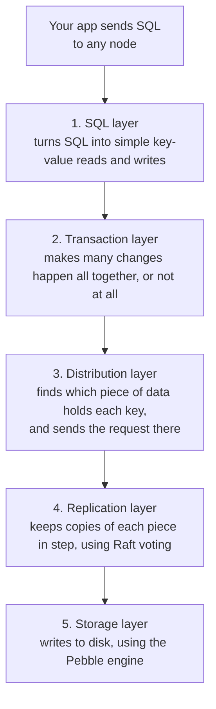
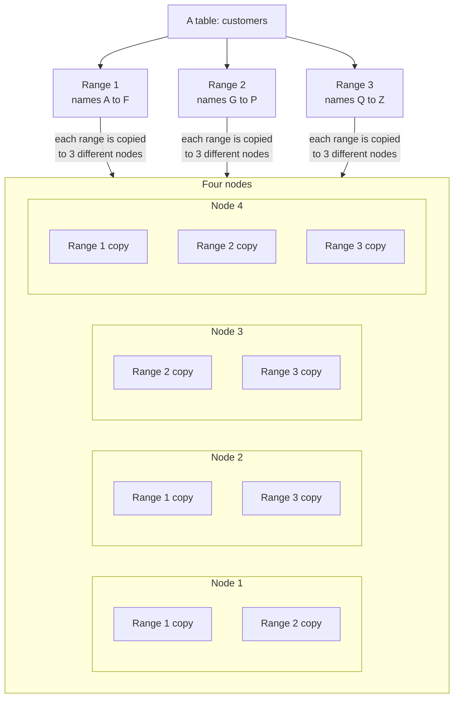
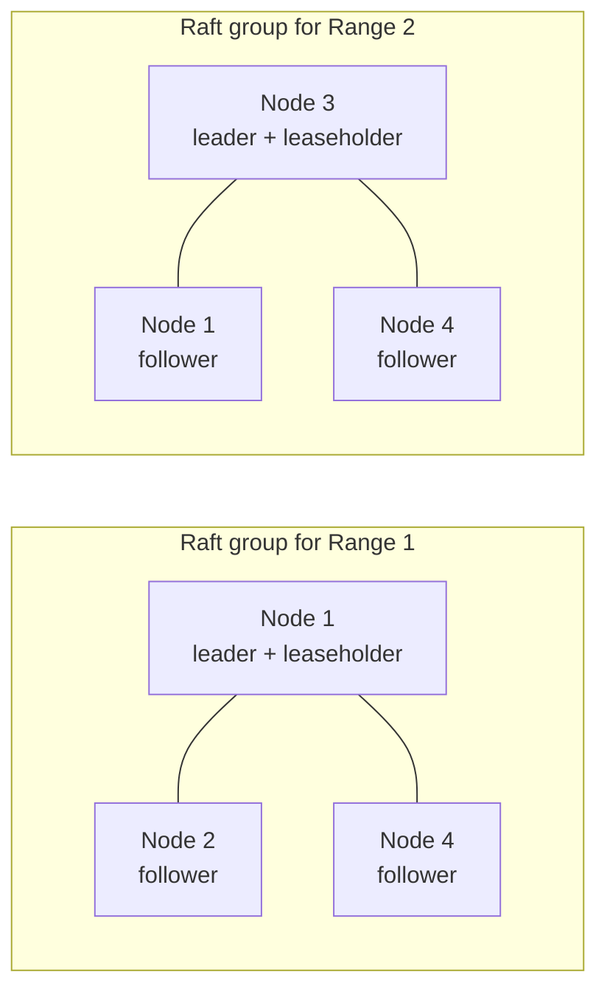
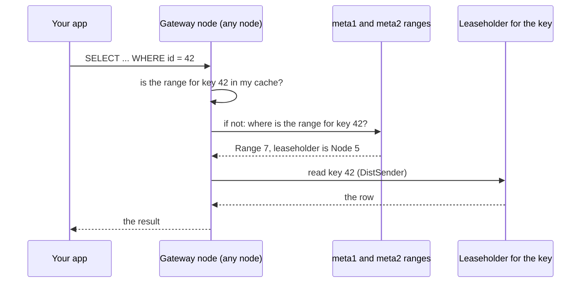
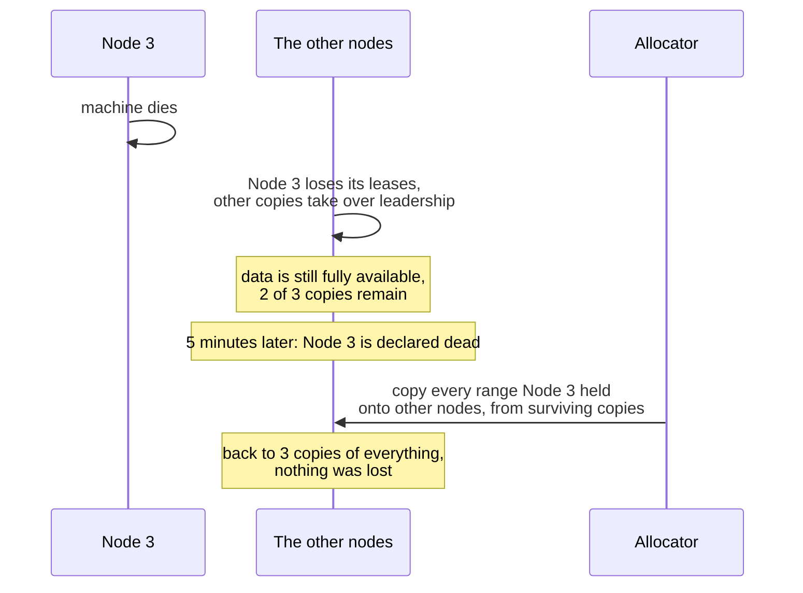
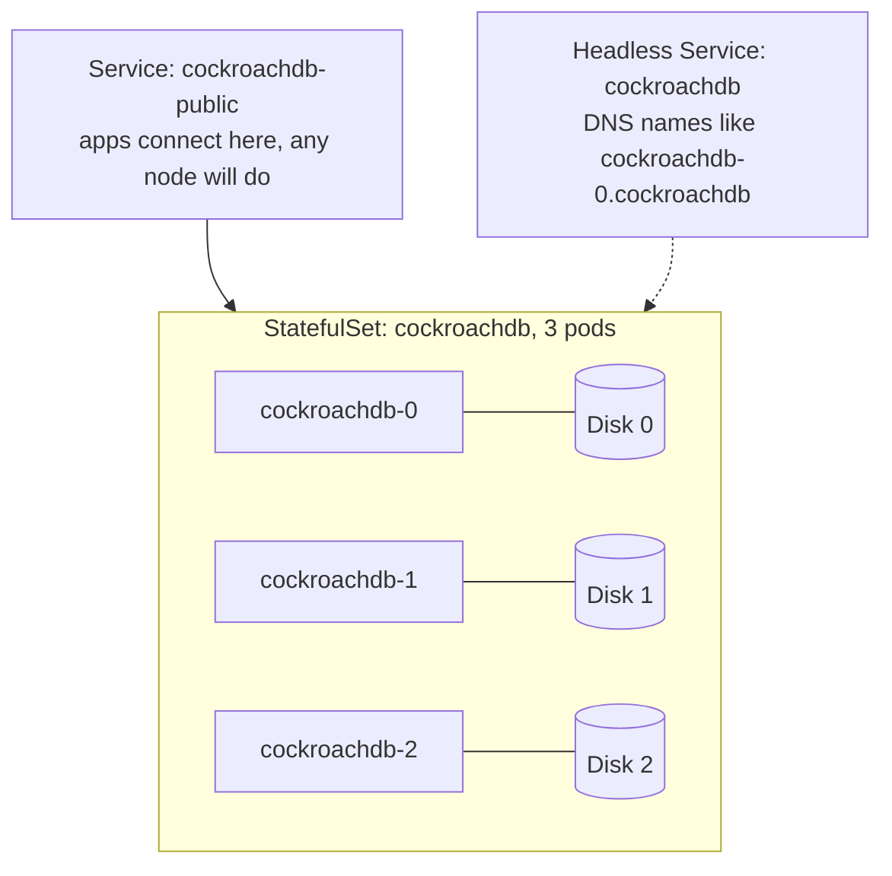
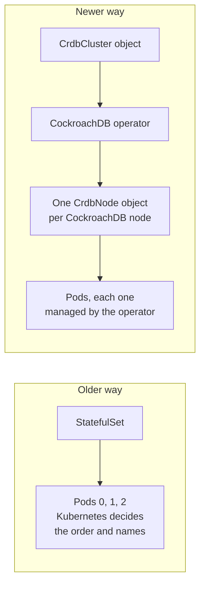
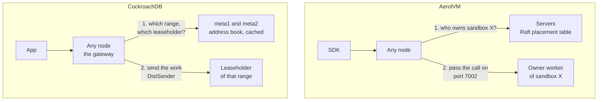
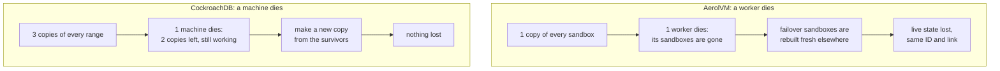

# CockroachDB and AerolVM: two clusters with their own brain, on Kubernetes

**What this is:** a plain-language explanation of how CockroachDB is built and
how it runs on Kubernetes, compared piece by piece with AerolVM. In
[`kubernetes-full-architecture.md`](kubernetes-full-architecture.md) we said
"CockroachDB runs its own Raft voting inside Kubernetes, so AerolVM can too".
This file checks that claim, and asks what AerolVM can learn from it.

**How the facts were checked:**

- **CockroachDB facts** were checked on 2026-11-05 against CockroachDB's own
  documentation for version **v26.4** (`docs.cockroachlabs.com`). Each section
  ends with its sources. The full list is at the end.
- **AerolVM facts** come from this repository's code, with file names.
- Anything that is an **idea**, not a fact, is marked **Proposal**.

**Short answer:** the claim was **mostly right, with one correction**.
CockroachDB does run its own Raft voting and its own data placement inside
Kubernetes, and Kubernetes only looks after its pods and disks. But only its
**older** Kubernetes methods use a StatefulSet. Its **newer**, recommended
Kubernetes operator does not use StatefulSets at all (section 9).

---

## Contents

| Part | Sections | What you learn |
|---|---|---|
| 1. CockroachDB in simple words | 1 to 7 | What it is, its layers, how it splits and copies data, how it finds data, how it handles dead machines, shutdowns and upgrades |
| 2. CockroachDB on Kubernetes | 8 to 10 | How it is installed on Kubernetes, then and now |
| 3. Side by side with AerolVM | 11 to 13 | What is the same, what is different, and the one big difference |
| 4. Lessons for AerolVM | 14 | Eight things to copy or change |
| 5. Sources | 15 | Every page used |

---

# Part 1: CockroachDB in simple words

## 1. What CockroachDB is

CockroachDB is a **SQL database spread across many machines**. To the app it
looks like one normal database. Behind the scenes:

- The data is cut into small pieces.
- Every piece is copied to several machines.
- **Any machine can take any query.** If it does not hold the data itself, it
  finds the machine that does and asks it.
- If a machine dies, the other copies keep working, and the database makes new
  copies somewhere else.

Each running CockroachDB program is called a **node**. Note: a CockroachDB
"node" is one CockroachDB program, while a Kubernetes "node" is a machine.
CockroachDB's own docs warn about this mix-up too.

You start a cluster with two commands:

1. `cockroach start` on each machine, with a `--join` list of the first
   machines, so each node knows where to find the others.
2. `cockroach init`, **once**, to set the new cluster up.

*Source: Architecture Overview.*

---

## 2. Five layers, like floors in a building

A request travels down through five layers. Each layer only talks to the one
above and the one below.

| Layer | Its job in one sentence |
|---|---|
| **SQL** | Turns your SQL into key-value operations. |
| **Transaction** | Makes several changes count as one: all happen, or none do. |
| **Distribution** | Presents all the pieces of data as one big sorted map, and routes each request to the right piece. |
| **Replication** | Keeps the copies of each piece the same, using Raft voting. |
| **Storage** | Reads and writes the data on disk. CockroachDB uses **Pebble**, a storage engine written in Go and inspired by RocksDB. |

A few words from the transaction layer, so they are not a mystery later:

- CockroachDB keeps **old versions** of each value, each with a timestamp. That
  lets it read the data "as of" a past time.
- A change in progress is first written as a **write intent**, a "pending"
  marker. It becomes real when the transaction commits.
- Each transaction has a **record** with its state: `PENDING`, `STAGING`,
  `COMMITTED` or `ABORTED`.
- A protocol called **Parallel Commits** makes a transaction that touches many
  ranges commit all at once, safely. (A transaction record state called
  `STAGING` exists for it.)
- Isolation levels: **SERIALIZABLE** and **READ COMMITTED**.

*Sources: Architecture Overview, Transaction Layer, Storage Layer.*

---

## 3. Ranges: the data is cut into pieces, and each piece is copied

All data (tables, indexes, almost all system data) is kept as one huge sorted
list of keys. That list is cut into pieces called **ranges**.

- A table starts as **one range**.
- When a range grows to **512 MiB** (the default `range_max_bytes`), it
  **splits** into two.
- Each range is copied to **3 nodes** by default (the "replication factor",
  `num_replicas`). Important system ranges, such as the ones that track where
  everything is and which nodes are alive, get **5 copies** by default.
- Each copy is called a **replica**.

Every range has three copies, always on three **different** nodes. Count
them: Range 1 is on nodes 1, 2 and 4. Range 2 is on nodes 1, 3 and 4. Range 3
is on nodes 2, 3 and 4.

*Sources: Architecture Overview, Distribution Layer, Replication Zones.*

---

## 4. Many small Raft groups, one per range

This is the most important idea in CockroachDB.

**Every range is its own Raft group.** The three copies of Range 1 vote among
themselves. The three copies of Range 2 vote among themselves. And so on. A big
cluster has many thousands of small Raft groups running side by side. When a
range splits, the new range gets a new Raft group with the same members.

In each group:

- One copy is the **Raft leader**. It coordinates every write. A write is
  committed only when a **majority** of the copies have it.
- One copy holds the **lease**, and is called the **leaseholder**. It is the
  only copy that serves up-to-date reads, and it sends writes to the leader.
- CockroachDB keeps the leaseholder and the Raft leader on the **same copy**,
  using a method called **Leader leases**. The only exception is a short moment
  while a lease moves. (An older method, epoch-based leases, is now off by
  default.)

So **every node is a leader for some ranges and a follower for others.** The
work is spread across all nodes. There is no single "boss" node for the whole
database.

*Sources: Architecture Overview, Replication Layer.*

---

## 5. Finding the data: any node can take any query

When a query arrives at a node, that node is called the **gateway** for it. The
gateway must find which node holds the lease for each key it needs.

CockroachDB keeps an **address book of ranges**, stored in the database
itself, in two levels:

- **meta2** lists every data range and where its copies live.
- **meta1** lists where the meta2 ranges live. meta1 is never split.
- **Every node learns where meta1 lives through gossip** (section 6).
- Nodes **cache** what they look up, so most lookups need no network call.

A part called the **DistSender** then sends each piece of work to the right
leaseholder, and gathers the answers.

*Source: Distribution Layer.*

---

## 6. Joining, gossip, dead nodes and moving data

### Joining and gossip

- Each new node is started with a `--join` list. It contacts one of those
  addresses, and if that fails, the next one, **until it joins the gossip
  network**.
- Gossip spreads cluster-wide facts to every node, such as where meta1 lives.
- The `--join` list is also saved in the node's data folder, but the docs
  recommend passing it every time, so a node can rejoin even if its data
  folder was lost.

### Telling the cluster where you are: locality

- Each node can be started with `--locality`, a list of labels such as
  `region=eu-west-1,zone=eu-west-1a`.
- CockroachDB "spreads the replicas of each piece of data across as diverse a
  set of localities as possible". With 3 copies in 3 zones, losing one zone
  loses only one copy of each range.

### Advertising an address

- `--advertise-addr` is the address a node tells the others to use. It can be
  an IP address **or a hostname**. A hostname "must be resolvable from all
  nodes".
- If you set nothing, the node advertises its own hostname.

### When a node stops answering

1. The node stops renewing its "I am alive" support (called **store
   liveness**), so it loses its leases. Other copies take over leadership, and
   the data stays available.
2. If it stays gone for **`server.time_until_store_dead`, 5 minutes by
   default**, the cluster declares it **dead**.
3. The cluster then **makes new copies** of every range that lived on the dead
   node, onto other nodes, from the surviving copies. No data is lost, because
   two other copies existed all along.

### Moving data around: the allocator

The **allocator** decides where copies and leases should live. It:

- Repairs ranges that have too few copies.
- Respects placement rules and zone survival goals.
- Spreads copies and leases so no node is overloaded. It uses two allocators
  together: the older one, and a newer "multi-metric allocator" (MMA) that
  watches each store's CPU use, write speed, disk use and capacity. For CPU
  overload it prefers moving a lease, which is cheap, over moving data.
- Moves data by sending a **snapshot** of a copy to the new node, which then
  catches up from the Raft log.

*Sources: cockroach start, Replication Layer, Node Shutdown.*

---

## 7. Stopping a node on purpose, and upgrading

CockroachDB has **two** ways to stop a node, for two different reasons.

| | Drain | Decommission |
|---|---|---|
| **When** | "I will restart this node soon" (maintenance, upgrades) | "This node is going away for good" (scale down, replace hardware) |
| **What it does** | Finishes running queries, closes client connections, and hands its **leases and Raft leaderships** to other nodes | Drains first, then **moves every copy of data** off the node |
| **Moves data?** | **No.** The copies stay on the node. | **Yes.** Heavy: lots of network traffic. |

Important details:

- **A `SIGTERM` signal starts a drain by itself**, and the process exits when
  the drain is done.
- **Do not kill the process before the drain finishes.**
- **On Kubernetes:** Kubernetes waits `terminationGracePeriodSeconds` before
  killing a pod. Kubernetes' default is 30 seconds. CockroachDB says to set it
  to **no less than 300 seconds (5 minutes)**, and its older operator uses 300
  seconds by default.

**Upgrades:**

- You upgrade **one node at a time** (a rolling upgrade). The cluster stays
  available the whole time.
- A **patch** upgrade (for example v26.4.1 to v26.4.2) is done when the last
  node is upgraded.
- A **major** upgrade (for example v26.3 to v26.4) has one more step, called
  **finalization**. Until the upgrade is finalized, new features that change
  system data stay switched off, so you can still roll back. For self-hosted
  clusters, finalization starts **automatically** once every node has rejoined
  on the new version, unless you turn that off.

*Sources: Node Shutdown, Upgrade CockroachDB.*

---

# Part 2: CockroachDB on Kubernetes

## 8. The older way: a StatefulSet

CockroachDB's docs list three older ways to install on Kubernetes. All three
create a **StatefulSet**:

- a hand-written StatefulSet file,
- the Helm chart (no longer actively developed, but still supported),
- the "Public operator".

What the StatefulSet gives each CockroachDB pod: a **stable network identity**
and the **same persistent disk** every time it restarts.

Other details from the guide:

- Each node's **certificate lists DNS names**, including wildcards that match
  every pod's DNS name, such as `*.cockroachdb.default.svc.cluster.local`. No IP
  numbers are needed for pods.
- Nodes log to standard output, so `kubectl logs` shows them.
- The disks are **cloud network disks** (EBS on AWS, Persistent Disk on
  Google Cloud), often copied by the cloud provider too.
- The guide's pods are **ordinary pods**. It does not ask for privileged pods
  or folders from the machine. CockroachDB only needs a network and a disk.

*Sources: Deploy CockroachDB in a Single Kubernetes Cluster, Kubernetes
Overview.*

## 9. The newer way: its own operator, without StatefulSets

CockroachDB now calls those three methods **"legacy"**. They will not be
supported in a future release. New installs should use the newer
**CockroachDB operator**:

- It is installed with CockroachDB's Helm charts.
- It adds two new kinds of Kubernetes objects: **`CrdbCluster`** (the whole
  cluster) and **`CrdbNode`** (one CockroachDB node).
- **It does not use StatefulSets.** It manages each node itself.
- It was built to make **multi-region** clusters simpler.

**Why this matters for us:** a StatefulSet is simple, but it decides things
like pod order and names by its own rules. A database that spans regions needs
more control than that, so CockroachDB wrote its own operator. AerolVM may hit
the same limits later (lesson L5).

*Sources: CockroachDB Operator Overview, Kubernetes Overview.*

## 10. What Kubernetes does and does not do for CockroachDB

| Kubernetes does | CockroachDB does |
|---|---|
| Runs the pods and restarts them | Decides which node holds which copy of which range |
| Gives each pod a disk and a stable name | Keeps copies in step with Raft voting |
| Sends `SIGTERM` and waits the grace period | Drains itself on `SIGTERM` |
| Load-balances app connections | Routes each request to the right leaseholder |
| Stores the certificates as Secrets | Checks every node's certificate |

This confirms the pattern from the AerolVM guide: **Kubernetes looks after the
processes and disks. The app keeps its own brain.**

---

# Part 3: Side by side with AerolVM

## 11. The big comparison table

| Idea | CockroachDB | AerolVM (from this repo) | Same or different? |
|---|---|---|---|
| **Any node takes any request** | Any node is the "gateway" for any SQL query | Any node takes any API call (`internal/cluster/cluster.go`) | **Same** |
| **Sending a request to the right node** | DistSender, using the meta1/meta2 address book | Look up the owner in the Raft placement table, pass the call on port 7002 over mTLS (`pkg/api/clusterroute/forward.go`) | **Same idea** |
| **The unit being placed** | A range: a piece of **data** | A sandbox: a **running program** | **Different** (section 12) |
| **Copies of each unit** | 3 by default, 5 for system ranges | **1.** A sandbox runs in one place. | **Different** |
| **Raft groups** | One per range: many thousands | **One** for the whole cluster, on 3 to 5 server nodes | **Different** |
| **Leader** | One leader per range, spread over all nodes | One leader for the whole cluster | **Different** |
| **Roles** | All nodes are equal | Server, worker and ingress roles (`SB_NODE_ROLE`) | **Different** |
| **Joining** | `--join` list, then the gossip network | `SB_BOOTSTRAP_PEERS`, then SWIM gossip | **Same** |
| **First start** | `cockroach init`, once | `SB_CLUSTER_BOOTSTRAP=true` on the first server | **Same** |
| **Advertised address** | Hostname allowed and normal; must resolve from all nodes | Raft turns the address into an **IP number at start-up** (`internal/cluster/raft.go`) | **Different**: lesson L1 |
| **Node certificates** | List DNS names, including pod wildcards | Carry the name `node:<id>` (`internal/cluster/tls.go`) | **Similar** |
| **Declared dead after** | **5 minutes** (`server.time_until_store_dead`) | **30 seconds** (`SB_DEAD_OWNER_GRACE`) | **Different** (section 12) |
| **After a death** | New copies made from surviving copies. **Nothing lost.** | Sandboxes with failover `recreate` are **rebuilt fresh**. Others become orphans. **Live state is lost.** | **Different** |
| **Zone awareness** | `--locality` labels; copies spread across zones | **None.** Placement does not look at zones (`internal/cluster/placement.go`) | **Different**: lesson L4 |
| **Choosing a place** | Allocator: watches load (CPU, disk, write speed), placement rules, zones | Filter, then pick 2 at random and take the one with more room (`placement.go`) | **Similar idea, simpler** |
| **On `SIGTERM`** | Drains: hands leases away, then exits | Tells the cluster "I'm leaving", which **starts the 30-second dead timer** (`internal/cluster/voter_autojoin.go`) | **Different**: lesson L2 |
| **Temporary stop** | Drain: no data moves | Drain: stops new sandboxes only (`POST /v1/cluster/nodes/{id}/drain`) | **Same idea** |
| **Permanent removal** | Decommission: moves every copy off first | Remove member: orphans its sandboxes (`DELETE /v1/cluster/members/{id}`) | **Different**: lesson L3 |
| **Upgrades** | Rolling; major versions wait for "finalization" before new features turn on | Rolling; a new kind of Raft write waits until every server reports the new version (`internal/cluster/fsm_egress_profiles.go`) | **Same idea**: lesson L6 |
| **Kubernetes object** | StatefulSet (older), own operator with `CrdbNode` (newer) | Planned: StatefulSet for servers, DaemonSet for workers, Deployment for ingress, plus an aerolvm-controller | **Similar path** |
| **Rights on the machine** | **None.** Ordinary pods. | Workers need a **privileged** pod | **The biggest difference** |

### The same story, drawn twice: finding the right node

---

## 12. The one big difference: data can be copied, a running program cannot

Almost every difference in the table comes from one fact:

> **CockroachDB places pieces of data. Data can be copied.**
> **AerolVM places running programs. A running program lives in one place.**

Follow that fact and the rest makes sense:

1. **Copies.** CockroachDB keeps 3 copies of every range, so it can lose a
   machine and lose nothing. A sandbox is a live program, with memory, open
   files and running processes. You cannot keep three live copies of it in
   step. So AerolVM keeps one.

2. **How fast to declare death.** CockroachDB can wait **5 minutes**, because
   while it waits, the other copies serve everything, and making new copies is
   expensive. AerolVM waits only **30 seconds**, because while it waits, the
   sandboxes on the dead machine are simply unreachable, and rebuilding one
   is cheap.

3. **What happens after a death.** CockroachDB rebuilds lost copies from the
   surviving copies, so the data is exactly the same. AerolVM can only
   **rebuild a sandbox fresh** from its recipe (image, settings and sealed
   secrets). Whatever the old sandbox had in memory or wrote inside itself is
   gone.

4. **Disks.** CockroachDB keeps everything on a network disk that can be
   re-attached to a new machine. AerolVM's sandboxes live in the worker
   machine's memory and local disk, which die with the machine.

5. **Rights on the machine.** CockroachDB only reads and writes files, so it is
   an ordinary pod. AerolVM must build sandboxes on the machine itself
   (networks, firewall rules, containers), so its workers must be privileged.

6. **One brain or many.** CockroachDB needs one Raft group per range, because
   each range's **data** must be agreed on. AerolVM only needs to agree on a
   small table ("sandbox X is on worker W"), so one Raft group on a few server
   nodes is enough.

**So the parallel holds for the cluster brain, not for the data.** Both run
their own Raft and their own placement inside Kubernetes. But CockroachDB's
nodes are interchangeable boxes of copied data, while AerolVM's workers are
machines full of one-of-a-kind running programs. That is why AerolVM must be
more careful with restarts, machine replacement, and zones.

## 13. What the comparison confirms about our plan

- **Running your own Raft inside Kubernetes is normal.** CockroachDB has done
  it for years. The plan's server StatefulSet (3 pods, one disk each, a
  headless Service, a PodDisruptionBudget) is the same shape as CockroachDB's
  older setup.
- **Using a stable DNS name for each server pod is the standard approach.**
  CockroachDB advertises hostnames and puts pod DNS names in its
  certificates.
- **A long shutdown grace period is normal.** CockroachDB asks for at least
  5 minutes.
- **An operator of your own is where mature projects end up.** CockroachDB
  moved from StatefulSets to its own operator.

---

# Part 4: Lessons for AerolVM

Each lesson says what CockroachDB does, what AerolVM does, and what we should
change. All changes are **Proposals** to discuss in engineering review.

### L1. Advertise DNS names, not IP numbers

- **CockroachDB:** `--advertise-addr` can be a hostname. It must resolve from
  all nodes.
- **AerolVM:** Raft turns its advertised address into an IP number at start-up
  (`internal/cluster/raft.go`). A server pod that moves gets a new IP.
- **Proposal:** let Raft store and dial the pod's DNS name. This is change C4
  in `kubernetes-full-architecture.md`, and CockroachDB shows it is the normal
  way.

### L2. A planned restart should not look like a death

- **CockroachDB:** `SIGTERM` starts a **drain**. The node hands its leases
  away and exits. Nothing is declared dead unless it stays gone for 5 minutes.
- **AerolVM:** `SIGTERM` makes the node say "I'm leaving", which starts the
  **30-second dead timer** (`internal/cluster/voter_autojoin.go`). A slow pod
  restart can make the cluster orphan or move sandboxes that are still running
  fine.
- **Proposal:** split "I'm restarting" from "I'm leaving for good". A worker
  that stops for a restart should mark itself as draining (no new sandboxes),
  and the dead timer should only start if it does not come back within a
  longer restart window. Also set a long `terminationGracePeriodSeconds` on
  AerolVM pods, as CockroachDB does.

### L3. Machine replacement is a "decommission", not a "drain"

- **CockroachDB:** has two clear tools. **Drain** for "back soon".
  **Decommission** for "gone for good", which moves every copy off before the
  node leaves.
- **AerolVM:** drain stops new sandboxes. Remove-member orphans what is left.
  Nothing moves sandboxes off a machine before it goes.
- **Why it matters on Kubernetes:** EKS and AKS **replace** machines during
  upgrades. That is a permanent removal.
- **Proposal:** a "decommission" for workers: drain, wait for sandboxes to
  finish up to a time limit, then rebuild the failover sandboxes on other
  workers **before** the machine is removed, not after it dies. The
  aerolvm-controller could trigger it when Kubernetes marks a machine for
  replacement.

### L4. Know which zone each node is in

- **CockroachDB:** each node gets `--locality` labels (region, zone). The
  allocator spreads copies across zones, so losing one zone loses at most one
  copy.
- **AerolVM:** placement does not look at zones (`internal/cluster/placement.go`
  has no zone logic, and there is no locality setting).
- **What can go wrong today:**
  - Failover can rebuild a sandbox **in the same zone** that just failed.
  - The **2 backup copies of a sandbox's sealed secrets** could all sit in one
    zone. If that zone dies, failover cannot open the secrets.
- **Proposal:** a locality setting per node (for example `SB_NODE_LOCALITY`,
  filled by the chart from the Kubernetes zone label). Use it to pick backup
  holders and failover targets in **other** zones.

### L5. Plan for an operator, not only plain StatefulSets

- **CockroachDB:** moved from StatefulSets to its own operator, with one
  `CrdbNode` object per node, to get more control (especially for multiple
  regions).
- **AerolVM:** the plan already has an aerolvm-controller for certificates.
- **Proposal:** start with StatefulSet and DaemonSet (simple, enough for one
  region), but let the aerolvm-controller grow into the place that runs
  upgrades worker by worker, decommissions machines (L3), and fills in zone
  labels (L4).

### L6. Keep the upgrade gate, and write down the order

- **CockroachDB:** rolling upgrades, plus a **finalization** step that keeps
  new features off until every node runs the new version.
- **AerolVM:** already has the same idea for Raft writes: a new kind of write
  is only accepted once every server reports the new version
  (`internal/cluster/fsm_egress_profiles.go`).
- **Proposal:** keep it. Document the rolling order for Kubernetes (servers,
  then ingress, then workers, one at a time), and test a mixed-version
  cluster in the upgrade test.

### L7. Put DNS names in certificates where possible

- **CockroachDB:** node certificates list pod DNS names, including a wildcard
  for all pods of the StatefulSet.
- **AerolVM:** certificates carry `node:<id>`, and the ID must match
  `SB_NODE_ID` (`internal/cluster/tls.go`). This already avoids IP numbers.
- **Proposal:** no change needed. The plan's certificate signer, which checks
  that the pod really runs on the machine it claims, is stricter than
  CockroachDB's shared node certificate.

### L8. Consider 5 voters for a bank

- **CockroachDB:** important system ranges get **5 copies** by default, not 3.
- **AerolVM:** the guide uses 3 server pods. 5 is allowed (at most 5 voters, at
  most 7 server nodes).
- **Proposal:** offer a 5-server option for banks. Spread 2, 2 and 1 across 3
  zones. It survives a whole zone going down **and** one more server failing
  at the same time.

---

# Part 5: Sources

All CockroachDB pages were read on **2026-11-05**. They describe CockroachDB
**v26.4**. The site serves them from `docs.cockroachlabs.com`.

| Page | What it confirmed |
|---|---|
| [Architecture Overview](https://www.cockroachlabs.com/docs/stable/architecture/overview) | `cockroach start --join` and `cockroach init`; any node takes any query; ranges; 5 layers; leaseholder and Raft leader on the same copy; SERIALIZABLE and READ COMMITTED |
| [Distribution Layer](https://www.cockroachlabs.com/docs/stable/architecture/distribution-layer) | meta1 and meta2; meta1 never splits; meta1's location spread by gossip; caches; DistSender; a split creates a new Raft group |
| [Replication Layer](https://www.cockroachlabs.com/docs/stable/architecture/replication-layer) | Raft groups per range; Leader leases; epoch-based leases off by default; snapshots; allocator and multi-metric allocator; rebalancing when nodes join or die |
| [Transaction Layer](https://www.cockroachlabs.com/docs/stable/architecture/transaction-layer) | Write intents; transaction record states; Parallel Commits |
| [Storage Layer](https://www.cockroachlabs.com/docs/stable/architecture/storage-layer) | Pebble, written in Go, inspired by RocksDB |
| [Replication Zones](https://www.cockroachlabs.com/docs/stable/configure-replication-zones) | `range_max_bytes` default 512 MiB; `num_replicas` default 3, and 5 for system, meta and liveness ranges |
| [cockroach start](https://www.cockroachlabs.com/docs/stable/cockroach-start) | `--join` and the gossip network; `--join` saved in the data folder; `--advertise-addr` hostname must resolve from all nodes; `--locality` |
| [Node Shutdown](https://www.cockroachlabs.com/docs/stable/node-shutdown) | Drain vs decommission; `SIGTERM` drains; `time_until_store_dead` 5 minutes; `terminationGracePeriodSeconds` at least 300 seconds, Kubernetes default 30 |
| [Upgrade CockroachDB](https://www.cockroachlabs.com/docs/stable/upgrade-cockroach-version) | Rolling upgrades one node at a time; finalization for major versions; automatic finalization by default |
| [Deploy in a Single Kubernetes Cluster](https://www.cockroachlabs.com/docs/stable/deploy-cockroachdb-with-kubernetes) | StatefulSet with a stable identity and the same disk per pod; node certificates with pod DNS wildcards; legacy status |
| [Kubernetes Overview](https://www.cockroachlabs.com/docs/stable/kubernetes-overview) | The three older methods are "legacy"; the newer CockroachDB operator is recommended |
| [CockroachDB Operator Overview](https://www.cockroachlabs.com/docs/stable/cockroachdb-operator-overview) | `CrdbCluster` and `CrdbNode` objects; no StatefulSets; built for multi-region |

**AerolVM sources:** `internal/cluster/cluster.go`, `placement.go`, `raft.go`,
`tls.go`, `voter_autojoin.go`, `dead_owner.go`, `fsm_egress_profiles.go`,
`pkg/api/clusterroute/forward.go`, `internal/config/config.go`.

**Not checked here:** the guide's other example, Ray on Kubernetes. Its claim
(Ray schedules its own tasks inside pods that Kubernetes runs) was not
verified in this pass.
