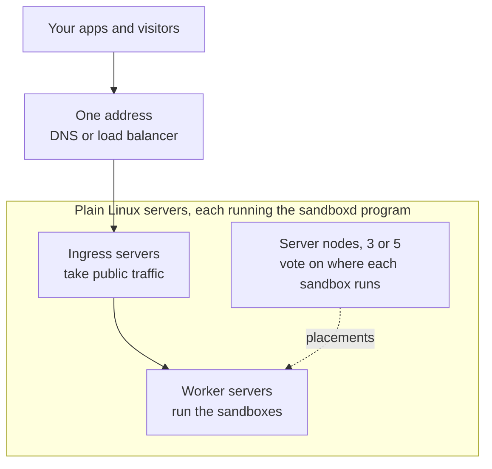
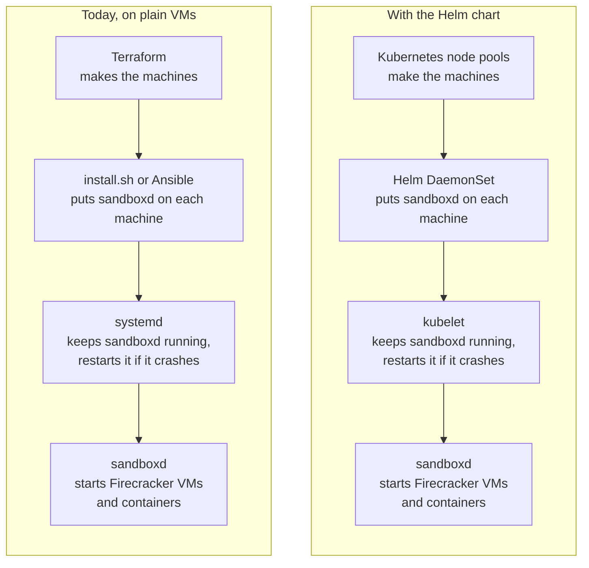
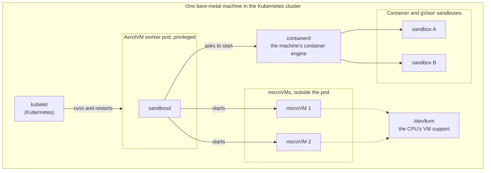
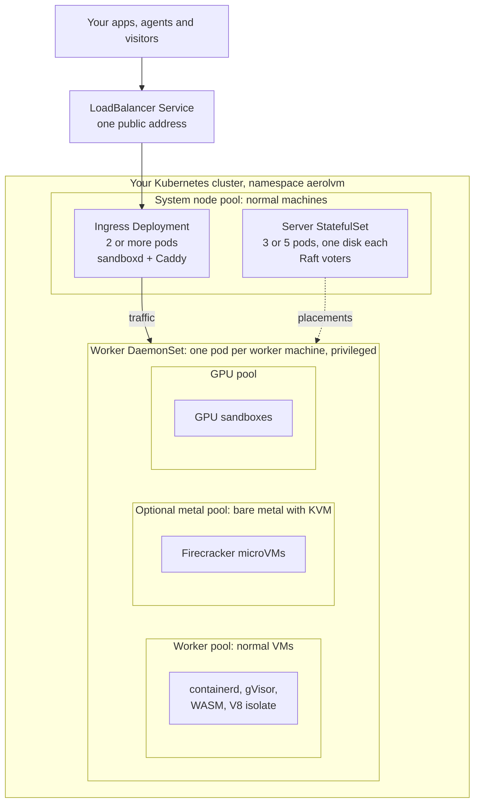
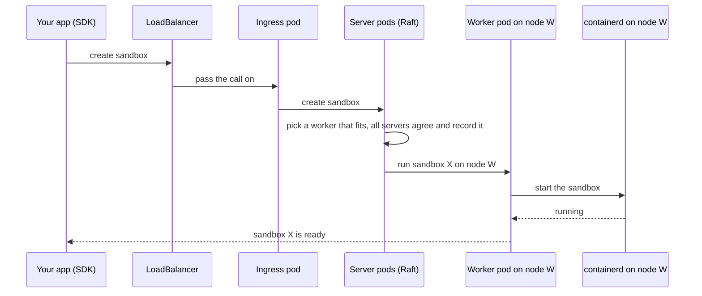
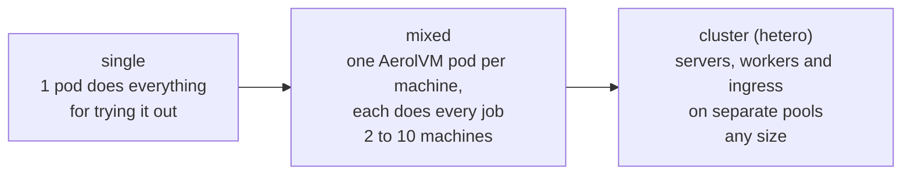
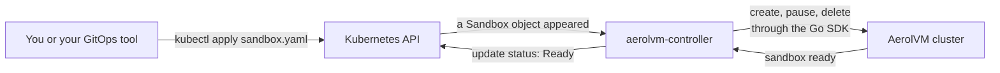
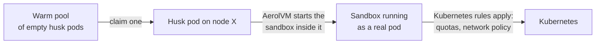
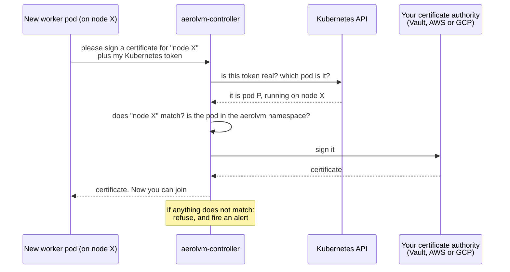
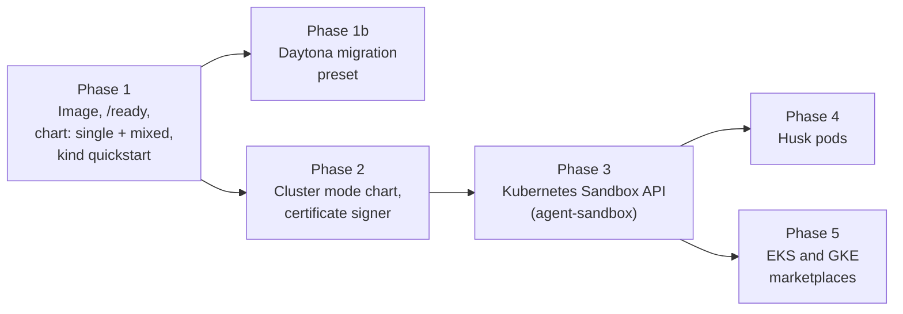

# AerolVM on Kubernetes, explained simply

**What this is:** a plain-language guide to how AerolVM would run inside
Kubernetes, installed with Helm. It explains the design in
[`kubernetes-deployment.md`](kubernetes-deployment.md) (PR #522). Read this
first, then the full plan.

**For the complete, detailed guide, read
[`kubernetes-full-architecture.md`](kubernetes-full-architecture.md).** It
covers EKS and AKS on normal VMs, with no bare metal, step by step.

**Status (2026-11-04):** nothing here is built yet. There is no AerolVM
container image, no Helm chart, and no `/ready` health check. This is the
design we would build.

---

## 1. The idea in one line

Today you install AerolVM on plain Linux servers. With the Helm chart, you
install the **same AerolVM** inside a Kubernetes cluster you already run, with
one command. For example (the chart does not exist yet, so this name is a
placeholder):

```bash
helm install aerolvm oci://ghcr.io/aerol-ai/charts/aerolvm
```

Your SDK code does not change. It still talks to one address.

---

## 2. Words you need

| Word | What it means here |
|---|---|
| **Kubernetes** | Software that runs apps across many machines and restarts them when they break. |
| **Node** | One machine (a VM or a bare-metal server) in the Kubernetes cluster. |
| **Pod** | The smallest thing Kubernetes runs: one or more containers that live and die together. |
| **Node pool** | A group of alike nodes, for example "GPU machines" or "bare-metal machines". |
| **Helm chart** | A package of Kubernetes files. `helm install` sets up everything in one go. |
| **StatefulSet** | Runs a fixed number of pods that each keep their own name and their own disk. |
| **DaemonSet** | Runs exactly one pod on every node that matches a label. |
| **Deployment** | Runs N copies of a pod that are all the same and can move freely. |
| **LoadBalancer Service** | Gives a set of pods one public address. |
| **CRD** | A new kind of Kubernetes object. You can `kubectl apply` it like a built-in one. |
| **Controller** | A program that watches Kubernetes objects and makes the real world match them. |
| **Sandbox** | An isolated machine AerolVM runs your code in: a container, gVisor, a Firecracker VM, WASM or a V8 isolate. |
| **Raft** | How AerolVM's server nodes agree on shared records, such as "sandbox X runs on worker W". |

---

## 3. How AerolVM works today (no Kubernetes)

A big AerolVM cluster splits its machines into three jobs. This is called a
**hetero cluster**.



- **Ingress** servers take traffic from the internet and pass it to the right
  worker.
- **Server** nodes keep the shared record of which worker runs which sandbox.
  They vote on every change, so the cluster survives one dead server.
- **Worker** servers run the sandboxes. They can be different machines: small
  VMs for containers, bare metal for Firecracker, GPU machines for GPU work.

Today you set this up with the install script, Ansible, or Terraform.

---

## 4. Isn't AerolVM already its own Kubernetes?

Yes. AerolVM is a small Kubernetes made only for sandboxes. It has the same
parts:

| Kubernetes part | What it does | The AerolVM part that does the same job |
|---|---|---|
| etcd | Keeps the shared records | Raft records on the server nodes |
| kube-scheduler | Picks a machine for each pod | Placement on the server nodes (`internal/cluster/placement.go`) |
| kubelet | The agent on each machine that starts things | `sandboxd` on each worker |
| Pod | The thing being run | A sandbox |
| Ingress / kube-proxy | Sends traffic to the right place | Ingress nodes with Caddy |

So the Helm chart does **not** put one scheduler inside the other. It stacks
them, and each one schedules a different thing.

### Kubernetes takes over systemd's job, not AerolVM's job

The easiest way to see it: compare with how AerolVM is installed today.



The bottom box is the **same code** in both. Kubernetes only replaces the
top three boxes: making machines, installing `sandboxd`, and keeping it
running. **Kubernetes never starts a sandbox or a microVM.** `sandboxd`
still does that, exactly as today.

### So how does a microVM start from inside a pod?

A normal pod is locked in a box and cannot touch the machine. The AerolVM
worker pod is **privileged**: it is allowed to reach through its box and use
the real machine. So `sandboxd`, inside the pod, starts the Firecracker
process **on the machine itself**, next to the pod, not inside it.
Kubernetes does not know the VM exists. It only sees the `sandboxd` pod.
In the picture, nothing in the two right-hand boxes is a pod.



### Why the sandboxes survive a pod restart

If Kubernetes restarts or upgrades the `sandboxd` pod, the sandboxes must keep
running. AerolVM already handles this today:

- **Containers and gVisor sandboxes** belong to the machine's containerd, not
  to `sandboxd`. They do not notice when `sandboxd` restarts.
- **Firecracker VMs** are moved into their own group on the machine
  (`aerolvm-vmm`), outside `sandboxd`'s group. When the new `sandboxd` starts,
  it finds them and takes them back over
  (`internal/runtime/firecracker/vmm_adopt.go`).

On Kubernetes this needs one extra thing the plan does not list yet: the
worker pod must be given the **machine's** process-group folder
(`/sys/fs/cgroup`) and run folder (`/run/sandboxd`). Without them, the VM's
"own group" would sit inside the pod, and a pod restart would kill every VM
on that machine. See section 13.

### Who is the boss of what

| | Kubernetes decides | AerolVM decides |
|---|---|---|
| What | Which machines exist, and that one `sandboxd` runs on each | Which sandbox goes on which machine |
| How often it changes | Rarely: when you add machines or upgrade | All the time: thousands of sandboxes |
| Speed | Seconds | 4 to 300 ms per sandbox |

They do not fight, because they schedule different things. The one thing
they share is the machine's CPU and memory. So worker machines are a
**separate node pool** that only AerolVM uses, and the chart tells AerolVM
how much of each machine it may fill (`SB_HOST_CPU_CORES`,
`SB_HOST_MEMORY_MB`).

### Then why run it on Kubernetes at all?

Not for anything technical. AerolVM works fine without it. The reason is
**operations**: many companies already run everything on Kubernetes. They
want to install, upgrade, monitor and add machines the way they already do,
with one tool. They do not want a second fleet of VMs managed by Ansible on
the side. The Helm chart gives them that.

Why not make each sandbox a pod from day one? Because Kubernetes takes about
1 to 3 seconds to start a pod. AerolVM starts a sandbox in about 4 to 300 ms,
depending on the runtime. Going through Kubernetes for every sandbox would
throw that speed away. Section 9 shows how a later phase gives Kubernetes a
view of each sandbox without losing the speed.

**AerolVM keeps its sandboxes separate from Kubernetes' own pods.** It uses
its own containerd namespace (`aerolvm`), apart from Kubernetes' (`k8s.io`).
So Kubernetes never cleans up our images, and we never touch its pods.

---

## 5. How each AerolVM job becomes a Kubernetes object

Each job from section 3 maps to the Kubernetes object that fits it best.

| AerolVM job | Kubernetes object | Why this one |
|---|---|---|
| **Server** (3 or 5) | StatefulSet with one disk per pod | Servers need stable names and must keep their Raft records across restarts. |
| **Worker** | DaemonSet on labeled nodes | One worker per machine. The worker must live on the machine whose sandboxes it runs. |
| **Ingress** | Deployment + LoadBalancer Service | Ingress pods are all the same and hold no data, so they can move freely. |
| **Caddy** (HTTPS and routing) | A second container in the same pod ("sidecar") | sandboxd talks to Caddy on `127.0.0.1`, so they must share a pod. |

Here is a full hetero cluster inside Kubernetes. Each kind of machine is its
own **node pool**.



The **same chart** puts a worker on each pool. You pick which runtimes each
pool runs with a setting (`SB_HOST_RUNTIMES`). A sandbox only lands on a
worker that can run it.

---

## 6. Why worker pods need special powers

Most apps in Kubernetes are locked down. An AerolVM worker cannot be, because
it builds sandboxes directly on the machine. Its pod is **privileged** and
uses the machine's network (`hostNetwork`). This is the main thing a security
team will ask about.

| What the worker needs on the machine | Why | How the chart gives it |
|---|---|---|
| The machine's containerd socket | To start and stop sandbox containers | Mount the socket file into the pod |
| Network rules (iptables), network spaces, TAP devices | To give each sandbox its own network and firewall | Privileged pod on the host network |
| `/dev/kvm` | To run Firecracker VMs | Mount the device, only on the metal pool |
| A folder that survives restarts | Local database, keys, sandbox files | A folder on the machine: `/var/lib/sandboxd` |
| Storage mounts the engine can see | S3, NFS, SSHFS mounts inside sandboxes | Share mounts both ways with the machine |
| Tools such as `iptables`, `skopeo`, `firecracker`, `workerd` | Used to build and run sandboxes | Baked into the AerolVM image |

To keep this safe:

- Workers run only on **their own tainted node pool**. Your normal apps never
  land there, and workers never land on your app machines.
- Only the `aerolvm` namespace allows privileged pods.
- Images and the chart are **signed**, so you can check they came from us.
- Servers and ingress pods are **not** privileged.

**Biggest risk:** our network rules and Kubernetes' network rules (kube-proxy
and the network plugin, such as Cilium) live on the same machine. They must not
step on each other. The plan tests this on purpose (section 11).

---

## 7. What happens when you create a sandbox

Nothing new happens here. The steps are the same as today. They just run
inside pods.



Then, when a visitor opens the sandbox's public link:


---

## 8. Three ways to install

The chart has three modes. You can start small and grow. Your code stays the
same.



| Mode | What runs | Good for |
|---|---|---|
| `single` | One privileged pod. No cluster. | Trying it on a laptop with kind, or a small team |
| `mixed` | One DaemonSet. Every pod votes, runs sandboxes and takes traffic. | 2 to 10 machines, surviving a dead machine |
| `cluster` | Server StatefulSet, worker DaemonSet, ingress Deployment | Large fleets, bare metal and GPUs |

---

## 9. Later phases: speaking Kubernetes' own language

The phases above put AerolVM **in** Kubernetes. Two later phases let people
manage sandboxes **with** Kubernetes tools.

### 9a. The Kubernetes Sandbox API (Phase 3)

Kubernetes has an official, standard API for agent sandboxes, called
**agent-sandbox** (`agents.x-k8s.io`). It adds objects such as `Sandbox`,
`SandboxTemplate`, `SandboxClaim` and `SandboxWarmPool`.

We would add a small program, the **aerolvm-controller**. It watches those
objects. When someone applies a `Sandbox`, it asks AerolVM to make one. When
they delete it, it asks AerolVM to delete it.



Why it matters: teams that run everything through `kubectl`, Argo CD or Flux
can manage sandboxes the same way. Teams that need speed still use the SDK
directly, which skips Kubernetes and stays fast.

Safety rules for the controller:

- Each Kubernetes **namespace is its own AerolVM owner**. Namespace A cannot
  see or delete namespace B's sandboxes.
- The controller never uses the admin token.
- Retries are safe. Each sandbox's ID comes from its Kubernetes object, so a
  repeated create returns the same sandbox.

### 9b. Husk pods (Phase 4)

Some buyers need **Kubernetes rules to apply to every single sandbox**:
quotas, network policies, pod security. For them, each sandbox lives inside a
real pod, called a **husk pod**.

The trick that keeps it fast: create the husk pods **ahead of time**, as a
warm pool. When a sandbox is needed, AerolVM takes a ready husk and starts the
sandbox inside it. Kubernetes' 1 to 3 second pod start is already paid for.



This is the hardest phase. It changes how AerolVM picks a worker (the husk's
node decides), which is a fragile area of the code. It needs its own design
doc first.

---

## 10. How a worker proves who it is (Phase 2)

AerolVM nodes trust each other through certificates. In Kubernetes, a new
worker pod must get a certificate before it can join. We must not let a fake
pod get one.

The rule: **a worker only gets a certificate for the machine it really runs
on.** Kubernetes itself vouches for that.



The key that signs certificates stays **outside** the cluster, in Vault or a
cloud certificate service. A test setup can keep it inside, with a loud
warning.

---

## 11. How we prove it works

| Test | Where | What it proves |
|---|---|---|
| `helm lint` and template checks | Every PR, offline | The chart is valid |
| `make k8s-dev` on kind | CI | Create, run and delete a sandbox with each SDK on a laptop-sized cluster |
| `k8s-single` and `k8s-cluster-3` | Live, on AWS EKS | It works on a real managed Kubernetes |
| Chaos step | Live | Kill the lead server pod and a worker pod during 50 creates: no duplicates, nothing lost |
| Network coexistence | Live | Our rules work next to kube-proxy and Cilium |
| 10,000 `Sandbox` objects | Live | The controller does not overload Kubernetes |

---

## 12. What exists today, and what is still missing

| Piece | Status |
|---|---|
| Server / worker / ingress roles (`SB_NODE_ROLE`) | ✅ Exists. The chart reuses it as is. |
| Capacity settings (`SB_HOST_CPU_CORES`, `SB_HOST_MEMORY_MB`) | ✅ Exists. No code change. |
| Separate containerd namespace (`SB_CONTAINERD_NAMESPACE`) | ✅ Exists |
| Certificates that reload without a restart | ✅ Exists (`internal/cluster/tls.go`) |
| Safe retries on create (`CreateSandboxWithID`) | ✅ Exists |
| AerolVM container image | ❌ Not built |
| Helm chart | ❌ Not built |
| `/ready` check that knows about the cluster | ❌ Not built. Today `/health` says "OK" even when a node is cut off from the cluster (open item in `TODOS.md`). Kubernetes needs this to stop sending traffic to a broken pod. |
| aerolvm-controller (certificates, Sandbox API) | ❌ Not built |
| Husk pods | ❌ Not built, needs its own design doc |

---

## 13. Things to settle before we plan

1. **The license block is gone.** The plan says the `cluster` mode and
   marketplace listings wait on license PR #223. That PR was **closed without
   merging** on 2026-10-03. AerolVM stays MIT and cluster mode is not
   restricted, so this block no longer applies. The plan text needs updating.
2. **`ROADMAP.md` says the opposite.** It says: "`sandboxd` will not become a
   Kubernetes workload, and sandboxes will not become Kubernetes objects,
   during this year." This plan does both. If we go ahead, the roadmap must
   change in the same effort. The roadmap itself says a change of direction is
   a PR to that file.
3. **The plan has had a CEO review, not an engineering review.** The next
   required step is `/plan-eng-review`.
4. **Firecracker VMs would die on a worker pod restart, as the plan stands.**
   Today each VM is moved into its own group on the machine, so a `sandboxd`
   restart leaves it running (`internal/runtime/firecracker/vmm_adopt.go`).
   Inside a pod, that group would sit inside the pod's own group unless the
   chart mounts the machine's `/sys/fs/cgroup` and `/run/sandboxd` into the
   worker pod. The plan's "worker pod restart" test should cover Firecracker,
   not only containers.
5. **Some details are a month old.** The ingress routing changed since
   (`SB_INGRESS_PROXY_ROUTING`), and key custody shipped (Vault, OpenBao, HSM).
   The plan should be re-checked against `main` before building.

---

## 14. Rough order of work (to plan in detail next)



Phase 1 alone already lets someone `helm install` AerolVM into their cluster
and use it with the SDKs. Each later phase is optional and builds on the one
before.
