# AerolVM on Kubernetes (EKS and AKS): the complete guide

**Who this is for:** anyone who wants to understand, from the ground up, how
AerolVM would run inside a bank's Kubernetes cluster on Amazon EKS or Azure
AKS. It assumes you know what a server is and what a container is. Everything
else is explained.

**Status (2026-11-05):** this is a design. **Nothing in it is built yet.**
There is no AerolVM container image and no Helm chart today. When this guide
says "the chart does X", read it as "the chart we would build would do X".
When something needs a change to AerolVM's code, the guide says so plainly,
and [section 22](#22-what-exists-and-what-we-must-build) collects every one
of them in one list.

**What we assume about the bank:**

1. The bank runs Kubernetes only on **Amazon EKS** or **Azure AKS**.
2. The bank uses **normal cloud VMs** as Kubernetes machines. No bare-metal
   servers.
3. The bank's security team **has approved** one privileged AerolVM pod on
   each AerolVM worker machine, in its own namespace, on its own group of
   machines. [Section 12](#12-security-what-the-bank-approved-and-the-walls-around-it)
   explains exactly what that approval means.

**Related files:**

- [`kubernetes-deployment.md`](kubernetes-deployment.md): the reviewed plan
  (PR #522). It is written for engineers and is very dense.
- [`kubernetes-explained.md`](kubernetes-explained.md): a short, simple
  version. This guide replaces it as the full explanation.

---

## How to read this guide

The guide has six parts. Each part builds on the one before.

| Part | Sections | What you learn |
|---|---|---|
| 1. The basics | 1 to 4 | The whole picture, the words, what a sandbox is, and why AerolVM keeps its own scheduler |
| 2. AerolVM today | 5 to 7 | What the `sandboxd` program does, its three roles, and how a cluster holds together |
| 3. The design on Kubernetes | 8 to 15 | Every piece of the Kubernetes setup, one at a time |
| 4. How it behaves | 16 to 20 | Step-by-step stories: install, create, run, break, upgrade |
| 5. EKS and AKS | 21 | What is the same and what is different on each cloud |
| 6. Building it | 22 to 27 | What exists, what we must build, in what order, and how we test it |

If you only read one section, read section 1.

---

# Part 1: The basics

## 1. The whole picture in one diagram

Here is the finished system. Look at the diagram first, then read the
numbered walk-through below it.

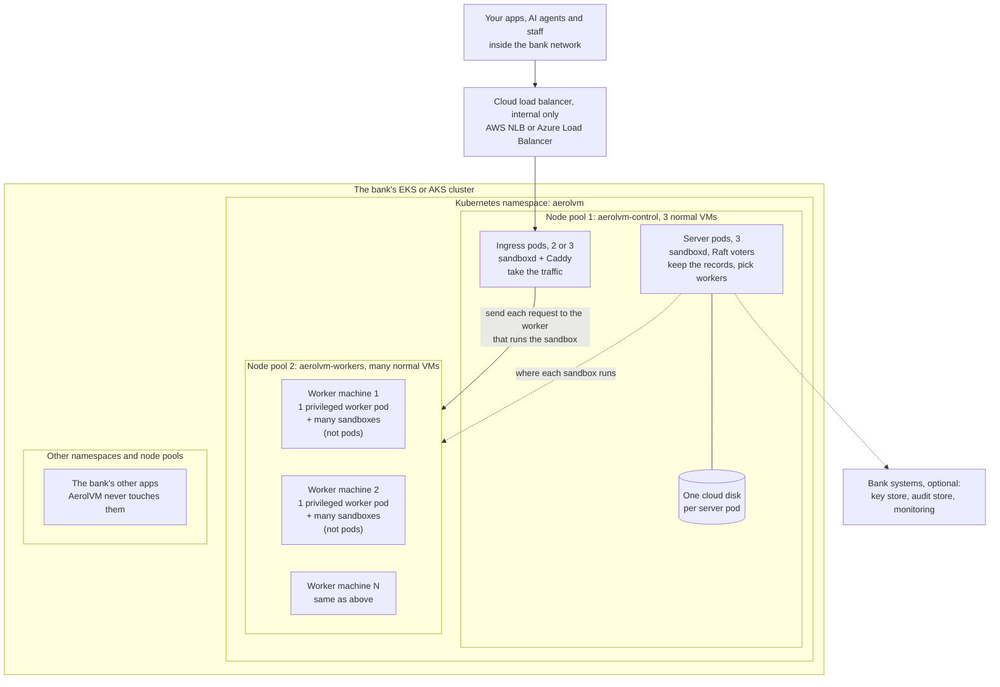

What the diagram shows, step by step:

1. **Everything AerolVM runs lives in one Kubernetes namespace**, called
   `aerolvm`. A namespace is like a folder for Kubernetes objects. The bank's
   other apps live in other namespaces.
2. **AerolVM uses two groups of machines** (Kubernetes calls a group of alike
   machines a "node pool"):
   - **aerolvm-control:** three normal VMs. They run the AerolVM pods that
     need no special rights: the server pods and the ingress pods.
   - **aerolvm-workers:** the VMs where sandboxes actually run. Each one runs
     exactly one AerolVM worker pod, and that pod has special rights.
3. **A request comes in** through the cloud load balancer. The load balancer
   is internal, so only the bank's own network can reach it.
4. **An ingress pod takes the request** and passes it to the worker machine
   that runs the sandbox in question.
5. **The server pods keep the shared records**: which sandbox runs on which
   worker. They also choose a worker for each new sandbox. There are three of
   them and they vote, so the system keeps working if one of them fails.
6. **Each worker pod starts sandboxes on its own machine.** The sandboxes are
   **not** Kubernetes pods. Kubernetes sees one AerolVM pod per worker
   machine, no matter how many sandboxes run there.
7. **The bank's other apps never share a machine** with AerolVM workers.
   Untrusted code never runs next to the bank's own apps.

If you remember one sentence, remember this one:

> **Kubernetes runs AerolVM. AerolVM runs the sandboxes.**

---

## 2. Words you need

This guide uses words from three worlds: Kubernetes, Linux, and AerolVM. Here
they all are. Come back to this table whenever a word is unclear.

### Kubernetes words

| Word | What it means |
|---|---|
| **Kubernetes** | Software that runs programs across many machines. It starts them, restarts them when they crash, and moves them when a machine dies. |
| **EKS / AKS** | Amazon's and Microsoft's managed Kubernetes. The cloud runs the Kubernetes "brain" for you. You still own the machines that run your pods. |
| **Cluster** | One Kubernetes installation: its brain plus all its machines. |
| **Node** | One machine in the cluster. On EKS and AKS, each node is a cloud VM. |
| **Node pool** | A group of alike nodes, for example "16-CPU machines for AerolVM workers". On EKS this is called a "managed node group". |
| **Container image** | A packaged program with everything it needs, ready to run. |
| **Container** | A running copy of an image, walled off from other programs. |
| **Pod** | The smallest thing Kubernetes runs. One or more containers that always run together on the same machine and share a network address. |
| **Init container** | A container in a pod that runs once, **before** the main containers start. Used for setup jobs. |
| **Sidecar** | A helper container in the same pod as the main container. |
| **Kubernetes namespace** | A folder for Kubernetes objects. Our folder is called `aerolvm`. |
| **Label** | A name tag on a node or pod, such as `aerolvm.io/pool=worker`. Used to pick things. |
| **Taint and toleration** | A taint is a "keep out" sign on a node. Only pods that carry the matching toleration (the "key") may run there. |
| **DaemonSet** | "Run exactly one copy of this pod on every node that has this label." |
| **StatefulSet** | "Run N copies of this pod. Give each one a fixed name and its own disk that follows it around." |
| **Deployment** | "Run N copies of this pod. They are all the same and can move freely." |
| **Service** | A fixed address in front of a set of pods. |
| **LoadBalancer Service** | A Service that asks the cloud for a real load balancer, so traffic from outside the cluster can reach the pods. |
| **Headless Service** | A Service that gives each pod of a StatefulSet its own DNS name, such as `aerolvm-server-0.aerolvm-server`. |
| **PersistentVolumeClaim (PVC)** | A request for a cloud disk. On EKS it becomes an EBS disk. On AKS it becomes an Azure Disk. |
| **Secret / ConfigMap** | Kubernetes objects that hold passwords and keys (Secret) or plain settings (ConfigMap). Pods read them as files or settings. |
| **Helm** | The package manager for Kubernetes. |
| **Helm chart** | A package of Kubernetes files. `helm install` creates everything in it at once. |
| **Values file** | The settings file you give to a Helm chart, for example "3 servers, workers on pool X". |
| **Probe** | A health check Kubernetes runs on a pod. **Liveness**: "is it alive? If not, restart it." **Readiness**: "is it ready for traffic? If not, stop sending it traffic." |
| **PodDisruptionBudget (PDB)** | A rule such as "never take down more than 1 of these pods at a time on purpose". |
| **PriorityClass** | How important a pod is. When a machine runs short, Kubernetes removes less important pods first. |
| **kubelet** | Kubernetes' agent on every node. It starts and stops that node's pods. |
| **kube-proxy** | A Kubernetes program on every node that writes network rules so Service addresses work. |
| **CNI plugin** | The program that gives each pod its network address. EKS uses the Amazon VPC CNI. AKS uses Azure CNI. |
| **Cluster autoscaler / Karpenter** | Programs that add machines when pods cannot fit, and remove machines that look empty. |
| **Pod Security Admission** | Kubernetes' built-in gate that blocks risky pods. Each namespace has a level: `restricted`, `baseline`, or `privileged`. |
| **Privileged pod** | A pod allowed to act like the machine's administrator (root). It can change the machine's network, start programs outside the pod, and use devices. |
| **hostNetwork** | The pod uses the **machine's** network, not a private pod network. |
| **hostPath** | A folder of the **machine** mounted into a pod. |

### Linux words

| Word | What it means |
|---|---|
| **Kernel** | The core of the operating system. Every program asks the kernel to open files, send network packets, and so on. |
| **containerd** | The program on each machine that actually runs containers. Kubernetes uses it to run pods. AerolVM uses the same containerd to run sandboxes. |
| **containerd namespace** | A separate shelf inside containerd. Kubernetes keeps its things on the `k8s.io` shelf. AerolVM keeps its sandboxes and images on the `aerolvm` shelf. Each side ignores the other's shelf. |
| **Network namespace** | A private, separate network stack. Each sandbox gets its own, so it cannot see other sandboxes' traffic. |
| **Bridge** | A virtual network switch inside a machine. AerolVM's is called `aerolvm0`. Every sandbox on the machine plugs into it. |
| **NAT** | Address translation. Sandboxes have private addresses. When they talk to the outside, the machine swaps their address for its own. |
| **iptables / nftables** | The machine's firewall rules. Kubernetes writes some. AerolVM writes others. |
| **cgroup** | A Linux "group" that limits and counts how much CPU and memory a set of programs uses. |
| **KVM (`/dev/kvm`)** | The CPU's hardware support for running virtual machines. Only needed for Firecracker. |

> **Watch out: "namespace" means three different things in this guide.**
> A **Kubernetes namespace** is a folder of Kubernetes objects (`aerolvm`).
> A **containerd namespace** is a shelf inside containerd (`aerolvm` or
> `k8s.io`). A **network namespace** is a private network for one sandbox.
> They are not related to each other. They just share a word.

### AerolVM words

| Word | What it means |
|---|---|
| **sandboxd** | The AerolVM program. One program does everything. A setting called the **role** picks which jobs it does. |
| **Sandbox** | A locked room where untrusted code runs. Your SDK creates one, runs code in it, and destroys it. |
| **Runtime** | The kind of wall around a sandbox: plain container, gVisor, WASM, V8 isolate, or Firecracker. |
| **Role** | `server`, `worker`, `ingress`, or `mixed`. Set with `SB_NODE_ROLE`. |
| **Raft** | The voting method the server nodes use to agree on shared records. |
| **Gossip** | How all AerolVM nodes keep track of who is alive. Each node regularly chats with a few others. |
| **mTLS (mutual TLS)** | Encrypted connections where **both** sides show a certificate. AerolVM nodes only talk to each other this way. |
| **Placement** | The record "sandbox X runs on worker W". Kept in Raft. |
| **Owner** | The worker that runs a sandbox. Its local database is the truth about that sandbox. |
| **Failover** | Rebuilding a sandbox on another worker when its worker dies. It is per sandbox and off by default. |
| **toolboxd** | A small helper program AerolVM puts inside every sandbox. It runs your commands and moves files. |
| **Caddy** | A web server. AerolVM uses it for HTTPS and to send traffic to the right sandbox. |
| **PAT token** | The admin password for the AerolVM API. |
| **Server key** | The key AerolVM uses to encrypt sandbox secrets. Every node in a cluster has the same one. |

---

## 3. What a sandbox is, and which kinds we use on EKS and AKS

A **sandbox** is a locked room for code you do not trust. An AI agent writes
some Python. You do not know what it will do. So you run it in a sandbox. If
the code tries something bad, it only damages the inside of its own room.

AerolVM can build that room in five ways. Each way is called a **runtime**.
They differ in how strong the walls are, how fast they start, and what they
need from the machine.

| Runtime | What it is | How strong the walls are | Start time (measured) | What it needs | Works on normal EKS/AKS VMs? |
|---|---|---|---|---|---|
| **gVisor** | A container with its own kernel in front of it | Strong | about 300 ms | The `runsc` program on the machine | **Yes** |
| **Plain container** (named `docker` in AerolVM settings) | A normal container. It shares the machine's kernel. | Medium | about 150 ms | Nothing special | Yes |
| **WASM** | A WebAssembly program run by an AerolVM helper process | Strong, but only runs WebAssembly | about 20 ms | Nothing special | Yes |
| **V8 isolate** | JavaScript run by Cloudflare's `workerd` | Strong-ish, JavaScript only | about 15 ms | The `workerd` program, root rights | Yes |
| **Firecracker** | A tiny virtual machine with its own kernel | Strongest | about 35 ms with warm pools | `/dev/kvm` | **No**, except on special machine types (section 21) |

**For the bank, gVisor is the main choice.** It runs normal Linux programs
(Python, Node, shell, anything in a container image), its walls are strong,
and it runs on any normal VM. Plain containers should be used only for code
the bank trusts. WASM and V8 isolates are optional extras. Firecracker is off,
because it needs hardware virtualization, which normal EKS and AKS VMs do
not offer.

### Why gVisor walls are strong

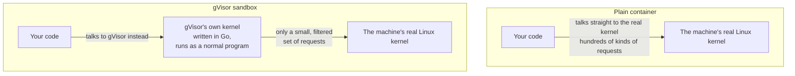

- In a **plain container**, your code talks straight to the machine's real
  kernel. The kernel is huge. If it has a bug, clever code can use that bug to
  escape the container and take over the machine.
- In **gVisor**, your code talks to **gVisor's own kernel** instead. gVisor
  answers most requests itself. It passes only a small, filtered set of
  requests on to the real kernel. So there is much less of the real kernel for
  bad code to attack.
- Google uses gVisor for its own sandbox products, such as GKE Sandbox.
- The cost: programs that do a lot of file or network work run a bit slower.
- gVisor does **not** need KVM. AerolVM runs it in gVisor's default mode,
  which works on any VM.

---

## 4. Why AerolVM keeps its own scheduler

### The worry

AerolVM already has its own "brain": server nodes that vote (Raft), a member
list (gossip), and a part that chooses a machine for each sandbox. Kubernetes
has the same kinds of parts: etcd, a member list, and a scheduler. So putting
AerolVM on Kubernetes looks like "a Kubernetes inside a Kubernetes". Is that
silly?

| Kubernetes part | What it does | The AerolVM part that does the same job |
|---|---|---|
| etcd | Keeps the shared records | Raft records on the server nodes |
| kube-scheduler | Picks a machine for each pod | Placement on the server nodes |
| kubelet | The agent on each machine that starts things | `sandboxd` on each worker |
| Pod | The thing being run | A sandbox |
| Ingress / kube-proxy | Sends traffic to the right place | Ingress nodes with Caddy |

### The answer: they schedule different things

Kubernetes was built to run **pods**. Pods are big and slow to start, and a
machine only holds a few of them. Sandboxes are small and fast, and a machine
holds many of them. Kubernetes is simply not built for things like sandboxes.

| | Kubernetes pod | AerolVM sandbox |
|---|---|---|
| Time to start | Kubernetes' own target: 99% of pods start within **5 seconds** | **15 to 300 milliseconds**, depending on the runtime |
| How many per machine | **110** by default, a few hundred at most | Many more, especially WASM and V8 isolates |
| What it can run | Containers. Virtual machines only through add-ons. | Containers, gVisor, Firecracker, WASM, V8 isolates |
| How often they change | Rarely: deploys and scaling | All the time: an agent can create one every few seconds |

An AI agent that waits 5 seconds for each sandbox is the exact problem
AerolVM exists to fix. If every sandbox had to go through Kubernetes, we would
throw that speed away.

### This is a normal pattern

Many well-known systems run their own scheduler on top of Kubernetes:

- **Ray** (used to train AI models): Kubernetes runs the Ray pods. Ray's own
  scheduler places millions of tiny tasks inside them, because Kubernetes is
  far too slow for that.
- **Spark** (big data jobs): Kubernetes starts the executor pods. Spark
  schedules the work inside them.
- **CockroachDB** (a database): it runs its own Raft voting inside a
  Kubernetes StatefulSet.

In each case, **Kubernetes looks after the machines and processes**, and the
app looks after its own small, fast work.

### So who is the boss of what?

| | Kubernetes decides | AerolVM decides |
|---|---|---|
| What | Which machines exist, and that one AerolVM pod runs on each | Which sandbox goes on which machine |
| How often it changes | Rarely: when you add machines or upgrade | All the time |
| Speed | Seconds to minutes | Milliseconds |

They do not fight, because they schedule different things. The one thing they
share is each worker machine's CPU and memory. That is why worker machines get
their own node pool, used only by AerolVM (section 8).

### Kubernetes takes over systemd's job, not AerolVM's job

The easiest way to see it: compare with how AerolVM is installed today.

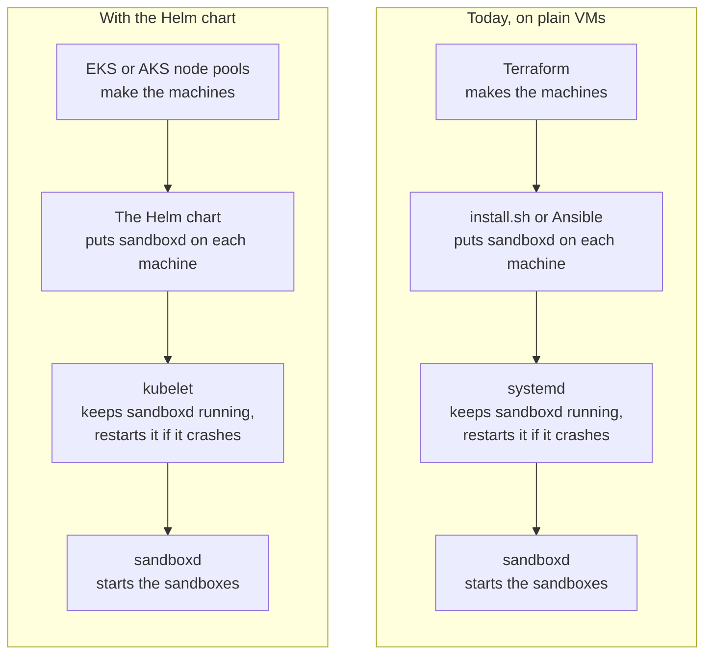

The bottom box is the **same code** in both. Kubernetes only replaces the top
three boxes: making machines, installing `sandboxd`, and keeping it running.
**Kubernetes never starts a sandbox.** `sandboxd` still does that, exactly as
today.

What we **take from Kubernetes** (so AerolVM does not have to do it):

- Making and replacing machines (node pools).
- Installing AerolVM and keeping it running (DaemonSet, StatefulSet,
  Deployment).
- Restarting it when it crashes.
- Rolling out new versions.
- The load balancer in front.
- Disks for the server nodes.
- Storing passwords and keys (Secrets).
- Proving which machine a pod runs on, for certificates (section 13).
- Collecting logs and metrics with the bank's existing tools.

What **AerolVM keeps**:

- Choosing a worker for each sandbox, in milliseconds.
- Starting, stopping, and walling off each sandbox.
- Sending traffic to the right sandbox.
- Rebuilding sandboxes when a worker dies.
- Encrypting sandbox secrets, and the audit log.

---

# Part 2: AerolVM today

## 5. What the `sandboxd` program does

AerolVM is one program, `sandboxd`, plus three small helpers. Here is what
lives inside it.

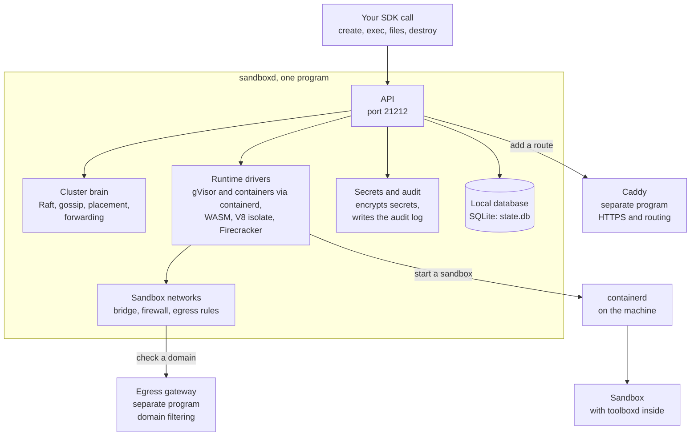

The parts, one by one:

- **API (port 21212):** where SDK calls arrive. Every role serves the API.
- **Cluster brain:** voting (Raft), the member list (gossip), choosing
  workers (placement), and passing calls to the right node (forwarding).
- **Runtime drivers:** the code that actually builds sandboxes. For gVisor
  and plain containers, it asks the machine's **containerd** to do the work.
- **Sandbox networks:** gives each sandbox a private network, firewall rules,
  and rules about which websites it may reach.
- **Secrets and audit:** encrypts the secrets you give a sandbox, and writes a
  tamper-evident log of who did what.
- **Local database (`state.db`):** each node's own records, in SQLite.

The three helper programs:

- **Caddy:** a separate web server. `sandboxd` tells it about new routes
  through Caddy's admin port (`127.0.0.1:2019`, reachable only from the same
  machine or pod). Caddy holds the HTTPS certificates.
- **Egress gateway:** a separate small program that checks which domains a
  sandbox may reach. Today systemd starts it on demand. `sandboxd` talks to it
  through a file socket in `/run/aerolvm/`.
- **toolboxd:** a tiny program placed inside each sandbox. It runs your
  commands, moves files, and streams output back.

---

## 6. The three roles

In a cluster, each `sandboxd` gets a role with the setting `SB_NODE_ROLE`.

| Role | What it does | Holds the Raft records? | Runs sandboxes? | Takes public traffic? |
|---|---|---|---|---|
| **server** | Votes, keeps the record of where every sandbox runs, picks a worker for each new sandbox | **Yes** | No | No |
| **worker** | Runs sandboxes on its machine | No. It asks the servers. | **Yes** | No |
| **ingress** | Holds the route table, sends visitors and API calls to the right worker, runs the SSH gateway | No. It asks the servers. | No | **Yes** |
| **mixed** | All three jobs at once | Yes | Yes | Yes |

Rules from the code:

- Cluster mode is on only when `SB_ENABLE_CLUSTER=true`.
- **Every role serves the API.** Any node can take any call and pass it to
  the right one.
- At most **5 servers vote**. A cluster may have at most **7 server nodes**;
  the extra two are spares for replacing a server.
- A **mixed** cluster may have at most **10 nodes**. Above that you must split
  the roles. The split is called a **hetero cluster**, and it is what this
  guide uses.
- With more than 10 ingress nodes, each ingress node only holds part of the
  route table, and a smarter router is needed in front. We will not need that
  at first.

### The ports

| Port | What uses it | Who talks on it |
|---|---|---|
| **21212** | The AerolVM API (plain HTTP) | Your SDK, and Caddy on the same node |
| **7000** | Raft voting (mTLS) | Servers with each other |
| **7001** | Gossip, the "who is alive" chat (TCP and UDP) | Every node with every node |
| **7002** | Internal calls between nodes (mTLS): passing a call to a sandbox's owner, asking the servers things | Every node with every node |
| **2019** | Caddy's admin port | Only `sandboxd` on the same node |
| **443** | HTTPS: sandbox links and the API from outside | Visitors and SDKs, through the load balancer |
| **22000 to 23000** | Shared TCP ports for sandboxes that expose raw TCP | Visitors |
| **2220** | SSH gateway into sandboxes | Users with SSH keys |

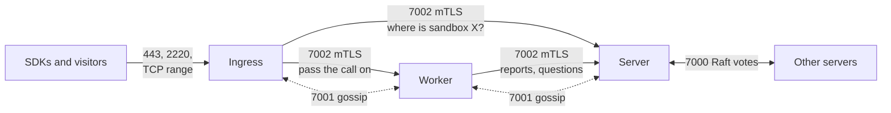

---

## 7. How a cluster holds together

This section explains the cluster brain in plain words. You need it to
understand what happens on Kubernetes when pods restart or machines die.

### Raft: three clerks who must agree

Think of the server nodes as three clerks who keep one shared ledger. Every
change, such as "sandbox X now runs on worker W", needs a **majority** to
agree before it is written.

- With **3 servers**, a majority is 2. The cluster survives **1** dead server.
- With **5 servers**, a majority is 3. The cluster survives **2** dead
  servers.
- If too many servers die and there is no majority, **no new changes** can be
  written. Running sandboxes keep running, but new sandboxes cannot be made.

One clerk at a time is the **leader**. The leader writes changes, and the
others copy them. If the leader dies, the others choose a new leader within a
few seconds.

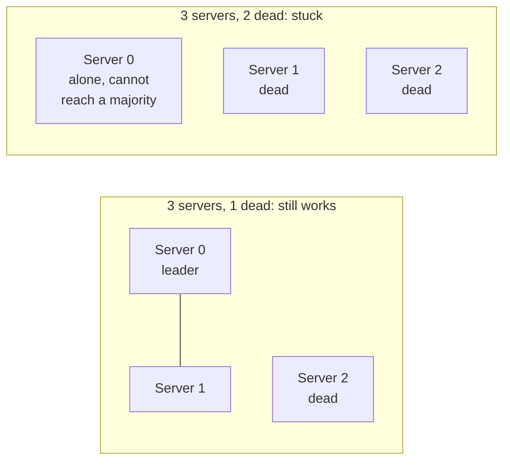

### Gossip: "I'm still here"

Every node regularly chats with a few random other nodes: "I'm alive, and
here's who I've heard from." News spreads quickly through the whole cluster
this way. When a node goes quiet, the others first suspect it, then declare it
dead.

When a node shuts down **cleanly**, it tells the others "I'm leaving". This
matters on Kubernetes. See "the 30-second rule" below.

### Capacity: how full is each worker?

Every 5 seconds, the servers ask each worker how much CPU, memory and disk it
has free, and which runtimes it can run (`SB_HOST_RUNTIMES`). A report is
trusted for at least 15 seconds. A worker with no fresh report gets no new
sandboxes.

### Placement: choosing a worker

When a new sandbox is requested:

1. **Filter.** Keep only workers that are alive, have a fresh report, are not
   drained, can run the requested runtime, and have room.
2. **Pick two at random.** Then choose the one with more free room. This
   simple trick spreads sandboxes evenly, and it is fast.
3. **Reserve.** Write "sandbox X is going to worker W" into Raft. The
   reservation lasts 120 seconds, in case the create fails half-way.

### Owners and forwarding

The worker that runs a sandbox is its **owner**. The owner's own database is
the truth about that sandbox. Raft only stores **which** worker owns it.

Any node can take any API call. If the call is about a sandbox on another
worker, the node looks up the owner and passes the call to it on port 7002.
The connection is checked: it must reach a node whose certificate says
`node:<owner-id>`, or it fails.

### When a worker dies: the 30-second rule

1. Gossip notices the worker is gone, or the worker said "I'm leaving".
2. A timer starts: **30 seconds** (`SB_DEAD_OWNER_GRACE`).
3. If the worker comes back in time, the timer is cancelled. Nothing moves.
4. If not, the leader acts on each of the dead worker's sandboxes:
   - Sandboxes created with **failover `recreate`** are rebuilt on another
     worker, with the **same ID, ports and link**. The new worker checks
     every 5 seconds whether it should rebuild something. The sandbox's
     secrets come from sealed copies on 2 backup nodes.
   - Sandboxes **without failover** (the default) become **orphans**. Calls
     to them answer `410 Gone`.
5. The dead worker is removed from the cluster.

Important: failover **rebuilds** a sandbox. It does not save what was in its
memory, and files written inside the old sandbox are gone unless they were
stored outside it.

### Joining the cluster

A new node needs four things before it can join:

1. **Seed addresses** (`SB_BOOTSTRAP_PEERS`): where to find the cluster.
2. **A certificate** signed by the cluster's own certificate authority (CA).
   It must carry the name `node:<its node ID>`, and that ID must match its
   `SB_NODE_ID` setting.
3. **The gossip key** (`SB_GOSSIP_SECRET_KEY`), so it can join the chat.
4. **The server key**, the same one every node has, so it can open sealed
   secrets.

The very first server starts the cluster with `SB_CLUSTER_BOOTSTRAP=true`.
All later nodes join the existing one.

---

# Part 3: The design on Kubernetes

## 8. The machines: node pools

AerolVM gets **two node pools of its own**. A third one is optional.

| Node pool | Machines | What runs there | "Keep out" sign (taint) | Special rights? |
|---|---|---|---|---|
| **aerolvm-control** | 3 normal VMs, one in each availability zone | 3 server pods and 2 or 3 ingress pods | `aerolvm.io/control` | No |
| **aerolvm-workers** | As many normal VMs as you need, with lots of CPU and memory | One worker pod per machine, and all the sandboxes | `aerolvm.io/worker` | **Yes**, the worker pod is privileged |
| aerolvm-metal (optional, later) | EKS `.metal` machines | Workers that also run Firecracker | `aerolvm.io/metal` | Yes |

The bank's own **system node pool**, where Kubernetes' own add-ons run, stays
as it is.

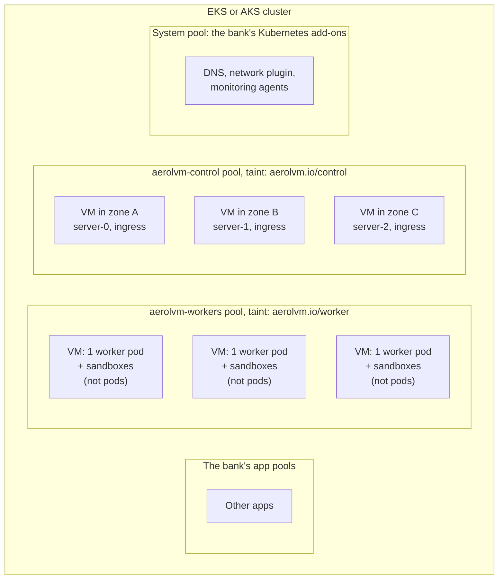

### Why separate pools?

1. **To contain the privileged pod.** The worker pod has administrator rights
   on its machine. Only AerolVM runs on those machines, so even in the worst
   case, nothing else of value is there.
2. **Because Kubernetes cannot see the sandboxes.** Sandboxes use the
   machine's CPU and memory, but they are not pods, so Kubernetes does not
   count them. If the bank's other pods landed on the same machine, they
   would fight with the sandboxes for memory, and Kubernetes would not
   understand why the machine is full.
3. **To keep untrusted code away from the bank's apps.** Even a sandbox that
   somehow broke out would find only AerolVM on its machine.

### How the "keep out" signs work

- Each AerolVM pool gets a **taint**, a "keep out" sign. Normal pods cannot
  land there.
- AerolVM's pods carry the matching **toleration**, the key that lets them in.
- AerolVM's pods also carry a **node selector**, so they go **only** to their
  own pool and never to the bank's app machines.

### Machine sizes

Worker machines should be big, because each one holds many sandboxes and
there is a fixed cost per machine (Kubernetes' own agents, the network
plugin, log and security agents). A starting point to confirm by testing: 16
to 64 CPUs, with 4 to 8 GB of memory per CPU, and a large local disk (200 GB
or more) for sandbox images and files.

**Use normal, on-demand machines for workers, not spot machines.** A spot
machine can be taken away by the cloud with two minutes' warning, and every
sandbox on it would die. The same goes for the control pool, which holds the
Raft voters.

### Telling AerolVM how big the machine is

Inside a pod, `sandboxd` reads the **whole machine's** CPU count and memory.
It does not know that kubelet, the network plugin and other agents also need
some. So the chart **must** set these settings on each worker:

- `SB_HOST_CPU_CORES`
- `SB_HOST_MEMORY_MB`
- `SB_HOST_DISK_GB`

A simple rule: **machine size, minus what Kubernetes reserves for itself,
minus the other agents on the machine, minus a safety margin.** These
settings already exist. No code change is needed.

---

## 9. The server pods (StatefulSet)

### What they are

Three pods, named `aerolvm-server-0`, `aerolvm-server-1` and
`aerolvm-server-2`. Each runs `sandboxd` with `SB_NODE_ROLE=server`. Together
they are the cluster's brain: they vote, keep the placement records, and pick
workers. They run **no sandboxes**.

### Why a StatefulSet

Servers need two things that only a StatefulSet gives:

1. **A fixed name.** `aerolvm-server-1` stays `aerolvm-server-1` even after it
   restarts on another machine. Raft needs stable members.
2. **Its own disk that follows it.** The Raft records must survive a restart.
   A StatefulSet gives each pod its own cloud disk (a PVC). If the pod moves,
   the disk moves with it.

### What is on each server's disk

The disk is mounted at `/var/lib/sandboxd`. It holds:

- `state.db`: the node's local SQLite database.
- `raft/`: the Raft log (the list of every change), the last 3 snapshots, and
  sealed recovery records for failover.
- `gossip-peers.json`: a list of known nodes, so a restarted server can find
  the cluster again.

On EKS the disk is an **EBS gp3** volume. On AKS it is an **Azure Premium SSD**
disk. A size of 20 to 50 GB is a starting point to confirm by testing.

### Spreading across zones

Cloud disks live in **one availability zone**. A pod can only use its disk in
that zone. So the chart places the three servers in **three different zones**.
If a whole zone goes down, two servers survive, which is still a majority.

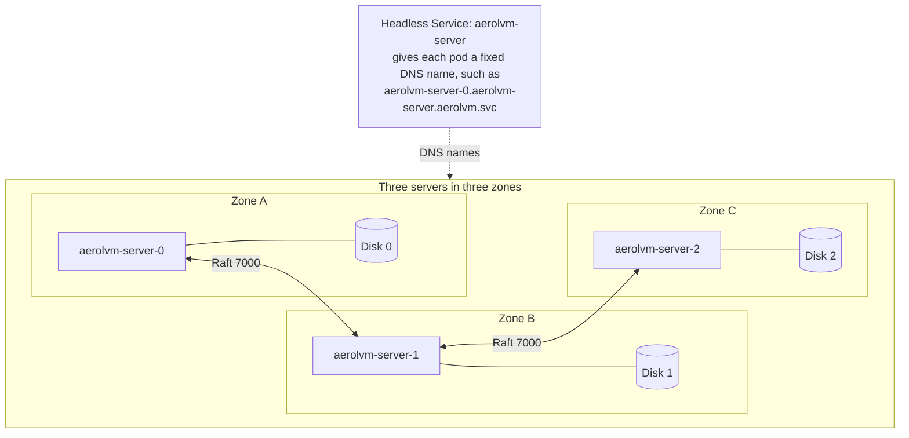

All three servers talk to each other on port 7000. The picture shows two of
those links to keep it readable.

### How the servers start for the first time

1. `aerolvm-server-0` starts first, with `SB_CLUSTER_BOOTSTRAP=true`. It
   creates the cluster and becomes the leader.
2. `aerolvm-server-1` and `aerolvm-server-2` start with
   `SB_BOOTSTRAP_PEERS` pointing at server-0's DNS name. They join and become
   voters.
3. From then on, all three are equal. Any of them can become the leader.

### Other settings

- **PodDisruptionBudget:** at most 1 server down on purpose at any time, so
  the cluster always keeps its majority during upgrades.
- **PriorityClass:** high, so Kubernetes removes other pods before a server.
- **No special rights wanted.** Servers run no sandboxes, so they should run as
  normal, locked-down pods. **To check:** today `sandboxd` may still try to
  set up machine firewall rules and talk to Docker when it starts, whatever
  its role. If so, a small code change must skip that work for the server and
  ingress roles.

### A problem to fix: Raft remembers IP numbers

When a server starts, it tells the others its address. Today, the code turns
that address into an **IP number** at start-up (`internal/cluster/raft.go`),
and Raft stores the IP number.

On Kubernetes, a pod gets a **new IP number** every time it moves to another
machine. The DNS name (`aerolvm-server-1.aerolvm-server...`) stays the same,
but the IP changes. So after a server pod moves, the other servers may keep
calling its **old** IP number.

Two ways to fix it, to decide in engineering review:

- **Better:** let Raft store the DNS name and look it up again each time it
  connects. The Raft library supports this through an "address provider".
- **Or:** prove with a test that a server which comes back with a new IP
  updates its address in Raft by itself, and add that test to the suite.

Until this is fixed or proven, a server pod that moves to another machine is
a risk.

---

## 10. The worker pods (DaemonSet): the most important part

### What they are

One worker pod on **every machine** in the `aerolvm-workers` pool. Each runs
`sandboxd` with `SB_NODE_ROLE=worker`, and it builds sandboxes on that one
machine. When you add a machine to the pool, Kubernetes puts a worker pod on
it by itself. When you remove a machine, its worker pod goes with it.

### Why a DaemonSet

A worker must live on the machine whose sandboxes it runs. "Exactly one pod
on every machine with this label" is exactly what a DaemonSet does.

Each worker uses the **machine's name** as its AerolVM node ID
(`SB_NODE_ID` = the Kubernetes node name). The pod's own name changes when it
is recreated, but the machine's name does not. So a restarted worker pod is
the **same** worker to the cluster, and it keeps its sandboxes.

### One worker machine, up close

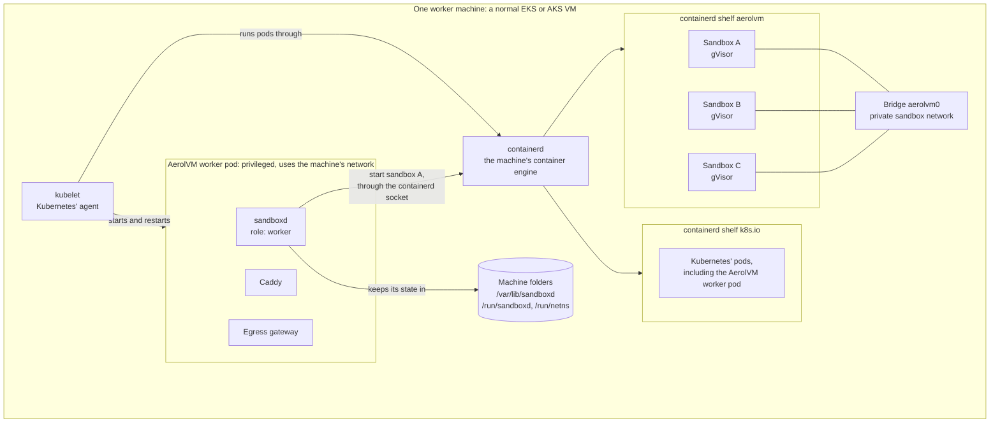

Read it like this:

- **kubelet** (Kubernetes' agent) starts the AerolVM worker pod and restarts
  it if it crashes. That is all Kubernetes does here.
- The **worker pod** has three containers: `sandboxd`, Caddy, and the egress
  gateway. They share the machine's network.
- `sandboxd` asks the **machine's containerd** to start each sandbox. It does
  this through containerd's socket file, which is mounted into the pod.
- containerd keeps Kubernetes' pods on the `k8s.io` shelf and AerolVM's
  sandboxes on the `aerolvm` shelf. Kubernetes never cleans up or touches
  AerolVM's shelf, and AerolVM never touches Kubernetes' shelf.
- Every sandbox plugs into AerolVM's private bridge, `aerolvm0`. That network
  exists only inside this machine.
- `sandboxd` keeps its database and files in **folders on the machine**, not
  inside the pod, so they survive a pod restart.

**Nothing in the "aerolvm" shelf is a pod.** If you run
`kubectl get pods -n aerolvm`, you see one worker pod per machine. You do not
see the sandboxes.

### What is inside the worker pod

| Part | Kind | What it does |
|---|---|---|
| `install-host-files` | Init container (runs once, first) | Copies `toolboxd`, `runsc` and the gVisor shim from the image onto the machine (section "Why paths must match" below) |
| `get-certificate` | Init container | Gets this worker's cluster certificate (section 13) |
| `sandboxd` | Main container | The worker itself |
| `caddy` | Sidecar | Sends traffic that arrives at this machine into the right sandbox |
| `egress-gateway` | Sidecar | Checks which domains each sandbox may reach |

**To check:** today systemd starts the egress gateway on demand
(socket activation). In a pod there is no systemd. The gateway may need a
small change so it can open its own socket in `/run/aerolvm/`.

### Every special right the worker pod needs, and why

This is the list the bank's security team approved. Each right has a reason.

| What the pod gets | Why `sandboxd` needs it |
|---|---|
| **privileged: true** | To build sandbox networks (network namespaces, the bridge, firewall rules) and to set limits on sandbox processes. These are administrator actions on the machine. |
| **hostNetwork: true** | Sandbox networks live in the machine's network. Caddy must reach sandbox addresses on the bridge. Other AerolVM nodes reach this worker at the machine's address. |
| **hostPID: true** | To see sandbox processes on the machine. Needed to take back V8 isolate and Firecracker sandboxes after a restart. **To check:** it may not be needed if only gVisor and plain containers are used. |
| containerd socket `/run/containerd/containerd.sock` | To ask the machine's containerd to start and stop sandboxes |
| Machine folder `/var/lib/sandboxd` | The database, keys, per-sandbox files, logs and storage mounts. It must survive a pod restart. Shared both ways (`Bidirectional`) so storage mounts made by `sandboxd` are seen by containerd. |
| Machine folder `/run/sandboxd` | Small "ready" signal files and records of running VMs |
| Machine folder `/run/netns` | Each sandbox's private network is a file here. Shared both ways so containerd sees the networks `sandboxd` creates. |
| Machine folder `/run/aerolvm` | Sockets for the egress gateway |
| Machine folder `/sys/fs/cgroup` | Only for V8 isolates and Firecracker: their process groups must sit **outside** the pod, so they survive a pod restart |
| Machine folder `/usr/local/bin` | Only for the init container: to place `runsc` and the gVisor shim where the machine's containerd looks for them |
| `/dev/kvm` | Only on the optional metal pool, for Firecracker |

### Why paths must match inside and outside the pod

This is the trickiest idea in the whole design, so here it is slowly.

`sandboxd` runs **inside** the pod. containerd runs **outside** the pod, on
the machine. When `sandboxd` says to containerd "start a sandbox, and put
the file `/var/lib/sandboxd/containerd/hosts/abc/resolv.conf` inside it",
containerd looks for that file **on the machine**, not inside the pod.

So every file that `sandboxd` hands to containerd must exist on the machine,
at the same path. That is why:

- The pod mounts the machine's `/var/lib/sandboxd` at the **same** path
  inside the pod.
- `toolboxd` (the helper that goes into every sandbox) must be copied **onto
  the machine**, for example to `/var/lib/sandboxd/bin/toolboxd`. The chart
  sets `SB_TOOLBOX_BINARY_PATH` to that path. Today the default path points
  next to `sandboxd` itself, which would be inside the pod image, where
  containerd cannot see it.
- `runsc` and its containerd shim (`containerd-shim-runsc-v1`) must be on the
  machine where containerd looks for programs, which is `/usr/local/bin`. This
  is the same place `install.sh --with-gvisor` puts them today. The init
  container copies them there.

### Settings the chart must set on workers

Some of AerolVM's defaults fit a plain server, not Kubernetes. The chart sets
these on every worker:

| Setting | Value | Why |
|---|---|---|
| `SB_ENABLE_CLUSTER` | `true` | Cluster mode |
| `SB_NODE_ROLE` | `worker` | Its job |
| `SB_NODE_ID` | the Kubernetes node name | Stable across pod restarts |
| `SB_CONTAINER_ENGINE` | `containerd` | The code default is `docker`, and EKS/AKS machines have no Docker |
| `SB_CONTAINERD_NATIVE_NETNS_POOL_ENABLED` | `true` | Turns on sandbox networks for containerd. `install.sh` sets it today; the code default is off. |
| `SB_CONTAINERD_CNI_CONF_PATH` | a path under `/var/lib/sandboxd/` | Keeps AerolVM's network file out of Kubernetes' network folder (see "the network file trap") |
| `SB_HOST_RUNTIMES` | `gvisor` (add `docker` only if plain containers are allowed) | Which runtimes this worker offers |
| `SB_HOST_CPU_CORES`, `SB_HOST_MEMORY_MB`, `SB_HOST_DISK_GB` | from the machine size | `sandboxd` cannot work out its fair share from inside a pod |
| `SB_TOOLBOX_BINARY_PATH` | `/var/lib/sandboxd/bin/toolboxd` | containerd must be able to see it |
| `SB_DATA_PLANE_ADVERTISE_HOST` | the machine's IP address | Where ingress nodes send this worker's traffic |
| `SB_DEAD_OWNER_GRACE` | for example `90s` | See "the 30-second rule on Kubernetes" |

### Three traps on Kubernetes, and how we avoid them

**Trap 1: the network file.** By default, AerolVM writes its sandbox network
settings to `/etc/cni/net.d/aerolvm.conflist`. But `/etc/cni/net.d` is the
folder the machine's containerd reads to set up **Kubernetes pod** networks,
and it uses the **first** file by name. Today the cloud's own file
(`10-aws.conflist` or `10-azure.conflist`) sorts first, so it would probably
work, but that is luck. **Fix:** the chart sets `SB_CONTAINERD_CNI_CONF_PATH`
to a private path. The setting already exists. No code change.

**Trap 2: the sandbox address range.** Sandboxes on each machine get private
addresses from **10.88.0.0/16**. This range is **fixed in the code**
(`internal/network/cni/conflist.go`). Banks use many `10.x` ranges. If the
bank's VPC (on AWS) or VNet (on Azure), or its pod network, uses any address
in 10.88.0.0/16, the machine's routing breaks and pods or sandboxes on it
cannot reach those addresses. **Fix:** a code change to make the range a
setting, so the chart can pick a range the bank does not use. The Firecracker
range is already a setting (`SB_FIRECRACKER_TAP_BASE_CIDR`).

**Trap 3: the Docker check.** `sandboxd` always checks Docker, even when it
uses containerd. On EKS and AKS machines there is no Docker, so `/health`
would always report "degraded". It still answers "200 OK", so Kubernetes
would not restart the pod, but the report would be wrong and would hide real
problems. **Fix:** a small code change to skip the Docker check when the
engine is containerd. We must also confirm that `sandboxd` starts at all
without Docker present.

### How sandboxes survive a worker pod restart

Kubernetes restarts pods for many reasons: a crash, an upgrade, a settings
change. The sandboxes must keep running. Here is why they do:

- **gVisor and plain-container sandboxes belong to the machine's containerd**,
  not to `sandboxd`. When the worker pod stops, containerd keeps them running.
  They do not notice.
- **The sandbox networks** are files in the machine's `/run/netns`. They stay.
- **The database** is in the machine's `/var/lib/sandboxd`. It stays.
- **The new `sandboxd`** starts, reads its database, finds its sandboxes, and
  carries on.
- **V8 isolates and Firecracker VMs** are moved into their own process groups
  at the **machine's** top level (`aerolvm-isolate`, `aerolvm-vmm`). This only
  works if the pod mounts the machine's `/sys/fs/cgroup`. Without that mount,
  these groups would sit inside the pod, and a pod restart would kill them.

### The 30-second rule on Kubernetes

When `sandboxd` stops cleanly, it tells the cluster "I'm leaving". That
starts the 30-second timer from section 7. If the new worker pod is not back
within 30 seconds, the servers declare the worker dead. Then they move its
failover sandboxes elsewhere and orphan the rest, **even though they are
still running fine on the machine**.

A pod restart on Kubernetes can take longer than 30 seconds, for example if
the new image must be downloaded first. So:

- **Download the image first.** The chart pre-pulls the new image on every
  worker before the upgrade starts.
- **Give more time.** Set `SB_DEAD_OWNER_GRACE` to about 90 seconds on
  Kubernetes. The cost: when a machine really dies, its failover sandboxes
  are rebuilt about one minute later than today.
- **Test it.** The test suite must restart a worker pod and check that every
  sandbox is still there and was not moved (section 26).

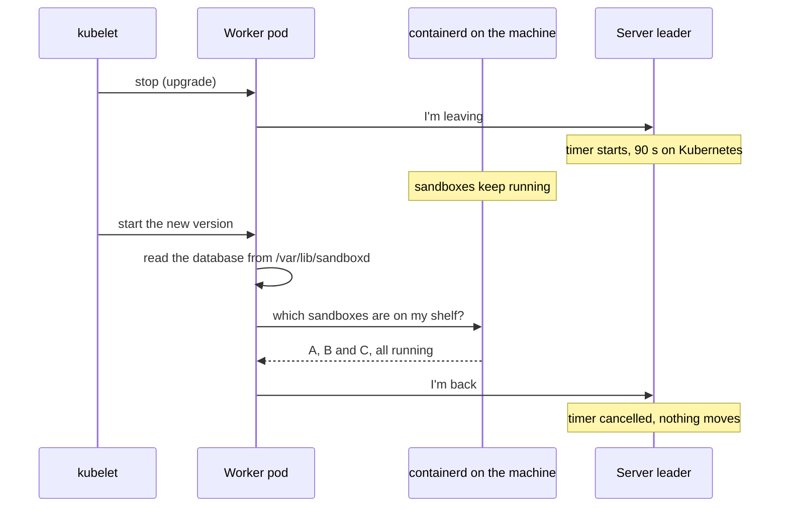

### Kubernetes cannot see the sandboxes' CPU and memory

Kubernetes keeps track of how much CPU and memory each **pod** uses.
Sandboxes are not pods, so Kubernetes does not count them. It does see that
the **machine** is busy. If the machine runs very low on memory, kubelet
starts removing pods to save it, beginning with the least important ones.

We protect against that in three ways:

1. **Only AerolVM runs on worker machines** (the taint from section 8), so
   there are no unimportant pods to fight with.
2. **`SB_HOST_MEMORY_MB` is set well below the machine's memory**, so AerolVM
   never fills the machine to the top.
3. **The worker pod gets the highest PriorityClass**
   (`system-node-critical`), so it is the very last pod kubelet would remove.

Disk is similar. Sandbox images are stored in the machine's containerd, on
AerolVM's shelf. Kubernetes' image clean-up only looks at its own shelf, so
**AerolVM must clean up its own old images**, and worker machines need big
disks.

---

## 11. The ingress pods and the load balancer

### What they are

Two or three pods, run as a **Deployment**, each with `sandboxd`
(`SB_NODE_ROLE=ingress`) and a Caddy sidecar. They are the front door. They
hold no important data, so Kubernetes can move them freely. They need no
special rights.

### The load balancer

A **LoadBalancer Service** in front of the ingress pods asks the cloud for a
real load balancer:

- **EKS:** the AWS Load Balancer Controller creates an **AWS Network Load
  Balancer**. The chart marks it as **internal**, so it has no public address.
- **AKS:** Azure creates a **Standard Load Balancer**. The chart marks it as
  internal in the same way.

It carries:

| Port | Use |
|---|---|
| 443 | HTTPS for the AerolVM API and for sandbox links |
| 2220 | SSH into sandboxes (only if the bank wants it) |
| A small TCP range | Raw TCP ports that sandboxes expose (see below) |

Apps that run **inside** the same Kubernetes cluster do not need the load
balancer. They can call the API through a normal Service, for example
`http://aerolvm-api.aerolvm.svc:21212`.

### Raw TCP ports need a smaller range

Today AerolVM reserves ports 22000 to 23000, so up to 1,000 sandboxes can each
expose one raw TCP port. A cloud load balancer cannot sensibly carry 1,000
ports: an AWS Network Load Balancer allows 50 listeners by default. On
Kubernetes we should:

- Use **HTTPS on port 443** for almost everything. AerolVM can already route
  TLS traffic by the name the client asks for, so many sandboxes share one
  port.
- Keep only a **small raw TCP range**, if the bank needs one at all.

### How a visitor reaches a sandbox

Each ingress pod keeps a **route table**: "sandbox X's link goes to worker W".
It learns this from the servers, either every 5 seconds or from a live change
feed (`SB_INGRESS_PROXY_ROUTING`). It writes the routes into its Caddy.

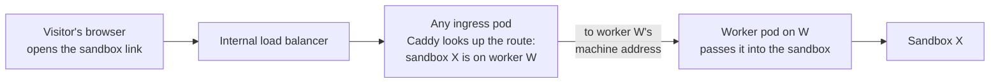

Because workers use the machine's network, ingress pods reach a worker at
**the worker machine's own IP address**. So the cloud firewall rules
(security groups on AWS, network security groups on Azure) must let the
control pool reach the worker pool on the needed ports.

### HTTPS certificates

Each sandbox link looks like `https://<sandbox>.<domain>`. To serve all of
them, Caddy needs a **wildcard certificate**, one certificate for
`*.<domain>`.

How AerolVM gets that certificate today:

- Caddy asks **Let's Encrypt**, or any other ACME certificate service
  (`SB_TLS_ACME_CA` can point at a bank's own ACME service).
- To prove it owns the domain, Caddy writes a record into DNS. The only DNS
  provider built in today is **Cloudflare**.

Banks usually use their own certificate authority, and Route 53, Azure DNS,
or internal DNS. Three ways to handle that on Kubernetes:

| Option | How it works | Work needed |
|---|---|---|
| **A. cert-manager (recommended)** | The bank's cert-manager gets the wildcard certificate from the bank's CA and stores it as a Kubernetes Secret. The chart mounts it into Caddy, and Caddy's settings point at those files. | Chart work. Caddy's base settings come from a template the installer fills today, so the chart can write a version that uses the files. To confirm when we build it. |
| B. Add DNS plugins | Build Caddy with the Route 53 and Azure DNS plugins | A change to our Caddy build |
| C. Bank's ACME service | Point `SB_TLS_ACME_CA` at it | Only if the bank runs ACME, and DNS still has to work |

---

## 12. Security: what the bank approved, and the walls around it

### What "privileged" really means

Honesty first. A privileged pod is **as powerful as the machine's
administrator**. If an attacker took over the **worker pod itself** (not a
sandbox, the worker pod), they would control that worker machine. That is
why the bank had to approve it, and why the design surrounds it with walls.

Note that this is the same kind of approval banks already give to other
software on every machine: the network plugin, storage drivers, and security
agents such as Microsoft Defender, CrowdStrike or Datadog all run as
privileged pods.

### The walls, from outside in

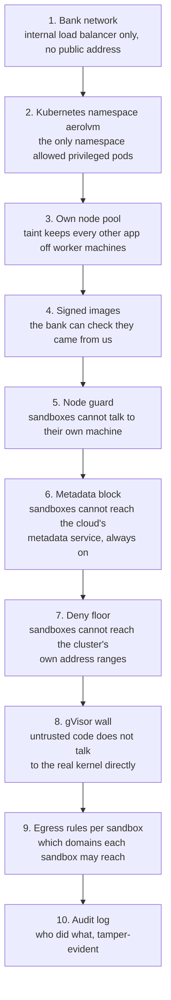

Each wall in plain words:

1. **Bank network.** The load balancer is internal. Only the bank's network
   can reach AerolVM.
2. **Namespace.** Kubernetes' Pod Security Admission allows privileged pods
   only in the `aerolvm` namespace (label
   `pod-security.kubernetes.io/enforce: privileged`). If the bank also uses a
   policy tool (Azure Policy on AKS, Gatekeeper or Kyverno on EKS), it gets a
   matching exception for this one namespace.
3. **Own node pool.** Worker machines run nothing but AerolVM.
4. **Signed images.** The plan signs every image and the chart (cosign), and
   publishes a list of everything inside (an SBOM). The bank's cluster can
   refuse any image that is not signed by us.
5. **Node guard.** AerolVM's firewall drops traffic from sandboxes to their
   own machine, except a short allow-list. A sandbox cannot reach kubelet or
   other programs on the machine. This exists today.
6. **Metadata block.** Clouds run a "metadata service" that hands out the
   machine's cloud credentials. AerolVM always blocks sandboxes from it,
   including the AWS addresses for EKS Pod Identity and Azure's WireServer.
   This exists today (`pkg/egresspolicy/metadata.go`).
7. **Deny floor.** A list of address ranges no sandbox may ever reach,
   whatever its own rules say. AerolVM supports this through an operator
   egress file (`SB_EGRESS_OPERATOR_FILE`). The chart fills it with the
   cluster's own ranges: the VPC or VNet, the pod range, and the Service
   range. Then a sandbox cannot reach other pods, other Services, or the
   Kubernetes API. **This must be set and tested before go-live** (section
   26). A bank will want a firm "no" here.
8. **gVisor.** Even if code is evil, it talks to gVisor's kernel, not the
   machine's real kernel (section 3).
9. **Egress rules.** Each sandbox can be limited to a list of domains, for
   example "only pypi.org". This exists today.
10. **Audit log.** Every action is recorded, and the log can be shipped off
    the machines (section 15).

### Keep the worker machines' cloud identity small

Each cloud machine has a cloud identity (an IAM role on AWS, a managed
identity on Azure). Give worker machines the **smallest** identity possible:
enough to join the cluster and pull images, nothing more. If AerolVM itself
needs cloud rights (for example to use AWS KMS), give them to the AerolVM
pod through **EKS Pod Identity** or **AKS Workload Identity**, not to the
machine.

---

## 13. Identity: certificates, keys and passwords

### The secrets AerolVM needs

| Secret | What it is for | Same on every node? | Where it lives on Kubernetes |
|---|---|---|---|
| **PAT token** | The admin password for the API | Yes | Kubernetes Secret |
| **Server key** | Encrypts sandbox secrets | Yes | Kubernetes Secret, or better, wrapped by a key store (below) |
| **Gossip key** | Encrypts the "who is alive" chat | Yes | Kubernetes Secret |
| **Cluster CA certificate** | Lets nodes check each other's certificates | Yes | Kubernetes Secret or ConfigMap (public part only) |
| **Node certificate and key** | Proves "I am node X" | **No**, one per node | Made for each pod at start (below) |
| **HTTPS wildcard certificate** | Sandbox links and the API | Yes | Kubernetes Secret, from cert-manager |

Both EKS and AKS can encrypt Kubernetes Secrets with a cloud key (AWS KMS on
EKS, Azure Key Vault on AKS). The bank can also keep the real values in AWS
Secrets Manager or Azure Key Vault and copy them in with a tool such as the
External Secrets Operator.

### The key store

AerolVM can keep its server key **wrapped** by a key store, so no plain copy
of it sits on any disk (`SB_CREDENTIAL_KEY_CUSTODY=wrapped`). The key stores
it supports today (`SB_SECRET_PROVIDER`):

- **AWS KMS** (`awskms`): the natural choice on EKS.
- **HashiCorp Vault or OpenBao** (`vault`).
- **An HSM** through PKCS#11 (`pkcs11`).

**Azure Key Vault is not supported yet.** On AKS, the bank would use Vault,
OpenBao or an HSM, or we add an Azure Key Vault provider (section 22).

### Node certificates: how a pod proves who it is

AerolVM nodes only trust each other through certificates. Each node's
certificate must say `node:<its node ID>`. On Kubernetes, a new pod must get
one before it can join. We must not let a fake pod get a certificate for a
node it is not.

The plan's answer is a small program, the **aerolvm-controller**, that signs
certificates. Its one rule: **a pod only gets a certificate for the machine
it really runs on, and Kubernetes itself vouches for that.**

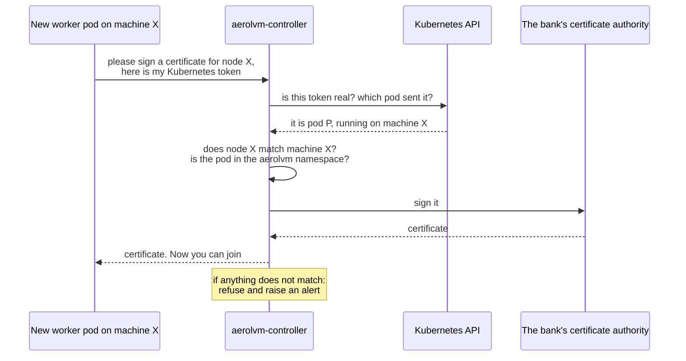

- For **workers**, the ID is the machine name.
- For **servers and ingress pods**, the ID is the pod's fixed name.
- The key that signs certificates stays **outside** the cluster, in the bank's
  certificate authority (Vault, AWS Private CA, or the bank's own PKI).
- Certificates reload by themselves when renewed. No restart is needed. This
  exists today (`internal/cluster/tls.go`).

---

## 14. Storage: what lives where, and what is lost when

| Data | Where it lives | Survives a pod restart? | Survives the machine being replaced? |
|---|---|---|---|
| Server: Raft records and database | The server's cloud disk (PVC) | Yes | **Yes**, the disk is re-attached to the new machine |
| Worker: database, keys, per-sandbox files | The worker machine's `/var/lib/sandboxd` | Yes | **No**, a new machine starts empty |
| Sandbox contents (files written inside) | The worker machine's containerd | Yes | **No** |
| Sandbox images (cache) | The worker machine's containerd | Yes | No, they are downloaded again |
| Audit log | Local file, then shipped out | Yes | Only what was already shipped |

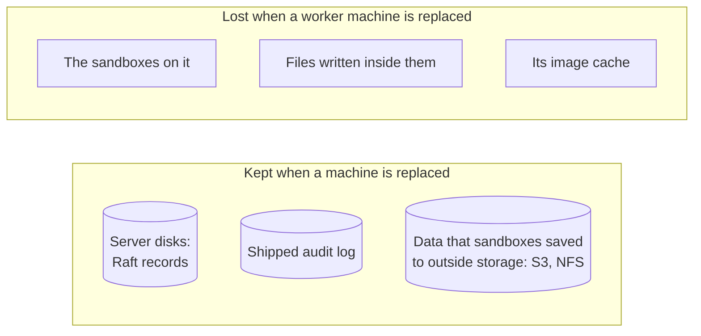

So **worker machines are replaceable**. If a worker machine goes away, its
sandboxes go with it. Sandboxes created with failover `recreate` are rebuilt
fresh on another worker. Anything that must last should be saved outside the
sandbox, for example to S3 or NFS through AerolVM's storage mounts.

---

## 15. Watching it: health checks, metrics and logs

### Health checks (probes)

| Probe | Endpoint | Status |
|---|---|---|
| **Liveness** ("is it alive?") | `GET /health` | **Exists.** It answers "200 OK" unless the database is broken. Good enough for liveness. |
| **Readiness** ("send it traffic?") | `GET /ready` | **Does not exist yet.** It must answer "not ready" when the pod is cut off from the cluster, or has seen no Raft leader for longer than a short grace period. Without it, Kubernetes would keep sending traffic to a pod that cannot do its job. |

### Metrics

- `GET /v1/metrics` gives Prometheus metrics. It needs a token with the
  metrics permission.
- The chart creates a **ServiceMonitor** (for the Prometheus Operator) with
  that token, so the bank's Prometheus scrapes every AerolVM pod.
- The existing alert rules (`setup/prometheus/`) and Grafana boards
  (`setup/grafana/`) ship with the chart.

### Logs and the audit log

- `sandboxd` writes its logs to standard output. The bank's existing log agent
  (Fluent Bit, the CloudWatch agent, or Azure Monitor) collects them like any
  other pod's logs.
- The **audit log** can be shipped to: `s3`, `webhook`, `bus` (a message
  bus), `file`, or `stdout` (`SB_AUDIT_EXPORT_BACKEND`). On Kubernetes,
  `stdout` lets the bank's log agent carry it to the bank's SIEM.
- The tamper-evident **witness** (proof that nobody edited the log) supports
  S3 with Object Lock today. That works on EKS. **Azure Blob is not supported
  yet.**

---

# Part 4: How it behaves

## 16. Installing it, step by step

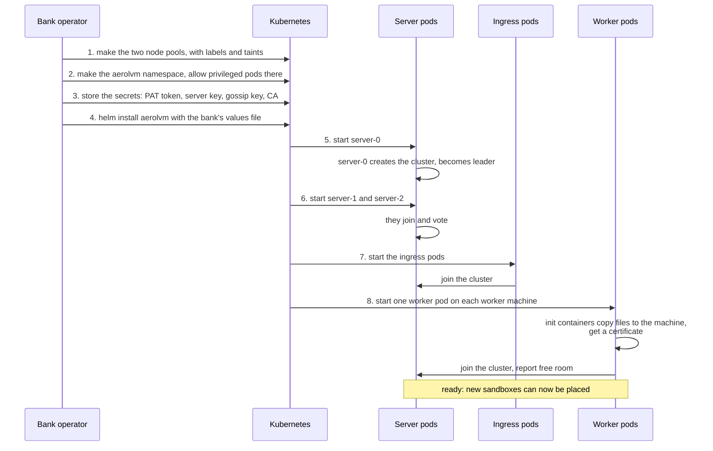

In words:

1. **Machines.** The bank creates the `aerolvm-control` and `aerolvm-workers`
   node pools, with their labels and taints. This is done with the bank's own
   tools (Terraform, eksctl, or the Azure CLI).
2. **Namespace.** The bank creates the `aerolvm` namespace and allows
   privileged pods there, and adds the matching policy exception.
3. **Secrets.** The bank stores the PAT token, server key, gossip key and CA
   certificate as Kubernetes Secrets, or links them from its secret store.
4. **Helm.** The operator runs `helm install` with the bank's values file
   (section 25 shows an example).
5. **Servers first.** server-0 starts and creates the cluster. server-1 and
   server-2 join it.
6. **Ingress.** The ingress pods start and join.
7. **Workers.** The DaemonSet puts one worker pod on every worker machine.
   Each worker copies its files onto the machine, gets its certificate,
   joins, and reports how much room it has.
8. **Ready.** From now on, SDKs can create sandboxes.

---

## 17. Creating a sandbox

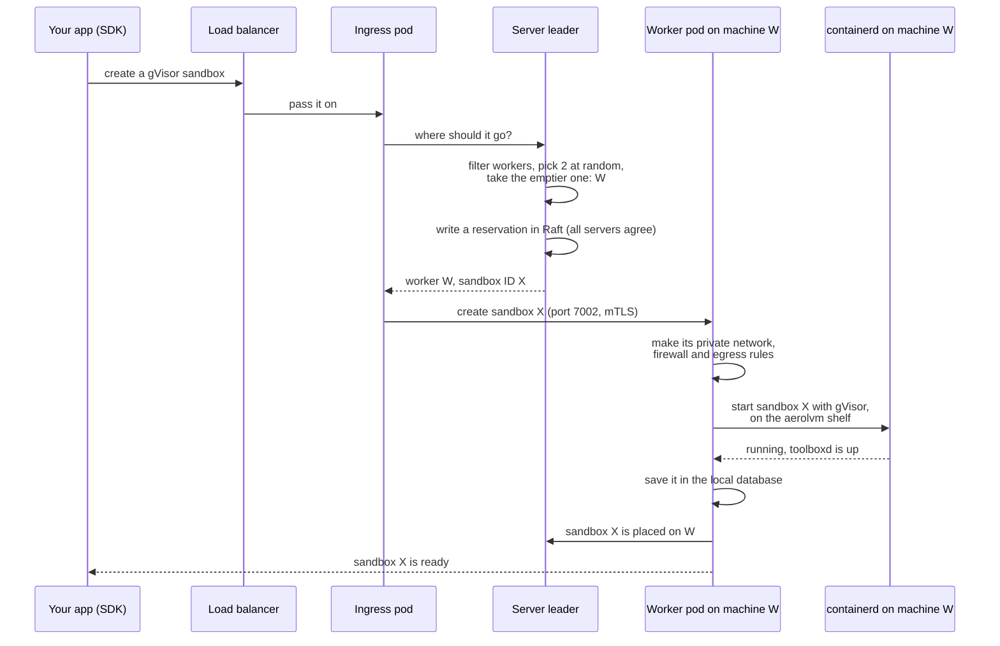

In words:

1. Your app calls `create`. The call reaches any ingress pod through the load
   balancer.
2. The ingress pod asks the server **leader** where the sandbox should go.
3. The leader filters the workers, picks two at random, and chooses the one
   with more room. It writes a reservation into Raft, so all servers agree.
4. The ingress pod passes the create to worker W on port 7002, over mTLS.
5. Worker W builds the sandbox's private network and firewall rules, then asks
   the machine's containerd to start the sandbox with gVisor.
6. `toolboxd` starts inside the sandbox, ready to run commands.
7. The worker saves the sandbox in its database and confirms the placement.
8. Your app gets back the sandbox ID.

**Nothing here involves Kubernetes.** No pod is created. That is why it takes
milliseconds, not seconds.

---

## 18. Running a command, and opening a sandbox link

### Running a command

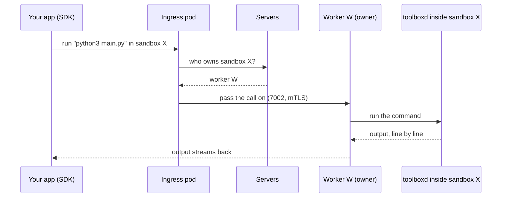

Every call about an existing sandbox (run a command, read a file, write a
file, destroy it) follows this path: any node, then the owner, then
`toolboxd` inside the sandbox.

### Opening a sandbox link

A visitor's browser opens `https://<sandbox-link>`. The load balancer sends
it to any ingress pod. That pod's Caddy already has a route for the sandbox
(section 11) and sends the visitor straight to the worker machine, which
passes it into the sandbox. The servers are not asked on each visit.

---

## 19. When things break

### a) A worker pod restarts (crash or upgrade)

- The sandboxes keep running. They belong to the machine's containerd.
- The new pod starts, reads its database, and takes its sandboxes back.
- If it is back within the grace time (`SB_DEAD_OWNER_GRACE`, about 90 seconds
  on Kubernetes), nothing moves.
- See the diagram in section 10.

### b) A worker machine dies, or the cloud replaces it

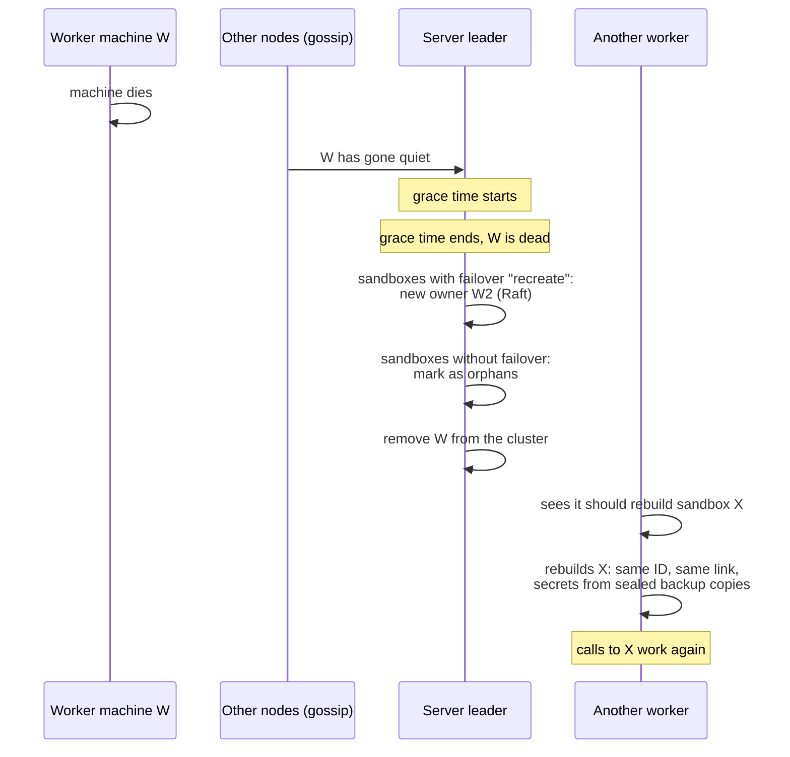

- Sandboxes with **failover `recreate`** come back on another worker with the
  same ID and link. They start fresh: what was in memory, and files written
  inside, are gone.
- Sandboxes **without failover** are gone. Calls to them answer `410 Gone`.
- Kubernetes, separately, may bring up a replacement machine. The DaemonSet
  puts a worker pod on it, and it joins as a **new, empty** worker.

### c) One server pod dies

- The other two still have a majority. Everything keeps working.
- The StatefulSet restarts the server pod, and its disk is re-attached. It
  catches up on the changes it missed.
- If it came back on a new machine with a new IP address, see the Raft
  address problem in section 9.

### d) Two of the three servers die

- There is no majority. **No new sandboxes can be created**, and many other
  calls fail, because workers and ingress pods cannot ask the servers who
  owns what.
- **Running sandboxes keep running.**
- When a server comes back, the cluster recovers by itself.
- If the servers' disks were lost for good, there is a recovery runbook
  (`setup/runbooks/lost-quorum-recovery.md`).

### e) An ingress pod dies

- The load balancer stops sending traffic to it and uses the others.
- The Deployment starts a new one.

### f) A whole availability zone goes down

- Two servers in the other zones keep the majority.
- Ingress pods in the other zones keep serving.
- Workers in the dead zone are lost, and their failover sandboxes are rebuilt
  in other zones.
- **This only works if workers are spread across zones too.** The node pool
  should cover all three zones.

---

## 20. Day-two work: upgrades, adding machines, removing machines

### Upgrading AerolVM

Run `helm upgrade` with the new version. Then:

1. **Servers** are updated one at a time. The PodDisruptionBudget makes sure
   two are always up.
2. **Ingress pods** are updated one at a time. The load balancer keeps sending
   traffic to the others.
3. **Workers** are updated **one machine at a time, on purpose**. The
   DaemonSet uses the `OnDelete` strategy: Kubernetes does not update a worker
   pod until someone deletes the old one. An upgrade job (or a person) does
   this: delete one worker pod, wait until the new one is ready and has its
   sandboxes back, then move to the next.

Why so careful with workers? In an earlier release (v0.7.10), restarting every
node at the same time split the cluster's member list. One at a time avoids
that.

### When EKS or AKS upgrades the machines

This is different from upgrading AerolVM, and it is important. When the bank
upgrades Kubernetes, or applies a new machine image for security patches,
**EKS and AKS replace or re-image the worker machines**. A replaced machine
is a **new, empty machine**. Every sandbox on the old machine is lost (or
rebuilt elsewhere, if it had failover).

The safe way:

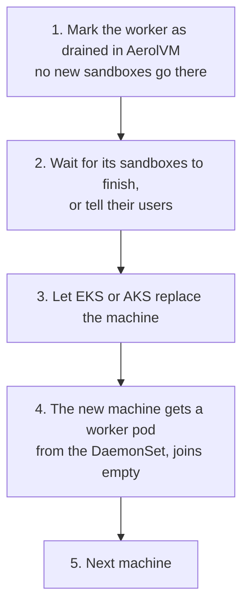

- AerolVM can already **drain** a worker:
  `POST /v1/cluster/nodes/{id}/drain`, or the script
  `scripts/sandboxd-node-lifecycle.sh drain --wait-empty`.
- Draining **does not move** running sandboxes. It only stops new ones from
  arriving. Running sandboxes must finish, or be rebuilt through failover
  when the machine goes.
- Today a person or a script must do these steps. A later improvement could
  let the aerolvm-controller drain a machine automatically when Kubernetes
  marks it for replacement.
- Plan machine upgrades for quiet hours.

### Adding machines

- Add machines to the `aerolvm-workers` pool. The DaemonSet puts a worker pod
  on each new machine. The worker joins and starts taking sandboxes.
- **The cluster autoscaler will not do this by itself.** It adds machines when
  **pods** cannot fit. Sandboxes are not pods, so it never sees a need for
  more room. Scaling up is a manual step, or a future job that watches
  AerolVM's capacity metrics.

### Removing machines

- **Danger:** the cluster autoscaler looks at a worker machine, sees only one
  DaemonSet pod on it, decides the machine is empty, and removes it, even
  though it is full of sandboxes.
- **Fix:** turn off automatic scale-down for the `aerolvm-workers` pool, or
  mark the machines with the cluster autoscaler's
  `cluster-autoscaler.kubernetes.io/scale-down-disabled=true` annotation. On
  EKS with Karpenter, use its disruption settings to the same effect.
- Always drain a worker in AerolVM before removing its machine.

---

# Part 5: EKS and AKS

## 21. EKS and AKS side by side

| Topic | Amazon EKS | Azure AKS |
|---|---|---|
| Machine operating system | **Amazon Linux 2023** to start. Bottlerocket later: its system folders are read-only and need extra work. | **Ubuntu** or **Azure Linux** |
| containerd socket | `/run/containerd/containerd.sock` | `/run/containerd/containerd.sock` |
| Process groups (cgroups) | Version 2 | Version 2 |
| Pod network (CNI) | Amazon VPC CNI: pods get addresses from the VPC | Azure CNI (overlay, pod subnet, or powered by Cilium) |
| Load balancer | AWS Load Balancer Controller, Network Load Balancer, internal | Azure Standard Load Balancer, internal |
| Server disks | EBS gp3, through the EBS CSI driver | Azure Premium SSD, through the Azure Disk CSI driver |
| Cloud identity for pods | EKS Pod Identity or IRSA | Workload Identity |
| Encrypting Kubernetes Secrets | AWS KMS | Azure Key Vault |
| AerolVM key store | **AWS KMS: supported** | Vault, OpenBao or HSM today. **Azure Key Vault: not supported yet.** |
| Audit log export | S3, webhook, bus, file, stdout | Webhook, bus, file, stdout. **Azure Blob: not supported yet.** |
| Tamper-evident audit witness | **S3 Object Lock: supported** | **Not supported yet** |
| Wildcard HTTPS certificate | cert-manager with the bank's CA or AWS Private CA | cert-manager with the bank's CA |
| Policy exception for privileged pods | Gatekeeper or Kyverno, if used | Azure Policy, if used |
| Firecracker (optional) | Only on `.metal` machine types, in their own pool | Machine sizes with nested virtualization. **Not tested by us.** |
| Cannot be used | **Fargate**: no DaemonSets, no privileged pods | **Virtual nodes** (Azure Container Instances): same reason |
| What machine upgrades do | Managed node group updates **replace** machines | Node image upgrades **re-image** machines |

**What this table tells us:** EKS is closer to ready, because AerolVM already
supports AWS KMS and S3. AKS needs three Azure pieces we do not have yet: a
Key Vault key store, Blob storage for audit export, and a Blob witness. Until
those exist, a bank on AKS can use Vault or OpenBao for keys, and a webhook,
message bus or stdout for the audit log.

---

# Part 6: Building it

## 22. What exists and what we must build

### Already exists (no change needed)

| Piece | Where |
|---|---|
| The server, worker and ingress roles | `SB_NODE_ROLE`, `internal/config/config.go` |
| Capacity settings | `SB_HOST_CPU_CORES`, `SB_HOST_MEMORY_MB`, `SB_HOST_DISK_GB` |
| A separate containerd shelf | `SB_CONTAINERD_NAMESPACE` (default `aerolvm`) |
| A setting for where the sandbox network file goes | `SB_CONTAINERD_CNI_CONF_PATH` |
| Certificates that reload without a restart | `internal/cluster/tls.go` |
| Safe retries on create | `Service.CreateSandboxWithID` |
| Draining a worker | `POST /v1/cluster/nodes/{id}/drain`, `scripts/sandboxd-node-lifecycle.sh` |
| Failover with sealed secrets | `internal/cluster/` |
| Metadata block, node guard, egress rules, deny floor | `pkg/egresspolicy/`, `pkg/docker/netrules/` |
| AWS KMS, Vault, OpenBao, HSM key stores | `SB_SECRET_PROVIDER` |
| Audit export and the S3 witness | `SB_AUDIT_EXPORT_BACKEND`, `SB_AUDIT_WITNESS_BACKEND` |
| Prometheus metrics, alerts, Grafana boards | `/v1/metrics`, `setup/prometheus/`, `setup/grafana/` |

### Must build: code changes in AerolVM

| # | Change | Why | Size |
|---|---|---|---|
| C1 | `/ready` endpoint that knows about the cluster | Kubernetes must stop sending traffic to a cut-off pod (section 15) | Small |
| C2 | Skip the Docker check when the engine is containerd, and make sure `sandboxd` starts without Docker | No Docker on EKS/AKS machines (section 10, trap 3) | Small |
| C3 | Make the sandbox address range a setting | 10.88.0.0/16 may clash with the bank's network (section 10, trap 2) | Small to medium; this area is fragile and needs regression tests |
| C4 | Raft finds servers by DNS name, not by an old IP number | Server pods get new IPs when they move (section 9) | Medium; cluster code is fragile and needs regression tests |
| C5 | Server and ingress roles start with no special rights | They should be normal, locked-down pods (section 9) | To be measured |
| C6 | Egress gateway can start without systemd | No systemd inside a pod (section 10) | Small |
| C7 | Azure Key Vault key store | AKS banks (section 21) | Medium |
| C8 | Azure Blob audit export and witness | AKS banks (section 21) | Medium |

### Must build: packaging and Kubernetes pieces

| # | Piece | Notes |
|---|---|---|
| P1 | Container images: `sandboxd` (with `toolboxd`, `runsc`, the gVisor shim, `iptables`, `ip` and the other tools), Caddy with the layer-4 module, the egress gateway | Signed with cosign, with an SBOM and build provenance |
| P2 | The Helm chart: `single`, `mixed` and `cluster` modes | Server StatefulSet, worker DaemonSet, ingress Deployment, Services, PDBs, PriorityClasses, ServiceMonitor |
| P3 | Worker init container | Copies `toolboxd`, `runsc` and the shim onto the machine |
| P4 | Caddy settings for a mounted certificate | For cert-manager (section 11, option A) |
| P5 | aerolvm-controller: the certificate signer | Section 13 |
| P6 | Worker upgrade job | Deletes worker pods one machine at a time and waits for each to be ready |
| P7 | A docs page, `kubernetes.mdx` | With the five SDK languages, like every docs page |

---

## 23. Build order

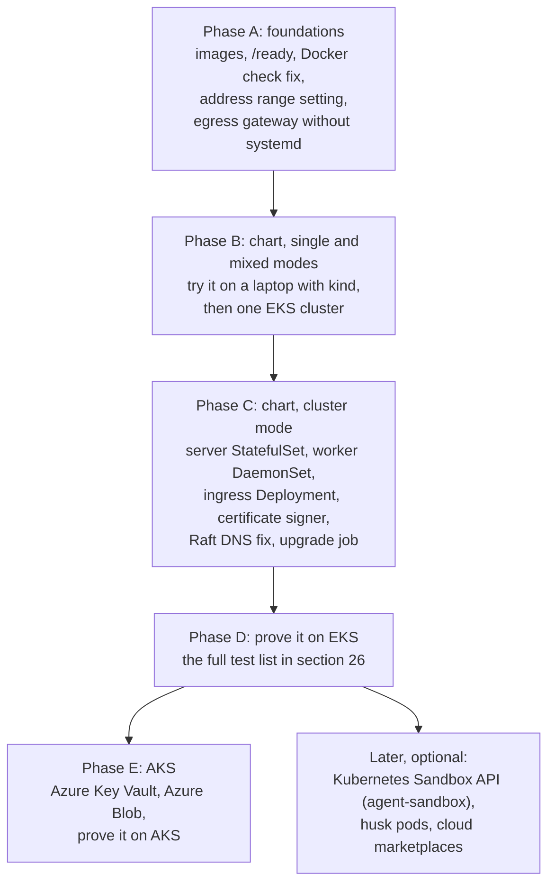

- **Phase A** makes AerolVM ready to live in a pod. Small changes, each with
  tests.
- **Phase B** gives a working `helm install` quickly, for trying it out and for
  small teams. One pod, or a few alike pods.
- **Phase C** is the real bank design from this guide.
- **Phase D** proves it on EKS, where AerolVM already supports the AWS key
  store and audit storage.
- **Phase E** adds what AKS needs.
- **Later phases** are optional. They let people manage sandboxes with
  `kubectl`, or make each sandbox a real pod. They are described in
  `kubernetes-deployment.md`.

### Updates the older plan needs

The plan in `kubernetes-deployment.md` must be updated before building:

1. **It names EKS and GKE, not AKS.** AKS must be added.
2. **The license block is gone.** The plan says cluster mode waits on license
   PR #223. That PR was closed without merging on 2026-10-03.
3. **`ROADMAP.md` says the opposite of this plan.** It says `sandboxd` will
   not become a Kubernetes workload this year. The roadmap must change in the
   same effort.
4. **It has had a CEO review, not an engineering review.** The next step is
   `/plan-eng-review`.
5. **It misses the items in this guide:** the machine `cgroup` mount, the
   30-second rule, the address range, the network file, the Docker check, the
   Raft IP problem, the egress gateway, the raw TCP port range, the
   autoscaler, and machine replacement.

---

## 24. Sizing: a first guess

These numbers are **starting points to confirm by testing**, not promises.

| Pool | Machines | Size each | Notes |
|---|---|---|---|
| aerolvm-control | 3 (one per zone) | 4 CPUs, 16 GB memory | Runs 1 server pod and 1 ingress pod each. Server disks 20 to 50 GB. |
| aerolvm-workers | Start with 3 (one per zone), grow as needed | 16 to 64 CPUs, 4 to 8 GB per CPU, 200 GB or more local disk | How many sandboxes fit depends on their size. Each sandbox asks for its own CPU and memory. |

---

## 25. What a values file might look like

This is a **sketch** to make the design concrete. The real names will be
settled when we build the chart.

```yaml
# values-bank-eks.yaml (sketch: names may change)
mode: cluster                     # single | mixed | cluster

image:
  repository: ghcr.io/aerol-ai/sandboxd
  tag: v0.6.11

domain: sandbox.bank.internal

# Made by the bank before install (section 16, step 3).
existingSecret: aerolvm-secrets   # PAT token, server key, gossip key

server:
  replicas: 3
  nodeSelector: { aerolvm.io/pool: control }
  tolerations: [{ key: aerolvm.io/control, effect: NoSchedule }]
  storage: { size: 50Gi, storageClass: gp3 }
  spreadAcrossZones: true

ingress:
  replicas: 3
  nodeSelector: { aerolvm.io/pool: control }
  service:
    internal: true                # no public address
    tcpPorts: { start: 22000, end: 22009 }   # small raw TCP range
  tls:
    secretName: aerolvm-wildcard-tls         # made by cert-manager

worker:
  nodeSelector: { aerolvm.io/pool: worker }
  tolerations: [{ key: aerolvm.io/worker, effect: NoSchedule }]
  runtimes: [gvisor]              # add docker only for trusted code
  capacity:                       # machine size minus reserves
    cpuCores: 60
    memoryMB: 230000
    diskGB: 400
  deadOwnerGrace: 90s
  sandboxSubnet: 10.250.0.0/16    # needs code change C3
  denyFloor:                      # cluster ranges no sandbox may reach
    - 10.0.0.0/16                 # the VPC
    - 172.20.0.0/16               # the Service range

firecracker:
  enabled: false

keyStore:
  provider: awskms
  keyId: arn:aws:kms:eu-west-1:111122223333:key/example

audit:
  export: s3
  bucket: bank-aerolvm-audit
```

---

## 26. Tests that prove it works

| Test | Where it runs | What it proves |
|---|---|---|
| `helm lint`, template checks | Every pull request, offline | The chart is valid |
| Single mode on kind | CI | Create, run and destroy a sandbox with each SDK |
| Cluster mode on EKS | Live | The full design works on a real managed cluster |
| **Worker pod restart** | Live | Every gVisor sandbox is still running and was **not** moved |
| **Worker pod slow restart** | Live | A restart longer than 30 seconds but shorter than the grace time moves nothing |
| **Server pod moved to a new machine** | Live | It rejoins with its new IP address and Raft keeps working |
| **Machine replaced** | Live | Failover sandboxes come back with the same ID and link; the new machine joins empty |
| **Network walls** | Live | A sandbox **cannot** reach: its own machine, the cloud metadata service, other pods, Kubernetes Services, the Kubernetes API, or the VPC/VNet |
| **Network file** | Live | New Kubernetes pods on a worker machine still get the cloud's pod network, not AerolVM's |
| **Firewall coexistence** | Live | AerolVM's rules and kube-proxy's rules both still work, with the cloud's default network plugin and with Cilium |
| **Autoscaler** | Live | The autoscaler never removes a worker machine that has sandboxes |
| **Chaos** | Live | Kill the leader server pod and one worker pod during 50 creates: no duplicate sandboxes, none lost |
| **Upgrade** | Live | A worker-by-worker upgrade keeps every sandbox |
| **AKS** | Live, in Phase E | The same list on AKS |

---

## 27. Questions to settle with the bank

1. **Address ranges.** Which ranges do the VPC or VNet, the pod network, and
   the Service network use? We need them for the deny floor, and to pick a
   sandbox range that does not clash.
2. **Certificates and DNS.** Which certificate authority signs the wildcard
   certificate, and does the bank use cert-manager? Which DNS holds the
   sandbox domain?
3. **Zones.** Three availability zones, or one?
4. **Runtimes.** gVisor only? Are plain containers allowed for trusted code?
   Are WASM and V8 isolates wanted?
5. **Firecracker.** Wanted at all? On EKS, are `.metal` machine types allowed?
6. **Raw TCP ports.** Do sandboxes need raw TCP, or is HTTPS on 443 enough?
7. **Grace time.** Is a 90-second wait before failover acceptable?
8. **EKS or AKS first?** EKS needs less new code.
9. **Key store and audit.** AWS KMS and S3 on EKS? On AKS, Vault or an HSM,
   and where should the audit log go?
10. **Machine upgrades.** How often does the bank replace machines for
    patches, and can that happen in quiet hours?

---

## Questions people ask

**Is each sandbox a Kubernetes pod?**
No. Kubernetes sees one AerolVM pod per worker machine. Sandboxes are made by
AerolVM through the machine's containerd. A later, optional phase ("husk
pods") can make each sandbox a real pod for teams that need that.

**What does `kubectl get pods -n aerolvm` show?**
The server pods, the ingress pods, and one worker pod per worker machine. To
list sandboxes, use the SDK, the `aerolvm` CLI, or the dashboard.

**Do Kubernetes NetworkPolicies control sandbox traffic?**
No. NetworkPolicies apply to pods, and sandboxes are not pods. AerolVM's own
walls apply instead: the node guard, the metadata block, the deny floor, and
each sandbox's egress rules (section 12).

**Do Kubernetes resource quotas limit sandboxes?**
No, for the same reason. AerolVM enforces its own limits: each sandbox's CPU,
memory and disk, and each worker's total room.

**What happens to sandboxes during a Kubernetes upgrade?**
Upgrading the Kubernetes control plane does not touch them. Upgrading the
**worker machines** replaces them, and sandboxes on a replaced machine are
lost or rebuilt elsewhere (section 20).

**Can a sandbox break out and attack the bank's other apps?**
It would have to break through gVisor first, then past AerolVM's firewall
walls. Even then it would land on a worker machine that runs nothing but
AerolVM, in a node pool kept apart from the bank's apps (section 12).

**Why not just run AerolVM on plain VMs next to the cluster?**
That works today, with Terraform and Ansible. But the bank's contract and
compliance cover EKS and AKS. Running AerolVM inside them lets the bank use
the tools, policies and approvals it already has.
