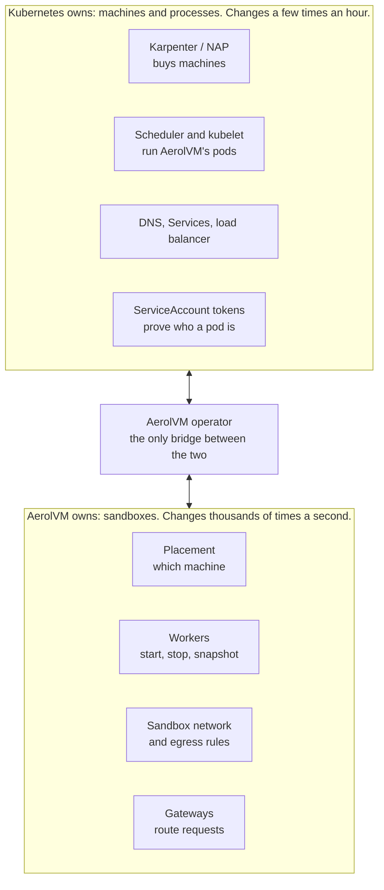
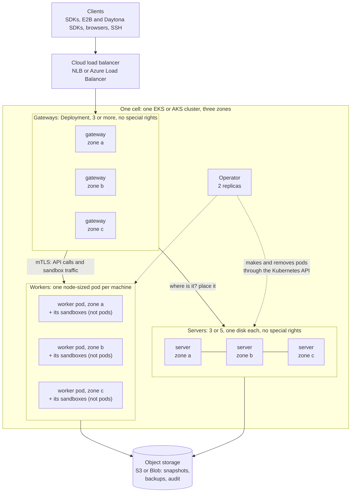
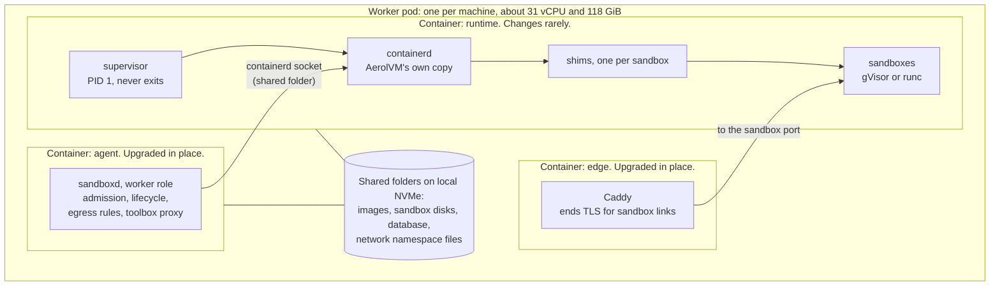
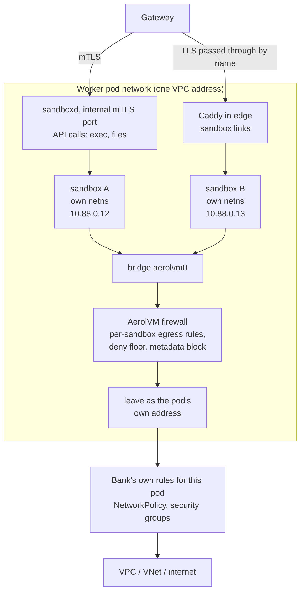
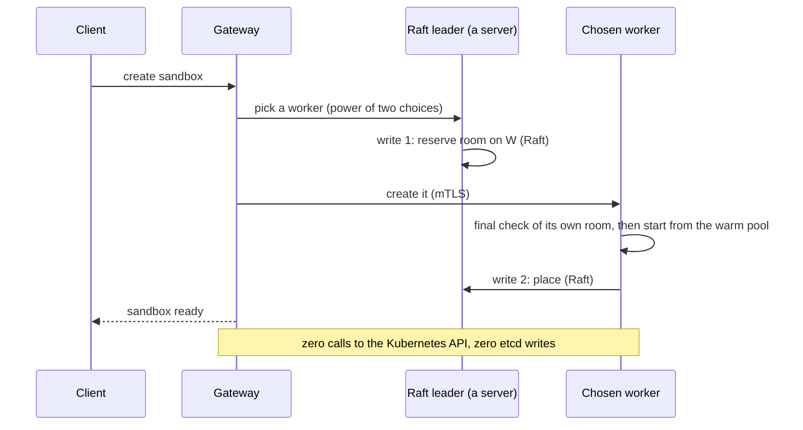
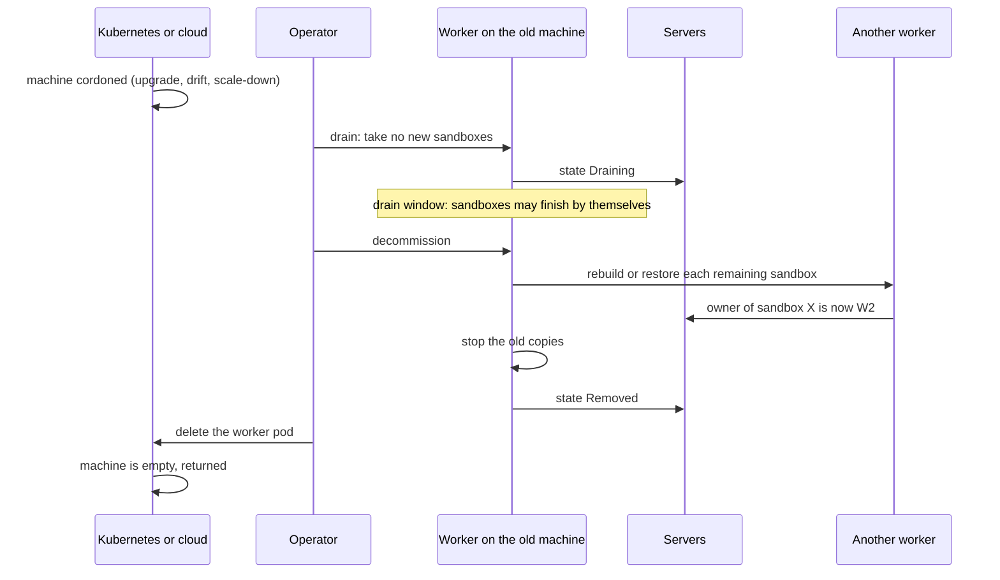
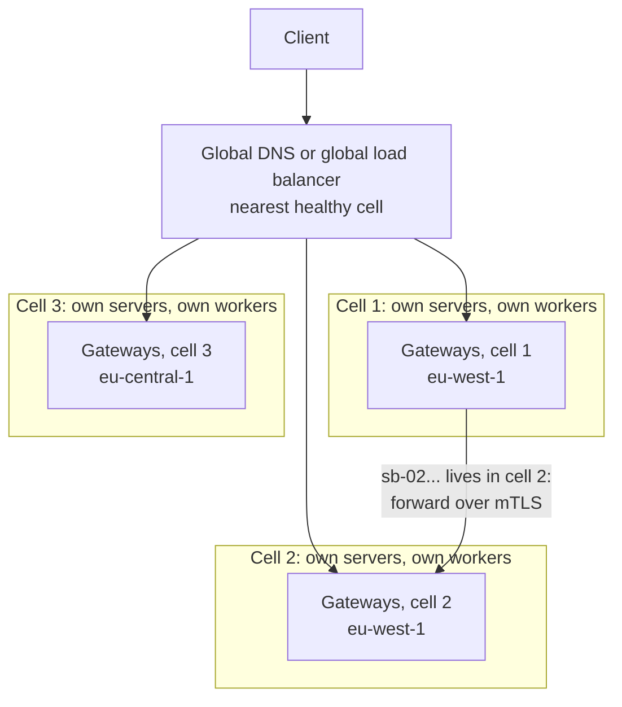
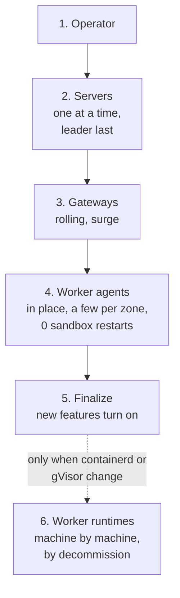
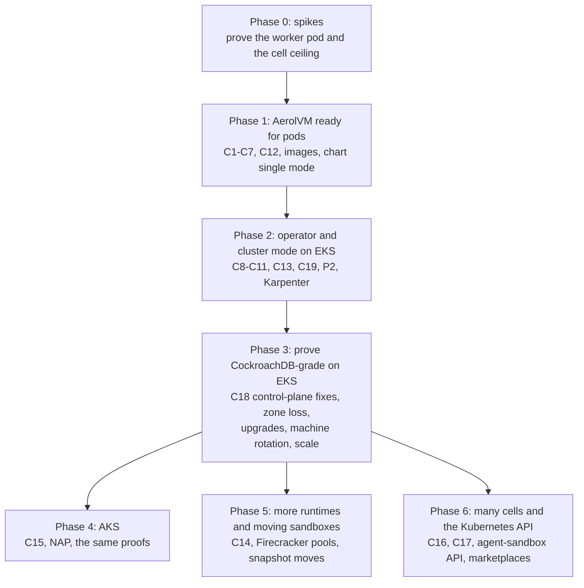

# AerolVM on Kubernetes, version 2: the CockroachDB-grade plan

**Status:** Draft, 2026-11-05. Not reviewed. Next gate: `/plan-eng-review`.
**Date:** 2026-11-05
**Replaces:** the design in `kubernetes-deployment.md` (sections 2 to 5) and the
worker design in `kubernetes-full-architecture.md` (section 10). Both files
stay for history. Each now starts with a note that points here.
**Builds on:** `kubernetes-cockroachdb-parallels.md` (lessons L1 to L8) and the
agent-sandbox study in `agent-sandbox-feature-parity.md` (PR #923).

## How to read this plan

- **Part 1 (sections 1 to 5)** says what we decided and why. If you read
  nothing else, read this.
- **Part 2 (sections 6 to 10)** is the design.
- **Part 3 (sections 11 to 16)** is how it behaves: zones, growing past one
  cell, upgrades, failures, security, and the Kubernetes API.
- **Part 4 (sections 17 to 22)** is how we build it and prove it.

Facts about today's code carry a `path` or `path:line`. Facts about
Kubernetes, EKS, AKS and CockroachDB carry a link in the Sources section.
Numbers marked **target** are goals we must prove, not promises.

### Words used in this plan

| Word | Meaning here |
|---|---|
| **Machine** or **node** | One VM in the EKS or AKS cluster. |
| **Node pool** | A group of machines of one type. |
| **Pod** | The smallest thing Kubernetes runs: one or more containers that share a network and a lifetime. |
| **Operator** | A program that runs inside Kubernetes and manages one product for you. CockroachDB has one. We will build one. |
| **CRD** | A new kind of Kubernetes object that an operator adds, such as `AerolCluster`. |
| **etcd** and **API server** | Kubernetes' own database and the front door to it. |
| **Raft** | A way for 3 or 5 copies of a small database to agree on every change. |
| **Gossip** | Machines telling each other "I am alive". |
| **cgroup** | The Linux "box" that limits how much CPU and memory a group of processes may use. |
| **netns** | A Linux network namespace: a private network stack for one group of processes. |
| **Zone** | One data center inside a cloud region (for example `eu-west-1a`). |
| **Cell** | One complete AerolVM cluster. Section 12. |
| **Drain** | "I will restart soon": take no new work, keep what you have. |
| **Decommission** | "I am leaving for good": move or finish all work first, then leave. |

---

# Part 1: What we decided and why

## 1. The plan in ten lines

1. **Kubernetes runs AerolVM's programs. AerolVM runs the sandboxes.** A
   sandbox is never a Kubernetes pod. There are no husk pods.
2. **We copy CockroachDB's discipline, not its storage engine.** CockroachDB
   keeps its own brain (Raft, gossip, placement) inside Kubernetes and lets
   Kubernetes look after machines, processes and disks. We do the same, with
   one owner for every job (section 4).
3. **Each worker machine runs one AerolVM worker pod, sized to the whole
   machine.** Every sandbox lives inside that pod: inside its CPU and memory
   box (cgroup) and inside its network (netns). Kubernetes sees the real use
   of every machine. AerolVM never touches the machine outside its own pod.
4. **Nothing is installed on the machines.** containerd, gVisor and every
   other tool ship inside our signed images. The bank keeps the stock EKS and
   AKS machine images.
5. **Kubernetes is never on the hot path.** Creating a sandbox makes zero
   calls to the Kubernetes API and zero writes to etcd. If the Kubernetes
   control plane goes down, sandboxes keep running and new ones still start.
6. **Upgrading AerolVM never restarts a sandbox.** The worker pod has three
   containers. The two we upgrade often (`sandboxd` and Caddy) are swapped in
   place. The one that holds the sandboxes is not touched.
7. **Machines leave the CockroachDB way.** Drain first. Then decommission,
   which moves, rebuilds or finishes every sandbox before the machine goes.
8. **Everything knows its zone.** Servers, failover targets and secret
   backups are spread across zones, so losing a zone is survivable.
9. **One cell grows to a tested ceiling. Past that, we add cells.** A cell is a
   full AerolVM cluster. Every new sandbox ID carries its cell number, so any
   gateway can route any request without a lookup.
10. **An operator drives it all from one `AerolCluster` object,** like
    CockroachDB's own operator.

## 2. Decisions

These replace decisions D2 to D14 in `kubernetes-deployment.md` where they
conflict. The "Old" column says what happens to the earlier decision.

| ID | Decision | Old |
|---|---|---|
| K1 | A sandbox is never a pod. No husk pods, no placeholder pods, no pod per sandbox. | Withdraws D4.1 and D7 |
| K2 | Workers are **one node-sized pod per machine**, made and removed by our operator, not a DaemonSet. Sandboxes live inside the pod's cgroup and network. | Replaces the worker DaemonSet in D2 and `kubernetes-deployment.md` §5.2 |
| K3 | The worker pod has **three containers**: `runtime` (holds the sandboxes, rarely changes), `agent` (`sandboxd`) and `edge` (Caddy). The last two are upgraded in place. | New |
| K4 | **Nothing on the machine outside pods.** No host containerd socket, no host network, no host PID, no host folders, no files copied onto the machine. | Replaces `kubernetes-full-architecture.md` §10 rights list |
| K5 | **Kubernetes is never on the hot path or the failure-detection path.** Zero Kubernetes API calls and zero etcd writes per sandbox. | Replaces D12's per-sandbox write budget |
| K6 | **An operator with `AerolCluster` and `AerolNode` objects** manages servers and workers directly, as CockroachDB's current operator does. No StatefulSets or DaemonSets for them. | Grows the `aerolvm-controller` of §5.3 |
| K7 | **A planned restart is not a death.** Drain and decommission are separate steps. A cordoned machine is the signal to decommission its worker. | New (lessons L2, L3) |
| K8 | **Zones everywhere.** Every node knows its zone. Placement, failover and secret backups use it. | New (lesson L4) |
| K9 | **Scale past one cell by adding cells**, not by growing one Raft group. The cell number lives inside the sandbox ID. | New |
| K10 | **One stateless gateway tier** takes all client traffic: the API, sandbox links, SSH and TCP ports. Workers open no ports of their own to clients. | Replaces the separate ingress role on Kubernetes |
| K11 | **Kubernetes objects only for things that change rarely** (the cluster, its nodes, templates, pools). A read view of sandboxes comes later through an aggregated API, never through etcd. | Revises D2, D5, D12. D14 is no longer needed. |
| K12 | **The operator scales workers from AerolVM's own capacity numbers.** A new worker pod that fits nowhere makes Karpenter (EKS) or Node Auto Provisioning (AKS) add a machine. | New |
| K13 | **EKS first, then AKS.** gVisor is the default runtime on both. GKE comes later. | Replaces Q4 (EKS + GKE) |
| K14 | **Kept from the CEO review:** signed images with SBOM and provenance (D4.3), `make k8s-dev` and `kubernetes.mdx` (D4.5), node certificates only after TokenReview proves the pod runs on that machine (D6), cluster-aware `/ready` (D8), namespace equals owner for Kubernetes callers (D10), CA key held outside the cluster (D11), shipped metrics, alerts and runbook (D13), Daytona migration preset (D4.2). | Kept |
| — | The license gate (D9) is gone. PR #223 was closed unmerged on 2026-10-03. | Obsolete |

## 3. What "CockroachDB-grade" means here

"As good as CockroachDB" is not a feeling. It is a list of properties that
CockroachDB proves with tests. These are ours. Each one has a test in
section 19.

| # | Goal | Target to prove |
|---|---|---|
| G1 | **Survive a zone.** Lose any one of three zones. | The API stays up. New creates work again within 30 s. Only that zone's sandboxes are lost, and failover sandboxes come back in other zones. |
| G2 | **No single point of failure.** | At least 3 gateways, 3 or 5 servers, 2 operator replicas, workers in every zone. |
| G3 | **Scale out by adding machines.** | One cell: at least 500 workers, 100,000 live sandboxes and 1,000 creates per second (**targets**). Today's code probably tops out near 150 creates per second per cluster (an estimate, section 9.3), so this needs the work in section 9.4. Past one cell: add cells. |
| G4 | **Kubernetes load grows with machines, not sandboxes.** | AerolVM's writes to the Kubernetes API are a few per machine per minute, and zero per sandbox. |
| G5 | **As fast as on plain VMs.** | gVisor create p50 within 10% of the same machine type outside Kubernetes. Today on EC2, warm path: gVisor 284 ms, containerd 189 ms (`plans/investor-benchmark-observability.md`). |
| G6 | **Dense.** | Sandboxes per machine limited only by CPU, memory and disk. No 110-pod cap. No VPC address per sandbox. (Today's per-worker network pool defaults to 256 sandboxes, `SB_CONTAINERD_NETNS_POOL_SIZE` in `internal/config/config.go`, so it must be sized from the machine.) |
| G7 | **Heals itself.** | A dead worker's failover sandboxes run elsewhere within 60 s. A dead server is replaced with no human. A dead gateway leaves the load balancer within 10 s. |
| G8 | **Planned work loses nothing.** | An AerolVM upgrade restarts 0 sandboxes. A machine replacement never loses a sandbox by surprise: each is moved, rebuilt or finished first, by its own policy. |
| G9 | **Rolling upgrades with mixed versions.** | Version N and N-1 run together. New features stay off until every node runs N (finalization). Rollback works until then. |
| G10 | **Secure by default.** | Only workers are privileged. Identities are proven by Kubernetes. TLS everywhere. Signed images. |
| G11 | **Observable.** | Every goal above has a metric, an alert and a runbook entry. |
| G12 | **Stock machines.** | Nothing installed or changed on any machine outside pods. |

## 4. One owner for every job

The worry from our earlier talk was: "this builds a Kubernetes inside a
Kubernetes". It would, if both did the same jobs. The rule that prevents it:
**every job has exactly one owner.** Kubernetes owns everything about
machines and processes. AerolVM owns everything about sandboxes.

| Job | Owner | How |
|---|---|---|
| Buy and return machines | Kubernetes: Karpenter (EKS) or Node Auto Provisioning (AKS) | Reacts to worker pods that do not fit (section 10.4) |
| Start, restart and place AerolVM's own programs | Kubernetes: scheduler and kubelet | Pods made by our operator |
| Find the other AerolVM programs at start-up | Kubernetes DNS | Headless Service names |
| Prove which pod is which | Kubernetes: ServiceAccount tokens and TokenReview | Turned into node certificates (section 15) |
| Sign certificates | The bank's certificate issuer, through cert-manager | CA key never in the cluster (D11) |
| Public load balancer | The cloud's load balancer, through a Service | NLB on AWS, Azure Load Balancer on Azure |
| Disks for the servers | Kubernetes volumes (EBS, Azure Disk) | One per server |
| Settings and keys | Kubernetes Secrets and our CRDs, plus the cloud KMS | They change rarely |
| **Choose a machine for a sandbox** | **AerolVM** | Thousands per second, in milliseconds |
| **Start, stop, pause and snapshot a sandbox** | **AerolVM worker** | Inside its own pod |
| **Sandbox network and egress rules** | **AerolVM worker** | Inside its own pod's network |
| **Notice a dead worker** | **AerolVM gossip** (Kubernetes is a second opinion) | Must work when the Kubernetes API is down |
| **Rebuild sandboxes after a death** | **AerolVM** | By each sandbox's failover policy |
| **Route a request to the right sandbox** | **AerolVM gateways** | Any gateway, any request |



### What AerolVM stops doing on Kubernetes

On plain VMs, AerolVM does a lot of the machine work itself. On Kubernetes it
stops doing all of it:

- **Installing and restarting itself** (today `install.sh`, Ansible,
  Terraform, systemd). Kubernetes does it.
- **Touching the machine.** No host firewall rules, no host network, no host
  cgroups, no host folders, no programs copied onto the machine. All of it
  moves inside the worker pod.
- **Its own join list.** Kubernetes DNS names replace `SB_BOOTSTRAP_PEERS`
  addresses.
- **Its own certificate authority.** The bank's issuer signs.
- **Opening ports on worker machines.** Workers open no ports to clients.
  Gateways carry all client traffic to them over mutual TLS.
- **Any per-sandbox Kubernetes object.** No husk pods, no CRD per sandbox.

### Why AerolVM keeps its own brain at all

For the same reason CockroachDB does: Kubernetes is built for a few slow,
long-lived things per machine, and sandboxes are many, small and fast.

| | Kubernetes pod | AerolVM sandbox |
|---|---|---|
| Start time | Kubernetes' own goal: 99% of pods within 5 s. We measured 5.5 s cold and 0.04–0.05 s from a warm pool with agent-sandbox on kind (`agent-sandbox-feature-parity.md`). | 4 ms (V8 isolate) to 284 ms (gVisor) on EC2, warm path |
| How many per machine | 110 by default. On EKS each pod also takes a VPC address: an m7i.8xlarge holds at most 234 pods, and managed node groups cap it at 250. | As many as CPU, memory and disk allow |
| Network address | One VPC address each (EKS VPC CNI) | Private to the worker pod. One VPC address per machine. |
| Cost to Kubernetes | Several etcd writes each | None |
| What it can run | Containers. VMs only through add-ons such as Kata. | containerd, gVisor, Firecracker, WASM, V8 isolates |

Ray and Spark use the same split. Kubernetes runs their processes, and their
own schedulers place the small, fast work inside them.

## 5. Options we compared

| Option | What it is | Verdict |
|---|---|---|
| A. Every sandbox is a pod | The agent-sandbox way: Kubernetes is the only scheduler, warm pools of real pods | **No.** Seconds to start cold, etcd writes per sandbox, 110 pods per machine, a VPC address per sandbox, no WASM or V8 isolates. Google's own published best is 300 sandboxes per second per cluster. |
| B. Husk pods | Empty pods wait, a sandbox is moved into one when claimed | **No.** Dummy pods hold capacity while waiting, two schedulers meet in the middle, and Kubernetes ends up choosing the machine. |
| C. Privileged DaemonSet using the machine's containerd | The earlier plan | **No.** It changes the machine outside the pod (host firewall next to kube-proxy and the CNI, host cgroups, `runsc` copied into `/usr/local/bin`). Kubernetes cannot see sandbox use, so the autoscaler sees busy machines as empty. A slow pod restart trips the 30-second death rule. |
| **D. One self-contained worker pod per machine** | Sandboxes live inside a node-sized pod that holds its own containerd and network | **Chosen.** Kubernetes sees true use, nothing touches the machine, upgrades keep sandboxes running. |
| E. CockroachDB's multi-Raft (one Raft group per slice of sandboxes) inside one cluster | Split the placement table into ranges, each with its own Raft group | **Not now.** Sandboxes never need a transaction across two sandboxes, so the simpler answer is cells (section 12). Revisit only if one cell cannot reach its target. |

---

# Part 2: The design

## 6. The whole system in one picture



What to notice:

- **Clients only ever talk to gateways.** Gateways hold no state, so any
  gateway can take any request.
- **Servers keep the small table "which sandbox is on which worker"** with
  Raft. They never run sandboxes and never face the internet.
- **Workers run sandboxes and nothing else.** They take traffic only from
  gateways, servers and other workers (for secret backups and moves), over
  mutual TLS.
- **The operator is the only part that talks to the Kubernetes API** while the
  cluster runs. Sandbox traffic never goes near it.

## 7. The four kinds of pod

| | Gateway | Server | Worker | Operator |
|---|---|---|---|---|
| **Job** | Take every client request and pass it on | Keep the placement table with Raft | Run sandboxes | Manage the cluster through Kubernetes |
| **Kubernetes object** | Deployment + autoscaler | Pod made by the operator, one `AerolNode` each, one disk each | Pod made by the operator, one `AerolNode` each | Deployment |
| **How many** | 3 to many, at least 1 per zone | 3 (one per zone) or 5 (2, 2, 1) | One per worker machine | 2, with leader election |
| **Special rights** | None (`restricted` pod security) | None (`restricted`) | **Privileged** (section 8.7) | None |
| **Keeps state** | No. A routing cache only. | Yes: Raft log and snapshots on its disk | Only its sandboxes, on the machine's local disk | No |
| **Scales by** | Requests and CPU | Fixed (3 or 5) | Free sandbox capacity (section 10.4) | Fixed |
| **Faces the internet** | Yes, behind the load balancer | No | No | No |

### 7.1 Gateway

The gateway merges two of today's jobs: the `/v1` API listener and the
ingress role. It serves:

- the `/v1` API and the Daytona, E2B and Runloop facades;
- HTTPS links to sandbox ports. The gateway reads the name in the TLS
  handshake (SNI) and passes the still-encrypted bytes to the owning worker,
  whose Caddy ends TLS, as owners do today. It uses the routing that needs no
  per-sandbox Caddy writes (`plans/ingress-proxy-routing.md`), which is behind
  `SB_INGRESS_PROXY_ROUTING` today and is always on in Kubernetes. That mode
  keeps a small index of every placement on each gateway (about 100–150 bytes
  per sandbox), so a plain cloud load balancer works with any number of
  gateways;
- the SSH gateway;
- TLS ports (`tls://` on 443, routed by SNI) and plain TCP ports. Plain TCP
  is the one weak spot on Kubernetes: each port needs its own load-balancer
  listener, and an AWS NLB allows at most 50, a limit AWS will not raise. So
  on Kubernetes we steer users to TLS ports, and plain TCP ports come from a
  small pool set per install (section 21, question 7).

A gateway keeps a cache of "sandbox X lives on worker W", filled from the
placement change feed that already exists
(`internal/cluster/placement_changelog.go`). Today a worker or ingress node
asks a server on **every** routed request, with no cache
(`internal/cluster/agent.go`, `OwnerOf`). A stale cache entry must be
safe: the worker checks that it owns the sandbox and answers "not here",
which refreshes the cache (fix E3 in section 9.4). CockroachDB's gateways work
the same way with their range cache.

Long streams (exec output, sessions, terminals) hold no state in the gateway.
If a gateway dies, the client reconnects through any other gateway and
re-attaches. Sessions live in `toolboxd` inside the sandbox, which keeps
running (`docs/src/content/docs/sessions.mdx`).

### 7.2 Server

Servers are today's server role (`SB_NODE_ROLE=server`) with four changes:

1. **Made by the operator, one `AerolNode` each, with its own disk.** Like
   CockroachDB's current operator, we do not use a StatefulSet. The operator
   pins each server to its zone, because EBS and Azure Disk volumes cannot
   move between zones.
2. **They advertise DNS names, not IP numbers** (lesson L1). Today Raft turns
   the advertised name into an IP number at start-up
   (`internal/cluster/raft.go`). A pod that moves gets a new IP, so this must
   change.
3. **On `SIGTERM` they hand off Raft leadership, then exit** (lesson L2).
   Today a stop sends a gossip "leave" with a 2-second timeout and does not
   hand off leadership (`internal/cluster/gossip.go`, `gossipNode.Close`;
   `internal/cluster/client.go`, `Close`).
4. **Three or five voters.** The existing cap of 7 server nodes
   (`cluster.MaxServerTierNodes`: 5 voters plus 2 while one is being
   replaced) stays.

### 7.3 Worker

Section 8. This is the part that changed most.

### 7.4 Operator

One Deployment, 2 replicas, one leader at a time. It is the **only** AerolVM
part that writes to the Kubernetes API while the cluster runs. It:

- turns one `AerolCluster` object into servers, gateways and workers;
- adds and removes workers from capacity numbers (section 10.4);
- runs upgrades in the right order (section 13);
- decommissions a worker before its machine goes (section 10.5);
- signs node certificates after TokenReview, through the bank's issuer
  (D6, D11);
- copies each machine's zone label onto its pod (section 11).

## 8. The worker pod, up close

This is the heart of the design, so it goes slowly.

### 8.1 One pod per machine, sized to the machine

Workers run in their own node pools. The pools carry a taint, so nothing else
lands there. The operator makes **one worker pod per machine**, and the pod
**asks for nearly the whole machine**: everything the machine offers to pods,
minus what the system add-ons on every machine need (the network plugin, log
shipper and so on).

Example on a 32 vCPU, 128 GiB machine:

| | Amount |
|---|---|
| Machine | 32 vCPU, 128 GiB |
| Offered to pods by Kubernetes (allocatable) | about 31.5 vCPU, 120 GiB |
| System add-ons on every machine | about 0.5 vCPU, 1 GiB |
| **Worker pod asks for (request = limit)** | **about 31 vCPU, 118 GiB** |

Why the whole machine:

- **Kubernetes' numbers become true.** The scheduler, the autoscaler and the
  bank's cost tools see the machine as full, because it is.
- **The autoscaler works with no tricks.** When the operator wants more room,
  it makes one more worker pod. That pod fits on no existing machine, so
  Karpenter or Node Auto Provisioning buys a new machine for it. **No dummy
  pods are needed.** The capacity unit is the real worker.
- **Nothing else can squeeze in,** and the worker pod has the highest
  priority, so the kubelet removes it last of all.
- **Request equals limit**, so Kubernetes gives it the "Guaranteed" class.

### 8.2 Three containers: `runtime`, `agent` and `edge`



- **`runtime`** holds containerd, the gVisor shim and every sandbox. It
  changes only when we change containerd or gVisor. Its first process is a
  small supervisor that never exits. If containerd crashes, the supervisor
  restarts it in place, and the sandboxes keep running, because each one
  belongs to its own shim, not to containerd. This container has **no
  liveness probe**. A failed probe would restart it and kill every sandbox.
- **`agent`** is `sandboxd` in the worker role. It changes with every AerolVM
  release. Kubernetes lets you change the image of a running pod's container:
  only that container restarts, and the pod keeps its identity, node, IP and
  volumes (Kubernetes "Pods" page, in Sources). So an AerolVM upgrade restarts
  `sandboxd`, and no sandbox notices. The new `sandboxd` finds its sandboxes
  through containerd and its database, as it does today after a restart.
- **`edge`** is the Caddy that today runs next to `sandboxd` on every owner
  node. It ends TLS for sandbox links and holds custom-domain certificates.
  It is its own container so that a `sandboxd` restart never cuts an open
  connection, which is the rule `plans/ingress-proxy-routing.md` already
  follows.
- The containers share folders on the machine's local disk. Each mounts
  them at the **same path**, so a file path `sandboxd` hands to containerd means
  the same file in both. The network-namespace folder (`/run/netns`) is shared
  with mount propagation, so a namespace `sandboxd` creates is visible to
  containerd. The earlier plan had to make paths match between a pod and the
  machine. Now both sides are inside our own pod.

### 8.3 Where sandboxes live: inside the pod's CPU and memory box

```
kubepods                                   (Kubernetes' box for all pods)
└── worker pod  (Guaranteed: about 31 vCPU, 118 GiB)
    ├── agent container       sandboxd
    ├── edge container        Caddy
    └── runtime container
        ├── supervisor, containerd
        ├── sandbox sb-0a1b...   its own limits, for example 2 vCPU, 4 GiB
        ├── sandbox sb-77c2...   its own limits
        └── ...
```

- **This does not happen by itself.** containerd's Kubernetes plugin does not
  give a privileged container its own cgroup namespace, so a privileged pod
  sees the machine's whole cgroup tree (containerd source, in Sources). Today
  `sandboxd` sets no cgroup path for a sandbox
  (`internal/runtime/containerd/lifecycle.go`), so inside a pod each sandbox
  would land at the machine's top level, outside the pod. Fix C7: `sandboxd`
  reads its own pod's cgroup path from `/proc/self/cgroup`, puts every sandbox
  under the `runtime` container's group, and **refuses to start a sandbox
  anywhere else**. The supervisor first moves itself into a child group,
  because cgroup v2 lets a group hand resources to children only when it has
  no processes of its own (the same trick Docker-in-Docker uses).
- Each sandbox has its own limits, set by AerolVM as today.
- The pod's limit is the hard ceiling for all of them together.
- Kubernetes, its metrics and the bank's cost tools see the real use, because
  every sandbox process sits inside the pod's box.
- If sandboxes together hit the pod's memory limit, the kernel stops a process
  inside the pod. We mark `containerd` and the supervisor as the last
  choice, so a sandbox goes first, never the machinery.

### 8.4 The network lives inside the pod



- **Each sandbox has its own network namespace**, joined to a bridge that
  lives in the worker pod's network, not the machine's.
- **Going out:** AerolVM's own firewall applies each sandbox's egress rules,
  the deny floor and the cloud metadata block, as today. Then traffic leaves
  with the pod's address. The bank's NetworkPolicy and security groups for the
  worker pod form a second, outer wall that AerolVM cannot loosen.
- **Coming in:** gateways reach the worker pod on two ports. API calls (exec,
  files, sessions) go to `sandboxd`'s internal mutual-TLS port, as they reach
  an owner node today. Sandbox links go to Caddy in the `edge` container,
  which ends TLS and passes the request to the sandbox.
- **What this removes:**
  - No host firewall rules, so no clash with kube-proxy or the CNI. This was
    the first risk in the earlier plan's risk table.
  - One VPC address per machine instead of one per sandbox.
  - The sandbox address range is private to the pod, so it cannot break the
    machine's routing. It still becomes a setting (C3), in case a sandbox must
    reach a bank network in the same range.
  - The cloud metadata service is blocked twice. AerolVM's own rule blocks
    it, as today. And on EKS, Karpenter's default machine settings allow only
    IMDSv2 with a hop limit of 1, which keeps everything off the host network
    away from it. Managed node groups with a custom launch template default to
    a hop limit of 2, so the chart's docs tell banks to set 1.

### 8.5 Disks

- **Workers** keep images, sandbox disks and their small database on the
  machine's **local NVMe disk**, through a pod volume. It is fast, and it dies
  with the machine, which is fine: the sandboxes die with the machine too.
  Each new worker pulls the templates its pool serves before it says "ready".
- **Servers** keep the Raft log and snapshots on a cloud disk (EBS gp3 or Azure
  Premium SSD), one per server, in the server's zone.
- **Object storage** (S3 or Azure Blob) holds sandbox snapshots, Raft backups,
  the audit export and the audit witness.

### 8.6 What survives what

| What happens | Sandboxes | Why |
|---|---|---|
| `agent` restarts or is upgraded | **Keep running** | They live in the `runtime` container |
| `edge` (Caddy) restarts or is upgraded | **Keep running** | Open sandbox links through this worker reconnect |
| containerd crashes | **Keep running** | Each belongs to its own shim; the supervisor restarts containerd |
| `runtime` container restarts | Lost, like a machine crash | Its box goes away. It has no liveness probe and its first process never exits, so this should be rare. |
| Worker pod deleted | Lost | So only the operator deletes worker pods, and only after decommission (section 10.5) |
| Machine dies | Lost. Failover sandboxes are rebuilt elsewhere. | Same as today on plain VMs |

### 8.7 The special rights, said plainly

The `runtime` and `agent` containers are **privileged**. (`edge` needs no
special rights.) A privileged container can do
almost anything a root user on the machine can do. We do not pretend
otherwise. What is different from the earlier plan:

- **No host network, no host PID, no host folders, no host containerd
  socket, no files copied onto the machine.** AerolVM touches the machine only
  through the kernel, never through its files or its network.
- **Mistakes stay inside the pod.** A bad firewall rule breaks one worker's
  sandboxes, not the machine's Kubernetes networking.

The walls around it:

1. Worker machines are their own tainted node pools. Only worker pods land
   there.
2. Worker pods live in their own namespace. Only that namespace allows
   privileged pods.
3. NetworkPolicy lets only gateways, servers and other workers reach a worker.
4. The worker's ServiceAccount has **no Kubernetes API rights at all**. The
   operator does all Kubernetes work.
5. The machine's cloud identity stays minimal. Sandboxes cannot reach the
   metadata service (section 8.4).
6. Images are signed, with an SBOM, and the bank's admission policy can refuse
   anything unsigned.

Later we try to shrink "privileged" to a named list of rights. That is a
nice-to-have, not a blocker.

### 8.8 The earlier worker design next to this one

| Problem in the earlier design (`kubernetes-full-architecture.md` §10) | This design |
|---|---|
| Host network: sandbox networks and firewall rules on the machine, next to kube-proxy and the CNI | Gone. All inside the pod's network. |
| Uses the machine's containerd through its socket (root on the machine) | Gone. Our own containerd, inside the pod. |
| `runsc` and its shim copied into the machine's `/usr/local/bin` | Gone. They ship in our image. |
| Firecracker and V8 isolate processes moved into cgroups at the machine's top level | Gone. Everything sits inside the pod's box. |
| Paths must match between the pod and the machine | Gone. Both sides are our own containers. |
| AerolVM's network file in the machine's CNI folder | Gone. Our containerd has its own folder. |
| Kubernetes cannot see sandbox CPU and memory; the autoscaler sees busy machines as empty | Gone. Use is inside the pod, and the pod asks for the whole machine. |
| A slow pod restart trips the 30-second death rule | Gone for upgrades: the agent restarts in place and announces it first (section 10.2). |
| AerolVM must clean up its own images on the machine | Still true, but now inside its own folder on the pod's volume. |
| `/health` always checks Docker | Still must be fixed (C2). |

### 8.9 Runtimes on ordinary EKS and AKS machines

| Runtime | Needs | On Kubernetes |
|---|---|---|
| **gVisor** (`runsc`) | Nothing special. AerolVM does not set a gVisor platform (`internal/runtime/containerd/runsc_config.go`), so gVisor uses its default, which needs no KVM. | **Phase 1. The default for banks.** |
| **runc** (plain containers) | Nothing | Phase 1, only for trusted code |
| **WASM** | Nothing | Phase 5 (section 18) |
| **V8 isolates** | Nothing | Phase 5 |
| **Firecracker** | `/dev/kvm`. **EKS:** metal instances, or, since February 2026, ordinary Intel instances with nested virtualization turned on (M7i, C7i, R7i, M8i, C8i, R8i and others; Karpenter's `EC2NodeClass` has a setting for it). **AKS:** sizes that support nested virtualization; KubeVirt (which uses KVM) runs there, but AKS does not officially support it. AKS's own Pod Sandboxing uses Hyper-V, not KVM, so it proves nothing for us. | Phase 5, on its own node pool, after Phase 0 checks `/dev/kvm` and speed on a live node |

WASM, V8 isolates and Firecracker start processes from `sandboxd` itself
today, not through containerd. In the pod, those processes must live in the
`runtime` container, or an agent upgrade would kill them. That needs a small
launcher inside `runtime` that starts them when the agent asks. This is why
they come in Phase 5, after gVisor works.

## 9. The control plane inside one cell

### 9.1 What the servers keep today

- **One Raft group**, using hashicorp/raft, run only by server-role nodes
  (`internal/cluster/raft.go`; workers and ingress nodes run the lighter
  `Agent`, `internal/cluster/agent.go`).
- **The placement table is kept in memory** on every server, with its indexes.
  One row is about 751 bytes, so 100,000 sandboxes take about 72 MB per server
  (`internal/cluster/topology.go`, `plans/secrets-hardening.md`).
- **What goes through Raft:** placement, deletes, failover moves, exposed
  ports, custom domains, volumes, egress profiles, API tokens and a few
  others (about 32 kinds, `internal/cluster/fsm.go`).
- **What does not:**
  - start, stop, pause and the "last used" clock;
  - sandbox secrets, which are sealed and copied to the owner and 2 backup
    workers;
  - free capacity. Every server asks every worker for it every 5 seconds
    (`internal/cluster/capacity_lease.go`).

A create costs **two** Raft writes (reserve, then place). A destroy costs two
writes and two reads from the leader. Kubernetes is not involved at all.



### 9.2 What CockroachDB-grade asks of this part

CockroachDB spreads its work so that no single node or lock limits the whole
cluster. Inside one cell we cannot avoid one Raft leader. That is fine, as long
as the leader does very little work per sandbox and never waits while holding
a lock.

### 9.3 What limits one cell today

| # | Limit | Evidence | Effect |
|---|---|---|---|
| L-a | The reservation lock is held while waiting for the Raft commit | `internal/cluster/client.go`, `applyReservationEncodedLocal` holds `reservationAdmissionMu` across `raft.Apply(...).Error()` | Reservations happen one at a time. With a commit at about 6–7 ms p50 on gp3 (`plans/warm-create-latency-tier1.md`), that is **roughly 150 creates per second for the whole cluster**. This is our estimate from the code, not a measurement. Phase 0 measures it. |
| L-b | No group commit: one Raft entry per command | `client.go`; `opReserveBatch` exists but only tests use it | Each write pays its own disk sync |
| L-c | Every write saves a recovery file, with fsync, under the table's write lock, on every server | `internal/cluster/fsm.go`, `recoveryStore.Put` inside apply | Slower commits, and reads wait too |
| L-d | Workers and ingress nodes ask a server for the owner on **every** routed request | `internal/cluster/agent.go`, `OwnerOf` → `lookupPlacement`, no cache | Server load grows with traffic, not with sandboxes |
| L-e | Every server polls every worker's capacity every 5 s | `capacity_lease.go` | 2,000 workers × 5 servers = 2,000 calls per second of pure upkeep |
| L-f | Choosing a worker scans the whole fleet | `internal/cluster/placement.go` | Cost per create grows with the fleet |
| L-g | Snapshots copy the whole table; all of it lives in memory | `fsm.go` snapshot and restore | Restart and catch-up time grow with sandboxes |
| L-h | Failover moves one sandbox per Raft write, in order, and stops at the first error | `internal/cluster/dead_owner.go`, `evictDeadOwner` | A worker with 500 failover sandboxes takes 500 sequential commits |
| L-i | A clean stop looks like a death | `internal/cluster/gossip.go` (`gossipNode.Close` sends a gossip leave); `dead_owner.go` | A pod restart over 30 s orphans or moves sandboxes |

### 9.4 The fixes

Each fix is a proposal for engineering review. Each touches
`internal/cluster`, the most fragile code we have, so each needs a regression
test next to the file it changes and a PR call-out (CLAUDE.md rule 6). We
measure before and after each one.

| Fix | What | Removes |
|---|---|---|
| E1 | **Group commit.** Many reserves and places share one Raft entry, using hashicorp/raft's batching and the unused `opReserveBatch`. | L-b |
| E2 | **Never wait for the disk while holding the reservation lock.** Check and hold the room in memory under the lock, release it, then commit. A failed commit gives the room back. | L-a |
| E3 | **Route cache on gateways and workers**, filled from the placement change feed that already exists (`placement_changelog.go`). The owner answers "not here" to a stale guess. | L-d |
| E4 | **Write the recovery file outside the table lock.** The file is named by its content hash, so it can be written before the commit and safely left behind if the commit fails. | L-c |
| E5 | **Capacity work grows with workers, not workers × servers.** Each worker pushes its numbers on change and every few seconds to the leader. Followers learn them from the leader. | L-e |
| E6 | **Pick from a sample, not the whole fleet.** Keep a list of fitting workers per runtime and zone, draw a few at random, and apply the power of two choices to them. | L-f |
| E7 | **Failover in batches**, many sandboxes per Raft write, and keep going past a single error. | L-h |
| E8 | **"Restarting" is not "leaving"** (C8 in section 17). | L-i |

L-g (full snapshots) stays for now. A cell's size is capped (section 9.5), so
its snapshot is too. If Phase 0 shows restore is too slow at the cap, we
move the table to disk with incremental snapshots.

### 9.5 Targets for one cell after the fixes

| Measure | Target |
|---|---|
| Creates per second, sustained | ≥ 1,000 |
| Live sandboxes | ≥ 100,000 (about 72 MB of table per server) |
| Workers | ≥ 500 |
| Raft commit p99 under that load | ≤ 25 ms |
| Owner lookups that reach a server | 0 on a cache hit |
| Failover of 1,000 sandboxes from one dead worker | ≤ 60 s |
| Server restart to caught up, at 100,000 sandboxes | ≤ 30 s |

These are **targets**. Phase 0 measures today's real numbers, and Phase 3
publishes the final ones. If a cell cannot reach them, that does not block
growth: section 12 adds cells.

### 9.6 Noticing a dead worker

- **Gossip decides,** as today: memberlist (the SWIM method) on port 7001.
  Kubernetes is never required for this, so a Kubernetes outage cannot cause
  a false failover.
- **Kubernetes is a second opinion through the operator.** When Kubernetes
  says a machine is gone (its node object is deleted), the operator tells the
  servers, and failover starts at once instead of waiting out the grace
  period. When a worker announced "restarting" and its pod is running, the
  servers wait the longer restart window. If the operator cannot reach
  Kubernetes, gossip alone decides.

## 10. The operator and the Kubernetes objects

### 10.1 Objects

| Object | One per | What it holds | Churn |
|---|---|---|---|
| `AerolCluster` | cell | Version, zones, server count, gateway scaling, worker pools, security settings | Changed by people |
| `AerolNode` | server or worker | Which machine, zone, role, state, version | A few changes per node per day |
| `SandboxTemplate` (later) | template | Image, size, runtime, policies | Changed by people |
| `SandboxPool` (later) | warm pool | Template and target size | Changed by people |

There is **no object per sandbox.** With 2,000 workers there are about 2,000
`AerolNode` objects. That is a normal load for etcd.

A first sketch of `AerolCluster` (names may change):

```yaml
apiVersion: aerolvm.io/v1alpha1
kind: AerolCluster
metadata:
  name: prod
  namespace: aerolvm-system
spec:
  version: v0.7.0
  cell: 1                      # 1 to 255. Goes into every new sandbox ID.
  zones: [eu-west-1a, eu-west-1b, eu-west-1c]
  servers:
    count: 3                   # 3 or 5
    storage: {size: 50Gi, storageClassName: gp3}
  gateways:
    minReplicas: 3
    maxReplicas: 30
    service: {type: LoadBalancer}
  workerPools:
    - name: gvisor-general
      runtimes: [gvisor]
      nodeSelector: {aerolvm.io/pool: gvisor-general}
      machine: {cpu: 32, memoryGiB: 128}
      minWorkers: 3            # at least one per zone
      maxWorkers: 300
      headroomPercent: 15      # keep this much free, per zone
  decommission:
    drainWindow: 15m           # time for sandboxes to finish by themselves
  security:
    certIssuerRef: {kind: ClusterIssuer, name: bank-private-ca}
    secretProvider: aws-kms
```

### 10.2 The life of a node

Every server and worker has an `AerolNode` that moves through these states.
Only the operator writes it. It combines what Kubernetes says about the pod
and machine with what AerolVM says about the node.


- **Restarting** is new. Before an in-place upgrade, the agent tells the
  cluster "I am restarting, back in about 30 s". The others wait for a longer
  restart window (for example 120 s) before suspecting it. Today a clean stop
  says "I am leaving", which starts the 30-second death timer
  (`internal/cluster/dead_owner.go`, `handleMemberLeave`; lesson L2).
- **Draining** takes no new sandboxes and keeps the ones it has.
- **Decommissioning** moves, rebuilds or finishes what is left
  (section 10.5).

### 10.3 Installing

1. The bank's platform team makes the node pools (or lets Karpenter or NAP
   make them), a certificate issuer, and a KMS key.
2. `helm install aerolvm` installs the operator and its CRDs.
3. They apply one `AerolCluster`.
4. The operator makes the servers. Server 1 starts the Raft cluster once.
   The others join through DNS.
5. The operator makes the gateways and the minimum workers. Each worker gets
   its certificate after TokenReview, joins gossip, pulls its templates and
   turns ready.
6. The cluster takes traffic.

### 10.4 Adding and removing workers, with no dummy pods

The operator reads AerolVM's own numbers: free CPU and memory per pool and
zone, warm-pool depth, and the rate of "no room" answers. It keeps the
headroom the `AerolCluster` asks for.


- **Scaling up** takes as long as the cloud needs to start a machine
  (often one to two minutes). Headroom covers that gap, as warm pools cover
  sandbox start-up today.
- **Scaling down:** the operator picks the emptiest worker, decommissions it
  (section 10.5), then deletes its pod. The machine is now empty, and Karpenter
  or NAP returns it.

### 10.5 Decommission: CockroachDB's "move it off first", for sandboxes

CockroachDB moves every copy of its data off a node before the node leaves.
A running sandbox cannot be copied while it runs, so each sandbox follows its
own policy:

| Sandbox kind | What decommission does |
|---|---|
| Ends by itself within the drain window | Nothing. It finishes. |
| Failover policy `recreate` | **Make before break.** Build the new copy on another worker, in another zone if possible, move the ID and link to it, then stop the old one. |
| Can be snapshotted (Firecracker with memory, or a containerd disk snapshot) | Snapshot, restore on another worker with the same ID and link. Firecracker keeps its memory; a containerd snapshot keeps its disk only. |
| None of the above | Tell the owner (event and webhook) at drain start, then stop it at the deadline. |



### 10.6 When Kubernetes or the cloud wants a machine back

Machines go away for planned reasons: Kubernetes version upgrades, new
machine images, Karpenter "drift", and scale-down. The rule: **a cordoned
machine is the signal to decommission its worker.** Every tool we care about
cordons first.

- **Karpenter (EKS) and Node Auto Provisioning (AKS, which is Karpenter
  underneath).** Worker pods carry `karpenter.sh/do-not-disrupt: "true"`.
  That annotation stops consolidation always, and stops drift only when the
  NodePool has no `terminationGracePeriod`. It does **not** stop expiry, node
  auto-repair or interruption, and a `terminationGracePeriod` overrides both
  it and PodDisruptionBudgets (Karpenter docs, in Sources). So worker
  NodePools use:
  - `expireAfter: Never` and no `terminationGracePeriod`. Banks still need
    machines patched, so the operator replaces machines by age itself, by
    decommission, a few per zone at a time.
  - Drift, such as a new machine image: the operator sees it, decommissions
    the worker, deletes the pod, and Karpenter takes the empty machine.
  - Auto-repair stays on. It only acts on machines that are already broken.
- **EKS managed node groups.** They cordon, then evict, and respect
  PodDisruptionBudgets for 15 minutes per machine. After that the update
  stops with `PodEvictionFailure`, unless someone forces it. The worker's
  PodDisruptionBudget blocks eviction, so the operator decommissions the
  worker when it sees the cordon. Two cautions:
  - Decommission must finish within those 15 minutes. If it can't, the
    operator's "prepare pool" action drains the pool before the upgrade
    starts.
  - The ASG's AZRebalance and scale-in ignore PodDisruptionBudgets, so the
    chart's docs say to suspend AZRebalance on worker groups.
- **AKS node pools without NAP.** The drain timeout defaults to 30 minutes
  and can be set from 5 minutes to 24 hours, so set it longer than the drain
  window. The "undrainable node" behaviour defaults to `Schedule`, which
  **deletes** the blocked machine, so worker pools must use `Cordon`. Max
  surge defaults to one machine.
- **Spot machines** are not used for workers. Two minutes' notice is not
  enough to move sandboxes.
- **A machine that just dies** is not planned. Gossip notices, the grace
  period runs, and failover rebuilds what it can, as today.

# Part 3: How it behaves

## 11. Zones and locality

Today placement ignores zones (`internal/cluster/placement.go`). On
Kubernetes every machine already has a zone label
(`topology.kubernetes.io/zone`), so the operator copies it onto each pod and
`sandboxd` reads it as a new setting, `SB_NODE_LOCALITY`
(for example `region=eu-west-1,zone=eu-west-1b`).

| Thing | Rule |
|---|---|
| Servers | 3 servers: one per zone. 5 servers: 2, 2 and 1, so the cluster survives a zone **and** one more server (lesson L8). |
| Gateways | At least one per zone. |
| Workers | Each pool keeps headroom in every zone. |
| New sandboxes | Spread across zones by free room. A caller may ask for a zone. |
| Failover target | Never the zone that just failed, unless no other zone has room. |
| Backup copies of a sandbox's sealed secrets | In zones other than the owner's, so a zone loss cannot take the owner and its backups together. |
| Traffic (later) | Send a sandbox's traffic to a gateway in its own zone, to save cross-zone transfer cost. |

## 12. Growing past one cell

### 12.1 Why cells and not one giant cluster

CockroachDB grows one cluster forever by cutting its data into ranges, each
with its own Raft group. It needs ranges because one table can be far bigger
and busier than one machine. And it needs transactions across ranges,
because one SQL statement can touch many of them.

Sandboxes are different in two ways:

1. **No transaction ever spans two sandboxes.** Each sandbox's placement row
   stands alone. We need no cross-range transactions, which is the hardest
   part of CockroachDB.
2. **Sandboxes are short-lived.** CockroachDB must split a full range and
   move data. We never have to: when a cell is full, we stop sending it new
   sandboxes, and it drains by itself as old ones end.

So we scale by **cells**: complete, independent AerolVM clusters. A cell is
to AerolVM what a range is to CockroachDB, a slice of the sandboxes with its
own Raft group. It is much simpler, and it brings a bonus: a fault in one cell
cannot spread to the others.

### 12.2 What a cell is

- One cell is one AerolVM cluster in one EKS or AKS cluster, spread over three
  zones of one region. One Kubernetes cluster per cell keeps Kubernetes
  upgrades and outages to one cell too.
- Each cell has a number from 1 to 255.
- A region can have several cells. A company can have cells in several
  regions.
- A bank running one template needs one cell for a long time. Cells matter
  for very large fleets and for keeping one fault small.

### 12.3 The cell number lives in the sandbox ID

Today an ID is `sb-` plus 16 hex digits, all random
(`internal/service/service.go:7620`). Clients tell an ID from a name by that
shape alone (`pkg/models/sandbox_name.go`), so the shape must not change.

The plan: **the first two hex digits become the cell number; the other 14
stay random.** `sb-07a3f19c2e4b5d60` lives in cell 7. The shape is
unchanged, so no client changes. 56 random bits is still far more than
enough: with a million live sandboxes, the chance of a clash is about 1 in
140,000, and a clash is caught by the create path anyway.

We start minting IDs this way in **Phase 1**, with every single-cell install
as cell 1, so that IDs made today can be routed when a second cell arrives.
IDs made before that are found by asking each cell once and caching the
answer. Facade IDs (`fc-`, `wasm-`, `iso-` and derived IDs) get the same
rule or a small lookup; that detail is for engineering review.

### 12.4 Many cells, one front door



- **Requests for an existing sandbox:** any gateway reads the cell number from
  the ID and forwards to that cell. No lookup.
- **New sandboxes:** the gateway places it in its own cell if there is room.
  If not, it picks the cell with the most room (two random cells, the freer
  one wins, as placement already does inside a cell).
- **Lists, names and quotas across cells** need care: a list asks every cell
  and merges, a tenant's names and quota live in that tenant's home cell.
  Section 21 lists these as open questions.
- **Regions:** a sandbox never leaves its region by default. Banks often must
  keep data in one region, so moving across regions is an explicit policy.

## 13. Upgrades

### 13.1 The order



- **Servers** hand off leadership before they stop. The leader goes last.
- **Worker agents** are swapped in place (section 8.2). No sandbox restarts.
- **Finalize:** a new kind of Raft write stays off until every server reports
  the new version. AerolVM already does this for some writes
  (`internal/cluster/fsm_egress_profiles.go`). We make it general, with one
  cluster version, like CockroachDB's finalization. Until it is finalized,
  rollback is safe.
- **Worker runtimes** change rarely. They change the CockroachDB way: one
  machine at a time, by decommission and a fresh pod.

### 13.2 Rules

- Any two parts may be one version apart (N and N-1). CI tests a mixed
  cluster on every release.
- `helm upgrade` only changes the operator and the CRDs. The operator does the
  rest, in the order above.
- CRDs only ever gain fields within a version. Removing a field needs a new
  API version.

## 14. When things break

| What breaks | What happens | Who acts | Sandboxes lost |
|---|---|---|---|
| A gateway pod | The load balancer drops it. Clients retry and re-attach through another. | Kubernetes, load balancer | None |
| A server pod | Raft keeps working with the others. The operator makes a new one in the same zone, with the same disk. | Raft, operator | None |
| Two of three servers | No new placements until one returns. Running sandboxes keep running. Existing links keep working from the gateway cache. | Operator, then a person if disks are lost (`scripts/raft-lost-quorum-recover.sh`) | None |
| A worker's `agent` | Restarts in place, finds its sandboxes again. | kubelet | None |
| A worker machine | Gossip notices. After the grace period, failover rebuilds `recreate` sandboxes elsewhere. | AerolVM | That machine's other sandboxes |
| A whole zone | Gateways and servers in the other two zones carry on. Failover rebuilds in the other zones. | AerolVM | That zone's sandboxes without failover |
| The Kubernetes API or etcd | Nothing changes for sandboxes. Creates, exec, links all keep working. Scaling, upgrades and new certificates wait. | Nobody needs to | None |
| The certificate issuer | Existing certificates keep working (they reload per handshake, `internal/cluster/tls.go`). New machines wait to join. | Operator retries | None |
| The cloud has no machines of that type | Headroom absorbs it. Then creates get "no room" (503 with Retry-After). Alert fires. | Person picks another machine type | None |
| Object storage | Snapshots and audit export queue and retry. | AerolVM | None |

Each row is a drill in section 19.

## 15. Security

### 15.1 Each pod's rights

| Pod | Pod security level | Runs as | Kubernetes API rights |
|---|---|---|---|
| Gateway | `restricted` | non-root, read-only root disk | None |
| Server | `restricted` | non-root | None |
| Operator | `restricted` | non-root | Its own namespace, pods, nodes (read), TokenReview, cert-manager requests |
| Worker | `privileged`, only in its namespace | `runtime` and `agent`: root in privileged containers. `edge`: non-root. | **None** |

### 15.2 Identity

- Every server, gateway and worker proves who it is with a short-lived,
  pod-bound ServiceAccount token. The operator checks it with TokenReview, and
  for a worker also checks that the pod really runs on the machine it names
  (D6). Only then does the bank's issuer sign its certificate (D11).
- Certificates carry the node name (`node:<id>`, as today in
  `internal/cluster/tls.go`) and the pod's DNS name (lesson L7).
- Kubernetes callers (for example a pipeline using `kubectl`) map to an
  AerolVM owner by namespace (D10). Normal SDK callers use AerolVM's own keys,
  SSO and roles, as today.

### 15.3 Network walls

| From | To | Allowed |
|---|---|---|
| Internet | Gateways | Through the load balancer only |
| Gateways | Servers, workers | mTLS ports only |
| Servers | Workers | mTLS ports only |
| Workers | Servers, other workers | mTLS ports only |
| Sandboxes | Anything | Only what AerolVM's egress rules allow, then only what the bank's rules for the worker pod allow |
| Sandboxes | Cloud metadata service | Never (two blocks) |
| Anything else | Workers | Nothing |

### 15.4 Supply chain

Every image (`gateway`, `server`, `agent`, `runtime`, `edge`, `operator`) is signed
with cosign, with an SBOM and build provenance (D4.3). The chart ships an
example admission policy that refuses unsigned AerolVM images.

## 16. The Kubernetes API: what is an object and what is not

- **Objects (in etcd):** `AerolCluster`, `AerolNode`, and later
  `SandboxTemplate` and `SandboxPool`. They change rarely.
- **Not objects:** sandboxes. They are created through the SDKs, the facades
  and the API, as today.
- **Seeing sandboxes with `kubectl` (later):** an aggregated API server, run
  by the gateways, answers `kubectl get sandboxes` straight from AerolVM, with
  nothing stored in etcd. Kubernetes' aggregation layer exists for this,
  and metrics-server uses it to serve `kubectl top` without etcd. The catch:
  our server must implement every verb itself, including `watch`. Kubernetes
  RBAC and namespaces still decide who sees what (D10).
- **agent-sandbox compatibility (later):** the same aggregated server can
  answer the `agents.x-k8s.io` API, so agent-sandbox clients work against
  AerolVM without one etcd object per sandbox. The upstream controller must
  not be installed next to it (D5 stays).

---

# Part 4: Building and proving it

## 17. What already exists, and what we must build

### Already exists

| Piece | Where |
|---|---|
| Server, worker and ingress roles | `SB_NODE_ROLE`, `internal/config/config.go` |
| containerd engine with its own namespace | `SB_CONTAINER_ENGINE=containerd`, `SB_CONTAINERD_SOCKET`, `SB_CONTAINERD_NAMESPACE` |
| gVisor through containerd | `internal/runtime/containerd/runtime_gvisor.go` |
| A setting for where the sandbox network file goes | `SB_CONTAINERD_CNI_CONF_PATH` |
| Capacity settings | `SB_HOST_CPU_CORES`, `SB_HOST_MEMORY_MB`, `SB_HOST_DISK_GB` |
| Certificates that reload without a restart, with `node:<id>` | `internal/cluster/tls.go` |
| Safe retries on create | `Service.CreateSandboxWithID` |
| Ingress with no per-sandbox Caddy writes (behind `SB_INGRESS_PROXY_ROUTING`) | `plans/ingress-proxy-routing.md` |
| Owner-paged reconcile, bounded fleet reads | `plans/secrets-hardening.md`, "Fleet-scale read paths" |
| Drain a worker | `POST /v1/cluster/nodes/{id}/drain` |
| Failover with sealed secrets | `internal/cluster/` |
| Egress rules, deny floor, metadata block, domain filtering | `pkg/egresspolicy/`, `pkg/docker/netrules/` |
| KMS, Vault, OpenBao and HSM key stores; audit export and witness | `SB_SECRET_PROVIDER`, `SB_AUDIT_EXPORT_BACKEND`, `SB_AUDIT_WITNESS_BACKEND` |
| Metrics, alerts, dashboards | `/v1/metrics`, `setup/prometheus/`, `setup/grafana/` |
| Version gate for new Raft writes | `internal/cluster/fsm_egress_profiles.go` |

### Must build in AerolVM

| # | Change | Why | Size |
|---|---|---|---|
| C1 | Cluster-aware `/ready` | Kubernetes must stop sending traffic to a cut-off pod (D8) | S |
| C2 | No Docker check when the engine is containerd; start with no Docker present | No Docker on EKS or AKS machines | S |
| C3 | Sandbox address range as a setting | A sandbox may need to reach a bank network in 10.88.0.0/16 | S–M, fragile area, regression tests |
| C4 | Raft advertises and dials DNS names | Server pods change IP when they move (L1) | M, fragile area, regression tests |
| C5 | Gateways and servers run with no special rights | `restricted` pod security | To measure |
| C6 | Egress gateway starts without systemd | No systemd in a pod | S |
| C7 | Split the worker into `runtime`, `agent` and `edge` containers; containerd socket and shared folders; every sandbox's cgroup under the pod, refused otherwise | Sections 8.2, 8.3 | M |
| C8 | "Restarting" notice before an in-place restart, and a longer restart window | Section 10.2 (L2) | M, cluster area, regression tests |
| C9 | Decommission: make-before-break rebuild, snapshot move, owner notice | Section 10.5 (L3) | L |
| C10 | `SB_NODE_LOCALITY`, and zone rules in placement, failover and secret backups | Section 11 (L4) | M, placement is fragile, regression tests |
| C11 | Gateway role: API, sandbox links, SSH, TLS and TCP ports in one stateless role, with proxy routing always on | Section 7.1 (K10) | M |
| C12 | Cell number in new sandbox IDs (cell 1 by default) | Section 12.3 | S |
| C13 | General cluster version and finalization | Section 13 (L6) | M |
| C14 | Launcher in the `runtime` container for Firecracker, V8 isolates and WASM | Section 8.9 | L |
| C15 | Azure Key Vault key store; Azure Blob audit export and witness | AKS banks | M each |
| C16 | Cross-cell forwarding and placement in gateways | Section 12.4 | L |
| C17 | Aggregated API server for `kubectl get sandboxes` | Section 16 | L |
| C18 | Control-plane fixes E1–E7: group commit, no lock across the commit, route cache, recovery file outside the lock, pushed capacity, sampled placement, batched failover | Section 9.4 | L in total, fragile area, regression tests for each |
| C19 | Pass "machine is gone" from the operator to the servers, so failover starts at once | Section 9.6 | S–M |

### Must build around AerolVM

| # | Piece | Notes |
|---|---|---|
| P1 | Images: `gateway`, `server`, `agent`, `runtime`, `edge` (Caddy with the layer-4 module), `operator` | Signed, SBOM, provenance. `runtime` carries containerd, `runsc` and its shim. |
| P2 | The operator: `AerolCluster`, `AerolNode`, cert signer, scaling, upgrades, decommission | Go, controller-runtime. Talks to AerolVM only through `sdk/go` and the admin API. |
| P3 | The Helm chart | Installs the operator and CRDs. A `single` mode (one pod, no operator) for kind and laptops. |
| P4 | `make k8s-dev` and `kubernetes.mdx` | Five SDK languages, as every docs page. |
| P5 | Live scenarios in `integration-tests/` | Section 19 |
| P6 | Runbook `setup/runbooks/kubernetes.md` and the alerts in section 19 | D13 |

## 18. Phases

Each phase ships as stacked PRs. Nothing merges until the whole phase is
green.



| Phase | What | Exit gate |
|---|---|---|
| **0. Spikes** (2–3 weeks) | S1: the worker pod on EKS (Amazon Linux 2023 and Bottlerocket) and AKS (Azure Linux and Ubuntu): our containerd and gVisor in a privileged `runtime` container, every sandbox placed under the pod's own cgroup path, bridge in the pod's network. S2: change the `agent` image in place and check no sandbox restarts. S3: memory pressure: does the kubelet ever evict the worker pod? S4: how far one cell goes: Raft writes per second, apply latency, snapshot and restore time at 100k, 250k and 1M placements. S5: Karpenter and NAP with `do-not-disrupt`, `expireAfter: Never` and a cordon-triggered decommission; an EKS managed node group upgrade inside its 15-minute limit. S6: `/dev/kvm` and Firecracker speed on an EC2 instance with nested virtualization. | Numbers written into this plan. If S1 or S2 fails, stop and rethink K2 and K3 before Phase 1. |
| **1. Ready for pods** | C1–C7, C12, images (P1), chart `single` mode (P3), `make k8s-dev` and docs (P4) | kind smoke test in CI; `cosign verify` passes; gVisor create p50 in a pod within 10% of the same machine without Kubernetes (G5) |
| **2. Cluster mode on EKS** | C8–C11, C13, C19, operator (P2), Karpenter integration, runbook and alerts (P6) | Live `k8s-cell-3zone` scenario green, including the chaos step (section 19) |
| **3. Prove it on EKS** | C18 (one fix at a time, measured), every drill in section 19, the scale bench, a 72-hour soak | G1–G12 measured and published in this plan |
| **4. AKS** | C15, NAP, Azure CNI | The Phase 3 proofs, green on AKS |
| **5. More runtimes** | C14, Firecracker pools on metal or nested-virtualization machines, Firecracker snapshot moves during decommission | Same suite with Firecracker, WASM and V8 isolates |
| **6. Many cells, Kubernetes API** | C16, C17, agent-sandbox compatibility, EKS add-on and Azure Marketplace listings | Two cells behind one front door; `kubectl get sandboxes`; agent-sandbox examples pass |

The Daytona migration preset (D4.2) can ship any time after Phase 1. It needs
no new server code.

## 19. Tests, drills and benchmarks

### Offline (`make test`)

- Chart: `helm lint`, `helm template` golden files, `kubeconform`.
- Operator (envtest): `AerolNode` state machine, including refused moves
  (for example Removed back to Serving); worker pod sizing from the machine
  shape; scale-up and scale-down decisions; decommission ordering; a cordoned
  node triggers decommission; the worker PDB blocks eviction.
- Cert signer: wrong machine, token for another pod, wrong audience, issuer
  down. Each is denied or retried, never signed.
- `sandboxd`: `/ready` cases (D8); "restarting" versus "leaving" (C8); zone
  rules in placement, failover and secret backups next to `placement.go`
  (C10); cell number in new IDs and the old-ID fallback (C12); mixed-version
  finalization (C13).

### On kind (CI, tag-gated)

- `single` mode: create, exec and delete through each SDK.
- Worker pod: change the `agent` image in place, check every sandbox is still
  running and was not moved.

### Live drills on EKS, then AKS (`integration-tests/`, `integration` tag)

| Drill | Passes when |
|---|---|
| Zone loss: block one zone's traffic | API stays up; creates recover within 30 s; failover sandboxes return in other zones (G1, G7) |
| Kill the Raft leader and one worker during 50 concurrent creates | Zero duplicate sandboxes, zero lost creates |
| AerolVM upgrade during load | 0 sandbox restarts (G8) |
| Mixed versions N and N-1 for one hour | All UC scenarios pass; new features stay off until finalization (G9) |
| Machine rotation: new machine image across the whole pool | Every sandbox was finished, rebuilt or moved by its policy; none lost by surprise (G8) |
| Kubernetes API unreachable from AerolVM for 10 minutes | Creates, exec and links keep working (K5) |
| Kill a gateway mid-stream | Client re-attaches through another gateway and gets recent output |
| Bank network policy: deny all egress for the worker pod | Sandboxes cannot get out even with an "allow all" AerolVM rule |

### Benchmarks

- **Cell ceiling (Phase 0 S4, then Phase 3):** creates per second, live
  sandboxes, Raft apply p99, snapshot and restore time, gossip time to
  detect a dead worker. Published here, as G3's real number.
- **Kubernetes load:** AerolVM's Kubernetes API calls per minute at 10, 100
  and 500 workers. Must grow with workers, not sandboxes (G4).
- **Latency in a pod versus on a plain VM,** same machine type (G5).
- **Density:** sandboxes per machine until "no room", in a pod versus on a
  plain VM (G6).

### Alerts (shipped in the chart)

Worker pod not ready; any `runtime` container restart (it should never
happen); decommission stuck past its deadline; headroom below target in a zone
for over 10 minutes; Raft leader changes above normal; cert signer denial
(possible impersonation); the cloud cannot supply machines; finalization
pending for over a day.

## 20. Risks and unknowns

| Risk | What could go wrong | How we find out or reduce it |
|---|---|---|
| Our own containerd inside a privileged container | It may not run cleanly on some machine images. On Bottlerocket, a privileged container loses its SELinux options and runs as `control_t`, not `super_t` (Bottlerocket issue 3791, open). | Phase 0 S1 on all four machine images. The first release supports Amazon Linux 2023 on EKS and Azure Linux or Ubuntu on AKS. Bottlerocket only if S1 passes. |
| Sandboxes land outside the pod | A privileged pod sees the machine's whole cgroup tree, so a missing cgroup path puts a sandbox at the machine's top level, invisible to Kubernetes and surviving the pod | C7: `sandboxd` refuses any sandbox whose cgroup is not under its own pod. A test checks every sandbox's path. |
| Nested cgroups under a systemd-managed container group | Kubelet, systemd and our containerd may disagree about who owns the group | Phase 0 S1 and S3 |
| Plain TCP ports on Kubernetes | An AWS NLB allows at most 50 listeners, and AWS will not raise it | TLS ports (SNI on 443) are the default on Kubernetes; plain TCP is a small pool per install; question 7 |
| A restarted server may miss a dead worker | `reconcileDeadOwners` says it marks gossip members that are not alive, but the code only clears live ones (`internal/cluster/dead_owner.go`). Marks come from gossip "leave" events, which a server that was down at the time never saw. Servers restart more often on Kubernetes. | Found by reading the code, not run. Check and fix with C8, with a regression test. |
| In-place image change | If an EKS or AKS policy, or a GitOps tool, recreates the pod instead, sandboxes die | Phase 0 S2. The operator owns worker pods, and the docs tell GitOps tools to leave them alone. |
| Bank refuses privileged pods | No worker at all | Same as the earlier plan: one privileged namespace, like the bank's security agents. Ask early (section 21). |
| The cell ceiling is lower than G3 | More cells sooner | Phase 0 S4. Cells (section 12) are the answer either way. |
| Decommission takes too long | Machine upgrades crawl | Drain window and per-zone budget are settings; sandboxes without a policy are stopped at the deadline. |
| Two places say who owns a sandbox during a move | A duplicate or a lost sandbox | Make-before-break uses the same compare-and-swap on the placement row as today's failover; regression tests next to the FSM. |
| Cloud has no machines of the type | Slow scale-up | Several machine types per pool; headroom; alert. |
| GitOps tools fight the operator over worker pods | Restarts | Worker pods are owned by `AerolNode`, not applied from Git. |

## 21. Open questions

Each has a recommendation. Engineering review closes them.

1. **Cells in the first release, or later?** Recommendation: later (Phase 6),
   but mint cell-numbered IDs from Phase 1 (C12) so nothing has to change
   later.
2. **Which machine provisioners do we support?** Recommendation: Karpenter on
   EKS and Node Auto Provisioning on AKS as the main path; managed node groups
   and plain AKS node pools also work through the cordon signal, with a
   documented longer upgrade timeout.
3. **Cross-cell names, lists and quotas.** Recommendation: a tenant's names
   and quota live in a home cell chosen by hashing the owner; lists ask every
   cell and merge. Decide in Phase 6 design.
4. **Old IDs and facade IDs in a multi-cell world.** Recommendation: ask each
   cell once and cache; give derived IDs the cell number where we derive them.
5. **Shrinking "privileged" to a named list of rights.** Recommendation: try
   after Phase 3, never as a blocker.
6. **The question to ask the bank now:** "Will you allow one privileged pod
   per worker machine, in its own namespace and node pool, with nothing
   installed on the machine?" Recommendation: ask before Phase 1. A "no"
   means this plan cannot run there at all.
7. **Plain TCP ports on Kubernetes.** Recommendation: TLS ports by default; a
   small plain-TCP pool per install (at most 50 per NLB); decide in Phase 2
   whether a TCP tunnel through the SDK and CLI is worth building.

## 22. Changes to the other Kubernetes documents

| File | Change |
|---|---|
| `kubernetes-deployment.md` | A note at the top: the design in sections 2 to 5 is replaced by this plan; decisions D4.1, D7 and D9 are withdrawn; D2, D5 and D12 are revised by K11. |
| `kubernetes-full-architecture.md` | A note at the top: section 10 (the worker DaemonSet) and its rights list describe the earlier design. Sections 1 to 9 and 11 to 21 mostly still hold; this plan wins where they differ. |
| `kubernetes-explained.md` | A note at the top pointing here. |
| `kubernetes-cockroachdb-parallels.md` | No change. Lessons L1 to L8 are all used here. |
| `ROADMAP.md` | Still says `sandboxd` will not become a Kubernetes workload this year. Change it when this plan is approved, not before. |


---

## Sources

Web pages were read on 2026-11-05. Code paths are relative to the repository
root at commit `d33b78c3` (branch `plans/kubernetes-ceo-review`).

### Kubernetes, EKS, AKS and Karpenter

| Claim in this plan | Source |
|---|---|
| A running pod's container image can be changed; the pod keeps its identity | [Kubernetes: Pods](https://kubernetes.io/docs/concepts/workloads/pods/) ("Pod updates may not change fields other than `spec.containers[*].image` …") |
| Privileged containers get no private cgroup namespace from containerd's Kubernetes plugin | [containerd source](https://github.com/containerd/containerd), `internal/cri/server/container_create.go` ("cgroupns is not used when running in cgroup v1 mode or in privileged") |
| cgroup v2 "no internal processes" rule | [Linux kernel: cgroup v2](https://docs.kernel.org/admin-guide/cgroup-v2.html) |
| Docker-in-Docker moves its processes into a child group first | [moby `hack/dind`](https://github.com/moby/moby/blob/master/hack/dind) |
| Bottlerocket drops SELinux options for privileged containers | [Bottlerocket issue 3791](https://github.com/bottlerocket-os/bottlerocket/issues/3791) |
| gVisor can run inside a container, with limits | [gVisor: rootless and nested use](https://gvisor.dev/docs/user_guide/rootless/) |
| `do-not-disrupt`, expiry, drift, budgets, `terminationGracePeriod` | [Karpenter: Disruption](https://karpenter.sh/docs/concepts/disruption/) |
| Karpenter's default IMDS settings (IMDSv2, hop limit 1) | [Karpenter: NodeClasses](https://karpenter.sh/docs/concepts/nodeclasses/) |
| AKS Node Auto Provisioning runs Karpenter | [AKS: Node Auto Provisioning](https://learn.microsoft.com/en-us/azure/aks/node-auto-provisioning) |
| EKS managed node group update: 15 minutes per node, `PodEvictionFailure`, AZRebalance ignores PDBs | [EKS: managed node update behavior](https://docs.aws.amazon.com/eks/latest/userguide/managed-node-update-behavior.html) |
| Managed node groups with a custom launch template default to hop limit 2 | [EKS: launch templates](https://docs.aws.amazon.com/eks/latest/userguide/launch-templates.html) |
| AKS drain timeout, undrainable-node behaviour, max surge | [AKS: rolling node pool upgrades](https://learn.microsoft.com/en-us/azure/aks/upgrade-aks-node-pools-rolling), [AKS: upgrade a cluster](https://learn.microsoft.com/en-us/azure/aks/upgrade-cluster) |
| EC2 nested virtualization on Intel 7th and 8th generation instances (Feb 2026) | [AWS What's New, 2026-02](https://aws.amazon.com/about-aws/whats-new/2026/02/amazon-ec2-nested-virtualization-on-virtual) |
| AKS Pod Sandboxing needs nested-virtualization sizes and uses Hyper-V | [AKS: Pod Sandboxing](https://learn.microsoft.com/en-us/azure/aks/use-pod-sandboxing), [Azure Linux: Pod Sandboxing](https://learn.microsoft.com/en-us/azure/azure-linux/pod-sandboxing-aks) |
| KubeVirt (KVM) runs on AKS nested-virtualization sizes, not as a supported add-on | [AKS blog: KubeVirt on AKS](https://blog.aks.azure.com/2026/02/06/kubevirt-on-aks) |
| Aggregated APIs can use their own storage and must implement every verb | [Kubernetes: API aggregation](https://kubernetes.io/docs/concepts/extend-kubernetes/api-extension/apiserver-aggregation/) |
| EKS pods per node (234 on m7i.8xlarge; cap of 250 above 30 vCPUs) | [EKS: choosing an instance type](https://docs.aws.amazon.com/eks/latest/userguide/choosing-instance-type.html) |
| 110 pods per node; 5,000 nodes upstream | [Kubernetes: large clusters](https://kubernetes.io/docs/setup/best-practices/cluster-large/) |
| AWS NLB: 50 listeners, not adjustable | [NLB quotas](https://docs.aws.amazon.com/elasticloadbalancing/latest/network/load-balancer-limits.html) |
| EKS up to 100,000 nodes per cluster | [AWS What's New, 2025-07](https://aws.amazon.com/about-aws/whats-new/2025/07/amazon-eks-100000-worker-nodes-per-cluster) |
| AKS 5,000 nodes per cluster, 1,000 per pool | [AKS quotas](https://learn.microsoft.com/en-us/azure/aks/quotas-skus-regions) |
| Kubernetes pod start goal: 99% within 5 s | [SIG Scalability SLO](https://github.com/kubernetes/community/blob/main/sig-scalability/slos/pod_startup_latency.md) |
| GKE Agent Sandbox: 300 sandboxes per second per cluster | [Google Cloud blog](https://cloud.google.com/blog/products/containers-kubernetes/bringing-you-agent-sandbox-on-gke-and-agent-substrate) |

### CockroachDB

| Claim | Source |
|---|---|
| Current operator: `CrdbCluster` and `CrdbNode`, no StatefulSets | [CockroachDB operator overview](https://www.cockroachlabs.com/docs/stable/cockroachdb-operator-overview) |
| `terminationGracePeriodSeconds` no shorter than 300 s; drain versus decommission | [CockroachDB: node shutdown](https://www.cockroachlabs.com/docs/stable/node-shutdown) |
| Ranges, one Raft group per range, meta ranges, gossip, locality, 5-minute dead timer, finalization | `plans/kubernetes-cockroachdb-parallels.md`, Part 5 |

### AerolVM code and plans

| Fact | Where |
|---|---|
| One Raft group, servers only | `internal/cluster/raft.go`, `internal/cluster/agent.go` |
| Placement row size, 72 MB per 100k | `internal/cluster/topology.go`, `plans/secrets-hardening.md` |
| Reservation lock held across the commit | `internal/cluster/client.go`, `applyReservationEncodedLocal` |
| Commit latency on gp3 | `plans/warm-create-latency-tier1.md` |
| Recovery file written inside apply | `internal/cluster/fsm.go` |
| Owner lookup without a cache | `internal/cluster/agent.go`, `OwnerOf` |
| Capacity polling | `internal/cluster/capacity_lease.go` |
| Placement, no zones | `internal/cluster/placement.go` |
| Failover one write per sandbox; dead-owner marking | `internal/cluster/dead_owner.go` |
| Placement change feed | `internal/cluster/placement_changelog.go` |
| Version gate | `internal/cluster/fsm_egress_profiles.go` |
| Sandbox ID format | `internal/service/service.go` (`generateSandboxID`), `pkg/models/sandbox_name.go` |
| No cgroup path for containerd sandboxes | `internal/runtime/containerd/lifecycle.go` |
| gVisor config, no platform set | `internal/runtime/containerd/runsc_config.go` |
| netns pool size 256 | `internal/config/config.go` (`SB_CONTAINERD_NETNS_POOL_SIZE`) |
| Ingress routing without per-sandbox Caddy writes | `plans/ingress-proxy-routing.md` |
| Create latency ladder on EC2 | `plans/investor-benchmark-observability.md` |
