# AerolVM on Kubernetes, version 2: the CockroachDB-grade plan

**Status:** Draft, 2026-11-05. CEO review done 2026-11-10 on branch
`plans/kubernetes-v2-ceo-review` (its record is at the end of this file;
12 items are handed to the eng review). Next gate: `/plan-eng-review`.
**Date:** 2026-11-05
**Replaces:** the design in `kubernetes-deployment.md` (sections 2 to 5) and the
worker design in `kubernetes-full-architecture.md` (section 10). Both files
stay for history. Each now starts with a note that points here.
**Builds on:** `kubernetes-cockroachdb-parallels.md` (lessons L1 to L8) and the
agent-sandbox study in `agent-sandbox-feature-parity.md` (PR #923).

## How to read this plan

- **Part 1 (sections 1 to 5)** says what we decided and why. If you read
  nothing else, read this.
- **Part 2 (sections 6 to 10)** is the design.
- **Part 3 (sections 11 to 16)** is how it behaves: zones, growing past one
  cell, upgrades, failures, security, and the Kubernetes API.
- **Part 4 (sections 17 to 22)** is how we build it and prove it.

Facts about today's code carry a `path` or `path:line`. Facts about
Kubernetes, EKS, AKS and CockroachDB carry a link in the Sources section.
Numbers marked **target** are goals we must prove, not promises.

### Words used in this plan

| Word | Meaning here |
|---|---|
| **Machine** or **node** | One VM in the EKS or AKS cluster. |
| **Node pool** | A group of machines of one type. |
| **Pod** | The smallest thing Kubernetes runs: one or more containers that share a network and a lifetime. |
| **Operator** | A program that runs inside Kubernetes and manages one product for you. CockroachDB has one. We will build one. |
| **CRD** | A new kind of Kubernetes object that an operator adds, such as `AerolCluster`. |
| **etcd** and **API server** | Kubernetes' own database and the front door to it. |
| **Raft** | A way for 3 or 5 copies of a small database to agree on every change. |
| **Gossip** | Machines telling each other "I am alive". |
| **cgroup** | The Linux "box" that limits how much CPU and memory a group of processes may use. |
| **netns** | A Linux network namespace: a private network stack for one group of processes. |
| **Zone** | One data center inside a cloud region (for example `eu-west-1a`). |
| **Cell** | One complete AerolVM cluster. Section 12. |
| **Drain** | "I will restart soon": take no new work, keep what you have. |
| **Decommission** | "I am leaving for good": move or finish all work first, then leave. |

---

# Part 1: What we decided and why

## 1. The plan in ten lines

1. **Kubernetes runs AerolVM's programs. AerolVM runs the sandboxes.** A
   sandbox is never a Kubernetes pod. There are no husk pods.
2. **We copy CockroachDB's discipline, not its storage engine.** CockroachDB
   keeps its own brain (Raft, gossip, placement) inside Kubernetes and lets
   Kubernetes look after machines, processes and disks. We do the same, with
   one owner for every job (section 4).
3. **Each worker machine runs one AerolVM worker pod, sized to the whole
   machine.** Every sandbox lives inside that pod: inside its CPU and memory
   box (cgroup) and inside its network (netns). Kubernetes sees the real use
   of every machine. AerolVM never touches the machine outside its own pod.
4. **Nothing is installed on the machines.** containerd, gVisor and every
   other tool ship inside our signed images. The bank keeps the stock EKS and
   AKS machine images.
5. **Kubernetes is never on the hot path for AerolVM's own callers.** A create
   through the SDKs, the facades or `/v1` makes zero calls to the Kubernetes API
   and zero writes to etcd. If the Kubernetes control plane goes down, sandboxes
   keep running and those creates still work. Callers of the Kubernetes
   agent-sandbox API (a later phase, §16) go through the Kubernetes API server by
   definition; even then, nothing is written to etcd per sandbox.
6. **Upgrading AerolVM never restarts a sandbox.** The worker pod has three
   containers. The two we upgrade often (`sandboxd` and Caddy) are swapped in
   place. The one that holds the sandboxes is not touched.
7. **Machines leave the CockroachDB way.** Drain first. Then decommission,
   which moves, rebuilds or finishes every sandbox before the machine goes.
8. **Everything knows its zone.** Servers, failover targets and secret
   backups are spread across zones, so losing a zone is survivable.
9. **One cell grows to a tested ceiling. Past that, we add cells.** A cell is a
   full AerolVM cluster. Every new sandbox ID carries its cell number, so any
   gateway can route any request without a lookup.
10. **An operator drives it all from one `AerolCluster` object,** like
    CockroachDB's own operator.

## 2. Decisions

These replace decisions D2 to D14 in `kubernetes-deployment.md` where they
conflict. The "Old" column says what happens to the earlier decision.

| ID | Decision | Old |
|---|---|---|
| K1 | A sandbox is never a pod. No husk pods, no placeholder pods, no pod per sandbox. | Withdraws D4.1 and D7 |
| K2 | Workers are **one node-sized pod per machine**, made and removed by our operator, not a DaemonSet. Sandboxes live inside the pod's cgroup and network. | Replaces the worker DaemonSet in D2 and `kubernetes-deployment.md` §5.2 |
| K3 | The worker pod has **three containers**: `runtime` (holds the sandboxes, rarely changes), `agent` (`sandboxd`) and `edge` (Caddy). The last two are upgraded in place. | New |
| K4 | **Nothing on the machine outside pods.** No host containerd socket, no host network, no host PID, no host folders, no files copied onto the machine. | Replaces `kubernetes-full-architecture.md` §10 rights list |
| K5 | **Kubernetes is never on the hot path or the failure-detection path for AerolVM's own callers** (SDKs, facades, `/v1`): zero Kubernetes API calls and zero etcd writes per sandbox. When the agent-sandbox facade is built later (§16), its callers pass through the Kubernetes API server. | Replaces D12's per-sandbox write budget |
| K6 | **An operator with `AerolCluster` and `AerolNode` objects** manages servers and workers directly, as CockroachDB's current operator does. No StatefulSets or DaemonSets for them. | Grows the `aerolvm-controller` of §5.3 |
| K7 | **A planned restart is not a death.** Drain and decommission are separate steps. A cordoned machine is the signal to decommission its worker. | New (lessons L2, L3) |
| K8 | **Zones everywhere.** Every node knows its zone. Placement, failover and secret backups use it. | New (lesson L4) |
| K9 | **Scale past one cell by adding cells**, not by growing one Raft group. The cell number lives inside the sandbox ID. | New |
| K10 | **One stateless gateway tier** takes all client traffic: the API, sandbox links, SSH and TCP ports. Workers open no ports of their own to clients. | Replaces the separate ingress role on Kubernetes |
| K11 | **Kubernetes objects only for things that change rarely** (the cluster and its nodes). Sandboxes are never Kubernetes objects. A read view, and the agent-sandbox API, come later through an aggregated API (§16), never as one etcd object per sandbox. | Revises D2, D5, D12. D14 is no longer needed. |
| K12 | **The operator scales workers from AerolVM's own capacity numbers.** A new worker pod that fits nowhere makes Karpenter (EKS) or Node Auto Provisioning (AKS) add a machine. | New |
| K13 | **EKS first, then AKS.** gVisor is the default runtime on both. GKE comes later. | Replaces Q4 (EKS + GKE) |
| K14 | **Kept from the CEO review:** signed images with SBOM and provenance (D4.3), `make k8s-dev` and `kubernetes.mdx` (D4.5), node identity only after TokenReview proves the pod runs on that machine (D6; R2: a join token by default), cluster-aware `/ready` (D8), namespace equals owner for Kubernetes callers (D10), CA key held outside the cluster in external-CA mode (D11, R2), shipped metrics, alerts and runbook (D13), Daytona migration preset (D4.2). | Kept |
| — | The license gate (D9) is gone. PR #223 was closed unmerged on 2026-10-03. | Obsolete |

## 3. What "CockroachDB-grade" means here

"As good as CockroachDB" is not a feeling. It is a list of properties that
CockroachDB proves with tests. These are ours. Each one has a test in
section 19.

| # | Goal | Target to prove |
|---|---|---|
| G1 | **Survive a zone.** Lose any one of three zones. | The API stays up. New creates work again within 30 s. Only that zone's sandboxes are lost. Every failover (`recreate`) sandbox comes back in the other zones: as many as the spare room holds within 60 s, the rest as new machines arrive (minutes), oldest first. A per-pool `zoneLossReserve` sets how much comes back within 60 s (CEO review RQ15). |
| G2 | **No single point of failure.** | At least 3 gateways, 3 or 5 servers, 2 operator replicas, workers in every zone. |
| G3 | **Scale out by adding machines.** | One cell: at least 500 workers, 100,000 live sandboxes and 1,000 creates per second (**targets**). Before v0.6.12 the code topped out near 150 creates per second per cluster (an estimate, section 9.3). §9.4 E2 shipped since; it is expected to allow 1,000–3,000 reserves per second (also an estimate). Phase 0 S4 measures it, so this needs the work in section 9.4. Past one cell: add cells. |
| G4 | **Kubernetes load grows with machines, not sandboxes.** | AerolVM's writes to the Kubernetes API are a few per machine per minute, and zero per sandbox. The later facade's TokenReview and SubjectAccessReview calls (§16) are reads, cached for 10 s by the standard delegating authorizer, and grow with distinct callers, not sandboxes; they do not count against this budget. |
| G5 | **As fast as on plain VMs.** | gVisor create p50 within 10% of the same machine type outside Kubernetes. Today on EC2, warm path: gVisor 284 ms, containerd 189 ms (`plans/investor-benchmark-observability.md`). |
| G6 | **Dense.** | Sandboxes per machine limited only by CPU, memory and disk. No 110-pod cap. No VPC address per sandbox. (Today's per-worker network pool defaults to 256 sandboxes, `SB_CONTAINERD_NETNS_POOL_SIZE` in `internal/config/config.go`, so it must be sized from the machine.) |
| G7 | **Heals itself.** | A dead worker's failover sandboxes run elsewhere within 60 s (one worker; a whole zone follows G1). A dead server is replaced with no human. A dead gateway leaves the load balancer within 10 s. |
| G8 | **Planned work loses nothing.** | An AerolVM upgrade restarts 0 sandboxes. A machine replacement never loses a sandbox by surprise: each is moved, rebuilt or finished first, by its own policy. |
| G9 | **Rolling upgrades with mixed versions.** | Version N and N-1 run together. New features stay off until every node runs N (finalization). Rollback works until then. |
| G10 | **Secure by default.** | Only workers are privileged. Identities are proven by Kubernetes before any join token or certificate is issued (R2). TLS everywhere. Signed images. |
| G11 | **Observable.** | Every goal above has a metric, an alert and a runbook entry. |
| G12 | **Stock machines.** | Nothing installed or changed on any machine outside pods. |

## 4. One owner for every job

The worry from our earlier talk was: "this builds a Kubernetes inside a
Kubernetes". It would, if both did the same jobs. The rule that prevents it:
**every job has exactly one owner.** Kubernetes owns everything about
machines and processes. AerolVM owns everything about sandboxes.

| Job | Owner | How |
|---|---|---|
| Buy and return machines | Kubernetes: Karpenter (EKS) or Node Auto Provisioning (AKS) | Reacts to worker pods that do not fit (section 10.4) |
| Start, restart and place AerolVM's own programs | Kubernetes: scheduler and kubelet | Pods made by our operator |
| Find the other AerolVM programs at start-up | Kubernetes DNS | Headless Service names |
| Prove which pod is which | Kubernetes: ServiceAccount tokens and TokenReview | The operator checks the pod, then mints it a single-use v0.7.0 join token (R2) |
| Sign certificates | AerolVM's servers by default, as on VMs (v0.7.0). In external-CA mode, the bank's issuer through cert-manager, and the CA key never enters the cluster (D11) | R2 |
| Public load balancer | The cloud's load balancer, through a Service | NLB on AWS, Azure Load Balancer on Azure |
| Disks for the servers | Kubernetes volumes (EBS, Azure Disk) | One per server |
| Settings and keys | Kubernetes Secrets and our CRDs, plus the cloud KMS | They change rarely |
| **Choose a machine for a sandbox** | **AerolVM** | Thousands per second, in milliseconds |
| **Start, stop, pause and snapshot a sandbox** | **AerolVM worker** | Inside its own pod |
| **Sandbox network and egress rules** | **AerolVM worker** | Inside its own pod's network |
| **Notice a dead worker** | **AerolVM gossip** (Kubernetes is a second opinion) | Must work when the Kubernetes API is down |
| **Rebuild sandboxes after a death** | **AerolVM** | By each sandbox's failover policy |
| **Route a request to the right sandbox** | **AerolVM gateways** | Any gateway, any request |

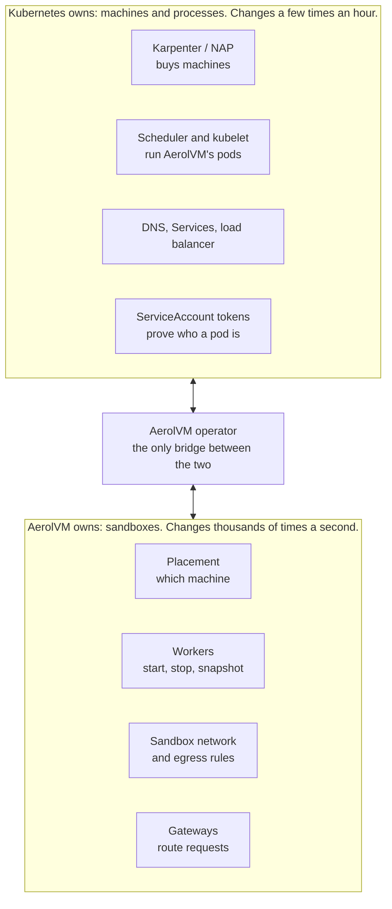

### What AerolVM stops doing on Kubernetes

On plain VMs, AerolVM does a lot of the machine work itself. On Kubernetes it
stops doing all of it:

- **Installing and restarting itself** (today `install.sh`, Ansible,
  Terraform, systemd). Kubernetes does it.
- **Touching the machine.** No host firewall rules, no host network, no host
  cgroups, no host folders, no programs copied onto the machine. All of it
  moves inside the worker pod.
- **Its own join list.** Kubernetes DNS names replace `SB_BOOTSTRAP_PEERS`
  addresses.
- **Its own certificate authority.** The bank's issuer signs. *(R2: in external-CA mode; the default is a v0.7.0 join token, §15.2)*
- **Opening ports on worker machines.** Workers open no ports to clients.
  Gateways carry all client traffic to them over mutual TLS.
- **Any per-sandbox Kubernetes object.** No husk pods, no CRD per sandbox.

### Why AerolVM keeps its own brain at all

For the same reason CockroachDB does: Kubernetes is built for a few slow,
long-lived things per machine, and sandboxes are many, small and fast.

| | Kubernetes pod | AerolVM sandbox |
|---|---|---|
| Start time | Kubernetes' own goal: 99% of pods within 5 s. We measured 5.5 s cold and 0.04–0.05 s from a warm pool with agent-sandbox on kind (`agent-sandbox-feature-parity.md`). | 4 ms (V8 isolate) to 284 ms (gVisor) on EC2, warm path |
| How many per machine | 110 by default. On EKS each pod also takes a VPC address: an m7i.8xlarge holds at most 234 pods, and managed node groups cap it at 250. | As many as CPU, memory and disk allow |
| Network address | One VPC address each (EKS VPC CNI) | Private to the worker pod. One VPC address per machine. |
| Cost to Kubernetes | Several etcd writes each | None |
| What it can run | Containers. VMs only through add-ons such as Kata. | containerd, gVisor, Firecracker, WASM, V8 isolates |

Ray and Spark use the same split. Kubernetes runs their processes, and their
own schedulers place the small, fast work inside them.

## 5. Options we compared

| Option | What it is | Verdict |
|---|---|---|
| A. Every sandbox is a pod | The agent-sandbox way: Kubernetes is the only scheduler, warm pools of real pods | **No.** Seconds to start cold, etcd writes per sandbox, 110 pods per machine, a VPC address per sandbox, no WASM or V8 isolates. Google's own published best is 300 sandboxes per second per cluster. |
| B. Husk pods | Empty pods wait, a sandbox is moved into one when claimed | **No.** Dummy pods hold capacity while waiting, two schedulers meet in the middle, and Kubernetes ends up choosing the machine. |
| C. Privileged DaemonSet using the machine's containerd | The earlier plan | **No.** It changes the machine outside the pod (host firewall next to kube-proxy and the CNI, host cgroups, `runsc` copied into `/usr/local/bin`). Kubernetes cannot see sandbox use, so the autoscaler sees busy machines as empty. A slow pod restart trips the 30-second death rule. |
| **D. One self-contained worker pod per machine** | Sandboxes live inside a node-sized pod that holds its own containerd and network | **Chosen.** Kubernetes sees true use, nothing touches the machine, upgrades keep sandboxes running. |
| E. CockroachDB's multi-Raft (one Raft group per slice of sandboxes) inside one cluster | Split the placement table into ranges, each with its own Raft group | **Not now.** Sandboxes never need a transaction across two sandboxes, so the simpler answer is cells (section 12). Revisit only if one cell cannot reach its target. |

---

# Part 2: The design

## 6. The whole system in one picture

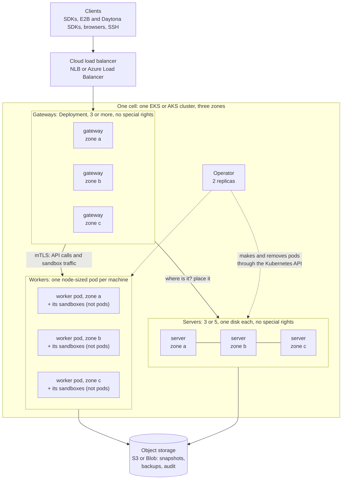

What to notice:

- **Clients only ever talk to gateways.** Gateways hold no state, so any
  gateway can take any request.
- **Servers keep the small table "which sandbox is on which worker"** with
  Raft. They never run sandboxes and never face the internet.
- **Workers run sandboxes and nothing else.** They take traffic only from
  gateways, servers and other workers (for secret backups and moves), over
  mutual TLS.
- **The operator is the only part that writes to the Kubernetes API** while the
  cluster runs. When the agent-sandbox facade is built later (§16), the
  gateways will also *serve* its aggregated API groups. SDK and facade traffic
  never goes near the Kubernetes API.

## 7. The four kinds of pod

| | Gateway | Server | Worker | Operator |
|---|---|---|---|---|
| **Job** | Take every client request and pass it on | Keep the placement table with Raft | Run sandboxes | Manage the cluster through Kubernetes |
| **Kubernetes object** | Deployment + autoscaler | Pod made by the operator, one `AerolNode` each, one disk each | Pod made by the operator, one `AerolNode` each | Deployment |
| **How many** | 3 to many, at least 1 per zone | 3 (one per zone) or 5 (2, 2, 1) | One per worker machine | 2, with leader election |
| **Special rights** | None (`restricted` pod security) | None (`restricted`) | **Privileged** (section 8.7) | None |
| **Keeps state** | No. A routing cache only. | Yes: Raft log and snapshots on its disk | Only its sandboxes, on the machine's local disk | No |
| **Scales by** | Requests and CPU | Fixed (3 or 5) | Free sandbox capacity (section 10.4) | Fixed |
| **Faces the internet** | Yes, behind the load balancer | No | No | No |

### 7.1 Gateway

The gateway merges two of today's jobs: the `/v1` API listener and the
ingress role. It serves:

- the `/v1` API and the Daytona, E2B and Runloop facades;
- HTTPS links to sandbox ports. The gateway reads the name in the TLS
  handshake (SNI) and passes the still-encrypted bytes to the owning worker,
  whose Caddy ends TLS, as owners do today. It uses the routing that needs no
  per-sandbox Caddy writes (`plans/ingress-proxy-routing.md`), which is behind
  `SB_INGRESS_PROXY_ROUTING`, on by default since cluster phase 2 (`internal/config/config.go:2302`). That mode
  keeps a small index of every placement on each gateway (about 100–150 bytes
  per sandbox), so a plain cloud load balancer works with any number of
  gateways;
- the SSH gateway;
- TLS ports (`tls://` on 443, routed by SNI) and plain TCP ports. Plain TCP
  is the one weak spot on Kubernetes: each port needs its own load-balancer
  listener, and an AWS NLB allows at most 50, a limit AWS will not raise. So
  on Kubernetes we steer users to TLS ports, and plain TCP ports come from a
  small pool set per install (section 21, question 7).

A gateway keeps a cache of "sandbox X lives on worker W", filled from the
placement change feed that already exists
(`internal/cluster/placement_changelog.go`). Today a worker or ingress node
asked a server on **every** routed request. An owner cache now exists
(`internal/cluster/agent.go:177-179`, #1018) but is off by default
(`SB_CLUSTER_OWNER_CACHE`); the chart turns it on. A stale cache entry must be
safe: the worker checks that it owns the sandbox and answers "not here",
which refreshes the cache (fix E3 in section 9.4). CockroachDB's gateways work
the same way with their range cache.

Long streams (exec output, sessions, terminals) hold no state in the gateway.
If a gateway dies, the client reconnects through any other gateway and
re-attaches. Sessions live in `toolboxd` inside the sandbox, which keeps
running (`docs/src/content/docs/sessions.mdx`).

### 7.2 Server

Servers are today's server role (`SB_NODE_ROLE=server`) with four changes:

1. **Made by the operator, one `AerolNode` each, with its own disk.** Like
   CockroachDB's current operator, we do not use a StatefulSet. The operator
   pins each server to its zone, because EBS and Azure Disk volumes cannot
   move between zones.
2. **They advertise DNS names, not IP numbers** (lesson L1). Today Raft turns
   the advertised name into an IP number at start-up
   (`internal/cluster/raft.go`). A pod that moves gets a new IP, so this must
   change.
3. **On `SIGTERM` they hand off Raft leadership, then exit** (lesson L2).
   Today a stop sends a gossip "leave" with a 2-second timeout and does not
   hand off leadership (`internal/cluster/gossip.go`, `gossipNode.Close`;
   `internal/cluster/client.go`, `Close`). The hand-off itself exists since
   v0.7.0 (`TransferLeadership`, `internal/cluster/rollout.go:250`); C8 calls it
   on `SIGTERM`.
4. **Three or five voters.** The existing cap of 7 server nodes
   (`cluster.MaxServerTierNodes`: 5 voters plus 2 while one is being
   replaced) stays.

### 7.3 Worker

Section 8. This is the part that changed most.

### 7.4 Operator

One Deployment, 2 replicas, one leader at a time. It is the **only** AerolVM
part that writes to the Kubernetes API while the cluster runs. It:

- turns one `AerolCluster` object into servers, gateways and workers;
- adds and removes workers from capacity numbers (section 10.4);
- carries out the leader's rollout on Kubernetes (section 13): the leader still
  decides the order, the stages, the canary and `finalize`;
- decommissions a worker before its machine goes (section 10.5);
- proves each new pod with TokenReview, then mints its single-use join token (or, in external-CA mode, requests its certificate from the bank's issuer) (R2)
  (D6, D11);
- copies each machine's zone label onto its pod (section 11).

## 8. The worker pod, up close

This is the heart of the design, so it goes slowly.

### 8.1 One pod per machine, sized to the machine

Workers run in their own node pools. The pools carry a taint, so nothing else
lands there. The operator makes **one worker pod per machine**, and the pod
**asks for nearly the whole machine**: everything the machine offers to pods,
minus what the system add-ons on every machine need (the network plugin, log
shipper and so on).

Example on a 32 vCPU, 128 GiB machine:

| | Amount |
|---|---|
| Machine | 32 vCPU, 128 GiB |
| Offered to pods by Kubernetes (allocatable) | about 31.5 vCPU, 120 GiB |
| System add-ons on every machine | about 0.5 vCPU, 1 GiB |
| **Worker pod asks for (request = limit)** | **about 31 vCPU, 118 GiB** |

Why the whole machine:

- **Kubernetes' numbers become true.** The scheduler, the autoscaler and the
  bank's cost tools see the machine as full, because it is.
- **The autoscaler works with no tricks.** When the operator wants more room,
  it makes one more worker pod. That pod fits on no existing machine, so
  Karpenter or Node Auto Provisioning buys a new machine for it. **No dummy
  pods are needed.** The capacity unit is the real worker.
- **Nothing else can squeeze in,** and the worker pod has the highest
  priority, so the kubelet removes it last of all.
- **Request equals limit**, so Kubernetes gives it the "Guaranteed" class.

### 8.2 Three containers: `runtime`, `agent` and `edge`

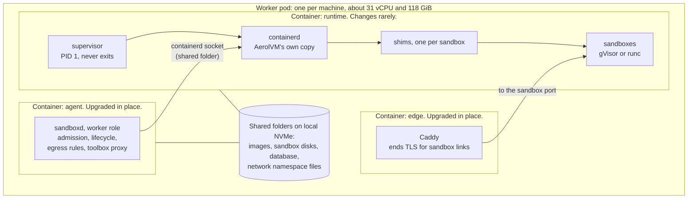

- **`runtime`** holds containerd, the gVisor shim and every sandbox. It
  changes only when we change containerd or gVisor. Its first process is a
  small supervisor that never exits. If containerd crashes, the supervisor
  restarts it in place, and the sandboxes keep running, because each one
  belongs to its own shim, not to containerd. This container has **no
  liveness probe**. A failed probe would restart it and kill every sandbox.
- **`agent`** is `sandboxd` in the worker role. It changes with every AerolVM
  release. Kubernetes lets you change the image of a running pod's container:
  only that container restarts, and the pod keeps its identity, node, IP and
  volumes (Kubernetes "Pods" page, in Sources). So an AerolVM upgrade restarts
  `sandboxd`, and no sandbox notices. The new `sandboxd` finds its sandboxes
  through containerd and its database, as it does today after a restart.
- **`edge`** is the Caddy that today runs next to `sandboxd` on every owner
  node. It ends TLS for sandbox links and holds custom-domain certificates. On
  Kubernetes its wildcard certificate comes from cert-manager, as a Secret
  mounted read-only, so no worker holds a DNS provider token (C25). Custom
  domains keep Caddy's on-demand TLS.
  It is its own container so that a `sandboxd` restart never cuts an open
  connection, which is the rule `plans/ingress-proxy-routing.md` already
  follows.
- The containers share folders on the machine's local disk. Each mounts
  them at the **same path**, so a file path `sandboxd` hands to containerd means
  the same file in both. The network-namespace folder (`/run/netns`) is shared
  with mount propagation, so a namespace `sandboxd` creates is visible to
  containerd. The earlier plan had to make paths match between a pod and the
  machine. Now both sides are inside our own pod.

### 8.3 Where sandboxes live: inside the pod's CPU and memory box

```
kubepods                                   (Kubernetes' box for all pods)
└── worker pod  (Guaranteed: about 31 vCPU, 118 GiB)
    ├── agent container       sandboxd
    ├── edge container        Caddy
    └── runtime container
        ├── supervisor, containerd
        ├── sandbox sb-0a1b...   its own limits, for example 2 vCPU, 4 GiB
        ├── sandbox sb-77c2...   its own limits
        └── ...
```

- **This does not happen by itself.** containerd's Kubernetes plugin does not
  give a privileged container its own cgroup namespace, so a privileged pod
  sees the machine's whole cgroup tree (containerd source, in Sources). Today
  `sandboxd` sets no cgroup path for a sandbox
  (`internal/runtime/containerd/lifecycle.go`), so inside a pod each sandbox
  would land at the machine's top level, outside the pod. Fix C7: `sandboxd`
  reads its own pod's cgroup path from `/proc/self/cgroup`, puts every sandbox
  under the `runtime` container's group, and **refuses to start a sandbox
  anywhere else**. The supervisor first moves itself into a child group,
  because cgroup v2 lets a group hand resources to children only when it has
  no processes of its own (the same trick Docker-in-Docker uses).
- Each sandbox has its own limits, set by AerolVM as today.
- The pod's limit is the hard ceiling for all of them together.
- Kubernetes, its metrics and the bank's cost tools see the real use, because
  every sandbox process sits inside the pod's box.
- If sandboxes together hit the pod's memory limit, the kernel stops a process
  inside the pod. We mark `containerd` and the supervisor as the last
  choice, so a sandbox goes first, never the machinery.

### 8.4 The network lives inside the pod

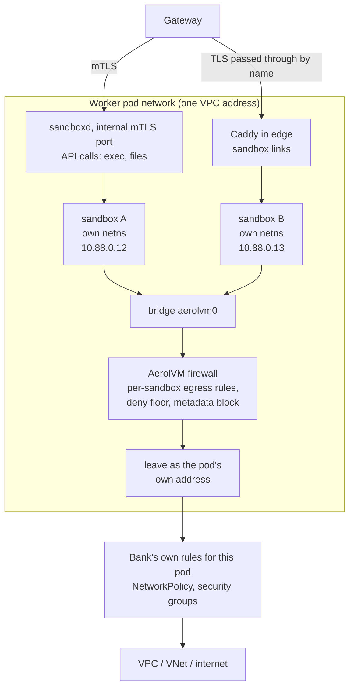

- **Each sandbox has its own network namespace**, joined to a bridge that
  lives in the worker pod's network, not the machine's.
- **Going out:** AerolVM's own firewall applies each sandbox's egress rules,
  the deny floor and the cloud metadata block, as today. Then traffic leaves
  with the pod's address. Because of that, the bank's NetworkPolicy and
  security groups cannot tell a sandbox's traffic from AerolVM's own: they
  limit the whole pod, and AerolVM cannot loosen them. What separates
  sandboxes from the bank's network is AerolVM's in-pod firewall, which on
  Kubernetes blocks private ranges, the cluster's own ranges, the API server
  and the worker pod's own ports by default (C24, CEO review RQ14).
- **Coming in:** gateways reach the worker pod on two ports. API calls (exec,
  files, sessions) go to `sandboxd`'s internal mutual-TLS port, as they reach
  an owner node today. Sandbox links go to Caddy in the `edge` container,
  which ends TLS and passes the request to the sandbox.
- **What this removes:**
  - No host firewall rules, so no clash with kube-proxy or the CNI. This was
    the first risk in the earlier plan's risk table.
  - One VPC address per machine instead of one per sandbox.
  - The sandbox address range is private to the pod, so it cannot break the
    machine's routing. It still becomes a setting (C3), in case a sandbox must
    reach a bank network in the same range.
  - The cloud metadata service is blocked twice. AerolVM's own rule blocks
    it, as today. And on EKS, Karpenter's default machine settings allow only
    IMDSv2 with a hop limit of 1, which keeps everything off the host network
    away from it. Managed node groups with a custom launch template default to
    a hop limit of 2, so the chart's docs tell banks to set 1.

### 8.5 Disks

- **Workers** keep images, sandbox disks and their small database on the
  machine's **local NVMe disk**, through a pod volume. It is fast, and it dies
  with the machine, which is fine: the sandboxes die with the machine too.
  Each new worker pulls its pool's images (`workerPools[].images`, plus every
  image `/v1/warm-pools` lists) before it says "ready".
- **Servers** keep the Raft log and snapshots on a cloud disk (EBS gp3 or Azure
  Premium SSD), one per server, in the server's zone.
- **Object storage** (S3 or Azure Blob) holds sandbox snapshots, Raft backups,
  the audit export and the audit witness.

### 8.6 What survives what

| What happens | Sandboxes | Why |
|---|---|---|
| `agent` restarts or is upgraded | **Keep running** | They live in the `runtime` container |
| `edge` (Caddy) restarts or is upgraded | **Keep running** | Open sandbox links through this worker reconnect |
| containerd crashes | **Keep running** | Each belongs to its own shim; the supervisor restarts containerd |
| `runtime` container restarts | Lost, like a machine crash | Its box goes away. It has no liveness probe and its first process never exits, so this should be rare. |
| Worker pod deleted | Lost | So only the operator deletes worker pods, and only after decommission (section 10.5). A validating webhook refuses any other delete of a live worker pod (C26). |
| Machine dies | Lost. Failover sandboxes are rebuilt elsewhere. | Same as today on plain VMs |

### 8.7 The special rights, said plainly

The `runtime` and `agent` containers are **privileged**. (`edge` needs no
special rights.) A privileged container can do
almost anything a root user on the machine can do. We do not pretend
otherwise. What is different from the earlier plan:

- **No host network, no host PID, no host folders, no host containerd
  socket, no files copied onto the machine.** AerolVM touches the machine only
  through the kernel, never through its files or its network.
- **Mistakes stay inside the pod.** A bad firewall rule breaks one worker's
  sandboxes, not the machine's Kubernetes networking.

The walls around it:

1. Worker machines are their own tainted node pools. Only worker pods land
   there.
2. Worker pods live in their own namespace. Only that namespace allows
   privileged pods.
3. NetworkPolicy lets only gateways, servers and other workers reach a worker.
4. The worker's ServiceAccount has **no Kubernetes API rights at all**. The
   operator does all Kubernetes work.
5. The machine's cloud identity stays minimal. Sandboxes cannot reach the
   metadata service (section 8.4).
6. Images are signed, with an SBOM, and the bank's admission policy can refuse
   anything unsigned.

Phase 0 spike S7 (CEO review CE3) tries to replace "privileged" with a named
list of rights: explicit capabilities, seccomp and AppArmor settings, and a
writable cgroup, with no host paths (K4). S7 is decided per supported machine image: S1, S2 and S3 must all pass
again with that list on it. On EKS that is Amazon Linux 2023, plus
Bottlerocket only if S1 passes there (§20). AKS images run S7 in Phase 4.
Each supported image has exactly one supported mode, never two: the list if
S7 passes on that image, `privileged: true` if it fails. The chart picks the
mode from the node pool's image.
The worker namespace keeps the Pod Security `privileged` level in both cases,
because added capabilities go beyond `baseline`. What changes is that the pod
no longer asks for `privileged: true`. If S7 fails, its findings go in the
evidence pack (P7) as the reason privileged is needed. It is never a blocker.

### 8.8 The earlier worker design next to this one

| Problem in the earlier design (`kubernetes-full-architecture.md` §10) | This design |
|---|---|
| Host network: sandbox networks and firewall rules on the machine, next to kube-proxy and the CNI | Gone. All inside the pod's network. |
| Uses the machine's containerd through its socket (root on the machine) | Gone. Our own containerd, inside the pod. |
| `runsc` and its shim copied into the machine's `/usr/local/bin` | Gone. They ship in our image. |
| Firecracker and V8 isolate processes moved into cgroups at the machine's top level | Gone. Everything sits inside the pod's box. |
| Paths must match between the pod and the machine | Gone. Both sides are our own containers. |
| AerolVM's network file in the machine's CNI folder | Gone. Our containerd has its own folder. |
| Kubernetes cannot see sandbox CPU and memory; the autoscaler sees busy machines as empty | Gone. Use is inside the pod, and the pod asks for the whole machine. |
| A slow pod restart trips the 30-second death rule | Gone for upgrades: the agent restarts in place and announces it first (section 10.2). |
| AerolVM must clean up its own images on the machine | Still true, but now inside its own folder on the pod's volume. |
| `/health` always checks Docker | Still must be fixed (C2). |

### 8.9 Runtimes on ordinary EKS and AKS machines

| Runtime | Needs | On Kubernetes |
|---|---|---|
| **gVisor** (`runsc`) | Nothing special. AerolVM does not set a gVisor platform (`internal/runtime/containerd/runsc_config.go`), so gVisor uses its default, which needs no KVM. | **Phase 1. The default for banks.** |
| **runc** (plain containers) | Nothing | Phase 1, only for trusted code |
| **WASM** | Nothing | Phase 5 (section 18) |
| **V8 isolates** | Nothing | Phase 5 |
| **Firecracker** | `/dev/kvm`. **EKS:** metal instances, or, since February 2026, ordinary Intel instances with nested virtualization turned on (M7i, C7i, R7i, M8i, C8i, R8i and others; Karpenter's `EC2NodeClass` has a setting for it). **AKS:** sizes that support nested virtualization; KubeVirt (which uses KVM) runs there, but AKS does not officially support it. AKS's own Pod Sandboxing uses Hyper-V, not KVM, so it proves nothing for us. | Phase 5, on its own node pool, after Phase 0 checks `/dev/kvm` and speed on a live node |

WASM, V8 isolates and Firecracker start processes from `sandboxd` itself,
not through containerd. On plain VMs they already outlive a `sandboxd` restart:
they start in a cgroup outside `sandboxd`'s unit and the next `sandboxd` takes
them over (`pkg/hostproc`; `internal/runtime/wasm/adopt.go`,
`internal/runtime/isolate/adopt.go`). In the pod, the same code must target the
`runtime` container's cgroup, and the pod must share one process namespace, or
an `agent` restart kills them with the container (C14). They still come in
Phase 5, after gVisor works.

## 9. The control plane inside one cell

### 9.1 What the servers keep today

- **One Raft group**, using hashicorp/raft, run only by server-role nodes
  (`internal/cluster/raft.go`; workers and ingress nodes run the lighter
  `Agent`, `internal/cluster/agent.go`).
- **The placement table is kept in memory** on every server, with its indexes.
  One row is about 751 bytes, so 100,000 sandboxes take about 72 MB per server
  (`internal/cluster/topology.go`, `plans/secrets-hardening.md`).
- **What goes through Raft:** placement, deletes, failover moves, exposed
  ports, custom domains, volumes, egress profiles, API tokens and a few
  others (about 32 kinds, `internal/cluster/fsm.go`).
- **What does not:**
  - start, stop, pause and the "last used" clock;
  - sandbox secrets, which are sealed and copied to the owner and 2 backup
    workers;
  - free capacity. Every server asks every worker for it every 5 seconds
    (`internal/cluster/capacity_lease.go`).

A create costs **two** Raft writes (reserve, then place). A destroy costs two
writes and two reads from the leader. Kubernetes is not involved at all.

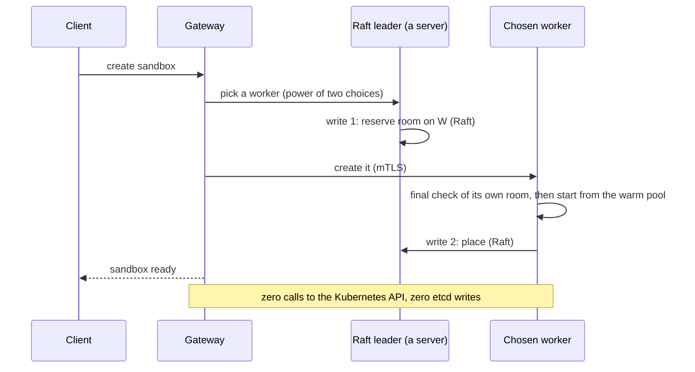

### 9.2 What CockroachDB-grade asks of this part

CockroachDB spreads its work so that no single node or lock limits the whole
cluster. Inside one cell we cannot avoid one Raft leader. That is fine, as long
as the leader does very little work per sandbox and never waits while holding
a lock.

### 9.3 What limits one cell today

| # | Limit | Evidence | Effect | Status on `main`, 2026-11-10 |
|---|---|---|---|---|
| L-a | The reservation lock is held while waiting for the Raft commit | `internal/cluster/client.go`, `applyReservationEncodedLocal` holds `reservationAdmissionMu` across `raft.Apply(...).Error()` | Reservations happen one at a time. With a commit at about 6–7 ms p50 on gp3 (`plans/warm-create-latency-tier1.md`), that is **roughly 150 creates per second for the whole cluster**. This is our estimate from the code, not a measurement. Phase 0 measures it. | Fixed: §9.4 E2 shipped (#1024, `admission_ledger.go`) |
| L-b | No group commit: one Raft entry per command | `client.go`; `opReserveBatch` exists but only tests use it | Each write pays its own disk sync | Mostly moot: raft groups concurrent applies now that E2 is in |
| L-c | Every write saves a recovery file, with fsync, under the table's write lock, on every server | `internal/cluster/fsm.go`, `recoveryStore.Put` inside apply | Slower commits, and reads wait too | Mostly fixed: Put defers fsync to snapshot time (`recovery_store.go:84-96`); the write still runs under the table lock |
| L-d | Workers and ingress nodes ask a server for the owner on **every** routed request | `internal/cluster/agent.go`, `OwnerOf` → `lookupPlacement`, no cache | Server load grows with traffic, not with sandboxes | Fixed behind a flag: owner cache (#1018, `SB_CLUSTER_OWNER_CACHE`, off by default; on in Kubernetes) and owner-side lease (#1042) |
| L-e | Every server polls every worker's capacity every 5 s | `capacity_lease.go` | 2,000 workers × 5 servers = 2,000 calls per second of pure upkeep | Open; since ef7fecfe a leader with stale capacity asks the worker on demand |
| L-f | Choosing a worker scans the whole fleet | `internal/cluster/placement.go` | Cost per create grows with the fleet | Open |
| L-g | Snapshots copy the whole table; all of it lives in memory | `fsm.go` snapshot and restore | Restart and catch-up time grow with sandboxes | Open |
| L-h | Failover moves one sandbox per Raft write, in order, and stops at the first error | `internal/cluster/dead_owner.go`, `evictDeadOwner` | A worker with 500 failover sandboxes takes 500 sequential commits | Open |
| L-i | A clean stop looks like a death | `internal/cluster/gossip.go` (`gossipNode.Close` sends a gossip leave); `dead_owner.go` | A pod restart over 30 s orphans or moves sandboxes | Partly fixed: a node the rollout is upgrading is not failed over before its deadline (`dead_owner.go:178`); gossip re-converges after a restart (#1102) |

### 9.4 The fixes

Each fix is a proposal for engineering review. Each touches
`internal/cluster`, the most fragile code we have, so each needs a regression
test next to the file it changes and a PR call-out (CLAUDE.md rule 6). We
measure before and after each one.

| Fix | What | Removes | Status on `main`, 2026-11-10 |
|---|---|---|---|
| E1 | **Group commit.** Many reserves and places share one Raft entry, using hashicorp/raft's batching and the unused `opReserveBatch`. | L-b | Done by raft's own batching once E2 shipped |
| E2 | **Never wait for the disk while holding the reservation lock.** Check and hold the room in memory under the lock, release it, then commit. A failed commit gives the room back. | L-a | Shipped (#1024) |
| E3 | **Route cache on gateways and workers**, filled from the placement change feed that already exists (`placement_changelog.go`). The owner answers "not here" to a stale guess. | L-d | Shipped behind `SB_CLUSTER_OWNER_CACHE` (#1018, #1042); the chart turns it on |
| E4 | **Write the recovery file outside the table lock.** The file is named by its content hash, so it can be written before the commit and safely left behind if the commit fails. | L-c | Open Stale premise (eng review OV-E7): Put already defers fsync to snapshot time (`internal/cluster/recovery_store.go:84-96`), and moving Put before commit would break the GC assumption that Put and snapshot tracking share the FSM lock. Re-measure; drop unless the remaining I/O shows up. |
| E5 | **Capacity work grows with workers, not workers × servers.** Each worker pushes its numbers on change and every few seconds to the leader. Followers learn them from the leader. | L-e | Open |
| E6 | **Pick from a sample, not the whole fleet.** Keep a list of fitting workers per runtime and zone, draw a few at random, and apply the power of two choices to them. | L-f | Open |
| E7 | **Failover in batches**, many sandboxes per Raft write, and keep going past a single error. | L-h | Open |
| E8 | **"Restarting" is not "leaving"** (C8 in section 17). | L-i | Partly: rollouts only (`dead_owner.go:178`); C8 covers restarts outside a rollout |

L-g (full snapshots) stays for now. A cell's size is capped (section 9.5), so
its snapshot is too. If Phase 0 shows restore is too slow at the cap, we
move the table to disk with incremental snapshots.

### 9.5 Targets for one cell after the fixes

| Measure | Target |
|---|---|
| Creates per second, sustained | ≥ 1,000 |
| Live sandboxes | ≥ 100,000 (about 72 MB of table per server) |
| Workers | ≥ 500 |
| Raft commit p99 under that load | ≤ 25 ms |
| Owner lookups that reach a server | 0 on a cache hit |
| Failover of 1,000 sandboxes from one dead worker | ≤ 60 s |
| Server restart to caught up, at 100,000 sandboxes | ≤ 30 s |

These are **targets**. Phase 0 measures today's real numbers, and Phase 3
publishes the final ones. If a cell cannot reach them, that does not block
growth: section 12 adds cells.

### 9.6 Noticing a dead worker

- **Gossip decides,** as today: memberlist (the SWIM method) on port 7001.
  Kubernetes is never required for this, so a Kubernetes outage cannot cause
  a false failover.
- **Kubernetes is a second opinion through the operator.** When Kubernetes
  says a machine is gone (its node object is deleted), the operator tells the
  servers, and failover starts at once instead of waiting out the grace
  period. When a worker announced "restarting" and its pod is running, the
  servers wait the longer restart window. If the operator cannot reach
  Kubernetes, gossip alone decides.

## 10. The operator and the Kubernetes objects

### 10.1 Objects

| Object | One per | What it holds | Churn |
|---|---|---|---|
| `AerolCluster` | cell | Version, zones, server count, gateway scaling, worker pools, security settings | Changed by people |
| `AerolNode` | server or worker | Which machine, zone, role, state, version; status counters for the printer columns (P10) | State: a few changes per node per day. Status counters: at most once a minute per node, inside G4's "a few writes per machine per minute" |

There is **no object per sandbox.** With 2,000 workers there are about 2,000
`AerolNode` objects. That is a normal load for etcd.

A first sketch of `AerolCluster` (names may change):

```yaml
apiVersion: aerolvm.io/v1alpha1
kind: AerolCluster
metadata:
  name: prod
  namespace: aerolvm-system
spec:
  version: v0.7.0
  cell: 1                      # 1 to 255. Goes into every new sandbox ID.
  zones: [eu-west-1a, eu-west-1b, eu-west-1c]
  servers:
    count: 3                   # 3 or 5
    storage: {size: 50Gi, storageClassName: gp3}
  gateways:
    minReplicas: 3
    maxReplicas: 30
    service: {type: LoadBalancer}
  workerPools:
    - name: gvisor-general
      runtimes: [gvisor]
      nodeSelector: {aerolvm.io/pool: gvisor-general}
      machine: {cpu: 32, memoryGiB: 128}
      minWorkers: 3            # at least one per zone
      maxWorkers: 300
      headroomPercent: 15      # keep this much free, per zone
      zoneLossReserve: 0%      # extra room per zone so more of a lost zone's recreate sandboxes return within 60 s (G1, RQ15)
      images: [python:3.12, node:22]   # pulled before the worker says ready
      provisioner: karpenter   # karpenter | nap | eks-managed | aks-pool; sets the decommission deadline cap
      decommission:
        drainWindow: 15m       # time for sandboxes to finish by themselves; 5m by default on eks-managed pools (§10.6)
  security:
    externalCA:                # optional (R2): omit to use v0.7.0 join tokens with the CA on the servers
      issuerRef: {kind: ClusterIssuer, name: bank-private-ca}
    secretProvider: aws-kms
    createPolicy: {configMapRef: {name: aerolvm-create-policy}}   # rendered as SB_CREATE_POLICY_FILE (internal/createpolicy)
```

### 10.2 The life of a node

Every server and worker has an `AerolNode` that moves through these states.
Only the operator writes it. It combines what Kubernetes says about the pod
and machine with what AerolVM says about the node.

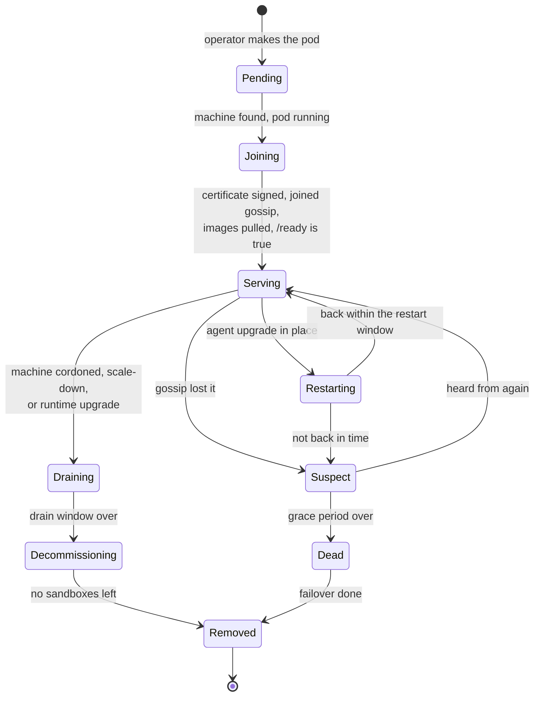

- **Restarting** is new. Before an in-place upgrade, the agent tells the
  cluster "I am restarting, back in about 30 s". The others wait for a longer
  restart window (for example 120 s) before suspecting it. Today a clean stop
  says "I am leaving", which starts the 30-second death timer
  (`internal/cluster/dead_owner.go`, `handleMemberLeave`; lesson L2).
- **Draining** takes no new sandboxes and keeps the ones it has.
- **Decommissioning** moves, rebuilds or finishes what is left
  (section 10.5).

### 10.3 Installing

1. The bank's platform team makes the node pools (or lets Karpenter or NAP
   make them), a certificate issuer *(only for external-CA mode, R2)*, and a KMS key.
2. `helm install aerolvm` installs the operator and its CRDs.
3. They apply one `AerolCluster`.
4. The operator makes the servers. Server 1 starts the Raft cluster once.
   The others join through DNS.
5. The operator makes the gateways and the minimum workers. Each worker gets
   its join token after TokenReview (R2), joins gossip, pulls its
   images and turns ready.
6. The cluster takes traffic.

### 10.4 Adding and removing workers, with no dummy pods

The operator reads AerolVM's own numbers: free CPU and memory per pool and
zone, warm-pool depth, and the rate of "no room" answers. It keeps the
headroom the `AerolCluster` asks for.

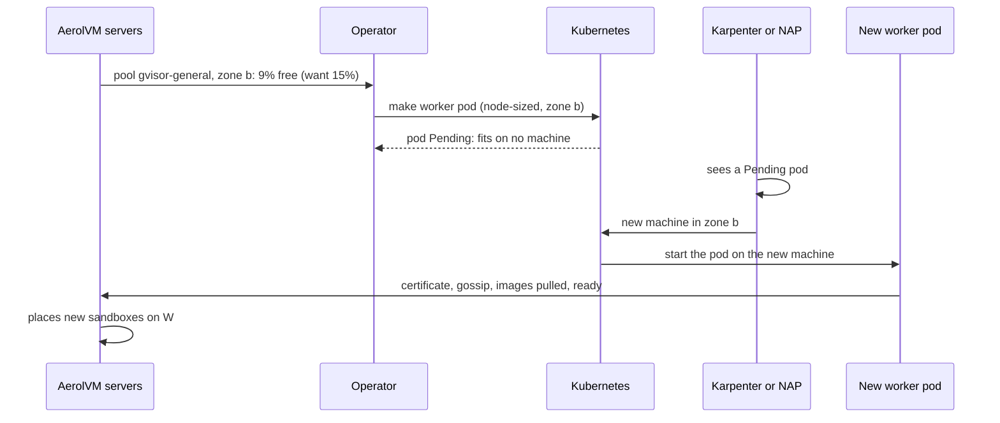

- **Scaling up** takes as long as the cloud needs to start a machine
  (often one to two minutes). Headroom covers that gap, as warm pools cover
  sandbox start-up today.
- **Scaling down:** the operator picks the emptiest worker, decommissions it
  (section 10.5), then deletes its pod. The machine is now empty, and Karpenter
  or NAP returns it.

### 10.5 Decommission: CockroachDB's "move it off first", for sandboxes

CockroachDB moves every copy of its data off a node before the node leaves.
A running sandbox cannot be copied while it runs, so each sandbox follows its
own policy:

| Sandbox kind | What decommission does |
|---|---|
| Ends by itself within the drain window | Nothing. It finishes. |
| Failover policy `recreate` | **Prepare before break** (keeps the shipped invariant I1, one executor; CEO review outside voice). Create the new copy on another worker, in another zone if possible, with its image pulled but its program not started. Stop the old one, move the ID and link with the placement compare-and-swap, then start the new one. Downtime is a stop plus a start, seconds. |
| Can be snapshotted (Firecracker with memory, or a containerd disk snapshot) | Snapshot, restore on another worker with the same ID and link. Firecracker keeps its memory; a containerd snapshot keeps its disk only. |
| gVisor, from Phase 5 (CEO review CE5) | Pause, `runsc checkpoint` with memory, restore on another worker with the same ID and link (C21). Running programs keep running; open network connections drop. Both workers must run the same gVisor version. |
| None of the above | Tell the owner (event and webhook) at drain start, then stop it at the deadline. |

The first row that applies wins, top to bottom. One exception: from Phase 5 a
gVisor sandbox tries the checkpoint move (C21) before `recreate` or a disk
snapshot, and if the move is refused or fails, the next row that applies is used.

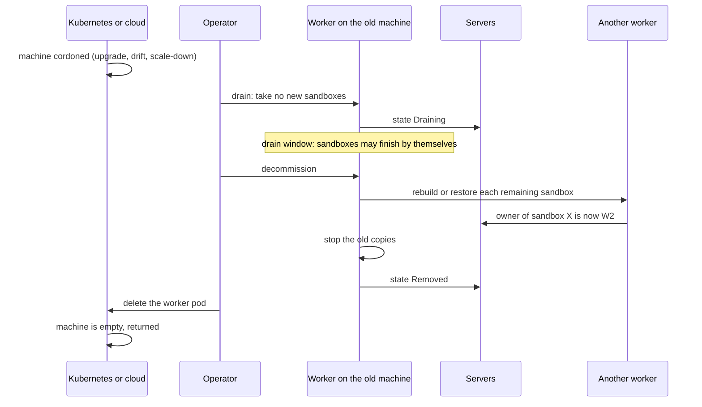

### 10.6 When Kubernetes or the cloud wants a machine back

Machines go away for planned reasons: Kubernetes version upgrades, new
machine images, Karpenter "drift", and scale-down. The rule: **a cordoned
machine is the signal to decommission its worker.** Every tool we care about
cordons first.

- **Karpenter (EKS) and Node Auto Provisioning (AKS, which is Karpenter
  underneath).** Worker pods carry `karpenter.sh/do-not-disrupt: "true"`.
  That annotation stops consolidation always, and stops drift only when the
  NodePool has no `terminationGracePeriod`. It does **not** stop expiry, node
  auto-repair or interruption, and a `terminationGracePeriod` overrides both
  it and PodDisruptionBudgets (Karpenter docs, in Sources). So worker
  NodePools use:
  - `expireAfter: Never` and no `terminationGracePeriod`. Banks still need
    machines patched, so the operator replaces machines by age itself, by
    decommission, a few per zone at a time.
  - Drift, such as a new machine image: the operator sees it, decommissions
    the worker, deletes the pod, and Karpenter takes the empty machine.
  - Auto-repair stays on. It only acts on machines that are already broken.
- **EKS managed node groups.** They cordon, then evict, and respect
  PodDisruptionBudgets for 15 minutes per machine. After that the update
  stops with `PodEvictionFailure`, unless someone forces it. The worker's
  PodDisruptionBudget blocks eviction, so the operator decommissions the
  worker when it sees the cordon. Two cautions:
  - Decommission must finish within those 15 minutes. The operator's
    decommission deadline is the drain window plus the move budget, and on
    managed node group pools the operator caps their sum at 14 minutes (a
    5-minute drain window by default there). If that is not enough, the
    operator's "prepare pool" action drains the pool before the upgrade
    starts.
  - The ASG's AZRebalance and scale-in ignore PodDisruptionBudgets, so the
    chart's docs say to suspend AZRebalance on worker groups.
- **AKS node pools without NAP.** The drain timeout defaults to 30 minutes
  and can be set from 5 minutes to 24 hours, so set it longer than the drain
  window. The "undrainable node" behaviour defaults to `Schedule`, which
  **deletes** the blocked machine, so worker pools must use `Cordon`. Max
  surge defaults to one machine.
- **Spot machines** are not used for workers. Two minutes' notice is not
  enough to move sandboxes.
- **A machine that just dies** is not planned. Gossip notices, the grace
  period runs, and failover rebuilds what it can, as today.

# Part 3: How it behaves

## 11. Zones and locality

Today placement ignores zones (`internal/cluster/placement.go`). On
Kubernetes every machine already has a zone label
(`topology.kubernetes.io/zone`), so the operator copies it onto each pod and
`sandboxd` reads it as the existing setting `SB_NODE_ZONE` (no new `SB_NODE_LOCALITY`; C10)
(for example `region=eu-west-1,zone=eu-west-1b`).

| Thing | Rule |
|---|---|
| Servers | 3 servers: one per zone, so the cluster survives any one zone. 5 servers: 2, 2 and 1, so it survives any one zone, or any two servers. It does **not** survive a two-server zone plus one more server (2 of 5 left; quorum needs 3). While a zone is down, the operator refuses maintenance (C22) on any remaining voter (CEO review outside voice; corrects lesson L8's use here). |
| Gateways | At least one per zone. |
| Workers | Each pool keeps headroom in every zone. |
| New sandboxes | Spread across zones by free room. A caller may ask for a zone. |
| Failover target | Never the zone that just failed, unless no other zone has room. |
| Backup copies of a sandbox's sealed secrets | In zones other than the owner's, so a zone loss cannot take the owner and its backups together. |
| Traffic (later) | Send a sandbox's traffic to a gateway in its own zone, to save cross-zone transfer cost. |

## 12. Growing past one cell

### 12.1 Why cells and not one giant cluster

CockroachDB grows one cluster forever by cutting its data into ranges, each
with its own Raft group. It needs ranges because one table can be far bigger
and busier than one machine. And it needs transactions across ranges,
because one SQL statement can touch many of them.

Sandboxes are different in two ways:

1. **No transaction ever spans two sandboxes.** Each sandbox's placement row
   stands alone. We need no cross-range transactions, which is the hardest
   part of CockroachDB.
2. **Sandboxes are short-lived.** CockroachDB must split a full range and
   move data. We never have to: when a cell is full, we stop sending it new
   sandboxes, and it drains by itself as old ones end.

So we scale by **cells**: complete, independent AerolVM clusters. A cell is
to AerolVM what a range is to CockroachDB, a slice of the sandboxes with its
own Raft group. It is much simpler, and it brings a bonus: a fault in one cell
cannot spread to the others.

### 12.2 What a cell is

- One cell is one AerolVM cluster in one EKS or AKS cluster, spread over three
  zones of one region. One Kubernetes cluster per cell keeps Kubernetes
  upgrades and outages to one cell too.
- Each cell has a number from 1 to 255.
- A region can have several cells. A company can have cells in several
  regions.
- A bank running one template needs one cell for a long time. Cells matter
  for very large fleets and for keeping one fault small.

### 12.3 The cell number lives in the sandbox ID

Today an ID is `sb-` plus 16 hex digits, all random
(`internal/service/service.go:8423`, `generateSandboxID`). Clients tell an ID from a name by that
shape alone (`pkg/models/sandbox_name.go`), so the shape must not change.

The plan: **the first two hex digits become the cell number; the other 14
stay random.** `sb-07a3f19c2e4b5d60` lives in cell 7. The shape is
unchanged, so no client changes. 56 random bits is still far more than
enough: with a million live sandboxes, the chance of a clash is about 1 in
140,000, and a clash is caught by the create path anyway.

We start minting IDs this way in **Phase 1**, with every single-cell install
as cell 1, so that IDs made today can be routed when a second cell arrives.
IDs made before that are found by asking each cell once and caching the
answer. Facade IDs (`fc-`, `wasm-`, `iso-` and derived IDs) get the same
rule or a small lookup; that detail is for engineering review.

### 12.4 Many cells, one front door

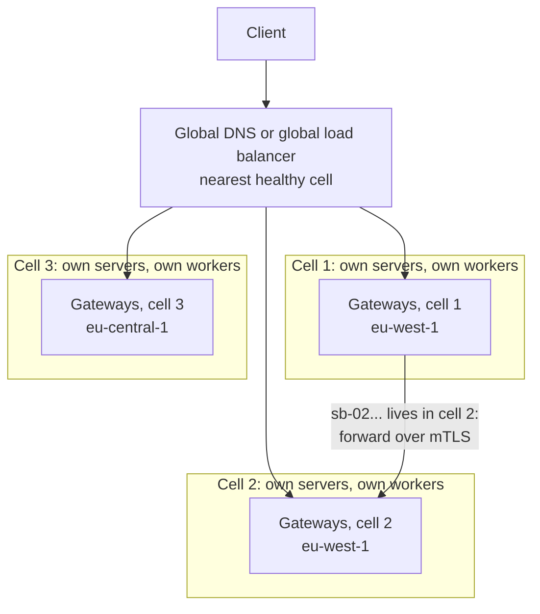

- **Requests for an existing sandbox:** any gateway reads the cell number from
  the ID and forwards to that cell. No lookup.
- **New sandboxes:** the gateway places it in its own cell if there is room.
  If not, it picks the cell with the most room (two random cells, the freer
  one wins, as placement already does inside a cell).
- **Lists, names and quotas across cells** need care: a list asks every cell
  and merges, a tenant's names and quota live in that tenant's home cell.
  Section 21 lists these as open questions.
- **Regions:** a sandbox never leaves its region by default. Banks often must
  keep data in one region, so moving across regions is an explicit policy.

## 13. Upgrades

### 13.1 The order

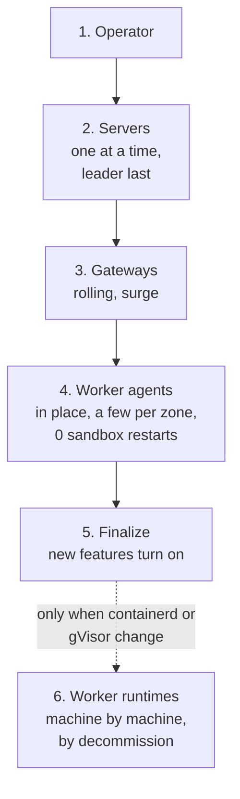

- **The leader drives the rollout, as on plain VMs since v0.7.0**
  (`internal/cluster/rollout_driver.go`): order, staging on every node first,
  `--pause-after` canaries, `finalize` and rollback. In pods, nodes run with
  `SB_REMOTE_UPGRADE=false`, so the rollout reports each one as `manual`
  (`pkg/upgradewire`). The operator is that node's hands: it changes the pod's
  `agent` image when the rollout reaches it, confirms the swap by the container's
  `imageID` changing as well as by the node reporting the new version (eng review
  SC-1), and reports back.
- **Servers** hand off leadership before they stop. The leader goes last.
- **Worker agents** are swapped in place (section 8.2). No sandbox restarts.
- **Finalize:** shipped in v0.7.0. A release's one-way migrations wait for
  `aerolvm upgrade finalize` (or run at the end of a rollout without `--hold`).
  Until then, rollback is safe; after it, there is no rollback
  (`internal/cluster/rollout_state.go:147-148` and `:235-237`).
- **Worker runtimes** change rarely. They change the CockroachDB way: one
  machine at a time, by decommission and a fresh pod.

### 13.2 Rules

- Any two parts may be one version apart (N and N-1). CI tests a mixed
  cluster on every release.
- **One owner of the target version (eng review D6):** on Kubernetes,
  `AerolCluster.spec.version` is the only place that sets it, through
  `helm upgrade` or by editing the object (so GitOps tools stay the source of
  truth). The operator starts the leader's rollout and carries it out, in the
  order above. A rollback means setting `spec.version` back; the operator then
  asks the leader to roll back. The operator marks the cluster as
  Kubernetes-managed through a cluster setting, so `aerolvm upgrade apply` and
  `aerolvm upgrade rollback` refuse there with a hint ("on Kubernetes, change
  spec.version"). `aerolvm upgrade status`, `stop`, `resume` and `finalize`
  keep working, because they set no target. Nothing ever downloads binaries
  onto a node there.
- CRDs only ever gain fields within a version. Removing a field needs a new
  API version.

## 14. When things break

| What breaks | What happens | Who acts | Sandboxes lost |
|---|---|---|---|
| A gateway pod | The load balancer drops it. Clients retry and re-attach through another. | Kubernetes, load balancer | None |
| A server pod | Raft keeps working with the others. The operator makes a new one in the same zone, with the same disk. | Raft, operator | None |
| Two of three servers | No new placements until one returns. Running sandboxes keep running. Existing links keep working from the gateway cache. | Operator, then a person if disks are lost: `sandboxd recover-quorum` in a server pod started in maintenance mode (C22) | None |
| A worker's `agent` | Restarts in place, finds its sandboxes again. | kubelet | None |
| A worker machine | Gossip notices. After the grace period, failover rebuilds `recreate` sandboxes elsewhere. | AerolVM | That machine's other sandboxes |
| A whole zone | Gateways and servers in the other two zones carry on. Failover rebuilds in the other zones. | AerolVM | That zone's sandboxes without failover |
| The Kubernetes API or etcd | Nothing changes for sandboxes. Creates through the SDKs, facades and `/v1`, exec and links all keep working. Agent-sandbox API calls fail, because they go through the Kubernetes API server. Scaling, upgrades and new certificates wait. | Nobody needs to | None |
| The gateways' aggregated APIService (later, with the agent-sandbox facade, §16) | Kubernetes marks the APIService unavailable. API discovery reports an error for agents.x-k8s.io, and deleting a namespace waits until the APIService is back (the same risk metrics-server carries). AerolVM's own API is unaffected. | Kubernetes, load balancer (Phase 6; its drill joins §19 with C17); alert `AerolVMAPIServiceUnavailable`; at least 3 gateways across zones | None |
| The certificate issuer (external-CA mode only, R2) | Existing certificates keep working (they reload per handshake, `internal/cluster/tls.go`). New machines wait to join. | Operator retries | None |
| The cloud has no machines of that type | Headroom absorbs it. Then creates get "no room" (503 with Retry-After). Alert fires. | Person picks another machine type | None |
| Object storage | Snapshots and audit export queue and retry. | AerolVM | None |

Each row is a drill in section 19.

## 15. Security

### 15.1 Each pod's rights

| Pod | Pod security level | Runs as | Kubernetes API rights |
|---|---|---|---|
| Gateway | `restricted` | non-root, read-only root disk | None. When the agent-sandbox facade is built later (§16): `system:auth-delegator` (TokenReview and SubjectAccessReview) and reading the `extension-apiserver-authentication` ConfigMap, the standard aggregated API server rights |
| Server | `restricted` | non-root | None |
| Operator | `restricted` | non-root | Its own namespace, pods, nodes (read), TokenReview, Secrets in its own namespace (join tokens), cert-manager requests only in external-CA mode (R2) |
| Worker | `privileged`, only in its namespace | `runtime` and `agent`: root in privileged containers. `edge`: non-root. | **None** |

### 15.2 Identity

- Every server, gateway and worker proves who it is with a short-lived,
  pod-bound ServiceAccount token. The operator checks it with TokenReview, and
  for a worker also checks that the pod really runs on the machine it names
  (D6). Only then does it issue the pod's identity (R2, CEO review RQ12):
  - **By default**, a single-use v0.7.0 join token for that pod
    (`internal/nodejoin`), stored as a Secret mounted only into that pod and
    deleted once the pod joins. The pod joins exactly as a VM does, its node
    certificate renews itself, and the CA key lives on the servers.
  - **In external-CA mode** (`security.externalCA`), the operator instead
    requests the pod's certificate from the bank's issuer through cert-manager,
    and the CA key never enters the cluster (D11). This is also the
    external-CA mode the kubectl-ops CEO review deferred for VMs (its S2).
- Certificates carry the node name (`node:<id>`, as today in
  `internal/cluster/tls.go`) and the pod's DNS name (lesson L7).
- Kubernetes callers (for example a pipeline using `kubectl`) map to an
  AerolVM owner by namespace (D10). Normal SDK callers use AerolVM's own keys,
  SSO and roles, as today.

### 15.3 Network walls

| From | To | Allowed |
|---|---|---|
| Internet | Gateways | Through the load balancer only |
| Kubernetes API server | Gateways | The aggregated API port only, mTLS (later, with the agent-sandbox facade, §16) |
| Gateways | Servers, workers | mTLS ports only |
| Servers | Workers | mTLS ports only |
| Workers | Servers, other workers | mTLS ports only |
| Sandboxes | Anything | Only what AerolVM's egress rules allow: by default no private range, none of the cluster's pod, Service or node ranges, not the API server and not the worker pod's own ports (C24); then only what the bank's rules for the whole worker pod allow |
| Sandboxes | Cloud metadata service | Never (two blocks) |
| Anything else | Workers | Nothing |

### 15.4 Supply chain

Every image (`aerolvm`, `aerolvm-operator`, `aerolvm-runtime`, `aerolvm-edge`; eng review D1) is signed
with cosign, with an SBOM and build provenance (D4.3). The chart ships an
example admission policy that refuses unsigned AerolVM images.

## 16. The Kubernetes API: what is an object and what is not

- **Objects (in etcd):** `AerolCluster` and `AerolNode`. They change rarely.
- **The agent-sandbox API, later (CEO review CE1, RQ9 and RQ10):** not in this
  phase. When it is built, the gateways serve the upstream kinds: `Sandbox`
  (group `agents.x-k8s.io`) and `SandboxClaim`, `SandboxTemplate` and
  `SandboxWarmPool` (group `extensions.agents.x-k8s.io`). One group-version maps
  to one APIService, so there are two. Agreed limits (RQ9): templates and warm
  pools exist only inside the Kubernetes API, never in AerolVM's SDKs or `/v1`,
  so the founder's 2026-11-05 template cut (`plans/agent-sandbox-feature-parity.md` T1)
  stands for AerolVM's own API. **Where template and warm-pool records live,
  and which sandboxes a namespace shows and deletes, are decided when the facade is built (CEO review RQ10).** This
  plan adds no storage for them, in Kubernetes or in AerolVM.
- **Not objects:** sandboxes. They are created through the SDKs, the facades
  and the API, as today.
- **Seeing sandboxes with `kubectl` (later, with the facade):** an aggregated API server, run
  by the gateways, answers `kubectl get sandboxes` straight from AerolVM, with
  nothing stored in etcd. Kubernetes' aggregation layer exists for this,
  and metrics-server uses it to serve `kubectl top` without etcd. The catch:
  our server must implement every verb itself, including `watch`. Lists page
  with `limit` and `continue` up to 100,000 sandboxes. A watch must resume on
  any gateway, and a version too old answers `410 Gone` so the client lists
  again; where versions come from is designed when the facade is built (its own eng review). Kubernetes RBAC
  and namespaces still decide who sees what (D10).
- **agent-sandbox compatibility (later, with the facade):** the same aggregated server can
  answer the `agents.x-k8s.io` API, so agent-sandbox clients work against
  AerolVM without one etcd object per sandbox. The upstream controller must
  not be installed next to it (D5 stays). C17 carries a table of every upstream
  field, each marked supported or refused. Fields AerolVM cannot honour (a
  per-sandbox Kubernetes service account, IRSA, GPUs, arbitrary `podTemplate`
  settings, and the upstream `sandbox-router` API) are refused with a clear
  error, never ignored. C17 pins the upstream agent-sandbox release (tag and
  commit) current when the facade's build starts, supports one upstream minor version at a
  time, and moves to a new one within one AerolVM minor release. Its gate runs
  that release's own e2e tests plus golden examples. A sandbox that
  needs cloud credentials uses AerolVM's own per-sandbox identity
  (`internal/cloudidentity`, the IRSA model without Kubernetes), not a
  Kubernetes service account.
  Clients reach sandbox ports through AerolVM's normal sandbox links (§7.1).

---

# Part 4: Building and proving it

## 17. What already exists, and what we must build

### Already exists

| Piece | Where |
|---|---|
| Server, worker and ingress roles | `SB_NODE_ROLE`, `internal/config/config.go` |
| containerd engine with its own namespace | `SB_CONTAINER_ENGINE=containerd`, `SB_CONTAINERD_SOCKET`, `SB_CONTAINERD_NAMESPACE` |
| gVisor through containerd | `internal/runtime/containerd/runtime_gvisor.go` |
| A setting for where the sandbox network file goes | `SB_CONTAINERD_CNI_CONF_PATH` |
| Capacity settings | `SB_HOST_CPU_CORES`, `SB_HOST_MEMORY_MB`, `SB_HOST_DISK_GB` |
| Certificates that reload without a restart, with `node:<id>` | `internal/cluster/tls.go` |
| Safe retries on create | `Service.CreateSandboxWithID` |
| Ingress with no per-sandbox Caddy writes (behind `SB_INGRESS_PROXY_ROUTING`) | `plans/ingress-proxy-routing.md` |
| Owner-paged reconcile, bounded fleet reads | `plans/secrets-hardening.md`, "Fleet-scale read paths" |
| Drain a worker | `POST /v1/cluster/nodes/{id}/drain` |
| Failover with sealed secrets | `internal/cluster/` |
| Egress rules, deny floor, metadata block, domain filtering | `pkg/egresspolicy/`, `pkg/docker/netrules/` |
| KMS, Vault, OpenBao and HSM key stores; audit export and witness | `SB_SECRET_PROVIDER`, `SB_AUDIT_EXPORT_BACKEND`, `SB_AUDIT_WITNESS_BACKEND` |
| Metrics, alerts, dashboards | `/v1/metrics`, `setup/prometheus/`, `setup/grafana/` |
| Version gate for new Raft writes | `internal/cluster/fsm_egress_profiles.go` |
| Leader-driven rollouts: order, staging, canary (`--pause-after`), `finalize` with one-way migrations, rollback; nodes that take no API upgrade report `manual` (v0.7.0) | `internal/cluster/rollout_driver.go`, `rollout_state.go`, `pkg/upgradewire` |
| Leadership hand-off on demand | `internal/cluster/rollout.go:250` (`TransferLeadership`) |
| Join tokens, node certificates that renew themselves, CA on the servers (`sandboxd adopt`), `preflight`, `reset` (v0.7.0) | `internal/nodejoin/`, `cmd/sandboxd/node.go` |
| `cordon`, `uncordon`, `drain`, `delete node` (hands `recreate` sandboxes to other workers) | `pkg/api/v1/routes.go:272-279`, `cmd/aerolvm/nodes.go` |
| `sandboxd backup`, `restore`, `recover-quorum` | `cmd/sandboxd/ops.go`, `internal/nodeops/` |
| Admission without a lock across the commit (§9.4 E2), owner cache and owner lease (§9.4 E3) | `internal/cluster/admission_ledger.go`, `agent.go:166` |
| Zone and node labels, zone-pinned creates that failover honours | `SB_NODE_ZONE`, `SB_NODE_LABELS` (`internal/config/config.go:1164`), `plans/placement-rules.md` |
| WASM workers and V8-isolate group hosts that outlive a `sandboxd` restart and are taken over again | `pkg/hostproc`, `internal/runtime/wasm/adopt.go`, `internal/runtime/isolate/adopt.go` |
| A cloud identity per sandbox (AerolVM is the OIDC issuer; the IRSA model without Kubernetes) | `internal/cloudidentity`, `plans/sandbox-cloud-identity.md` |
| Operator create policy (images, registries, runtimes, sizes, non-root, GPU) | `SB_CREATE_POLICY_FILE`, `internal/createpolicy` |
| Signed per-sandbox tokens checked with no database call | `pkg/sandboxtoken` |
| Per-image warm pools as an API | `/v1/warm-pools` (`pkg/api/v1/routes.go:189-191`) |
| Fault points and the release-gate tools (recovery time, soak driver) | `internal/failpoint`, `plans/cluster-phase-2.md` §5 |
| A download mirror for release files and Terraform providers | #1052, #1095, #1099 |

### Must build in AerolVM

| # | Change | Why | Size |
|---|---|---|---|
| C1 | Cluster-aware `/ready` | Kubernetes must stop sending traffic to a cut-off pod (D8) | S |
| C2 | No Docker check when the engine is containerd; start with no Docker present | No Docker on EKS or AKS machines | S |
| C3 | Sandbox address range as a setting | A sandbox may need to reach a bank network in 10.88.0.0/16 | S–M, fragile area, regression tests |
| C4 | Raft advertises and dials DNS names | Server pods change IP when they move (L1) | M, fragile area, regression tests |
| C5 | Gateways and servers run with no special rights | `restricted` pod security | To measure |
| C6 | Egress gateway starts without systemd | No systemd in a pod | S |
| C7 | Split the worker into `runtime`, `agent` and `edge` containers; containerd socket and shared folders; every sandbox's cgroup under the pod, refused otherwise. **The ownership lease is enforced where the sandboxes live** (CEO review outside voice, critical): today only `sandboxd` checks it (`internal/service/ownership_lease.go:193-197`), so with the `agent` down its sandboxes would keep running while the cluster recreates them. The `agent` renews a local lease file in the shared folder; the `runtime` supervisor stops every sandbox when that file's expiry passes without renewal. A test keeps the `agent` down past the lease and checks no sandbox runs twice. Mount helpers (`pkg/mounts`) also run under the `runtime` container's cgroup with Bidirectional mount propagation, so sandboxes keep their mounts across an `agent` restart (eng review OV-E2). | Sections 8.2, 8.3 | M |
| C8 | "Restarting" notice before an in-place restart **outside a rollout** (a pod `SIGTERM` or kubelet restart), wired to the existing `TransferLeadership` on servers; rollout restarts are already covered (`dead_owner.go:178`) Applies to every cluster, plain VMs included (eng review D9, which reverses D7 for this item): existing VM tests are updated to the new behavior, table rows assert it on VMs, and the release note says VM clusters change. | Section 10.2 (L2) | M, cluster area, regression tests |
| C9 | Decommission, built on the existing `drain` and `delete node`: make-before-break rebuild, snapshot move, owner notice, triggered by a cordon | Section 10.5 (L3) | L |
| C10 | Zone rules built on the existing `SB_NODE_ZONE` and placement rules (the operator sets `SB_NODE_ZONE` from `topology.kubernetes.io/zone`; no new `SB_NODE_LOCALITY`): spread across zones by default, failover never into the zone that just failed, secret backups in other zones Applies to every cluster, plain VMs included (eng review D9, which reverses D7 for this item): existing VM tests are updated to the new behavior, table rows assert it on VMs, and the release note says VM clusters change. | Section 11 (L4) | M, placement is fragile, regression tests |
| C11 | Gateway role: API, sandbox links, SSH, TLS and TCP ports in one stateless role, with proxy routing always on | Section 7.1 (K10) | M |
| C12 | Cell number in new sandbox IDs (cell 1 by default) | Section 12.3 | S |
| C13 | ~~General cluster version and finalization~~ Shipped in v0.7.0 (rollout `finalize`, one-way migrations, the active version in `internal/cluster/join_pat.go`). What is left: today the walk marks a node with `SB_REMOTE_UPGRADE=false` as `manual` while staging and skips it (`internal/cluster/rollout_driver.go:395`, `remainingIn` at :481), so order, pacing and `--pause-after` do not apply to it. C13 adds an operator-driven node state that the walk waits on, in order: the leader marks the node's turn, the operator changes the pod's `agent` image and reports back. Cluster FSM area: regression tests and a PR call-out (CLAUDE.md rule 6).  Also (eng review D6): a Kubernetes-managed cluster setting that makes `aerolvm upgrade apply` and `rollback` refuse with a hint, and the operator turns a lowered `spec.version` into a leader rollback. Kubernetes-managed clusters only; plain VM behavior is unchanged, and a table row asserts it with the Kubernetes setting off (eng review D7). | Section 13 (L6) | M |
| C14 | Keep Firecracker, V8-isolate and WASM processes alive across an `agent` restart: point `pkg/hostproc` at the `runtime` container's cgroup and share the pod's process namespace, so those processes are not killed with the `agent` container (a spike like S2 tests it when Phase 5 starts). WASM and V8 already outlive a `sandboxd` restart on plain VMs. The agent refuses to start these sandboxes unless it sees the shared process namespace at boot (CEO review §2 gap). | Section 8.9 | L |
| C15 | Azure Key Vault key store; Azure Blob audit export and witness | AKS banks | M each |
| C16 | Cross-cell forwarding and placement in gateways | Section 12.4 | L |
| C17 | Aggregated API server on the gateways for `kubectl get sandboxes` and the agents.x-k8s.io kinds, later (Phase 6, CEO review RQ10): two APIServices, every verb including `watch`, paging to 100k, the supported-or-refused field table, TokenReview and SubjectAccessReview. Template and warm-pool storage and the namespace rules are decided when the facade is built (CEO review RQ10). | Section 16 | L (human: ~8 weeks / CC: ~2 weeks) |
| C18 | Control-plane fixes E4–E7 (E1–E3 shipped in v0.6.12, §9.4): recovery file outside the lock, pushed capacity, sampled placement, batched failover | Section 9.4 | L in total, fragile area, regression tests for each |
| C19 | Pass "machine is gone" from the operator to the servers, so failover starts at once It may shorten the wait only to the lease limit, `lease + lease/15` after the last proven contact (16 s by default), never to zero, because Node deletion does not prove the old copy stopped (`internal/service/ownership_lease.go:40-48`; eng review OV-E1). | Section 9.6 | S–M |
| C20 | Per-team usage export (CEO review CE4): usage units per owner only (namespace and template dimensions belong to C17 in Phase 6; under D10 a namespace equals an owner). Each worker exposes monotonic per-owner counters on its own `/metrics`, labelled with its own incarnation, and only for owners that have sandboxes on it. Prometheus scrapes every worker (P9's ServiceMonitor), and a P9 recording rule sums `rate()` by owner, so a worker restart, a departed worker and a leader change lose and double-count nothing. Nothing is aggregated in the leader, and the capacity path is untouched. Two series per owner (CEO review RQ16): **reserved** (each sandbox's CPU and memory limit × its lifetime, from the reserved axes that already flow for every runtime) is the charge; **consumed** (measured CPU-seconds and memory from cgroup statistics) is shown alongside and never changes the bill. Consumed needs a new runtime-neutral sampler that reads cgroup statistics through containerd, because today's live sampler works only with Docker (`internal/service/usage_live.go:30-45`). The exporter is off by default (`pkg/controlplane` stays a no-op); the chart turns it on. Units, never money: a documented allocation rule (eng review checks how OpenCost and Kubecost import it) lets the bank's cost tool split the worker pods' own cost by these shares, so nothing is counted twice. A local exporter only: the open-source build still sends nothing anywhere. | §8.1: the bank's cost tools see one machine-sized pod, not who used it | M, plus the consumed sampler (human: ~1 week / CC: ~1–2 days) |
| C21 | gVisor checkpoint moves during decommission (CEO review CE5): a fenced hand-off (CEO review outside voice): pause the source, `runsc checkpoint` with memory, copy, restore on the target **paused**, move ownership with the placement compare-and-swap, then resume the target and delete the source. If the swap fails, the target deletes its paused copy and the source resumes. No copy ever runs before it owns the sandbox. On by default for gVisor sandboxes, so no new SDK field. Open connections drop. The checkpoint holds the sandbox's memory, secrets included, so it is sealed with the cluster's existing AEAD key (`pkg/secrets`) before it leaves the worker, staged only on the target worker's local disk, never in object storage, and deleted after restore or after a failed move. Refused, and the next §10.5 row applies, when the gVisor versions or the CPU feature sets differ (pools with several machine types pick a target of the same instance family), or when the move would exceed its time budget: 60 s per sandbox, and the whole decommission inside the operator's decommission deadline (§10.6). Because gVisor's network stack carries the sandbox's in-pod address inside the checkpoint, C21 gives every worker pod its own slice of the install's sandbox range (the operator assigns it; C3 sets the parent range), so a moved sandbox's address is never in use on the target; the target reserves it before the restore. Moves run up to 8 at a time per worker, so the managed-node-group budget (14 minutes minus the drain window) fits about 70 sandboxes of 60 s each; past that, the next §10.5 row applies. P7's data flows include it. One bundle, taken while paused, holds the memory checkpoint and the rootfs diff (reusing `internal/runtime/containerd/snapshot.go`); a sandbox with external-storage mounts is refused until re-attach is designed (eng review OV-E3). | Section 10.5 | XL, high risk |
| C22 | Server-pod maintenance mode. A person sets `aerolvm.io/maintenance: "true"` on the server's `AerolNode`; the operator stops reconciling that server and recreates its pod with its volume and a holding entrypoint instead of `sandboxd`, until the annotation is removed. `sandboxd backup`, `restore` and `recover-quorum` then run in it with `kubectl exec`. A lost-quorum recovery sets the annotation on **every** surviving server, because `recover-quorum` refuses while `sandboxd` runs on any of them (`internal/nodeops/quorum.go:120-121`), and the operator replaces no lost server while any server is in maintenance. Their "is sandboxd running" check is systemd-only today (`internal/nodeupgrade/host.go:70-71`, used at `internal/nodeops/quorum.go:120`), so C22 adds a pod host layer that checks the process directly. | Section 14; v0.7.0 recovery tools | M |
| C23 | Node identity on Kubernetes (R2, CEO review RQ12): the operator mints a single-use join token per pod after TokenReview (default), and an external-CA mode that requests certificates from the bank's issuer through cert-manager. Both modes are tested; the external-CA mode reuses the kubectl-ops plan's deferred `--external-ca` design. Pod-native init and join (eng review OV-E5): `sandboxd` enrolls in-process at container start, writes its files to the pod volume and restarts no unit (`Joiner.Run` today needs root, an installed host and systemd, `internal/nodejoin/join.go:65-71`); the first server pod runs `init`; `init` mints the operator's admin credential into a Secret in the operator's namespace. | §15.2; D6, D11 | M (human: ~2.5 weeks / CC: ~3–4 days) |
| C24 | Sandboxes cannot reach the bank's network by default (CEO review RQ14). Phase 1: the chart sets `SB_ENABLE_NETWORK_RULES=true` and `SB_EGRESS_BLOCK_PRIVATE_BY_DEFAULT=true`, and the in-pod firewall blocks sandbox traffic to the worker pod's own addresses and ports. Phase 2: the operator adds the API server address to the immutable deny floor, next to the metadata block and the worker's own ports (`pkg/egresspolicy/dial.go:105`, which no allow can override), and adds the cluster's pod, Service and node ranges to the overridable private-range default, not the floor. The chart ships an egress NetworkPolicy for worker pods (AerolVM pods, DNS, object storage and KMS, the public internet minus private ranges). A bank opens one internal range on purpose in two places: an egress profile in AerolVM, and the same range in the worker pods' NetworkPolicy. P8 runs a probe sandbox that must fail to reach the API server, a pod address and its own worker's ports. | §8.4, §15.3; T4 flag exists | M (human: ~1 week / CC: ~1–2 days) |
| C25 | Sandbox-link certificates on Kubernetes (eng review D4): cert-manager (the bank's issuer, or ACME DNS-01 with the DNS token held only in cert-manager's namespace) writes the wildcard certificate into a Secret mounted read-only into every `edge` container; Caddy loads it from file and reloads on change; no worker holds a DNS provider token; custom domains keep Caddy's on-demand TLS. cert-manager becomes a chart prerequisite. P8 checks that no worker pod mounts a DNS token. | §8.2; CEO review S-4 | S (human: ~3 days / CC: ~half a day) |
| C26 | Worker-pod delete guard (eng review D5): a validating webhook in the operator refuses deleting a live worker pod unless the operator asked for it, the pod is marked decommissioned, or `aerolvm.io/force-delete=true` is set (written to the audit log). `failurePolicy: Ignore`, so a webhook outage never blocks cluster repairs. An alert fires for any worker pod lost without decommission. | §8.6; CEO review Section 4 | S (human: ~3 days / CC: ~half a day) |
| C27 | Worker disk protection (eng review D8): images and the worker database on their own volume with reserved headroom; new creates refused under 10% free on the sandbox volume (503 + Retry-After) and an alert at 80% used; sandbox data on a local PersistentVolume and no ephemeral-storage limit that could evict the worker pod; per-sandbox `DiskGB` enforced with XFS project quotas from Phase 1 if Phase 0 spike S8 passes (containerd does not enforce it today, `internal/runtime/containerd/lifecycle.go:58-61`). | §8.5; G6 | M (human: ~1.5 weeks / CC: ~2–3 days) |

### Must build around AerolVM

| # | Piece | Notes |
|---|---|---|
| P1 | Four images (eng review D1): `aerolvm` (`sandboxd`; the gateway, server and agent pods run it, and a setting picks the role), `aerolvm-operator` (the operator, so a flaw in its Kubernetes libraries is reported on this image only), `aerolvm-runtime` (the supervisor, containerd, `runsc` and its shim), and `aerolvm-edge` (the custom Caddy build: layer-4, DNS and the `aerolvm_route` plugin from `603240eb`) | Published on `ghcr.io/aerol-ai/*` for amd64 and arm64 (multi-arch manifests), with cosign keyless signatures, an SBOM and SLSA provenance; the chart is a signed OCI artifact on the same registry; both are copied to the existing download mirror, and `aerolvm release pull --images` bundles them for a bank's own registry (eng review D2). |
| P2 | The operator: `AerolCluster`, `AerolNode`, node identity (R2: TokenReview, then a single-use join token per pod, or cert-manager in external-CA mode), scaling, upgrades, decommission Machine retirement (eng review OV-E6): an idempotent sequence recorded in `AerolNode`: cordon the Node, decommission, delete the worker pod, delete the Karpenter/NAP NodeClaim; RBAC gains Node patch and NodeClaim delete. | Go, controller-runtime. Talks to AerolVM only through `sdk/go` and the admin API. |
| P3 | The Helm chart | Installs the operator and CRDs. A `single` mode (one pod, no operator) for kind and laptops. |
| P4 | `make k8s-dev` and `kubernetes.mdx` | Five SDK languages, as every docs page. |
| P5 | Live scenarios in `integration-tests/` | Section 19 |
| P6 | Runbook `setup/runbooks/kubernetes.md` and the alerts in section 19 | D13 |
| P7 | Bank security evidence pack (CEO review CE2): each pod's exact rights and why, threat model, network walls, data flows, how to verify signatures, the admission policy and its one named exception, the create policy (`SB_CREATE_POLICY_FILE`) and how sandboxes get cloud credentials without stored keys (`internal/cloudidentity`). Versioned with the chart. | Phase 0: draft v1, sent to the bank with Q6 on day one (R4), then updated with S7's result. Final in Phase 2, when the full layout exists. |
| P8 | `aerolvm k8s verify` (CEO review CE2): checks a live install against P7, exit 1 on any miss. Phase 1 (`single` mode): images signed, no host mounts, no Kubernetes API rights, and a probe sandbox cannot reach a private address or its worker's ports (C24). Phase 2 adds privileged only in the worker namespace, NetworkPolicies present, and the IMDS hop limit, read through the cloud API with the caller's own credentials and skipped with a warning when none are given. | Phase 1 subset, Phase 2 full |
| P9 | Chart monitoring (CEO review CE4): a ServiceMonitor, the PrometheusRules that implement P6's alert list, and Grafana dashboards, including per-team use from C20 | Phase 2 |
| P10 | Platform polish (CEO review CE6). Phase 1: Helm install notes with the next three commands and a health check. Phase 2: a preflight init container in every worker pod (cgroup v2, kernel version; `/dev/kvm` only on Firecracker pools), so every machine is checked, including ones added later, and a failed check keeps that worker out of service with a clear reason on its `AerolNode`; `kubectl get aerolnodes` printer columns (zone, state, version, sandboxes, free CPU) read from `AerolNode` status, which the operator updates at most once a minute; Kubernetes Events on `AerolNode` for decommission progress, at most one per 10% of progress per node; an Argo CD health check in the docs; and a `values-bank-eks.yaml` preset linked from P7. All inside the G4 write budget. | Phases 1 and 2 |

## 18. Phases

Each phase ships as stacked PRs. Nothing merges until the whole phase is
green.

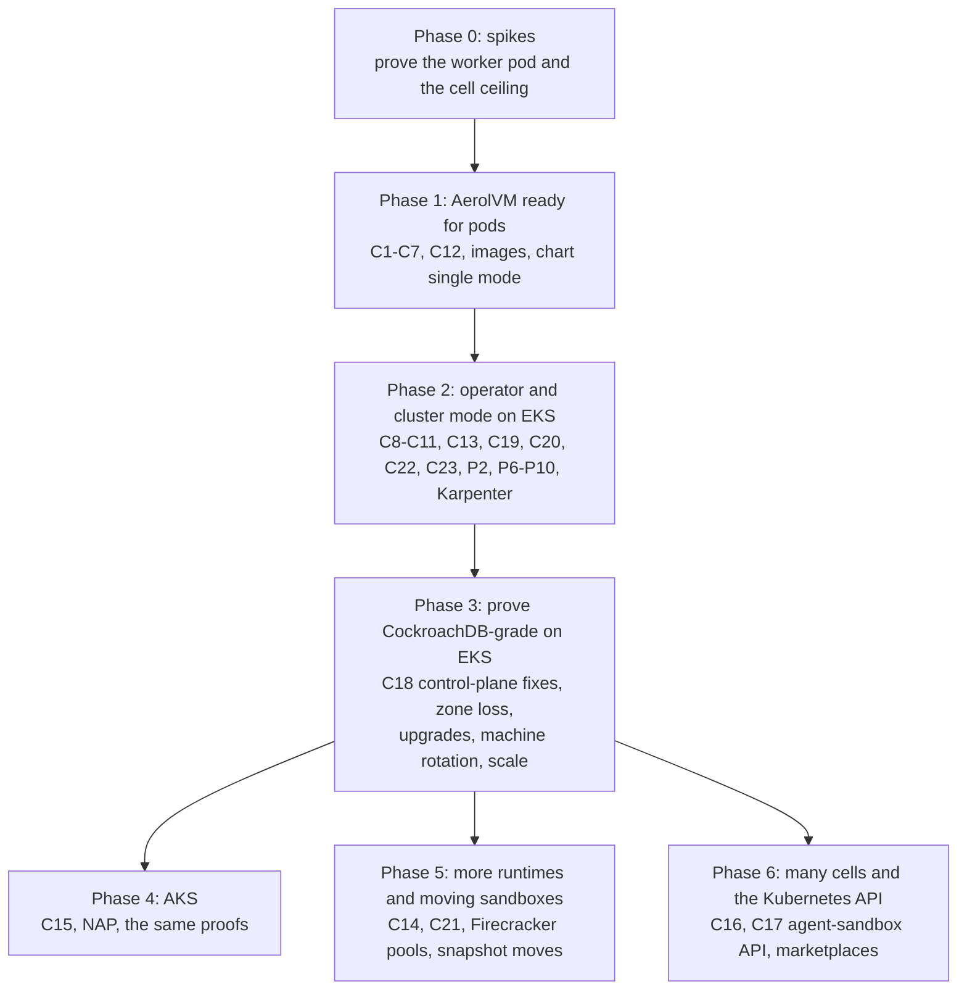

| Phase | What | Exit gate |
|---|---|---|
| **0. Spikes** (2–3 weeks) | S1: the worker pod on EKS (Amazon Linux 2023 and Bottlerocket) and AKS (Azure Linux and Ubuntu): our containerd and gVisor in a privileged `runtime` container, every sandbox placed under the pod's own cgroup path, bridge in the pod's network. S2: change the `agent` image in place and check no sandbox restarts, and that continuous I/O on an externally mounted file keeps working across the swap (eng review OV-E2). S3: memory pressure: does the kubelet ever evict the worker pod? S3 also records kubelet CPU and memory and the number of cAdvisor container series per worker pod at 100, 500 and 1,000 sandboxes; if that cost is too high, Phase 1 picks a fix through its own decision (eng review D3). S4: how far one cell goes: Raft writes per second, apply latency, snapshot and restore time at 100k, 250k and 1M placements. S5: Karpenter and NAP with `do-not-disrupt`, `expireAfter: Never` and a cordon-triggered decommission; an EKS managed node group upgrade inside its 15-minute limit. S6: `/dev/kvm` and Firecracker speed on an EC2 instance with nested virtualization. S7 (CEO review CE3): the worker pod with a named list of rights instead of `privileged: true`. S8 (eng review D8): per-sandbox disk limits with XFS project quotas on local NVMe, on Amazon Linux 2023 and Bottlerocket. P7: the evidence pack draft v1, sent with the privileged-pod question (Q6) on day one while the spikes run (R4); updated with S7's result. A "no" stops the spikes. | Numbers written into this plan. If S1 or S2 fails, stop and rethink K2 and K3 before Phase 1. |
| **1. Ready for pods** | C1–C7, C12, C24 (Phase 1 part), C25, C27, images (P1), chart `single` mode (P3), `make k8s-dev` and docs (P4), `aerolvm k8s verify` single-mode subset (P8), install notes (P10) | kind smoke test in CI; `cosign verify` passes; the `aerolvm k8s verify` subset passes on the kind install and fails on a seeded violation; gVisor create p50 in a pod within 10% of the same machine without Kubernetes (G5) |
| **2. Cluster mode on EKS** | C8–C11, C13, C19, C20, C22, C23, C24 (Phase 2 part), C26, operator (P2), Karpenter integration, runbook and alerts (P6), chart monitoring (P9), evidence pack final (P7), full `aerolvm k8s verify` (P8), operator preflight, printer columns, Events, Argo CD check and bank preset (P10) | Live `k8s-cell-3zone` scenario green, including the chaos step (section 19); full `aerolvm k8s verify` passes on that cell |
| **3. Prove it on EKS** | C18 (one fix at a time, measured), every drill in section 19, the scale bench, a 72-hour soak | G1–G12 measured and published in this plan |
| **4. AKS** | C15, NAP, Azure CNI | The Phase 3 proofs, green on AKS |
| **5. More runtimes and moving sandboxes** | C14, Firecracker pools on metal or nested-virtualization machines, Firecracker snapshot moves during decommission, gVisor checkpoint moves (C21, CEO review CE5) | Same suite with Firecracker, WASM and V8 isolates; a machine rotation moves a running gVisor sandbox with its memory and a running process survives |
| **6. Many cells and the Kubernetes API** | C16; C17, the agent-sandbox API with the RQ9 limits (CEO review RQ10: not earlier; its storage and namespace rules are decided when it is built); EKS add-on and Azure Marketplace listings | Two cells behind one front door; `kubectl get sandboxes`; agent-sandbox examples pass, except those that need refused fields |

The Daytona migration preset (D4.2) can ship any time after Phase 1. It needs
no new server code.

## 19. Tests, drills and benchmarks

### Offline (`make test`)

- Chart: `helm lint`, `helm template` golden files, `kubeconform`.
- Operator (envtest): `AerolNode` state machine, including refused moves
  (for example Removed back to Serving); worker pod sizing from the machine
  shape; scale-up and scale-down decisions; decommission ordering; a cordoned
  node triggers decommission; the worker PDB blocks eviction.
- New in the CEO review: C13's operator-driven node state (the walk waits, in order, and `--pause-after` holds), next to `rollout_driver_test.go`; C20's per-owner counters across a leader change, next to `capacity_lease.go`; C21's refusals (version, CPU, address, time budget) and its sealing; C22's maintenance mode and pod host layer; P10's preflight init container and its rate limits; `aerolvm k8s verify` passing on a clean install and failing on each seeded violation.
- Identity (R2): wrong machine, token for another pod, wrong audience, a join token used twice or after it expires, issuer
  down. Each is denied or retried, never signed.
- `sandboxd`: `/ready` cases (D8); "restarting" versus "leaving" (C8); zone
  rules in placement, failover and secret backups next to `placement.go`
  (C10); cell number in new IDs and the old-ID fallback (C12); mixed-version
  finalization (C13).

### On kind (CI, tag-gated)

- `single` mode: create, exec and delete through each SDK.
- Worker pod: change the `agent` image in place, check every sandbox is still
  running and was not moved.

### Live drills on EKS, then AKS (`integration-tests/`, `integration` tag)

| Drill | Passes when |
|---|---|
| Zone loss: block one zone's traffic | API stays up; creates recover within 30 s; every `recreate` sandbox returns in other zones; the share back within 60 s matches `zoneLossReserve`, and the time until all are back is recorded (G1) |
| Kill the Raft leader and one worker during 50 concurrent creates | Zero duplicate sandboxes, zero lost creates |
| AerolVM upgrade during load | 0 sandbox restarts (G8) |
| Mixed versions N and N-1 for one hour | All UC scenarios pass; new features stay off until finalization (G9) |
| Machine rotation: new machine image across the whole pool | Every sandbox was finished, rebuilt or moved by its policy; none lost by surprise (G8) |
| Kubernetes API unreachable from AerolVM for 10 minutes | Creates through the SDKs and facades, exec and links keep working (K5); from Phase 6, agent-sandbox API calls fail and recover when it returns |
| Kill a gateway mid-stream | Client re-attaches through another gateway and gets recent output |
| Bank network policy: deny all egress for the worker pod | Sandboxes cannot get out even with an "allow all" AerolVM rule |
| One sandbox writes until its disk is full (C27) | Other sandboxes, the `agent` and the worker database keep working; new creates get 503 with Retry-After; the alert fires; with S8 passed, the writer hits its own limit first |
| A person deletes a worker pod during a rollout (C26) | The delete is refused with a clear message; with `aerolvm.io/force-delete=true` it goes through, the audit log records it and the "lost without decommission" alert fires |
| Kill the operator leader and the Raft leader together during a rollout (C13) | The rollout resumes in order with no node stepped twice and no sandbox restarted |
| Sandbox probes the bank's cluster network (C24) | A sandbox with no egress profile cannot reach the API server, another pod's address, a Service address or its own worker's ports; with a profile that opens one internal range, only that range works |

### Benchmarks

- **Cell ceiling (Phase 0 S4, then Phase 3):** creates per second, live
  sandboxes, Raft apply p99, snapshot and restore time, gossip time to
  detect a dead worker. Published here, as G3's real number.
- **Kubernetes load:** AerolVM's Kubernetes API calls per minute at 10, 100
  and 500 workers. Must grow with workers, not sandboxes (G4).
- **Latency in a pod versus on a plain VM,** same machine type (G5).
- **Density:** sandboxes per machine until "no room", in a pod versus on a
  plain VM (G6).

### Alerts (shipped in the chart)

Worker pod not ready; any `runtime` container restart (it should never
happen); decommission stuck past its deadline; headroom below target in a zone
for over 10 minutes; Raft leader changes above normal; cert signer denial
(possible impersonation); `AerolVMAPIServiceUnavailable`
(Phase 6, with the agent-sandbox facade); the cloud cannot supply machines; finalization
pending for over a day. From the CEO review: a worker waiting on an image pull
for over 10 minutes; a rollout step stuck in `operator_turn` past its deadline;
the usage exporter stale for over 10 minutes; checkpoint-move refusals above
normal, by reason; a server in maintenance for over 1 hour; identity denials and
external-CA certificates pending for over 10 minutes; sandbox egress drops to
cluster ranges above normal (C24); `adopt` finding fewer hosts than expected
after an `agent` restart.

## 20. Risks and unknowns

| Risk | What could go wrong | How we find out or reduce it |
|---|---|---|
| Our own containerd inside a privileged container | It may not run cleanly on some machine images. On Bottlerocket, a privileged container loses its SELinux options and runs as `control_t`, not `super_t` (Bottlerocket issue 3791, open). | Phase 0 S1 on all four machine images. The first release supports Amazon Linux 2023 on EKS and Azure Linux or Ubuntu on AKS. Bottlerocket only if S1 passes. |
| Sandboxes land outside the pod | A privileged pod sees the machine's whole cgroup tree, so a missing cgroup path puts a sandbox at the machine's top level, invisible to Kubernetes and surviving the pod | C7: `sandboxd` refuses any sandbox whose cgroup is not under its own pod. A test checks every sandbox's path. |
| Nested cgroups under a systemd-managed container group | Kubelet, systemd and our containerd may disagree about who owns the group | Phase 0 S1 and S3 |
| Plain TCP ports on Kubernetes | An AWS NLB allows at most 50 listeners, and AWS will not raise it | TLS ports (SNI on 443) are the default on Kubernetes; plain TCP is a small pool per install; question 7 |
| A restarted server may miss a dead worker | `reconcileDeadOwners` says it marks gossip members that are not alive, but the code only clears live ones (`internal/cluster/dead_owner.go`). Marks come from gossip "leave" events, which a server that was down at the time never saw. Servers restart more often on Kubernetes. | Found by reading the code, not run. Check and fix with C8, with a regression test. |
| In-place image change | If an EKS or AKS policy, or a GitOps tool, recreates the pod instead, sandboxes die | Phase 0 S2. The operator owns worker pods, and the docs tell GitOps tools to leave them alone. |
| Bank refuses privileged pods | No worker at all | Same as the earlier plan: one privileged namespace, like the bank's security agents. Ask early (section 21). |
| The cell ceiling is lower than G3 | More cells sooner | Phase 0 S4. Cells (section 12) are the answer either way. |
| Decommission takes too long | Machine upgrades crawl | Drain window and per-zone budget are settings; sandboxes without a policy are stopped at the deadline. |
| Two places say who owns a sandbox during a move | A duplicate or a lost sandbox | Make-before-break uses the same compare-and-swap on the placement row as today's failover; regression tests next to the FSM. |
| Cloud has no machines of the type | Slow scale-up | Several machine types per pool; headroom; alert. |
| GitOps tools fight the operator over worker pods | Restarts | Worker pods are owned by `AerolNode`, not applied from Git. |

## 21. Open questions

Each has a recommendation. Engineering review closes them.

1. **Cells in the first release, or later?** Recommendation: later (Phase 6),
   but mint cell-numbered IDs from Phase 1 (C12) so nothing has to change
   later.
2. **Which machine provisioners do we support?** Recommendation: Karpenter on
   EKS and Node Auto Provisioning on AKS as the main path; managed node groups
   and plain AKS node pools also work through the cordon signal, with a
   documented longer upgrade timeout.
3. **Cross-cell names, lists and quotas.** Recommendation: a tenant's names
   and quota live in a home cell chosen by hashing the owner; lists ask every
   cell and merge. Decide in Phase 6 design.
4. **Old IDs and facade IDs in a multi-cell world.** Recommendation: ask each
   cell once and cache; give derived IDs the cell number where we derive them.
5. **Shrinking "privileged" to a named list of rights.** Decided in the CEO
   review (CE3): Phase 0 spike S7. Its result is recorded, never a blocker.
6. **The question to ask the bank now:** "Will you allow one privileged pod
   per worker machine, in its own namespace and node pool, with nothing
   installed on the machine?" Decided in the CEO review (R4, RQ13): ask on
   day one of Phase 0, with the P7 draft v1, while the spikes run. A "no"
   stops the spikes still running, because it means this plan cannot run there
   at all. The bank gets an update with S7's result.
7. **Plain TCP ports on Kubernetes.** Recommendation: TLS ports by default; a
   small plain-TCP pool per install (at most 50 per NLB); decide in Phase 2
   whether a TCP tunnel through the SDK and CLI is worth building.

## 22. Changes to the other Kubernetes documents

| File | Change |
|---|---|
| `kubernetes-deployment.md` | A note at the top: the design in sections 2 to 5 is replaced by this plan; decisions D4.1, D7 and D9 are withdrawn; D2, D5 and D12 are revised by K11. |
| `kubernetes-full-architecture.md` | A note at the top: section 10 (the worker DaemonSet) and its rights list describe the earlier design. Sections 1 to 9 and 11 to 21 mostly still hold; this plan wins where they differ. |
| `kubernetes-explained.md` | A note at the top pointing here. |
| `kubernetes-cockroachdb-parallels.md` | No change. Lessons L1 to L8 are all used here. |
| `ROADMAP.md` | Still says `sandboxd` will not become a Kubernetes workload this year. Change it when this plan is approved, not before. |


---

## Sources

Web pages were read on 2026-11-05. Code paths are relative to the repository
root at commit `d33b78c3` (branch `plans/kubernetes-ceo-review`). The CEO review of
2026-11-10 re-checked them after rebasing onto `origin/main` at `0d2b32ab`.

### Kubernetes, EKS, AKS and Karpenter

| Claim in this plan | Source |
|---|---|
| A running pod's container image can be changed; the pod keeps its identity | [Kubernetes: Pods](https://kubernetes.io/docs/concepts/workloads/pods/) ("Pod updates may not change fields other than `spec.containers[*].image` …") |
| Privileged containers get no private cgroup namespace from containerd's Kubernetes plugin | [containerd source](https://github.com/containerd/containerd), `internal/cri/server/container_create.go` ("cgroupns is not used when running in cgroup v1 mode or in privileged") |
| cgroup v2 "no internal processes" rule | [Linux kernel: cgroup v2](https://docs.kernel.org/admin-guide/cgroup-v2.html) |
| Docker-in-Docker moves its processes into a child group first | [moby `hack/dind`](https://github.com/moby/moby/blob/master/hack/dind) |
| Bottlerocket drops SELinux options for privileged containers | [Bottlerocket issue 3791](https://github.com/bottlerocket-os/bottlerocket/issues/3791) |
| gVisor can run inside a container, with limits | [gVisor: rootless and nested use](https://gvisor.dev/docs/user_guide/rootless/) |
| `do-not-disrupt`, expiry, drift, budgets, `terminationGracePeriod` | [Karpenter: Disruption](https://karpenter.sh/docs/concepts/disruption/) |
| Karpenter's default IMDS settings (IMDSv2, hop limit 1) | [Karpenter: NodeClasses](https://karpenter.sh/docs/concepts/nodeclasses/) |
| AKS Node Auto Provisioning runs Karpenter | [AKS: Node Auto Provisioning](https://learn.microsoft.com/en-us/azure/aks/node-auto-provisioning) |
| EKS managed node group update: 15 minutes per node, `PodEvictionFailure`, AZRebalance ignores PDBs | [EKS: managed node update behavior](https://docs.aws.amazon.com/eks/latest/userguide/managed-node-update-behavior.html) |
| Managed node groups with a custom launch template default to hop limit 2 | [EKS: launch templates](https://docs.aws.amazon.com/eks/latest/userguide/launch-templates.html) |
| AKS drain timeout, undrainable-node behaviour, max surge | [AKS: rolling node pool upgrades](https://learn.microsoft.com/en-us/azure/aks/upgrade-aks-node-pools-rolling), [AKS: upgrade a cluster](https://learn.microsoft.com/en-us/azure/aks/upgrade-cluster) |
| EC2 nested virtualization on Intel 7th and 8th generation instances (Feb 2026) | [AWS What's New, 2026-02](https://aws.amazon.com/about-aws/whats-new/2026/02/amazon-ec2-nested-virtualization-on-virtual) |
| AKS Pod Sandboxing needs nested-virtualization sizes and uses Hyper-V | [AKS: Pod Sandboxing](https://learn.microsoft.com/en-us/azure/aks/use-pod-sandboxing), [Azure Linux: Pod Sandboxing](https://learn.microsoft.com/en-us/azure/azure-linux/pod-sandboxing-aks) |
| KubeVirt (KVM) runs on AKS nested-virtualization sizes, not as a supported add-on | [AKS blog: KubeVirt on AKS](https://blog.aks.azure.com/2026/02/06/kubevirt-on-aks) |
| Aggregated APIs can use their own storage and must implement every verb | [Kubernetes: API aggregation](https://kubernetes.io/docs/concepts/extend-kubernetes/api-extension/apiserver-aggregation/) |
| EKS pods per node (234 on m7i.8xlarge; cap of 250 above 30 vCPUs) | [EKS: choosing an instance type](https://docs.aws.amazon.com/eks/latest/userguide/choosing-instance-type.html) |
| 110 pods per node; 5,000 nodes upstream | [Kubernetes: large clusters](https://kubernetes.io/docs/setup/best-practices/cluster-large/) |
| AWS NLB: 50 listeners, not adjustable | [NLB quotas](https://docs.aws.amazon.com/elasticloadbalancing/latest/network/load-balancer-limits.html) |
| EKS up to 100,000 nodes per cluster | [AWS What's New, 2025-07](https://aws.amazon.com/about-aws/whats-new/2025/07/amazon-eks-100000-worker-nodes-per-cluster) |
| AKS 5,000 nodes per cluster, 1,000 per pool | [AKS quotas](https://learn.microsoft.com/en-us/azure/aks/quotas-skus-regions) |
| Kubernetes pod start goal: 99% within 5 s | [SIG Scalability SLO](https://github.com/kubernetes/community/blob/main/sig-scalability/slos/pod_startup_latency.md) |
| GKE Agent Sandbox: 300 sandboxes per second per cluster | [Google Cloud blog](https://cloud.google.com/blog/products/containers-kubernetes/bringing-you-agent-sandbox-on-gke-and-agent-substrate) |

### CockroachDB

| Claim | Source |
|---|---|
| Current operator: `CrdbCluster` and `CrdbNode`, no StatefulSets | [CockroachDB operator overview](https://www.cockroachlabs.com/docs/stable/cockroachdb-operator-overview) |
| `terminationGracePeriodSeconds` no shorter than 300 s; drain versus decommission | [CockroachDB: node shutdown](https://www.cockroachlabs.com/docs/stable/node-shutdown) |
| Ranges, one Raft group per range, meta ranges, gossip, locality, 5-minute dead timer, finalization | `plans/kubernetes-cockroachdb-parallels.md`, Part 5 |

### AerolVM code and plans

| Fact | Where |
|---|---|
| One Raft group, servers only | `internal/cluster/raft.go`, `internal/cluster/agent.go` |
| Placement row size, 72 MB per 100k | `internal/cluster/topology.go`, `plans/secrets-hardening.md` |
| Reservation lock held across the commit | `internal/cluster/client.go`, `applyReservationEncodedLocal` |
| Commit latency on gp3 | `plans/warm-create-latency-tier1.md` |
| Recovery file written inside apply | `internal/cluster/fsm.go` |
| Owner lookup without a cache | `internal/cluster/agent.go`, `OwnerOf` |
| Capacity polling | `internal/cluster/capacity_lease.go` |
| Placement, no zones | `internal/cluster/placement.go` |
| Failover one write per sandbox; dead-owner marking | `internal/cluster/dead_owner.go` |
| Placement change feed | `internal/cluster/placement_changelog.go` |
| Version gate | `internal/cluster/fsm_egress_profiles.go` |
| Sandbox ID format | `internal/service/service.go` (`generateSandboxID`), `pkg/models/sandbox_name.go` |
| No cgroup path for containerd sandboxes | `internal/runtime/containerd/lifecycle.go` |
| gVisor config, no platform set | `internal/runtime/containerd/runsc_config.go` |
| netns pool size 256 | `internal/config/config.go` (`SB_CONTAINERD_NETNS_POOL_SIZE`) |
| Ingress routing without per-sandbox Caddy writes | `plans/ingress-proxy-routing.md` |
| Create latency ladder on EC2 | `plans/investor-benchmark-observability.md` |

---

## CEO review, 2026-11-10

Reviewer: `/plan-ceo-review`, branch `plans/kubernetes-v2-ceo-review` (stacked on
PR #522, which stays untouched because it is approved). Code facts below were
checked against `origin/main` at `5e56b4dd` (v0.7.0 plus later merges). After
the RQ9 answer the branch was rebased onto `origin/main` at `0d2b32ab`.

### Step 0 record

**0A. Premise.** The real problem is that banks only allow EKS and AKS, and
AerolVM installs only on plain VMs today. The outcome needed: `helm install` on
a bank's stock EKS or AKS, the same speed as on VMs, and a security review the
bank can pass. If nothing is done, AerolVM cannot be sold to those banks.

The plan addresses this directly. But it rests on one premise nobody has
confirmed yet: that the bank allows one privileged pod per worker machine
(open question 6). The 2026-11-04 session assumed clearance ("let's just say I
got the security clearance"). Today the plan asks the bank only before
Phase 1, after the 2–3 week Phase 0 spikes.

**0B. Code that already exists (much of it shipped after 2026-11-05).**

| Plan item | Already on `main` | Receipt |
|---|---|---|
| §9.3 L-a, lock held across the Raft commit (the "~150 creates/s" limit) | Fixed by §9.4 fix E2 | `internal/cluster/admission_ledger.go` (header comment); #1024 |
| §9.3 L-b, no group commit | Mostly moot: raft groups concurrent applies now that §9.4 E2 is in | `plans/cluster-correctness-and-create-latency.md` §5 |
| §9.3 L-d, no owner cache | Built, but **off by default** | `internal/cluster/agent.go:177-179` (`SB_CLUSTER_OWNER_CACHE`); #1018. Owner lease E3b: #1042 |
| C13, cluster version and finalization | Shipped in v0.7.0: leader-driven rollout with `finalize` and one-way migrations | `internal/cluster/rollout_state.go:147-148`, `rollout_driver.go:467` |
| C8, "restarting" is not "leaving" | Partly: a node the rollout is upgrading is not failed over before its deadline | `internal/cluster/dead_owner.go:178-183` |
| §7.2 change 3, hand off leadership on stop | The primitive exists (`TransferLeadership`); a plain `SIGTERM` does not call it | `internal/cluster/rollout.go:250-267` |
| C10, `SB_NODE_LOCALITY` and zone rules | `SB_NODE_ZONE`, node labels and zone-pinned creates exist, and failover honours them. Spread, anti-affinity and zone-aware secret backups do not. | `internal/config/config.go:1164-1169`; `plans/placement-rules.md` §5; 4d9a0bd3 |
| §13, the operator runs upgrades in order | The leader already orders, stages, canaries and finalizes rollouts | `internal/cluster/rollout_driver.go` |
| C9, decommission | `drain` and `delete node` (hands `recreate` sandboxes to other workers) exist. Make-before-break and snapshot moves do not. | `pkg/api/v1/routes.go:272-279`; `cmd/aerolvm/help.go` deleteHelp |
| K14 / D6 / D11, node identity | v0.7.0 shipped join tokens, and the **CA key now lives on the servers** (`sandboxd adopt` imports it). D11 says the CA key is held outside the cluster. | `internal/nodejoin/adopt.go:18-72` |

**Reality rows.**
- REALITY: premise-table finding. 11 code claims are stale or changed (the table above). External Kubernetes, EKS and AKS claims are cited but were not re-checked today (`unverified=21`). §9.3 (L-a to L-i) `internal/cluster/agent.go:177`
- REALITY: already-done finding. §9.4 fixes E2, E3a, E3b, C13 and part of C8, C9 and C10 shipped after the plan date. `internal/cluster/admission_ledger.go:1`
- REALITY: surface-check pass. Every named file, setting and route exists on `main`. `pkg/api/v1/routes.go:272`
- REALITY: binding-decisions finding. The 2026-09-30 decisions put the agent-sandbox API facade in Phase 3 and replace own CRDs. v2 moves the facade to Phase 6 and adds its own `SandboxTemplate` and `SandboxPool` CRDs. It withdraws husk pods and the license gate, which is an announced, user-driven reversal (2026-11-04). §10.1 and §16 `plans/kubernetes-deployment.md:23`
- REALITY: numbers finding. 751 B per placement [measured: secrets-hardening fleet-scale]. gVisor 284 ms and containerd 189 ms warm [measured: `plans/investor-benchmark-observability.md:28`]. A 6–7 ms commit [measured: `plans/warm-create-latency-tier1.md:60`]. "~150 creates/s" [estimated, now stale: E2 expects 1,000–3,000 reserves/s, also an estimate; re-measure before the gate]. The ID-clash chance of about 1 in 140,000 at 1M live re-derives as n²/2^57 ≈ 1 in 144,000. §9.3 L-a
- REALITY: deferred-asks pass. No linked issue. the plan header `plans/kubernetes-v2-architecture.md:3`
- REALITY: pr-count pass. No `.gstack/ship-policy.json`, so the default is one PR per wave. The plan ships each phase as stacked PRs. §18 `plans/kubernetes-v2-architecture.md:1272`

**0C. Dream state.**
```
  CURRENT STATE                  THIS PLAN                       12-MONTH IDEAL
  VM installs only               worker pod per machine,         A bank's platform team runs
  (installer, Terraform);        operator, EKS then AKS,         helm install on stock EKS/AKS,
  v0.7.0 kubectl-style ops;      CockroachDB-grade drills,       passes security review in a
  no Kubernetes path      --->   cells, aggregated API    --->   week, gets VM-speed sandboxes;
                                 (6 phases)                      agent frameworks that speak
                                                                 agents.x-k8s.io work unchanged;
                                                                 upgrades restart nothing
```
The plan moves toward the ideal. As first written, it put the agent-sandbox API last (Phase 6),
while the ecosystem is converging on it (see Landscape).

**Landscape (web search, 2026-11-10).**
- [Layer 1] The tried-and-true answer is one pod per sandbox, through the Kubernetes Agent Sandbox CRD (SIG Apps), GKE Agent Sandbox, or a Kata/gVisor RuntimeClass. Otherwise a hosted service (E2B, Modal, Daytona, Vercel).
- [Layer 2] agent-sandbox is gaining users: a Kubernetes blog post in March 2026, LiteLLM Agent Platform built on it (May 2026), Dify's enterprise sandbox, and OpenSandbox (Apache-2.0). Cost per always-on pod is the common complaint (gVisor adds about 250m CPU and 100Mi per pod). Nested containers work, but their edge cases multiply.
- [Layer 3] Banks need "untrusted agent code on our approved clusters, audited, dense and fast". One pod per sandbox puts etcd on the hot path, so the plan's split is right. But **distribution is the agent-sandbox API, not the scheduler**. The best position: keep the plan's engine, and speak the API the frameworks already call, early.

**No new approach decision was needed.** The core approach (option D, one
worker pod per machine) was chosen by the user on 2026-11-04/05. The review does
not reopen it.

### Decision ledger

Proposal IDs were renamed CE1–CE6 after the spec review, so they no longer clash
with the §9.4 fixes E1–E8. The questions were asked as E1–E6 and numbered
D1–D10; this record calls them RQ1–RQ10 (the saved question texts keep their
asked D numbers), so they do not clash with the plan's
decisions D2–D14.

| ID and owner | Contract and evidence | Current | Proposed | Status | Exact approval and scope |
|---|---|---|---|---|---|
| R1 (plan author) | §9, §17 and C8/C10/C13 must match `main` (0B table) | Plan rebased on `origin/main` (0 behind); §7.1, §7.2, §8.9, §9.3–9.4 (status columns), §13, §14, §17 (14 new "already exists" rows), C8, C9, C10, C13, C14, C17, G3 updated; C22 added | — | approved | User instruction with the RQ9 answer, 2026-11-10: "There are a lot of important features that are built and present in the latest main. You need to check those as well. Probably rebase the current branch with the main to understand." Scope: rebase this review branch on `origin/main` and make the plan build on what shipped (v0.6.12, v0.7.0, cluster phase 2, parity build, cloud identity); C22 added because v0.7.0's recovery tools need `sandboxd` stopped, which a pod cannot do without a maintenance mode. |
| R2 (owner, security) | Node identity: K14 keeps D6 (TokenReview) and D11 (CA outside the cluster); v0.7.0 keeps the CA on the servers (`adopt.go`) | C23 | — | approved | RQ12 answer 2026-11-10, see the 0I row R2 |
| R3 (owner, strategy) | 2026-09-30 binding decision: agent-sandbox facade in Phase 3, no own sandbox CRDs | Phase 6, upstream kinds only, storage undecided | — | approved (via CE1, RQ3/RQ9/RQ10) | RQ10 answer 2026-11-10 puts the facade after Phase 3, later than the 2026-09-30 binding decision's Phase 3; the user's answer supersedes that timing. |
| R4 (owner) | Premise: the bank allows privileged worker pods (Q6) | Day one of Phase 0 | — | approved | RQ13 answer 2026-11-10, see the 0I row R4 |

**Mode: SCOPE EXPANSION.** The user picked it in answer to RQ2 (asked twice; first
SELECTIVE EXPANSION, then SCOPE EXPANSION). The recommendation was SCOPE REDUCTION.

**Taste calibration.** Patterns to copy: `internal/cluster/admission_ledger.go`
(the invariant written above the code), `internal/cluster/rollout_state.go` (an
explicit state and command table), and `plans/placement-rules.md` (a short
decision table plus a correctness section). Patterns to avoid:
`internal/service/service.go` (8,400+ lines; put no Kubernetes logic there), and
`internal/cluster/capacity_lease.go` (two review rounds in a row were regressions
from the previous fix).

### 0F/0G. Expansion framing

**10x check.** As written, the plan makes AerolVM *runnable* on EKS and AKS. The
10x version makes it the *default answer* there. Once the Phase 6 facade lands, agent frameworks that already
speak the Kubernetes agent-sandbox API (LiteLLM Agent Platform, Dify, OpenSandbox
users) point at AerolVM and get image-cached creates about 20x faster (gVisor 284 ms
with the image cached [measured] against 5.5 s for a cold pod [measured, kind]), no 110-pod
or VPC-address limit per machine, and zero etcd writes per sandbox, with no
code change for the common fields (unsupported upstream fields are refused with
a clear error). Warm-pool hits are in the same range as agent-sandbox's own warm
pool (AerolVM's warm-pool hit 43 ms p50 on runc [measured,
`plans/warm-create-latency-tier1.md`] against 40–50 ms [measured, kind]); gVisor
from a warm pool is not measured yet, and Phase 0 measures it. And a bank's security team gets the evidence it needs in a week, not
a quarter. (After RQ10, the agent-sandbox part is Phase 6 work, not Phases 0–2.)

**Platonic ideal.**
1. A bank platform engineer runs `helm install aerolvm`, then applies one `AerolCluster` with their zones and their certificate issuer.
2. Twenty minutes later there is a 3-zone cell.
3. Their agent framework creates sandboxes on gVisor in a few hundred milliseconds cold, and faster from a warm pool.
4. `kubectl get sandboxes -n team-a` lists them, and the bank's cost tool shows sandbox spend per team.
5. Their admission policy passes with one named, documented exception.
6. Monthly machine patching moves running sandboxes with their memory.
7. Nothing is installed on the machines, and nobody on the platform team learns a new tool.

**Delight scan** (adjacent improvements of about 30 minutes each):
1. `helm install` notes print the next three commands and a health check.
2. `kubectl get aerolnodes` shows zone, state, version, sandboxes and free CPU (CRD printer columns).
3. Kubernetes Events on `AerolNode` tell the decommission story ("moved 12 of 40 sandboxes").
4. An Argo CD health check for `AerolCluster` and `AerolNode` in the chart docs.
5. A `values-bank-eks.yaml` preset: gVisor only, NetworkPolicies on, restricted namespaces, IMDS hop limit 1 documented.
6. A pre-install Job that checks each worker pool for cgroup v2, the kernel version and `/dev/kvm` before any worker starts.

**Candidates for the opt-in ceremony** (each asked separately: Add, Defer or Skip):

| # | Proposal | Effort | Risk |
|---|---|---|---|
| CE1 | The agent-sandbox API (`agents.x-k8s.io`) as a front door in Phase 2, through the aggregated API on gateways (no etcd per sandbox). Resolves R3. | L | medium |
| CE2 | A bank security evidence pack plus `aerolvm k8s verify`, which checks a live install against it | M | low |
| CE3 | Least-privilege worker: a Phase 0 spike that measures the smallest capability set, replacing blanket `privileged` where it can | S (spike) | medium |
| CE4 | Per-team sandbox cost and metrics in the chart (OpenCost-compatible export, dashboards, alerts) | M | low |
| CE5 | Moving running gVisor sandboxes with their memory during decommission (runsc checkpoint/restore) | XL | high |
| CE6 | The delight pack above (six small items) | S | low |

Ledger rows for the ceremony:

| ID and owner | Contract and evidence | Current | Proposed | Status | Exact approval and scope |
|---|---|---|---|---|---|
| CE1 (owner, strategy; resolves R3) | 2026-09-30 binding decision: agent-sandbox facade in Phase 3, no own sandbox CRDs. Landscape: LiteLLM, Dify and OpenSandbox build on agents.x-k8s.io. Plan §16 and C17: aggregated API in Phase 6. | Phase 2b; upstream kinds only (own template/pool CRDs dropped) | — | approved | RQ3 answer 2026-11-10: "Add as Phase 2b". Scope: C17 plus the agents.x-k8s.io kinds served by the gateways' aggregated API in a new Phase 2b; own SandboxTemplate/SandboxPool CRDs dropped; D5 and K5 unchanged. Open for eng review: a whole group-version goes to one APIService, so templates and warm pools are stored in AerolVM, not etcd. Reopened as CE1-r by spec review round 1 and decided by RQ9 (kept, with limits); then moved out of this phase by RQ10 (Phase 6, storage decided when built). The RQ9 limits still govern that later build. |

### Answered decision CE1 (RQ3 → A, Add as Phase 2b)
Commitment comparison:

| Commitment | Source/approval or pending | Current | A | B | C |
|---|---|---|---|---|---|
| When agent-sandbox clients work against AerolVM | Binding 2026-09-30 said Phase 3 | Phase 6 | Phase 2b, right after the EKS cell passes its gate | Phase 6, with a TODO | Not in this plan |
| Own `SandboxTemplate`/`SandboxPool` CRDs | Binding 2026-09-30: no own sandbox CRDs | Planned for later | Dropped: upstream `SandboxTemplate` and `SandboxWarmPool` | Pending (R3 stays open) | Pending (R3 stays open) |
| etcd writes per sandbox (K5) | Approved in plan | Zero | Zero: aggregated API answers from AerolVM | Zero | Zero |
| Upstream agent-sandbox controller next to ours (D5) | Approved 2026-09-30 | Refused | Refused | Refused | Refused |
| 2026-09-30 Approach C decision | Binding | In conflict | Honored | Conflict recorded, deferred | Superseded; reversal logged |

Question: D3 — CE1: Add the agent-sandbox API as a front door in Phase 2b?
Project/branch/task: CEO review (SCOPE EXPANSION) of the Kubernetes v2 plan on plans/kubernetes-v2-ceo-review.
ELI10: Kubernetes now has a standard way to ask for a sandbox, the agent-sandbox API. Agent tools such as LiteLLM's agent platform and Dify already use it. Today our plan answers that API only in Phase 6, a year or more away. This option answers it in a new Phase 2b, right after AerolVM runs on EKS. A team using those tools could then switch to AerolVM without changing code. It still writes nothing to Kubernetes' database per sandbox, because the gateways answer those requests straight from AerolVM.
Stakes if we pick wrong: wait too long, and the agent frameworks settle on other backends first. Add it too early, and Phase 2b takes weeks while the upstream API is still changing.
Recommendation: A because the agent-sandbox API is where agent teams on Kubernetes already are, and meeting them there is how a fast engine gets picked.
Note: options differ in kind, not coverage — no completeness score.
Pros / cons:
A) Add as Phase 2b (recommended)
  ✅ Agent frameworks that already call agents.x-k8s.io can use AerolVM with no code change
  ✅ Honors the 2026-09-30 decision and drops our own template and pool CRDs for the upstream ones
  ❌ About 4 weeks of human work (CC: about 4 days). The server must answer every verb, including watch.
B) Defer to TODOS.md
  ✅ Phase 2 stays focused on getting one EKS cell working and proven first
  ✅ The idea stays on record, with its reason, for a later review to pick up
  ❌ Agent teams on Kubernetes keep using other backends until Phase 6
C) Skip
  ✅ Zero implementation work, and no tie to an upstream API that is still changing
  ✅ Keeps AerolVM's own SDKs and facades as the only way in
  ❌ Reverses the 2026-09-30 decision, and gives up the main Kubernetes distribution path
Net: a few weeks now buys the API the market already uses; deferring keeps Phase 2 small.
Header: CE1 agent API
A) Add as Phase 2b (recommended)
Effort L (human: ~4 weeks / CC: ~4 days), risk medium. Gateways serve agents.x-k8s.io through the aggregated API, using upstream SandboxTemplate and SandboxWarmPool. ✅ Agent frameworks work unchanged. ✅ Honors the 2026-09-30 decision. ❌ Must implement every verb, including watch, on an API still changing.
B) Defer to TODOS.md
Effort S (zero implementation work now), risk low. Keep Phase 6, and write a TODO with the reason and trigger. ✅ Phase 2 stays small. ✅ Idea kept on record. ❌ Agent teams on Kubernetes go elsewhere until Phase 6.
C) Skip
Effort S (zero implementation work), risk medium. Drop the API from this plan, and log the reversal of the 2026-09-30 decision. ✅ No upstream churn. ✅ SDKs stay the only way in. ❌ Gives up the main Kubernetes distribution path.

| ID and owner | Contract and evidence | Current | Proposed | Status | Exact approval and scope |
|---|---|---|---|---|---|
| CE2 (owner, sales and security) | Q6 and R4: the whole plan needs the bank to accept privileged worker pods. K14 already ships signatures, SBOM, provenance and an example admission policy (D4.3). §15 lists the walls in prose only. | P7 evidence pack (draft Phase 0, final Phase 1); P8 `aerolvm k8s verify` (Phase 1) | — | approved | RQ4 answer 2026-11-10: "Add: draft in Phase 0, verify in Phase 1". Scope: P7 and P8 in §17, Phase 0 and Phase 1 rows in §18. R4 (when to ask the bank) stays a separate open row. Amended within scope by spec review rounds 1–2: P7 draft v1 in Phase 0, final in Phase 2; P8 single-mode subset in Phase 1, full in Phase 2. |

### Answered decision CE2 (RQ4 → A, Add)
Commitment comparison:

| Commitment | Source/approval or pending | Current | A | B | C |
|---|---|---|---|---|---|
| What the bank's security team receives | Plan §15 | Plan prose | A versioned evidence pack: the exact rights each pod has and why, a threat model, network walls, data flows, how to verify signatures, the admission policy, and its one named exception | Plan prose until later | Plan prose |
| A check of a live install against those claims | — | None | `aerolvm k8s verify`: privileged only in the worker namespace, NetworkPolicies present, images signed, no host mounts, the IMDS hop limit, no Kubernetes API rights on workers | None | None |
| When the bank is asked about privileged pods (R4) | Pending R4 | Before Phase 1 | Unchanged here (R4 decided separately); the pack is what you send | Unchanged | Unchanged |
| Signed images, SBOM, provenance (D4.3, K14) | Approved | Planned | Unchanged; the pack points to them | Unchanged | Unchanged |

Question: D4 — CE2: Add a bank security evidence pack plus a live `aerolvm k8s verify` check?
Project/branch/task: CEO review (SCOPE EXPANSION) of the Kubernetes v2 plan on plans/kubernetes-v2-ceo-review.
ELI10: Before a bank lets AerolVM onto its EKS cluster, its security team must approve one privileged pod per worker machine. Today all they would get is our plan's prose. This option gives them a ready pack: exactly which rights each pod has and why, the walls around it, how to check the image signatures, and the one admission-policy exception needed. A command, `aerolvm k8s verify`, then checks a live install against every claim in the pack. So the pack is proof, not a promise.
Stakes if we pick wrong: without it, every bank security review starts from zero and can take months. With it, we must keep the pack true as the chart changes.
Recommendation: A because the privileged-pod "yes" is the plan's biggest single risk, and a checkable pack is the cheapest way to win it, once, for every bank.
Note: options differ in kind, not coverage — no completeness score.
Pros / cons:
A) Add: draft in Phase 0, verify in Phase 1 (recommended)
  ✅ Gives every bank's security team the same checkable answer, shortening each review
  ✅ The verify command turns claims like "no host mounts" into a test that can fail
  ❌ About 2 weeks of human work (CC: about 2 days), plus keeping the pack in step with the chart
B) Defer to TODOS.md
  ✅ Phases 0 and 1 keep their current scope and finish sooner
  ✅ The pack can be written later, from the finished chart, with less rework
  ❌ The first bank's security review starts with prose, which is slower to win
C) Skip
  ✅ Zero implementation work, and no extra document to keep up to date
  ✅ Each bank's questions get answered by hand, fitted to that bank
  ❌ Every bank review repeats the same work, and nothing proves the claims on a live install
Net: two weeks of work to make the privileged-pod "yes" fast and repeatable.
Header: CE2 evidence
A) Add: draft in Phase 0, verify in Phase 1 (recommended)
Effort M (human: ~2 weeks / CC: ~2 days), risk low. Pack drafted in Phase 0 to support the bank ask; `aerolvm k8s verify` ships with the chart in Phase 1. ✅ Faster, repeatable bank reviews. ✅ Claims become tests. ❌ Must stay in step with the chart.
B) Defer to TODOS.md
Effort S (zero implementation work now), risk low. Write a TODO with the reason and trigger (first bank security review). ✅ Phases 0–1 stay as planned. ✅ Less rework later. ❌ The first bank review starts from prose.
C) Skip
Effort S (zero implementation work), risk medium. Answer each bank by hand. ✅ Nothing extra to maintain. ✅ Fitted per bank. ❌ Repeated work; no live proof of the claims.

| ID and owner | Contract and evidence | Current | Proposed | Status | Exact approval and scope |
|---|---|---|---|---|---|
| CE3 (owner, security) | §8.7 and Q5: "shrink privileged to a named list of rights" is a nice-to-have after Phase 3. Likely blockers: a non-privileged pod gets `/sys/fs/cgroup` read-only from containerd's CRI, and netns plus overlay mounts need `CAP_SYS_ADMIN`. | Phase 0 spike S7 | — | approved | RQ5 answer 2026-11-10: "Add as Phase 0 spike S7". Scope: S7 in Phase 0; a capability list becomes the Phase 1 default only if S7 passes on every target machine image; findings go in P7; never a stop; K4 holds. Amended within scope by spec review rounds 1–2: decided per supported machine image, one mode per image; the unapproved second supported mode (a privileged fallback next to the list) removed. |

### Answered decision CE3 (RQ5 → A, Add as Phase 0 spike S7)
Commitment comparison:

| Commitment | Source/approval or pending | Current | A | B | C |
|---|---|---|---|---|---|
| When we learn whether `privileged: true` can be replaced | Plan Q5 | After Phase 3 | Phase 0 spike S7 (runtime and agent containers with explicit capabilities, seccomp and AppArmor settings, writable cgroup, no host paths) | After Phase 3, with a TODO | Never |
| Phase 1 default for worker pods | K2, §8.7 | `privileged: true` | The capability list if S7 passes on all target machine images; else `privileged: true`, with S7's findings in the evidence pack | `privileged: true` | `privileged: true` |
| K4, no host folders | Approved | Holds | Holds: S7 may not use host paths to get devices | Holds | Holds |
| Phase 0 exit gate | Plan §18 | S1 and S2 decide | Adds S7's result as a recorded finding, never a stop | Unchanged | Unchanged |

Question: D5 — CE3: Add a Phase 0 spike that tries to replace "privileged" with a named list of rights?
Project/branch/task: CEO review (SCOPE EXPANSION) of the Kubernetes v2 plan on plans/kubernetes-v2-ceo-review.
ELI10: Our worker pods need "privileged" mode, which lets a container do almost anything root can do on the machine. Bank security tools flag that word on sight. Often a named list of rights ("these 6 powers, for these reasons") is an easier conversation. The plan tries that only after Phase 3. This option spends a few days in Phase 0 to find out whether it works. If it does, Phase 1 ships the shorter list by default. It may well fail, because containerd inside a pod needs some near-root powers. Then the result goes in the evidence pack as the reason "privileged" is needed.
Stakes if we pick wrong: skip it, and we may ask banks for more power than we need. Over-invest, and we chase a goal the kernel may not allow.
Recommendation: A because a few days now gives a data-backed answer to the first question every bank security team asks.
Note: options differ in kind, not coverage — no completeness score.
Pros / cons:
A) Add as Phase 0 spike S7 (recommended)
  ✅ The bank gets a measured answer to "why privileged?", not a guess, in the evidence pack
  ✅ If it passes, Phase 1 asks banks for a short named list instead of blanket root power
  ❌ About 3 days of human work (CC: about half a day), and the likely result is "privileged is still needed"
B) Defer to TODOS.md
  ✅ Phase 0 stays focused on S1 and S2, the spikes that decide the whole design
  ✅ The question stays on record with its trigger: a bank that refuses privileged pods
  ❌ The first bank conversation happens without knowing whether a smaller ask was possible
C) Skip
  ✅ Zero implementation work; the plan keeps one simple, well-known pod setting
  ✅ No time spent on a goal that the kernel and containerd may simply not allow
  ❌ We may ask every bank for more power than AerolVM really needs, forever
Net: a few days to replace a guess with a measurement on the plan's biggest risk.
Header: CE3 rights
A) Add as Phase 0 spike S7 (recommended)
Effort S (human: ~3 days / CC: ~half a day), risk medium. Try explicit capabilities, seccomp and AppArmor, and a writable cgroup with no host paths. If it passes, it becomes the Phase 1 default. ✅ Measured answer for banks. ✅ Possibly a smaller ask. ❌ Likely result: privileged still needed.
B) Defer to TODOS.md
Effort S (zero implementation work now), risk low. TODO with the trigger: a bank refuses privileged pods. ✅ Phase 0 stays focused. ✅ Kept on record. ❌ The first bank talk happens without the answer.
C) Skip
Effort S (zero implementation work), risk low. Keep `privileged: true` for good. ✅ One simple setting. ✅ No chasing a possibly impossible goal. ❌ May over-ask every bank forever.

| ID and owner | Contract and evidence | Current | Proposed | Status | Exact approval and scope |
|---|---|---|---|---|---|
| CE4 (owner, product) | §8.1: the worker pod asks for the whole machine, so the bank's cost tools see one big pod per machine, not who used it. `pkg/controlplane` already defines neutral usage `Sample`s (units, not money; `controlplane.go:125`), discarded in the open-source build. G11, D13 and P6 already ship metrics and alerts. | C20 and P9 in Phase 2 | — | approved | RQ6 answer 2026-11-10: "Add in Phase 2". Scope: C20 (per-owner, per-namespace, per-template usage export from pkg/controlplane samples, OpenCost format, no per-sandbox labels, local only) and P9 (ServiceMonitor, rules, dashboards) in Phase 2. Amended within scope by spec review rounds 1–2: usage units plus an allocation rule (not OpenCost custom costs, which report money for services outside the cluster); leader-aggregated; off by default. |

### Answered decision CE4 (RQ6 → A, Add in Phase 2)
Commitment comparison:

| Commitment | Source/approval or pending | Current | A | B | C |
|---|---|---|---|---|---|
| Who used the worker machines | §8.1 | Not visible to the bank's cost tools | CPU-seconds and memory GiB-seconds per owner, namespace (D10) and template, exported in OpenCost's custom-cost format, built from `pkg/controlplane` `Sample`s | Not visible until later | Not visible |
| Metric label cardinality | New | — | Per owner, namespace and template only. Never one label per sandbox (100k sandboxes would flood Prometheus). | — | — |
| Chart monitoring (G11, D13, P6) | Approved | Alerts and runbook | Adds a ServiceMonitor, PrometheusRules and Grafana dashboards to the chart | Unchanged | Unchanged |
| Open-source build stays a no-op for managed usage (CLAUDE.md) | Approved | Holds | Holds: a local exporter, nothing sent anywhere | Holds | Holds |

Question: D6 — CE4: Add per-team sandbox cost and metrics to the chart in Phase 2?
Project/branch/task: CEO review (SCOPE EXPANSION) of the Kubernetes v2 plan on plans/kubernetes-v2-ceo-review.
ELI10: Each worker pod asks Kubernetes for a whole machine. So a bank's cost tool, such as OpenCost or Kubecost, sees "AerolVM used 31 CPUs" and cannot say which team used them. Banks charge teams for what they use. This option makes AerolVM report CPU and memory use per team and per template in the format those tools read, using usage records AerolVM already makes. It also ships ready dashboards and alert rules with the Helm chart. It reports per team, never per sandbox, so the metrics system is not flooded.
Stakes if we pick wrong: without it, the bank's finance team sees one opaque bill and pushes back. With it, it is one more exporter to maintain.
Recommendation: A because chargeback is how a bank platform team justifies a new shared service, and the usage data already exists.
Note: options differ in kind, not coverage — no completeness score.
Pros / cons:
A) Add in Phase 2 (recommended)
  ✅ The bank's own cost tool shows sandbox spend per team, with no extra software to buy
  ✅ Reuses pkg/controlplane usage samples, so the numbers match what a managed build would bill
  ❌ About 1.5 weeks of human work (CC: about 1–2 days), plus one more exporter to keep working
B) Defer to TODOS.md
  ✅ Phase 2 stays focused on the operator and a working EKS cell
  ✅ Kept on record, with its trigger: the first bank asks for chargeback
  ❌ The first pilot runs as one opaque cost line, which finance teams question
C) Skip
  ✅ Zero implementation work; the existing metrics and alerts stay as they are
  ✅ No risk of a second, different usage number next to a future managed bill
  ❌ AerolVM stays a black box to every bank's cost tooling
Net: about a week and a half to turn one opaque cost line into per-team chargeback.
Header: CE4 cost
A) Add in Phase 2 (recommended)
Effort M (human: ~1.5 weeks / CC: ~1–2 days), risk low. Export per-owner, per-namespace and per-template use in OpenCost's format from pkg/controlplane samples; ship a ServiceMonitor, rules and dashboards. ✅ Per-team chargeback. ✅ Reuses existing usage data. ❌ One more exporter to maintain.
B) Defer to TODOS.md
Effort S (zero implementation work now), risk low. TODO with the trigger: the first bank asks for chargeback. ✅ Phase 2 stays focused. ✅ Kept on record. ❌ The pilot is one opaque cost line.
C) Skip
Effort S (zero implementation work), risk low. Keep machine-level use only. ✅ Nothing new. ✅ No second usage number. ❌ A black box to bank cost tools.

| ID and owner | Contract and evidence | Current | Proposed | Status | Exact approval and scope |
|---|---|---|---|---|---|
| CE5 (owner, product) | §10.5: decommission rebuilds (`recreate`), snapshots (Firecracker memory, containerd disk only) or stops. G8: no surprise loss, by policy. gVisor has `runsc checkpoint`/`restore`; open TCP connections do not survive it. | C21 in Phase 5 | — | approved | RQ7 answer 2026-11-10: "Add to Phase 5" (recommendation was Defer). Scope: C21 gVisor checkpoint moves in Phase 5 next to Firecracker snapshot moves; Phases 0–2 unchanged; open connections drop; same gVisor version required. Amended within scope by spec review rounds 1–2: on by default for gVisor; sealed, staged locally, time-budgeted; refused on version, CPU or address mismatch. |

### Answered decision CE5 (RQ7 → A, Add to Phase 5; recommendation was Defer)
Commitment comparison:

| Commitment | Source/approval or pending | Current | A | B | C |
|---|---|---|---|---|---|
| A running gVisor sandbox during machine replacement | §10.5 | Rebuilt, or its disk moved; its running programs restart | Paused, checkpointed with memory, restored on another worker with the same ID; open network connections drop | Unchanged until a trigger | Unchanged |
| G8 (planned work loses nothing by surprise) | Approved | Met by policy | Met, and long jobs keep running | Met by policy | Met by policy |
| Phase 5 scope | Plan §18 | C14, Firecracker pools, Firecracker snapshot moves | Adds gVisor checkpoint moves (XL) | Unchanged | Unchanged |
| Phases 0–2 (the bank path) | Plan §18 | Unchanged | Unchanged | Unchanged | Unchanged |

Question: D7 — CE5: Add moving running gVisor sandboxes with their memory during machine replacement?
Project/branch/task: CEO review (SCOPE EXPANSION) of the Kubernetes v2 plan on plans/kubernetes-v2-ceo-review.
ELI10: Banks patch their machines every month, so every worker machine gets replaced. Today the plan either rebuilds each sandbox on a new machine, or moves only its disk. Either way, programs running inside start over. gVisor can freeze a sandbox, save its memory, and resume it elsewhere. That would let an hour-long agent job survive patching. But open network connections still drop, a large sandbox pauses while it is copied, and both machines need matching gVisor versions. It is a big, risky build, so the honest call is to wait until a customer needs it.
Stakes if we pick wrong: add it now, and months of hard work land before anyone asks for it. Skip it, and long jobs restart at every patch cycle.
Recommendation: B because the plan already meets G8 by policy, Phase 5 already moves Firecracker memory for customers who need it, and this is XL work with high risk.
Note: options differ in kind, not coverage — no completeness score.
Pros / cons:
A) Add to Phase 5
  ✅ Long-running agent jobs on gVisor survive monthly machine patching without restarting
  ✅ Sits in Phase 5 next to the Firecracker snapshot moves, so Phases 0–2 are untouched
  ❌ XL work (human: ~2 months / CC: ~2 weeks) with high risk; open connections still drop
B) Defer to TODOS.md (recommended)
  ✅ No XL, high-risk build before any customer has asked for it
  ✅ Kept on record with its trigger: a customer whose long jobs break on machine rotation
  ❌ Until then, running programs in gVisor sandboxes restart when their machine is replaced
C) Skip
  ✅ Zero implementation work, and no new checkpoint path to test and secure
  ✅ Customers who need memory kept can use Firecracker, which Phase 5 already moves
  ❌ gVisor, the default runtime for banks, never keeps running programs across machine replacement
Net: a hard, uncertain build for a need nobody has raised yet; keep it ready, not built.
Header: CE5 live move
A) Add to Phase 5
Effort XL (human: ~2 months / CC: ~2 weeks), risk high. runsc checkpoint and restore during decommission, same ID, open connections drop. ✅ Long jobs survive patching. ✅ Bank path untouched. ❌ Hard and uncertain.
B) Defer to TODOS.md (recommended)
Effort S (zero implementation work now), risk low. TODO with the trigger: a customer whose long jobs break on machine rotation. ✅ No speculative XL build. ✅ Kept on record. ❌ Programs restart on machine replacement until then.
C) Skip
Effort S (zero implementation work), risk low. Firecracker remains the way to keep memory. ✅ Nothing new to secure. ✅ Firecracker covers the need. ❌ The default bank runtime never keeps running programs.

| ID and owner | Contract and evidence | Current | Proposed | Status | Exact approval and scope |
|---|---|---|---|---|---|
| CE6 (owner, developer experience) | The six delight-scan items in 0F/0G. P3 (chart) and P2 (operator) already exist; each item is about 30 minutes and has no server change. | P10 in Phases 1 and 2 | — | approved | RQ8 answer 2026-11-10: "Add all six to their phases". Scope: P10; install notes and pre-install Job in Phase 1; printer columns, Events, Argo CD check and values-bank-eks.yaml in Phase 2; no server change. Amended within scope by spec review rounds 1–2: the pre-install Job became a preflight init container in every worker pod (Phase 2); status and Events rate-limited under G4. |

### Answered decision CE6 (RQ8 → A, Add all six)
Commitment comparison:

| Commitment | Source/approval or pending | Current | A | B | C |
|---|---|---|---|---|---|
| `helm install` notes with the next three commands and a health check | New | None | Phase 1 (P3) | TODO | None |
| `kubectl get aerolnodes` printer columns: zone, state, version, sandboxes, free CPU | New | None | Phase 2 (P2) | TODO | None |
| Kubernetes Events on `AerolNode` for decommission progress | New | None | Phase 2 (P2) | TODO | None |
| Argo CD health check for `AerolCluster`/`AerolNode` in the docs | New | None | Phase 2 (P4) | TODO | None |
| `values-bank-eks.yaml` preset | New | None | Phase 2 (P3), linked from the evidence pack (P7) | TODO | None |
| Pre-install Job that checks cgroup v2, the kernel version and `/dev/kvm` per worker pool | New | None | Phase 1 (P3) | TODO | None |

Question: D8 — CE6: Add the six small "delight" items for platform engineers?
Project/branch/task: CEO review (SCOPE EXPANSION) of the Kubernetes v2 plan on plans/kubernetes-v2-ceo-review.
ELI10: These are six small touches, about half an hour each, that make AerolVM feel native to a Kubernetes engineer. After install, Helm prints the next three commands. `kubectl get aerolnodes` shows each machine's zone, state and free CPU. `kubectl describe` tells the story of a machine being emptied ("moved 12 of 40 sandboxes"). Argo CD shows the cluster's health. A ready "bank on EKS" settings file ships with the chart. And a check runs before workers start, catching a machine that lacks what AerolVM needs. None of them change the server.
Stakes if we pick wrong: skip them, and AerolVM works but feels foreign, so engineers trust it less. Add them, and that is about a day of extra work.
Recommendation: A because each one is cheap, and together they decide whether a Kubernetes engineer feels at home in the first hour.
Note: options differ in kind, not coverage — no completeness score.
Pros / cons:
A) Add all six to their phases (recommended)
  ✅ The first hour after `helm install` feels like any well-made Kubernetes product
  ✅ The pre-install check catches a bad machine image before any sandbox runs on it
  ❌ About 3 days of human work in total (CC: about half a day), spread over Phases 1 and 2
B) Defer to TODOS.md
  ✅ Phases 1 and 2 stay exactly as planned, with no new items to track
  ✅ The list stays on record, ready for a polish pass before the first bank pilot
  ❌ Easy wins are left out, and polish passes tend to get skipped
C) Skip
  ✅ Zero implementation work, and fewer things in the chart to test
  ✅ Engineers can still use the plain chart and the operator as designed
  ❌ AerolVM feels less native, and bad machine images are found later, the hard way
Net: about three days of small work that makes the product feel finished.
Header: CE6 delight
A) Add all six to their phases (recommended)
Effort S (human: ~3 days / CC: ~half a day), risk low. Helm notes and the pre-install Job in Phase 1; printer columns, Events, the Argo CD check and the bank preset in Phase 2. ✅ Feels native. ✅ Catches bad machines early. ❌ Small extra work in two phases.
B) Defer to TODOS.md
Effort S (zero implementation work now), risk low. TODO with the trigger: the first bank pilot. ✅ Phases unchanged. ✅ Kept on record. ❌ Polish passes tend to get skipped.
C) Skip
Effort S (zero implementation work), risk low. Plain chart and operator only. ✅ Less to test. ✅ Still works. ❌ Feels less native; bad machines found late.

### Spec review, round 1 (score 5/10, FAIL)

Fixed without a new question, because each one makes an approved choice work
as approved: §16's stale CRD line, S7's pass rule and its single mode (the
`privileged` fallback was unapproved creep, so it is removed), §10.5 precedence,
C20 built on units and an allocation rule (OpenCost custom costs report money
for services outside the cluster, which would count the worker pods twice), C21
sealing, staging, time budgets and CPU checks, the P7/P8/P10 split between
Phase 1 (`single` mode) and Phase 2 (the full layout), P10's rate limits under
G4, the R4 wording, the status line, G3's stale tag, and the CE renaming.

Reopened, because the CE1 question said "D5 and K5 unchanged", and that was wrong:

| ID and owner | Contract and evidence | Current | Proposed | Status | Exact approval and scope |
|---|---|---|---|---|---|
| CE1-r (owner, strategy) | Spec review: (1) agent-sandbox callers create through the Kubernetes API server, so K5 cannot hold for them, and gateways need `system:auth-delegator`; (2) upstream `SandboxClaim` needs `SandboxTemplate`, which the founder cut on 2026-11-05 ("after thorough review, i do not want this feature at all", `plans/agent-sandbox-feature-parity.md` T1 and R3), and the X1 mapping table was declined; (3) a down APIService breaks API discovery and namespace deletion across the whole cluster; (4) two API groups mean two APIServices, and upstream fields such as `podTemplate` service accounts, IRSA and GPUs cannot be honoured; (5) about 4 weeks is too low. | Phase 2b with the limits | — | approved | RQ9 answer 2026-11-10: "Keep in Phase 2b, with the limits above", plus the instruction "There are a lot of important features that are built and present in the latest main. You need to check those as well. Probably rebase the current branch with the main to understand." Scope: K5 narrowed to SDK, facade and /v1 callers; two APIServices; upstream templates and warm pools only inside the Kubernetes API; refused-field table; gateway auth-delegator rights; APIService failure row; paging and watch rules; estimate L (~8 weeks human / ~2 weeks CC). Superseded on timing by RQ10: not in this phase; the limits stand for the later build. |

### Answered decision CE1-r (RQ9 → A, keep in Phase 2b with the limits)
Commitment comparison:

| Commitment | Source/approval or pending | Current (RQ3 approval) | A | B | C |
|---|---|---|---|---|---|
| When agent-sandbox clients work | RQ3 | Phase 2b | Phase 2b | Phase 6, with a TODO | Never in this plan |
| K5, zero Kubernetes API calls per sandbox | Plan K5 | "Unchanged" (wrong) | Holds for SDK and facade callers only. Agent-sandbox callers go through the API server by definition. | Holds everywhere | Holds everywhere |
| Templates | Founder cut 2026-11-05 (T1) | Upstream `SandboxTemplate` served | Upstream `SandboxTemplate`/`SandboxWarmPool` exist only inside the Kubernetes API, stored in AerolVM; never in AerolVM's SDKs or `/v1` | None | None |
| Upstream fields AerolVM cannot honour (`podTemplate` service account, IRSA, GPU, arbitrary pod settings) | New | Unstated | Refused with a clear error; a C17 table lists every field as supported or refused | — | — |
| Cluster-wide risk from a down APIService | New | Unstated | Two APIServices; at least 3 gateways across zones; an availability alert; documented in P7 | None | None |
| Effort | RQ3 said ~4 weeks | L | L (human: ~8 weeks / CC: ~2 weeks) | S (zero work now) | S (zero work) |
| 2026-09-30 Approach C | Binding | Honored | Honored, except templates now exist only as upstream kinds | Phase 3 timing superseded by the 2026-11-04/05 direction; recorded | Superseded; reversal logged |

Question: D9 — CE1 reopened: keep the agent-sandbox API in Phase 2b now that its real costs are known?
Project/branch/task: CEO review (SCOPE EXPANSION) of the Kubernetes v2 plan on plans/kubernetes-v2-ceo-review.
ELI10: You said yes to serving the Kubernetes agent-sandbox API in Phase 2b. The independent reviewer found three things my question did not tell you. First, requests through that API pass through Kubernetes' own API server, so "Kubernetes is never on the hot path" holds only for our SDKs. Second, the API's fast path needs sandbox templates, a feature you cut on 2026-11-05. Third, if our API service goes down, some Kubernetes commands across the bank's whole cluster start failing, the same risk metrics-server carries. It is also about twice the work I said. Option A keeps it, with templates allowed only inside the Kubernetes API and never in our SDKs.
Stakes if we pick wrong: keep it, and you take on templates and a cluster-wide failure mode you meant to avoid. Drop it, and agent teams on Kubernetes use other backends for longer.
Recommendation: A because your template cut was about AerolVM's own API, where "template" already means two other things, and inside the Kubernetes API the word belongs to the upstream standard.
Note: options differ in kind, not coverage — no completeness score.
Pros / cons:
A) Keep in Phase 2b, with the limits above (recommended)
  ✅ Agent frameworks on Kubernetes can use AerolVM for the common fields, with no code change
  ✅ AerolVM's own SDKs and /v1 API stay template-free, as you decided on 2026-11-05
  ❌ About 8 weeks of human work (CC: about 2 weeks), and a down gateway set can disturb kubectl cluster-wide
B) Defer to TODOS.md (back to Phase 6)
  ✅ No templates anywhere, and no cluster-wide failure mode during the bank pilot
  ✅ Kept on record with its trigger: a named customer running an agents.x-k8s.io framework
  ❌ Agent teams on Kubernetes keep using other backends until Phase 6
C) Skip
  ✅ Zero implementation work, and the K5 promise stays true for every caller, forever
  ✅ No dependence on an upstream API that is still changing
  ❌ Gives up the main Kubernetes distribution path, and reverses the 2026-09-30 decision
Net: the distribution win is real, but now costs templates in the Kubernetes API and twice the work.
Header: CE1 reopened
A) Keep in Phase 2b, with the limits above (recommended)
Effort L (human: ~8 weeks / CC: ~2 weeks), risk medium. Two APIServices on the gateways; K5 narrowed to SDK and facade callers; upstream templates and warm pools only inside the Kubernetes API; unsupported fields refused, listed in a C17 table. ✅ Frameworks work for common fields. ✅ SDKs stay template-free. ❌ Twice the work; cluster-wide failure mode.
B) Defer to TODOS.md (back to Phase 6)
Effort S (zero implementation work now), risk low. Phase 2b removed; TODO with the trigger: a named customer on an agents.x-k8s.io framework. ✅ No templates, no new failure mode. ✅ Kept on record. ❌ Other backends win Kubernetes agent teams meanwhile.
C) Skip
Effort S (zero implementation work), risk medium. Remove the agent-sandbox API from the plan; log the reversal of 2026-09-30 Approach C. ✅ K5 stays true for everyone. ✅ No upstream churn. ❌ Gives up the main distribution path.

### Spec review, round 2 (score 6/10, FAIL)

Fixed without a new question, because each one makes an approved choice work as
approved:
- R2 marked open everywhere it was written as decided.
- §11 uses `SB_NODE_ZONE`.
- The decommission deadline is drain window plus move budget, capped at 14 minutes on managed node groups.
- C21 reserves the sandbox's address on the target first.
- G4 excludes the cached TokenReview and SubjectAccessReview reads.
- C18 is down to E4–E7, and the Phase 2 and 5 diagrams are complete.
- S7 is decided per supported machine image.
- C17 pins the upstream release, a change policy and its e2e suite, and refuses the `sandbox-router` API, which was unapproved creep.
- C20 is leader-aggregated and off by default, with "template" defined.
- C22 has a trigger and a pod host layer.
- C13 gets an operator-driven node state that the rollout waits on, now size M. Today the walk skips `manual` nodes.
- P10's preflight became an init container in every worker pod.
- Citations were refreshed.
- The vision's speed claims now match measured numbers.
- Review questions are labelled RQ.

Two new choices:

| ID and owner | Contract and evidence | Current | Proposed | Status | Exact approval and scope |
|---|---|---|---|---|---|
| CE1-s (owner, data model) | RQ9: templates and warm pools only inside the Kubernetes API, "stored in AerolVM". Founder rule: no facade-specific tables, because AerolVM owns the data model (founder rule, recorded in project memory). §16 mapped `SandboxWarmPool` onto `/v1/warm-pools`, which RQ9 forbids, and that route is global and per image. Upstream puts `SandboxClaim` (one per sandbox) in the same group-version as templates and pools, so the whole group must be aggregated. | No storage added; the facade moves out of this phase (Phase 6) | — | approved (custom answer) | RQ10 answer 2026-11-10 (typed): "Skip the agent-sandbox facade in this phase. Do not add template or warm-pool storage in Kubernetes or in AerolVM. Decide where those records live when the facade is built later." Scope: Phase 2b removed; C17 back in Phase 6 with the RQ9 limits; no template or warm-pool storage anywhere in this plan; the storage choice (A, B or C above) is made when the facade is built. |
| CE1-n (owner, product) | D10: namespace equals owner for Kubernetes callers. The namespace controller deletes every object an aggregated API lists in a namespace being deleted. | — | — | deferred (with the facade) | Not asked: RQ10 moved the facade out of this phase, so the namespace rules are decided when it is built. |

### Answered decision CE1-s (RQ10 → custom: skip the facade in this phase, add no storage)
Commitment comparison:

| Commitment | Source/approval or pending | Current | A | B | C |
|---|---|---|---|---|---|
| Where upstream `SandboxTemplate`/`SandboxWarmPool` objects live | RQ9 | "Stored in AerolVM" (unspecified) | Internal CRDs in etcd (`*.k8s.aerolvm.io`), rare writes (K11) | A new kind in AerolVM's Raft FSM | Not served |
| "No facade-specific tables" rule | Founder rule | — | Holds: AerolVM gets no new table | Broken: a Kubernetes-only store inside AerolVM | Holds |
| "Only the operator writes to the Kubernetes API" (§6, §7.4) | Plan | Holds | One named exception: gateways write only those internal CRDs (narrow RBAC) | Holds | Holds |
| `/v1/warm-pools` | RQ9: never in `/v1` | Mapped (conflict) | Not shown there: the gateways sum the requested depth per image and set the internal pool through the same code path | Same as A | Not applicable |
| Frameworks that use `SandboxClaim` | CE1 | Work | Work | Work | Do not work |
| Cluster FSM risk (CLAUDE.md rule 6) | — | — | None | New FSM kind: regression tests and a PR call-out | None |

Question: D10 — CE1-s: where do the upstream templates and warm pools live?
Project/branch/task: CEO review (SCOPE EXPANSION) of the Kubernetes v2 plan on plans/kubernetes-v2-ceo-review.
ELI10: In D9 you kept the Kubernetes agent-sandbox API, with templates and warm pools existing only inside the Kubernetes API. The plan said they would be "stored in AerolVM". But your standing rule is that compatibility layers never get their own tables, because AerolVM owns the data model. Option A keeps them in Kubernetes' own database as two small internal object types. They change rarely, so that is cheap. The gateways write only those two types. Option B stores them inside AerolVM, which breaks your rule. Option C serves only plain sandboxes, which breaks the common "claim from a warm pool" flow.
Stakes if we pick wrong: B quietly builds the parallel store you ruled out. C makes most agent frameworks fail on their first call.
Recommendation: A because it keeps your no-facade-tables rule and the K5 promise, and it costs one narrow write permission for the gateways.
Note: options differ in kind, not coverage — no completeness score.
Pros / cons:
A) Internal CRDs in etcd, written by the gateways (recommended)
  ✅ AerolVM gets no Kubernetes-only table, so the no-facade-tables rule holds
  ✅ Templates and pools change rarely, so etcd sees a few writes a day, not one per sandbox
  ❌ The gateways become a second Kubernetes API writer, limited to their own two object types
B) A new kind in AerolVM's Raft FSM
  ✅ Only the operator ever writes to the Kubernetes API, as the plan says today
  ✅ Templates and pools replicate with everything else AerolVM stores
  ❌ Builds the facade-specific store your rule forbids, in the most fragile code AerolVM has
C) Serve only `Sandbox` in Phase 2b
  ✅ No templates or pools anywhere, and the smallest Phase 2b to build
  ✅ The rule holds, and the operator stays the only writer
  ❌ Frameworks that claim from a warm pool, the common fast path, fail on their first call
Net: one narrow write permission buys both your data-model rule and a working claim flow.
Header: CE1 storage
A) Internal CRDs in etcd, written by the gateways (recommended)
Effort S on top of C17 (human: ~3 days / CC: ~half a day), risk low. Two internal CRDs (`*.k8s.aerolvm.io`); gateways get write rights on those only; pool depth summed per image, never shown in /v1. ✅ No-facade-tables rule holds. ✅ Rare etcd writes only. ❌ Gateways become a narrow second writer.
B) A new kind in AerolVM's Raft FSM
Effort M (human: ~1.5 weeks / CC: ~2 days), risk medium. New FSM kind with regression tests (rule 6). ✅ The operator stays the only writer. ✅ Replicates with AerolVM's state. ❌ Breaks the no-facade-tables rule.
C) Serve only `Sandbox` in Phase 2b
Effort S (less work than today's C17), risk low. Refuse claims, templates and warm pools. ✅ Smallest build. ✅ Rule and writer both hold. ❌ The common claim flow fails.

### Spec review, round 3 (score 7/10, FAIL; the last round allowed)

18 issues, all inside approved decisions. Fixed in place:
- C22 puts every surviving server in maintenance mode.
- §19 tests cover each new item.
- Workers pre-pull images (`workerPools[].images`), not "templates".
- Each pool has its own `provisioner` and drain window.
- The summary's S7 rule is per machine image.
- `AerolNode` status counters are rate-limited inside G4.
- Five more places mark R2 open.
- Phase 6 tags are on the facade drills and alert.
- Labels are fixed.
- C14 is tested when Phase 5 starts.
- Wording is fixed in the summary and the CE3 row.
- Speed terms are now "image cached" and "warm-pool hit".
- The watch-version design goes to the facade's own eng review.
- Citations are fixed.
- C20 is per owner only, read on the leader's existing capacity pull, with a rule-6 regression test.
- C21 gives each worker its own sandbox address slice and runs up to 8 moves at a time.

**Issues verified: 18 of 18.** These are edits applied and checked against this
text, not a reviewer's verdict; the review cap of three rounds is reached.

### 0H document approval

RQ11 answer 2026-11-10: "Approve and continue". Scope: these versions of the
plan and the CEO summary (now `docs/designs/kubernetes-v2.md`).
Unresolved rows (R2, R4) and implementation stay unapproved.

### 0I. Temporal interrogation: the blockers

| ID and owner | Contract and evidence | Current | Proposed | Status | Exact approval and scope |
|---|---|---|---|---|---|
| R2 (owner, security) | Plan K14 keeps D6 (TokenReview, then sign `node:<id>`) and D11 (CA key outside the cluster, the bank's issuer through cert-manager), from the 2026-09-30 CEO review. v0.7.0 shipped join tokens, self-renewing node certificates and the CA key on the servers (`internal/nodejoin/adopt.go:18-72`); the kubectl-ops CEO review deferred an external-CA mode (its S2). Blocks P7's identity section and the Phase 2 node flow. | C23: join tokens by default, external-CA mode as a switch | — | approved | RQ12 answer 2026-11-10: "Join tokens by default, plus a bank-authority switch". Scope: C23 in Phase 2; TokenReview gates a single-use join token per pod (default, CA on the servers); `security.externalCA` switches to cert-manager and the bank's issuer (CA outside the cluster, D11); both modes tested. |
| R4 (owner) | Q6: a "no" on privileged pods means the plan cannot run there at all. Phase 0 spikes cost 2–3 weeks. | Day one of Phase 0, spikes in parallel | — | approved | RQ13 answer 2026-11-10: "Ask at the start of Phase 0, spikes in parallel". Scope: Q6 and the P7 draft v1 go to the bank on Phase 0's first day; the spikes run meanwhile; a "no" stops them; an update follows S7. |

### Answered decision R2 (RQ12 → C, join tokens by default plus a bank-authority switch)
Commitment comparison:

| Commitment | Source/approval or pending | Current | A | B | C |
|---|---|---|---|---|---|
| How a new worker or server pod gets its node certificate | D6, v0.7.0 | Two paths written | The operator proves the pod with TokenReview, then mints a single-use join token for it as a Secret mounted only into that pod; the pod joins exactly as a VM does | TokenReview, then the operator requests the certificate from the bank's issuer through cert-manager | A by default; B when `security.externalCA` names an issuer |
| Where the CA key lives | D11; v0.7.0 | Both | On the servers, as on VMs | Outside the cluster (the bank's issuer) | On the servers by default; outside in external-CA mode |
| Code paths shared with VM installs | — | — | One (`internal/nodejoin`) | A Kubernetes-only path | One default path, plus one optional mode |
| Banks that must issue certificates from their own PKI | D11 rationale | Served (as written) | Not served | Served | Served |
| Phase 2 work | — | — | S (human: ~3 days / CC: ~half a day) | M (human: ~2 weeks / CC: ~3 days) | M (human: ~2.5 weeks / CC: ~3–4 days) |

Question: D12 — R2: how do AerolVM's pods prove who they are and get their certificates?
Project/branch/task: CEO review (SCOPE EXPANSION) of the Kubernetes v2 plan on plans/kubernetes-v2-ceo-review.
ELI10: Every AerolVM pod needs a certificate so the others trust it. The plan says the bank's own certificate authority signs them, and the signing key never enters the cluster. But v0.7.0 shipped a simpler way for VMs: a one-time join token, with the signing key kept on AerolVM's servers. Option A uses only the v0.7.0 way: Kubernetes proves which pod is asking, then the operator hands that pod a one-time token. Option C does that by default, and adds a switch for banks whose rules say certificates must come from their own authority.
Stakes if we pick wrong: A alone can fail a bank whose security policy demands its own certificate authority. B alone builds a second identity system next to the one VMs use.
Recommendation: C because one default path is shared with VM installs, and the bank's-own-authority option is the exact ask the 2026-09-30 review recorded for banks.
Note: options differ in kind, not coverage — no completeness score.
Pros / cons:
A) Join tokens only
  ✅ One identity path for VMs and Kubernetes, already built and live-tested in v0.7.0
  ✅ The smallest Phase 2 work: the operator only mints and mounts one token per pod
  ❌ A bank that requires certificates from its own authority cannot use AerolVM
B) The bank's authority only, through cert-manager (as written)
  ✅ The signing key never enters the cluster, which is the strongest answer for a bank review
  ✅ Uses the bank's existing certificate tooling and its audit trail
  ❌ A second, Kubernetes-only identity system next to the v0.7.0 one VMs use
C) Join tokens by default, plus a bank-authority switch (recommended)
  ✅ Default installs share one identity path with VMs; banks that need their own authority flip one setting
  ✅ Also delivers the external-CA mode the kubectl-ops review deferred, for VMs later
  ❌ About 2.5 weeks of human work (CC: about 3–4 days), and two modes to test
Net: one shared default path, plus the switch banks are most likely to ask for.
Header: Node identity
A) Join tokens only
Effort S (human: ~3 days / CC: ~half a day), risk medium. TokenReview gates a single-use join token per pod; CA on the servers; D11 withdrawn. ✅ One path. ✅ Already built. ❌ Fails banks that require their own CA.
B) The bank's authority only, through cert-manager (as written)
Effort M (human: ~2 weeks / CC: ~3 days), risk low. TokenReview, then cert-manager CertificateRequests to the bank's issuer. ✅ Key never in the cluster. ✅ The bank's own tooling. ❌ A second identity system.
C) Join tokens by default, plus a bank-authority switch (recommended)
Effort M (human: ~2.5 weeks / CC: ~3–4 days), risk low. A by default; `security.externalCA` switches to B for banks that need it. ✅ One default path. ✅ Bank option ready. ❌ Two modes to test.

### Answered decision R4 (RQ13 → A, ask at the start of Phase 0, spikes in parallel)
Commitment comparison:

| Commitment | Source/approval or pending | Current | A | B | C |
|---|---|---|---|---|---|
| When the bank gets the privileged-pod question (Q6) | Plan Q6 | Before Phase 1, after the spikes | At the start of Phase 0, with P7 draft v1; the spikes run meanwhile | Before Phase 1 (as written), with P7 updated by S7 | Before any Phase 0 work starts; the spikes wait for the answer |
| What a "no" stops | Q6 | Phase 1 onward | The spikes that are still running | Phase 1 onward; the spikes are already spent | Everything, before anything is spent |
| What the bank sees | CE2 (P7) | P7 updated with S7 | P7 v1 now, then an update with S7's result | P7 with S7's result | P7 v1 |
| Weeks at risk if the answer is "no" | — | 2–3 (the spikes) | Under 1 (a typical reply time) | 2–3 | 0 |

Question: D13 — R4: when do we ask the bank whether it allows one privileged pod per worker machine?
Project/branch/task: CEO review (SCOPE EXPANSION) of the Kubernetes v2 plan on plans/kubernetes-v2-ceo-review.
ELI10: The whole plan needs the bank to say yes to one privileged pod per worker machine. If it says no, nothing in this plan can run there. Today the plan asks after the 2–3 weeks of Phase 0 test work. Option A asks on day one of Phase 0, with the first draft of the security pack, and keeps the test work going while the bank thinks. Then a "no" wastes days, not weeks. The bank gets an update when the least-privilege test (S7) finishes.
Stakes if we pick wrong: ask late, and a "no" throws away weeks of work. Wait for the answer first, and the bank's slow reply stalls everything.
Recommendation: A because asking costs one message, a "no" ends the plan, and running the spikes meanwhile means a slow reply delays nothing.
Note: options differ in kind, not coverage — no completeness score.
Pros / cons:
A) Ask at the start of Phase 0, spikes in parallel (recommended)
  ✅ A "no" costs days of spike work, not the full 2–3 weeks
  ✅ Nothing waits on the bank: the spikes run while it decides
  ❌ The bank first sees a draft pack, without S7's measured answer to "why privileged?"
B) Ask before Phase 1 (as written)
  ✅ The bank sees the full pack, including S7's measured result, in one go
  ✅ One conversation with the bank's security team, not two
  ❌ A "no" arrives after 2–3 weeks of spikes that are then wasted
C) Ask before any Phase 0 work, and wait
  ✅ Zero work is spent before the bank says yes
  ✅ The cleanest possible go or no-go gate
  ❌ A bank security reply can take weeks, and everything stalls until it comes
Net: one early message, with the spikes still running, caps the cost of a "no" at days.
Header: Bank ask
A) Ask at the start of Phase 0, spikes in parallel (recommended)
Effort S (one message plus P7 v1, already planned), risk low. Q6 sent with P7 v1 on day one; an update follows S7. ✅ Cheap "no". ✅ No waiting. ❌ First pack is a draft.
B) Ask before Phase 1 (as written)
Effort S (zero new work), risk medium. Q6 sent with P7 updated by S7. ✅ Full pack at once. ✅ One conversation. ❌ A "no" wastes the spikes.
C) Ask before any Phase 0 work, and wait
Effort S (zero new work), risk medium. Phase 0 starts on a yes. ✅ Nothing spent before yes. ✅ Clean gate. ❌ A slow reply stalls the plan.

### 0I. The build sequence and what will surprise the implementer

| When | What the implementer needs | Where it bites | Effort (human / CC + gstack) |
|---|---|---|---|
| Phase 0, day 1 | Send Q6 and P7 v1 to the bank (R4). Pin the EKS images (AL2023; Bottlerocket only if S1 passes). | A "no" ends the plan; everything else is conditional on "yes". | ~2 days / ~2 hours |
| Phase 0, weeks 1–3 | S1–S7 spikes. S1 (our containerd in a privileged pod, sandboxes under the pod's cgroup) and S2 (in-place `agent` swap) decide K2/K3. | The cgroup v2 "no internal processes" rule; containerd CRI gives privileged pods the host cgroup tree; Bottlerocket's `control_t`. | ~3 weeks / ~4–5 days |
| Phase 1 | C1–C7, C12, P1 images (new: the release pipeline builds no container images today), P3 single mode, P8 subset, P10 notes. | `/health` still pings Docker (`internal/service/service.go:6273`); images must reach the bank's mirror like release files do. | ~4–5 weeks / ~1–1.5 weeks |
| Phase 2 | The operator (P2), C8–C11, C13's operator-driven rollout state, C19, C20, C22, C23, P6–P10, Karpenter. | C13 and C20 touch `internal/cluster` (rule 6). The rollout skips `manual` nodes today (`rollout_driver.go:395`). The EKS managed-node-group 15-minute limit. | ~8–10 weeks / ~2–3 weeks |
| Phase 3 | C18 (E4–E7), every §19 drill, the 72-hour soak, the cell-ceiling bench, using `internal/failpoint` and the cluster-phase-2 soak driver. | Numbers may miss G3; cells are the answer either way. | ~6–8 weeks / ~2 weeks |
| Phases 4–6 | AKS (C15, NAP), runtimes and C21 gVisor moves, then cells and the agent-sandbox facade (decide its storage first; TODOS). | C21's per-worker address slices; the facade's APIService blast radius. | Planned per phase |

### Review sections

#### Section 1: Architecture

System with the CEO-review additions (new or changed parts marked `*`):
```
 clients ──► cloud LB ──► gateways (Deployment, >=3, restricted)
                            │  API, sandbox links (SNI pass-through), SSH, TLS ports
                            │  owner cache ON (SB_CLUSTER_OWNER_CACHE)        [shipped, flag]
                            ▼
                 servers (3|5 pods, one disk each) ── Raft ── leader
                   │   leader rollout (order, stage, canary, finalize)    [v0.7.0]
                   │   *operator-driven node state (C13)
                   │   *per-owner usage counters read on capacity pull (C20)
                   ▼
   ┌──────── worker pod (one per machine, node-sized, privileged) ────────┐
   │ runtime: supervisor, containerd, shims, sandboxes (gVisor)           │
   │          *WASM/V8/FC hosts via pkg/hostproc + shared PID ns (C14)    │
   │ agent:   sandboxd worker   *preflight init container (P10)           │
   │ edge:    Caddy (TLS for sandbox links)                               │
   └──────────────────────────────────────────────────────────────────────┘
                 ▲                                   │
   operator (2 replicas, leader) ────────────────────┘  creates/removes pods,
     *TokenReview -> single-use join token Secret per pod (C23 default)
     *external-CA mode: cert-manager -> bank issuer (C23 switch)
     *executes rollout steps by changing the agent image (C13)
     *maintenance mode for server pods (C22)
   Karpenter/NAP ◄── pending worker pods      object storage ◄── snapshots, backups, audit
```

Coupling, before and after:
```
 before: operator ──► K8s API        after: operator ──► K8s API
         operator ──► sandboxd API          operator ◄──► leader rollout (C13: waits on operator)
                                            agent ──► runtime cgroup + shared PID ns (C14)
```
The C13 coupling is justified: it reuses the tested leader rollout rather than
re-implementing order, staging and finalize in the operator. It lives in
`internal/cluster`, so rule 6 applies (C13 already says so).

State machine, new: a node's rollout step for an operator-driven node (C13).
```
 pending ──stage ok──► staged ──leader: your turn──► operator_turn
    │                    │                               │ operator changes agent image
    │                    └─stage failed──► failed        ▼
    └─down──► skipped                          upgrading ──reports new version──► done
                                                  │ deadline (--node-timeout)
                                                  ▼
                                               failed ──► operator restores the old image
 refused: done ──► operator_turn (a finished node is never stepped twice);
          operator_turn on two nodes of one batch beyond --batch (the leader hands out turns).
```
State machine, new: server maintenance (C22).
```
 Serving ──annotation set──► Maintenance (holding entrypoint, volume kept, no reconcile)
 Maintenance ──annotation removed──► Serving (normal pod recreated)
 refused today: none. Finding A1 below.
```

Findings:
- **WARNING A1 (C22).** Setting maintenance on a voter of a healthy 3-server cell takes that cell to 2 of 3. A second mistake loses quorum. Remedy, pending for eng review (owner: plan author): the operator refuses maintenance when it would leave fewer than a majority of voters serving, unless the annotation names `recover-quorum`.
- **WARNING A2 (readiness).** A new worker is not ready until its images are pulled (§8.5). A slow or missing image mirror stalls scale-up past the headroom. Remedy: Section 8 adds an alert, and the `AerolNode` reason says which image is waiting.
- **OK A3.** Scaling, first to break at 10x and 100x: the single Raft leader (C18 and cells), then every server polling every worker (L-e, §9.4 E5 in Phase 3). `AerolNode` status at once a minute is about 33 writes per second at 2,000 workers, inside G4.
- **OK A4.** Single points of failure: the Raft leader (elects a new one), the operator (not on the hot path), object storage (queues), KMS (unsealing new secrets waits), and in external-CA mode the bank's issuer (new machines wait; existing ones keep working).
- **OK A5.** Rollback posture: Phase 1 is `helm rollback`, with no state. From Phase 2, `helm rollback` restores the operator, and AerolVM's rollout rollback works until `finalize`. Runtime changes roll back machine by machine through decommission. Minutes per node.
- **WARNING A6 (value test).** The CEO-review record at the end of this file (about 500 lines) is a process artifact. Its consumer is `/plan-eng-review`. Once that review is done, it can retire into the CEO archive with a one-paragraph summary left here. Pending (owner: plan author). P7 and P8 pass the value test: the bank's security team and CI consume them, and they decide the privileged-namespace approval and catch drift.
- **Platform potential.** Kubernetes becomes a thin executor of AerolVM's own control plane: the same join tokens, rollout and recovery tools as VMs. Every later Kubernetes feature reuses the VM code paths.

#### Section 2: Error and rescue map

| Codepath (new) | What can go wrong | Error / condition | Rescued? | Rescue action | User sees |
|---|---|---|---|---|---|
| C23 default: operator mints a join token | TokenReview denies the pod's token | TokenReview `authenticated: false` | Y | No token; `AerolNode` condition `IdentityDenied`; alert (§19 "identity denial") | Pod stays Pending with a reason |
| | Join token expired before the pod started | join refused: token expired | Y | Operator mints a fresh token and replaces the Secret (single use, short life) | Pod joins a little later |
| | The Secret was read by someone else first | join refused: already used | Y | Operator deletes the pod and starts over; audit event | A security alert, not a silent join |
| C23 external-CA mode | Issuer slow or down | CertificateRequest not Ready | Y | Back off and retry; `AerolNode` condition `CertificatePending`; alert after 10 min | New machines wait; running ones keep working |
| C13 operator step | New `agent` image cannot be pulled | `ErrImagePull` | Y | Step deadline, then node `failed`, operator restores the old image, rollout stops | `aerolvm upgrade status` shows the node `failed` with the reason |
| | Operator restarts mid-step | — | Y | Reconcile reapplies the same desired image (idempotent) | Nothing |
| | Leader changes mid-step | — | Y | The rollout record is in Raft; the new leader keeps waiting on `operator_turn` | Nothing |
| C20 usage export | Leader change | counter reset on the exported series | Y | Counters live on workers; the exported series resets once; Prometheus `rate()` handles it | Nothing |
| | A worker's counters reset (agent restart) | value lower than last seen | Y | The leader adds the new value as a fresh start, never a negative delta | Nothing |
| | Exporter stops updating | stale metric | Y | Alert on staleness (Section 8) | Cost dashboard flags missing data |
| C21 checkpoint move | Checkpoint, copy or restore fails | runsc error, timeout | Y | Fall back to the next §10.5 row; staged copy deleted; old copy kept until the new one runs | Sandbox restarts from its image, as before CE5 |
| | Failover moves the sandbox during the move | placement compare-and-swap conflict | Y | The restore aborts and deletes its copy | Nothing extra |
| C22 maintenance | Pod recreate fails | pod not Running | Y | Alert "server in maintenance over 1 h"; the annotation stays until a person clears it | Operator sees the alert |
| C8 SIGTERM hand-off | `TransferLeadership` times out | raft future error | Y | Exit anyway after the timeout; the followers elect | One election, about 1 s |
| C14 hostproc in a pod | Shared process namespace not set or blocked by policy | adopt finds no hosts after an `agent` restart | **N ← GAP** | Remedy: the agent refuses to start WASM, V8 or Firecracker sandboxes unless it can see the shared namespace at boot; metric plus alert | Without it, sandboxes die silently on upgrade |
| P10 preflight init container | A check fails | init container exit 1 | Y | Worker never ready; `AerolNode` reason names the check | Pool short of room; headroom alert |
| P8 verify | No cloud credentials for the IMDS check | — | Y | That check is skipped with a warning; exit 0 only if everything else passed | A warning line |

Gap found: 1 (C14, the silent sandbox loss if the pod lacks a shared process
namespace). Its remedy enforces an approved behavior (C14: processes survive an
`agent` restart), so it is recorded as required C14 work, not new scope.

#### Section 3: Security and threat model

| # | Threat | Likelihood | Impact | Mitigated by the plan? |
|---|---|---|---|---|
| S-1 | **CRITICAL GAP.** A sandbox reaches the bank's cluster network: other pods (VPC addresses on EKS), Services, the API server, and its own worker pod's ports. Sandbox traffic leaves with the worker pod's address (§8.4), so the bank's NetworkPolicy cannot tell it apart from AerolVM's own traffic. `SB_EGRESS_BLOCK_PRIVATE_BY_DEFAULT` is off by default (`internal/config/config.go:2171`). The plan's "second, outer wall" (§8.4, §15.3) holds only for destinations the worker pod itself must never reach. | High (untrusted code, by design) | High (lateral movement inside a bank's cluster) | Yes, by C24 (RQ14) |
| S-2 | A join token Secret is read before its pod uses it (someone with Secret read in the worker namespace, or an etcd backup) | Low | High (a rogue node joins) | Partly: single use, deleted after join (C23). Pending for eng review: a life of at most 10 minutes, bound to the pod's UID and machine, and RBAC so only the operator touches Secrets in the worker namespace. |
| S-3 | A sandbox that escapes gVisor reads the pod's ServiceAccount token | Low | Medium (the worker SA has no API rights, K4) | Partly. Pending: mount the projected token only into the `agent` container, never `runtime`. |
| S-4 | Every privileged worker holds a DNS API token so `edge` can get wildcard certificates (DNS-01), the same issue the cluster docs review found on VMs | Medium | Medium (DNS takeover of the zone) | No. Pending for eng review: cert-manager issues the wildcard into a Secret mounted only into `edge`, so workers hold no DNS token. |
| S-5 | Escape from the privileged `runtime` container to the machine | Low (gVisor) | High | Yes, as far as it can be: §8.7 walls, gVisor default, S7 measures the smallest rights, P7 states it. |
| S-6 | Editing the create-policy ConfigMap widens which images or runtimes are allowed | Low | High | Partly. Pending: RBAC limits that ConfigMap to platform admins, and P8 checks it. |
| S-7 | Operator actions leave no trail (tokens minted, maintenance set) | Medium | Medium | No. Pending: the operator writes AerolVM audit events for each mint, use, refusal and maintenance change. |

Injection: no new shell or template input from callers. Dependencies: controller-runtime
(new), and cert-manager and Karpenter (bank-provided). Data classes: checkpoints hold
memory (sealed, C21), backups hold keys (existing), and join tokens are secrets (S-2).

| ID and owner | Contract and evidence | Current | Proposed | Status | Exact approval and scope |
|---|---|---|---|---|---|
| S-1 (owner, security) | §8.4, §15.3; `internal/config/config.go:2171` (off by default); T4 exists (`plans/agent-sandbox-feature-parity.md`); `pkg/egresspolicy` deny floor | C24 | — | approved | RQ14 answer 2026-11-10: "Block by default in Kubernetes installs". Scope: C24 (chart flags and in-pod firewall in Phase 1; discovered cluster ranges, API server and the egress NetworkPolicy in Phase 2); P8 probe; §8.4 and §15.3 corrected; banks open ranges through egress profiles. |

### Answered decision S-1 (RQ14 → A, block by default)
Commitment comparison:

| Commitment | Source/approval or pending | Current | A | B | C |
|---|---|---|---|---|---|
| Sandbox egress to private ranges in a Kubernetes install | T4 flag, off by default | Allowed unless a profile blocks it | Blocked by default: the chart sets `SB_ENABLE_NETWORK_RULES` and `SB_EGRESS_BLOCK_PRIVATE_BY_DEFAULT`; the operator adds the cluster's pod, Service and node ranges and the API server address to the deny floor | Allowed; docs tell banks to set the flag | Allowed |
| Sandbox to its own worker pod's ports | — | Unstated | Blocked by AerolVM's in-pod firewall | Unstated | Unstated |
| Worker pod egress NetworkPolicy | §8.7 (ingress only) | Not specified | Shipped in the chart: AerolVM pods, DNS, object storage and KMS, the public internet minus private ranges | An example in the docs | None |
| Proof | P8 | None | P8 runs a probe sandbox that must fail to reach the API server, a pod address and its own worker's ports | None | None |
| A bank that needs a sandbox to reach an internal service | Egress profiles exist | Already allowed | Opens that range in an egress profile, on purpose | Unchanged | Unchanged |
| §8.4 and §15.3 text | Plan | Claims an outer wall | Corrected: the bank's policy limits the pod; AerolVM's firewall separates sandboxes from the pod | Corrected | Unchanged (wrong) |

Question: D14 — S-1: block sandboxes from the bank's own cluster network by default on Kubernetes?
Project/branch/task: CEO review (SCOPE EXPANSION) of the Kubernetes v2 plan on plans/kubernetes-v2-ceo-review.
ELI10: On EKS, every pod in the bank's cluster has a normal network address inside the bank's network. A sandbox's traffic leaves with its worker pod's address. So the bank's own network rules cannot tell "AerolVM talking to its servers" apart from "untrusted code poking around". Today AerolVM blocks private networks for sandboxes only if an operator turns that on, and it is off by default. Option A turns it on for every Kubernetes install. It also blocks the cluster's own address ranges, ships a matching network policy, and adds a probe sandbox to `aerolvm k8s verify` that proves the block works.
Stakes if we pick wrong: leave it open, and untrusted agent code can scan and reach services inside the bank's cluster, the worst finding a bank security review can make.
Recommendation: A because zero silent failures and secure by default (G10) both demand it, and the flag and egress profiles already exist, so it is mostly turning on and proving what is built.
Completeness: A=10/10, B=5/10, C=2/10
Pros / cons:
A) Block by default in Kubernetes installs (recommended)
  ✅ Untrusted code cannot reach the bank's pods, Services, API server or its own worker's ports by default
  ✅ `aerolvm k8s verify` proves it on every install, and banks can still open a range on purpose
  ❌ About 1 week of human work (CC: about 1–2 days), and the operator must discover the cluster's ranges
B) Document only
  ✅ No change to AerolVM's defaults, and no range discovery to build
  ✅ Banks that read the docs can still lock it down with the existing flag
  ❌ Every install that misses one line of docs leaves its cluster network open to sandboxes
C) Do nothing
  ✅ Zero implementation work for this item
  ✅ Behaviour matches plain VM installs today
  ❌ The plan keeps a false claim about an outer wall, and the cluster network stays open
Net: about a week turns an existing flag into a proven, default-on wall around the bank's network.
Header: Private egress
A) Block by default in Kubernetes installs (recommended)
Effort M (human: ~1 week / CC: ~1–2 days), risk low. Chart turns on the private-range block and network rules; operator adds the cluster's ranges and the API server to the deny floor; in-pod firewall blocks the worker's own ports; chart ships an egress NetworkPolicy; P8 probe proves it. ✅ Default-on wall. ✅ Proven per install. ❌ Range discovery to build.
B) Document only
Effort S (docs only), risk high. Example NetworkPolicy and the flag in the docs. ✅ No default change. ✅ Lock-down possible. ❌ Missed docs mean an open network.
C) Do nothing
Effort S (zero implementation work), risk high. Plan as written. ✅ No work. ✅ Same as VMs. ❌ False claim stays; network open.

#### Section 4: Data flow and interaction edge cases

```
C23 join:   pod SA token ─► TokenReview ─► mint join token ─► Secret (owner: the pod) ─► pod joins ─► Secret deleted
  nil/empty token ─► denied, AerolNode IdentityDenied     expired/used ─► refused, fresh token or pod restart
  two operator replicas ─► leader election; Secret named by pod UID, create-if-absent (idempotent)
  pod deleted before join ─► Secret garbage-collected through its ownerReference

C20 usage:  worker counters ─► leader pull (monotonic check) ─► per-owner sums (memory) ─► /metrics
  worker unreachable ─► keep last value, mark stale     value went down ─► treat as a fresh start
  owner deleted ─► series dropped after 1 h

C24 ranges: cluster pod/Service/node ranges + API server ─► parse ─► deny floor (admin API) ─► in-pod rules
  discovery fails ─► keep the Phase 1 private-range block, alert     ranges change ─► reconcile
  a range overlaps the sandbox range ─► refuse that config with a clear reason
```

Async ordering, C21 move against failover (invariant I1: one executor per sandbox):
```
 order 1: W1 paused ─► W2 restores PAUSED ─► CAS W1→W2 ok ─► W2 resumes ─► W1 dies ─► failover CAS W1→W3 fails ─► one runner
 order 2: W1 paused ─► W1 dies ─► failover CAS W1→W3 ok ─► W2's CAS fails ─► W2 deletes its paused copy (it never ran) ─► one runner
 (corrected after the outside voice: the earlier version let W2 run before its CAS, so a losing copy could have written)
```
Mechanism: the placement compare-and-swap with the ownership epoch (#1041). Proof:
a fault-harness test with a failpoint between restore and CAS, run in both orders
(pending for eng review, owner: plan author).

C13 step against a leader change: a node is stepped at most once per rollout,
because the step state is in Raft and each update carries `ExpectState`
(`rollout_driver.go:395`).

| Interaction | Edge case | Handled? | How |
|---|---|---|---|
| `helm upgrade` twice quickly | stale target | Y | The operator reconciles to the latest; a second target while one runs is refused ("a rollout to X is running") |
| A person runs `kubectl delete pod` on a worker | sandboxes die without decommission | **N ← WARNING** | Pending for eng review: a validating webhook that refuses worker-pod deletes not made by the operator (fail-open, so a webhook outage cannot block cluster repairs); finalizers cannot help, because the kubelet stops containers as soon as deletion starts |
| GitOps tool reapplies a worker pod | in-place image reverted | Y (§20) | Worker pods are owned by `AerolNode`, not applied from Git |
| 2,000 `AerolNode` objects | large list | Y | Within normal etcd load (§10.1) |

#### Section 5: Code quality

- Fits existing patterns: the operator as `cmd/aerolvm-operator` plus `internal/operator`, talking to AerolVM only through `sdk/go` and the admin API (P2). C13 extends the explicit state and command table in `internal/cluster/rollout_state.go`. C22's pod host layer implements the existing `nodeops` host interface, never `if inPod` branches. C20 reuses `pkg/controlplane` samples. C14 reuses `pkg/hostproc`.
- Keep all Kubernetes logic out of `internal/service/service.go` (8,400+ lines).
- Watch for complexity: the operator's reconcile over role × state. Use a state table like `rollout_state.go`, not nested branches.
- Over-engineering risk: C21 (XL, default-on). Under-engineering, now pending: S-2, S-3 and the worker-pod delete guard.
- No duplicated behavior found: the leader's rollout is reused, not copied.

#### Section 6: Tests

| New thing | Type | Happy | Failure | Edge |
|---|---|---|---|---|
| C13 operator-driven step | unit (state table) + envtest + live | walk waits, in order | image pull fails, node failed, old image back | leader change mid-step; `--pause-after 1` |
| C20 per-owner counters | unit next to `capacity_lease.go` | sums match samples | worker unreachable gives stale | counter reset; leader change |
| C21 checkpoint move | unit + live (Phase 5) | process survives | version, CPU, address or time refusal | failover race, both orders |
| C22 maintenance | envtest + live | backup, restore, recover-quorum in a pod | pod recreate fails gives alert | all survivors in maintenance |
| C23 identity | unit + envtest + live, both modes | join with a token; join with an external CA | denied, expired, used twice, issuer down | two operator replicas |
| C24 egress | unit (rules) + kind + live | probe blocked | discovery fails, keeps the RFC 1918 block | an opened range works, only it |
| P8 verify | kind + live | passes clean | fails on each seeded violation | no cloud credentials, warning |
| P10 preflight | kind | worker ready | failed check gives a reason | machine added later |

Assertion check: each row's observable assertion is its "happy" and "failure"
columns. `no_claim` for the envtest rows: a real kubelet and a real scheduler
(fake API server; envtest only). The live rows carry that proof.

New packages (the operator) must reach the repo's 85% bar (CLAUDE.md). Flakiness
risks: envtest timing, and live AWS runs (cost, laptop network; stage builds
through S3, per the live-run rule). Proposed extra drills, pending for eng review:
a person deletes a worker pod during a rollout (hostile QA), and killing the
operator leader and the Raft leader together during a rollout (chaos).

#### Section 7: Performance

- **WARNING P-1.** client-go's default rate limit (QPS 5, burst 10) would throttle the operator at scale: `AerolNode` status at once a minute for 2,000 nodes is about 33 writes per second. Pending for eng review: raise the operator's client QPS (for example 50, burst 100), write status only when it changes, and spread writes with jitter.
- Slowest new paths: worker scale-up (machine plus image pulls, 2–5 min; headroom covers it), decommission (up to 14 min per managed-node-group machine), and a full rollout (servers one at a time, workers in 10% batches).
- Memory: the leader's per-owner counters are about 100 bytes per owner. Join-token Secrets are one per joining pod, deleted after the join.

#### Section 8: Observability

Launch scope (Prime Directive 5). These alerts join §19 and P6's runbook, and P9 ships them:
- a worker waiting on an image pull for over 10 minutes (A2);
- a rollout step stuck in `operator_turn` past its deadline (C13);
- the usage exporter stale for over 10 minutes (C20);
- the checkpoint-move refusal rate above normal, by reason (C21);
- a server in maintenance for over 1 hour (C22);
- identity denials and external-CA certificates pending for over 10 minutes (C23);
- sandbox egress drops to cluster ranges above normal, by range kind, which may mean an attack (C24);
- `adopt` finding fewer hosts than expected after an `agent` restart (C14).

Debuggability: `AerolNode` conditions and Events carry each reason. Audit events
for operator actions are pending (S-7).

#### Section 9: Deployment and rollout

- Flags: C20 exporter off by default; external-CA by chart value (C23); C24's flags set on by the chart. **WARNING D-1:** C21 is on by default for gVisor (RQ7) with no off switch. Pending for eng review: a kill switch (`SB_GVISOR_CHECKPOINT_MOVES`, default on), so a bad move path can be stopped without a release.
- Order per phase as in §18. The operator supports sandboxd N and N-1 (§13.2). CRDs start at `v1alpha1`.
- Rollback: Phase 1 `helm rollback`. Phase 2+: `helm rollback` for the operator, plus `aerolvm upgrade rollback` until `finalize`.
- After each deploy: `aerolvm k8s verify`, `aerolvm get nodes`, `aerolvm upgrade status`. Smoke: the kind job in CI (Phase 1) and the live `k8s-cell-3zone` scenario (Phase 2).
- To make shipping routine: P1 adds signed images and the chart to `release.yml`, which builds no images today, and mirrors them the way release files already are (#1052, #1095).

#### Section 10: Long-term trajectory

- Debt: two identity modes (C23); C21's XL default-on path; per-worker address slices; the operator as a second product to maintain; this file's review appendix (A6).
- Reversibility: worker-pod design (K2/K3) 2/5, gated by Phase 0; C23 3/5; C21 3/5 (4/5 with D-1's kill switch); C20 and C24 5/5; CRDs at `v1alpha1` 4/5; cell IDs (C12) 2/5, cheap but permanent once minted. Overall **3/5**.
- Ecosystem fit: good. It reuses `internal/nodejoin`, the leader rollout, `pkg/hostproc`, `pkg/egresspolicy` and `pkg/controlplane`.
- The 1-year question: yes, if §4's one-owner table stays true. Kubernetes runs processes, and AerolVM runs sandboxes with the same code on VMs and in pods.
- What comes after: AKS (Phase 4), runtimes and C21 (Phase 5), then cells and the agent-sandbox facade (Phase 6, storage decided first). The architecture supports that order. Platform potential: `AerolNode` plus join tokens make any conformant Kubernetes (GKE later) a target.

#### Section 11: Design and UX

SKIPPED (no UI scope). Grafana dashboards (P9) and printer columns (P10) are
observability, covered in Section 8.

### Outside voice (Codex, gpt-6-astra; completed)

7 findings, all checked against the code. Corrected without a question, because
each keeps a shipped invariant or an approved choice working:
- #1 Critical: lease enforcement moves into the `runtime` supervisor (C7).
- #2: a fenced hand-off for C21, and "prepare before break" in §10.5 (I1).
- #4: the 2–2–1 claim in §11, plus no voter maintenance while a zone is down.
- #6: C20 counters live on the workers and are summed by Prometheus.
- #7: C24 keeps only the API server, metadata and the worker's own ports in the immutable floor; cluster ranges are an overridable default.

Two need a choice: #3 (RQ15) and #5 (RQ16).

| ID and owner | Contract and evidence | Current | Proposed | Status | Exact approval and scope |
|---|---|---|---|---|---|
| OV-3 (owner, product) | G1 "failover sandboxes come back in other zones", G7 "within 60 s"; `headroomPercent: 15` per zone (§10.1). With 3 equal zones, a zone loss leaves about 30% spare for 85% of a zone's load; machines take minutes. | G1/G7 restated; `zoneLossReserve` per pool | — | approved | RQ15 answer 2026-11-10: "Limit the promise, plus a per-pool reserve setting". Scope: G1 and G7 restated; `zoneLossReserve` (default 0%) per worker pool; the zone-loss drill measures the share back in 60 s and the time until all are back. |
| OV-5 (owner, product) | C20 "usage units"; the live sampler needs Docker (`internal/service/usage_live.go:30-45`); otherwise only reserved amounts flow | Reserved charge, consumed alongside | — | approved | RQ16 answer 2026-11-10: "Both: reserved as the charge, consumed alongside". Scope: C20 exports reserved (charge) and consumed (view) per owner; a new runtime-neutral cgroup sampler through containerd; the consumed view never changes the bill. |

### Answered decision OV-3 (RQ15 → A, honest promise plus a per-pool reserve)
Commitment comparison:

| Commitment | Source/approval or pending | Current | A | B | C |
|---|---|---|---|---|---|
| What comes back after a whole zone is lost | G1, G7 | "Come back" within 60 s (not achievable) | All `recreate` sandboxes come back, as room allows: headroom first (seconds), then new machines (minutes); the oldest first | All come back within 60 s | Unchanged claim |
| Spare room kept per zone | §10.1 | 15% | 15% by default, plus a per-pool `zoneLossReserve` a bank can raise for a faster full recovery | About 50% (room for a third of the pool in each zone) | 15% |
| Worker cost | — | Baseline | Baseline unless a bank raises the reserve | About 1.5x the worker machines | Baseline |
| G1 drill (§19) | Plan | "Failover sandboxes return in other zones" | Measures the share back within 60 s and the time until all are back | Measures all back within 60 s | Unchanged |

Question: D15 — OV-3: what does the plan promise after a whole zone is lost?
Project/branch/task: CEO review (SCOPE EXPANSION) of the Kubernetes v2 plan on plans/kubernetes-v2-ceo-review.
ELI10: The plan promises that when a whole data-center zone dies, the sandboxes set to come back do come back in the other zones, fast. But each zone keeps only 15% spare room. Losing one of three zones means rebuilding about a third of everything, and 15% spare in two zones holds about 30%. The rest waits for new machines, which take minutes. Option A makes the promise honest: everything comes back, fast where room exists, then as new machines arrive, and a bank can pay for more spare room if it wants faster. Option B keeps the promise by keeping about half of each zone idle.
Stakes if we pick wrong: keep the claim, and a bank's zone-loss drill fails in front of them. Reserve by default, and every customer pays about 1.5x for idle machines.
Recommendation: A because an honest guarantee with a cost dial beats a false one, and banks can choose the reserve their recovery target needs.
Note: options differ in kind, not coverage — no completeness score.
Pros / cons:
A) Limit the promise, plus a per-pool reserve setting (recommended)
  ✅ The promise is true: every recreate sandbox comes back, fast first, the rest as machines arrive
  ✅ Banks that need faster recovery raise zoneLossReserve and pay only for what they choose
  ❌ By default, part of a lost zone's sandboxes wait minutes for new machines, not 60 seconds
B) Reserve room for a full zone loss by default
  ✅ Every recreate sandbox is back within 60 seconds after a zone loss, as the plan says today
  ✅ No dependence on the cloud having machines at the moment of the outage
  ❌ About 1.5x the worker machines, idle most of the time, for every customer
C) Keep the claim as written
  ✅ Zero implementation work; the goals table stays as it is
  ✅ No new setting to explain or test
  ❌ The promise cannot be met, and the zone-loss drill will show it
Net: an honest promise with a dial, or a fast promise at 1.5x the machines.
Header: Zone loss
A) Limit the promise, plus a per-pool reserve setting (recommended)
Effort S (human: ~2 days / CC: ~half a day), risk low. Restate G1 and G7; add `zoneLossReserve` per pool (default 0); the drill measures share back in 60 s and time to all back. ✅ True promise. ✅ Cost dial. ❌ Default recovery takes minutes for part.
B) Reserve room for a full zone loss by default
Effort S (human: ~1 day / CC: ~2 hours), risk low. Headroom sized for a third of the pool per zone. ✅ 60 s for all. ✅ No cloud dependency. ❌ ~1.5x idle machines.
C) Keep the claim as written
Effort S (zero implementation work), risk high. Goals unchanged. ✅ No work. ✅ Nothing new. ❌ A promise the drill disproves.

### Answered decision OV-5 (RQ16 → C, reserved as the charge, consumed alongside)
Commitment comparison:

| Commitment | Source/approval or pending | Current | A | B | C |
|---|---|---|---|---|---|
| What a C20 unit measures | RQ6 ("CPU and memory use per team") | Unstated | Reserved: each sandbox's CPU and memory limit × the time it exists, which is what the worker pod's machine is paid for | Consumed: measured CPU-seconds and memory from cgroup statistics, read through containerd for every runtime | Both, reserved as the charge and consumed as an extra view |
| Data on `main` | `internal/service/usage_live.go:30-45` | Reserved axes flow for every runtime; live consumption only for Docker | Already there | A new runtime-neutral sampler (containerd cgroup stats; gVisor reports through its own cgroup) | A plus B |
| How the bank's cost tool splits the worker pods' cost | C20 | By shares | By reserved shares: stable and predictable | By consumed shares: idle sandboxes pay less | By reserved shares; consumed shown alongside |
| Phase 2 work | C20 | M | M (no new sampler) | M plus about 1 week (human) / 1–2 days (CC) | M plus B's sampler |

Question: D16 — OV-5: should per-team usage count what each team reserves, or what it actually burns?
Project/branch/task: CEO review (SCOPE EXPANSION) of the Kubernetes v2 plan on plans/kubernetes-v2-ceo-review.
ELI10: You approved per-team usage so a bank can charge each team for its share of the worker machines. There are two ways to count a share. "Reserved" counts the CPU and memory each sandbox is allowed, times how long it exists. That is what blocks the machine for others, and AerolVM already records it for every runtime. "Consumed" counts what each sandbox actually used. That needs a new measuring loop for containerd and gVisor, because today's only works with Docker. Reserved is predictable. Consumed is cheaper for teams with idle sandboxes.
Stakes if we pick wrong: the wrong basis makes teams dispute their bill, or makes idle reservations look free while they block capacity.
Recommendation: A because the worker machine's cost comes from what is reserved, the data already exists for every runtime, and a consumed view can be added later without changing the bill.
Note: options differ in kind, not coverage — no completeness score.
Pros / cons:
A) Reserved: limit × time (recommended)
  ✅ The data already exists for every runtime, so C20 needs no new sampler
  ✅ The charge matches what blocks the machine, and teams can predict their bill
  ❌ A team that reserves big and idles pays for room it did not burn
B) Consumed: measured CPU and memory
  ✅ Teams pay for what they actually burned, so idle reservations cost less
  ✅ Gives the bank a view of real efficiency per team
  ❌ A new runtime-neutral sampler to build (~1 week human / ~1–2 days CC), and bills move with load
C) Both: reserved as the charge, consumed alongside
  ✅ Predictable bills, plus the efficiency view teams ask for
  ✅ The consumed view never changes the bill, so no disputes from it
  ❌ The new sampler's cost of B, plus two numbers to explain on every dashboard
Net: charge for what blocks the machine now; add consumption as a view if teams ask.
Header: Usage basis
A) Reserved: limit × time (recommended)
Effort M (C20 as planned; no new sampler), risk low. Units are each sandbox's CPU and memory limit × lifetime, from the reserved axes that already flow. ✅ Data exists. ✅ Predictable. ❌ Idle reservations still pay.
B) Consumed: measured CPU and memory
Effort M+ (human: ~1 more week / CC: ~1–2 more days), risk medium. New sampler reading cgroup stats through containerd. ✅ Pay for use. ✅ Efficiency view. ❌ New sampler; bills move with load.
C) Both: reserved as the charge, consumed alongside
Effort M+ (B's sampler plus a second series), risk medium. ✅ Predictable bill. ✅ Efficiency view. ❌ Two numbers everywhere.

### Resolve remaining TODO choices

| ID and owner | Contract and evidence | Current | Proposed | Status | Exact approval and scope |
|---|---|---|---|---|---|
| TD-1 (owner, cluster correctness) | Outside voice #1 applies to plain VMs too: the ownership lease is enforced only inside `sandboxd` (`internal/service/ownership_lease.go:193-197`); containerd sandboxes outlive a dead `sandboxd` (they are not in its unit's cgroup), so a crash-looping `sandboxd` leaves them running while failover recreates them, breaking I1 (one executor). C7's fix covers pods only. | TODOS.md entry "Enforce the ownership lease when sandboxd is down on a VM" (P1) | — | approved | RQ17 answer 2026-11-10: "Add to TODOS.md". Scope: one TODOS.md entry; this plan's scope unchanged. |

### Answered decision TD-1 (RQ17 → A, add to TODOS.md)
Commitment comparison:

| Commitment | Source/approval or pending | Current | A | B |
|---|---|---|---|---|
| I1 when `sandboxd` stays down on a VM | Shipped invariant | Not enforced | TODO: a host-side lease watchdog (a small systemd unit outside `sandboxd`'s cgroup) stops sandboxes when the lease expires unrenewed; a regression test keeps `sandboxd` down past the lease | Not enforced |
| This plan's scope | — | C7 (pods) | Unchanged; the VM fix is separate work | Unchanged |

Question: D17 — TD-1: add a TODO for the same lease gap on plain VM installs?
Project/branch/task: CEO review (SCOPE EXPANSION) of the Kubernetes v2 plan on plans/kubernetes-v2-ceo-review.
ELI10: The outside reviewer found that only sandboxd enforces "a sandbox runs on one machine at a time". In pods, the plan now fixes that inside the runtime container. But the same hole exists on plain VMs today. If sandboxd keeps crashing, its sandboxes keep running, and the cluster rebuilds them elsewhere, so two copies run. This TODO records a small fix for VMs: a separate watchdog that stops sandboxes when the lease runs out. It is outside this Kubernetes plan, so it goes to the backlog, not into this plan.
Stakes if we pick wrong: skip it, and a rare crash loop on a VM can run a customer's job twice, with double side effects.
Recommendation: A because it breaks a shipped correctness rule, and a TODO costs nothing while keeping the fix from being lost.
Note: options differ in kind, not coverage — no completeness score.
Pros / cons:
A) Add to TODOS.md (recommended)
  ✅ The VM hole is on record with its cause, fix and test, ready for the next cluster work
  ✅ Keeps this Kubernetes plan's scope unchanged
  ❌ Until someone picks it up, the VM gap stays open
B) Skip
  ✅ No backlog item to track
  ✅ Crash loops long enough to trip failover are rare
  ❌ A known break of the one-executor rule on VMs is left unrecorded
Net: a free backlog entry for a real hole in a shipped rule.
Header: VM lease TODO
A) Add to TODOS.md (recommended)
Effort S to record (fix later: human M / CC S), risk low. A TODOS.md entry with What, Why, Pros, Cons, Effort, Priority P1, Depends on and Start. ✅ Recorded. ✅ Scope unchanged. ❌ Gap open until done.
B) Skip
Effort S (zero work), risk medium. Nothing recorded. ✅ No item. ✅ Rare case. ❌ Known break left unrecorded.

### Approval readiness

Approval readiness: PASS. Each row is checked against its answer:
- R1: the instruction given with RQ9.
- R2: RQ12.
- R3: RQ3, RQ9 and RQ10.
- R4: RQ13.
- CE1: RQ3, reopened by RQ9, moved out of this phase by RQ10.
- CE1-r: RQ9.
- CE1-s: RQ10.
- CE1-n: deferred with the facade (RQ10).
- CE2: RQ4.
- CE3: RQ5.
- CE4: RQ6, with its basis set by RQ16.
- CE5: RQ7.
- CE6: RQ8.
- S-1: RQ14.
- OV-3: RQ15.
- OV-5: RQ16.
- TD-1: RQ17.
- The documents: RQ11.

The plan applies only those scopes. These are **not** accepted work. They stay
pending for `/plan-eng-review` (owner: plan author): A1, A6, S-2, S-3, S-4, S-6,
S-7, the worker-pod delete guard, P-1, D-1, and the two proposed drills.

### Review facts

- **Mode:** SCOPE EXPANSION.
- **Proposals:** 6 proposed (CE1–CE6). 5 accepted (CE2–CE6). 1 moved out of this phase to Phase 6 and TODOS (CE1).
- **New items from the review:** C22 (from R1), C23 (from RQ12), C24 (from RQ14), G1 and G7 restated (RQ15), C20's basis (RQ16).
- **Critical gaps:** 0 open. S-1 was closed by C24, and outside-voice #1 by C7.
- **Unresolved choices:** 12, all handed to eng review.
- **Outside voice:** Codex (gpt-6-astra) completed, with 7 findings, all resolved (5 corrected, 2 decided).
- **Status:** `issues_open`.

REALITY rows (repeated from Step 0) and the check line:
PLAN_REALITY: phase=ceo rows=7/7 missing=none verdict=complete

### NOT in scope

| Item | Disposition | Answer | Why |
|---|---|---|---|
| The agent-sandbox facade in Phases 0–3 (CE1) | Moved to Phase 6 | RQ10 | Not before the bank path; the RQ9 limits stand for the later build |
| Where the facade's template and warm-pool records live, and its namespace rules | Deferred (TODOS.md) | RQ10 | Decided when the facade is built; no storage in this plan |
| The ownership-lease watchdog on plain VMs | Deferred (TODOS.md, P1) | RQ17 | A real gap, but outside this Kubernetes plan |

Nothing was rejected outright.

### What already exists

Section 17's "Already exists" table (14 rows added by this review) and the 0B table
list what the plan reuses:
- the leader rollout and `finalize`;
- join tokens and `adopt`;
- `drain`, `delete node`, `backup`, `restore` and `recover-quorum`;
- the admission ledger, the owner cache and the owner lease;
- `SB_NODE_ZONE` and the placement rules;
- `pkg/hostproc` with WASM and V8 adopt;
- `internal/cloudidentity`, `internal/createpolicy` and `pkg/sandboxtoken`;
- `/v1/warm-pools`, `internal/failpoint` and the soak driver;
- the download mirror, and the T4 private-range flag.

The plan reuses each one rather than rebuilding it.

### Dream state delta

After this plan's Phases 0–3, a bank runs `helm install` on stock EKS:
- a checkable evidence pack and a default-on wall around its network;
- one shared identity path with VMs, and a switch for its own certificate authority;
- per-team chargeback;
- upgrades that restart nothing;
- an honest zone-loss promise with a cost dial.

Still missing against the 12-month ideal:
- agent frameworks that call agents.x-k8s.io (Phase 6);
- AKS (Phase 4);
- running programs that survive machine patching (gVisor moves, Phase 5).

### Error and rescue registry

Section 2's table is the registry: 16 codepath rows. Its one gap (C14 without a
shared process namespace) is fixed by C14's refusal at boot. Outside-voice #1 added
one more row, handled in C7: the `agent` down past the lease, so the `runtime`
supervisor stops the sandboxes. 0 open critical gaps.

### Failure modes registry

```
  CODEPATH              | FAILURE MODE                          | RESCUED? | TEST? | USER SEES?                 | LOGGED?
  ----------------------|---------------------------------------|----------|-------|----------------------------|--------
  C7 lease (runtime)    | agent down past the lease              | Y        | Y     | sandboxes stop; alert      | Y
  C13 operator step     | agent image pull fails                 | Y        | Y     | node failed; old image     | Y
  C13 operator step     | leader change mid-step                 | Y        | Y     | nothing                    | Y
  C20 usage             | worker restart / departed / leader     | Y        | Y     | nothing                    | Y
  C20 usage             | exporter stale                         | Y        | Y     | stale-data alert           | Y
  C21 move              | checkpoint/restore fails               | Y        | Y     | sandbox restarts (as before)| Y
  C21 move              | failover race                          | Y        | Y     | one runner                 | Y
  C22 maintenance       | pod recreate fails                     | Y        | Y     | alert after 1 h            | Y
  C23 identity          | denied / expired / used twice          | Y        | Y     | Pending reason; alert      | Y
  C23 external CA       | issuer down                            | Y        | Y     | new nodes wait; alert      | Y
  C24 egress            | range discovery fails                  | Y        | Y     | RFC 1918 block kept; alert | Y
  C14 hostproc in pod   | no shared process namespace            | Y        | Y     | sandboxes refused at boot  | Y
  P10 preflight         | check fails                            | Y        | Y     | worker not ready; reason   | Y
  worker pod deleted    | sandboxes die without decommission     | N        | N     | sandboxes lost             | Y  <- pending (webhook)
```
The last row is not silent (Kubernetes logs the delete and the sandboxes' loss is
visible), so it is a WARNING, not a CRITICAL GAP. Its remedy is pending for eng review.

### Scope expansion decisions

Full record: `docs/designs/kubernetes-v2.md`.
- Accepted: CE2, CE3, CE4, CE5, CE6.
- Deferred: CE1 in this phase (Phase 6, plus the TODO on its storage).
- Skipped: none.

### Diagrams

Error flow (C13 operator step, the most stateful new path):
```
 leader: operator_turn ─► operator patches agent image ─► pod restarts agent
      │                                   │ pull fails / crash
      │                                   ▼
      │                         step deadline passes ─► node failed ─► operator restores old image
      │                                                        └─► rollout stops; status shows reason
      └─► node reports new version ─► done ─► next node in order
```
Deployment sequence (each phase):
```
 helm upgrade (operator + CRDs) ─► operator ready ─► leader rollout: stage on all nodes
   ─► servers one by one (leader last, hand-off) ─► gateways (rolling) ─► worker agents in batches
   ─► finalize (or --hold) ─► aerolvm k8s verify ─► done
```
Rollback flowchart:
```
 problem found ─► before finalize? ──yes──► aerolvm upgrade rollback ─► operator restores old images ─► verify
                       │no
                       ▼
                 roll forward with a fix (one-way migrations ran) ─► if operator-only: helm rollback
```
System architecture, coupling, the two state machines, data flows and async
ordering are in Sections 1 and 4.

### Stale diagram audit

These diagrams in this file still match the text:
- §4 (who owns what), with "the only bridge" true for writes; the gateways are a reader of the API only in Phase 6;
- §6 (whole system);
- §8.2 (worker pod) and §8.4 (network), the latter with the corrected text;
- §9.1 (create);
- §10.2, updated to "images pulled";
- §10.4 (scale-up), updated;
- §10.5 (decommission);
- §12.4 (cells);
- §13.1 (upgrade order);
- §18 (phases), updated.

Stale diagrams found: 0. The other plan files (`kubernetes-deployment.md`,
`kubernetes-full-architecture.md`, `kubernetes-explained.md`) already carry a
"replaced by v2" note.

## Implementation Tasks
Synthesized from this review's findings. Each task derives from a specific
finding above. Run with Claude Code or Codex; checkbox as you ship.

- [ ] **T1 (P1, human: ~2 days / CC: ~2 hours)** — sales/security — Send Q6 and the P7 draft v1 to the bank on Phase 0's first day
  - Surfaced by: 0I R4 (RQ13), CE2 (RQ4)
  - Files: new `docs/security/kubernetes-evidence-pack.md` (to be determined)
  - Verify: the bank has the question and pack; its answer is recorded in this plan's Q6
- [ ] **T2 (P1, human: ~3 weeks / CC: ~4–5 days)** — spikes — Run Phase 0 S1–S7 and write the numbers into this plan
  - Surfaced by: §18 Phase 0, CE3 (S7), outside voice #1 (lease test in S2's setup)
  - Files: to be determined (spike scripts under `integration-tests/`)
  - Verify: each spike's result is recorded; S1/S2 pass or K2/K3 are rethought
- [ ] **T3 (P1, human: ~1 week / CC: ~1–2 days)** — runtime — Enforce the ownership lease in the `runtime` supervisor (C7)
  - Surfaced by: outside voice #1 (critical); `internal/service/ownership_lease.go:193-197`
  - Files: `internal/service/ownership_lease.go`, the runtime supervisor (to be determined)
  - Verify: a test keeps `agent` down past the lease; no sandbox runs twice
- [ ] **T4 (P1, human: ~1 week / CC: ~1–2 days)** — egress — Block the bank's network by default on Kubernetes (C24)
  - Surfaced by: Section 3 S-1 (RQ14), outside voice #7
  - Files: `pkg/egresspolicy/dial.go`, `internal/config/config.go`, the chart (to be determined)
  - Verify: P8's probe sandbox cannot reach the API server, a pod address or its worker's ports; an opened range works
- [ ] **T5 (P1, human: ~2.5 weeks / CC: ~3–4 days)** — operator — Node identity: join tokens by default plus external-CA mode (C23)
  - Surfaced by: 0I R2 (RQ12)
  - Files: `internal/nodejoin/`, the operator (to be determined)
  - Verify: envtest and live joins in both modes; a reused or expired token is refused
- [ ] **T6 (P1, human: ~1.5 weeks / CC: ~2–3 days)** — cluster — Add the operator-driven node state to the rollout walk (C13)
  - Surfaced by: spec review round 2 (feasibility 1); `internal/cluster/rollout_driver.go:395,481`
  - Files: `internal/cluster/rollout_state.go`, `internal/cluster/rollout_driver.go`
  - Verify: regression tests next to `rollout_driver_test.go`; order, pacing and `--pause-after` hold for operator-driven nodes
- [ ] **T7 (P2, human: ~1 week / CC: ~1–2 days)** — cluster — Server-pod maintenance mode with a pod host layer (C22)
  - Surfaced by: R1, spec review round 3 (completeness 1)
  - Files: `internal/nodeops/`, `internal/nodeupgrade/host.go`, the operator
  - Verify: backup, restore and recover-quorum run in pods; every survivor in maintenance for recovery
- [ ] **T8 (P2, human: ~2.5 weeks / CC: ~3–4 days)** — usage — Reserved and consumed per-owner usage (C20)
  - Surfaced by: CE4 (RQ6), outside voice #5 and #6 (RQ16)
  - Files: `pkg/controlplane/`, a new containerd cgroup sampler (to be determined), P9 rules
  - Verify: counters survive restarts and leader changes; the recording rule sums by owner
- [ ] **T9 (P2, human: ~3 days / CC: ~half a day)** — product — Restate G1/G7 and add `zoneLossReserve` (RQ15)
  - Surfaced by: outside voice #3
  - Files: the operator's pool sizing, this plan's §3 and §19
  - Verify: the zone-loss drill reports the share back within 60 s and the time until all are back
- [ ] **T10 (P3, human: ~2 months / CC: ~2 weeks)** — runtime — gVisor fenced checkpoint moves (C21, Phase 5)
  - Surfaced by: CE5 (RQ7), outside voice #2
  - Files: to be determined
  - Verify: no copy runs before its swap; refusals by version, CPU, address and time are tested
- [ ] **T11 (P1, human: ~1 day / CC: ~1 hour)** — process — Run `/plan-eng-review` on this plan and settle the 12 pending items
  - Surfaced by: Approval readiness (pending list)
  - Files: `plans/kubernetes-v2-architecture.md`
  - Verify: each pending item is decided or deferred with an answer

### Completion summary

```
  +====================================================================+
  |            MEGA PLAN REVIEW — COMPLETION SUMMARY                   |
  +====================================================================+
  | Mode selected        | SCOPE EXPANSION                             |
  | System Audit         | plan 582 commits behind main; rebased; v0.7.0|
  |                      | already ships rollout, finalize, join tokens |
  | Step 0               | expansion; CE2-6 added, CE1 to Phase 6;      |
  |                      | R2 join tokens + CA switch; R4 ask day one   |
  | Section 1  (Arch)    | 3 issues found (A1, A2, A6)                 |
  | Section 2  (Errors)  | 16 error paths mapped, 1 GAP (fixed)        |
  | Section 3  (Security)| 7 issues found, 1 critical (closed by C24)  |
  | Section 4  (Data/UX) | 16 edge cases mapped, 1 unhandled (pending) |
  | Section 5  (Quality) | 2 issues found                              |
  | Section 6  (Tests)   | Diagram produced, 2 gaps (proposed drills)  |
  | Section 7  (Perf)    | 1 issue found (P-1)                         |
  | Section 8  (Observ)  | 8 gaps found (alerts added)                 |
  | Section 9  (Deploy)  | 1 risk flagged (D-1)                        |
  | Section 10 (Future)  | Reversibility: 3/5, debt items: 5           |
  | Section 11 (Design)  | SKIPPED (no UI scope)                       |
  +--------------------------------------------------------------------+
  | NOT in scope         | written (3 items)                           |
  | What already exists  | written                                     |
  | Dream state delta    | written                                     |
  | Error/rescue registry| 16 rows, 0 CRITICAL GAPS                    |
  | Failure modes        | 14 total, 0 CRITICAL GAPS                   |
  | TODOS.md updates     | 2 items proposed (both added)               |
  | Scope proposals      | 6 proposed, 5 accepted (EXP)                |
  | CEO plan             | written                                     |
  | Outside voice        | Codex gpt-6-astra, completed, 7 findings    |
  | Lake Score           | 1/1 recommendations chose complete option   |
  | Diagrams produced    | 10 (arch, coupling, 2 state, data, async,   |
  |                      | error, deploy, rollback, sequence)          |
  | Stale diagrams found | 0                                           |
  | Unresolved decisions | 12 (listed below, for eng review)           |
  | Reality rows         | 7/7 rows (PLAN_REALITY), 21 unverified      |
  +====================================================================+
```

### Unresolved decisions

No question went unanswered. The 12 open items are implementation choices handed
to `/plan-eng-review`. They are listed at the end of the report.


## Eng review, 2026-11-10

Target (fixed): `plans/kubernetes-v2-architecture.md` on branch
`plans/kubernetes-v2-ceo-review`, as amended by the CEO review above. Report file:
this plan. Run by `/plan-eng-review`, invoked directly (the user chose it over
`/autoplan`, which would have re-run the CEO review).

### Scope Challenge

**A. What already solves each sub-problem.** The CEO review's §17 table (14 rows)
and its 0B table stand. Since the rebase, main gained 20 commits (`origin/main`).
Two touch this plan:
- `603240eb` adds a custom Caddy plugin, `aerolvm_route`, for the sandbox route's upstream lookup. The `edge` image (P1) must be that custom Caddy build, not stock Caddy with the layer-4 module.
- `3dd93a3e` snapshots Raft every 8,192 entries, checked every 120 s. Phase 0 S4's restore-time numbers must use it.

**Minimum change for the goal.** A bank pilot needs Phases 0–2 only. Phases 3–6
are already phased later, and C21 (Phase 5) and C16/C17 (Phase 6) do not block
the bank path. The CEO review set this scope today (RQ3–RQ17), so this review
proposes no feature cuts. It asks only about structure.

**Complexity check (estimates).** More than 100 changed or new files across
C1–C24 and P1–P10 [estimate]. New components: the operator (P2), the gateway role
(C11), the `runtime` supervisor (C7), the consumed-usage sampler (C20), the pod
host layer and maintenance entrypoint (C22), the external-CA mode (C23),
`aerolvm k8s verify` (P8), the preflight init container (P10), and up to six
container images (P1). That is at least 9 new services [estimate]. The gate
trips, so B asks the structure question.

**Search check.**
- [Layer 1] An in-place container image change is supported: only `image` may change, that container restarts, its restart count rises, and the pod keeps its node, IP and volumes. OpenKruise's in-place update confirms success by comparing the container's `imageID` before and after; C13's operator step should do the same, next to the node's reported version.
- [Layer 2] KEP-5474 (writable cgroups) may later let a pod write its own cgroups without `privileged`. S7 should note it as a future path.
- [Layer 3] The kubelet's cAdvisor discovers and watches every cgroup under a pod, including the ones containers create. With hundreds of sandboxes per worker pod, that costs kubelet CPU and memory and multiplies the container metrics a bank's Prometheus scrapes. The plan does not measure it; finding SC-3 below.

**TODOS cross-reference.** Linked:
- `TODOS.md:25` and `:45`: no `/ready` route exists (C1).
- "Decide the agent-sandbox facade's storage" (Phase 6).
- "Enforce the ownership lease when sandboxd is down on a VM", which shares C7's design.
- "Propose a controller-class field" (Phase 6).

None blocks Phases 0–2.

**Distribution check.** `release.yml` builds no container images and packages no
chart today (`.github/workflows/release.yml`, no image or chart step). P1 needs a
registry, both CPU architectures (amd64, arm64), cosign signing, an SBOM and
provenance, and the same mirror path as release files. The chart must be an OCI
artifact. `aerolvm k8s verify` ships inside the existing CLI. Finding SC-2 below.

**B. Scope record (post-answer).** Feature answers: none proposed (the CEO review
set the scope today). Structure: D1, custom answer 2026-11-10: "A bank scans every
file inside an image. The operator is the program that talks to Kubernetes, so its
image contains the Kubernetes libraries. A flaw in one of those libraries is
reported for every image that contains them. The four images are: aerolvm holds
sandboxd. The gateway, server, and agent pods use it. A setting chooses the role.
Those three roles are the same program, so one image is enough to scan.
aerolvm-operator holds the operator. A flaw in its Kubernetes libraries stays on
this image. aerolvm-runtime holds containerd, gVisor, and the supervisor.
aerolvm-edge holds Caddy." Accepted scope: P1 ships four images (`aerolvm`,
`aerolvm-operator`, `aerolvm-runtime`, `aerolvm-edge`); every feature, contract and
approved fix is unchanged. Pending remedies: A1, A6, S-2, S-3, S-4, S-6, S-7, the
worker-pod delete guard, P-1, D-1, the two drills, SC-2, SC-3. Scope Challenge
result: scope accepted as-is (a smaller arrangement, not a scope reduction).

**C. Findings.**
1. SC-1 `[INFORMATIONAL] (confidence: 8/10)` §13.1, "it changes the pod's `agent` image when the rollout reaches it": no confirmation method. Fixed as required proof of approved C13 behavior: confirm by `imageID` and the node's reported version. No question needed.
2. SC-2 `[INFORMATIONAL] (confidence: 9/10)` `.github/workflows/release.yml` (no image or chart step): P1 names no registry, CPU architectures or mirror path. Decision D2.
3. SC-3 `[INFORMATIONAL] (confidence: 6/10; medium confidence, verify this is actually an issue)` KEP-5474: "the kubelet's cAdvisor discovers and watches every cgroup under the Pod cgroups, including cgroups that containers create". Hundreds of sandbox cgroups per worker pod may cost kubelet CPU and memory and multiply scraped metrics. Decision D3.

Dispositions: SC-1 accepted (required proof of approved C13); SC-2 accepted (D2, A); SC-3 accepted (D3, A). Scope Challenge result: scope accepted as-is.

Reality rows (eng):
- REALITY: premise-table finding. The CEO-review table holds, plus 2 new facts (`603240eb`, `3dd93a3e`); external Kubernetes facts are cited, not re-checked (`unverified=21`). `internal/cluster/agent.go:177`
- REALITY: already-done finding. 20 new commits on main since the rebase; 2 touch this plan (caddy `aerolvm_route`, Raft snapshot interval). `internal/cluster/rollout_driver.go:395`
- REALITY: surface-check pass. Named routes, settings and files re-checked on the rebased tree (CEO review). `pkg/api/v1/routes.go:272`
- REALITY: binding-decisions pass. This review keeps every CEO answer (RQ1–RQ17) and the 2026-11-10 decision-log entries. `plans/kubernetes-v2-architecture.md:3`
- REALITY: numbers finding. The CEO-review tags hold; S4's restore time must be re-measured with the new snapshot interval [re-measure before gate]. `internal/config/config.go:2171`
- REALITY: deferred-asks pass. No linked issue. `plans/kubernetes-v2-architecture.md:1`
- REALITY: pr-count pass. No ship policy; each phase ships as stacked PRs. `plans/kubernetes-v2-architecture.md:1272`


### Section 1: Architecture

**Two shapes.**
- *Operator.* Shape A (the plan): a separate operator Deployment that owns every Kubernetes API write and executes the leader's rollout. Shape B: a reconciler inside the Raft leader. **Pick A.** It hides all Kubernetes API knowledge behind `AerolCluster`/`AerolNode`; servers stay restricted with no API rights, and placement never waits on the Kubernetes API (K5). B would give servers write rights and couple the leader to API availability.
- *C7 lease enforcer.* Shape A (the plan): the `runtime` supervisor watches a lease file the `agent` renews. Shape B: the supervisor runs its own lease client against the servers. **Pick A.** It is one small file contract, while B duplicates `sandboxd`'s lease logic (red flag 6).

**Red flags screened.**
- #5 split ownership and #6 two ways, the upgrade target. `AerolCluster.spec.version` (§10.1) and the leader's rollout record (`aerolvm upgrade apply`, §13.2) can both set the target version. Finding E-3, decision D6.
- #8 hand-synced list. P7's claims and P8's checks can drift. Accepted as required work for CE2: P7's checklist is generated from P8's check registry, and a test fails when they differ.
- #2 leakage. None: the zone comes from `topology.kubernetes.io/zone`, and the operator derives `SB_NODE_ZONE` from it.
- #1, #3, #4 and #7. None found at plan level.

**Carried forward as required work** (hardening of approved items; no new behavior):
- C22 refuses maintenance that would leave fewer than a majority of voters serving, unless it is marked `recover-quorum` (A1, safety for R1/C22).
- Join tokens live at most 10 minutes, are bound to the pod UID and machine, and only the operator may touch Secrets in the worker namespace (S-2, for C23).
- The ServiceAccount token is mounted only into `agent` (S-3, for C23 and K4).
- RBAC limits the create-policy ConfigMap to platform admins, and P8 checks it (S-6, for CE2).
- The operator writes audit events for each mint, use, refusal and maintenance change (S-7).
- The operator's client QPS is raised, status is written only on change, with jitter (P-1, for G4).
- `SB_GVISOR_CHECKPOINT_MOVES` is a kill switch, default on (D-1, for CE5).
- The chaos drill (kill the operator leader and the Raft leader during a rollout) is required proof of C13.

The review-appendix trim (A6) becomes a task after this review.

**Findings.**
1. E-1 `[INFORMATIONAL] (confidence: 8/10)` S-4: on Kubernetes, `edge` needs sandbox-link certificates. Today Caddy gets them itself through ACME and DNS-01, which puts a DNS API token on every privileged worker (`internal/config/config.go:352-360`, `TLSACMECA`, `TLSIssuer`). Decision D4.
2. E-2 `[INFORMATIONAL] (confidence: 8/10)` §4.5 and Section 4 of the CEO review: a person or tool deleting a worker pod kills its sandboxes without decommission; finalizers cannot stop the kubelet. Decision D5.
3. E-3 `[CRITICAL] (confidence: 9/10)` §13.2 (now fixed, D6), "`aerolvm upgrade apply` from a laptop works the same way against a Kubernetes install", next to §10.1 `AerolCluster.spec.version`: two owners of the target version. The operator would push a cluster back to `spec.version` after a CLI upgrade, or re-upgrade after a CLI rollback. Decision D6.

Dispositions: E-1 accepted (D4, A, C25); E-2 accepted (D5, A, C26); E-3 accepted (D6, A). Carried-forward hardening: accepted as required work (above).


### Section 2: Code quality

No findings that need a decision.
- Reuse: P8's checks use the existing preflight check model (status, detail, fix line, `internal/nodejoin`), not a new one. C22's pod host layer implements the existing `nodeops` host interface.
- Shared code: a lease-file package would have one in-plan caller (C7); the VM watchdog is a TODO. Extract it when that TODO is built. Nothing else meets the two-caller bar.
- Error handling: the CEO review's Section 2 registry covers every new path.
- Debt: two identity modes (C23) and C21's XL path are known and accepted.
- Diagrams in this file are accurate after the edits (CEO stale-diagram audit, plus §13.2 now matching D6).

### Section 3: Tests

Framework: Go `testing`, table-driven, `make test` offline; live checks in
`integration-tests/` behind the `integration` tag (CLAUDE.md). New packages must
reach 85% line coverage.

```
CODE PATHS (proposed; existing tests to extend in brackets)            USER FLOWS
[+] internal/cluster rollout (C13, D6, D7)                              [+] Platform engineer
  ├── operator-driven node state      [GAP] extend rollout_state_test.go   ├── [GAP] [→E2E] helm install → AerolCluster → 3-zone cell ready
  ├── VM manual node unchanged        [★★★ TESTED] rollout_driver_test.go:642  ├── [GAP] [→E2E] change spec.version → rollout, 0 sandbox restarts
  ├── apply/rollback refused on k8s   [GAP] extend cmd/aerolvm upgrade tests   ├── [GAP] [→E2E] lower spec.version → leader rollback
  └── imageID + version confirmation  [GAP] operator envtest                   └── [GAP] [→E2E] kubectl delete worker pod → refused (C26)
[+] runtime supervisor lease (C7)                                       [+] Bank security team
  ├── agent down past lease → stop    [GAP] [→E2E] new runtime test         ├── [GAP] aerolvm k8s verify passes clean, fails on each seeded violation
  └── lease renewed → keep running    [GAP] unit                            └── [GAP] [→E2E] probe sandbox blocked from API, pod IP, own ports (C24)
[+] internal/service/ownership_lease (lease file writer)               [+] Sandbox user (agent)
  └── writes/renews file              [★★ TESTED] extend ownership_lease_test.go  ├── [GAP] [→E2E] create on gVisor in a pod, p50 within 10% of a VM (G5)
[+] pkg/egresspolicy (C24)                                                └── [GAP] [→E2E] session survives an agent upgrade (S2)
  ├── API server in immutable floor   [GAP] extend dial_test.go
  └── cluster ranges overridable      [GAP] extend dial_test.go
[+] internal/nodejoin + operator (C23)
  ├── default: token mint/use/expire  [★★ TESTED] join_test.go + [GAP] envtest
  └── external-CA mode                [GAP] envtest (fake issuer) + [→E2E]
[+] internal/nodeops pod host (C22)   [GAP] extend quorum_test.go (pod host)
[+] usage export (C20)                [GAP] new sampler test + extend controlplane_test.go
[+] placement zone spread (C10)       [GAP] extend placement_test.go (+ VM-unchanged row)
[+] C21 fenced move (Phase 5)         [GAP] [→E2E] fault harness, both orders
[+] C25 edge certs from file          [GAP] unit (reload on change) + kind
[+] C26 delete webhook                [GAP] envtest (allow/refuse/force/fail-open)

COVERAGE: 3/30 paths have tests today (reused code)  |  every GAP above is required work for an approved item
QUALITY: ★★★:1 ★★:2  |  GAPS: 27 (11 E2E/live)
Legend: ★★★ behavior + edge + error  |  ★★ happy path  |  [→E2E] needs integration/live test
```

Regression contract (IRON RULE): settled by D7. Existing VM tests stay green
unchanged, plus one row per change with the Kubernetes setting off.

Test ambition:
- *2am Friday test:* the live `k8s-cell-3zone` scenario changes `spec.version` during 50 concurrent creates, with zero sandbox restarts and zero lost creates.
- *Hostile QA:* delete a worker pod during a rollout (C26).
- *Chaos:* kill the operator leader and the Raft leader together during a rollout (C13).

All three are in §19. Flakiness risks: envtest timing (use fake clocks), and live
AWS runs (stage builds through S3, run one gate at a time). Tests made obsolete:
none.

Test plan artifact: written to the project folder (see Required outputs).

### Section 4: Performance

1. P-2 `[INFORMATIONAL] (confidence: 7/10)` C20: Prometheus ingests per-worker, per-owner counters before the recording rule sums them. That is about workers × owners-per-worker × 4 series (reserved and consumed, CPU and memory). At G3's 500 workers and up to about 200 owners per worker, that reaches about 400,000 raw series [estimate], heavy for a bank's Prometheus. Accepted as required work for CE4 (no new behavior): P9 documents dropping the raw series after recording (relabel on remote write, or an OpenTelemetry collector `sum`), and the Phase 3 scale bench measures the real count.
2. Image pulls on scale-up, the kubelet and cAdvisor cost (D3), and the operator's write rate (P-1) are already covered.
3. Memory: the operator's informer cache holds about 2,000 `AerolNode`s and pods at the cell ceiling, a few MB. C26's webhook is called only on worker-pod deletes.
4. Slow paths: worker scale-up (2–5 min), decommission (up to 14 min per managed-node-group machine), full rollout (servers serial, workers in 10% batches). None is on a per-request path.


### Outside voice (eng pass)

Codex (gpt-6-astra) ran. Its output was **rejected by the result check**: it had no
overall "Recommendation: … because …" line ("REASON: missing_markers"). So this run
gives **no outside coverage** (outside_status: unavailable). The native fallback ran
next; see below. Its seven points were leads only, so each was checked against the
code before being used. All seven hold, and they are recorded as this review's own
findings (verified by reading code):

1. OV-E1 `[CRITICAL] (confidence: 9/10)` `internal/service/ownership_lease.go:40-48`: "the freeze lands at most lease + lease/15 (16 s by default) after the last proven contact, against an earliest reassignment of grace (30 s)". C19 (§9.6) starts failover "at once" when Kubernetes deletes a Node, which skips that margin, so the old copy may still run. **Fixed as required work** (keeps the shipped invariant I1): C19 may shorten the wait only down to the lease limit, `lease + lease/15` after the last proven contact (16 s by default), never to zero. A test deletes a Node while its worker keeps running.
2. OV-E2 `[INFORMATIONAL] (confidence: 9/10)` `pkg/mounts/cgroup.go:26-30`: mount helpers run in `/sys/fs/cgroup/aerolvm-mounts` at the host root. In a privileged pod that escapes the pod's accounting, and the fallback dies with `agent`. **Fixed as required work** (C7, Phase 1): mount helpers run under the `runtime` container's cgroup, like `pkg/hostproc`, with Bidirectional mount propagation, so sandboxes keep their mounts across an `agent` restart. S2 adds continuous I/O on a mounted file across an `agent` swap.
3. OV-E3 `[INFORMATIONAL] (confidence: 8/10)` `internal/runtime/containerd/snapshot.go:252-262`: the snapshot path captures the rootfs diff; C21 moves memory only. **Fixed as required work** (C21): one bundle, taken while the sandbox is paused, holds the memory checkpoint and the rootfs diff (reusing `snapshot.go`). A sandbox with external-storage mounts is refused (the next §10.5 row applies) until re-attach is designed. Tests cover changed files, open file descriptors and a running process.
4. OV-E4 `[INFORMATIONAL] (confidence: 9/10)` `internal/runtime/containerd/lifecycle.go:58-61`: "containerd overlayfs does not [enforce DiskGB]. Soft-ignore." One sandbox can fill the worker's disk (images, database, every sandbox). Decision D8 (answered: A, C27 and S8).
5. OV-E5 `[INFORMATIONAL] (confidence: 9/10)` `internal/nodejoin/join.go:65-71`: `Joiner.Run` needs root, an installed host layout and a systemd restart. Pods cannot "join exactly as a VM" (§15.2). **Fixed as required work** (C23): a pod-native init and join path. `sandboxd` enrolls in-process at container start, writes its files to the pod volume and never restarts a unit. The first server pod runs `init` (CA on the servers by default). The operator's admin credential is minted by `init` and stored as a Secret in the operator's namespace.
6. OV-E6 `[INFORMATIONAL] (confidence: 8/10)` §10.6: "the operator replaces machines by age itself, by decommission", but decommission plus deleting the pod leaves the machine running, and a new worker pod can land back on it. **Fixed as required work** (P2, §10.6): an idempotent retirement sequence, recorded in `AerolNode`: cordon the Node, decommission, delete the worker pod, then delete the Karpenter/NAP NodeClaim (managed node groups use their own replacement). The operator's RBAC gains Node patch and NodeClaim delete. A test replaces a machine while the operator restarts mid-sequence.
7. OV-E7 `[INFORMATIONAL] (confidence: 8/10)` `internal/cluster/recovery_store.go:84-96`: Put already leaves blobs in the page cache and syncs at snapshot time. §9.4 E4's premise ("with fsync, under the table's write lock") is stale, and moving Put before commit would break the GC assumption that Put and snapshot tracking share the FSM lock. **Factual correction**: E4 is marked "re-measure; drop unless the remaining I/O shows up", and L-c's status is updated.

### Decision ledger (eng review)

### SC-2: where and how the four images and the chart are published
Finding: SC-2, INFORMATIONAL, confidence 9/10, `.github/workflows/release.yml` (binaries for amd64 and arm64 at lines 115 and 133; no image or chart step), reviewer Claude.
Plan baseline: P1 "Signed, SBOM, provenance" (original plan, kept by CEO review K14/D4.3); D1 four images. No registry, architectures or mirror path chosen.
Runtime evidence: release binaries are built for amd64 and arm64 (`.github/workflows/release.yml:115,133`); release files are mirrored to a download mirror (#1052, #1095); no container registry is used today.
Comparison grid:

| Commitment | Source/approval or pending | Current | A | B | C |
|---|---|---|---|---|---|
| Registry | pending | none | `ghcr.io/aerol-ai/*` for the four images and the chart | same as A | decided when Phase 1 starts |
| CPU architectures | pending | binaries: amd64 + arm64 | amd64 and arm64 (multi-arch manifests) | amd64 only in Phase 1; arm64 later | decided later |
| Signing, SBOM, provenance | approved (P1) | planned | cosign keyless signatures, an SBOM and SLSA provenance on every image and the chart | same as A | same as A |
| Chart | approved (P3) | planned | an OCI artifact on the same registry, signed | same as A | decided later |
| Air-gapped banks | pending | release files mirrored | images and chart copied to the existing download mirror; `aerolvm release pull` gains `--images` to bundle them for a bank's own registry | same as A | decided later |

Question D2:
D2 — SC-2: where and how do the four images and the chart get published?
Project/branch/task: eng review of plans/kubernetes-v2-architecture.md on plans/kubernetes-v2-ceo-review.
ELI10: Today a release builds AerolVM's programs for both Intel/AMD and ARM machines and puts them on a download mirror. It builds no container images and no Helm chart. The Kubernetes plan needs four images and a chart, signed, with a parts list (SBOM). Banks also need a way to copy them into their own private registry, because their clusters often cannot reach the internet. Option A publishes all of it on GitHub's container registry for both machine types, and lets `aerolvm release pull` bundle the images for an offline bank.
Stakes if we pick wrong: AMD-only images shut out banks on ARM (Graviton) machines, and with no offline bundle, banks with closed networks cannot install.
Recommendation: A because both machine types are already built for every release, and the offline bundle reuses `aerolvm release pull`, so closed-network banks install the same way they already upgrade.
Completeness: A=10/10, B=7/10, C=3/10
Pros / cons:
A) ghcr.io, both machine types, offline bundle (recommended)
  ✅ Every bank, Intel/AMD or ARM, online or closed-network, installs the same signed images
  ✅ Reuses the existing mirror and `aerolvm release pull`, so offline installs work like offline upgrades
  ❌ About 1 week of human work (CC: about 1–2 days) in release.yml, and multi-arch builds take longer in CI
B) ghcr.io, Intel/AMD only first, offline bundle
  ✅ Simpler and faster CI builds for Phase 1
  ✅ Still signed, still mirrored, still bundled for closed networks
  ❌ Banks on ARM machines cannot run AerolVM on Kubernetes until a later release
C) Decide when Phase 1 starts
  ✅ Zero work now; nothing to choose before the spikes
  ✅ Leaves room to pick a bank's preferred registry later
  ❌ Phase 1 starts with an open release question, and P7's evidence pack cannot cite where images come from
Net: one week of release work so every bank can install, on any machine, online or offline.
Header: Image publishing
Options:
A) ghcr.io, both machine types, offline bundle (recommended)
Effort M (human: ~1 week / CC: ~1–2 days), risk low. Four images and the chart on ghcr.io/aerol-ai, amd64 + arm64, cosign keyless + SBOM + SLSA provenance, copied to the download mirror; `aerolvm release pull --images` bundles them. ✅ Every bank. ✅ Reuses the mirror. ❌ Slower CI.
B) ghcr.io, Intel/AMD only first, offline bundle
Effort M (human: ~4 days / CC: ~1 day), risk medium. As A, amd64 only in Phase 1. ✅ Faster CI. ✅ Signed and bundled. ❌ No ARM banks yet.
C) Decide when Phase 1 starts
Effort S (zero work now), risk medium. Nothing chosen. ✅ No work now. ✅ Flexible. ❌ Open release question; P7 cannot cite the source.

State: approved
Actual answer: A) ghcr.io, both machine types, offline bundle (D2, 2026-11-10)
Accepted scope: P1 publishes the four images and the chart on ghcr.io/aerol-ai for amd64 and arm64, cosign keyless plus SBOM plus SLSA provenance, copied to the download mirror; `aerolvm release pull --images` bundles them; release.yml gains these steps.
History: none


### SC-3: kubelet and cAdvisor cost of nested sandbox cgroups
Finding: SC-3, INFORMATIONAL, confidence 6/10 (medium: verify this is actually an issue), source KEP-5474 ("the kubelet's cAdvisor discovers and watches every cgroup under the Pod cgroups, including cgroups that containers create"), reviewer Claude.
Plan baseline: Phase 0 S3 measures memory pressure and kubelet eviction only (§18); G6 promises density limited by CPU, memory and disk.
Runtime evidence: unknown; not measured. Each sandbox gets its own cgroup under the worker pod (C7, §8.3).
Comparison grid:

| Commitment | Source/approval or pending | Current | A | B |
|---|---|---|---|---|
| What S3 measures | §18 Phase 0 | memory pressure, eviction | also kubelet CPU and memory, and the number of cAdvisor container series per worker pod, at 100, 500 and 1,000 sandboxes | unchanged |
| What happens if it is too costly | pending | nothing | the S3 result is written into this plan, and Phase 1 picks a fix (for example, documented scrape drop rules for nested cgroups, or a larger kubelet reserve in the operator's pod sizing) through its own decision | nothing |
| G6 density promise | approved | as stated | unchanged; S3's numbers back it | unchanged, unproven for kubelet cost |

Question D3:
D3 — SC-3: should Phase 0 measure what hundreds of sandboxes inside one pod cost the kubelet?
Project/branch/task: eng review of plans/kubernetes-v2-architecture.md on plans/kubernetes-v2-ceo-review.
ELI10: Kubernetes' node agent, the kubelet, has a built-in monitor (cAdvisor) that watches every resource group under each pod, including the ones a pod creates itself. Our worker pod creates one group per sandbox, so one machine could have a thousand of them. That may cost the kubelet real CPU and memory, and it may flood the bank's monitoring with thousands of extra metric lines. We have not measured it. Option A adds that measurement to a Phase 0 test the plan already runs (S3). Phase 1 then picks a fix only if the numbers show a problem.
Stakes if we pick wrong: unmeasured, a dense machine can slow its own kubelet or overload the bank's Prometheus, and we learn it in a bank's production.
Recommendation: A because it is a day of measurement inside a test that already runs, and it backs the density promise (G6) with numbers.
Completeness: A=9/10, B=3/10
Pros / cons:
A) Measure it in Phase 0 S3 (recommended)
  ✅ The density promise gets real kubelet and metrics numbers at 100, 500 and 1,000 sandboxes
  ✅ Any fix is chosen from data in Phase 1, not guessed now
  ❌ About 1 day of human work (CC: about 2 hours) added to S3
B) Skip the measurement
  ✅ Zero extra work in Phase 0
  ✅ The source is a design proposal, so the cost may turn out small
  ❌ A kubelet or monitoring overload would first show up on a bank's busy machine
Net: one day of measurement turns an unknown into a number before any bank runs it.
Header: cAdvisor cost
Options:
A) Measure it in Phase 0 S3 (recommended)
Effort S (human: ~1 day / CC: ~2 hours), risk low. S3 also records kubelet CPU and memory and cAdvisor series per worker pod at 100, 500 and 1,000 sandboxes; a fix, if needed, is a Phase 1 decision. ✅ Numbers for G6. ✅ Data-driven fix. ❌ A day added to S3.
B) Skip the measurement
Effort S (zero work), risk medium. S3 unchanged. ✅ No work. ✅ Cost may be small. ❌ Overload found in production.

State: approved
Actual answer: A) Measure it in Phase 0 S3 (D3, 2026-11-10)
Accepted scope: S3 also records kubelet CPU and memory and cAdvisor container series per worker pod at 100, 500 and 1,000 sandboxes; results go into this plan; any fix is a separate Phase 1 decision.
History: none


### E-1: where `edge` gets sandbox-link certificates on Kubernetes
Finding: E-1, INFORMATIONAL, confidence 8/10, `internal/config/config.go:352-360` (Caddy's own ACME issuer settings), CEO-review S-4; reviewer Claude.
Plan baseline: §8.2 "`edge` ... ends TLS for sandbox links and holds custom-domain certificates"; source of certificates unstated. C23 external-CA mode uses cert-manager for node certificates only.
Runtime evidence: on VMs, Caddy issues wildcard certificates itself through ACME DNS-01 with the DNS provider token in `/etc/default/caddy`.
Comparison grid:

| Commitment | Source/approval or pending | Current | A | B | C |
|---|---|---|---|---|---|
| Who issues the wildcard sandbox-link certificate | pending | unstated (VM default: Caddy, DNS-01) | cert-manager, into a Secret mounted read-only into every `edge` container; Caddy loads it from a file | each worker's Caddy, DNS-01, as on VMs | the gateways end TLS for sandbox links |
| DNS API token on worker machines | — | (VM: yes) | none: only cert-manager's namespace holds it | on every worker | none |
| End-to-end TLS to the owning worker (§7.1) | approved plan | yes | yes | yes | no: gateways decrypt traffic |
| Custom domains | plan §8.2 | on edge | unchanged: Caddy's on-demand TLS on `edge`, as today | unchanged | moved to gateways |
| cert-manager required in default installs | C23 default needs none | no | yes, for this certificate | no | no |

Question D4:
D4 — E-1: where do workers get the certificate for sandbox links on Kubernetes?
Project/branch/task: eng review of plans/kubernetes-v2-architecture.md on plans/kubernetes-v2-ceo-review.
ELI10: Each worker's Caddy needs a wildcard certificate so visitors reach sandboxes over HTTPS. On plain VMs, Caddy gets it itself by proving domain ownership through the DNS provider, so every machine holds the DNS provider's password. On Kubernetes those workers are privileged and run untrusted code, so a leaked DNS password could let an attacker take over the bank's domain. Option A lets cert-manager, the standard Kubernetes certificate tool, fetch the certificate and hand it to the workers as a read-only file. Then no worker holds the DNS password.
Stakes if we pick wrong: with B, a sandbox escape on any worker can steal the DNS token and redirect the whole domain.
Recommendation: A because it removes a domain-takeover secret from every privileged machine, and cert-manager is the tool bank platform teams already run.
Completeness: A=9/10, B=5/10, C=6/10
Pros / cons:
A) cert-manager issues it; workers read a file (recommended)
  ✅ No worker machine holds the DNS provider token, so a sandbox escape cannot take over the domain
  ✅ Uses the bank's own cert-manager and issuer, which their security team already trusts
  ❌ Default installs now need cert-manager, about 3 days of human work (CC: about half a day) to wire
B) Each worker's Caddy gets it itself, as on VMs
  ✅ No new dependency, and the same code path as plain VM installs
  ✅ Works on clusters with no cert-manager at all
  ❌ Every privileged worker holds the DNS token, the exact risk the cluster-docs review flagged
C) The gateways end TLS for sandbox links
  ✅ No certificate or DNS token on any worker machine
  ✅ Certificates live only on a few restricted gateway pods
  ❌ Gateways see decrypted sandbox traffic, which breaks the plan's end-to-end TLS design
Net: a few days of wiring removes a domain-takeover secret from every privileged machine.
Header: Link certificates
Options:
A) cert-manager issues it; workers read a file (recommended)
Effort S (human: ~3 days / CC: ~half a day), risk low. cert-manager (bank issuer or ACME DNS-01, token only in its namespace) writes the wildcard into a Secret mounted read-only into `edge`; Caddy loads it from file; custom domains keep Caddy's on-demand TLS. ✅ No DNS token on workers. ✅ Bank's own tool. ❌ cert-manager needed.
B) Each worker's Caddy gets it itself, as on VMs
Effort S (zero new work), risk high. Caddy DNS-01 with the token on every worker. ✅ No dependency. ✅ Same as VMs. ❌ DNS token on every privileged worker.
C) The gateways end TLS for sandbox links
Effort M (human: ~1 week / CC: ~2 days), risk medium. Gateways hold certs and decrypt. ✅ No certs on workers. ✅ Few cert holders. ❌ Breaks end-to-end TLS.

State: approved
Actual answer: A) cert-manager issues it; workers read a file (D4, 2026-11-10)
Accepted scope: C25 in Phase 1: cert-manager writes the wildcard into a Secret mounted read-only into `edge`; Caddy loads it from file; no DNS token on workers; custom domains keep on-demand TLS; cert-manager is a chart prerequisite; P8 checks no worker mounts a DNS token.
History: none


### E-2: guarding worker pods against a plain delete
Finding: E-2, INFORMATIONAL, confidence 8/10, plan §10.5 ("only the operator deletes worker pods, and only after decommission") and CEO review Section 4; reviewer Claude.
Plan baseline: §8.6 "Worker pod deleted: Lost. So only the operator deletes worker pods". Nothing enforces it.
Runtime evidence: Kubernetes starts stopping a pod's containers as soon as its deletion begins; a finalizer only delays removing the object. Only an admission webhook can refuse the delete.
Comparison grid:

| Commitment | Source/approval or pending | Current | A | B | C |
|---|---|---|---|---|---|
| A `kubectl delete pod` (or a tool) on a live worker | pending | sandboxes die, no decommission | refused by a validating webhook in the operator, unless the operator asked for it or the pod is marked decommissioned | allowed; an alert fires afterwards | allowed, silent |
| Webhook down | — | — | fail-open: deletes go through, so an outage never blocks cluster repairs; the alert still fires | n/a | n/a |
| Emergency override | — | — | an annotation `aerolvm.io/force-delete=true`, written to the audit log | n/a | n/a |
| Alert when a worker pod goes without decommission | Section 8 | none | yes | yes | no |
| Hostile-QA drill (delete during a rollout) | CEO review proposal | pending | required proof of A | required proof of the alert | none |

Question D5:
D5 — E-2: should the operator refuse a plain delete of a live worker pod?
Project/branch/task: eng review of plans/kubernetes-v2-architecture.md on plans/kubernetes-v2-ceo-review.
ELI10: Every sandbox on a machine lives inside that machine's worker pod. If someone runs `kubectl delete pod` on it, or a cleanup tool does, every sandbox there dies at once, with no chance to move. Kubernetes offers one way to say "no" to a delete: an admission webhook, a small check the API server calls first. Option A adds that check to the operator. It only lets the delete through if the operator asked for it, if the machine was already emptied, or if a person adds a force flag. If the webhook itself is down, deletes go through, so it can never block a bank fixing its cluster.
Stakes if we pick wrong: without the guard, one mistyped command loses every sandbox on a machine, and banks learn of it from angry users.
Recommendation: A because one wrong command should not destroy a machine's sandboxes, and fail-open keeps the guard from ever blocking a repair.
Completeness: A=9/10, B=6/10, C=2/10
Pros / cons:
A) Webhook refuses it (fail-open), plus an alert (recommended)
  ✅ A mistyped `kubectl delete pod` is refused with a clear message, and nothing is lost
  ✅ Fail-open and a force flag mean the guard never blocks an emergency repair
  ❌ About 3 days of human work (CC: about half a day), plus a webhook certificate to manage
B) Alert only
  ✅ No webhook to run or secure, and nothing can block a delete
  ✅ The platform team learns at once when a worker pod vanished without being emptied
  ❌ The sandboxes are already gone when the alert fires
C) Do nothing
  ✅ Zero work, and Kubernetes behaves exactly as the bank expects
  ✅ No extra component in the cluster
  ❌ One wrong command silently kills every sandbox on a machine
Net: a small fail-open guard turns a machine-wide loss into a refused command.
Header: Delete guard
Options:
A) Webhook refuses it (fail-open), plus an alert (recommended)
Effort S (human: ~3 days / CC: ~half a day), risk low. A validating webhook in the operator refuses deleting a live worker pod unless the operator asked, the pod is decommissioned, or `aerolvm.io/force-delete=true` is set (audited); failurePolicy Ignore; an alert for any worker pod lost without decommission; the hostile-QA drill proves it. ✅ Refused, not lost. ✅ Never blocks repairs. ❌ A webhook to run.
B) Alert only
Effort S (human: ~1 day / CC: ~1 hour), risk medium. Alert when a worker pod goes without decommission; the drill proves the alert. ✅ No webhook. ✅ Fast notice. ❌ Sandboxes already lost.
C) Do nothing
Effort S (zero work), risk high. Plan as written. ✅ No work. ✅ Plain Kubernetes. ❌ Silent machine-wide loss.

State: approved
Actual answer: A) Webhook refuses it (fail-open), plus an alert (D5, 2026-11-10)
Accepted scope: C26 in Phase 2: validating webhook refusing live worker-pod deletes unless operator-requested, decommissioned or force-annotated (audited); failurePolicy Ignore; the "lost without decommission" alert; the hostile-QA drill in §19.
History: none


### E-3: one owner for the target version on Kubernetes
Finding: E-3, CRITICAL, confidence 9/10, plan §13.2 ("`aerolvm upgrade apply` from a laptop works the same way against a Kubernetes install. It never downloads binaries onto a node there.") and §10.1 (`spec.version: v0.7.0` in `AerolCluster`); reviewer Claude.
Plan baseline: §13.2 as amended by the CEO review: `helm upgrade` sets the target version and the operator starts the leader's rollout; `aerolvm upgrade apply` also works.
Runtime evidence: `aerolvm upgrade apply` hands the rollout to the leader (`cmd/aerolvm/upgrade.go` help: "On a cluster it hands the rollout to the leader and returns"); `rollback` "puts every node back on the previous version (only before finalize)". Nothing in AerolVM knows about `AerolCluster.spec.version`.
Comparison grid:

| Commitment | Source/approval or pending | Current | A | B |
|---|---|---|---|---|
| Who sets the target version on Kubernetes | pending (two owners today) | `spec.version` and `aerolvm upgrade apply` both | `AerolCluster.spec.version` only (through `helm upgrade` or editing the object) | the leader's rollout; the operator copies it into `spec.version` |
| `aerolvm upgrade apply` and `rollback` on a Kubernetes install | §13.2 | work | refused with a clear hint: "on Kubernetes, change spec.version (helm upgrade)"; rollback = set `spec.version` back, and the operator asks the leader to roll back | work; the operator writes the new value into `spec.version` |
| `aerolvm upgrade status`, `stop`, `resume`, `finalize` | v0.7.0 | work | still work (they change no target) | still work |
| GitOps (Argo CD, Flux) | §20 risk row | — | Git holds `spec.version`, so GitOps stays the truth | Git's `spec.version` is overwritten by the operator, so GitOps tools fight it |
| How AerolVM knows it is on Kubernetes | — | — | the operator sets a cluster setting that `aerolvm upgrade apply` reads from the admin API | not needed |

Question D6:
D6 — E-3: on Kubernetes, which one place decides what version AerolVM should run?
Project/branch/task: eng review of plans/kubernetes-v2-architecture.md on plans/kubernetes-v2-ceo-review.
ELI10: Right now the plan lets two things set the target version on Kubernetes: the `spec.version` field in the AerolCluster object, and the `aerolvm upgrade apply` command. If both can set it, they fight. Someone upgrades with the command, then the operator sees `spec.version` still says the old version and rolls the cluster back. Or a rollback by command gets undone. Option A makes `spec.version` the only place on Kubernetes. The upgrade and rollback commands then refuse there and point you to it, while status, stop, resume and finalize keep working.
Stakes if we pick wrong: with two owners, an upgrade or rollback can silently reverse itself, and a bank's GitOps tool keeps fighting the operator.
Recommendation: A because one owner per piece of state is the rule this plan is built on, and `spec.version` is what helm and GitOps tools already manage.
Completeness: A=9/10, B=6/10
Pros / cons:
A) `spec.version` is the only target on Kubernetes (recommended)
  ✅ No upgrade or rollback can reverse itself, because only one place sets the target
  ✅ helm and GitOps tools stay the source of truth, which is how bank platform teams work
  ❌ `aerolvm upgrade apply` and `rollback` refuse on Kubernetes, so laptop habits from VM installs change there
B) The command is the target; the operator copies it into `spec.version`
  ✅ The same `aerolvm upgrade` commands work on VMs and on Kubernetes
  ✅ No refusal message for people used to the CLI
  ❌ GitOps tools see their `spec.version` overwritten and fight the operator; two writers stay
Net: one owner of the target version, the one bank tooling already manages.
Header: Version owner
Options:
A) `spec.version` is the only target on Kubernetes (recommended)
Effort S (human: ~2 days / CC: ~half a day), risk low. `aerolvm upgrade apply` and `rollback` refuse on Kubernetes with a hint; rollback means setting `spec.version` back, and the operator asks the leader to roll back; status, stop, resume and finalize keep working; §13.2 corrected. ✅ One owner. ✅ GitOps-safe. ❌ CLI habits change on Kubernetes.
B) The command is the target; the operator copies it into `spec.version`
Effort S (human: ~2 days / CC: ~half a day), risk medium. The operator writes the leader's target back into `spec.version`. ✅ Same CLI everywhere. ✅ No refusals. ❌ Fights GitOps; two writers.

State: approved
Actual answer: A) `spec.version` is the only target on Kubernetes (D6, 2026-11-10)
Accepted scope: §13.2 corrected; C13 adds a Kubernetes-managed cluster setting so `aerolvm upgrade apply` and `rollback` refuse with a hint; a lowered `spec.version` becomes a leader rollback; status, stop, resume and finalize keep working.
History: none


### T-1: regression contract for plain VM installs (C8, C10, C13)
Finding: T-1, CRITICAL (regression rule), confidence 9/10, `internal/cluster/rollout_driver_test.go:642` and `internal/cluster/rollout_state_test.go:48,98` (today's `manual`-node behavior), plan C8 (SIGTERM hand-off), C10 ("spread across zones by default"), C13 (operator-driven node state); reviewer Claude.
Plan baseline: C8, C10 and C13 as amended by the CEO review and D6; none says whether plain VM clusters change.
Runtime evidence: on VMs today a node with `SB_REMOTE_UPGRADE=false` is marked `manual`, skipped by the walk, and marked done when it reports the version (`rollout_driver.go:395,431-433`); a stop sends a gossip leave without a leadership hand-off; placement ignores zones unless a create asks for one (`plans/placement-rules.md`).
Comparison grid:

| Commitment | Source/approval or pending | Current (VMs) | A | B |
|---|---|---|---|---|
| `manual` nodes in a VM rollout (C13) | v0.7.0, tested | skipped, done on report | unchanged; the operator-driven state exists only on Kubernetes-managed clusters | unchanged |
| Leadership hand-off on `SIGTERM` (C8) | pending | none | Kubernetes-managed clusters only | every cluster, VMs included (a planned `systemctl stop` hands off first) |
| Default zone spread (C10) | pending | none | Kubernetes-managed clusters only | every cluster whose nodes set `SB_NODE_ZONE` |
| Proof | IRON RULE | existing tests | the existing VM tests stay green unchanged, plus a table row per change asserting VM behavior is identical with the Kubernetes setting off | existing tests updated to the new VM behavior, plus rows asserting the new behavior on VMs |

Question D7:
D7 — T-1: should plain VM installs change behavior because of the Kubernetes work?
Project/branch/task: eng review of plans/kubernetes-v2-architecture.md on plans/kubernetes-v2-ceo-review.
ELI10: Three planned changes touch code that plain VM clusters run today. The rollout gets a new step for Kubernetes nodes. A stopping server hands off leadership first. New sandboxes spread across zones by default. Option A keeps VM clusters exactly as they are and turns the three changes on only for Kubernetes-managed clusters, with tests proving VMs did not change. Option B also gives VM clusters the hand-off and the zone spread, which are improvements there too, but change what shipped customers see.
Stakes if we pick wrong: with B and weak tests, a VM customer's upgrade or placement silently changes; with A, VM users wait longer for two improvements.
Recommendation: A because it keeps every shipped VM behavior identical and proves it, and the two improvements can come to VMs later as their own, separately tested change.
Completeness: A=9/10, B=7/10
Pros / cons:
A) VMs unchanged; Kubernetes-only, with tests proving it (recommended)
  ✅ No VM customer sees any change from the Kubernetes work, and the existing VM tests stay green unchanged
  ✅ Each change has a test row proving VM behavior is identical with the Kubernetes setting off
  ❌ VM clusters wait for the leadership hand-off and zone spread, which would help them too
B) VMs also get the hand-off and zone spread
  ✅ Planned VM stops hand off leadership, and VM clusters with zones spread sandboxes for safety
  ✅ One behavior everywhere, so less to explain in the docs
  ❌ Shipped VM placement and shutdown change, so release notes and updated tests must cover it
Net: keep VMs frozen and proven now, and bring the improvements to VMs later on purpose.
Header: VM behavior
Options:
A) VMs unchanged; Kubernetes-only, with tests proving it (recommended)
Effort S (human: ~2 days / CC: ~half a day), risk low. C8's hand-off, C10's default spread and C13's operator-driven state apply only when the operator marks the cluster Kubernetes-managed; table rows assert VM behavior is identical with it off. ✅ No VM change. ✅ Proven. ❌ VMs wait for two improvements.
B) VMs also get the hand-off and zone spread
Effort S (human: ~3 days / CC: ~1 day), risk medium. C8 and C10 apply everywhere; C13 stays Kubernetes-only; tests updated; release notes say so. ✅ Better VMs too. ✅ One behavior. ❌ Shipped behavior changes.

State: approved
Actual answer: A) VMs unchanged; Kubernetes-only, with tests proving it (D7, 2026-11-10)
Accepted scope: C8's SIGTERM hand-off, C10's default zone spread and C13's operator-driven state apply only to Kubernetes-managed clusters; existing VM tests stay green unchanged; one table row per change asserts identical VM behavior with the setting off.
History: D9 (2026-11-10) reversed this answer for C8 and C10, which now apply to VMs too; C13 keeps this answer.


### OV-E4: one sandbox filling a worker's disk
Finding: OV-E4, INFORMATIONAL, confidence 9/10, `internal/runtime/containerd/lifecycle.go:58-61` ("containerd overlayfs does not [enforce DiskGB]. Soft-ignore."); first raised by Codex's rejected output, verified by Claude.
Plan baseline: §8.5 "Workers keep images, sandbox disks and their small database on the machine's local NVMe disk, through a pod volume"; G6 promises density limited by CPU, memory and disk; no per-sandbox disk limit.
Runtime evidence: containerd sandboxes have no enforced disk limit today (same on VM containerd installs); images, sandbox writable layers and the worker database share one volume.
Comparison grid:

| Commitment | Source/approval or pending | Current | A | B | C |
|---|---|---|---|---|---|
| Images and the worker database | §8.5 | same volume as sandboxes | own volume, with reserved headroom | own volume, with reserved headroom | unchanged |
| New creates when the sandbox volume is nearly full | — | allowed | refused under 10% free with a clear 503 and Retry-After, alert at 80% used | same as A | allowed |
| Worker pod eviction for disk use | — | possible if an ephemeral-storage limit is set | none: sandbox data on a local PersistentVolume, no ephemeral-storage limit that could evict the worker | same as A | unchanged |
| Per-sandbox disk limit (`DiskGB`) on Kubernetes | — | not enforced | Phase 0 spike S8 (XFS project quotas on local NVMe, AL2023 and Bottlerocket); enforced from Phase 1 if S8 passes | not enforced | not enforced |
| Proof | — | none | disk-exhaustion drill: one sandbox writes until full; others, the agent and the database keep working | same drill | none |

Question D8:
D8 — OV-E4: how do we stop one sandbox from filling a worker machine's disk?
Project/branch/task: eng review of plans/kubernetes-v2-architecture.md on plans/kubernetes-v2-ceo-review.
ELI10: Every sandbox on a machine writes to the same local disk as the machine's container images and AerolVM's own small database. containerd does not enforce a per-sandbox disk size today. So one runaway sandbox can fill the disk and break every other team's sandboxes on that machine, and AerolVM itself. Option A protects the machine now: AerolVM's own files get their own space, new sandboxes are refused when space runs low, and an alert fires. It also adds a short test in Phase 0 of real per-sandbox limits (disk quotas), switched on in Phase 1 if they work.
Stakes if we pick wrong: with C, one tenant's runaway job can take down a whole machine of other tenants, the noisy-neighbour failure banks review for first.
Recommendation: A because it closes the machine-wide failure now and gets true per-sandbox limits if the spike proves them, at the cost of one short spike.
Completeness: A=10/10, B=7/10, C=2/10
Pros / cons:
A) Protect the machine now, plus a quota spike (recommended)
  ✅ AerolVM's images and database can never be squeezed out by a sandbox, and new creates stop before the disk is full
  ✅ If spike S8 passes, every sandbox gets a real disk limit from Phase 1, so one tenant cannot hurt another
  ❌ About 1.5 weeks of human work (CC: about 2–3 days), and quotas may not work on every machine image
B) Protect the machine only, no per-sandbox limit
  ✅ AerolVM itself survives a full disk, and new creates stop in time
  ✅ No quota code to build or test on each machine image
  ❌ One sandbox can still fill the shared sandbox space and break the others on that machine
C) Defer, as on VM installs today
  ✅ Zero work now; the behavior matches today's containerd VM installs
  ✅ Nothing new to explain to banks yet
  ❌ A runaway sandbox can take down a whole machine of tenants, AerolVM included
Net: protect the machine now, and earn per-sandbox limits with one spike.
Header: Disk limits
Options:
A) Protect the machine now, plus a quota spike (recommended)
Effort M (human: ~1.5 weeks / CC: ~2–3 days), risk medium. Own volume with headroom for images and the database; creates refused under 10% free (503 + Retry-After); alert at 80%; sandbox data on a local PV so the worker is never evicted for disk; Phase 0 spike S8 for XFS project quotas, enforced in Phase 1 if it passes; a disk-exhaustion drill. ✅ Machine protected. ✅ Real limits if proven. ❌ Quotas may not fit every image.
B) Protect the machine only, no per-sandbox limit
Effort S (human: ~4 days / CC: ~1 day), risk medium. As A without S8 and quotas. ✅ AerolVM survives. ✅ No quota code. ❌ Noisy neighbours still possible.
C) Defer, as on VM installs today
Effort S (zero work), risk high. Known limit. ✅ No work. ✅ Same as VMs. ❌ Machine-wide failure possible.

State: approved
Actual answer: A) Protect the machine now, plus a quota spike (D8, 2026-11-10)
Accepted scope: C27 in Phase 1 (own volume with headroom for images and the database; creates refused under 10% free; alert at 80%; local PV, no evicting ephemeral-storage limit); Phase 0 spike S8 for XFS project quotas, enforced from Phase 1 if it passes; the disk-exhaustion drill in §19.
History: none


### TD-E1: bring the SIGTERM hand-off and default zone spread to plain VM clusters
Finding: TD-E1, INFORMATIONAL, confidence 9/10, from D7 (C8 and C10 are Kubernetes-only; "the two improvements can come to VMs later as their own, separately tested change"); reviewer Claude.
Plan baseline: D7 answer: VM behavior unchanged.
Runtime evidence: VM stops send a gossip leave with no leadership hand-off (`internal/cluster/gossip.go`, `gossipNode.Close`); VM placement ignores zones unless a create asks (`plans/placement-rules.md` §5).
Comparison grid:

| Commitment | Source/approval or pending | Current | A | B | C |
|---|---|---|---|---|---|
| VM clusters get C8's hand-off and C10's default spread | D7 (not in this plan) | no | a TODOS.md entry, P3, separate change with its own tests and release note | nothing recorded | built in this plan (reopens D7) |
| This plan's scope | D7 | Kubernetes-only | unchanged | unchanged | grows |

Question D9:
D9 — TD-E1: add a TODO to bring the leadership hand-off and zone spread to plain VM clusters?
Project/branch/task: eng review of plans/kubernetes-v2-architecture.md on plans/kubernetes-v2-ceo-review.
ELI10: In D7 you kept plain VM clusters exactly as they are. Two of the Kubernetes changes would help VMs too. A server that is shut down on purpose hands off its leader job first, so there is no election. New sandboxes spread across zones when nodes say which zone they are in. This TODO records doing that later, as its own change, with its own tests and release note. Option C would build it in this plan instead, which goes against D7.
Stakes if we pick wrong: skip it, and the improvement is forgotten; build it now, and VM customers see changes in a Kubernetes release.
Recommendation: A because a backlog entry keeps D7's promise to VM users and still keeps the improvement on record.
Note: options differ in kind, not coverage — no completeness score.
Pros / cons:
A) Add to TODOS.md (recommended)
  ✅ The VM improvement stays on record with its reason and the tests it needs
  ✅ Keeps D7 intact: no VM customer sees a change from the Kubernetes work
  ❌ VM clusters keep elections on planned stops until someone picks it up
B) Skip
  ✅ No backlog item to track
  ✅ VM clusters already work well without it
  ❌ The improvement is likely forgotten once the Kubernetes work ships
C) Build it now in this plan
  ✅ VM clusters get faster planned restarts and safer placement sooner
  ✅ One behavior on VMs and Kubernetes
  ❌ Reopens D7, and changes shipped VM behavior inside a Kubernetes release
Net: record it now, ship it to VMs later on purpose.
Header: VM follow-up
Options:
A) Add to TODOS.md (recommended)
Effort S to record (fix later: human S / CC S), risk low. A P3 TODOS.md entry with What, Why, Pros, Cons, Context and Depends on. ✅ On record. ✅ D7 intact. ❌ VMs wait.
B) Skip
Effort S (zero work), risk low. Nothing recorded. ✅ No item. ✅ VMs fine as is. ❌ Likely forgotten.
C) Build it now in this plan
Effort S (human: ~3 days / CC: ~1 day), risk medium. C8 and C10 also on VMs; tests and release note. ✅ Better VMs sooner. ✅ One behavior. ❌ Reopens D7.

State: approved
Actual answer: C) Build it now in this plan (D9, 2026-11-10)
Accepted scope: C8's SIGTERM leadership hand-off and C10's default zone spread apply to every cluster, plain VMs included; existing VM tests updated to the new behavior; table rows assert it on VMs; the release note says VM clusters change. C13's operator-driven state stays Kubernetes-only (D7 unchanged for C13).
History: reverses D7's scope for C8 and C10 only.


### Approval readiness (eng review)

Approval readiness: PASS. Each row is checked against its answer:
- SC-1: required proof of approved C13.
- SC-2: D2 A.
- SC-3: D3 A.
- E-1: D4 A, C25.
- E-2: D5 A, C26.
- E-3: D6 A.
- T-1: D7 A, narrowed by D9 for C8 and C10.
- OV-E1, OV-E2, OV-E3, OV-E5, OV-E6: required fixes to approved C19, C7, C21, C23 and P2, keeping I1 and approved behavior.
- OV-E7: factual correction.
- OV-E4: D8 A, C27 and S8.
- TD-E1: D9 C.
- Structure: D1, the custom four-image answer.

The CEO review's 12 handed-on items are all settled here:
- A1, S-2, S-3, S-6, S-7, P-1, D-1 and the chaos drill are required work for their approved items.
- S-4 is settled by D4.
- The delete guard and the hostile drill are settled by D5.
- A6 becomes task T14.

Nothing is pending.

### NOT in scope (eng review)

- The agent-sandbox facade, cells and marketplaces stay in Phase 6, the facade's storage decided when it is built (CEO review RQ10, TODOS.md).
- Re-attaching external-storage mounts after a C21 move: refused until designed (OV-E3); a Phase 5 design item.
- A cAdvisor fix: chosen in Phase 1 only if S3's numbers show a problem (D3).
- Per-sandbox disk limits: enforced only if spike S8 passes (D8).
- The VM ownership-lease watchdog: TODOS.md (CEO review RQ17).

### What already exists (eng review)

Reused, not rebuilt:
- the leader rollout and its state table (`internal/cluster/rollout_*.go`, 29 + 7 tests), extended by one operator-driven state;
- `internal/nodejoin`, reused for tokens and the preflight check model, with a pod-native entry added;
- `nodeops` host interface, implemented by C22's pod host layer;
- `pkg/hostproc` (7 tests), pointed at the `runtime` cgroup;
- `pkg/mounts` cgroup placement, pointed at the `runtime` cgroup;
- `pkg/egresspolicy` (floor and private-range rule; 4 tests);
- `internal/service/ownership_lease.go` (11 tests), as the lease-file writer;
- `internal/runtime/containerd/snapshot.go`, for C21's rootfs diff;
- `pkg/controlplane` samples, for C20;
- the download mirror and `aerolvm release pull`, for D2.

Shared-code extraction: none now (the lease-file package waits for its second caller).

### Diagrams (eng review)

Operator-driven upgrade on Kubernetes (D6, C13, SC-1):
```
 git/helm: spec.version=v2 ─► operator sees new target ─► asks leader: start rollout v2
 leader: stage all ─► order servers (leader last) ─► gateways ─► workers 10% batches
   per node: operator_turn ─► operator patches agent image ─► imageID changed? ─► node reports v2 ─► done
                                      │ no / deadline                                    
                                      ▼                                                  
                              failed ─► operator restores old image ─► rollout stops
 lower spec.version (before finalize) ─► operator asks leader: rollback
 aerolvm upgrade apply|rollback on Kubernetes ─► refused: "change spec.version"
```
Machine retirement (OV-E6):
```
 AerolNode: Retiring ─► cordon Node ─► decommission worker ─► delete worker pod (webhook allows: operator)
   ─► delete NodeClaim (Karpenter/NAP) ─► Retired     (each step recorded; operator restart resumes at the next step)
```
Lease fence in a pod (C7, OV-E1, C19):
```
 agent renews lease file every lease/3 ─► runtime supervisor checks expiry every lease/15
 agent down / cut off ─► expiry passes ─► supervisor stops every sandbox (lease + lease/15 = 16 s max)
 leader: earliest reassignment = grace (30 s); C19 may shorten only to the 16 s lease limit
```
Inline code diagrams to add when built: `internal/cluster/rollout_state.go` (the
operator-driven state row), the operator's `AerolNode` state machine, and the
`runtime` supervisor's lease loop.

### Failure modes (eng review)

| New path | Realistic failure | Test / handling | User sees |
|---|---|---|---|
| Operator-driven rollout | Image pulls fine but the container never changes (`imageID` same) | SC-1 check, step deadline, node failed | `upgrade status` shows the node failed with the reason |
| Lease fence in a pod | `agent` killed by OOM | supervisor stops sandboxes at expiry; test with `agent` down | sandboxes restart on another worker (failover), never run twice |
| C19 Node deletion | Node object deleted while the machine still runs | failover waits the 16 s lease limit; test | a short wait, no duplicates |
| Mount helpers | `agent` restart | helpers live in the `runtime` cgroup; S2 I/O test | mounts keep working |
| Pod-native join | First server pod restarts during `init` | `init` is safe to re-run (as on VMs); envtest | cluster comes up; no double CA |
| Machine retirement | Operator crashes between pod delete and NodeClaim delete | steps recorded in `AerolNode`, resumed | machine still replaced |
| Disk full | One sandbox fills its volume | C27 headroom and create refusal; drill | other sandboxes fine; new creates get 503 |
| Edge certs | cert-manager renewal fails | Caddy keeps the old certificate until expiry; alert on renewal failure | nothing until expiry; then an alert, not silence |
| Delete webhook | Webhook down | fail-open; "lost without decommission" alert | the delete goes through; the alert fires |

Critical gaps: 0. No path is untested, unhandled and silent at once.

### Worktree parallelization strategy

| Step | Modules touched | Depends on |
|---|---|---|
| Phase 0 spikes S1–S8 | `integration-tests/` (spike scripts) | — |
| A. Images and publishing (P1, D2) | `.github/workflows/`, image build files, chart | — |
| B. Cluster core (C13, D6, C8/C10 on all clusters, C19) | `internal/cluster/` | — |
| C. Worker pod runtime (C7, C14, OV-E2, C27) | `internal/runtime/`, `pkg/hostproc`, `pkg/mounts`, `internal/service` (lease file) | Phase 0 S1/S2 |
| D. Egress (C24) | `pkg/egresspolicy`, `internal/config` | — |
| E. Usage (C20) | `pkg/controlplane`, new sampler | — |
| F. Operator (P2, C22, C23, C25, C26, P10, retirement) | new `cmd/aerolvm-operator`, `internal/operator`, `internal/nodejoin`, `internal/nodeops` | A, B, C |

Parallel lanes: Lane 1: A. Lane 2: B. Lane 3: C (after the spikes). Lane 4: D, then E (both small).
Lane 5: F, after A, B and C merge. Execution order: launch 1, 2 and 4 now; launch 3
after S1/S2; merge all; then 5. Conflict flags: B and F both touch rollout
semantics (keep C13's state table in B, consumed by F); C and F both touch
`internal/service`/`internal/nodejoin` startup (sequence C first).

### Implementation Tasks (eng review)
Synthesized from this review's findings. Each task derives from a specific
finding above. Run with Claude Code or Codex; checkbox as you ship.

- [ ] **T1 (P1, human: ~1.5 weeks / CC: ~2–3 days)** — cluster — Add the operator-driven rollout state and the Kubernetes-managed setting (C13, D6, SC-1)
  - Surfaced by: Section 1 E-3; Scope Challenge SC-1
  - Files: `internal/cluster/rollout_state.go`, `internal/cluster/rollout_driver.go`, `cmd/aerolvm/upgrade.go`
  - Verify: `go test ./internal/cluster/ -run Rollout` with the new rows; `aerolvm upgrade apply` refused on a Kubernetes-managed fake
- [ ] **T2 (P1, human: ~1 week / CC: ~1–2 days)** — runtime — Lease file plus supervisor fence, and mount helpers in the runtime cgroup (C7, OV-E2)
  - Surfaced by: Outside voice OV-E2; CEO outside voice #1
  - Files: `internal/service/ownership_lease.go`, `pkg/mounts/cgroup.go`, runtime supervisor (to be determined)
  - Verify: agent-down-past-lease test; S2 mounted-file I/O across an agent swap
- [ ] **T3 (P1, human: ~1 day / CC: ~2 hours)** — cluster — Limit C19 to the lease margin (OV-E1)
  - Surfaced by: Outside voice OV-E1
  - Files: `internal/cluster/dead_owner.go`
  - Verify: Node-deletion test with the worker still running; no duplicate
- [ ] **T4 (P1, human: ~1.5 weeks / CC: ~2–3 days)** — nodejoin — Pod-native init and join; operator credential bootstrap (C23, OV-E5)
  - Surfaced by: Outside voice OV-E5
  - Files: `internal/nodejoin/`, `cmd/sandboxd/node.go`
  - Verify: envtest: first server inits, others join, worker joins with a token; re-run is safe
- [ ] **T5 (P1, human: ~1 week / CC: ~1–2 days)** — release — Four images and the chart on ghcr.io, multi-arch, signed, mirrored, bundled (P1, D1, D2)
  - Surfaced by: Scope Challenge SC-2
  - Files: `.github/workflows/release.yml`, `cmd/aerolvm/release.go`
  - Verify: `cosign verify` on each image; `aerolvm release pull --images` bundle loads into a local registry
- [ ] **T6 (P1, human: ~3 days / CC: ~half a day)** — edge — cert-manager certificate for `edge` (C25, D4)
  - Surfaced by: Section 1 E-1
  - Files: chart, Caddy config for file-loaded certificates
  - Verify: kind test: certificate rotates and Caddy reloads; P8 finds no DNS token on workers
- [ ] **T7 (P1, human: ~1.5 weeks / CC: ~2–3 days)** — runtime — Worker disk protection and spike S8 (C27, D8)
  - Surfaced by: Outside voice OV-E4
  - Files: `internal/runtime/containerd/lifecycle.go`, chart volumes
  - Verify: disk-exhaustion drill; S8 result recorded
- [ ] **T8 (P1, human: ~1 day / CC: ~2 hours)** — spikes — Add the kubelet and cAdvisor cost to S3 (D3)
  - Surfaced by: Scope Challenge SC-3
  - Files: Phase 0 spike scripts (to be determined)
  - Verify: numbers at 100, 500 and 1,000 sandboxes written into §18
- [ ] **T9 (P2, human: ~3 days / CC: ~half a day)** — operator — Worker-pod delete webhook (C26, D5)
  - Surfaced by: Section 1 E-2
  - Files: operator (to be determined)
  - Verify: envtest allow/refuse/force/fail-open; hostile-QA drill
- [ ] **T10 (P2, human: ~1 week / CC: ~1–2 days)** — operator — Machine retirement sequence (OV-E6)
  - Surfaced by: Outside voice OV-E6
  - Files: operator (to be determined)
  - Verify: replace a machine with an operator restart mid-sequence
- [ ] **T11 (P2, human: ~3 days / CC: ~1 day)** — cluster — Leadership hand-off on SIGTERM and default zone spread on every cluster, with a release note (C8, C10, D9)
  - Surfaced by: TD-E1 (D9 C)
  - Files: `internal/cluster/gossip.go`, `internal/cluster/client.go`, `internal/cluster/placement.go`
  - Verify: updated VM tests; new table rows; release note drafted
- [ ] **T12 (P3, human: ~2 weeks / CC: ~3 days)** — runtime — C21 bundle with the rootfs diff; refuse sandboxes with external mounts (OV-E3)
  - Surfaced by: Outside voice OV-E3
  - Files: `internal/runtime/containerd/snapshot.go` and the C21 code (to be determined)
  - Verify: move test with changed files, open descriptors and a running process
- [ ] **T13 (P3, human: ~1 day / CC: ~2 hours)** — cluster — Re-measure E4 and drop it unless it shows up (OV-E7)
  - Surfaced by: Outside voice OV-E7
  - Files: `internal/cluster/recovery_store.go` (measurement only)
  - Verify: Phase 0 S4 numbers
- [ ] **T14 (P3, human: ~1 hour / CC: ~10 min)** — docs — Move the CEO and eng review records into the archive, leaving a summary (A6)
  - Surfaced by: CEO review A6
  - Files: `plans/kubernetes-v2-architecture.md`
  - Verify: the plan ends with a short review summary and the report

_No new tasks from Code Quality._

### Unresolved decisions (eng review)

None. D1–D9 are answered.

### Completion summary (eng review)

- Step 0: Scope Challenge — scope accepted as-is (four images, a smaller arrangement, not a reduction)
- Reality rows: 7/7 applicable rows emitted (PLAN_REALITY complete), 21 unverified premises (external Kubernetes facts)
- Architecture Review: 4 issues found (E-1, E-2, E-3, red flag #8)
- Code Quality Review: 0 issues found
- Test Review: diagram produced, 27 gaps identified (all required tests for approved items), plus regression contract T-1
- Performance Review: 1 issue found (P-2)
- NOT in scope: written
- What already exists: written
- TODOS.md updates: 1 item proposed to user (D9; chosen: build it now, so no TODO)
- Failure modes: 0 critical gaps flagged
- Unresolved decisions: 0 in this review
- Outside voice: Codex (gpt-6-astra) unavailable (output rejected: missing markers); native fallback unavailable (no complete report within five minutes); 7 leads verified by this review as its own findings
- Parallelization: 5 lanes, 4 parallel / 1 sequential (operator after A, B, C)
- Lake Score: 2/2 (D2, D8 offered a 10/10 option and picked it)

### Suppressed findings (appendix)

None below confidence 5.

## GSTACK REVIEW REPORT

| Review | Trigger | Why | Runs | Status | Findings |
|--------|---------|-----|------|--------|----------|
| CEO Review | `/plan-ceo-review` | Scope & strategy | 1 | ISSUES OPEN | 6 proposals, 5 accepted, 1 deferred |
| Outside Review | Codex (gpt-6-astra), via `/plan-ceo-review` and `/plan-eng-review` outside voice | Independent 2nd opinion | 3 | CEO pass: completed; eng pass: unavailable | CEO pass: 7 findings; 7 resolved; 0 unresolved. Eng pass: no completed external review (Codex output rejected: missing markers; native fallback: no complete report within five minutes) |
| Eng Review | `/plan-eng-review` | Architecture & tests (required) | 1 | ISSUES OPEN | 32 issues, 0 critical gaps |
| Design Review | `/plan-design-review` | UI/UX gaps | 0 | — | not needed (no UI scope) |
| DX Review | `/plan-devex-review` | Developer experience gaps | 0 | — | — |

- **OUTSIDE COVERAGE:** codex. The CEO-review phase completed, with 7 findings (1 critical), all resolved. The eng-review phase was unavailable: the Codex output was rejected for missing its overall Recommendation line, and the native fallback timed out at five minutes. The eng pass's 7 Codex leads were checked against the code by this review and recorded as its own findings OV-E1 to OV-E7; they are not outside coverage.
- **CROSS-MODEL:** CEO phase only: this review and Codex (gpt-6-astra) overlapped on the C21 race and C24, and Codex alone found the lease, zone-capacity, quorum, usage and counter issues. No completed external review exists for the eng phase.
- **VERDICT:** no review is CLEAR yet. The CEO and eng reviews are complete, with every decision answered (RQ1–RQ17, D1–D9). Their `issues_open` status means 32 mapped issues turned into tasks, not open choices. Eng review required: the gate clears only an eng review with zero issues found.

**UNRESOLVED DECISIONS:**
- + 12 unresolved from prior reviews (the CEO review's handed-on items; this eng review settled all 12, see its Approval readiness)
